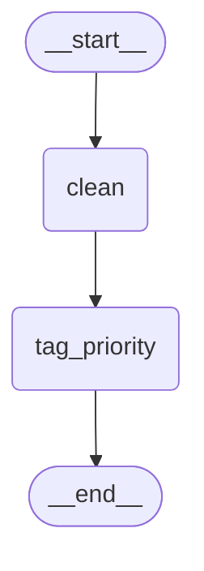

# 1.1 Your First Graph: State, Nodes and Edges

## The problem

Suppose you write a support-ticket pipeline in plain Python. The first version is a chain of calls:

```python
clean_text = clean(text)
priority = tag_priority(clean_text)
```

That works until the pipeline grows. Soon you want to route tickets to different queues, retry a step that failed, stop and wait for a human, or resume after a crash. Each new requirement means more glue code: a dict that collects intermediate results, `if` statements that decide what runs next, and code to save and restore all of it. The steps themselves stay simple. The trouble is the code around them that carries data between steps and decides the order.

LangGraph takes that glue code over. You describe the pipeline as data: which values it carries, which steps exist and how they connect. LangGraph then runs it. The official overview calls LangGraph a low-level orchestration framework and runtime for long-running, stateful agents. This course gets to agents later. The model underneath them is the subject of this lesson: a graph with shared state, and in our first graph there is no LLM at all.

## The concept

A LangGraph graph has three parts.

**State.** The data the run carries, as one dict that every step can read. Its shape is the [state schema](../../../GLOSSARY.md#state-schema): a type that lists the keys the state may hold. Usually it is a `TypedDict`. The schema is a contract. LangGraph creates one storage slot (a *channel*) for each key and knows nothing about keys outside it.

**Nodes.** The steps. A node is an ordinary function that takes the current state and returns a dict of the keys it wants to change. That return value is a [partial update](../../../GLOSSARY.md#partial-update): it lists only the changed keys, never the whole state. LangGraph merges it into the state, and every key the node did not mention keeps its value.

**Edges.** The order. An edge `A → B` says "after A finishes, run B". Two virtual nodes mark the boundaries. [START](../../../GLOSSARY.md#start) is where the input enters the graph, and [END](../../../GLOSSARY.md#end) is where the run stops. An edge from `START` decides which node runs first.

You build these parts with a [StateGraph](../../../GLOSSARY.md#stategraph). It is a *builder*: you give it the schema, then register nodes with `add_node` and edges with `add_edge`. A builder cannot run anything. `compile()` checks the wiring and returns a [CompiledStateGraph](../../../GLOSSARY.md#compiledstategraph), and that object is what you run with `invoke()` or `stream()`. The official Graph API page says you must compile a graph before you can use it.

The mental model: **nodes do not call each other and do not pass data to each other.** Each node reads from the shared state and writes back to it. The edges alone decide who runs next. A node never needs to know which node comes before or after it, which is why you can add, remove or reorder steps without touching the node functions.

## How it works

A run of a linear graph goes like this:

1. `invoke(input)` writes the input dict into the state. Only keys from the schema are kept.
2. LangGraph follows the edge from `START` and calls that node with the current state.
3. The node returns a partial update. LangGraph writes each returned key into its channel. With no special merge rule configured, the new value simply replaces the old one.
4. LangGraph follows the node's outgoing edge and repeats step 3 for the next node.
5. When the edge leads to `END`, the run stops and `invoke()` returns the final state as a dict.

Step 3 needs one more word. Each key can have a *reducer*, a function that combines the old and the new value, for example by appending to a list. Our state has no reducers, so every key uses the default rule: the last write wins. Reducers come in a later module. For now, remember that returning a key means "replace this value".

## In our example

The storyline of this course is *ticket-router*: a support system that takes raw tickets and, lesson by lesson, learns to clean, classify, route and answer them. In this first step a ticket passes through two nodes.

The diagram below was generated from the code with `graph.get_graph().draw_mermaid()`, with the styling removed. It shows the whole structure: entry, two nodes, exit.



All of the graph code is in [graph.py](../src/l1_1_hello_graph/graph.py). The [code walkthrough](readalong.md#graphpy) goes through it piece by piece. Here we look at how it maps onto the concepts.

**The state schema** has three keys. `text` comes from the caller, and each node fills in one of the other two:

<!-- snippet: src/l1_1_hello_graph/graph.py#state -->
```python
class TicketState(TypedDict):
    """The shared state every node reads from and writes to.

    Each key becomes a channel in the graph. With no reducer attached, a value
    a node returns for a key simply replaces the old value.
    """

    text: str  # the raw ticket text, as the customer typed it
    clean_text: str  # written by the clean node
    priority: str  # written by the tag_priority node: "high" or "normal"
```
<!-- /snippet -->

`TicketState` is a plain `TypedDict` with all three keys required, yet the graph is invoked with only `{"text": ...}`. That works because LangGraph uses the schema to learn which keys exist. It does not check at run time that every key is present. A key that no one has written yet is simply absent from the state.

**The nodes** are plain functions. Look at what each one returns:

<!-- snippet: src/l1_1_hello_graph/graph.py#clean_node -->
```python
def clean(state: TicketState) -> dict[str, str]:
    """Collapse whitespace and lowercase the raw text into clean_text."""
    # str.split() with no argument splits on any run of whitespace (spaces,
    # newlines, tabs) and drops leading/trailing whitespace.
    clean_text = " ".join(state["text"].split()).lower()
    # Return only the key this node owns: a partial update. LangGraph merges
    # it into the state, so "text" stays untouched.
    return {"clean_text": clean_text}
```
<!-- /snippet -->

<!-- snippet: src/l1_1_hello_graph/graph.py#tag_priority_node -->
```python
def tag_priority(state: TicketState) -> dict[str, str]:
    """Set priority to "high" if clean_text holds an urgent keyword."""
    # clean_text is available here because the clean node ran first and its
    # update was already merged into the state.
    is_urgent = any(word in state["clean_text"] for word in URGENT_KEYWORDS)
    return {"priority": "high" if is_urgent else "normal"}
```
<!-- /snippet -->

`clean` returns `{"clean_text": ...}` and nothing else. It does not copy `text` into its result, and it does not need to, because the merge keeps `text` as it was. `tag_priority` reads `state["clean_text"]`, a key it did not write. It can rely on that key because an edge makes it run after `clean`, so `clean`'s update is already in the state. Each node owns one key. That division of ownership is the habit to build from the first lesson on.

**The wiring** is done in `build_graph`:

<!-- snippet: src/l1_1_hello_graph/graph.py#build_graph -->
```python
def build_graph() -> CompiledStateGraph:
    """Wire the nodes into a linear graph and compile it."""
    # The builder takes the state schema; it defines which keys exist.
    builder = StateGraph(TicketState)

    # Register each node under a string name. Order of add_node does not
    # decide what runs; only edges do.
    builder.add_node("clean", clean)
    builder.add_node("tag_priority", tag_priority)

    # START and END are the graph's virtual entry and exit points.
    builder.add_edge(START, "clean")
    builder.add_edge("clean", "tag_priority")
    builder.add_edge("tag_priority", END)

    # compile() validates the wiring (entry point, unknown node names) and
    # returns a runnable graph with invoke() and stream().
    return builder.compile()
```
<!-- /snippet -->

`add_node` registers a function under a name, and from then on edges refer to the name, not to the function. The three `add_edge` calls are the whole control flow. `compile()` returns the runnable graph.

> [!NOTE]
> `builder.set_entry_point("clean")` does the same as `add_edge(START, "clean")`. In 1.2.16 its docstring says exactly that, and it is not deprecated, although some tutorials claim it is. This course uses `add_edge(START, ...)` because it is what the official docs show and it keeps all the wiring in one style.

**Running the graph.** [\_\_main\_\_.py](../src/l1_1_hello_graph/__main__.py) builds the graph once and uses it in three ways. First it prints the structure:

<!-- snippet: src/l1_1_hello_graph/__main__.py#draw_mermaid -->
```python
# get_graph() returns a drawable view of the compiled graph.
print("== Graph (Mermaid) ==")
print(graph.get_graph().draw_mermaid())
```
<!-- /snippet -->

`get_graph()` returns a description of the compiled graph's nodes and edges, and `draw_mermaid()` renders it as Mermaid text. Nothing runs and nothing goes over the network. Then it runs two tickets to the end:

<!-- snippet: src/l1_1_hello_graph/__main__.py#invoke -->
```python
# invoke() runs the graph to the end and returns the final state.
# We pass only "text"; the nodes fill in clean_text and priority.
print("== invoke() ==")
for ticket in SAMPLE_TICKETS:
    print(graph.invoke({"text": ticket}))
```
<!-- /snippet -->

Finally it runs a third ticket with `stream(..., stream_mode="updates")`, which yields what each node returned as soon as that node finishes:

<!-- snippet: src/l1_1_hello_graph/__main__.py#stream_updates -->
```python
# stream_mode="updates" yields one {node_name: partial_update} per step,
# which shows exactly what each node returned.
print("\n== stream(stream_mode='updates') ==")
for update in graph.stream({"text": "  Refund   please "}, stream_mode="updates"):
    print(update)
```
<!-- /snippet -->

Streaming has a module of its own later in the course. Here it serves one purpose: it makes the partial updates visible.

## Run it

From the course root, run `./run.sh 1.1`. This is the output of the verified run:

```text
== Graph (Mermaid) ==
---
config:
  flowchart:
    curve: linear
---
graph TD;
	__start__([<p>__start__</p>]):::first
	clean(clean)
	tag_priority(tag_priority)
	__end__([<p>__end__</p>]):::last
	__start__ --> clean;
	clean --> tag_priority;
	tag_priority --> __end__;
	classDef default fill:#f2f0ff,line-height:1.2
	classDef first fill-opacity:0
	classDef last fill:#bfb6fc

== invoke() ==
{'text': '  The site is DOWN,\n  please fix ASAP!  ', 'clean_text': 'the site is down, please fix asap!', 'priority': 'high'}
{'text': 'How do I change my   email address?', 'clean_text': 'how do i change my email address?', 'priority': 'normal'}

== stream(stream_mode='updates') ==
{'clean': {'clean_text': 'refund please'}}
{'tag_priority': {'priority': 'high'}}
```

What to notice:

- **The Mermaid block** has the same three edges as the `add_edge` calls. `START` and `END` are drawn as `__start__` and `__end__`, which are the string values of those constants. The program uses no LLM and no clock, so every run prints exactly this.
- **`invoke()` returns the whole final state**, though the input had only `text`. The other two keys were merged in by the nodes.
- **`text` is unchanged**, newline and extra spaces included. No node returned `text`, so no node replaced it. This is the partial update at work.
- **The stream shows one item per node**, shaped `{node_name: update}`. Each update holds exactly one key, the one that node owns. The state evolves like this:

  | After | `text` | `clean_text` | `priority` |
  |---|---|---|---|
  | input | `'  Refund   please '` | (absent) | (absent) |
  | `clean` | unchanged | `'refund please'` | (absent) |
  | `tag_priority` | unchanged | unchanged | `'high'` |

## Details and edge cases

**Keys outside the schema are dropped silently.** When a node returns a dict, LangGraph keeps only the keys the schema knows (in 1.2.16 this filter is in `CompiledStateGraph.attach_node`). The same goes for the input: `graph.invoke({"text": "hi", "extra": 1})` returns no `extra` key. There is no warning in either case. This makes the schema the single place where the state's shape is defined, and it also turns a typo into a silent bug (see the first experiment).

**The schema is not validated at run time.** Type hints like `text: str` document intent. LangGraph does not enforce them for a `TypedDict`. If you call `graph.invoke({})`, the graph starts and `clean` fails with `KeyError: 'text'` when it reads `state["text"]`. A node should either rely on a key that an earlier step is guaranteed to set, or read it with `state.get(...)`.

**Input values are overwritten like any other value.** `graph.invoke({"text": "hi", "priority": "low"})` returns `'priority': 'normal'`. The caller's value was in the state, then `tag_priority` wrote a new one, and the last write won.

**What a node may return.** A dict of updates, or `None` or `{}` to change nothing. A node that returns something else, such as a string, fails at run time with `InvalidUpdateError: Expected dict, got ...`.

**`compile()` checks names, not reachability.** It raises `ValueError` if no edge leaves `START`, or if an edge starts or ends at a name that was never registered with `add_node`. It does not complain about a node that no edge reaches. Such a node compiles fine and never runs (see the last experiment). The Graph API docs page says compiling checks for "no orphaned nodes", but in 1.2.16 `StateGraph.validate()` does not check reachability, so trust the behaviour you see here. The names `__start__` and `__end__` are reserved: `add_node("__end__", ...)` raises `ValueError: Node `__end__` is reserved.`

**Build once, run many times.** The compiled graph keeps no data between calls in this lesson: each `invoke()` starts from its own input. That is why `main` compiles once and reuses the graph for every ticket. (Keeping state between calls needs a checkpointer, which a later module covers.)

**Order of `add_node` calls does not matter.** Only the edges decide what runs and in what order. You could register `tag_priority` before `clean` and nothing would change.

## Common mistakes

> [!WARNING]
> **Returning the whole state from a node.** A habit from plain Python is to copy the input, change it and return the copy: `return {**state, "clean_text": ...}`. In LangGraph this writes every key again. It does no harm while the values are unchanged, but as soon as the node changes one by accident (the second experiment does this on purpose), it overwrites data another node owns, and once a key has a reducer that appends (later lessons), resending its old value can duplicate it. Return only the keys the node owns.

> [!WARNING]
> **A typo in a returned key.** `return {"prio": "high"}` raises no error. The update is dropped because `prio` is not in the schema, and the result simply lacks `priority`. When a value is mysteriously missing, compare the returned keys with the schema first.

> [!WARNING]
> **Forgetting `compile()`.** `StateGraph` has no `invoke()` method. Calling `builder.invoke(...)` fails with `AttributeError`. Compile first, then run the compiled graph.

> [!TIP]
> Print `graph.get_graph().draw_mermaid()` whenever you change the wiring. A missing or extra edge is easier to see in the picture than in a list of `add_edge` calls, and you can check it before running anything.

## Experiments

Each experiment starts from the lesson's original code. Make the change in [graph.py](../src/l1_1_hello_graph/graph.py), run `./run.sh 1.1` from the course root, and try to predict the result before you open the explanation.

1. In `tag_priority`, change the returned key from `"priority"` to `"prio"`: `return {"prio": "high" if is_urgent else "normal"}`.

   <details><summary>What happens and why</summary>

   The program runs without any error. Both `invoke()` results lack `priority`:

   ```text
   {'text': '  The site is DOWN,\n  please fix ASAP!  ', 'clean_text': 'the site is down, please fix asap!'}
   ```

   and the stream prints `{'tag_priority': None}` for the second node. The node did run, but LangGraph filtered its update against `TicketState`, found no known key and kept nothing. The schema is the contract, and LangGraph quietly drops anything outside it. Put the code back as it was (`git checkout -- .` in the lesson directory).

   </details>

2. In `clean`, return the whole state with a changed `text`: `return {**state, "text": "x", "clean_text": clean_text}`.

   <details><summary>What happens and why</summary>

   The priorities are still correct, but the original ticket text is gone:

   ```text
   {'text': 'x', 'clean_text': 'the site is down, please fix asap!', 'priority': 'high'}
   ```

   The stream shows the cause: `{'clean': {'text': 'x', 'clean_text': 'refund please'}}`. The node returned `text`, and with no reducer a returned value replaces the old one. A node that returns keys it does not own can destroy data. Put the code back as it was.

   </details>

3. Delete the line `builder.add_edge(START, "clean")`.

   <details><summary>What happens and why</summary>

   The program stops before printing anything, in `build_graph`:

   ```text
   ValueError: Graph must have an entrypoint: add at least one edge from START to another node
   ```

   `compile()` validates the wiring, and without an edge from `START` LangGraph does not know where the input should go. Wiring errors surface at compile time, before any ticket is processed. Put the code back as it was.

   </details>

4. Misspell the target of the middle edge: `builder.add_edge("clean", "tag_prio")`.

   <details><summary>What happens and why</summary>

   Again `compile()` fails:

   ```text
   ValueError: Found edge ending at unknown node `tag_prio`
   ```

   `add_edge` accepts any string and does not check it straight away. `compile()` then compares every edge end with the registered node names. Node names are plain strings, so this check is your safety net. Put the code back as it was.

   </details>

5. Replace the two lines `builder.add_edge("clean", "tag_priority")` and `builder.add_edge("tag_priority", END)` with a single `builder.add_edge("clean", END)`.

   <details><summary>What happens and why</summary>

   It compiles and runs. The Mermaid output still lists `tag_priority(tag_priority)`, but with no edge to or from it, the results have no `priority`, and the stream prints only `{'clean': {'clean_text': 'refund please'}}`. The node is registered but unreachable, and `compile()` does not treat that as an error. `add_node` only makes a step available. Edges decide whether and when it runs. Put the code back as it was.

   </details>

## Summary

- A LangGraph graph is **state + nodes + edges**. The state schema (a `TypedDict` here) lists the keys, nodes are functions, and edges set the order between `START` and `END`.
- A node returns a **partial update** with only the keys it owns. LangGraph merges it into the state, and without a reducer each returned key replaces the old value.
- Keys outside the schema are **dropped silently**, both in node updates and in the input.
- `StateGraph` is a builder. `compile()` checks the wiring (entry point, unknown names) and returns the runnable `CompiledStateGraph`.
- `invoke()` returns the final state. `stream(stream_mode="updates")` shows each node's update as it happens.
- `get_graph().draw_mermaid()` draws the compiled structure, so you can check the wiring before running.

## Self-check

1. `clean` returns only `{"clean_text": ...}`. Why does the final result still contain `text`?

   <details><summary>Answer</summary>

   The returned dict is a partial update. LangGraph writes the returned keys into the state and leaves every other key alone. `text` came from the input and no node returned it, so it keeps its original value.

   </details>

2. A node returns `{"priorty": "high"}`. What error do you get?

   <details><summary>Answer</summary>

   None. `priorty` is not in the state schema, so LangGraph drops the update silently and the result has no `priority` key. That is why typos in returned keys are hard to spot.

   </details>

3. You register three nodes with `add_node` but connect only two of them with edges. Does `compile()` fail?

   <details><summary>Answer</summary>

   No. `compile()` checks that an edge leaves `START` and that every edge refers to a registered node. An unreachable node is allowed. It just never runs.

   </details>

4. What is the difference between the `StateGraph` object and what `compile()` returns?

   <details><summary>Answer</summary>

   `StateGraph` is a builder: it collects the schema, nodes and edges, and it has no `invoke()`. `compile()` validates that description and returns a `CompiledStateGraph`, which you run with `invoke()` or `stream()` and inspect with `get_graph()`.

   </details>

5. In the `stream_mode="updates"` output, why does each item contain exactly one key?

   <details><summary>Answer</summary>

   Each item shows what one node returned, under that node's name. Each of our nodes returns only the single key it owns. A node that returned more keys would show more keys there, as the second experiment shows.

   </details>

## Further reading

- [Graph API overview](https://docs.langchain.com/oss/python/langgraph/graph-api), LangChain docs: state, schema, reducers, nodes, `START`/`END`, edges and compiling, with the sections this chapter relies on.
- [Use the Graph API](https://docs.langchain.com/oss/python/langgraph/use-graph-api), LangChain docs: how-to guide with defining state, node updates and visualizing a graph.
- [LangGraph overview](https://docs.langchain.com/oss/python/langgraph/overview), LangChain docs: what LangGraph is for and where it fits.
- [Streaming](https://docs.langchain.com/oss/python/langgraph/streaming), LangChain docs: the `updates` stream mode used here, covered in full later in the course.
- [The Simplest Graph](https://github.com/langchain-ai/langchain-academy/blob/main/module-1/simple-graph.ipynb), LangChain Academy, module 1: the same building blocks in an official course notebook (it adds a conditional edge, the subject of our next lesson).
- [langgraph 1.2.16 tests](https://github.com/langchain-ai/langgraph/tree/1.2.16/libs/langgraph/tests): executable specifications of graph construction and validation, at the version this course pins.
- [LangGraph Tutorial: Build a ReAct Agent With the v1.0 API](https://agentsindex.ai/blog/langgraph-tutorial), AgentsIndex: a beginner walkthrough of state, nodes, edges and `draw_mermaid()`. Read it with care: it calls `set_entry_point()` deprecated, which it is not in 1.2.16, and builds on the deprecated `create_react_agent`.
