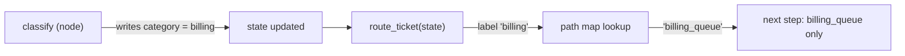
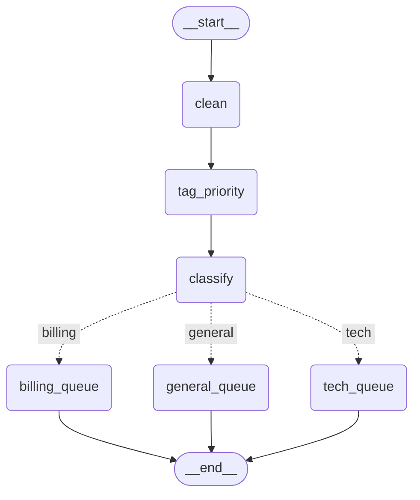

# 1.2 Conditional Edges and Routing

## The problem

In lesson 1.1 every ticket took the same path: `START → clean → tag_priority → END`. An edge `A → B` meant "after A, always run B". That is enough for a fixed pipeline, but a support system has to treat tickets differently. A refund request should reach the billing team, a login error the tech team, and everything else general support.

In plain Python you would write an `if`/`elif` chain and call a different function in each branch. You could do the same inside a single LangGraph node: one `handle_ticket` node that checks the text and builds the matching reply. That works, but the graph no longer shows what it does. The drawing has one box where there are really three paths. The stream reports one node no matter which team answered. And when lesson 1.3 needs to add a step to the tech path only, there is no tech path in the graph to add it to.

What we want is for the graph itself to branch: after a given node, look at the state and continue along exactly one of several paths, and still have every possible path declared up front, so it can be drawn and checked.

## The concept

A [conditional edge](../../../GLOSSARY.md#conditional-edge) is an edge whose destination is decided at run time. You add one with `add_conditional_edges(source, path, path_map)`:

- **`source`** is the node the edge leaves from, here `"classify"`.
- **`path`** is a [routing function](../../../GLOSSARY.md#routing-function). LangGraph calls it with the state after `source` has finished. It returns a *label*: a value that says where to go next. It does not return a [partial update](../../../GLOSSARY.md#partial-update), and it does not change the state.
- **`path_map`** is the optional [path map](../../../GLOSSARY.md#path-map), a dict from labels to node names. LangGraph looks the label up in it to find the next node.

The path map has two jobs, and both matter:

1. **Translation.** The routing function can speak the language of the domain (`"billing"`, `"tech"`, `"general"`), and the path map turns those words into node names (`"billing_queue"`, ...). Renaming a node then means changing one dict entry, not the routing logic.
2. **Declaration.** The map lists every place the edge can lead. `compile()` uses that list to check that each destination is a real node, and `get_graph()` uses it to draw one arrow per destination. Without such a list, LangGraph cannot know where the edge goes until it actually runs.

If you leave the path map out, LangGraph looks for the list somewhere else: the routing function's return annotation. When it is a `typing.Literal`, for example `-> Literal["billing_queue", "tech_queue"]`, LangGraph treats each listed value as a node name. When there is neither a path map nor a `Literal`, the destinations are unknown before run time. You lose both the check and the drawing.

The mental model: **a node decides, an edge directs.** In our graph, the `classify` node makes the decision and writes it into the state as `category`, so it is part of the result and can be tested like any other node. The routing function only reads that decision and turns it into a direction. It holds no business logic of its own.

## How it works

The diagram below shows what happens around `classify` in one run. Note that the routing function is part of the edge, not a node of its own.



Step by step:

1. `classify` runs and returns `{"category": "billing"}`.
2. Still in the same step, LangGraph calls `route_ticket` with the state as it is after `classify`'s update. That is why `state["category"]` is already set when the routing function reads it.
3. `route_ticket` returns the label `"billing"`.
4. LangGraph looks `"billing"` up in the path map and gets `"billing_queue"`.
5. Only `billing_queue` is scheduled for the next step. `tech_queue` and `general_queue` do not run at all.

In 1.2.16 this logic lives in `BranchSpec` in `langgraph/graph/_branch.py`. Its `_finish` method does the lookup with a plain `self.ends[r]`, which is why a label missing from the path map ends in a `KeyError` (see the experiments).

Compare this with plain edges. A node may have several outgoing plain edges, and then *all* of them fire: every target runs in the next step. Plain edges can fan out, but they cannot choose. Choosing one path among several takes a conditional edge.

## In our example

The ticket-router from lesson 1.1 gets a `classify` node and three queue nodes. The diagram below was generated from the code with `graph.get_graph().draw_mermaid()`, with the styling removed. It is the same Mermaid text the program prints when you run it.



Plain edges are drawn as solid arrows. The conditional edge is drawn as three dotted arrows, one per path-map entry, each labelled with its key. The drawing knows about all three paths only because the path map declares them.

All the code is in [graph.py](../src/l1_2_conditional_edges/graph.py), and the [code walkthrough](readalong.md#graphpy) goes through it line by line. `clean` and `tag_priority` are unchanged from 1.1. Here we look at the new parts.

**The state** gets two new keys, one for the decision and one for the outcome:

<!-- snippet: src/l1_2_conditional_edges/graph.py#state -->
```python
class TicketState(TypedDict):
    """The shared state every node reads from and writes to.

    Each key becomes a channel in the graph. With no reducer attached, a value
    a node returns for a key simply replaces the old value.
    """

    text: str  # the raw ticket text, as the customer typed it
    clean_text: str  # written by the clean node
    priority: str  # written by the tag_priority node: "high" or "normal"
    category: Category  # written by the classify node
    reply: str  # written by whichever queue node ran
```
<!-- /snippet -->

**The decision** is a normal node. It returns only the key it owns:

<!-- snippet: src/l1_2_conditional_edges/graph.py#classify_node -->
```python
def classify(state: TicketState) -> dict[str, str]:
    """Write the ticket's category: billing, then tech, otherwise general."""
    text = state["clean_text"]
    # Order matters: a ticket that mentions both a payment and an error is
    # treated as a billing ticket because billing is checked first.
    if any(word in text for word in BILLING_KEYWORDS):
        category = "billing"
    elif any(word in text for word in TECH_KEYWORDS):
        category = "tech"
    else:
        category = "general"
    # The decision is stored in the state, so it shows up in the final result
    # and in the stream, and it can be tested on its own.
    return {"category": category}
```
<!-- /snippet -->

The order of the checks is the tie-break rule: a ticket that mentions both a payment and an error goes to billing. Because this is a node, the rule is easy to test on its own, and its result, `category`, appears in the output.

**The routing function** only reads that decision:

<!-- snippet: src/l1_2_conditional_edges/graph.py#route_ticket -->
```python
def route_ticket(state: TicketState) -> Category:
    """Return the route label for the conditional edge out of classify."""
    # A routing function returns a destination label, not a state update.
    # It only reads the state and never changes it; the decision itself was
    # recorded by the classify node so it is visible in the result and
    # testable.
    return state["category"]
```
<!-- /snippet -->

Two things set it apart from a node. Its return value is a label, not a dict. And it is never registered with `add_node`, so it has no name in the graph and never shows up in the stream. Its return type, `Category`, is the alias `Literal["billing", "tech", "general"]` defined at the top of the file. With a path map present, LangGraph does not need the annotation, so here it serves as documentation: a reader sees the three possible labels in the signature. The state key `category` uses the same alias, so a type checker can confirm that `route_ticket` returns one of the three labels.

**The queue nodes** each write a fixed reply:

<!-- snippet: src/l1_2_conditional_edges/graph.py#queue_nodes -->
```python
def billing_queue(state: TicketState) -> dict[str, str]:
    """Answer a billing ticket with the billing team's fixed reply."""
    return {"reply": "Billing team: we will check your invoice."}


def tech_queue(state: TicketState) -> dict[str, str]:
    """Answer a tech ticket with the tech team's fixed reply."""
    return {"reply": "Tech team: we are looking into the problem."}


def general_queue(state: TicketState) -> dict[str, str]:
    """Answer any other ticket with the support team's fixed reply."""
    return {"reply": "Support team: thanks, we will get back to you."}
```
<!-- /snippet -->

All three write the same key, `reply`. That is safe only because exactly one of them runs per ticket. Recall from 1.1 that a key without a reducer keeps the last value written. If two nodes wrote `reply` in the same step, there would be no "last" one, and LangGraph raises an error instead (the fifth experiment shows this).

**The wiring** puts it together:

<!-- snippet: src/l1_2_conditional_edges/graph.py#build_graph -->
```python
def build_graph() -> CompiledStateGraph:
    """Wire the nodes into a graph with one conditional edge and compile it."""
    # The builder takes the state schema; it defines which keys exist.
    builder = StateGraph(TicketState)

    # Register each node under a string name. Order of add_node does not
    # decide what runs; only edges do.
    builder.add_node("clean", clean)
    builder.add_node("tag_priority", tag_priority)
    builder.add_node("classify", classify)
    builder.add_node("billing_queue", billing_queue)
    builder.add_node("tech_queue", tech_queue)
    builder.add_node("general_queue", general_queue)

    # START and END are the graph's virtual entry and exit points.
    builder.add_edge(START, "clean")
    builder.add_edge("clean", "tag_priority")
    builder.add_edge("tag_priority", "classify")

    # After classify, LangGraph calls route_ticket and follows exactly one
    # path. The path map translates the labels route_ticket returns into node
    # names and declares every possible destination, so compile() can check
    # them and get_graph() can draw them. The Literal return type documents
    # the same labels and is what LangGraph would use as destinations if
    # there were no path map.
    builder.add_conditional_edges(
        "classify",
        route_ticket,
        {"billing": "billing_queue", "tech": "tech_queue", "general": "general_queue"},
    )

    # Whichever queue node ran, the graph ends after it.
    builder.add_edge("billing_queue", END)
    builder.add_edge("tech_queue", END)
    builder.add_edge("general_queue", END)

    # compile() validates the wiring (entry point, unknown node names) and
    # returns a runnable graph with invoke() and stream().
    return builder.compile()
```
<!-- /snippet -->

`tag_priority` now leads to `classify` instead of `END`. Nothing connects to the queue nodes with `add_edge`: the conditional edge is their only way in. Each queue node has its own plain edge to [END](../../../GLOSSARY.md#end), because whichever one ran, the run is over after it.

## Run it

From the course root, run `./run.sh 1.2`. This is the output of the verified run:

```text
== Graph (Mermaid) ==
---
config:
  flowchart:
    curve: linear
---
graph TD;
	__start__([<p>__start__</p>]):::first
	clean(clean)
	tag_priority(tag_priority)
	classify(classify)
	billing_queue(billing_queue)
	tech_queue(tech_queue)
	general_queue(general_queue)
	__end__([<p>__end__</p>]):::last
	__start__ --> clean;
	classify -. &nbsp;billing&nbsp; .-> billing_queue;
	classify -. &nbsp;general&nbsp; .-> general_queue;
	classify -. &nbsp;tech&nbsp; .-> tech_queue;
	clean --> tag_priority;
	tag_priority --> classify;
	billing_queue --> __end__;
	general_queue --> __end__;
	tech_queue --> __end__;
	classDef default fill:#f2f0ff,line-height:1.2
	classDef first fill-opacity:0
	classDef last fill:#bfb6fc

== invoke() ==
{'text': 'I was charged twice, please refund me', 'clean_text': 'i was charged twice, please refund me', 'priority': 'high', 'category': 'billing', 'reply': 'Billing team: we will check your invoice.'}
{'text': 'The app shows an error on login', 'clean_text': 'the app shows an error on login', 'priority': 'normal', 'category': 'tech', 'reply': 'Tech team: we are looking into the problem.'}
{'text': 'Do you have a dark mode?', 'clean_text': 'do you have a dark mode?', 'priority': 'normal', 'category': 'general', 'reply': 'Support team: thanks, we will get back to you.'}

== stream(stream_mode='updates') ==
{'clean': {'clean_text': 'refund please'}}
{'tag_priority': {'priority': 'high'}}
{'classify': {'category': 'billing'}}
{'billing_queue': {'reply': 'Billing team: we will check your invoice.'}}
```

What to notice:

- **The Mermaid block** has dotted, labelled arrows only out of `classify`. The labels are the path-map keys, the targets are the path-map values. The edges are not printed in the order `build_graph` added them, so compare by content, not by position. The program uses no LLM and no clock, so every run prints exactly this.
- **Each `invoke()` result** names its route twice: `category` says why, and `reply` says which queue node ran. The three tickets cover all three paths, so one run exercises every branch.
- **Priority and category are independent.** The first ticket is `high` because of "refund", which is also a billing word. The decisions come from different keyword lists in different nodes.
- **The stream has four updates, not six.** `route_ticket` does not appear, because it is part of the edge. `tech_queue` and `general_queue` do not appear, because they never ran. Here is how the state evolves for the streamed ticket:

  | After | `clean_text` | `priority` | `category` | `reply` |
  |---|---|---|---|---|
  | input | (absent) | (absent) | (absent) | (absent) |
  | `clean` | `'refund please'` | (absent) | (absent) | (absent) |
  | `tag_priority` | unchanged | `'high'` | (absent) | (absent) |
  | `classify` | unchanged | unchanged | `'billing'` | (absent) |
  | `billing_queue` | unchanged | unchanged | unchanged | `'Billing team: ...'` |

## Details and edge cases

**Edge or node: where does routing belong?** Put the *decision* in a node and the *direction* in a conditional edge, as this lesson does. Doing everything in one node with an `if` inside hides the branches from the drawing, the stream and later extensions. Doing the decision inside the routing function is also a trap: the routing function cannot store anything in the state. If it returns a dict, LangGraph does not merge it. It tries to use it as a label, and the run fails with `TypeError: unhashable type: 'dict'`. So a category computed there would be lost, and nobody could see why a ticket went where it went. The official Graph API page draws the same line: use conditional edges to route without changing state. When a node needs to update the state *and* choose the next node in one step, LangGraph offers `Command`, which lesson 3.3 covers.

**Three ways to declare destinations.** The third argument of `add_conditional_edges` accepts:

- a dict from labels to node names, as in our code;
- a list of node names, meaning each label is already a node name. The official quickstart writes `add_conditional_edges("llm_call", should_continue, ["tool_node", END])`;
- nothing, in which case LangGraph reads a `Literal` return annotation from the routing function.

A `Literal` return type and a path map are not combined. If there is a path map, LangGraph uses it and ignores the annotation. That is why our `Category` labels need no matching nodes.

**When labels equal node names, the arrows have no label.** With a list or a `Literal` of node names, `draw_mermaid()` draws plain dotted arrows such as `a -.-> b;`. Labels appear only when the label differs from the node name, as with our dict.

**Routing to the end.** A routing function may return `END` (the string `"__end__"`) to stop the run. Declare it like any other destination: `Literal["tool_node", "__end__"]` (the quickstart writes `Literal["tool_node", END]`), or `END` as a value in the path map.

**`compile()` checks the declared destinations, not the routing function.** It verifies that every path-map value (or `Literal` value) is a registered node. It cannot know which labels the routing function will actually return. A label that is missing from the path map fails only at run time, with a `KeyError` raised "during task with name 'classify'", and only for a ticket that takes that route. This is why the tests run one ticket down every branch.

**Undeclared destinations are not checked at all.** With no path map and no `Literal`, an unknown node name does not raise an exception. In 1.2.16 LangGraph logs a warning on stderr ("wrote to unknown channel branch:to:..., ignoring it") and the run simply stops. The docstring of `add_conditional_edges` warns that without a `Literal` return type or a path map, "the graph visualization assumes the edge could transition to any node in the graph". In practice, in 1.2.16 the drawing we got shows a single `classify --> __end__` arrow and leaves the queue nodes unconnected (third experiment).

**Do not mix plain and conditional edges out of the same node.** If `classify` also had `add_edge("classify", "general_queue")`, the plain edge would fire on every run, in addition to the path the routing function picks. The Graph API page warns about this, and in 1.2.16 a billing or tech ticket ends in the same `InvalidUpdateError` as the fifth experiment, because two queue nodes write `reply` in one step. A general ticket runs fine, since both edges lead to the same node.

**A routing function may return several labels.** Returning a list such as `["billing", "tech"]` schedules all the listed nodes for the same next step, which runs them in parallel. Our queue nodes would then collide on `reply`. Parallel branches and how to combine their results are the subject of module 3.

**Branching right at the entry.** `add_conditional_edges(START, route)` is allowed and picks the first node at run time. The routing function then sees only the input.

## Common mistakes

> [!WARNING]
> **A path map that misses a label.** Adding a fourth category to `classify` but forgetting the path map compiles fine and works for the old categories. The first ticket with the new category fails with `KeyError`. Keep the `Literal` alias, the labels `classify` writes and the path map in sync, and test every branch.

> [!WARNING]
> **Returning node names with no `Literal` and no path map.** It works as long as every name is right, so the problem stays hidden. A typo does not raise an exception. It logs a warning, ends the run early and leaves keys like `reply` missing. Always declare destinations, with a `Literal` return type or a path map.

> [!WARNING]
> **Using plain edges to branch.** Three `add_edge` calls out of one node do not mean "one of these three". They mean "all three". Branching needs `add_conditional_edges`.

> [!WARNING]
> **Updating the state in the routing function.** A routing function returns a label, and anything it computes is gone after the edge is taken. Compute in a node, write the result to the state, and let the routing function read it.

> [!TIP]
> Keep routing functions short enough to read at a glance, ideally a lookup of a value a node already wrote. All the branching logic then lives in nodes, where it shows up in the stream and can be tested directly, as `test_billing_checked_before_tech` does in [test_graph.py](../tests/test_graph.py).

## Experiments

Each experiment starts from the lesson's original code. Make the change in [graph.py](../src/l1_2_conditional_edges/graph.py), run `./run.sh 1.2` from the course root, and try to predict the result before you open the explanation.

1. In `build_graph`, delete the path map, leaving `builder.add_conditional_edges("classify", route_ticket)`.

   <details><summary>What happens and why</summary>

   The program stops in `build_graph`, before printing anything:

   ```text
   ValueError: At 'classify' node, 'route_ticket' branch found unknown target 'billing'
   ```

   Without a path map, LangGraph falls back to `route_ticket`'s return annotation. `Category` is `Literal["billing", "tech", "general"]`, so it treats `billing`, `tech` and `general` as node names, and `compile()` finds no node called `billing`. Either name the labels after the nodes or keep the path map. Put the code back as it was (`git checkout -- .` in the lesson directory).

   </details>

2. Make `route_ticket` return `"sales"` for general tickets, and keep the path map: add `if state["category"] == "general": return "sales"` before the existing `return`.

   <details><summary>What happens and why</summary>

   The graph compiles and the drawing is unchanged. The first two `invoke()` results print as usual, then the dark-mode ticket fails:

   ```text
   KeyError: 'sales'
   During task with name 'classify' and id '...'
   ```

   (The task id differs on every run.) `compile()` checked the path-map values, which are all real nodes. It cannot check what the routing function returns. The lookup of `"sales"` fails when it happens, as part of the `classify` task, and only for a ticket that takes that route. With a path map an unknown label is a loud error, but you still need a test for every branch to see it before your users do. Put the code back as it was.

   </details>

3. Make `route_ticket` return node names directly: change its return type to `str`, its body to `return state["category"] + "_queue"`, and delete the path map. Run it. Then also add `if state["category"] == "general": return "sales_queue"` before that `return`, and run it again.

   <details><summary>What happens and why</summary>

   The first run routes every ticket correctly, and `invoke()` and the stream print exactly as before. But the drawing has changed. The edges are now:

   ```text
   	__start__ --> clean;
   	clean --> tag_priority;
   	tag_priority --> classify;
   	classify --> __end__;
   ```

   The three queue nodes are still listed but have no arrows. With neither a `Literal` nor a path map, LangGraph does not know where the edge can go, so it cannot draw or check the destinations.

   The second run raises no exception. Only a warning appears on stderr:

   ```text
   Task classify with path ('__pregel_pull', 'classify') wrote to unknown channel branch:to:sales_queue, ignoring it.
   ```

   The dark-mode result is `{'text': 'Do you have a dark mode?', 'clean_text': 'do you have a dark mode?', 'priority': 'normal', 'category': 'general'}`, with no `reply`. The run just stopped after `classify`. This is the worst kind of routing bug: wrong and quiet. Declaring destinations turns it into a compile-time or run-time error. Put the code back as it was.

   </details>

4. Delete the `"general": "general_queue"` entry from the path map.

   <details><summary>What happens and why</summary>

   The drawing loses the `classify -. &nbsp;general&nbsp; .-> general_queue;` arrow and the `general_queue --> __end__;` edge. `general_queue` is still listed, but nothing leads to it. The billing and tech tickets work, and the dark-mode ticket fails with `KeyError: 'general'`. The path map is the complete list of where the edge may go, for the drawing and for the run. Put the code back as it was.

   </details>

5. Replace the `add_conditional_edges(...)` call with three plain edges: `builder.add_edge("classify", "billing_queue")`, `builder.add_edge("classify", "tech_queue")` and `builder.add_edge("classify", "general_queue")`.

   <details><summary>What happens and why</summary>

   It compiles, and the drawing shows three solid arrows such as `classify --> billing_queue;`. Then the first `invoke()` fails:

   ```text
   langgraph.errors.InvalidUpdateError: At key 'reply': Can receive only one value per step. Use an Annotated key to handle multiple values.
   ```

   Plain edges always fire, so after `classify` all three queue nodes run in the same step, and all three write `reply`. A key without a reducer accepts one value per step, so LangGraph refuses the update. Because `invoke()` already fails, the stream section never runs. To see the fan-out, also delete the `# region invoke` block in [\_\_main\_\_.py](../src/l1_2_conditional_edges/__main__.py) and run again. The stream then prints the `classify` update, all three queue updates, and the same error. Only a conditional edge picks one path. Put the code back as it was.

   </details>

## Summary

- A **conditional edge** chooses its destination at run time. After the source node finishes, LangGraph calls the **routing function** with the updated state and follows only the path it picks.
- A routing function returns a **label**, not a state update. Make the decision in a node, store it in the state, and let the routing function only read it.
- The **path map** translates labels into node names and declares every possible destination. Without one, a `Literal` return type plays the declaring role, with the labels taken as node names.
- Declared destinations are checked by `compile()` and drawn by `get_graph()`. A label missing from the path map fails at run time, only on that route, so test every branch.
- With no declaration at all, an unknown destination is not an error: the run quietly stops with a logged warning.
- Plain edges out of one node all fire. Only a conditional edge picks one of several paths.

## Self-check

1. `route_ticket` reads `state["category"]`, but `classify` runs in the same step. Why is the value already there?

   <details><summary>Answer</summary>

   LangGraph calls the routing function after the source node has finished, with the state that includes that node's update. The routing function is part of the edge out of `classify`, so it always sees what `classify` just wrote.

   </details>

2. Our `route_ticket` is annotated `-> Literal["billing", "tech", "general"]`, and there is no node called `billing`. Why does `compile()` not complain?

   <details><summary>Answer</summary>

   Because the path map is given. LangGraph takes the destinations from the path map (`billing_queue`, `tech_queue`, `general_queue`), and those are real nodes. The `Literal` annotation is used only when there is no path map, and then its values must be node names, as the first experiment shows.

   </details>

3. You add a category `"sales"` to `classify` and forget the path map. When do you find out?

   <details><summary>Answer</summary>

   Only when a ticket is classified as `"sales"`. `compile()` passes because every path-map value is a node, and the other tickets route fine. The sales ticket fails with `KeyError: 'sales'` at run time. A test that sends one ticket down each branch catches it early.

   </details>

4. Why not compute the category inside `route_ticket` and drop the `classify` node?

   <details><summary>Answer</summary>

   A routing function cannot write to the state: its return value is used as a label, and a dict is not even accepted (`TypeError: unhashable type: 'dict'`). The category would not appear in the result or the stream, and the next lessons could not read it. A node owns the decision and records it, and the edge only follows it.

   </details>

5. What is the difference between three `add_edge` calls out of `classify` and one `add_conditional_edges` call with three destinations?

   <details><summary>Answer</summary>

   Three plain edges all fire, so all three queue nodes run in the same step (and here they collide on `reply`). A conditional edge with three declared destinations runs exactly the one the routing function picks.

   </details>

## Further reading

- [Graph API overview: Conditional edges](https://docs.langchain.com/oss/python/langgraph/graph-api#conditional-edges), LangChain docs: routing functions, the optional path map, conditional entry points, and the warning against mixing plain and conditional edges. The same page compares conditional edges with `Command`.
- [Use the Graph API: Create branches](https://docs.langchain.com/oss/python/langgraph/use-graph-api#create-branches), LangChain docs: a how-to example of conditional branching with a `Literal` return type.
- [LangGraph quickstart](https://docs.langchain.com/oss/python/langgraph/quickstart), LangChain docs: an agent whose `should_continue` routing function returns `"tool_node"` or `END`, declared as a list path map.
- [The Simplest Graph](https://github.com/langchain-ai/langchain-academy/blob/main/module-1/simple-graph.ipynb), LangChain Academy, module 1: a minimal conditional edge with a `Literal` return type (`decide_mood`).
- [`langgraph/graph/_branch.py` at 1.2.16](https://github.com/langchain-ai/langgraph/blob/1.2.16/libs/langgraph/langgraph/graph/_branch.py): how a conditional edge reads the `Literal` annotation and looks labels up in the path map, at the version this course pins.
- [langgraph 1.2.16 tests](https://github.com/langchain-ai/langgraph/tree/1.2.16/libs/langgraph/tests): executable specifications of graph construction and validation, including conditional edges, at the pinned version.
