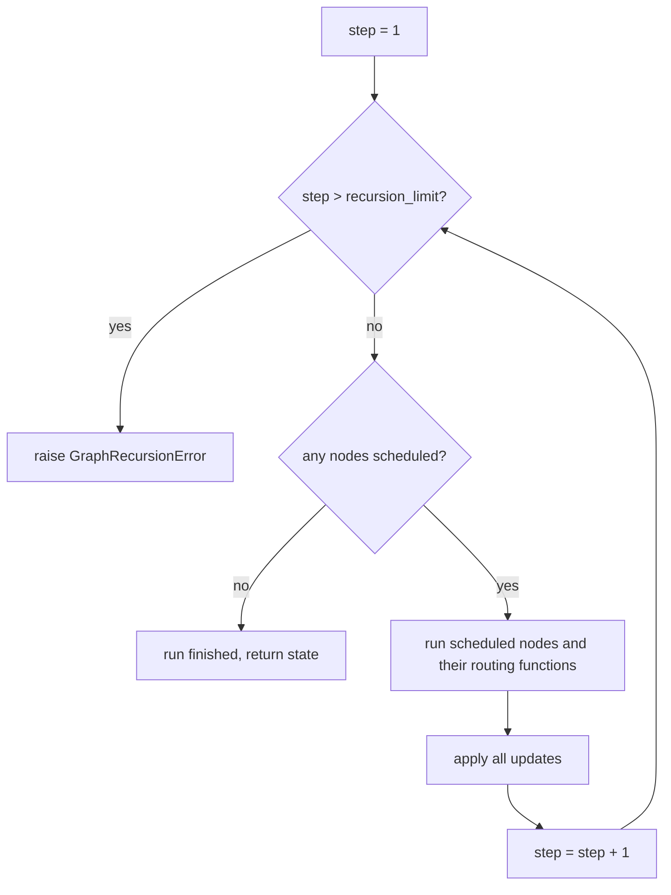
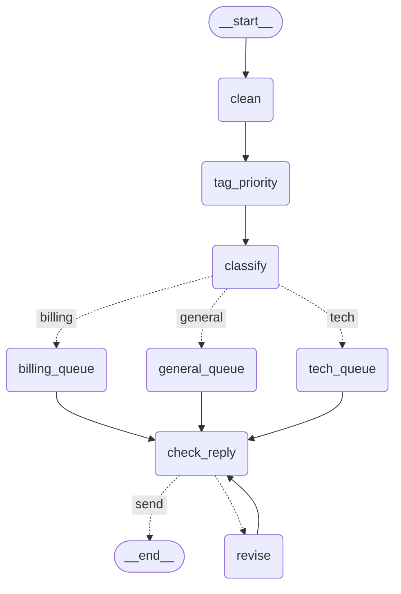

# 1.3 Loops, Super-steps and the Recursion Limit

## The problem

So far every run of the ticket router has gone forward only. In lesson 1.2 a ticket passed `clean`, `tag_priority` and `classify`, took one branch of the [conditional edge](../../../GLOSSARY.md#conditional-edge), and the queue node it reached sent it to `END`. Each node ran at most once, so the run had to end.

Real work is often not like that. A reply is drafted, checked, fixed and checked again. An agent calls a tool, looks at the result and decides whether to call another one. In both cases the same steps repeat until a condition holds, and you can't know in advance how many rounds that takes. In plain Python you would write a `while` loop. In a graph, a loop is an edge that goes back to a node that already ran.

That raises two questions this lesson answers. How does LangGraph run a graph that has a cycle in it, and what counts as one "step" of such a run? And what stops a loop that never meets its exit condition, for example because a reviser keeps producing a draft that fails the check? A `while True` in plain Python simply hangs. A LangGraph run doesn't, but the way it stops is something you need to plan for.

## The concept

**Cycles are allowed.** Graphs in LangGraph do not have to be acyclic. You close a loop with an ordinary edge that points backwards, a [back edge](../../../GLOSSARY.md#back-edge), and `compile()` accepts it without comment. LangGraph does not check whether a loop can end. Ending it is your job, and you do it the way lesson 1.2 taught: a conditional edge whose [routing function](../../../GLOSSARY.md#routing-function) picks between "go round again" and "leave". This was a deliberate choice. In the essay *Building LangGraph*, Nuno Campos explains that DAG-based frameworks were ruled out because an agent's computation graph is cyclical.

**A run is a sequence of super-steps.** LangGraph runs a graph in rounds, called [super-steps](../../../GLOSSARY.md#super-step). In each super-step it does three things:

1. It finds the nodes that are scheduled to run in this super-step: the targets of the edges that fired in the previous one.
2. It runs all of them (and their routing functions). Each node sees the state as it was at the start of the super-step.
3. It applies all their [partial updates](../../../GLOSSARY.md#partial-update) to the state together, and then the next super-step begins.

The run ends when a super-step finds nothing to run. Nodes that run one after another are in separate super-steps. Nodes that run in parallel share one, which module 3 covers. In this lesson each super-step runs exactly one node, so you can read "super-step" as "one node call" for now, but the counter counts super-steps, not node calls.

The model comes from Google's Pregel system (Malewicz et al., 2010). In Pregel, a computation is "a sequence of iterations, called supersteps" (section 1). A vertex can read the messages sent to it in the previous superstep and send messages that arrive in the next one (sections 2 and 3.1), and the computation ends when every vertex has voted to halt and no messages are in transit (section 2). LangGraph's nodes play the role of vertices, writes to the state play the role of messages, and "no node scheduled" plays the role of "everyone voted to halt". The Graph API docs describe LangGraph's runtime the same way.

**Every run has a step budget.** Pregel trusts the algorithm to halt. LangGraph adds a safety net, because a loop driven by an LLM or by buggy routing may never converge. The [recursion_limit](../../../GLOSSARY.md#recursion_limit) key in the run config caps how many super-steps one run may take. When a run reaches the limit and the graph still has not finished, LangGraph raises [GraphRecursionError](../../../GLOSSARY.md#graphrecursionerror) from `langgraph.errors`. The name is historical: nothing recurses in the Python sense, but the class does subclass Python's built-in `RecursionError`.

**A graph can see its budget.** The limit is a hard stop: when it hits, `invoke()` raises and you get no result back. To end a loop *gracefully* before that, a node or routing function needs to know how many super-steps are left. LangGraph provides that number as a [managed value](../../../GLOSSARY.md#managed-value): a state key that LangGraph computes itself before each call instead of storing it in a channel. You declare it by giving a key the type [`RemainingSteps`](../../../GLOSSARY.md#remainingsteps) from `langgraph.managed`. Nodes can't write it, the caller doesn't pass it, and it is not part of the result.

The mental model: **a routing function ends the loop when the work is done, `RemainingSteps` lets it end the loop early when time is running out, and `recursion_limit` ends the run by force when both fail.**

## How it works

The diagram below shows the loop LangGraph runs for one `invoke()` call without a checkpointer, as it works in 1.2.16. Look at where the limit check sits: before LangGraph looks for more work.



The first node of a run executes in super-step 1. LangGraph puts the number in `config["metadata"]["langgraph_step"]`, and the docs show how to read it inside a node. The managed value `RemainingSteps` is computed from the same counter. In 1.2.16, for super-step $s$ of a run with limit $L$:

$$
\text{remaining} = L - s
$$

So the first node sees $L - 1$, and the value drops by one each super-step. The node that runs when the value has reached 0 is the last thing that can run: after it the counter moves to $L + 1$, the check `step > recursion_limit` fails, and LangGraph raises, *even if the graph would have ended there anyway*. That leads to the rule worth remembering:

> [!IMPORTANT]
> A run whose nodes take $N$ super-steps needs `recursion_limit` of at least $N + 1$. A one-node graph fails with `recursion_limit=1` and works with 2. The limit counts the check that finds "nothing left to run" as well.

You can see all of this in the source. `RemainingStepsManager.get` in `langgraph/managed/is_last_step.py` returns `scratchpad.stop - scratchpad.step`, and `PregelLoop.tick` in `langgraph/pregel/_loop.py` starts with the `if self.step > self.stop` check that sets the status `out_of_steps`. `Pregel.stream` turns that status into the `GraphRecursionError`.

**The default limit.** If you don't pass `recursion_limit`, LangGraph 1.2.16 uses 10007. The value is `DEFAULT_RECURSION_LIMIT` in `langgraph/_internal/_config.py`, and the environment variable `LANGGRAPH_DEFAULT_RECURSION_LIMIT` overrides it. The Graph API page says the default has been 1000 since 1.0.6, and older tutorials and forum posts say 25. Neither matches the installed 1.2.16 source, which is what your code runs on. Either way, don't build on the default: if a loop matters, pass a limit that fits it.

## In our example

The ticket router now treats each queue node's reply as a first draft. A new `check_reply` node lists the rules the draft still breaks: it must start with a greeting, carry an urgent note when the ticket is high priority, and end with a sign-off. A new `revise` node fixes one of those problems and goes back to `check_reply`. The diagram below was generated from the code with `graph.get_graph().draw_mermaid()`, with the styling removed.



The cycle is `check_reply -.-> revise` (dotted, because it is one path of a conditional edge) together with `revise --> check_reply` (solid, a plain back edge). The arrow to `revise` has no label because the label `"revise"` equals the node name, a rule you met in 1.2.

Everything before the queue nodes is unchanged from 1.2. The whole file is [graph.py](../src/l1_3_loops_and_recursion_limit/graph.py), and the [code walkthrough](readalong.md#graphpy) goes through it line by line. Here we look at how the new parts map onto the concepts.

**The state** gets two keys:

<!-- snippet: src/l1_3_loops_and_recursion_limit/graph.py#state -->
```python
class TicketState(TypedDict):
    """The shared state every node reads from and writes to.

    Each key becomes a channel in the graph. With no reducer attached, a value
    a node returns for a key simply replaces the old value.
    """

    text: str  # the raw ticket text, as the customer typed it
    clean_text: str  # written by the clean node
    priority: str  # written by the tag_priority node: "high" or "normal"
    category: Category  # written by the classify node
    reply: str  # written by whichever queue node ran, then by revise
    problems: list[str]  # written by check_reply: rules the reply still breaks
    # A managed value: LangGraph fills it in before every node and routing
    # function with how many super-steps are left before the recursion limit.
    # The caller never passes it, and it does not appear in the result.
    remaining_steps: RemainingSteps
```
<!-- /snippet -->

`problems` is an ordinary key: `check_reply` writes it, and each write replaces the whole list. `remaining_steps` is the managed value. When `StateGraph` reads the schema, it sees the `RemainingSteps` annotation and registers a managed value instead of a channel. That is why none of the printed results contains a `remaining_steps` key, and why passing one in the input has no effect.

**The check** only reads the reply and reports:

<!-- snippet: src/l1_3_loops_and_recursion_limit/graph.py#check_reply_node -->
```python
def check_reply(state: TicketState) -> dict[str, list[str]]:
    """List the rules the current reply still breaks, in a fixed order."""
    reply = state["reply"]
    problems: list[str] = []
    if not reply.startswith(GREETING):
        problems.append("greeting")
    if state["priority"] == "high" and URGENT_NOTE not in reply:
        problems.append("urgent_note")
    if not reply.endswith(SIGN_OFF):
        problems.append("sign_off")
    # Only the list is returned; the reply itself is left as it is. An empty
    # list means the draft is ready to send.
    return {"problems": problems}
```
<!-- /snippet -->

**The revision** fixes one problem per pass:

<!-- snippet: src/l1_3_loops_and_recursion_limit/graph.py#revise_node -->
```python
def revise(state: TicketState) -> dict[str, str]:
    """Fix only the first listed problem and return the improved reply."""
    # Fixing one problem per pass stands in for a reviser that improves a
    # draft step by step, so the loop really runs several rounds. The check
    # after each pass decides whether another round is needed.
    reply = state["reply"]
    first = state["problems"][0]
    if first == "greeting":
        reply = GREETING + " " + reply
    elif first == "urgent_note":
        reply = reply + " " + URGENT_NOTE
    elif first == "sign_off":
        reply = reply + " " + SIGN_OFF
    # Only "reply" is returned. "problems" is now stale until check_reply runs
    # again, which is why the back edge to check_reply matters.
    return {"reply": reply}
```
<!-- /snippet -->

Fixing only the first problem stands in for a real reviser, say an LLM, that improves a draft a bit at a time, so the loop really runs several rounds. Note what `revise` does *not* return: `problems`. After `revise` runs, `problems` still describes the old reply. Only the next `check_reply` makes it correct again. Each node writes only the keys it is responsible for (`reply` is written by both the queue node and `revise`, `problems` only by `check_reply`), and the loop is what keeps the two keys consistent.

**The exit condition** is a routing function with two reasons to leave:

<!-- snippet: src/l1_3_loops_and_recursion_limit/graph.py#route_after_check -->
```python
def route_after_check(state: TicketState) -> Literal["revise", "send"]:
    """Decide whether the reply goes out or gets another revision round."""
    # Like route_ticket, this function only reads the state.
    if not state["problems"]:
        return "send"
    # remaining_steps is readable here too, not only in nodes. If another
    # round would not fit before the recursion limit, leave the loop
    # gracefully and send the best draft so far; the remaining problems stay
    # listed in the state.
    if state["remaining_steps"] <= STEPS_PER_REVISION:
        return "send"
    return "revise"
```
<!-- /snippet -->

The first `if` is the normal exit: the reply passes every rule. The second is the guard. One more round costs two super-steps (`revise`, then `check_reply`), which is the constant `STEPS_PER_REVISION = 2` at the top of the file. The router runs in the same super-step as `check_reply` and sees the same `remaining_steps`. Suppose it sees $r$. Then `revise` would run with $r - 1$ left and the next `check_reply` with $r - 2$. That second call must not be the one that runs at 0, so it needs $r - 2 \geq 1$, that is $r \geq 3$. Hence the rule "send when `remaining_steps <= 2`". When the guard fires, the reply goes out unfinished, and the problems it still has stay listed in the state for the caller to see.

**The wiring** adds one conditional edge and the back edge:

<!-- snippet: src/l1_3_loops_and_recursion_limit/graph.py#build_graph -->
```python
def build_graph() -> CompiledStateGraph:
    """Wire the nodes into a graph with a routing step and a revision loop."""
    # The builder takes the state schema; it defines which keys exist.
    builder = StateGraph(TicketState)

    # Register each node under a string name. Order of add_node does not
    # decide what runs; only edges do.
    builder.add_node("clean", clean)
    builder.add_node("tag_priority", tag_priority)
    builder.add_node("classify", classify)
    builder.add_node("billing_queue", billing_queue)
    builder.add_node("tech_queue", tech_queue)
    builder.add_node("general_queue", general_queue)
    builder.add_node("check_reply", check_reply)
    builder.add_node("revise", revise)

    # START and END are the graph's virtual entry and exit points.
    builder.add_edge(START, "clean")
    builder.add_edge("clean", "tag_priority")
    builder.add_edge("tag_priority", "classify")

    # After classify, LangGraph calls route_ticket and follows exactly one
    # path. The path map translates the labels route_ticket returns into node
    # names and declares every possible destination, so compile() can check
    # them and get_graph() can draw them. The Literal return type documents
    # the same labels and is what LangGraph would use as destinations if
    # there were no path map.
    builder.add_conditional_edges(
        "classify",
        route_ticket,
        {"billing": "billing_queue", "tech": "tech_queue", "general": "general_queue"},
    )

    # Whichever queue node ran, its draft reply goes to check_reply.
    builder.add_edge("billing_queue", "check_reply")
    builder.add_edge("tech_queue", "check_reply")
    builder.add_edge("general_queue", "check_reply")

    # After check_reply, either send the reply (END) or revise it once more.
    builder.add_conditional_edges(
        "check_reply", route_after_check, {"revise": "revise", "send": END}
    )

    # This back edge is what makes the cycle: after revise, check_reply runs
    # again. LangGraph allows cycles; compile() does not reject them. What
    # stops a cycle is a routing decision, or else the recursion limit.
    builder.add_edge("revise", "check_reply")

    # compile() validates the wiring (entry point, unknown node names) and
    # returns a runnable graph with invoke() and stream().
    return builder.compile()
```
<!-- /snippet -->

The [path map](../../../GLOSSARY.md#path-map) maps `"send"` to `END`, so the routing function speaks the domain's language ("send this reply") and the map says where that leads. The last `add_edge` is the back edge. Without it, nothing would bring the revised reply back to the check.

**Watching the super-steps.** [\_\_main\_\_.py](../src/l1_3_loops_and_recursion_limit/__main__.py) numbers each streamed update:

<!-- snippet: src/l1_3_loops_and_recursion_limit/__main__.py#stream_updates -->
```python
# stream_mode="updates" yields one {node_name: partial_update} per step.
# In this graph every super-step runs exactly one node, so one update is
# one super-step; the numbers match LangGraph's own langgraph_step.
print("\n== stream(stream_mode='updates') ==")
for step, update in enumerate(
    graph.stream({"text": "  Refund   please "}, stream_mode="updates"), start=1
):
    print(f"step {step}: {update}")
```
<!-- /snippet -->

That numbering is only valid because no super-step in this graph runs two nodes. In a graph with parallel branches, one super-step would produce several updates.

**Hitting the limit on purpose.** The last section runs the urgent billing ticket with two small limits:

<!-- snippet: src/l1_3_loops_and_recursion_limit/__main__.py#recursion_limit -->
```python
# recursion_limit caps the number of super-steps in one run. The guard in
# route_after_check turns a too-small limit into an early, graceful stop,
# but it cannot help if the limit is too small to even reach the loop:
# then LangGraph raises GraphRecursionError.
print("\n== recursion_limit ==")
for limit in (9, 5):
    try:
        result = graph.invoke({"text": SAMPLE_TICKETS[0]}, {"recursion_limit": limit})
    except GraphRecursionError as error:
        first_line = str(error).splitlines()[0]
        print(f"recursion_limit={limit}: GraphRecursionError: {first_line}")
    else:
        print(
            f"recursion_limit={limit}: reply={result['reply']!r} problems={result['problems']}"
        )
```
<!-- /snippet -->

`recursion_limit` goes in the config, the second argument of `invoke()`, at the top level. It applies to that one call. The compiled graph does not change, so one `graph` object serves both limits.

## Run it

From the course root, run `./run.sh 1.3`. This is the output of the verified run:

```text
== Graph (Mermaid) ==
---
config:
  flowchart:
    curve: linear
---
graph TD;
	__start__([<p>__start__</p>]):::first
	clean(clean)
	tag_priority(tag_priority)
	classify(classify)
	billing_queue(billing_queue)
	tech_queue(tech_queue)
	general_queue(general_queue)
	check_reply(check_reply)
	revise(revise)
	__end__([<p>__end__</p>]):::last
	__start__ --> clean;
	billing_queue --> check_reply;
	check_reply -. &nbsp;send&nbsp; .-> __end__;
	check_reply -.-> revise;
	classify -. &nbsp;billing&nbsp; .-> billing_queue;
	classify -. &nbsp;general&nbsp; .-> general_queue;
	classify -. &nbsp;tech&nbsp; .-> tech_queue;
	clean --> tag_priority;
	general_queue --> check_reply;
	revise --> check_reply;
	tag_priority --> classify;
	tech_queue --> check_reply;
	classDef default fill:#f2f0ff,line-height:1.2
	classDef first fill-opacity:0
	classDef last fill:#bfb6fc

== invoke() ==
{'text': 'I was charged twice, please refund me', 'clean_text': 'i was charged twice, please refund me', 'priority': 'high', 'category': 'billing', 'reply': 'Hi there! Billing team: we will check your invoice. We are treating this as urgent. Best regards, Support.', 'problems': []}
{'text': 'The app shows an error on login', 'clean_text': 'the app shows an error on login', 'priority': 'normal', 'category': 'tech', 'reply': 'Hi there! Tech team: we are looking into the problem. Best regards, Support.', 'problems': []}
{'text': 'Do you have a dark mode?', 'clean_text': 'do you have a dark mode?', 'priority': 'normal', 'category': 'general', 'reply': 'Hi there! Support team: thanks, we will get back to you. Best regards, Support.', 'problems': []}

== stream(stream_mode='updates') ==
step 1: {'clean': {'clean_text': 'refund please'}}
step 2: {'tag_priority': {'priority': 'high'}}
step 3: {'classify': {'category': 'billing'}}
step 4: {'billing_queue': {'reply': 'Billing team: we will check your invoice.'}}
step 5: {'check_reply': {'problems': ['greeting', 'urgent_note', 'sign_off']}}
step 6: {'revise': {'reply': 'Hi there! Billing team: we will check your invoice.'}}
step 7: {'check_reply': {'problems': ['urgent_note', 'sign_off']}}
step 8: {'revise': {'reply': 'Hi there! Billing team: we will check your invoice. We are treating this as urgent.'}}
step 9: {'check_reply': {'problems': ['sign_off']}}
step 10: {'revise': {'reply': 'Hi there! Billing team: we will check your invoice. We are treating this as urgent. Best regards, Support.'}}
step 11: {'check_reply': {'problems': []}}

== recursion_limit ==
recursion_limit=9: reply='Hi there! Billing team: we will check your invoice.' problems=['urgent_note', 'sign_off']
recursion_limit=5: GraphRecursionError: Recursion limit of 5 reached without hitting a stop condition. You can increase the limit by setting the `recursion_limit` config key.
```

What to notice:

- **The Mermaid block** has the cycle in it: `check_reply -.-> revise;` and `revise --> check_reply;`. No queue node leads to `__end__` any more. The only way out is the `send` path. The program uses no LLM and no clock, so every run prints exactly this.
- **The `invoke()` results** all end with `'problems': []` and contain no `remaining_steps`. The final state doesn't show how many rounds a ticket took. The billing ticket needed three fixes, the other two needed two (no urgent note, because their priority is `normal`).
- **The stream** shows the loop unrolled: four super-steps to reach the queue, the first check, then three `revise`/`check_reply` rounds, one per problem, 11 super-steps in all. `route_after_check` never appears, because it is part of the edge, as `route_ticket` was in 1.2. The default limit of 10007 leaves plenty of room.
- **`recursion_limit=9`** stops gracefully after one round. The table shows what the router saw at each check:

  | Super-step | Node | `remaining_steps` (limit 9) | Router decides |
  |---|---|---|---|
  | 5 | `check_reply` | 4 | 3 problems, 4 > 2: `revise` |
  | 6 | `revise` | 3 | |
  | 7 | `check_reply` | 2 | 2 problems, but 2 <= 2: `send` |

  The run ends after super-step 7. In super-step 8 the counter is still within the limit, LangGraph finds nothing to run, and `invoke()` returns the partly revised reply with the two problems still listed.
- **`recursion_limit=5`** raises. The first `check_reply` already runs in super-step 5 with `remaining_steps == 0`. The router does choose `send`, and the graph would end, but a node that ran with 0 remaining is the last one allowed, so the limit check raises anyway. The guard can only shorten the loop. It cannot make room for the four super-steps before it. The program prints only the first line of the message. The second line is a link to the troubleshooting page `GRAPH_RECURSION_LIMIT`.

## Details and edge cases

**The limit is per call.** `recursion_limit` counts the super-steps of one `invoke()` or `stream()` call, starting from 1 each time. When a later module adds a checkpointer and a run resumes on a thread, the budget restarts for the new call. It is not a total across the thread.

**Put it at the top level of the config.** The Graph API page notes that `recursion_limit` must not go inside the `configurable` key. In 1.2.16, `{"configurable": {"recursion_limit": 5}}` is silently ignored: the urgent billing ticket then finishes all three rounds under the default limit, with no warning.

**`recursion_limit` must be at least 1.** A value of 0 or less raises `ValueError: recursion_limit must be at least 1` before any node runs.

**Catching the error loses the run's work.** `GraphRecursionError` is raised out of `invoke()`, so there is no return value. Whatever the loop achieved is gone, unless a checkpointer saved it (module 5). That is why this lesson uses `RemainingSteps`: the docs call it proactive handling, as opposed to reactively catching the error outside the graph. Use the error as a last-resort alarm, not as a way to end a loop.

**Routing functions see `RemainingSteps` too.** The docs show it read in a node. In 1.2.16 a routing function receives the same state, managed value included, and in our graph it reads the same number as the `check_reply` call it belongs to. Because the decision is a pure read, it lives naturally in the routing function. Nothing needs to be written to the state.

**Testing with managed values.** When you call `route_after_check` directly, as `test_route_after_check` in [test_graph.py](../tests/test_graph.py) does, no LangGraph runtime is involved, so nobody fills in `remaining_steps`. The test passes it by hand. Only a running graph computes it.

**`IsLastStep`.** The same module exports `IsLastStep`, a yes/no managed value. In 1.2.16 it is `True` when `remaining_steps` is 1: this is the last super-step after which the run can still end normally. Any node scheduled after it would run with 0 steps left, and the run raises. So a routing function that sees `True` must end the run at once and schedule nothing more. That makes `IsLastStep` a usable guard only for a loop whose round is a single super-step, a node that routes back to itself. Any longer round runs out of steps in the middle. Take an agent that calls a tool and comes back (agent → tools → agent): a round costs two super-steps, exactly like our revise → check_reply. A router on the agent that ends on `IsLastStep` works only when the agent happens to land on the step with 1 left. With `recursion_limit=5` it does not: the agent runs with 4, 2 and then 0 steps left (the tools node gets the step with 1), so the run raises `GraphRecursionError` before the router ever sees `True`. For such loops, use `RemainingSteps` with a threshold equal to the round's cost, as our guard does with its threshold of 2.

**A loop costs super-steps per round, not per loop.** The budget a loop needs grows with the number of rounds times the nodes per round, plus everything before and after the loop. Count it as you would count the cost of a `while` loop: our refund ticket needs $4 + 1 + 3 \times 2 = 11$ super-steps, so `recursion_limit` 12 or more.

**Cycles still need a declared exit.** Everything from 1.2 still applies inside a loop. The path map must contain every label the routing function can return, including the one that leaves. A routing function that never returns `"send"` makes the loop end only through the guard or the limit.

## Common mistakes

> [!WARNING]
> **Off by one.** A run of $N$ super-steps needs `recursion_limit` of $N + 1$, not $N$. Our refund ticket takes 11 super-steps and fails with a limit of 11 (fifth experiment). The same off-by-one sinks a guard that counts a round as one super-step when it really costs two (second experiment).

> [!WARNING]
> **Treating the recursion limit as a loop budget.** Raising the limit to make a `GraphRecursionError` go away hides a loop that does not converge. And when the error is the only exit, every run that hits it throws its work away. Give the loop its own exit: a condition that ends it when the work is done, and a `RemainingSteps` check that ends it when the budget is nearly used up.

> [!WARNING]
> **Forgetting the back edge.** If the edge `revise → check_reply` is missing, `compile()` raises nothing and the run quietly ends after one revision, with a stale `problems` list. A node without an outgoing edge simply ends the run, and the drawing shows it as `revise --> __end__`.

> [!WARNING]
> **Trusting the default you read about.** Tutorials quote 25, the docs quote 1000, and langgraph 1.2.16 uses 10007. A loop that never converges runs for over 10,000 super-steps before the default stops it. For loops that call an LLM, that's a lot of calls. Pass an explicit `recursion_limit` sized to the job.

> [!TIP]
> When a run raises `GraphRecursionError`, stream it with `stream_mode="updates"` and a small limit. The repeating pattern of node names shows you which cycle fails to exit, and the updates show which value fails to change.

## Experiments

Each experiment starts from the lesson's original code. Make the change in [graph.py](../src/l1_3_loops_and_recursion_limit/graph.py), run `./run.sh 1.3` from the course root, and try to predict the result before you open the explanation.

1. Delete the guard from `route_after_check`: remove the `if state["remaining_steps"] <= STEPS_PER_REVISION: return "send"` lines, keeping only the empty-problems check.

   <details><summary>What happens and why</summary>

   The first three sections print as before, since the default limit leaves plenty of room. In the last section both calls now raise:

   ```text
   recursion_limit=9: GraphRecursionError: Recursion limit of 9 reached without hitting a stop condition. You can increase the limit by setting the `recursion_limit` config key.
   recursion_limit=5: GraphRecursionError: Recursion limit of 5 reached without hitting a stop condition. You can increase the limit by setting the `recursion_limit` config key.
   ```

   Without the guard the router keeps revising until the reply is clean, which needs 11 super-steps, and 9 isn't enough. `recursion_limit` is a hard stop that raises and returns nothing. `RemainingSteps` is what lets the graph see the limit coming and leave the loop with a usable reply. Put the code back as it was (`git checkout -- .` in the lesson directory).

   </details>

2. Set `STEPS_PER_REVISION = 1`.

   <details><summary>What happens and why</summary>

   The normal runs are unchanged, but the `recursion_limit=9` call raises `GraphRecursionError` again. Follow the counter: the first `check_reply` runs in super-step 5 with 4 left, so the router starts a round. The second runs in super-step 7 with 2 left, and since 2 is greater than 1, the router starts another round. `revise` runs with 1 left, and `check_reply` with 0. The router then chooses `send`, too late: a node that ran with 0 remaining is the last one allowed, so LangGraph raises. A round really costs two super-steps, and counting it as one turns a graceful stop into a crash. Put the code back as it was.

   </details>

3. Make `revise` return the reply unchanged: replace its body with `return {"reply": state["reply"]}`. Then, in the lesson directory, start a Python shell with `env -u VIRTUAL_ENV uv run python` and run `from l1_3_loops_and_recursion_limit.graph import build_graph` and `build_graph().invoke({"text": "Refund please"})`. Then also delete the guard, as in experiment 1, and run the same call again.

   <details><summary>What happens and why</summary>

   The first call takes about a second (the time depends on your machine) and returns the untouched draft with all three problems:

   ```text
   {'text': 'Refund please', 'clean_text': 'refund please', 'priority': 'high', 'category': 'billing', 'reply': 'Billing team: we will check your invoice.', 'problems': ['greeting', 'urgent_note', 'sign_off']}
   ```

   The loop never converges. Only the guard ends it, after exactly 5000 rounds counted down from the default limit of 10007: a stream of that run has 10005 updates. Without the guard, the second call raises `GraphRecursionError: Recursion limit of 10007 reached without hitting a stop condition. ...`. The default is a large safety net, not a budget. When a loop may not converge, pass a small `recursion_limit` for each run. Put the code back as it was.

   </details>

4. Delete the back edge `builder.add_edge("revise", "check_reply")` from `build_graph`.

   <details><summary>What happens and why</summary>

   `compile()` accepts it, and nothing raises. The drawing now has `revise --> __end__;` in place of `revise --> check_reply;`. Every ticket stops after a single revision:

   ```text
   {'text': 'I was charged twice, please refund me', 'clean_text': 'i was charged twice, please refund me', 'priority': 'high', 'category': 'billing', 'reply': 'Hi there! Billing team: we will check your invoice.', 'problems': ['greeting', 'urgent_note', 'sign_off']}
   ```

   `problems` still lists `greeting`, although the reply now starts with "Hi there!", because `check_reply` never ran again. The stream ends with the `revise` update after six super-steps. A node without an outgoing edge just ends the run, so a missing back edge fails silently. Put the code back as it was.

   </details>

5. Delete the guard as in experiment 1, and change the limits in the `recursion_limit` section of [\_\_main\_\_.py](../src/l1_3_loops_and_recursion_limit/__main__.py) from `(9, 5)` to `(12, 11)`.

   <details><summary>What happens and why</summary>

   ```text
   recursion_limit=12: reply='Hi there! Billing team: we will check your invoice. We are treating this as urgent. Best regards, Support.' problems=[]
   recursion_limit=11: GraphRecursionError: Recursion limit of 11 reached without hitting a stop condition. You can increase the limit by setting the `recursion_limit` config key.
   ```

   The run needs 11 super-steps, yet a limit of 11 fails. The last `check_reply` runs in super-step 11 with `remaining_steps == 0`. Then LangGraph advances the counter to 12, checks it against the limit *before* it looks for more work, and raises. A run of $N$ super-steps needs a limit of at least $N + 1$. Put the code back as it was.

   </details>

## Summary

- A graph may contain **cycles**. A back edge closes the loop, `compile()` accepts it, and a routing function decides each round whether to continue or leave.
- LangGraph runs a graph in **super-steps**, a model taken from Pregel: run the scheduled nodes, apply their updates together, repeat until nothing is scheduled. Sequential nodes take one super-step each.
- **`recursion_limit`** (in the run config, per call) caps the super-steps of a run. Reaching it raises **`GraphRecursionError`**, and the run's result is lost. In 1.2.16 the default is 10007.
- A run of $N$ super-steps needs `recursion_limit` of at least $N + 1$, because the limit is checked before LangGraph looks for more work.
- The **`RemainingSteps`** managed value tells a node or routing function how many super-steps are left, so a loop can stop gracefully. Leave room for a whole round: our guard sends when 2 or fewer remain.

## Self-check

1. Our refund ticket takes 11 super-steps. What is the smallest `recursion_limit` that lets it finish without the guard, and why not 11?

   <details><summary>Answer</summary>

   12. The last node runs in super-step 11 with `remaining_steps == 0`. LangGraph then advances to step 12 and checks the limit before it looks for more work, so with a limit of 11 it raises even though nothing was left to do.

   </details>

2. In a graph where two nodes run in parallel after `START`, then one node after them, how many super-steps does a run take?

   <details><summary>Answer</summary>

   Two. Nodes that run in parallel share a super-step, so the two parallel nodes form step 1 and the node after them forms step 2. The limit counts super-steps, not node calls.

   </details>

3. Why does `route_after_check` send when `remaining_steps <= 2`, rather than when it is 0 or 1?

   <details><summary>Answer</summary>

   A new round takes two super-steps: `revise` runs with one fewer step left, and `check_reply` with two fewer. The `check_reply` must not run with 0 left, because the node that runs at 0 is the last one before the error. So a round may start only when at least 3 steps remain.

   </details>

4. With `recursion_limit=5` the guard chooses `send`, yet the run still raises. Why can't the guard save it?

   <details><summary>Answer</summary>

   The first `check_reply` runs in super-step 5, with 0 steps remaining, because the four super-steps before the loop already used most of the budget. Choosing `send` would end the graph, but the node that ran at 0 is the last one allowed, so the limit check raises anyway. A guard can shorten a loop. It can't make room for the work before it.

   </details>

5. Why doesn't `remaining_steps` appear in the dicts that `invoke()` returns?

   <details><summary>Answer</summary>

   It is a managed value, not a channel. LangGraph computes it before each node and routing function call from the limit and the current step. It is never stored, so it is not part of the final state, and a value passed in the input is ignored.

   </details>

## Further reading

- [Graph API overview](https://docs.langchain.com/oss/python/langgraph/graph-api), LangChain docs: the "Graphs" section on super-steps and message passing, and "Recursion limit" with `langgraph_step` and `RemainingSteps` under runtime context. Its default of 1000 does not match the 1.2.16 source.
- [GRAPH_RECURSION_LIMIT](https://docs.langchain.com/oss/python/langgraph/errors/GRAPH_RECURSION_LIMIT), LangChain docs: the troubleshooting page linked from the error message.
- [Building LangGraph: Designing an Agent Runtime from first principles](https://langchain.com/blog/building-langgraph), Nuno Campos, LangChain blog: why LangGraph needed cycles and how its plan, execute, update loop follows Pregel.
- [Pregel: A System for Large-Scale Graph Processing](https://cs.princeton.edu/courses/archive/spring16/cos598F/pregel_paper.pdf), Malewicz et al., SIGMOD 2010: sections 1 and 2 define supersteps and halting, section 3.1 the message timing.
- [`langgraph/_internal/_config.py` at 1.2.16](https://github.com/langchain-ai/langgraph/blob/1.2.16/libs/langgraph/langgraph/_internal/_config.py): `DEFAULT_RECURSION_LIMIT` and its environment variable.
- [`langgraph/managed/is_last_step.py` at 1.2.16](https://github.com/langchain-ai/langgraph/blob/1.2.16/libs/langgraph/langgraph/managed/is_last_step.py): how `RemainingSteps` and `IsLastStep` are computed.
- [`langgraph/pregel/_loop.py` at 1.2.16](https://github.com/langchain-ai/langgraph/blob/1.2.16/libs/langgraph/langgraph/pregel/_loop.py): `PregelLoop.tick` and its limit check.
- [langgraph 1.2.16 tests](https://github.com/langchain-ai/langgraph/tree/1.2.16/libs/langgraph/tests): executable specifications of the runtime, including recursion limits, at the pinned version.
