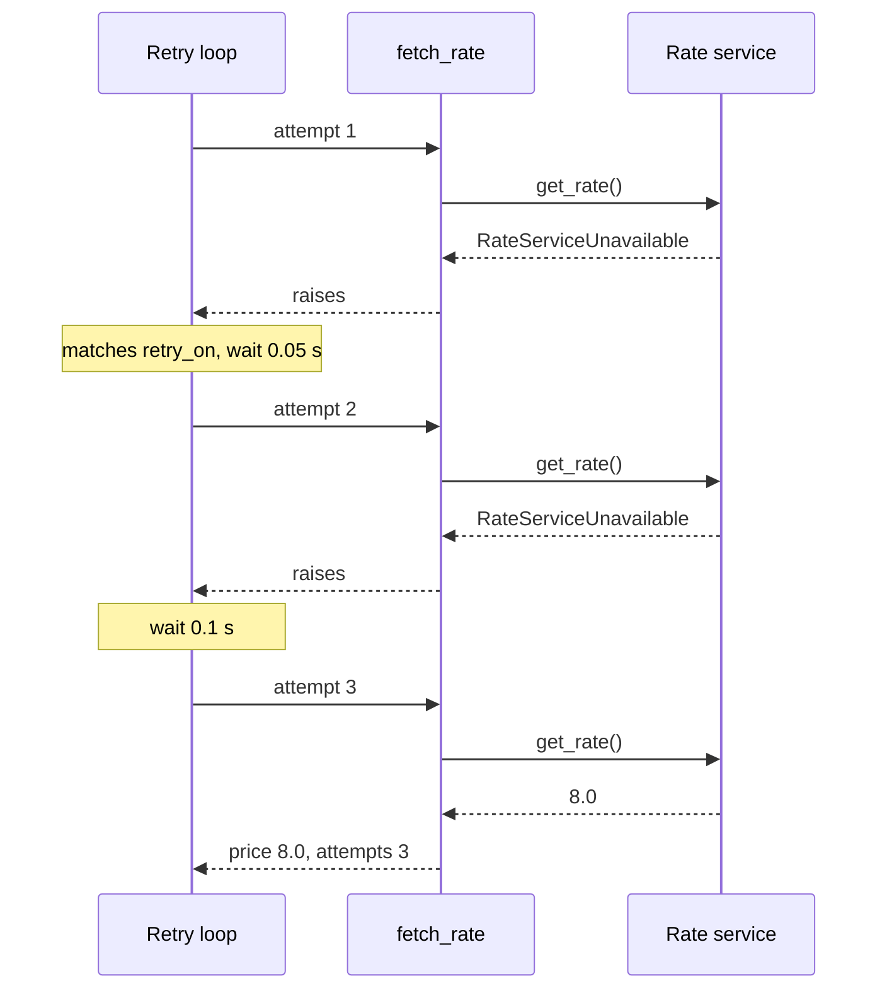
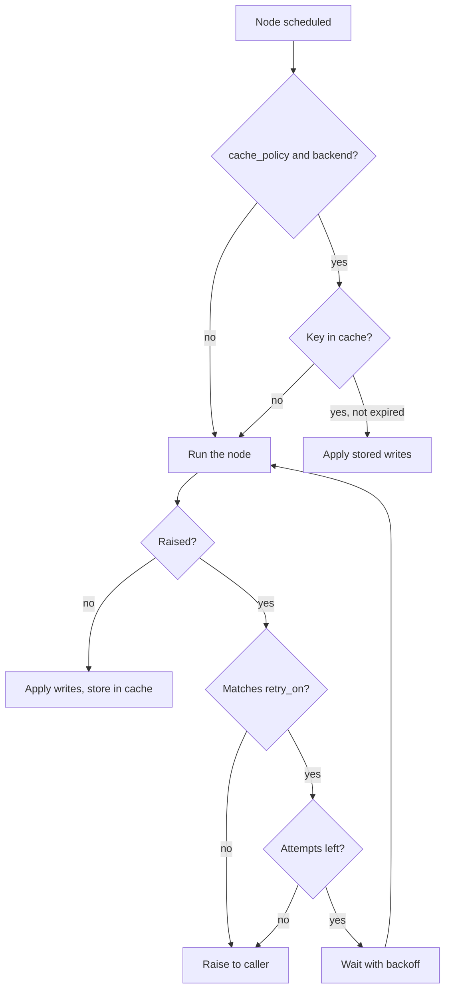

# 10.1 Retry and Cache Policies

## The problem

Every graph so far called only code that ran in the same process: plain functions, fake chat models, in-memory stores. Production nodes call other systems: a geocoding API, a pricing service, a model provider, a database. Those calls go wrong in two ways that local code never does.

They **fail for reasons that have nothing to do with your request.** A connection drops, a load balancer answers 503 while a pod restarts, a provider returns "rate limited" for a few seconds. Send the same request a moment later and it works. Without help, one such hiccup in one node fails the whole run. `ainvoke` raises, and the work of every node before it is lost.

They are also **slow or expensive.** A geocoding call costs money and takes hundreds of milliseconds. If ten quotes for the same address come in, ten identical lookups are wasted.

You could solve both inside the node, with a `for` loop around the call, a `try/except` and a dict of earlier results. Every node that talks to the outside would then have its own copy of that loop, each slightly different. LangGraph moves both concerns out of the node body into two per-node settings: a **retry policy** and a **cache policy**. The node stays a plain function that does its one job.

## The concept

### Retry policy

A [RetryPolicy](../../../GLOSSARY.md#retrypolicy) tells LangGraph what to do when a node raises: which exceptions to retry, how many times, and how long to wait in between. It is attached when the node is added, `add_node(name, fn, retry_policy=...)`, and applies to that node only.

Its fields, with their defaults in 1.2.16:

| Field | Default | Meaning |
|---|---|---|
| `max_attempts` | `3` | Attempts in total, **counting the first one**. 3 means one call plus up to two retries. |
| `initial_interval` | `0.5` | Seconds to wait before the first retry. |
| `backoff_factor` | `2.0` | Each next wait is this many times longer than the previous one. |
| `max_interval` | `128.0` | Upper bound for one wait, in seconds. |
| `jitter` | `True` | Add a random amount to every wait. |
| `retry_on` | `default_retry_on` | Which exceptions are retried: one class, a list of classes, or a function `exc -> bool`. |

Two ideas from this table need a name. Waiting longer after each failure is [exponential backoff](../../../GLOSSARY.md#exponential-backoff): a service that is struggling gets more and more room to recover instead of a steady hammering. Adding a random amount to each wait is [jitter](../../../GLOSSARY.md#jitter). Without it, a hundred clients that failed in the same second would all retry in the same second, again and again, and keep the service down.

`RetryPolicy` is a `NamedTuple`, just a bundle of numbers. Creating one does nothing. It only has an effect once it is attached to a node.

### Cache policy

A [CachePolicy](../../../GLOSSARY.md#cachepolicy) tells LangGraph that a node's result may be reused: if the node is about to run with an input it has already seen, LangGraph skips the function and applies the stored update instead. It has two fields:

- `key_func` turns the node's input into a [cache key](../../../GLOSSARY.md#cache-key). The default pickles the whole input, so any difference in any state key gives a different key.
- `ttl` is how long an entry lives, in seconds. `None`, the default, means it never expires.

A policy describes *what may be cached*. It does not store anything. The storage is a **cache backend** that you pass to `compile(cache=...)`. In 1.2.16 the package ships [InMemoryCache](../../../GLOSSARY.md#inmemorycache) (`langgraph.cache.memory`), which keeps entries in a dict in process memory, and `RedisCache` (`langgraph.cache.redis`) for a cache shared between processes.

### The mental model

Both policies wrap the node from the outside, and the node never knows about them:

- The **cache** sits *before* the node: "have I already answered this question?"
- The **retry loop** sits *around* the node: "it failed. Is this the kind of failure that may go away, and do I have attempts left?"

So a retry policy only makes sense for work that can fail for passing reasons, and a cache policy only for work whose result depends on nothing but its input. In our example these are two different nodes.

## How it works

### The retry loop

When a node with a retry policy raises, LangGraph's retry loop (`arun_with_retry` in `langgraph/pregel/_retry.py`) does this:

1. It checks the exception against `retry_on`. No match: the exception goes up unchanged and the run fails.
2. It counts the failure. If the count has reached `max_attempts`, it re-raises the node's own exception. You catch `RateServiceUnavailable`, not a LangGraph wrapper.
3. Otherwise it waits and runs the node again **with the same input**. Before each attempt it clears the writes of the failed one, so only the successful attempt's update reaches the state.

The wait before retry $n$ (the first retry is $n=1$) is

$$
w_n = \min\left(M,\; i \cdot b^{\,n-1}\right)
$$

where $i$ is `initial_interval`, $b$ is `backoff_factor` and $M$ is `max_interval`. With `jitter=True`, 1.2.16 adds a random value between 0 and 1 second to every $w_n$. That is an absolute amount, not a percentage, so with tiny intervals like ours it dominates the wait.

Some things never enter the retry loop. An `interrupt()` is not an error and is never retried, and neither is a `Command` sent to a parent graph. And only the failing node is retried: in our graph `lookup_zone` finished in an earlier [super-step](../../../GLOSSARY.md#super-step) and does not run again when `fetch_rate` is retried.

Inside the node, the current attempt number is available as [node_attempt](../../../GLOSSARY.md#node_attempt) on `runtime.execution_info`: 1 on the first run, then 2, 3 and so on. The node does not have to count anything itself. LangGraph also logs every retry at `INFO` level through Python's `logging`, which our program does not show because it sets up no logging.

Here is section 1 of our run over time: two failures, two waits, one success.



### The cache lookup

When a node with a cache policy is scheduled, LangGraph calls `key_func` with the node's input, hashes the result, and adds a namespace made of the node's name and its function's module and qualified name. Then it asks the backend for that key:

- **Hit:** the stored writes are applied as if the node had returned them. The function is not called at all. In `stream_mode="updates"` that node's update carries an extra `'__metadata__': {'cached': True}`.
- **Miss:** the node runs. As soon as it finishes successfully, its writes are stored under the key with the policy's `ttl`.

Only successful results are stored. A node that raised, or paused on an interrupt, leaves nothing in the cache. Otherwise a later hit would silently skip the node instead of raising. The flip side is that a node's result is cached the moment *that node* succeeds, even if a later node in the same run fails.

The whole path of one node through both policies:



## In our example

The program quotes a shipping price in two steps, `START -> lookup_zone -> fetch_rate -> END`. `lookup_zone` stands for an expensive address lookup and is cached. `fetch_rate` calls a flaky rate service and is retried. Nothing touches the network: [service.py](../src/l10_1_retry_and_cache/service.py) scripts the failures, and its counters `zone_lookups` and `rate_calls` show how often each call really ran. The [code walkthrough](readalong.md) goes through every file. Here we look at the parts that carry the idea.

### Two kinds of failure

The service can fail in two ways, and the difference between them is the third objective of this lesson:

<!-- snippet: src/l10_1_retry_and_cache/service.py#errors -->
```python
class RateServiceUnavailable(ConnectionError):
    """A transient failure: the rate service is down for a moment.

    Trying again a little later can succeed, so this error is worth retrying.
    """


class ParcelTooHeavy(ValueError):
    """A bad request: the parcel is over the weight limit.

    The same request fails the same way every time, so retrying never helps.
    """
```
<!-- /snippet -->

`RateServiceUnavailable` is a [transient error](../../../GLOSSARY.md#transient-error): the service is down for a moment and may answer on the next try. `ParcelTooHeavy` is a [permanent error](../../../GLOSSARY.md#permanent-error): a 40 kg parcel is over the limit now and will be over the limit on every retry. The base classes are chosen to match what LangGraph's default rules expect, as the section on choosing what to retry explains.

### The retry policy

<!-- snippet: src/l10_1_retry_and_cache/graph.py#retry_policy -->
```python
# How LangGraph retries fetch_rate when it raises.
RATE_RETRY = RetryPolicy(
    # max_attempts counts the first try: 1 call + up to 3 retries.
    max_attempts=4,
    # Waits between attempts: 0.05, 0.1, 0.2 s (each one x backoff_factor).
    # Real services use seconds here.
    initial_interval=0.05,
    backoff_factor=2.0,
    # In production keep jitter=True: in 1.2.16 it adds a random 0-1 s to
    # every wait, so many clients don't retry in lockstep. It is off here
    # only to keep the demo fast and repeatable.
    jitter=False,
    # Retry the transient error only: ParcelTooHeavy fails at once.
    retry_on=RateServiceUnavailable,
)
```
<!-- /snippet -->

Four attempts mean one call plus up to three retries. With $i = 0.05$ and $b = 2$, the waits are 0.05, 0.1 and 0.2 seconds. Real services need waits in seconds, but these are short so the demo finishes quickly. `jitter=False` keeps the timing the same on every run. In production you would leave it on. `retry_on` names the transient error and nothing else.

### The cache policy

<!-- snippet: src/l10_1_retry_and_cache/graph.py#cache_policy -->
```python
def zone_cache_key(state: QuoteState) -> str:
    """Build the cache key for lookup_zone from the node's input.

    The key function receives the node's whole input. The zone depends only
    on the address, so the key ignores the weight and normalises spelling.
    (The default key pickles the entire input, weight included.)
    """
    return state["address"].strip().lower()


# Cache lookup_zone results for 10 minutes; ttl is in seconds, None = forever.
ZONE_CACHE = CachePolicy(key_func=zone_cache_key, ttl=600)
```
<!-- /snippet -->

`zone_cache_key` is where you decide what the result **really depends on**. `lookup_zone` receives the whole state, weight included, but the zone depends only on the address. So the key drops the weight and normalises case and surrounding spaces. Two quotes for `"12 Baker Street, London"` and `"  12 baker street, LONDON "` share one entry, whatever the parcels weigh.

### Wiring

<!-- snippet: src/l10_1_retry_and_cache/graph.py#build_graph -->
```python
def build_graph(api: ShippingApi, cache: BaseCache | None = None):
    """Build and compile the quote graph around a ShippingApi.

    `cache` is the backend that stores cached node results, for example an
    InMemoryCache. Without it the CachePolicy has no effect.
    """

    def lookup_zone(state: QuoteState) -> dict[str, str]:
        """Find the shipping zone for the address (the expensive, cached step)."""
        return {"zone": api.lookup_zone(state["address"])}

    async def fetch_rate(state: QuoteState, runtime: Runtime) -> dict[str, float | int]:
        """Ask the flaky rate service for the price (the retried step)."""
        price = await api.get_rate(state["zone"], state["weight_kg"])
        # LangGraph injects `runtime` because of the parameter's name and
        # annotation. node_attempt is 1 on the first try and counts up on
        # every retry.
        return {"price": price, "attempts": runtime.execution_info.node_attempt}


    builder = StateGraph(QuoteState)
    # The policies are attached per node, when the node is added.
    builder.add_node("lookup_zone", lookup_zone, cache_policy=ZONE_CACHE)
    builder.add_node("fetch_rate", fetch_rate, retry_policy=RATE_RETRY)
    builder.add_edge(START, "lookup_zone")
    builder.add_edge("lookup_zone", "fetch_rate")
    builder.add_edge("fetch_rate", END)
    # A CachePolicy only declares what to cache. Without a cache backend
    # passed to compile(), nothing is cached and no error is raised.
    return builder.compile(cache=cache)
```
<!-- /snippet -->

Both policies go in as `add_node` keyword arguments, each on the node it fits. The node bodies contain no loop, no `try/except` and no lookup table. `fetch_rate` reads `node_attempt` only so the output can show which attempt succeeded. The cache backend comes in at `compile(cache=cache)`. Without it, `ZONE_CACHE` has no effect and LangGraph does not warn you (see [Common mistakes](#common-mistakes)).

`fetch_rate` is `async` because it stands for a network call, so the graph has to be run with `ainvoke` or `astream`. `__main__.py` uses `asyncio.run(main())`. A sync `graph.invoke(...)` raises `TypeError: No synchronous function provided to "fetch_rate"`.

## Run it

From the course root, `./run.sh 10.1`. The live run of the verified lesson printed:

```text
== 1. The rate service fails twice, the retry policy recovers ==
{'lookup_zone': {'zone': 'UK'}}
{'fetch_rate': {'price': 8.0, 'attempts': 3}}
rate service calls: 3

== 2. Same address, other spelling: the zone comes from the cache ==
{'lookup_zone': {'zone': 'UK'}, '__metadata__': {'cached': True}}
{'fetch_rate': {'price': 20.0, 'attempts': 1}}
zone lookups: 1

== 3. The service stays down: retries run out ==
gave up after 4 calls: rate service unavailable (503)

== 4. A bad request is not retried ==
failed after 1 call: parcel too heavy: 40.0 kg
zone lookups in total: 2
```

All four sections share one `ShippingApi` and one graph with one `InMemoryCache`, so the outage script and the cache carry over from section to section. What to notice:

- **Section 1.** There is a single `fetch_rate` update, with `attempts: 3`. The two failed attempts produce no update and no error. They show up only in `rate service calls: 3`. Retries are invisible to the caller unless you look for them.
- **Section 2.** `lookup_zone`'s update carries `'__metadata__': {'cached': True}`, and `zone lookups` is still 1: the function was not called. The address was spelled differently and the weight changed, but the key function maps both requests to the same key. `fetch_rate` is not cached, so it runs with the new weight and the price is 20.0.
- **Section 3.** Ten scripted failures are more than four attempts. After the fourth call LangGraph re-raises the original `RateServiceUnavailable` with its own message, which `__main__.py` catches by class.
- **Section 4.** `ParcelTooHeavy` is not in `retry_on`, so the first failure goes straight to the caller: one call, no waiting.
- **The last line.** Two real lookups: London in section 1 and Paris in section 3. Section 4 got Paris from the cache, although the run in section 3 failed. `lookup_zone` had succeeded before `fetch_rate` gave up, and its result was stored at that moment.

The output is the same on every run: nothing in the lesson is random, and jitter is off.

## Which failures to retry

A retry repeats the same request. That helps exactly when the cause of the failure is outside the request and may have passed. It never helps when the cause is in the request or in your code. So the question to ask about every exception is: *would the identical call, sent again in a few seconds, have a real chance of succeeding?*

| Retry: transient | Do not retry: permanent |
|---|---|
| Connection refused or reset, DNS hiccup | Invalid input: a parcel over the weight limit, a malformed address |
| HTTP 502, 503, 504 | HTTP 400, 401, 403, 404, 422 |
| HTTP 429 "too many requests", with longer waits | `KeyError`, `TypeError`, `ValueError` from your own code |
| A timeout of a call that is safe to repeat | A failure that has already been retried by another layer |

Retrying a permanent error is not harmless. It costs `max_attempts` calls instead of one, the caller waits through every backoff before seeing an error that was certain from the start, and the extra load lands on a service that may already be struggling. Experiment 4 shows this: with `retry_on=Exception`, the 40 kg parcel is sent four times and fails 0.35 s later, with the same message.

### Telling LangGraph which is which

`retry_on` accepts three forms:

- **One class**, as in our `RATE_RETRY`: `retry_on=RateServiceUnavailable`.
- **A list or tuple of classes**: `retry_on=[RateServiceUnavailable, RateLimited]`.
- **A function** `exc -> bool`, when the class alone does not decide, for example to look at an HTTP status code inside the exception.

The cleanest way to make that decision easy is the one `service.py` takes: give the two kinds of failure **different exception classes** at the boundary where you talk to the outside, and name only the transient one in `retry_on`.

`add_node(..., retry_policy=...)` also accepts a list of policies. On each failure LangGraph uses the first policy whose `retry_on` matches, with that policy's waits and `max_attempts`. That lets a rate limit get longer waits than a dropped connection. The failure count is shared between the policies.

### What `default_retry_on` does

If you leave `retry_on` out, LangGraph uses [default_retry_on](../../../GLOSSARY.md#default_retry_on) (from `langgraph/_internal/_retry.py`). In 1.2.16 it decides, in this order:

1. Any built-in `ConnectionError` (including `ConnectionResetError`, `ConnectionRefusedError`): **retry**.
2. `httpx.HTTPStatusError`: retry only for status 500 to 599.
3. `requests.HTTPError`: retry for 500 to 599 (but see the note below).
4. `ValueError`, `TypeError`, `ArithmeticError`, `ImportError`, `LookupError`, `NameError`, `SyntaxError`, `RuntimeError`, `ReferenceError`, `StopIteration`, `StopAsyncIteration`, `OSError` and their subclasses: **do not retry**.
5. Anything else: **retry**.

That is why our two exception classes are subclasses of `ConnectionError` and `ValueError`: the default rules already handle them correctly, and experiment 4 shows that removing `retry_on` changes nothing in our run. Still, look at rule 5 and at the gaps in the list before you rely on the default:

- **Your own exception classes are retried.** A `class QuoteRejected(Exception)` falls through to rule 5, so a business error that can never succeed gets retried by default.
- **Many timeouts are not retried.** The built-in `TimeoutError`, which `asyncio` raises too, is a subclass of `OSError`, so rule 4 says no. The same goes for `requests.ConnectionError` and `requests.Timeout`: in `requests` they derive from `OSError` and not from the built-in `ConnectionError`. `httpx.ConnectError` and `httpx.ReadTimeout` do fall through to rule 5 and are retried.
- **A 429 from `httpx` is not retried**, because rule 2 accepts only 5xx.

> [!NOTE]
> We checked rule 3 against the installed 1.2.16 source. The `requests` branch tests `if exc.response`, and a `requests.Response` is falsy for every 4xx and 5xx status. So an `HTTPError` raised by `raise_for_status()` is retried even for a 404. If you use `requests`, pass your own `retry_on`.

The practical rule: treat `default_retry_on` as a reasonable fallback for quick experiments, and **name the exceptions explicitly** in any node that talks to a real service.

### Retrying repeats side effects

A retry runs the **whole node again** from its first line. If the node changed something in the outside world before it failed, the retry does it again. The tricky case is a timeout or a dropped connection *after* the request reached the service: the card may have been charged and the order created, and only the answer was lost. Retrying such a call is only safe if it is [idempotent](../../../GLOSSARY.md#idempotent), the same property lesson 6.3 required of code before `interrupt()`. Use an idempotency key, an upsert or a "check first" step, or keep the side effect in its own node with a retry policy that fits it. Reading a rate, as `fetch_rate` does, is idempotent by nature.

## Details and edge cases

**The cache key sees only the node's input.** `key_func` receives the input the node gets, here the state. It does not see the run config or the runtime context. If a node's result depends on something outside its input (the user's locale in the context, the current time, a feature flag), the cache cannot tell those runs apart. Either put that value into the state so the key can use it, or do not cache the node.

**The cache is shared by every run of the compiled graph.** It is not tied to a [thread_id](../../../GLOSSARY.md#thread_id) and needs no checkpointer: our graph has none. With a shared backend such as Redis, every process and every user shares the entries. That is what you want for a zone lookup, but it would be a data leak for a node that reads one customer's private data and keys only on a product id.

**Changing the code does not invalidate the cache.** The namespace uses the node's name and its function's module and qualified name, not its code. With `InMemoryCache` a restart empties the cache anyway. With a persistent backend, entries written by the old version of the function stay valid until their `ttl` runs out. A compiled graph has `clear_cache(nodes=None)` and `aclear_cache(...)` to drop them, for all nodes or a list of node names.

**`ttl` is checked when an entry is read.** `InMemoryCache` stores an expiry time with each entry and drops an expired entry the next time it is looked up. `ttl` is a number of seconds, and with `ttl=None` an entry lives as long as the backend does.

**A cache hit still produces an update.** Downstream nodes cannot tell a cached result from a fresh one. The final state from `ainvoke` is identical. Only the updates stream marks it with `__metadata__`, which is why `show_quote` uses `stream_mode="updates"`.

**Do not cache what should be live.** `fetch_rate` is deliberately not cached: a price depends on the rate service, which can change its answer without any change in our input. Cache only nodes whose result is a function of their input, at least for the length of the `ttl`.

**Jitter dominates small intervals.** In 1.2.16, jitter adds a uniform 0 to 1 second to *every* wait, whatever the interval. With `initial_interval=0.05` the planned wait is 0.05 s and the real one is up to 1.05 s. With intervals of several seconds the extra second is the small random spread it is meant to be.

**When retries give up, the run is lost.** Our graph has no checkpointer, so after section 3's failure nothing of that run is saved, except the zone that went into the cache. Later lessons of this module add the other half: 10.2 limits how long one attempt may take, 10.3 adds an error handler that turns a final failure into a fallback answer and `set_node_defaults()` to give every node a policy at once, and 10.4 resumes a failed run from a checkpoint.

## Common mistakes

> [!WARNING]
> **A cache policy without a cache backend.** `add_node(..., cache_policy=...)` with `compile()` and no `cache=` is valid. Nothing is cached, and there is no error and no warning. Experiment 1 shows it: section 2 loses its `__metadata__` marker and the lookup count goes up. If caching seems to do nothing, check `compile(cache=...)` first.

> [!WARNING]
> **Relying on the default key.** The default `key_func` pickles the node's whole input. A field the result does not depend on, here `weight_kg`, makes every request a new key, and the cache never hits. Experiment 2 shows it. Write a `key_func` that returns exactly what the result depends on, normalised.

> [!WARNING]
> **Retrying everything.** `retry_on=Exception`, or leaving `retry_on` out when the node raises your own exception classes, retries bad requests and bugs too. The caller waits through every backoff for an error that was certain from the first call. Name the transient errors.

> [!WARNING]
> **Reading `max_attempts` as "number of retries".** It counts the first call. `max_attempts=4` is one call plus three retries, which is what `test_retries_stop_at_max_attempts` pins down with `api.rate_calls == 4`.

> [!WARNING]
> **Retrying a call that is not idempotent.** A retry runs the whole node again. A payment or an email sent before the failure is sent again. Make the call idempotent or move it into its own node.

> [!WARNING]
> **Calling `invoke` on a graph with an async node.** Once `fetch_rate` is `async def`, the graph must be run with `ainvoke`/`astream`. Sync `invoke` raises `TypeError: No synchronous function provided to "fetch_rate"`.

## Experiments

Run each one from the lesson's original code with `./run.sh 10.1`.

1. In `main` in [\_\_main\_\_.py](../src/l10_1_retry_and_cache/__main__.py), change `graph = build_graph(api, cache=InMemoryCache())` to `graph = build_graph(api)`.

   <details><summary>What happens and why</summary>

   Section 2 prints `{'lookup_zone': {'zone': 'UK'}}` without the `__metadata__` entry and `zone lookups: 2`, and the last line says `zone lookups in total: 4`. Every run now calls the lookup. `ZONE_CACHE` is still attached to the node, but a cache policy only declares what may be cached. The backend passed to `compile()` stores the results, and LangGraph does not complain when it is missing. Undo the change afterwards (`git checkout -- .` in the lesson directory).

   </details>

2. In [graph.py](../src/l10_1_retry_and_cache/graph.py), replace `ZONE_CACHE = CachePolicy(key_func=zone_cache_key, ttl=600)` with `ZONE_CACHE = CachePolicy(ttl=600)`, so the default key is used.

   <details><summary>What happens and why</summary>

   Section 2 misses the cache: no `__metadata__`, and `zone lookups: 2`. Section 4 misses too, so the last line says `zone lookups in total: 4`, the same as with no cache at all. The default key pickles the whole input. Section 2 has another spelling and another weight than section 1, and section 4 has another weight than section 3, so each is a new key. A `key_func` is how you tell LangGraph what the result really depends on. Undo the change afterwards.

   </details>

3. In [graph.py](../src/l10_1_retry_and_cache/graph.py), set `ttl=1` in `ZONE_CACHE`. In `main`, add `await asyncio.sleep(1.1)` just before the `print()` that starts section 2.

   <details><summary>What happens and why</summary>

   Section 2 runs `lookup_zone` again: no `__metadata__`, `zone lookups: 2`, and the last line says `zone lookups in total: 3`. The London entry expired after one second, and `InMemoryCache` drops an expired entry when it is next read. Section 4 still hits Paris, which was stored only moments before. `ttl` is in seconds. Undo the change afterwards.

   </details>

4. In `RATE_RETRY`, change `retry_on=RateServiceUnavailable` to `retry_on=Exception`. Then, as a second step, delete the `retry_on` line altogether.

   <details><summary>What happens and why</summary>

   With `Exception`, section 4 prints `failed after 4 calls: parcel too heavy: 40.0 kg`, and the run takes about 0.35 s longer. The bad request was sent four times, with the full backoff in between, and failed with the same message. Retrying an error that cannot go away wastes attempts and delays the answer.

   With `retry_on` removed, the output is the same as the original. `default_retry_on` takes over: `RateServiceUnavailable` is a `ConnectionError`, which it retries, and `ParcelTooHeavy` is a `ValueError`, which it never retries. The result is right only because the exception classes were chosen with those rules in mind. Change the base of `ParcelTooHeavy` to `Exception` and it would be retried. Undo the changes afterwards.

   </details>

5. In `RATE_RETRY`, set `jitter=True` and run the lesson two or three times.

   <details><summary>What happens and why</summary>

   The printed output stays the same, but the run takes noticeably longer and the duration changes from run to run. In our runs the whole program took between about 2.9 and 4.8 seconds instead of about 1. Each of the five waits (two in section 1, three in section 3) gets a random extra 0 to 1 second on top of its planned 0.05 to 0.2 s. That randomness is the point: in production it spreads out the retries of many clients that failed together. Keep it on there, with intervals large enough that the extra second is a small spread. Undo the change afterwards.

   </details>

## Summary

- `RetryPolicy` on `add_node` reruns a node that raised a matching exception. `max_attempts` counts the first call, waits grow by `backoff_factor`, and when attempts run out the node's own exception reaches the caller.
- Retry only transient errors: dropped connections, 5xx, rate limits. Bad input, 4xx and bugs fail the same way every time. Give the two kinds different exception classes and name the transient ones in `retry_on`. Don't rely on `default_retry_on` for real services.
- A retry runs the whole node again, so a side effect before the failure must be idempotent.
- `CachePolicy` on `add_node` plus a backend in `compile(cache=...)` lets LangGraph skip a node whose input it has seen. Without the backend nothing is cached, silently.
- The `key_func` decides what the result depends on. The default key uses the whole input, so unrelated fields defeat the cache.
- Only successful node results are cached, at the moment the node succeeds, and a cache hit shows up as `'__metadata__': {'cached': True}` in the updates stream.

## Self-check

1. With `RetryPolicy(max_attempts=3, initial_interval=1.0, backoff_factor=3.0, jitter=False)` and a node that always raises a matching error, how many times does the node run, and how long does LangGraph wait in total before giving up?

   <details><summary>Answer</summary>

   Three runs, because `max_attempts` includes the first one. There are two waits, $1.0$ s and $1.0 \cdot 3 = 3.0$ s, so 4 seconds in total. After the third failure LangGraph re-raises the node's exception without waiting again.

   </details>

2. A node calls a payment API. The API sometimes answers 503 and sometimes 402 "card declined". Which should `retry_on` cover, and what else must be true before you add a retry at all?

   <details><summary>Answer</summary>

   Only the 503: a declined card stays declined. Before retrying, the charge must be idempotent, for example by sending an idempotency key. If a 503 or a timeout came after the payment went through, a blind retry would charge the card twice.

   </details>

3. A colleague adds `cache_policy=CachePolicy(ttl=3600)` to a node, compiles with `builder.compile()`, and sees the node run on every request. What are the two possible reasons in this lesson's terms?

   <details><summary>Answer</summary>

   Either no backend was passed (`compile(cache=InMemoryCache())` is missing), so the policy has no effect and nothing warns about it. Or the default key is used and the input differs between requests in some field the result does not depend on, so every request is a new key. A `key_func` that returns only the relevant part fixes the second.

   </details>

4. In our run, why is `zone lookups in total` 2 and not 3, although the quote in section 3 failed?

   <details><summary>Answer</summary>

   `lookup_zone` succeeded for Paris in section 3 before `fetch_rate` ran out of attempts. LangGraph stores a node's writes in the cache as soon as that node succeeds. A later failure of another node does not remove them, so section 4 got the Paris zone from the cache.

   </details>

5. Your node raises `class InventoryMissing(Exception)` when a product does not exist, and you attached `RetryPolicy()` without `retry_on`. What happens, and how do you fix it?

   <details><summary>Answer</summary>

   `default_retry_on` retries any exception that is not in its list of programming and OS errors, and `InventoryMissing` derives directly from `Exception`, so it is retried: three calls and the backoff waits for an error that can never go away. Either pass `retry_on` with the transient exceptions only, or derive `InventoryMissing` from `LookupError` so the default rules leave it alone. Naming the exceptions explicitly is the clearer fix.

   </details>

## Further reading

- [Fault tolerance](https://docs.langchain.com/oss/python/langgraph/fault-tolerance), LangGraph docs: the retry parameters, `default_retry_on`, custom `retry_on` and `node_attempt`, plus timeouts and error handlers for the next lessons.
- [Graph API overview: node caching](https://docs.langchain.com/oss/python/langgraph/graph-api#node-caching), LangGraph docs: `CachePolicy`, `compile(cache=...)` and the `cached` marker.
- [`langgraph/types.py` at 1.2.16](https://github.com/langchain-ai/langgraph/blob/1.2.16/libs/langgraph/langgraph/types.py): the definitions and defaults of `RetryPolicy` and `CachePolicy`.
- [`langgraph/pregel/_retry.py` at 1.2.16](https://github.com/langchain-ai/langgraph/blob/1.2.16/libs/langgraph/langgraph/pregel/_retry.py): the retry loop, the backoff formula and the jitter.
- [`langgraph/_internal/_retry.py` at 1.2.16](https://github.com/langchain-ai/langgraph/blob/1.2.16/libs/langgraph/langgraph/_internal/_retry.py): `default_retry_on`.
- [`langgraph/pregel/_loop.py` at 1.2.16](https://github.com/langchain-ai/langgraph/blob/1.2.16/libs/langgraph/langgraph/pregel/_loop.py): when node results are written to and read from the cache, and why errors are never cached.
- [`tests/test_retry.py` at 1.2.16](https://github.com/langchain-ai/langgraph/blob/1.2.16/libs/langgraph/tests/test_retry.py): executable examples of the retry rules.
- [Best practices for parallel nodes (fanouts)](https://forum.langchain.com/t/best-practices-for-parallel-nodes-fanouts/1900), LangChain forum: a short community checklist that recommends retry policies for nodes with transient failures and node caching for repeated, expensive work.
