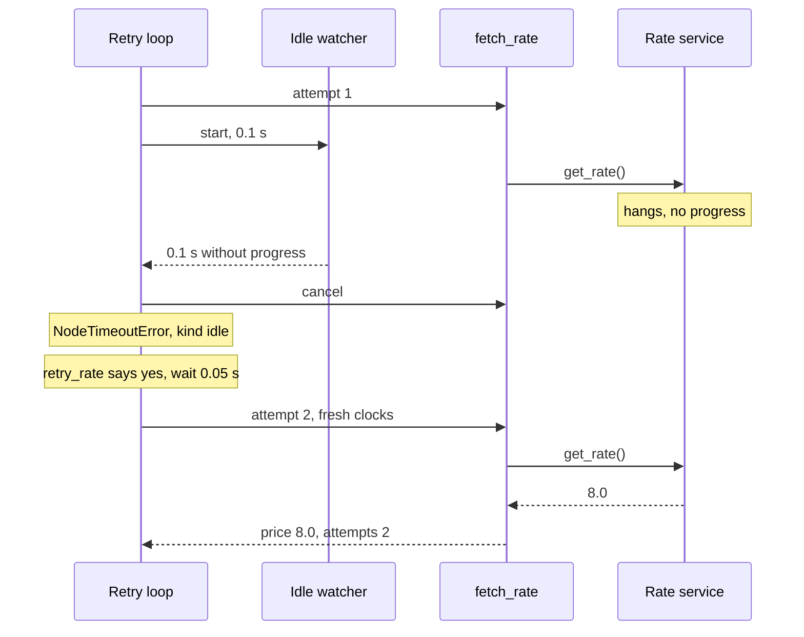

# 10.2 Node Timeouts

## The problem

Lesson 10.1 dealt with a rate service that **fails fast**: it answers 503 and the retry policy tries again. A real service has a worse way to go wrong: it **does not answer at all**. The TCP connection is open, the request was sent, and nothing comes back. Maybe a load balancer dropped the connection without closing it, or the service is stuck behind a lock. No exception is raised, so a retry policy never gets involved. The `await` in `fetch_rate` just waits, and the whole run waits with it, for as long as the HTTP client's own timeout allows. If that timeout is missing, it waits forever.

The opposite case looks the same from the outside. A tariff calculation, a long document conversion or an LLM writing a long answer can take a minute and be perfectly healthy. A plain "give up after 10 seconds" rule kills it.

So you need two different limits:

- **A hard limit** on how long one attempt may take in total, whatever it is doing.
- **A silence limit** that gives up on an attempt that has stopped making progress, but leaves alone one that is slow and still working.

The node also needs a way to say "I am still working". LangGraph provides all three as per-node settings, next to the retry policy from 10.1.

## The concept

### A timeout policy per node

A [TimeoutPolicy](../../../GLOSSARY.md#timeoutpolicy) (from `langgraph.types`) limits how long **one attempt** of a node may run. You attach it the same way as a retry policy, `add_node(name, fn, timeout=...)`, and it applies to that node only. It has three fields:

| Field | Default | Meaning |
|---|---|---|
| `run_timeout` | `None` | The hard limit, in seconds, from the start of the attempt. |
| `idle_timeout` | `None` | The silence limit, in seconds, since the last sign of progress. |
| `refresh_on` | `"auto"` | Which signals count as progress for `idle_timeout`. |

Nothing checks that you set a limit. If both are left as `None`, `TimeoutPolicy()` is accepted, `compile()` succeeds and the node silently gets no timeout at all, so `TimeoutPolicy(refresh_on="heartbeat")` on its own does nothing. Any limit you do set must be greater than 0, otherwise you get a `ValueError`. A `datetime.timedelta` works anywhere a number of seconds does.

The [run_timeout](../../../GLOSSARY.md#run_timeout) is a wall clock. It starts when the attempt starts and nothing resets it. The [idle_timeout](../../../GLOSSARY.md#idle_timeout) is a countdown that starts again every time the attempt shows a [progress signal](../../../GLOSSARY.md#progress-signal). It fires only when the attempt has been silent for the whole interval. When both are set, whichever runs out first ends the attempt.

`timeout=` also accepts a plain number or a `timedelta`. That is short for `TimeoutPolicy(run_timeout=...)`: a number means a hard limit only, never an idle limit.

### Heartbeats

What counts as progress? With the default `refresh_on="auto"`, LangGraph watches what it can see from the outside. The idle clock is reset when the node writes to the state, emits stream output (including `runtime.stream_writer`), schedules a child task, or triggers any LangChain callback event (a chat model starting, a token arriving, a tool finishing). A node that streams an LLM answer token by token therefore stays alive with no extra code.

Many long jobs produce none of these signals. Our `fetch_rate` awaits one call to the rate service and only writes its result when it returns. For such code there is an explicit signal, the [heartbeat](../../../GLOSSARY.md#heartbeat): a call to `runtime.heartbeat()` from inside the node. Each call says "this attempt is still alive" and resets the idle clock. It never touches the run clock.

[refresh_on](../../../GLOSSARY.md#refresh_on) chooses the sources. `"auto"` counts all of the above. `"heartbeat"` counts only explicit `runtime.heartbeat()` calls. That is useful when a chatty subcomponent, say an agent loop that keeps calling tools, could keep an attempt alive that is not really getting anywhere.

### The mental model

Think of a timed attempt as a race between the node and up to two alarm clocks:

- The **run alarm** is set once, at the start of the attempt, for `run_timeout` seconds.
- The **idle alarm** is set for `idle_timeout` seconds and is pushed back to the full interval on every progress signal.

If the node finishes first, both alarms are switched off and nothing happens. If an alarm goes off first, LangGraph cancels the node and the attempt fails with a [NodeTimeoutError](../../../GLOSSARY.md#nodetimeouterror). From then on it is an ordinary failed attempt, and the retry policy from 10.1 decides what happens next.

That last sentence is the key to combining the two policies: **a timeout is just another way for an attempt to fail.** Both limits apply to a single attempt, and every retry starts with fresh clocks.

## How it works

### One timed attempt

For a node with a timeout, LangGraph's retry loop (`arun_with_retry` in `langgraph/pregel/_retry.py`) runs each attempt like this in 1.2.16:

1. It starts the node body as a separate asyncio task.
2. Next to it, it starts one watcher task per configured limit. The run watcher simply sleeps `run_timeout` seconds. The idle watcher sleeps until "last progress + `idle_timeout`", checks whether progress has happened since, and sleeps again if it has.
3. It waits for whichever task finishes first.
4. If the node finished, the watchers are cancelled and the result is used.
5. If a watcher finished, LangGraph closes the attempt so that late writes from it are dropped, clears the writes it had buffered, cancels the node task, and raises `NodeTimeoutError`. It does **not** wait for the cancelled task to end.

The idle clock starts at the beginning of the attempt. A call that is silent from the start therefore fails after exactly `idle_timeout` seconds.

The node is stopped by [cooperative cancellation](../../../GLOSSARY.md#cooperative-cancellation): `task.cancel()` raises `asyncio.CancelledError` at the `await` the node is waiting on. That only works if the node is waiting on an `await`. It is the reason timeouts exist only for async nodes, as the section on details explains.

### The error that reaches the retry loop

`NodeTimeoutError` (from `langgraph.errors`) carries what you need to react to it:

| Attribute | Meaning |
|---|---|
| `node` | The name of the node that timed out. |
| `kind` | `"idle"` or `"run"`: which limit fired. |
| `timeout` | The value of the limit that fired, in seconds. |
| `idle_timeout`, `run_timeout` | Both configured limits (`None` if not set). |
| `elapsed` | Seconds from the start of the attempt to the timeout. |

Its message also contains the elapsed time, for example `Node 'fetch_rate' exceeded its idle timeout of 0.100s without making progress (elapsed: 0.101s).` That number differs on every run.

The error goes through the retry loop like any other exception: it is checked against `retry_on`, counted against `max_attempts`, followed by the backoff wait, and re-raised to the caller when attempts run out. The class has one deliberate detail. `NodeTimeoutError` derives from `Exception`, **not** from the built-in `TimeoutError`. The built-in one is an `OSError`, and 10.1 showed that [default_retry_on](../../../GLOSSARY.md#default_retry_on) does not retry an `OSError` unless it is a `ConnectionError`. The built-in `TimeoutError` is not a `ConnectionError`, so it is not retried. Because `NodeTimeoutError` is not an `OSError` at all, the default rules retry it, whichever limit fired.

Here is section 1 of our run over time: the first call hangs, the idle alarm fires, the retry succeeds.



## In our example

The graph is still `START -> lookup_zone -> fetch_rate -> END` from 10.1, with the cache on `lookup_zone` and the retry policy on `fetch_rate`. Now the rate service can also hang or be slow, `fetch_rate` gets a timeout policy, and the retry decision tells the two kinds of timeout apart. The [code walkthrough](readalong.md) goes through every changed line. Here we look at the parts that carry the idea.

### A service that hangs and a service that is slow

The fake rate service in [service.py](../src/l10_2_node_timeouts/service.py) gained two ways to misbehave and a progress callback:

<!-- snippet: src/l10_2_node_timeouts/service.py#shipping_api -->
```python
class ShippingApi:
    """A stand-in for two external APIs, with counters to see how often they run."""

    def __init__(self, rate_failures: int = 0, rate_hangs: int = 0, rate_steps: int = 0) -> None:
        """Create the API; the arguments script how the rate service misbehaves.

        The next `rate_failures` calls to `get_rate` fail with
        RateServiceUnavailable, then the service recovers.
        """
        self.rate_failures = rate_failures
        # rate_hangs scripts the next N calls to hang (never answer), like
        # rate_failures does for outages.
        self.rate_hangs = rate_hangs
        # rate_steps is how many STEP_S steps every call works through before
        # answering (0 = instant).
        self.rate_steps = rate_steps
        self.zone_lookups = 0  # how many times the "expensive" lookup really ran
        self.rate_calls = 0  # how many times the rate service was called

    def lookup_zone(self, address: str) -> str:
        """Turn an address into a shipping zone (think of a geocoding API)."""
        self.zone_lookups += 1
        # The city is the text after the last comma: "12 Baker Street, London".
        city = address.rsplit(",", 1)[-1].strip().lower()
        return ZONES[city]

    async def get_rate(
        self,
        zone: str,
        weight_kg: float,
        on_progress: Callable[[], None] | None = None,
    ) -> float:
        """Ask the rate service for the price of a parcel (a network call).

        Many SDKs take a progress callback like `on_progress`. The service
        calls it after every finished step of the calculation. The service
        knows nothing about LangGraph.
        """
        self.rate_calls += 1
        # The weight check comes first, so a too-heavy parcel fails the same
        # way whether or not the service is "down".
        if weight_kg > MAX_WEIGHT_KG:
            raise ParcelTooHeavy(f"parcel too heavy: {weight_kg} kg")
        if self.rate_failures > 0:
            self.rate_failures -= 1
            raise RateServiceUnavailable("rate service unavailable (503)")
        if self.rate_hangs > 0:
            self.rate_hangs -= 1
            # A hang: the call never answers. Only a timeout that cancels
            # this await gets the caller out of here early.
            await asyncio.sleep(HANG_S)
        # The slow path: work through the tariff step by step and report
        # progress after every step.
        for _ in range(self.rate_steps):
            await asyncio.sleep(STEP_S)
            if on_progress is not None:
                on_progress()
        return RATES_PER_KG[zone] * weight_kg
```
<!-- /snippet -->

A **hang** is `await asyncio.sleep(HANG_S)`: an await that would last five seconds and produces nothing. The **slow path** works through `rate_steps` steps of `STEP_S` seconds and calls `on_progress()` after each one. Many real SDKs take a callback like this for uploads, batch jobs or downloads. The service knows nothing about LangGraph. It just reports progress to whoever is listening.

### The timeout policy

<!-- snippet: src/l10_2_node_timeouts/graph.py#timeout_policy -->
```python
# How long one attempt of fetch_rate may take. Both limits apply to a single
# attempt, and each retry starts with fresh clocks.
RATE_TIMEOUT = TimeoutPolicy(
    # Hard wall-clock cap in seconds. Heartbeats never extend it.
    run_timeout=0.3,
    # Fires when the attempt shows no progress for this many seconds. In this
    # node the only progress signal is runtime.heartbeat(). With the default
    # refresh_on="auto", node writes, stream chunks, child tasks and
    # LangChain callbacks also count; refresh_on="heartbeat" counts
    # heartbeats only.
    idle_timeout=0.1,
)
# A plain number, `timeout=0.3`, means run_timeout only. Real services use
# seconds to minutes; the values are tiny only to keep the demo fast.
```
<!-- /snippet -->

`RATE_TIMEOUT` sets both limits. `idle_timeout=0.1` catches a hang quickly. `run_timeout=0.3` caps a call that keeps working but never finishes. The values are tiny so the whole demo runs in under two seconds. A real rate service would get seconds, and an LLM call or a document conversion would get minutes.

### Passing the heartbeat to the service

<!-- snippet: src/l10_2_node_timeouts/graph.py#nodes -->
```python
def lookup_zone(state: QuoteState) -> dict[str, str]:
    """Find the shipping zone for the address (the expensive, cached step)."""
    return {"zone": api.lookup_zone(state["address"])}

async def fetch_rate(state: QuoteState, runtime: Runtime) -> dict[str, float | int]:
    """Ask the flaky rate service for the price (the retried step)."""
    # runtime.heartbeat records progress for the idle timeout. It is a
    # no-op when the node has no idle timeout.
    price = await api.get_rate(state["zone"], state["weight_kg"], on_progress=runtime.heartbeat)
    # LangGraph injects `runtime` because of the parameter's name and
    # annotation. node_attempt is 1 on the first try and counts up on
    # every retry.
    return {"price": price, "attempts": runtime.execution_info.node_attempt}
```
<!-- /snippet -->

`on_progress=runtime.heartbeat` passes the method itself, not the result of calling it. The service calls it after each step, and each call resets the idle clock of the current attempt. This is the usual pattern: hook the heartbeat into whatever progress the work already reports, such as a callback, a loop over batches or a paginated download. Do not call it from a timer, as the common mistakes explain.

`runtime.heartbeat` does nothing outside an attempt with an idle limit, so the node also works unchanged without a timeout, or with a plain-number timeout.

### Which timeouts to retry

<!-- snippet: src/l10_2_node_timeouts/graph.py#retry_policy -->
```python
def retry_rate(error: Exception) -> bool:
    """Decide whether fetch_rate is retried after `error`.

    A call that went silent (an idle timeout) is probably a dropped
    connection, so a fresh attempt can succeed. A call that kept working
    until the hard cap (a run timeout) would most likely hit the cap again,
    so retrying it only multiplies the wait. ParcelTooHeavy is still never
    retried.
    """
    if isinstance(error, NodeTimeoutError):
        # NodeTimeoutError is not a subclass of the built-in TimeoutError,
        # which is why the default retry_on (default_retry_on) does retry it.
        # `kind` says which limit fired: "idle" or "run".
        return error.kind == "idle"
    return isinstance(error, RateServiceUnavailable)


# How LangGraph retries fetch_rate when it raises.
RATE_RETRY = RetryPolicy(
    # max_attempts counts the first try: 1 call + up to 3 retries.
    max_attempts=4,
    # Waits between attempts: 0.05, 0.1, 0.2 s (each one x backoff_factor).
    # Real services use seconds here.
    initial_interval=0.05,
    backoff_factor=2.0,
    # In production keep jitter=True: in 1.2.16 it adds a random 0-1 s to
    # every wait, so many clients don't retry in lockstep. It is off here
    # only to keep the demo fast and repeatable.
    jitter=False,
    # Retry the transient errors only: ParcelTooHeavy fails at once.
    # retry_on can also be a function that gets the exception.
    retry_on=retry_rate,
)
```
<!-- /snippet -->

This is the third form of `retry_on` from 10.1, a function that receives the exception. `retry_rate` keeps the 10.1 rule for everything that is not a timeout, and makes a different call for each kind of timeout:

- **Idle timeout: retry.** The call went silent. That usually means the connection or the remote worker is gone, and a fresh call has a real chance.
- **Run timeout: do not retry.** The call was working the whole time and simply needed more than the cap. The next attempt does the same work and most likely hits the same cap, so a retry only multiplies the wait.

It is the transient/permanent question of 10.1 applied to timeouts. With the default `retry_on`, both kinds would be retried.

### Wiring

In `build_graph` the timeout sits next to the retry policy:

```python
builder.add_node("fetch_rate", fetch_rate, retry_policy=RATE_RETRY, timeout=RATE_TIMEOUT)
```

`lookup_zone` gets no timeout. It is a sync function, and LangGraph can only time async nodes. A timeout on it is accepted by `add_node`, but `compile()` raises a `ValueError` (experiment 4).

## Run it

From the course root, `./run.sh 10.2`. The live run of the verified lesson printed:

```text
== 1. The rate service hangs once: the idle timeout cuts it off, a retry recovers ==
{'lookup_zone': {'zone': 'UK'}}
{'fetch_rate': {'price': 8.0, 'attempts': 2}}
rate service calls: 2

== 2. A slow quote that reports progress: heartbeats keep it alive ==
{'lookup_zone': {'zone': 'UK'}}
{'fetch_rate': {'price': 12.0, 'attempts': 1}}
took longer than idle_timeout=0.1 s: True

== 3. The service hangs for good: every attempt times out ==
gave up after 4 calls: idle timeout of 0.1 s in fetch_rate

== 4. Progress without end: the run timeout is the hard cap ==
gave up after 1 call: run timeout of 0.3 s in fetch_rate
```

All four sections share one `ShippingApi` and one graph. What to notice:

- **Section 1.** The run did not wait five seconds for the hung call. The idle alarm cut it off after 0.1 s, and the second call answered. As with the failures in 10.1, the timed-out attempt left no update and no error. It shows up only as `attempts: 2` ([node_attempt](../../../GLOSSARY.md#node_attempt) counts timed-out attempts too) and in `rate service calls: 2`.
- **Section 2.** The call took 0.2 s, twice the idle limit, and still succeeded on the first attempt. There was a heartbeat every 0.025 s, so the idle alarm never got close. The line prints a comparison instead of the measured time, so it reads the same on any machine.
- **Section 3.** Ten scripted hangs and four attempts: every attempt ended with an idle timeout, and after the fourth LangGraph re-raised the last `NodeTimeoutError` itself. The program catches it by class and prints only its fields. `str(error)` would include the elapsed time, which changes from run to run.
- **Section 4.** The call sent heartbeats the whole time, so it was never idle. The run alarm cut it off at 0.3 s anyway, and `retry_rate` did not retry a run timeout: one call, no backoff.

The printed output is the same on every run. The total run time, about 1.8 s, varies a little with the machine.

## Predicting attempts and time

Because a timeout is just a failed attempt, the arithmetic of 10.1 carries over. Ask three questions about a node that keeps timing out:

1. **Which limit fires?** A silent call fails after `idle_timeout`. A call that keeps reporting progress fails after `run_timeout`. A call that starts silent always fails after `idle_timeout`, because the idle clock starts with the attempt.
2. **Does `retry_on` accept that kind?** If not, there is exactly **one** attempt and no wait.
3. **If it does,** there are `max_attempts` attempts, each costing its limit, plus the backoff waits between them.

For $N$ attempts that all time out after $T$ seconds, with waits $w_n$ from 10.1's formula, the time until the caller sees the error is

$$
T_{\text{total}} = N \cdot T + \sum_{n=1}^{N-1} w_n
$$

With `jitter=True`, add up to one second per wait.

Applied to our `RATE_RETRY` ($N = 4$, waits 0.05, 0.1 and 0.2 s) and `RATE_TIMEOUT`:

| Case | Limit that fires | Retried? | Attempts | Time until the result or error |
|---|---|---|---|---|
| Section 1: one hang, then an instant answer | idle, 0.1 s | yes | 2 | $0.1 + 0.05 \approx 0.15$ s |
| Section 3: hangs on every call | idle, 0.1 s | yes | 4 | $4 \cdot 0.1 + 0.35 = 0.75$ s |
| Section 4: heartbeats, never finishes | run, 0.3 s | no | 1 | $0.3$ s |
| Section 4 with `retry_on=(RateServiceUnavailable, NodeTimeoutError)` | run, 0.3 s | yes | 4 | $4 \cdot 0.3 + 0.35 = 1.55$ s |

The last row is experiment 3. It shows why `retry_rate` exists: retrying the hard cap would turn 0.3 s into 1.55 s, with the same result at the end.

Two rules follow:

- **The attempt count is shared.** `max_attempts` counts every failed attempt, whatever its cause. One 503 followed by hangs uses one attempt on the 503 and the remaining three on idle timeouts: four calls in total, and the caller gets the last error, an idle `NodeTimeoutError`.
- **Only `run_timeout` gives a worst case.** With `run_timeout` set, one attempt can never take longer than it, and the formula with $T$ = `run_timeout` is an upper bound for the whole node. With only `idle_timeout`, a node that keeps sending heartbeats can run forever. Set both on anything that talks to the outside.

There is no limit for the node as a whole across all its retries. If you need one, choose `run_timeout`, `max_attempts` and the intervals so that the formula stays within it.

## Details and edge cases

**Timeouts need async nodes.** Python cannot safely stop a running thread, so LangGraph only times nodes it can cancel through asyncio. A timeout on a sync node passes `add_node` and fails in `compile()` with `ValueError: Node timeouts are only supported for async nodes because sync Python execution cannot be safely cancelled in-process. Node 'lookup_zone' is sync.` The same check makes a sync `graph.invoke()` on our graph fail with that message for `fetch_rate`, which is why the program uses `astream` and `ainvoke`.

**An async node that blocks the event loop cannot be timed either.** The watchers are asyncio tasks too. They only run when the node reaches an `await`. We tried an `async def` node that calls `time.sleep(0.5)` under `run_timeout=0.2`. It finished after 0.5 s and *succeeded*: the alarm never got a chance to fire. With an `await asyncio.sleep(0)` after the blocking call, the error came, but only at 0.5 s. Keep blocking work out of timed nodes, or move it into a thread.

**A thread is abandoned, not stopped.** With `await asyncio.to_thread(time.sleep, 0.5)` under `run_timeout=0.2`, `NodeTimeoutError` arrived on time at 0.2 s. The thread itself ran to the end, though, and `asyncio.run()` returned only at 0.5 s, because it waits for its worker threads on shutdown. A timeout frees the graph. It does not stop work that has already left the event loop, and that work may still have side effects.

**LangGraph does not wait for the cancelled node.** The error is raised right after the cancel is requested. A node that catches `CancelledError` and goes on keeps running in the background after the error has reached the caller. Its later state writes are dropped, because the attempt is already closed. Its side effects are not. Use `try/finally` for cleanup and let `CancelledError` propagate.

**A timed-out call may still have happened.** As with the failed calls in 10.1, an idle timeout on a request that the service did receive leaves you not knowing whether it was processed. Retrying a timeout is only safe for [idempotent](../../../GLOSSARY.md#idempotent) calls. Reading a rate is one. Creating a shipment is not, unless you send an idempotency key.

**What `"auto"` counts.** Under `refresh_on="auto"` the idle clock is reset by state writes the node sends, stream output and `runtime.stream_writer` calls, child-task scheduling, LangChain callback events from the node and its descendants, and `runtime.heartbeat()`. A plain function node like `fetch_rate` writes only when it returns, so writes do not help it while it waits. That is why the heartbeat is needed here.

**A per-`Send` timeout.** In a fan-out with `Send` (lesson 3.2), `Send(node, arg, timeout=...)` overrides the target node's timeout for that one task, which is useful when the work per item varies a lot. Without it, the node's own `timeout` applies.

**What comes next.** Here the final `NodeTimeoutError` still ends the run. Lesson 10.3 adds a node-level error handler that runs after the retries are exhausted and turns the error into a fallback quote. It also adds `set_node_defaults()`, which gives every node a retry policy and a timeout at once.

## Common mistakes

> [!WARNING]
> **An idle timeout on a node that never signals progress.** A long `await` that emits nothing looks exactly like a hang. Without a heartbeat (or another progress signal), a healthy but slow call fails after `idle_timeout`, then again on each retry. Experiment 1 shows it: removing `on_progress=runtime.heartbeat` makes section 2 fail after four attempts. Either hook the heartbeat into real progress or use only a `run_timeout`.

> [!WARNING]
> **Expecting a plain number to be an idle timeout.** `timeout=30` is `TimeoutPolicy(run_timeout=30)`: a hard cap, with no idle limit and with heartbeats ignored. A hang is caught only at the cap. Experiment 2 shows how that changes section 1.

> [!WARNING]
> **Sending heartbeats from a timer.** A background task that calls `runtime.heartbeat()` every second keeps the attempt "alive" even when the actual work is stuck, which defeats the idle limit. Send a heartbeat only when the work has really moved forward.

> [!WARNING]
> **Catching `TimeoutError`.** `NodeTimeoutError` is not a subclass of the built-in `TimeoutError`, so `except TimeoutError` does not catch it (experiment 5). Import it from `langgraph.errors` and catch it by name. For the same reason, an `asyncio.TimeoutError` or `httpx.ReadTimeout` raised by your own code inside the node stays what it is. LangGraph turns only its own alarms into `NodeTimeoutError`.

> [!WARNING]
> **Retrying run timeouts by default.** `default_retry_on` retries every `NodeTimeoutError`, including a call that was working until the hard cap. That turns one long wait into `max_attempts` long waits (experiment 3). Decide per kind in a `retry_on` function.

> [!WARNING]
> **Blocking calls inside a timed async node.** `time.sleep`, a sync HTTP client or heavy CPU work inside `async def` blocks the event loop, and the timeout cannot fire until it is released. Use async clients, or `asyncio.to_thread` and accept that the thread keeps running after a timeout.

## Experiments

Run each one from the lesson's original code with `./run.sh 10.2`.

1. In `fetch_rate` in [graph.py](../src/l10_2_node_timeouts/graph.py), remove `on_progress=runtime.heartbeat` from the `api.get_rate(...)` call.

   <details><summary>What happens and why</summary>

   Section 1 still works. Section 2 prints its `lookup_zone` update and then the program stops with a traceback whose error line is `langgraph.errors.NodeTimeoutError: Node 'fetch_rate' exceeded its idle timeout of 0.100s without making progress (elapsed: 0.101s).` (the elapsed time varies), followed by a note naming the task. The service was working, step by step, but nobody told LangGraph. An await that emits nothing looks exactly like a hang, so each attempt was cut off after 0.1 s, `retry_rate` retried it as an idle timeout, and after four attempts and about 0.75 s the error reached the caller. Section 2 has no `try/except`, so the program ends there. Undo the change afterwards (`git checkout -- .` in the lesson directory).

   </details>

2. In `build_graph`, replace `timeout=RATE_TIMEOUT` with `timeout=0.3` in the `add_node` call for `fetch_rate`.

   <details><summary>What happens and why</summary>

   Section 1 now waits 0.3 s on the hung call and then fails at once with a traceback ending in `NodeTimeoutError: Node 'fetch_rate' exceeded its run timeout of 0.300s (elapsed: 0.301s).` A plain number is a `run_timeout` only, so there is no idle limit and the hang is noticed only at the hard cap. The error now has `kind == "run"`, which `retry_rate` does not retry, so the hang that one retry fixed before is now fatal. Undo the change afterwards.

   </details>

3. In `RATE_RETRY`, change `retry_on=retry_rate` to `retry_on=(RateServiceUnavailable, NodeTimeoutError)`.

   <details><summary>What happens and why</summary>

   Sections 1 to 3 print the same as before. Section 4 now says `gave up after 4 calls: run timeout of 0.3 s in fetch_rate`, and the whole run takes about 1.3 s longer (3.1 s instead of 1.8 s in our run). Every attempt worked until the cap, the run timeout is now retried, and the formula gives $4 \cdot 0.3 + 0.35 = 1.55$ s for section 4 instead of 0.3 s. The result is the same error, only later. Undo the change afterwards.

   </details>

4. In `build_graph`, add `timeout=0.1` to the `add_node` call for `lookup_zone`.

   <details><summary>What happens and why</summary>

   `add_node` accepts it, and `builder.compile()` raises `ValueError: Node timeouts are only supported for async nodes because sync Python execution cannot be safely cancelled in-process. Node 'lookup_zone' is sync.` The program stops before any section runs. Timeouts work by cancelling an asyncio task, and a sync function cannot be cancelled that way. If `lookup_zone` blocked in `time.sleep`, nothing could stop it anyway. To time a lookup, make it `async def` with an async client. Undo the change afterwards.

   </details>

5. In section 3 of `main` in [\_\_main\_\_.py](../src/l10_2_node_timeouts/__main__.py), change `except NodeTimeoutError as error:` to `except TimeoutError as error:`.

   <details><summary>What happens and why</summary>

   Sections 1 and 2 print as before. Section 3 prints its heading and then the program ends with a `NodeTimeoutError` traceback: the `except` did not match. `NodeTimeoutError` deliberately does not derive from the built-in `TimeoutError`, which is an `OSError`, so that `default_retry_on` retries it. Catch it by its own name. Undo the change afterwards.

   </details>

## Summary

- `add_node(..., timeout=TimeoutPolicy(run_timeout=..., idle_timeout=...))` limits each attempt of an async node. `run_timeout` is a hard wall clock. `idle_timeout` fires only after a period without progress. A plain number means `run_timeout` only.
- Progress is a state write, stream output, a child task, a LangChain callback or, explicitly, `runtime.heartbeat()`. Hook the heartbeat into real progress of long work that emits nothing else. `refresh_on="heartbeat"` counts heartbeats only.
- When a limit fires, LangGraph cancels the node and raises `NodeTimeoutError` with `node`, `kind`, `timeout` and `elapsed`. It goes through the retry policy like any other error, and every retry gets fresh clocks.
- `NodeTimeoutError` is not a built-in `TimeoutError`, so the default `retry_on` retries both kinds. Retry idle timeouts, and usually not run timeouts.
- Predicting the outcome: one attempt if `retry_on` rejects the timeout, otherwise `max_attempts`. The time is $N \cdot T$ plus the backoff waits, and only a `run_timeout` makes $T$ bounded.
- Timeouts rely on cooperative cancellation: sync nodes are rejected at compile time, blocking calls delay the timeout, and threads keep running after it.

## Self-check

1. A node has `timeout=TimeoutPolicy(idle_timeout=5)` and calls a model with `ainvoke`, waiting 40 s for the whole answer without streaming. It fails every time with an idle timeout. Name two ways to fix it.

   <details><summary>Answer</summary>

   Something must count as progress, or the idle limit must go. Stream the answer (with `astream`, each token triggers a LangChain callback event, which resets the idle clock under `refresh_on="auto"`), or replace the idle limit with a `run_timeout` large enough for a normal answer, for example `timeout=60`. Calling `runtime.heartbeat()` from a timer would also stop the error, but it would hide a real hang.

   </details>

2. With our `RATE_RETRY` and `RATE_TIMEOUT`, the rate service hangs on the first call and on the second call works through 40 steps, sending heartbeats. How many calls are made, what reaches the caller, and roughly when?

   <details><summary>Answer</summary>

   Two calls. The first hang ends with an idle timeout after 0.1 s, `retry_rate` retries it, and LangGraph waits 0.05 s. The second call sends heartbeats, so it is never idle, but the run alarm fires at 0.3 s. `retry_rate` does not retry a run timeout, so a `NodeTimeoutError` with `kind == "run"` reaches the caller after about $0.1 + 0.05 + 0.3 = 0.45$ s.

   </details>

3. Your node raises a custom error after a 503 and sometimes hangs. With `RetryPolicy(max_attempts=3, initial_interval=1.0, jitter=False)`, a `retry_on` that accepts both, and `timeout=TimeoutPolicy(run_timeout=10, idle_timeout=2)`, what is the longest the node can take before the caller sees an error?

   <details><summary>Answer</summary>

   Three attempts, each at most 10 s because of `run_timeout`, plus two waits of 1 s and 2 s (`backoff_factor` defaults to 2). That is $3 \cdot 10 + 1 + 2 = 33$ s. The idle limit can only make an attempt shorter. Without `run_timeout` there would be no upper bound, because an attempt that keeps reporting progress never times out.

   </details>

4. Why does `default_retry_on` retry a `NodeTimeoutError` but not an `asyncio.TimeoutError` raised inside the node by your own `asyncio.wait_for`?

   <details><summary>Answer</summary>

   `asyncio.TimeoutError` is the built-in `TimeoutError`, an `OSError` that is not a `ConnectionError`, so `default_retry_on` does not retry it. `NodeTimeoutError` derives directly from `Exception` on purpose, so it falls through to the default "retry" rule. LangGraph converts only its own alarms into `NodeTimeoutError`. A timeout from your own code reaches the retry loop unchanged.

   </details>

5. A colleague puts `timeout=30` on a sync node that calls `requests.get(...)` and gets a `ValueError` from `compile()`. They make the node `async def` and keep `requests.get` inside it. Does the timeout work now?

   <details><summary>Answer</summary>

   It compiles, but the timeout cannot fire while `requests.get` blocks the event loop. The watcher only runs once the node reaches an `await`, so the call can run far beyond 30 s, and if the node returns without awaiting afterwards it even succeeds. Use an async client such as `httpx.AsyncClient`, or `await asyncio.to_thread(requests.get, ...)`, where the timeout fires on time but the thread keeps running in the background until the request ends.

   </details>

## Further reading

- [Fault tolerance: timeouts](https://docs.langchain.com/oss/python/langgraph/fault-tolerance#timeouts), LangGraph docs: `run_timeout`, `idle_timeout`, progress signals, heartbeat mode, `NodeTimeoutError`, per-`Send` timeouts and the async-only limitation.
- [`langgraph/types.py` at 1.2.16](https://github.com/langchain-ai/langgraph/blob/1.2.16/libs/langgraph/langgraph/types.py): `TimeoutPolicy`, its defaults and how a number is turned into a policy.
- [`langgraph/pregel/_retry.py` at 1.2.16](https://github.com/langchain-ai/langgraph/blob/1.2.16/libs/langgraph/langgraph/pregel/_retry.py): the timed attempt (`_arun_with_timeout`), the watchers and the progress tracking (`_TimedAttemptScope`) inside the retry loop.
- [`langgraph/errors.py` at 1.2.16](https://github.com/langchain-ai/langgraph/blob/1.2.16/libs/langgraph/langgraph/errors.py): `NodeTimeoutError` and why it is not a built-in `TimeoutError`.
- [`langgraph/runtime.py` at 1.2.16](https://github.com/langchain-ai/langgraph/blob/1.2.16/libs/langgraph/langgraph/runtime.py): `Runtime.heartbeat` and its no-op default.
- [`tests/test_retry.py` at 1.2.16](https://github.com/langchain-ai/langgraph/blob/1.2.16/libs/langgraph/tests/test_retry.py): executable examples, such as a run timeout that heartbeats do not refresh.
- [Task cancellation](https://docs.python.org/3/library/asyncio-task.html#task-cancellation), Python docs: how `CancelledError` reaches a coroutine and why it should not be swallowed.
