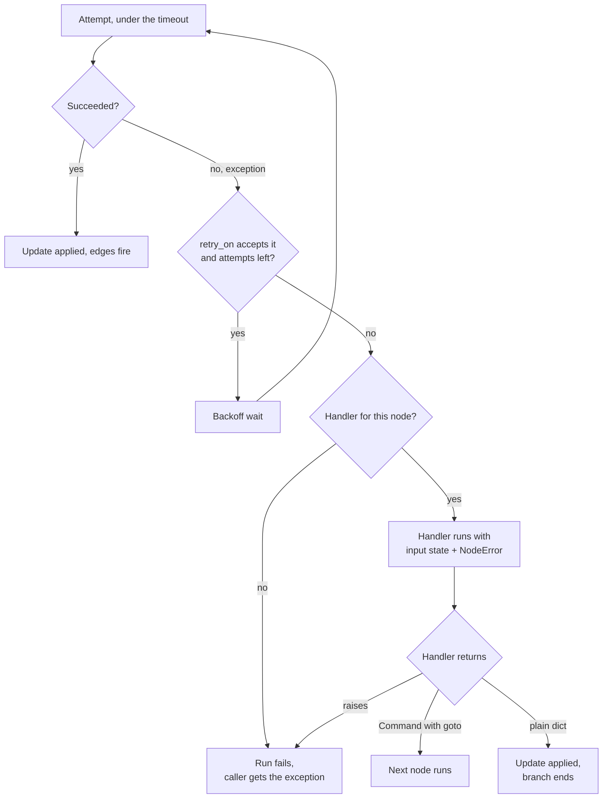
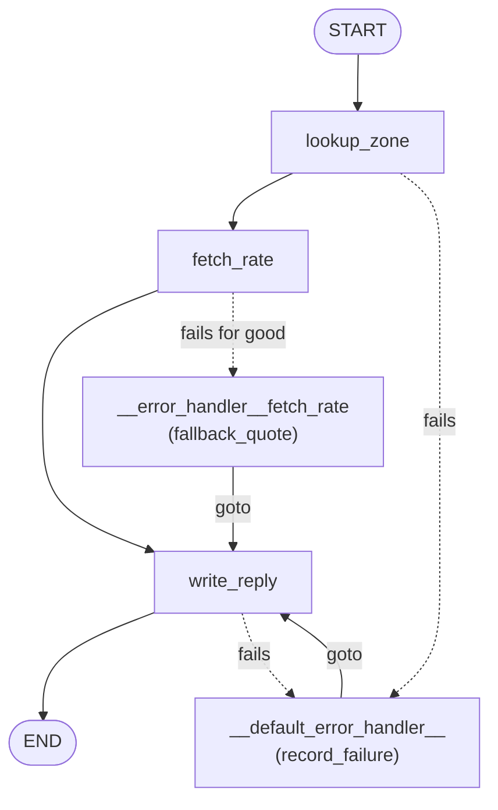

# 10.3 Error Handlers and Node Defaults

## The problem

After 10.1 and 10.2, `fetch_rate` survives a short outage and a single hang. Its retry policy tries again, and its timeout cuts off a call that went silent. But when the rate service stays down, the last attempt still fails, and the exception ends the run. 10.2's section 3 caught that `NodeTimeoutError` in the caller and printed it. In a real service that means the customer gets an error page instead of an answer.

In most cases the run could still give a useful answer. For a shipping quote, a flat-rate estimate is better than nothing. For an unknown city, a polite "we can't quote this address" is better than a `KeyError`. Doing this inside the node is awkward, though. A `try/except` around the API call would also catch the errors the retry policy is supposed to see, so the retries would stop working. And the fallback belongs to the moment the retries have given up, which the node itself cannot see.

There is a second, smaller problem. In 10.2 the retry policy and the timeout were set on `fetch_rate` only. A graph with ten nodes that call outside services would repeat the same `retry_policy=..., timeout=...` arguments ten times, and the one node where someone forgot them would be the one that breaks.

LangGraph 1.2 solves both: a handler per node that runs after the retries, and graph-wide defaults for all the per-node settings.

## The concept

### A handler that runs after the retries

A [node-level error handler](../../../GLOSSARY.md#node-level-error-handler) is a function you attach with `add_node(name, fn, error_handler=handler)`. LangGraph calls it **once**, when the node has failed for good: after the [RetryPolicy](../../../GLOSSARY.md#retrypolicy) has used up its attempts, or right away if the error is not one `retry_on` retries. A node with no retry policy gets its handler on the first failure.

A handler is written like a node. It receives the state and returns an update. In addition, it can ask for the failure itself with a parameter annotated [NodeError](../../../GLOSSARY.md#nodeerror). LangGraph injects that parameter by its type, the same way it injects `runtime: Runtime`. `NodeError` (from `langgraph.errors`) is a small frozen dataclass with two fields:

| Field | Meaning |
|---|---|
| `node` | The name of the node that failed, such as `"fetch_rate"`. |
| `error` | The exception from its **last** attempt. Earlier attempts' errors are not kept. |

The `NodeError` parameter is optional. A handler that only needs the state can be `def handler(state)`.

### The handler decides where the run goes

The key rule is this: **when a node fails, its own outgoing edges do not fire.** The edge `fetch_rate -> write_reply` exists for a `fetch_rate` that returned a result. A failed `fetch_rate` returned nothing, so nothing follows from it. From that point the handler's return value alone decides what happens:

- A [Command](../../../GLOSSARY.md#command) with `update=` and [goto](../../../GLOSSARY.md#goto) (lesson 3.3) applies the update and sends the run to the named node. This is the usual form.
- A plain dict applies the update, and then that branch of the run **ends**. Nothing is scheduled after the handler.
- An exception raised in the handler **fails the run**. No other handler catches it, the default one included.

So a handler is not a "catch and carry on as if nothing happened". It is a fork in the road: you choose the next node yourself.

### Node defaults

[set_node_defaults](../../../GLOSSARY.md#set_node_defaults) is a `StateGraph` method that sets `retry_policy`, `timeout`, `cache_policy` and `error_handler` once, for every node of that graph:

```python
builder.set_node_defaults(retry_policy=..., timeout=..., error_handler=...)
```

Three rules make it predictable:

1. **A value set in `add_node` always wins** over the default.
2. **Defaults are applied in `compile()`.** It does not matter whether you call `set_node_defaults` before or after the `add_node` calls.
3. **Defaults belong to one graph.** A [subgraph](../../../GLOSSARY.md#subgraph) compiled separately does not inherit them.

A default `error_handler` gives every node without its own handler the same fallback. A per-node handler replaces it for that node.

### Handlers are nodes too

LangGraph does not run a handler as a hidden callback. It turns each handler into an extra node of the compiled graph, an [error-handler node](../../../GLOSSARY.md#error-handler-node):

- `add_node("fetch_rate", ..., error_handler=fallback_quote)` adds a node named `__error_handler__fetch_rate`.
- `set_node_defaults(error_handler=record_failure)` adds one node named `__default_error_handler__`, shared by all nodes that use the default.

That has visible effects. The handler's update appears under that name in `stream_mode="updates"`, and the node is listed in `graph.nodes`. Because it is a node, some of the defaults also apply to it. The next section shows which ones.

## How it works

### The order: timeout, retry, handler

For a node with a retry policy, a timeout and a handler, one failure goes through these stages. The diagram shows the decision points.



Three details follow from the source of 1.2.16 (`PregelRunner` in `pregel/_runner.py` and `prepare_node_error_handler_task` in `pregel/_algo.py`):

- **The timeout is per attempt, the handler per failure.** Each attempt runs under the [TimeoutPolicy](../../../GLOSSARY.md#timeoutpolicy) with fresh clocks, as in 10.2. A timed-out attempt is one more failed attempt for the retry loop. The handler sees only the end of this loop: one call, with the final exception.
- **The handler gets the failed node's input.** Its `state` is exactly what the failed node received. Writes from the failed attempts are dropped, so nothing the node tried to write reaches the handler or the final state.
- **The handler runs in the same [super-step](../../../GLOSSARY.md#super-step).** It is scheduled right after the failure, as a task of the same step, not as a new step after it. If its `Command` says `goto="write_reply"`, then `write_reply` runs in the next step, like after any node.

### Which defaults reach which nodes

In `compile()`, LangGraph walks over all node specs, the handler nodes included, and fills in every setting the node did not set itself. Not every default is filled into every node:

| Default | Regular nodes | Error-handler nodes | Why |
|---|---|---|---|
| `retry_policy` | yes | yes | A handler can hit a transient failure too, say while writing to a database. |
| `timeout` | yes | yes | A stuck handler should be cancelled like a stuck node. |
| `error_handler` | yes | no | A handler must never catch its own failure. |
| `cache_policy` | yes | no | A handler's input can differ between failures that share a cache key. |

The reasons in the last column are the ones the docs and the source comments give. The table has two consequences that are easy to miss:

- **A default timeout makes every node async-only.** 10.2 showed that `compile()` rejects a timeout on a sync node. With `set_node_defaults(timeout=...)`, every node gets that timeout, so every node, handler nodes included, must be `async def`. There is no per-node way out: `add_node(..., timeout=None)` means "not set here, use the default", which is exactly what the default fills in.
- **A handler that raises is retried before the run fails.** The handler node gets the default retry policy. If it raises an error that `retry_on` accepts, LangGraph runs it again, up to `max_attempts` times. Only then does the run fail.

## In our example

The graph gets a third node, `write_reply`, which turns the state into the customer's answer. The healthy path is `START -> lookup_zone -> fetch_rate -> write_reply -> END`. The two handlers add paths around it. The [code walkthrough](readalong.md) goes through every changed line. Here we look at the parts that carry the idea.

The diagram below shows the static edges as solid arrows, the jump to a handler on failure as dotted arrows, and each handler's `goto` as a labelled arrow. It is drawn by hand, for two reasons. First, `graph.get_graph()` fails on this graph, because drawing calls `zone_cache_key` on an empty input (an issue inherited from 10.1). Second, even on a graph where `get_graph()` works, it would not show the handler paths: a handler node gets no list of destinations, so it is drawn with no outgoing edges. LangGraph does not read a handler's `Command[Literal[...]]` return annotation; the `Literal` only tells the reader where `goto` leads.



### Two handlers

Both handlers live in the `error_handlers` region of [graph.py](../src/l10_3_error_handlers/graph.py):

<!-- snippet: src/l10_3_error_handlers/graph.py#error_handlers -->
```python
# A flat rate above every zone's real rate (UK 4.0, EU 7.5), so an estimate
# never undercharges.
FALLBACK_RATE_PER_KG = 9.0


def describe_failure(error: NodeError) -> str:
    """Say which error happened in which node, e.g. "KeyError in lookup_zone".

    Only the exception's type name is used, never str(error.error): a
    NodeTimeoutError's message contains the measured elapsed time and would
    make the output vary between runs.
    """
    return f"{type(error.error).__name__} in {error.node}"


# Both handlers are async because the default timeout also applies to
# handler nodes, and a timed node must be async.
async def fallback_quote(state: QuoteState, error: NodeError) -> Command[Literal["write_reply"]]:
    """fetch_rate's own error handler: reply with a flat-rate estimate.

    It runs once, after RATE_RETRY has used up its attempts (each one bounded
    by RATE_TIMEOUT), or right after the first error that is not retried. It
    receives fetch_rate's input state and the final exception. LangGraph
    injects `error` because of the NodeError annotation.
    """
    if not isinstance(error.error, (RateServiceUnavailable, NodeTimeoutError)):
        # A request error such as ParcelTooHeavy cannot be fixed by an
        # estimate, so re-raise it. An exception raised in a handler fails
        # the run: no other handler catches it.
        raise error.error
    # goto is needed: fetch_rate's own edge to write_reply does not fire
    # when fetch_rate failed, so a plain dict would end the run here.
    # LangGraph does not read a handler's return annotation (and draws no
    # edge from a handler node): the Literal only names goto for the reader.
    return Command(
        update={
            "price": FALLBACK_RATE_PER_KG * state["weight_kg"],
            "error": describe_failure(error),
        },
        goto="write_reply",
    )


async def record_failure(state: QuoteState, error: NodeError) -> Command[Literal["write_reply"]]:
    """The graph-wide default handler for any regular node without its own.

    In this graph that means lookup_zone and write_reply. It records what
    went wrong and routes to write_reply, skipping the nodes in between.
    """
    return Command(update={"error": describe_failure(error)}, goto="write_reply")
```
<!-- /snippet -->

`fallback_quote` is the plan B for the rate call. It knows what it can repair: an outage (`RateServiceUnavailable`) or a hang (`NodeTimeoutError`). For those it writes a flat-rate estimate. `FALLBACK_RATE_PER_KG` is above every real rate, so an estimate can only overcharge. It reads `state["weight_kg"]` from the input that `fetch_rate` received, and records the failure with `describe_failure`.

Everything else is re-raised. In this graph that is `ParcelTooHeavy`, a [permanent error](../../../GLOSSARY.md#permanent-error): the request itself is wrong, and an estimate for a parcel the carrier refuses would be a lie. `raise error.error` re-raises the original exception object, so the caller sees a `ParcelTooHeavy`, not a LangGraph wrapper. This is an allowlist on purpose: a handler should repair the failures it understands and let the rest through.

`record_failure` is the default handler. It does not try to repair anything. It records which node failed and jumps to `write_reply`, so the customer still gets an answer, "no quote". When `lookup_zone` fails, the jump also skips `fetch_rate`, which could not run without a zone anyway.

Both return `Command(update=..., goto="write_reply")`. Without the `goto`, a failed `fetch_rate` would end the run at the handler (experiment 1). Both are `async def`, because the default timeout covers handler nodes too (experiment 4). `describe_failure` uses only the exception's type name: the message of a `NodeTimeoutError` contains the measured elapsed time, which would make the output differ between runs.

### Defaults for every node

<!-- snippet: src/l10_3_error_handlers/graph.py#node_defaults -->
```python
builder = StateGraph(QuoteState)
# These apply to every node that does not set its own value in add_node,
# and they are applied at compile() time, whatever the order of calls.
# retry and timeout also cover the error-handler nodes; error_handler
# and cache_policy cover regular nodes only. The defaults are not
# inherited by subgraphs.
builder.set_node_defaults(
    retry_policy=RATE_RETRY,
    timeout=RATE_TIMEOUT,
    error_handler=record_failure,
)
builder.add_node("lookup_zone", lookup_zone, cache_policy=ZONE_CACHE)
# A per-node handler wins over the default one. LangGraph adds it as the
# node "__error_handler__fetch_rate". retry and timeout now come from
# the defaults.
builder.add_node("fetch_rate", fetch_rate, error_handler=fallback_quote)
builder.add_node("write_reply", write_reply)
```
<!-- /snippet -->

`RATE_RETRY` and `RATE_TIMEOUT` are unchanged from 10.2, but they now reach every node. In the compiled graph:

| Node | Retry | Timeout | Handler | Cache |
|---|---|---|---|---|
| `lookup_zone` | `RATE_RETRY` | `RATE_TIMEOUT` | `__default_error_handler__` | `ZONE_CACHE` (its own) |
| `fetch_rate` | `RATE_RETRY` | `RATE_TIMEOUT` | `__error_handler__fetch_rate` (its own) | none |
| `write_reply` | `RATE_RETRY` | `RATE_TIMEOUT` | `__default_error_handler__` | none |
| `__error_handler__fetch_rate` | `RATE_RETRY` | `RATE_TIMEOUT` | none | none |
| `__default_error_handler__` | `RATE_RETRY` | `RATE_TIMEOUT` | none | none |

`test_node_defaults_on_the_compiled_graph` in [test_error_handlers.py](../tests/test_error_handlers.py) checks this table against `graph.nodes`.

The shared retry policy works for the new nodes only because `retry_rate` was already written as an allowlist in 10.2. It returns `True` for an outage and for an idle timeout, and `False` for anything else. For `lookup_zone`'s `KeyError` it says no, so an unknown city is looked up once and goes straight to the handler. A broad rule written with only `fetch_rate` in mind, such as `retry_on=Exception`, would now retry the unknown city three times before the handler ran, each time with the same result. [default_retry_on](../../../GLOSSARY.md#default_retry_on) happens to refuse a `KeyError` (it is a `LookupError`), but it retries every exception class that is not on its list, your own custom errors included.

The default timeout is why `lookup_zone` changed from `def` to `async def` in this lesson. Its body is the same. It still calls the sync `api.lookup_zone`, which returns at once.

### The reply

`write_reply` works out what happened from which keys are in the state. A `TypedDict` state does not fill in missing keys, so a key nobody wrote is simply absent:

- no `price`: a handler ran before `fetch_rate` could, so the answer is "no quote";
- `price` and `error`: `fallback_quote` wrote an estimate;
- only `price`: a real quote.

## Run it

From the course root, `./run.sh 10.3`. The live run of the verified lesson printed:

```text
== 1. A healthy quote: lookup_zone -> fetch_rate -> write_reply ==
{'lookup_zone': {'zone': 'UK'}}
{'fetch_rate': {'price': 8.0, 'attempts': 1}}
{'write_reply': {'reply': '8.0 EUR to UK'}}

== 2. The rate service is down: retries run out, then fetch_rate's handler sends an estimate ==
{'lookup_zone': {'zone': 'UK'}}
{'__error_handler__fetch_rate': {'price': 27.0, 'error': 'RateServiceUnavailable in fetch_rate'}}
{'write_reply': {'reply': 'estimated 27.0 EUR to UK (RateServiceUnavailable in fetch_rate)'}}
rate service calls: 4

== 3. The service hangs for good: every attempt times out, then the same handler ==
{'lookup_zone': {'zone': 'EU'}}
{'__error_handler__fetch_rate': {'price': 9.0, 'error': 'NodeTimeoutError in fetch_rate'}}
{'write_reply': {'reply': 'estimated 9.0 EUR to EU (NodeTimeoutError in fetch_rate)'}}
rate service calls: 4

== 4. An unknown city: the default handler from set_node_defaults catches lookup_zone ==
{'__default_error_handler__': {'error': 'KeyError in lookup_zone'}}
{'write_reply': {'reply': 'no quote (KeyError in lookup_zone)'}}
rate service calls: 0

== 5. A parcel that is too heavy: the handler re-raises what it cannot fix ==
{'lookup_zone': {'zone': 'EU'}}
run failed: parcel too heavy: 40.0 kg
rate service calls: 1
```

What to notice:

- **Section 1** is the only run that uses the static edge `fetch_rate -> write_reply`. No handler ran, so there is no `error` in the reply.
- **Section 2.** There is no `fetch_rate` line. Four calls were made, all of them failed, and failed attempts leave no update. The next line is the handler's update, under the handler node's name. It has no `attempts` key, because `fetch_rate` never returned. The estimate is $3.0 \cdot 9.0 = 27.0$. The handler ran once, after the fourth call.
- **Section 3** has the same shape, with a different error. Every attempt hung and was cut off by the idle timeout, the retries took about $4 \cdot 0.1 + 0.35 = 0.75$ s as in 10.2, and then the same handler wrote the estimate. Only the error type in the reply shows that it was a timeout this time.
- **Section 4.** There is no `lookup_zone` line either: it failed on its only attempt, because `retry_rate` does not retry a `KeyError`. The default handler took over, and its `goto` jumped past `fetch_rate`, which is why the rate service was called 0 times.
- **Section 5.** `lookup_zone` worked. `fetch_rate` failed after 1 call, and `ParcelTooHeavy` was not retried. `fallback_quote` re-raised it, so the handler node wrote nothing and the run failed. The program's `except ParcelTooHeavy` caught the original exception class.

The output is the same on every run. The whole run takes about 1.5 s, most of it in section 3.

## Details and edge cases

**Why the failed node's edges do not fire.** In LangGraph, a node's edges are carried out by writes the node makes after it returns: "go to `write_reply`" is one of them. A failed task commits no writes at all, its routing included. The handler is a separate node without static edges, so what it returns is the only routing left. A plain dict from the handler is applied to the state, and the branch then stops. `invoke()` returns normally, with the handler's update in the result, and nothing tells you that the rest of the graph was skipped.

**The handler sees the input, not a partial result.** `state` in a handler is the failed node's input. Partial writes from the failed attempts are dropped. If a node did half its work before failing, the handler cannot see that half, only the exception. If the handler needs to know, put it on the exception.

**A handler cannot be caught by another handler.** If a handler raises, the run fails with that exception, as if the node had no handler. The default handler does not catch failures of a per-node handler, and it does not catch its own. Before giving up, the handler node is retried by the default retry policy, if its error is one `retry_on` accepts.

**No timeout opt-out, but a retry opt-out.** `None` in `add_node` always means "use the default". You cannot take one node out of a default timeout. You can give it a much larger one, `add_node(..., timeout=600)`. For retries there is a real opt-out: `retry_policy=RetryPolicy(max_attempts=1)` runs the node once, and its failure goes straight to the handler.

**Without a timeout, handlers may be sync.** The async rule comes from the timeout, not from handlers. A sync graph with sync nodes and a sync handler, and no timeout anywhere, works with `invoke()`.

**Compiling the same builder twice fails.** `compile()` adds the `__default_error_handler__` node to the builder itself. In 1.2.16 a second `compile()` on the same builder raises ``ValueError: Auto-generated default error handler node `__default_error_handler__` already exists.`` Our `build_graph` makes a new `StateGraph` on every call, so each test gets a fresh builder. For the same reason, you cannot name a node of your own `__default_error_handler__` or `__error_handler__<node>`.

**A default handler can loop.** `record_failure` also covers `write_reply`, and it routes to `write_reply`. If `write_reply` itself failed every time, the run would go `write_reply`, handler, `write_reply`, handler and so on. We tried a graph built that way. It stopped only at the default `recursion_limit` (10007 in 1.2.16, lesson 1.3) with a `GraphRecursionError`. Our `write_reply` only formats strings, so it does not happen here. A default handler that routes to a node it also covers needs a guard, for example a check of `error.node`.

**Interrupts are not errors.** `interrupt()` (lesson 6.1) raises `GraphInterrupt`, a `GraphBubbleUp`. Neither the retry policy nor the handler sees it, and the run pauses as usual.

**Subgraphs.** When a node calls a subgraph that raises, the parent node's handler gets that exception in `error.error`. The parent's defaults do not reach the nodes inside the subgraph: give the subgraph its own `set_node_defaults`.

**Durable handlers.** With a [checkpointer](../../../GLOSSARY.md#checkpointer), the failure is saved in the checkpoint. If the process stops after the node failed but before the handler finished, the handler gets the same `NodeError` when the run resumes. 1.2.0 added this ("durable error-handler resume across host crashes"). Lesson 10.4 builds on it.

### A known limit: failures next to other tasks

Every failing node in this lesson runs **alone** in its super-step. That matters, because in 1.2.16 handlers work fully only there. Open issue [langchain-ai/langgraph#8277](https://github.com/langchain-ai/langgraph/issues/8277) describes the other case. When the failing node shares its super-step with other tasks (parallel branches from a [fan-out](../../../GLOSSARY.md#fan-out), or a [Send](../../../GLOSSARY.md#send) fan-out), the handler runs and its update is applied, but the original exception is still raised to the caller at the end of the run.

The cause, as the issue explains it: a node alone in its step runs on a fast path without a future, and that path checks whether the error was handled. With several tasks, each one runs as a future, and the executor re-raises failed futures on exit without that check. Experiment 5 reproduces it. The issue also reports that a [stream_mode](../../../GLOSSARY.md#stream_mode) that includes `"messages"` takes the same path even for a node that is alone in its step. We did not test that case.

Until it is fixed, rely on handlers only for nodes that run alone in their super-step, or catch the error inside the node and return a fallback update.

## Common mistakes

> [!WARNING]
> **Returning a plain dict from a handler that should continue the run.** The handler's update is applied, and then that branch stops: the failed node's edges never fire. With `stream_mode="updates"` you see the handler's line and then nothing (experiment 1). If the run should go on, return `Command(update=..., goto="next_node")`.

> [!WARNING]
> **A catch-all default handler that swallows bad requests.** A default handler applies to every node without its own handler, and it catches every error type. Without `fallback_quote`'s re-raise, a too-heavy parcel ends in a friendly "no quote" and the caller never learns that the request was invalid (experiment 2). Let handlers repair the errors they understand, and re-raise the rest.

> [!WARNING]
> **A default timeout with sync nodes or a sync handler.** `set_node_defaults(timeout=...)` reaches every node, handler nodes included. One `def` among them makes `compile()` raise `ValueError: Node timeouts are only supported for async nodes ...`, and `timeout=None` does not exempt it (experiments 3 and 4).

> [!WARNING]
> **A broad `retry_on` made into a default.** Once the retry policy is a default, it reaches nodes it was not written for. With `retry_on=Exception`, the `KeyError` of an unknown city would be retried three times before the handler ran. `default_retry_on` retries any exception class it does not list, such as your own `ParcelTooHeavy` if it derived from `Exception` directly. Write `retry_on` as an allowlist of [transient errors](../../../GLOSSARY.md#transient-error) before you make it a default.

> [!WARNING]
> **Expecting a handler on a parallel branch to stop the exception.** In 1.2.16, a node that fails in the same super-step as other tasks gets its handler, but the caller still gets the exception (issue #8277, experiment 5).

## Experiments

Run each one from the lesson's original code with `./run.sh 10.3`.

1. In `fallback_quote` in [graph.py](../src/l10_3_error_handlers/graph.py), replace the `return Command(update={...}, goto="write_reply")` with a plain `return {...}` of the same two keys.

   <details><summary>What happens and why</summary>

   Sections 2 and 3 print the `__error_handler__fetch_rate` update and then the call count. There is no `write_reply` line. Sections 1, 4 and 5 are unchanged. The failed `fetch_rate` committed no writes, so its edge to `write_reply` never fired, and a plain dict from the handler schedules nothing. The run ends after the handler, with an estimate in the state but no reply. Undo the change afterwards (`git checkout -- .` in the lesson directory).

   </details>

2. In `build_graph`, remove `error_handler=fallback_quote` from the `add_node` call for `fetch_rate`.

   <details><summary>What happens and why</summary>

   Sections 2 and 3 now show `{'__default_error_handler__': {'error': 'RateServiceUnavailable in fetch_rate'}}` (and `NodeTimeoutError` in section 3), followed by `no quote (...)` replies: no estimate. Section 5 no longer fails. It prints `{'__default_error_handler__': {'error': 'ParcelTooHeavy in fetch_rate'}}` and the reply `no quote (ParcelTooHeavy in fetch_rate)`, and the `except` never runs. Without its own handler, `fetch_rate` falls back to the default one, which catches every error. The per-node handler won over the default, and it was the one that re-raised what it could not fix. Undo the change afterwards.

   </details>

3. Make `lookup_zone` a plain `def` again, as it was in 10.2.

   <details><summary>What happens and why</summary>

   The program stops before section 1, in `builder.compile()`, with `ValueError: Node timeouts are only supported for async nodes because sync Python execution cannot be safely cancelled in-process. Node 'lookup_zone' is sync.` The default timeout reached `lookup_zone` too. In 10.2 it had no timeout, so it could stay sync. Adding `timeout=None` to its `add_node` call does not help, because `None` means "use the default". Undo the change afterwards.

   </details>

4. Make `record_failure` a plain `def`.

   <details><summary>What happens and why</summary>

   The same `ValueError` from `compile()`, now ending in `Node '__default_error_handler__' is sync.` The handler became a graph node, and the retry and timeout defaults apply to handler nodes too. That is useful: a handler that writes to a slow database is cut off and retried like any node. A handler that finally raises still fails the run. Undo the change afterwards.

   </details>

5. Add a node that runs next to `lookup_zone`. In `build_graph`, define `async def log_request(state: QuoteState) -> dict: return {}`, add it with `builder.add_node("log_request", log_request)`, and add the edge `builder.add_edge(START, "log_request")`.

   <details><summary>What happens and why</summary>

   Every section starts with an extra `{'log_request': None}` line (a node that returns an empty dict shows up as `None` in the updates stream). Sections 1 to 3 otherwise print as before. In section 4 the `{'__default_error_handler__': {'error': 'KeyError in lookup_zone'}}` update is still printed, and then the program dies with a `KeyError: 'rome'` traceback that ends in `During task with name 'lookup_zone' ...`. There is no `write_reply` line, and section 5 never runs. `lookup_zone` now shares its super-step with `log_request`. The handler ran and its update was applied, but the executor re-raised the original exception anyway: the known limit from issue #8277. Sections 2 and 3 are not affected, because `fetch_rate` still runs alone in its step. Undo the change afterwards.

   </details>

## Summary

- `add_node(..., error_handler=handler)` runs `handler` once, after the node's retries are used up or after an error that is not retried. A parameter annotated `NodeError` gives it `error.node` and the last exception, `error.error`. Its `state` is the failed node's input.
- A failed node's outgoing edges do not fire. The handler's return value decides what comes next: `Command(update=..., goto=...)` continues, a plain dict ends that branch, and an exception fails the run, with no other handler catching it.
- `StateGraph.set_node_defaults(retry_policy=..., timeout=..., cache_policy=..., error_handler=...)` sets defaults for every node. `add_node` values win, defaults are applied at `compile()`, and subgraphs do not inherit them.
- Handlers become nodes, `__error_handler__<node>` and `__default_error_handler__`. Retry and timeout defaults apply to them too, so with a default timeout every node and handler must be `async def`. `timeout=None` does not opt out.
- Repair only what you understand: re-raise permanent errors from a handler, and write `retry_on` as an allowlist before you make it a default.
- In 1.2.16 a handled failure next to other tasks in the same super-step is still raised to the caller (issue #8277).

## Self-check

1. In section 2 of `main`, set `api.rate_failures = 3` instead of `10`. What does the section print, and does a handler run?

   <details><summary>Answer</summary>

   No handler runs. The first three calls fail with `RateServiceUnavailable`, `retry_rate` retries each, and the fourth attempt succeeds, the last one `RATE_RETRY` allows. The section prints `{'lookup_zone': {'zone': 'UK'}}`, `{'fetch_rate': {'price': 12.0, 'attempts': 4}}`, `{'write_reply': {'reply': '12.0 EUR to UK'}}` and `rate service calls: 4`. A handler only runs when the node fails for good. Retries that end in a success are invisible apart from `attempts`.

   </details>

2. A colleague's handler returns `{"status": "failed"}`. `invoke()` returns without an error and `status` is set, but the node that should run after the failed one never did. Why, and what is the fix?

   <details><summary>Answer</summary>

   A failed node commits no writes, its routing included, so its static edges do not fire. A handler that returns a plain dict only updates the state, and the branch ends there. Return `Command(update={"status": "failed"}, goto="<next node>")` to continue.

   </details>

3. Your graph has `set_node_defaults(timeout=30, error_handler=on_error)` and one node that must not be timed, because it waits for a slow batch job. What can you do?

   <details><summary>Answer</summary>

   You cannot take it out of the default timeout: `timeout=None` in `add_node` means "use the default". Give that node a larger timeout of its own, such as `timeout=3600`, or a `TimeoutPolicy` with only an `idle_timeout` and heartbeats from the job (lesson 10.2). Remember that the node must be `async def` either way, and so must `on_error`.

   </details>

4. Two nodes, `a` and `b`, both start from `START`. `a` has an error handler that returns a `Command` to a recovery node. `a` fails. What do you expect in 1.2.16, and what would you do about it?

   <details><summary>Answer</summary>

   `a` and `b` run in the same super-step, which is the case of issue #8277. The handler runs and its update is applied, but the caller still gets `a`'s exception. In our experiment 5 the run ended at that point, before the handler's `goto` target ran. Until the issue is fixed, either make sure the node runs alone in its step, or catch the error inside `a` and return a fallback update from the node itself.

   </details>

5. Why does `fallback_quote` re-raise `ParcelTooHeavy` instead of returning "no quote", as `record_failure` does for an unknown city?

   <details><summary>Answer</summary>

   An estimate or a "no quote" reply hides the fact that the request was invalid. The caller should learn that the parcel is over the limit, for example to show a validation message. An unknown city is treated as an answer the customer can be given. That is a product decision, and the handler is where you make it. The default handler cannot make it, because it catches every node's errors without knowing them.

   </details>

## Further reading

- [Fault tolerance: error handling](https://docs.langchain.com/oss/python/langgraph/fault-tolerance#error-handling), LangGraph docs: `error_handler`, `NodeError`, routing with `Command`, resume after a crash, interrupts and subgraph failures.
- [Fault tolerance: graph defaults](https://docs.langchain.com/oss/python/langgraph/fault-tolerance#graph-defaults), LangGraph docs: `set_node_defaults`, precedence, and which defaults reach handler nodes.
- [`langgraph/graph/state.py` at 1.2.16](https://github.com/langchain-ai/langgraph/blob/1.2.16/libs/langgraph/langgraph/graph/state.py): `set_node_defaults`, the handler nodes created in `add_node`, and how `compile()` fills in the defaults.
- [`langgraph/pregel/_runner.py` at 1.2.16](https://github.com/langchain-ai/langgraph/blob/1.2.16/libs/langgraph/langgraph/pregel/_runner.py): where a failed task is routed to its handler, and the single-task fast path.
- [`langgraph/errors.py` at 1.2.16](https://github.com/langchain-ai/langgraph/blob/1.2.16/libs/langgraph/langgraph/errors.py): the `NodeError` dataclass.
- [`tests/test_retry.py` at 1.2.16](https://github.com/langchain-ai/langgraph/blob/1.2.16/libs/langgraph/tests/test_retry.py): executable examples, such as `test_graph_error_handler_runs_after_retry_exhaustion` and `test_set_node_defaults_error_handler_overridden_by_node_handler`.
- [langgraph 1.2.0 release notes](https://github.com/langchain-ai/langgraph/releases/tag/1.2.0): `set_node_defaults()` and durable error-handler resume.
- [Issue #8277](https://github.com/langchain-ai/langgraph/issues/8277): a handled exception is re-raised when the failing node runs in parallel with other tasks.
