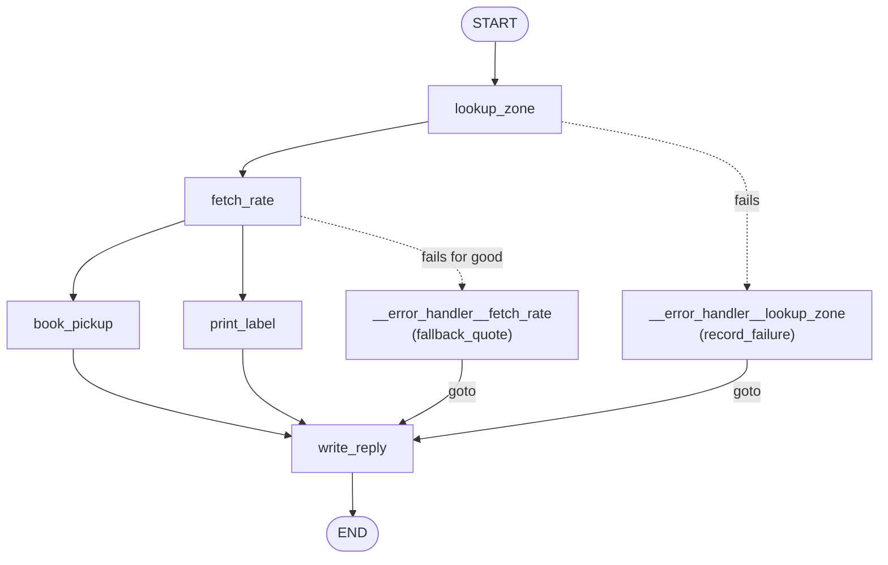
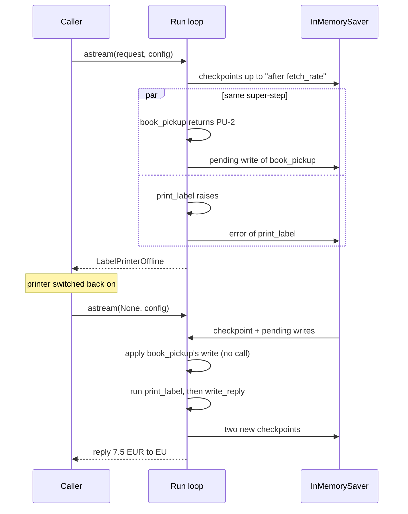

# 10.4 Recovering a Failed Run

## The problem

The quote graph from 10.3 can now absorb a lot. A retry policy rides out a short outage, a timeout cuts off a hung call, and an error handler turns a lost rate service into an estimate. Some failures cannot be handled inside the graph, though. A label printer that is switched off needs a person to switch it back on. Retrying a few milliseconds later does not help, and a fallback that pretends a label was printed would be worse than an error.

So the run fails, and the exception reaches the caller. That is the right outcome, but it raises a practical question: what happens to the work the run had already done? In this lesson the shipment step does two things at once. `book_pickup` books a courier, which is a side effect in the outside world, and `print_label` prints the label. When `print_label` fails, the courier is already booked. If the only way forward were to send the order again from the start, the zone would be looked up again, the rate service would be called again, and a second courier would be booked.

Lesson 5.1 showed that a run on a graph with a [checkpointer](../../../GLOSSARY.md#checkpointer) keeps its finished steps when it fails. Lesson 5.2 finished a crashed run by invoking with `None`. This lesson puts the two together in a graph with parallel branches and error handlers. It shows exactly what is kept when one branch fails, how to continue once the cause is fixed, and where 1.2.16 does not let you resume.

## The concept

### Resuming a run

To **resume** a failed run is to continue it from the last state the checkpointer saved, instead of starting it again. In LangGraph you do that by invoking the graph with `None` as the input and the config of the failed run:

```python
await graph.ainvoke(None, {"configurable": {"thread_id": "shipment-2"}})
```

`None` means "no new input". LangGraph loads the latest [checkpoint](../../../GLOSSARY.md#checkpoint) of that [thread_id](../../../GLOSSARY.md#thread_id) and runs the tasks that were still open in it. Nothing before them runs again. The official Functional API guide states the precondition for this: the cause of the error must have been fixed first, otherwise the resume fails the same way.

Three inputs, three outcomes:

| Call | What happens |
|---|---|
| `ainvoke(None, config)` on a thread with a checkpoint | The run continues from that checkpoint. |
| `ainvoke(original_input, config)` on the same thread | A **new** run starts on the thread. Open tasks from the failed run are dropped, and every node runs again. |
| `ainvoke(None, config)` on a thread with no checkpoint | [EmptyInputError](../../../GLOSSARY.md#emptyinputerror): `Received no input for __start__`. There is nothing to continue and nothing to start with. |

The second row surprises people. Sending the same request again feels like "retry", but to LangGraph it is new input, and new input starts over.

### What is saved when a step fails

A [super-step](../../../GLOSSARY.md#super-step) can run several tasks at once. When one of them fails, the others may already have finished. The checkpoint that marks the end of that step is never written, because the step did not end. What the checkpointer has is:

- the **last complete checkpoint**, the one saved after the previous step, and
- the [pending writes](../../../GLOSSARY.md#pending-writes) attached to it: the writes of every task of the failed step that finished, plus the error of the task that failed.

On a resume, LangGraph prepares the failed step again from that checkpoint. For every task that has saved writes, it applies those writes and does not call the node. Only the tasks without saved writes run. The Checkpointers guide puts it in one sentence: when you resume from that super-step, the successful nodes are not run again.

You can read all of this before you resume. [get_state](../../../GLOSSARY.md#get_state) returns a [StateSnapshot](../../../GLOSSARY.md#statesnapshot) of the latest checkpoint:

- `snapshot.next` names the tasks that still have to run. After a failure that is the failed task, and any sibling that did not finish.
- `snapshot.tasks` has one [PregelTask](../../../GLOSSARY.md#pregeltask) per task of the failed step. A finished task has its writes in `result`. The task that failed has `error` set, as a **string**: the error went through the checkpointer's serializer, which stores an exception as its `repr` (lesson 5.1). A task can also have neither, when nothing was saved for it (next section). So `error is None` does not mean "finished". The reliable signals are `next` (what will run) and `result` (what was kept).
- `snapshot.values` already include the pending writes of the finished tasks.

### "Finished" means finished

Only a sibling that **returned** before the failure has saved writes. If a sibling is still running, waiting at an `await`, when the other task raises, LangGraph cancels it. With `"sync"` or `"async"` (the default), the cancelled task is saved with the error `CancelledError()`. With `"exit"` the cancellation is not saved at all, so the task has neither an error nor a result. In every mode it stays in `next` and runs again on the resume. Whatever side effect it had already caused happens a second time (experiment 3).

## How it works

### The graph

The healthy path is a chain with one [fan-out](../../../GLOSSARY.md#fan-out) and its join. The diagram is drawn by hand: as in 10.1 and 10.3, `graph.get_graph()` fails on this graph, because drawing calls `zone_cache_key` on an empty input. Solid arrows are static edges, dotted arrows lead to an error-handler node, and `goto` arrows are the handlers' jumps. The two shipment nodes have no handler.



`book_pickup` and `print_label` run in the same super-step, and `write_reply` waits for both through a [waiting edge](../../../GLOSSARY.md#waiting-edge) (lesson 3.1).

### Failure and resume, step by step

The sequence below follows the Paris shipment of section 2 and the resume of section 3. Look at what reaches the checkpointer before the exception reaches the caller.



In the 1.2.16 source (`PregelLoop.put_writes` in `pregel/_loop.py`), the writes of each finished task are handed to the saver as soon as the task finishes, unless the durability mode is `"exit"` (next section). On the resume, the loop's `tick` re-emits the update of every task whose writes it applied from the checkpoint, and marks it as cached. That is why the replayed update carries `'__metadata__': {'cached': True}` in the stream, although no node cache is involved.

### Durability on a failed run

The [durability mode](../../../GLOSSARY.md#durability-mode) (lesson 5.2) decides *when* checkpoints and writes are handed to the saver:

- `"sync"` and `"async"` save each checkpoint at the end of its step and each task's writes as the task finishes. The difference between them is whether the next step waits for the save.
- `"exit"` keeps everything in memory and saves once, when the run exits. Exiting with an exception counts: the loop's exit code saves the current checkpoint and its pending writes on the way out.

For an **ordinary exception**, then, all three modes leave a resumable thread with the same `next` and the same kept writes. Only the number of checkpoints differs, because `"exit"` saves only the last one. Section 4 measures this.

The modes differ on a **hard crash**, when the process is killed and no more Python code runs. Lesson 5.2 measured that with a SQLite file: with `"sync"` every finished step was on disk, `"async"` lost a varying number of the newest checkpoints, and `"exit"` lost the whole run. Carried over to this graph: with `"exit"`, a crash during the shipment step would also lose `book_pickup`'s write, so the rerun would book a second courier. This lesson uses an [InMemorySaver](../../../GLOSSARY.md#inmemorysaver), which survives no crash in any mode, so it cannot show this. Durability matters together with a persistent checkpointer, such as `SqliteSaver` (5.2) or `PostgresSaver` (5.6).

## In our example

The [code walkthrough](readalong.md) goes through every changed line. Here we look at the parts that carry the idea.

### Two parallel shipment nodes, without handlers

<!-- snippet: src/l10_4_recover_failed_run/graph.py#parallel_edges -->
```python
# Two edges from fetch_rate fan out, so both nodes run in one
# super-step. The list form waits for both (lesson 3.1). The handlers'
# Command(goto="write_reply") skips this part, so an estimate or a
# "no quote" books nothing. fetch_rate stays alone in its step: #8277
# (see 10.3) only hits handlers of nodes that share their step.
builder.add_edge("fetch_rate", "book_pickup")
builder.add_edge("fetch_rate", "print_label")
builder.add_edge(["book_pickup", "print_label"], "write_reply")
```
<!-- /snippet -->

Two edges from `fetch_rate` put `book_pickup` and `print_label` into one super-step. The list form `["book_pickup", "print_label"]` makes `write_reply` wait for both. Both nodes call sync methods of `ShippingApi` that return at once, so `book_pickup` has always returned before `print_label` raises, and every run gives the same output.

The more important change is in the node defaults:

<!-- snippet: src/l10_4_recover_failed_run/graph.py#node_defaults -->
```python
builder = StateGraph(QuoteState)
# These apply to every node that does not set its own value in add_node,
# and they are applied at compile() time, whatever the order of calls.
# retry and timeout still cover every node, the error-handler nodes
# included. The defaults are not inherited by subgraphs. There is no
# per-node opt-out of a default error_handler (error_handler=None means
# "use the default"), so the handler moved to the one node that needs it.
builder.set_node_defaults(
    retry_policy=RATE_RETRY,
    timeout=RATE_TIMEOUT,
)
# LangGraph adds the handler as the node "__error_handler__lookup_zone"
# (it was "__default_error_handler__" in 10.3).
builder.add_node(
    "lookup_zone", lookup_zone, cache_policy=ZONE_CACHE, error_handler=record_failure
)
# A per-node handler wins over the default one. LangGraph adds it as the
# node "__error_handler__fetch_rate". retry and timeout now come from
# the defaults.
builder.add_node("fetch_rate", fetch_rate, error_handler=fallback_quote)
builder.add_node("book_pickup", book_pickup)
builder.add_node("print_label", print_label)
builder.add_node("write_reply", write_reply)
```
<!-- /snippet -->

In 10.3, `record_failure` was the default handler from [set_node_defaults](../../../GLOSSARY.md#set_node_defaults). Here it moved to `lookup_zone`'s own `add_node` call. A default handler would also cover the two new nodes, and a node with a [node-level error handler](../../../GLOSSARY.md#node-level-error-handler) cannot be fixed and resumed in 1.2.16 (see "Error handlers and resume" below). There is no per-node opt-out of a default handler: `error_handler=None` in `add_node` means "use the default". So the only way to leave the shipment nodes without a handler is to have no default handler at all. Retry and timeout stay defaults. `retry_rate` does not retry `LabelPrinterOffline`, so `print_label` fails at its first attempt.

`build_graph` now takes a `checkpointer` and passes it to `compile()`. It defaults to `None`, so the tests copied from 10.3 still build a graph without one and call it without a config.

### Reading what was saved

<!-- snippet: src/l10_4_recover_failed_run/__main__.py#show_saved -->
```python
async def show_saved(graph: Any, config: RunnableConfig) -> None:
    """Print what the checkpointer kept for the thread in `config`."""
    # get_state reads the latest checkpoint of the thread. `next` is the
    # tasks still to run.
    snapshot = await graph.aget_state(config)
    print(f"saved: next={snapshot.next}")
    # `tasks` are the tasks of that step. A failed task has the error it
    # raised, as the saved repr string (it went through the serializer). A
    # task whose writes were saved has them in `result`. A task with neither
    # has nothing saved: under durability="exit" a cancelled sibling's error
    # is never written, yet it is still in `next` and runs again.
    for task in snapshot.tasks:
        if task.error is not None:
            print(f"  {task.name}: failed with {task.error}")
        elif task.result is not None:
            print(f"  {task.name}: finished, kept {task.result}")
        else:
            print(f"  {task.name}: nothing saved, runs again")
```
<!-- /snippet -->

`show_saved` is how you inspect a failed thread before deciding what to do with it. It prints `next` and one line per `PregelTask`, in three cases: the error string for a task that failed, the kept writes for a task that finished, and "nothing saved, runs again" for a task with neither. The third case does not occur in the lesson's output. It is the cancelled sibling under `"exit"` from the previous section. The order of the tests matters: `result`, not a missing `error`, is what says a task was kept.

### Failing and resuming

<!-- snippet: src/l10_4_recover_failed_run/__main__.py#failed_run -->
```python
print("== 2. The label printer is offline: the run fails after book_pickup has finished ==")
config = {"configurable": {"thread_id": "shipment-2"}}
api.printer_online = False
try:
    await show_quote(graph, {"address": "1 Rue de Rivoli, Paris", "weight_kg": 1.0}, config)
except LabelPrinterOffline as error:
    # No handler caught it, so the error reaches the caller.
    print(f"run failed: {error}")
# The checkpointer kept the checkpoint before this step and
# book_pickup's finished write.
await show_saved(graph, config)
```
<!-- /snippet -->

<!-- snippet: src/l10_4_recover_failed_run/__main__.py#resume -->
```python
print("== 3. The printer is back: resume with None on the same thread ==")
# Fix the cause first. A resume while the printer is still offline fails
# the same way.
api.printer_online = True
calls_before = api.rate_calls
pickups_before = api.pickups_booked
labels_before = api.labels_printed
# None means "no new input: continue this thread from its last
# checkpoint". The original input would start the run over.
await show_quote(graph, None, config)
print(
    f"during the resume: rate calls {api.rate_calls - calls_before}, "
    f"pickups booked {api.pickups_booked - pickups_before}, "
    f"labels printed {api.labels_printed - labels_before}"
)
```
<!-- /snippet -->

The order matters: first fix the cause (`api.printer_online = True`), then resume with `None` on the **same** config. The three counters measure what the resume really did in the outside world.

### Comparing durability modes

<!-- snippet: src/l10_4_recover_failed_run/__main__.py#durability_modes -->
```python
print("== 4. Durability modes: what a failed run leaves in the checkpointer ==")
# Durability is chosen per call. On an ordinary exception every mode
# keeps the failed step and its finished writes; "exit" just writes them
# once, on the way out. The difference is a hard crash: "sync" has every
# finished step and write saved, "async" may lose the newest ones, and
# "exit" loses the whole run (lesson 5.2 measured it). An in-memory
# saver survives no crash at all.
for mode in ("sync", "async", "exit"):
    config = {"configurable": {"thread_id": f"durability-{mode}"}}
    api.printer_online = False
    try:
        await graph.ainvoke(
            {"address": "5 Market Street, Manchester", "weight_kg": 3.0},
            config,
            durability=mode,
        )
    except LabelPrinterOffline:
        pass
    # checkpointer.list(config) lists this thread's checkpoints, newest
    # first.
    saved = len(list(checkpointer.list(config)))
    snapshot = await graph.aget_state(config)
    # Kept means "has a saved result". A missing error is not enough:
    # under "exit" a cancelled sibling has neither and runs again.
    kept = [task.name for task in snapshot.tasks if task.result is not None]
    api.printer_online = True
    pickups_before = api.pickups_booked
    await graph.ainvoke(None, config, durability=mode)
    print(
        f"{mode:<5} checkpoints: {saved}  next: {snapshot.next}  kept: {kept}  "
        f"pickups booked on resume: {api.pickups_booked - pickups_before}"
    )
```
<!-- /snippet -->

`durability=` is an argument of each call, not of the graph. Every mode gets its own thread, so the counts do not mix. `checkpointer.list(config)` lists the thread's checkpoints, newest first. `kept` uses the same test as `show_saved`: a task counts as kept only if it has a saved `result`.

## Run it

From the course root, `./run.sh 10.4`. The live run of the verified lesson printed:

```text
== 1. A healthy shipment: book_pickup and print_label run in parallel ==
{'lookup_zone': {'zone': 'UK'}}
{'fetch_rate': {'price': 8.0, 'attempts': 1}}
{'book_pickup': {'pickup_id': 'PU-1'}}
{'print_label': {'label_id': 'LB-1'}}
{'write_reply': {'reply': '8.0 EUR to UK'}}

== 2. The label printer is offline: the run fails after book_pickup has finished ==
{'lookup_zone': {'zone': 'EU'}}
{'fetch_rate': {'price': 7.5, 'attempts': 1}}
{'book_pickup': {'pickup_id': 'PU-2'}}
run failed: label printer offline
saved: next=('print_label',)
  book_pickup: finished, kept {'pickup_id': 'PU-2'}
  print_label: failed with LabelPrinterOffline('label printer offline')

== 3. The printer is back: resume with None on the same thread ==
{'book_pickup': {'pickup_id': 'PU-2'}, '__metadata__': {'cached': True}}
{'print_label': {'label_id': 'LB-2'}}
{'write_reply': {'reply': '7.5 EUR to EU'}}
during the resume: rate calls 0, pickups booked 0, labels printed 1

== 4. Durability modes: what a failed run leaves in the checkpointer ==
sync  checkpoints: 4  next: ('print_label',)  kept: ['book_pickup']  pickups booked on resume: 0
async checkpoints: 4  next: ('print_label',)  kept: ['book_pickup']  pickups booked on resume: 0
exit  checkpoints: 1  next: ('print_label',)  kept: ['book_pickup']  pickups booked on resume: 0

== 5. A failure an error handler re-raised: the thread is closed ==
{'lookup_zone': {'zone': 'EU'}}
run failed: parcel too heavy: 40.0 kg
saved: next=()
rate service calls during the resume: 0
```

What to notice:

- **Section 1.** `book_pickup` and `print_label` each print an update from the same super-step, and `write_reply` runs once, after both.
- **Section 2.** `book_pickup`'s update was streamed before the failure: the courier `PU-2` is booked. There is no `print_label` line, because a failed task produces no update. `next` names only `print_label`. The error is a `repr` string, `LabelPrinterOffline('label printer offline')`, not an exception object.
- **Section 3.** The resume starts with the shipment step. `lookup_zone` and `fetch_rate` do not appear at all: they belong to steps that were already saved. `book_pickup` appears again, but with the same `PU-2` and the `cached` marker. That is the replayed pending write. The counters confirm it: 0 rate calls, 0 new pickups, 1 label.
- **Section 4.** The same failure in three modes. `"sync"` and `"async"` hold 4 checkpoints at the failure (the input, the start, after `lookup_zone`, after `fetch_rate`), `"exit"` holds 1. All three keep `book_pickup`'s write and book no second pickup on the resume.
- **Section 5.** The 40 kg parcel fails as in 10.3: `fallback_quote` re-raises `ParcelTooHeavy`. But here `next` is empty and there are no tasks. The resume runs nothing and returns the saved values, so the rate service is not called again. The thread looks finished, although the run failed.

The output is the same on every run. The whole run takes well under a second.

## Details and edge cases

**Error handlers and resume.** Section 5 shows the first of two limits that 1.2.16 sets on nodes with an error handler.

- When a handler **re-raises the original exception** (`raise error.error`, as `fallback_quote` does), the run fails, but the step is recorded as finished. `next` is `()`, `tasks` is `()`, and `ainvoke(None, config)` does nothing. This happens even when the node runs alone in its step.
- When a handler **raises a new exception**, `next` stays at the failed node. But the resume runs the **handler** again, never the node, and the handler's `error.error` is now the saved string instead of the exception object (experiment 5). LangGraph's own test `test_error_handler_resumes_after_crash` asserts exactly that the handler, not the original node, is rescheduled.

The second case is the "durable error-handler resume" that 1.2.0 added and that 10.3 mentioned. It is meant for a handler that was interrupted, for example by a host crash, so that it gets the same `NodeError` when the run resumes. It is not a way to re-run a node whose cause you fixed. The practical rule: **for a given node, choose either an error handler or resume, not both.** That is why the shipment nodes have none.

**Handlers in a parallel step.** If `record_failure` were still a default handler, it would also cover `print_label`, which shares its super-step with `book_pickup`. That is the case of issue [#8277](https://github.com/langchain-ai/langgraph/issues/8277) from 10.3: the handler runs and its writes are applied, its `goto` takes the run to `write_reply`, and yet `LabelPrinterOffline` is still raised to the caller. Combined with the first limit, the thread then ends with `next == ()` and the misleading reply `estimated 7.5 EUR to EU (LabelPrinterOffline in print_label)` in its state. Experiment 4 reproduces it. `fetch_rate` stays alone in its step, so its handler keeps working.

**A resume before the fix fails the same way.** With the printer still offline, `ainvoke(None, config)` raises `LabelPrinterOffline` again. `next` stays `('print_label',)`, no checkpoint is added, and `book_pickup` is not called. You can resume as often as you like; each attempt only re-runs the open tasks.

**`get_state` with a `checkpoint_id` hides pending writes.** `get_state(config)` with only a `thread_id` reads the latest checkpoint and applies its pending writes, which is why `snapshot.values` contain `pickup_id` after the failure. `get_state(snapshot.config)` names the [checkpoint_id](../../../GLOSSARY.md#checkpoint_id) explicitly, and in 1.2.16 it returns the values without the pending writes: no `pickup_id`. It also lists the finished sibling in `next`, which reads `('book_pickup', 'print_label')` there. The writes are still saved; that view just does not apply them. LangGraph's test `test_pending_writes_resume` checks both views.

**The `cached` marker is not the node cache.** In `stream_mode="updates"`, `'__metadata__': {'cached': True}` appears both for a node answered from a cache backend (10.1) and for a replayed pending write. `book_pickup` has no [CachePolicy](../../../GLOSSARY.md#cachepolicy), and the label would appear without any cache backend. Don't use the marker to decide whether a cache works.

**A config is required.** With a checkpointer, every call needs `{"configurable": {"thread_id": ...}}`. Without it, `ainvoke` raises `ValueError: Checkpointer requires one or more of the following 'configurable' keys: thread_id, checkpoint_ns, checkpoint_id` (lesson 5.1). And never pass `durability=` to a graph without a checkpointer: in 1.2.16, `durability="sync"` then fails with an `AttributeError` (open issue [#9267](https://github.com/langchain-ai/langgraph/issues/9267), lesson 5.2).

**There is always a window.** Even with `"sync"`, `book_pickup`'s write is saved only after the node returns. The courier is booked inside the node, a moment earlier. A process killed between the two leaves no saved write, and the rerun books again. Durability narrows the window, it does not close it. A node with a side effect must be [idempotent](../../../GLOSSARY.md#idempotent): for example, send the booking API an idempotency key derived from the thread, so that a second booking for the same order changes nothing.

## Common mistakes

> [!WARNING]
> **Resubmitting the request instead of resuming.** `ainvoke(original_input, config)` on the failed thread starts a new run. Every node runs again, and side effects happen twice: a second courier, a second rate call (experiment 1). Resume with `None`.

> [!WARNING]
> **Losing the `thread_id`.** The `thread_id` is the only key to the saved work. A resume on a new thread finds no checkpoint and raises `EmptyInputError` (experiment 2). Store the thread id with the order, so that whoever fixes the cause can resume the right run.

> [!WARNING]
> **Assuming every sibling's work is kept.** Only siblings that returned before the failure have saved writes. A sibling still waiting at an `await` is cancelled and runs again on the resume, side effect included (experiment 3).

> [!WARNING]
> **Putting an error handler on a node you want to resume.** In 1.2.16 a re-raised error closes the thread, and a new exception from the handler makes the resume re-run the handler, not the node. A default handler from `set_node_defaults` reaches every node, and `error_handler=None` does not opt out (experiments 4 and 5).

> [!WARNING]
> **Treating `tasks[...].error` as an exception.** It is the saved `repr` string, as lesson 5.1 showed. Compare strings, or catch the real exception around `ainvoke`.

## Experiments

Run each one from the lesson's original code with `./run.sh 10.4`.

1. In section 3 of `main` in [\_\_main\_\_.py](../src/l10_4_recover_failed_run/__main__.py), replace `await show_quote(graph, None, config)` with `await show_quote(graph, {"address": "1 Rue de Rivoli, Paris", "weight_kg": 1.0}, config)`.

   <details><summary>What happens and why</summary>

   Section 3 now runs the whole graph again: `{'lookup_zone': {'zone': 'EU'}, '__metadata__': {'cached': True}}` (this time from the real node cache, `ZONE_CACHE`), then `fetch_rate`, a new courier `PU-3`, label `LB-2` and the reply. The summary reads `rate calls 1, pickups booked 1, labels printed 1`. New input starts a new run on the thread and discards the open tasks of the failed one. Only `None` continues from the saved checkpoint. A customer who "retries" by sending the order again gets a second courier. Undo the change afterwards (`git checkout -- .` in the lesson directory).

   </details>

2. In section 3, add `config = {"configurable": {"thread_id": "shipment-4"}}` just before `await show_quote(graph, None, config)`.

   <details><summary>What happens and why</summary>

   The program prints the section 3 header and stops with a traceback ending in `langgraph.errors.EmptyInputError: Received no input for __start__`. Thread `shipment-4` has no checkpoint, so there is nothing to continue, and `None` gives no input to start from. The saved work of `shipment-2` is reachable only through its own `thread_id`. Undo the change afterwards.

   </details>

3. Make `book_pickup` slow. In [graph.py](../src/l10_4_recover_failed_run/graph.py), add `import asyncio` at the top and change the body of the `book_pickup` node to:

   ```python
   pickup_id = api.book_pickup(state["zone"])
   await asyncio.sleep(0.05)
   return {"pickup_id": pickup_id}
   ```

   <details><summary>What happens and why</summary>

   In section 1, `print_label`'s update now comes before `book_pickup`'s. Section 2 prints no `book_pickup` update, and `show_saved` shows `next=('book_pickup', 'print_label')`, with `book_pickup: failed with CancelledError()`. When `print_label` raised, `book_pickup` was still waiting at the `sleep`, so LangGraph cancelled it. The courier `PU-2` had already been booked, but the node never returned, so no write was saved. The resume runs `book_pickup` again and books `PU-3`: `pickups booked 1`.

   Section 4 prints `next: ('book_pickup', 'print_label')  kept: []  pickups booked on resume: 1` in all three modes. The modes differ only in what is saved for the cancelled task. Under `"sync"` and `"async"` it is the `CancelledError()` error. Under `"exit"` the cancellation is never written, so `show_saved` would print `book_pickup: nothing saved, runs again`. Either way the task has no `result`, it is still in `next`, and it runs again. Only siblings that finished are kept. A node with side effects must be safe to repeat. Undo the change afterwards.

   </details>

4. In `build_graph`, put `error_handler=record_failure` back into `set_node_defaults(...)` and remove it from `lookup_zone`'s `add_node` call, as in 10.3.

   <details><summary>What happens and why</summary>

   Section 2 now prints `{'__default_error_handler__': {'error': 'LabelPrinterOffline in print_label'}}` after `book_pickup`'s update, and then `run failed: label printer offline`: the handler ran, and the error reached the caller anyway (issue #8277). `show_saved` prints `next=()` and no tasks. Section 3 resumes nothing and prints only `during the resume: rate calls 0, pickups booked 0, labels printed 0`. Section 4 shows `next: ()  kept: []` in every mode, with 6, 6 and 1 checkpoints. Two limits hit at once: the handler in a parallel step does not stop the exception, and a node with a handler is never re-run by a resume. The thread's state even holds the reply `estimated 7.5 EUR to EU (LabelPrinterOffline in print_label)`, although no label was printed. Undo the change afterwards.

   </details>

5. In `fallback_quote`, replace `raise error.error` with `raise ParcelTooHeavy(str(error.error))`, and import `ParcelTooHeavy` from the service module next to `RateServiceUnavailable`.

   <details><summary>What happens and why</summary>

   Section 5 now prints `saved: next=('fetch_rate',)` and `fetch_rate: failed with ParcelTooHeavy('parcel too heavy: 40.0 kg')`: with a fresh exception the thread stays open. But the resume line fails again, and the program ends with a traceback in `fallback_quote`, `ParcelTooHeavy: ParcelTooHeavy('parcel too heavy: 40.0 kg')`, during the task `__error_handler__fetch_rate`. The resume re-ran the handler, not `fetch_rate`, and the rate service was not called again. The doubled message shows that the handler's `error.error` was now the saved `repr` string, not the exception object. The durable handler resume of 1.2 is for a handler that crashed, not for fixing a node's cause. Undo the change afterwards.

   </details>

## Summary

- With a checkpointer, a failed run keeps its last complete checkpoint, plus the pending writes of every task in the failed step that finished and the error of the one that failed. `get_state` shows the open tasks in `next` and each task's error (a `repr` string) or result in `tasks`.
- Fix the cause, then resume with `ainvoke(None, config)` on the same `thread_id`. Finished siblings are not called again: their saved writes are re-applied and show up in the stream with `'__metadata__': {'cached': True}`. New input starts over; `None` on an unknown thread raises `EmptyInputError`.
- Only siblings that returned are kept. One still running when the other fails is cancelled and runs again, so side effects must be idempotent.
- For an ordinary exception every durability mode keeps the failed step and its writes; `"exit"` writes them once, on the way out. On a hard crash `"sync"` keeps the most, `"async"` may lose the newest checkpoints, and `"exit"` loses the run (lesson 5.2). An in-memory saver survives no crash.
- In 1.2.16, a node with an error handler cannot be fixed and resumed: a re-raised error closes the thread, a new exception re-runs the handler. Use a handler or resume for a node, not both.

## Self-check

1. After a failed run, `get_state(config).next` is `('print_label',)` and the task `book_pickup` has its writes in `result`. What will `ainvoke(None, config)` call, once the printer works?

   <details><summary>Answer</summary>

   Only `print_label`, and then `write_reply`, which was waiting for both branches. `book_pickup`'s saved write is applied without calling the node, so no second courier is booked. `lookup_zone` and `fetch_rate` belong to steps that were already saved and do not run either.

   </details>

2. A support tool "retries" failed orders by calling `ainvoke(order, {"configurable": {"thread_id": order_id}})`. What goes wrong, and how do you fix it?

   <details><summary>Answer</summary>

   Passing the order again is new input, so a new run starts on the thread, the open tasks of the failed run are dropped, and every node runs again, side effects included. Pass `None` instead, after fixing the cause. If the thread has no checkpoint (for example a wrong id), `None` raises `EmptyInputError` rather than starting a run silently.

   </details>

3. In a run with `durability="exit"`, `print_label` raises an ordinary exception. Is `book_pickup`'s write lost? What if the process had been killed at the same moment instead?

   <details><summary>Answer</summary>

   On an exception it is kept: the run loop saves the checkpoint and its pending writes when it exits, and exiting with an exception counts. Section 4 shows `kept: ['book_pickup']` for `"exit"`. A killed process runs no exit code, so with `"exit"` nothing of the run is saved, as lesson 5.2 measured, and the rerun would book a second courier. With a persistent saver and `"sync"`, the finished steps and the write would be on disk.

   </details>

4. Why does `book_pickup` have no error handler, not even the default `record_failure` from 10.3?

   <details><summary>Answer</summary>

   In 1.2.16 a node with a handler cannot be fixed and resumed: a re-raised error leaves `next` empty, and a new exception makes the resume re-run the handler, not the node. And since `book_pickup` shares its super-step with `print_label`, a handler there would also hit issue #8277. A default handler from `set_node_defaults` cannot be switched off per node (`error_handler=None` means "use the default"), so `record_failure` moved to `lookup_zone`'s own `add_node`.

   </details>

5. In the updates stream of a resume you see `{'book_pickup': {...}, '__metadata__': {'cached': True}}`. Does this prove that the node cache works?

   <details><summary>Answer</summary>

   No. The same marker appears for a replayed pending write: the loop re-emits the update of each task whose writes it applied from the checkpoint and marks it as cached. `book_pickup` has no cache policy at all. To check the node cache, look at whether the underlying call happened, for example with a counter like `api.zone_lookups`.

   </details>

## Further reading

- [Checkpointers: pending writes](https://docs.langchain.com/oss/python/langgraph/checkpointers#pending-writes), LangGraph docs: what is kept when a node fails in a super-step, and why successful nodes are not re-run. The [durability modes](https://docs.langchain.com/oss/python/langgraph/checkpointers#durability-modes) section of the same page describes `"exit"`, `"async"` and `"sync"`.
- [Functional API: resuming](https://docs.langchain.com/oss/python/langgraph/functional-api#resuming), LangGraph docs: resuming after an error with `None` and the same thread id, and the sections on determinism and idempotency.
- [Fault tolerance: resume-safe failures](https://docs.langchain.com/oss/python/langgraph/fault-tolerance#resume-safe-failures), LangGraph docs: failure provenance in the checkpoint, and the handler getting the same `NodeError` after a crash.
- [Persistence](https://docs.langchain.com/oss/python/langgraph/persistence), LangGraph docs: checkpointers versus stores, and the note that an in-memory saver is lost on restart.
- [`langgraph/pregel/_loop.py` at 1.2.16](https://github.com/langchain-ai/langgraph/blob/1.2.16/libs/langgraph/langgraph/pregel/_loop.py): `put_writes`, the replayed writes marked as cached in `tick`, and the save on exit for `durability="exit"`.
- [`tests/test_pregel.py` at 1.2.16](https://github.com/langchain-ai/langgraph/blob/1.2.16/libs/langgraph/tests/test_pregel.py): `test_pending_writes_resume`, the pending-writes behaviour in every durability mode.
- [`tests/test_retry.py` at 1.2.16](https://github.com/langchain-ai/langgraph/blob/1.2.16/libs/langgraph/tests/test_retry.py): `test_error_handler_resumes_after_crash`, the resume re-runs the handler, not the node.
- [langgraph 1.2.0 release notes](https://github.com/langchain-ai/langgraph/releases/tag/1.2.0): durable error-handler resume across host crashes.
- [Issue #8277](https://github.com/langchain-ai/langgraph/issues/8277): a handled exception is re-raised when the failing node runs in parallel with other tasks.
- [Issue #9267](https://github.com/langchain-ai/langgraph/issues/9267): `durability="sync"` on a graph without a checkpointer raises `AttributeError`.
