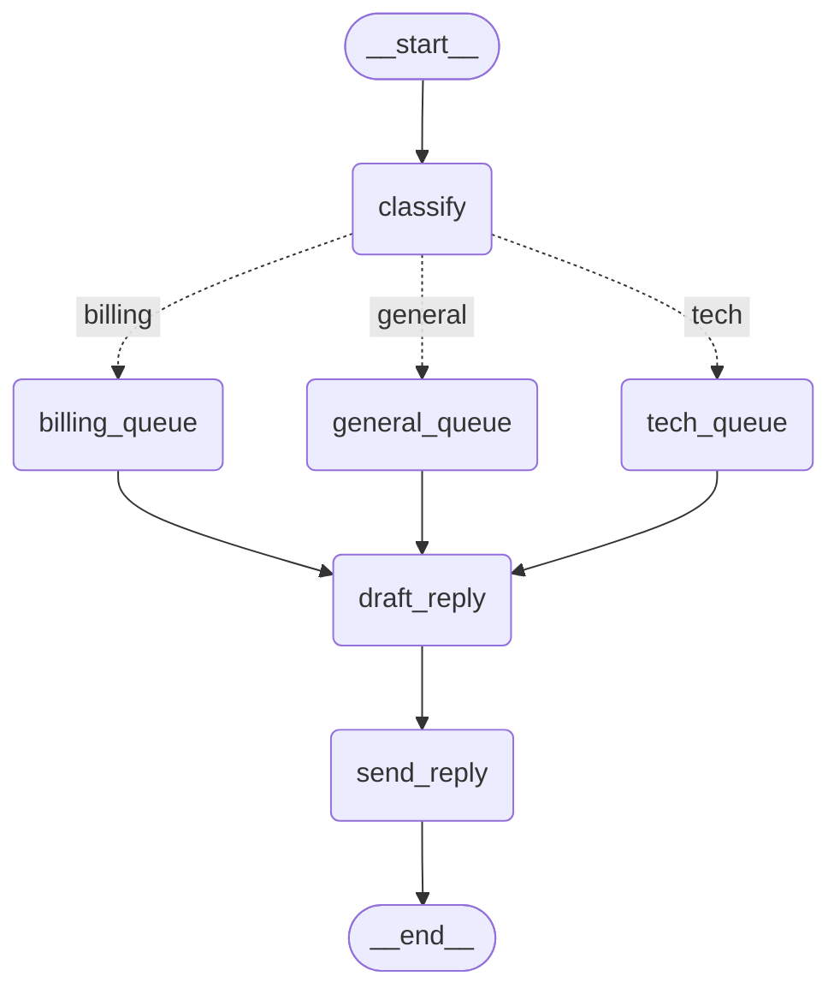
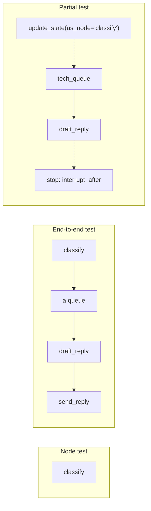
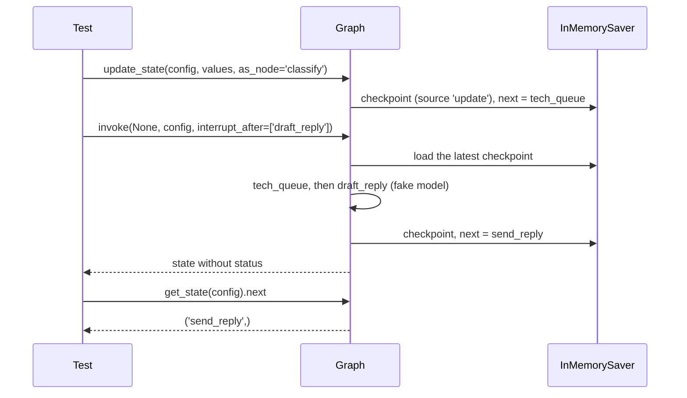

# 10.5 Testing Graphs with pytest

## The problem

So far in this module you have checked a graph by running it and reading the output. That works while you are writing the graph. It stops working once the graph changes for other reasons: a new keyword, a renamed node, an extra branch. Nobody re-reads the output of every route after every change, so a test suite has to do it.

Testing a graph is harder than testing a plain function, for three reasons you already know from earlier lessons:

- **One step calls an LLM.** Its answers vary, cost money and need a key and a network. A test that depends on them is slow and flaky.
- **A graph with a [checkpointer](../../../GLOSSARY.md#checkpointer) has memory.** A [thread_id](../../../GLOSSARY.md#thread_id) that a previous run used is not empty (lesson 5.1). If two tests share a saver, the second one starts where the first one stopped.
- **The interesting part is often in the middle.** To check what `draft_reply` does for a tech ticket, a full run has to classify the ticket first and then send the reply, which in production is an email. You want neither.

This lesson answers each of these with one technique, and builds the test suite for a small ticket router at three levels: one node, the whole graph, and a slice of it.

## The concept

### Three levels of tests

| Level | What runs | What it checks | How |
|---|---|---|---|
| Node | one node's function | the update the node returns for a given state | `compiled_graph.nodes[name].invoke(state)` |
| End to end | the whole graph, START to END | the final state, the path taken, the saved thread | `invoke` or `stream` with a fresh checkpointer |
| Partial | a section of the graph | what the section does with a prepared state, and where it stops | `update_state(..., as_node=...)`, then `invoke(None, ..., interrupt_after=[...])` |

The official [LangGraph testing guide](https://docs.langchain.com/oss/python/langgraph/test) describes the same three techniques. This lesson adds what the guide leaves out: a fake model for the LLM step, fixtures that keep tests apart, and the checks that catch the ways these techniques fail silently.

### Isolation: every test builds its own graph

The rule behind all three levels is that **a test owns everything it touches**. The guide puts it as: create the graph and a new checkpointer before each test. In pytest this is what a [pytest fixture](../../../GLOSSARY.md#pytest-fixture) is for. A fixture is a function marked with `@pytest.fixture`. A test that has a parameter with the fixture's name gets the fixture's return value. Fixtures defined in [conftest.py](../../../GLOSSARY.md#conftestpy) are available to every test file in that directory without an import.

How long pytest keeps one fixture value is its [fixture scope](../../../GLOSSARY.md#fixture-scope). The default is `function`: the fixture is called again for every test, so every test gets a new object. Wider scopes (`class`, `module`, `package`, `session`) share one object between tests. That is useful for something that is expensive to create and safe to share. It is wrong for a checkpointer, because a checkpointer is state.

Two choices in the graph code make isolation possible:

- **The graph is built by a factory**, `build_graph(model, checkpointer)`, not compiled once at module level. Each test calls it with its own parts.
- **The model is a parameter.** The LLM node gets its [chat model](../../../GLOSSARY.md#chat-model) from outside. Production passes a real one; tests pass a fake [GenericFakeChatModel](../../../GLOSSARY.md#genericfakechatmodel) (lesson 4.1) that returns scripted replies and needs no network.

### Level 1: one node, through the compiled graph

A compiled graph has a `nodes` attribute: a dict from node name to a [PregelNode](../../../GLOSSARY.md#pregelnode). It holds every node you added, plus the internal `__start__`. `PregelNode.invoke(state)` runs only that node's function and returns its [partial update](../../../GLOSSARY.md#partial-update). It does not write the update into the state, it follows no edge and it saves no checkpoint, even when the graph has a checkpointer.

Why not just call the Python function `classify(...)` directly? You can, and for a plain function that is fine. Going through `graph.nodes` tests the node as the graph registered it: under its name, with the function the factory actually wired in. For `draft_reply`, which is created inside `make_draft_reply(model)`, there is no module-level function to call at all.

### Level 2: the whole graph

An end-to-end test runs the graph as production does: input in, final state out, with a checkpointer and a `thread_id`. It can check three things:

- **the result**: `invoke` returns the final state values;
- **the path**: `stream(..., stream_mode="updates")` yields one `{node_name: update}` dict per finished node (lesson 7.1), so the test can check which nodes ran and in which order;
- **the thread**: `get_state(config).next == ()` says nothing is left to run, so the run reached END and did not stop on the way.

### Level 3: partial execution

[Partial execution](../../../GLOSSARY.md#partial-execution) runs only a section of the graph, without changing the graph. It uses two things you already know from lessons 6.1 and 6.5:

1. **Seed the thread.** [update_state](../../../GLOSSARY.md#update_state)`(config, values, as_node="classify")` saves `values` in a new [checkpoint](../../../GLOSSARY.md#checkpoint), as if `classify` had just returned them. [as_node](../../../GLOSSARY.md#as_node) names the node *before* the section you want to test. LangGraph then evaluates that node's outgoing edges to decide what runs next.
2. **Run the section and stop.** `invoke(None, config, interrupt_after=["draft_reply"])`. `None` means "no new input: continue the saved thread". [interrupt_after](../../../GLOSSARY.md#interrupt_after) names the *last* node you want to run. After it, the run pauses, saves a checkpoint and returns the state so far.

`interrupt_after` is a static breakpoint. Lesson 6.1 set breakpoints aside as a debugging tool and used `interrupt()` for human-in-the-loop instead. In a test, a breakpoint is exactly what you want: a stop that the graph code knows nothing about.

## How it works

The graph under test is the ticket router you know from lessons 1.2 and 1.3, rebuilt with a drafting and a sending step. The diagram was generated from the code with `get_graph().draw_mermaid()` (styling removed). Dotted arrows are the [conditional edge](../../../GLOSSARY.md#conditional-edge) from `classify`.



The three levels cut this graph in different places. The next diagram shows what each kind of test runs: a node test calls a single node, the end-to-end test runs everything, and the partial test starts after `classify` and stops before `send_reply`.



What happens in the partial test, step by step:



The seeding checkpoint has metadata `{'source': 'update', 'step': 0, ...}`, and `get_state(config).next` already shows `('tech_queue',)` right after `update_state`: the route was decided when the values were saved, by `route_ticket` running on them.

## In our example

The [code walkthrough](readalong.md) goes through every file line by line. Here are the parts that carry the idea.

### The graph is built to be tested

The LLM node is made by a function that takes the model:

<!-- snippet: src/l10_5_testing_graphs/graph.py#draft_reply_node -->
```python
def make_draft_reply(model: BaseChatModel) -> Callable[[TicketState], dict[str, str]]:
    """Build the draft_reply node around the given chat model.

    The model is a parameter: production passes a real chat model, tests pass
    a fake one. Nothing in the graph knows the difference.
    """

    def draft_reply(state: TicketState) -> dict[str, str]:
        """Ask the model for a reply written for the team that owns the ticket."""
        response = model.invoke(
            [
                SystemMessage(SYSTEM_PROMPT.format(team=state["team"])),
                HumanMessage(state["text"]),
            ]
        )
        return {"reply": response.content}

    return draft_reply
```
<!-- /snippet -->

`build_graph` takes the model and the checkpointer as arguments and compiles a new graph on every call:

<!-- snippet: src/l10_5_testing_graphs/graph.py#build_graph -->
```python
def build_graph(
    model: BaseChatModel, checkpointer: BaseCheckpointSaver | None = None
) -> CompiledStateGraph:
    """Wire and compile the ticket router.

    A factory, not a module-level graph: every test builds its own graph with
    its own model and checkpointer, so nothing is shared between tests.
    """
    builder = StateGraph(TicketState)
    builder.add_node("classify", classify)
    builder.add_node("billing_queue", billing_queue)
    builder.add_node("tech_queue", tech_queue)
    builder.add_node("general_queue", general_queue)
    builder.add_node("draft_reply", make_draft_reply(model))
    builder.add_node("send_reply", send_reply)

    builder.add_edge(START, "classify")
    # route_ticket returns a category; the mapping turns it into a node name.
    builder.add_conditional_edges(
        "classify",
        route_ticket,
        {
            "billing": "billing_queue",
            "tech": "tech_queue",
            "general": "general_queue",
        },
    )
    # Whatever queue ran, the ticket goes on to the same drafting step.
    builder.add_edge("billing_queue", "draft_reply")
    builder.add_edge("tech_queue", "draft_reply")
    builder.add_edge("general_queue", "draft_reply")
    builder.add_edge("draft_reply", "send_reply")
    builder.add_edge("send_reply", END)
    return builder.compile(checkpointer=checkpointer)
```
<!-- /snippet -->

Nothing in [graph.py](../src/l10_5_testing_graphs/graph.py) refers to pytest or to a fake. The graph only asks for a `BaseChatModel`, and the test decides which one.

### The fake model and the fixtures

`GenericFakeChatModel` returns its scripted replies and ignores the prompt. A test of `draft_reply` needs the prompt, though: it is where the node puts the team name. `RecordingChatModel` adds that by overriding `_generate`, the method `BaseChatModel.invoke` ends in:

<!-- snippet: tests/conftest.py#recording_model -->
```python
class RecordingChatModel(GenericFakeChatModel):
    """A fake chat model that also remembers every prompt it received.

    GenericFakeChatModel returns the scripted AIMessages one per call and
    ignores its input. Recording the prompts lets a test check what the node
    sent to the model.
    """

    # Field(default_factory=list): pydantic gives every instance its own list.
    prompts: list[list[BaseMessage]] = Field(default_factory=list)

    def _generate(
        self,
        messages: list[BaseMessage],
        stop: list[str] | None = None,
        run_manager: CallbackManagerForLLMRun | None = None,
        **kwargs: Any,
    ) -> ChatResult:
        """Record the prompt, then return the next scripted reply."""
        self.prompts.append(messages)
        return super()._generate(messages, stop=stop, run_manager=run_manager, **kwargs)
```
<!-- /snippet -->

The fixtures are all function-scoped, which is the whole point:

<!-- snippet: tests/conftest.py#fixtures -->
```python
# All fixtures are function-scoped (the pytest default), and that is the
# point: every test gets its own model, checkpointer and config.


@pytest.fixture
def make_model() -> Callable[..., RecordingChatModel]:
    """Return a factory that builds a fake model with the given replies."""

    def _make(*replies: str) -> RecordingChatModel:
        # The script is an iterator that gets used up, so every test makes its
        # own model with exactly the replies its run needs.
        return RecordingChatModel(messages=iter([AIMessage(r) for r in replies]))

    return _make


@pytest.fixture
def checkpointer() -> InMemorySaver:
    """Return a fresh in-memory checkpointer for one test."""
    return InMemorySaver()


@pytest.fixture
def config() -> RunnableConfig:
    """Return the run config with the thread to save checkpoints under."""
    # Every test may use the same thread_id only because every test gets a
    # fresh checkpointer.
    return {"configurable": {"thread_id": "ticket-1"}}
```
<!-- /snippet -->

`make_model` returns a factory rather than a model, so each test scripts exactly the replies its run needs. All tests use `thread_id` `"ticket-1"`, which is safe only because each one gets its own [InMemorySaver](../../../GLOSSARY.md#inmemorysaver).

### Level 1: a node test

<!-- snippet: tests/test_nodes.py#test_draft_reply_node -->
```python
def test_draft_reply_node(make_model, checkpointer: InMemorySaver) -> None:
    """draft_reply sends the team prompt and the ticket to the model."""
    model = make_model("Sorry about the crash, we are on it.")
    graph = build_graph(model, checkpointer)

    # The node gets exactly the state it reads; no other node runs.
    update = graph.nodes["draft_reply"].invoke(
        {"text": "The app crashes on login", "team": "Tech team"}
    )

    assert update == {"reply": "Sorry about the crash, we are on it."}
    assert [m.content for m in model.prompts[0]] == [
        "You write short, friendly replies for the Tech team.",
        "The app crashes on login",
    ]
    # A direct node call bypasses the graph's checkpointer: nothing was saved.
    assert list(checkpointer.list(None)) == []
```
<!-- /snippet -->

The test passes only the two keys `draft_reply` reads, as if a queue node had just run. It checks the update, the prompt the model received, and one fact you might not expect: the graph has a checkpointer, but `checkpointer.list(None)` is empty. A direct node call goes around the run loop that writes checkpoints. `test_classify_node` uses another trick: it builds the graph with `make_model()` and no replies, so any model call would fail. A green test therefore also proves that `classify` never touches the model.

### Level 2: end to end

<!-- snippet: tests/test_end_to_end.py#test_route_order -->
```python
def test_route_order(make_model, checkpointer: InMemorySaver, config: RunnableConfig) -> None:
    """Only one queue node runs, and the nodes run in wiring order."""
    graph = build_graph(make_model("Thanks for asking."), checkpointer)

    # stream_mode="updates" yields one {node_name: update} dict per step.
    chunks = graph.stream({"text": "Do you ship to Canada?"}, config, stream_mode="updates")
    order = [name for chunk in chunks for name in chunk]

    assert order == ["classify", "general_queue", "draft_reply", "send_reply"]
```
<!-- /snippet -->

`test_full_run` checks the result of each route with `==` against the whole final state. This test checks the path instead: only one queue node runs, in the order of the edges.

### Level 3: a slice

<!-- snippet: tests/test_partial.py#test_partial_run -->
```python
def test_partial_run(make_model, checkpointer: InMemorySaver, config: RunnableConfig) -> None:
    """Start after classify, stop after draft_reply: send_reply never runs."""
    model = make_model(FAKE_REPLY)
    graph = build_graph(model, checkpointer)

    # The seeded category contradicts the text on purpose: the text says
    # "refund", but the tech route proves classify did not run and the seeded
    # state decided the route.
    graph.update_state(
        config,
        {"text": "Please refund my order", "category": "tech"},
        as_node="classify",
    )

    # Pass None: new input would start a new run at START. interrupt_after
    # takes a list of node names.
    result = graph.invoke(None, config, interrupt_after=["draft_reply"])

    assert result["team"] == "Tech team"
    assert result["reply"] == FAKE_REPLY
    assert "status" not in result
    # An unknown node name in interrupt_after is silently ignored, so check
    # where the run stopped: the next node to run is send_reply.
    assert graph.get_state(config).next == ("send_reply",)
    assert model.prompts[0][0].content == ("You write short, friendly replies for the Tech team.")
```
<!-- /snippet -->

The seed contradicts itself on purpose. The text says "refund", which `classify` would send to billing, but the seeded category is `"tech"`. The Tech team in the result therefore proves that `classify` did not run and the seeded state decided the route. `test_resume_after_partial` continues the same thread with `stream(None, config)` and sees a single update, from `send_reply`. The model has one scripted reply and still counts one prompt, so the draft was not generated again.

## Run it

From the course root, `./run.sh 10.5` runs the suite with `python -m pytest -v tests`. The live run of the verified lesson printed:

```text
============================= test session starts ==============================
platform linux -- Python 3.12.14, pytest-9.1.1, pluggy-1.7.0 -- /path/to/course/10-production/.venv/bin/python3
cachedir: .pytest_cache
rootdir: /path/to/course/10-production/10.5-testing-graphs
configfile: pyproject.toml
plugins: langsmith-0.14.11, anyio-4.15.1
collecting ... collected 11 items

tests/test_end_to_end.py::test_full_run[billing] PASSED                  [  9%]
tests/test_end_to_end.py::test_full_run[tech] PASSED                     [ 18%]
tests/test_end_to_end.py::test_full_run[general] PASSED                  [ 27%]
tests/test_end_to_end.py::test_route_order PASSED                        [ 36%]
tests/test_nodes.py::test_classify_node[refund-billing] PASSED           [ 45%]
tests/test_nodes.py::test_classify_node[crash-tech] PASSED               [ 54%]
tests/test_nodes.py::test_classify_node[question-general] PASSED         [ 63%]
tests/test_nodes.py::test_classify_node[billing-before-tech] PASSED      [ 72%]
tests/test_nodes.py::test_draft_reply_node PASSED                        [ 81%]
tests/test_partial.py::test_partial_run PASSED                           [ 90%]
tests/test_partial.py::test_resume_after_partial PASSED                  [100%]

============================== 11 passed in 0.09s ==============================
```

What to notice:

- **11 tests from 6 test functions.** Parametrized tests appear once per case, with the `id=` values in brackets: `test_full_run[tech]`, `test_classify_node[billing-before-tech]`. A failing case names itself.
- **The order.** pytest runs the files in alphabetical order, so the end-to-end tests run first and the node tests after them. Nothing in the suite depends on that order. Experiment 1 shows what happens when something does.
- **0.09 s.** No network, no API key. The only LLM step talks to a fake, so the suite can run on every save and in CI. Your paths, versions and timing will differ; the list of tests and their results will not.

## Details and edge cases

**A node call skips more than the checkpointer.** `PregelNode.invoke` calls the node's function with exactly the dict you pass. There is no state schema in between: no default values, no [reducers](../../../GLOSSARY.md#reducer), no merge with earlier keys. Pass a state without a key the node reads and you get a plain `KeyError` (`KeyError: 'team'` for `draft_reply` without `team`). The returned dict is the node's own update, not the state after it, which is why `test_classify_node` can compare with `==` and catch an extra key.

**The routing function is tested through its effect.** `route_ticket` is a [routing function](../../../GLOSSARY.md#routing-function), not a node, so it is not in `graph.nodes`. The tests check what it causes: which queue node appears in the stream, or what `get_state(config).next` shows after `update_state`. For a router with logic of its own, you can also test the function directly, since it is plain Python.

**`update_state` needs a checkpointer and a real node name.** On a graph compiled without one it raises `ValueError: No checkpointer set`. With `as_node="nope"` it raises `InvalidUpdateError: Node nope does not exist`. Both are loud, which is good.

**Without `as_node`, a fresh thread treats the update as input.** On a thread with history, LangGraph infers `as_node` from the node that wrote last (lesson 6.5). A new thread has no history, so the values are saved as if they were the graph's input, `next` becomes `('classify',)`, and the "partial" run is a full run again (experiment 3). The [time-travel guide](https://docs.langchain.com/oss/python/langgraph/use-time-travel) lists setting up state on a fresh thread, one with no execution history, among the cases where you should pass `as_node` explicitly.

**`interrupt_after` is checked when compiling, but not per call.** `compile(interrupt_after=["draft"])` raises `` ValueError: Interrupt node `draft` not found `` (lesson 4.3 met this message). The same name passed to `invoke` or `stream` is not checked at all. At each step LangGraph only asks whether the task's name is in what you passed, so an unknown name matches nothing and the run goes on to END (experiment 4).

**Use a list, not a string.** The testing guide passes `interrupt_after="node3"`, and a string does work for an exact name. But the check is `task.name in interrupt_after`, and for a string `in` is a substring test. In 1.2.16, `interrupt_after="tech_queue_and_draft_reply"` stops after `tech_queue`, because `"tech_queue"` is a substring of it. A list compares whole names.

**`None` continues, input restarts.** On a thread with a checkpoint, `invoke(None, config)` runs the open tasks. Any other input starts a new run at START on the same thread, and the seeded state is overwritten by what the nodes compute (experiment 5). Lesson 10.4 showed the same rule for a failed run.

**A used-up script fails loudly, but obscurely.** The fake model calls `next()` on its iterator. When the replies run out, `StopIteration` is raised inside `invoke`'s internal generator, and Python turns it into `RuntimeError: generator raised StopIteration` (lesson 4.1). In pytest, look for `During task with name 'draft_reply'` in the traceback to see which node ran out of replies.

**The testing guide still uses `MemorySaver`.** Its example compiles with `MemorySaver()`, while the text links to `InMemorySaver`. In 1.2.16 `MemorySaver` is only a backwards-compatible alias, `MemorySaver = InMemorySaver`. Use `InMemorySaver`.

## Common mistakes

> [!WARNING]
> **Sharing a checkpointer between tests.** A module- or session-scoped saver, or one created at module level, carries checkpoints from one test into the next whenever they use the same `thread_id`. The failures appear in other tests, often in other files, and change when the test order changes (experiment 1). Keep the checkpointer fixture function-scoped.

> [!WARNING]
> **Building the fake model once.** `GenericFakeChatModel` consumes its iterator, so a model shared by several tests runs out of replies in whichever test comes later. Build one per test, with exactly the replies the run needs (experiment 2).

> [!WARNING]
> **Forgetting `as_node` when seeding a fresh thread.** Without it the values count as input, the node you meant to skip runs again and overwrites them (experiment 3). Always name the node before the section.

> [!WARNING]
> **Trusting `interrupt_after` without checking where the run stopped.** A misspelt node name in the per-call argument raises no error, and the run goes through the step you wanted to avoid, side effect included (experiment 4). Assert `get_state(config).next` after a partial run.

> [!WARNING]
> **Passing the input again instead of `None`.** `invoke(values, config, interrupt_after=[...])` after `update_state` starts over at START and discards the seed (experiment 5).

> [!TIP]
> Make each test fail for one reason you can name. The deliberate contradiction in the partial test's seed ("refund" text, `"tech"` category) is an example: if `classify` runs when it should not, the team is wrong, and the assertion says so.

## Experiments

Run each one from the lesson's original code with `./run.sh 10.5`.

1. In [conftest.py](../tests/conftest.py), change the decorator of the `checkpointer` fixture to `@pytest.fixture(scope="session")`.

   <details><summary>What happens and why</summary>

   The end-to-end tests still pass, and so do the classify tests. Two later tests fail: `test_draft_reply_node`, because `checkpointer.list(None)` is not empty (the diff reports 24 extra `CheckpointTuple`s, the checkpoints of the four end-to-end runs), and `test_partial_run` on `assert 'status' not in result`. The partial run reads the same thread `ticket-1`, which already holds `status: 'sent'` from an end-to-end run, and the result still contains it. One shared saver leaks state between tests, and the failures show up in `test_nodes.py` and `test_partial.py`, not in the end-to-end file that wrote the checkpoints. A fresh checkpointer per test removes the problem. Undo the change afterwards (`git checkout -- .` in the lesson directory).

   </details>

2. In `test_full_run` in [test_end_to_end.py](../tests/test_end_to_end.py), replace `model = make_model(reply)` with `model = make_model()`.

   <details><summary>What happens and why</summary>

   All three `test_full_run` cases fail with `RuntimeError: generator raised StopIteration`, and each traceback contains `During task with name 'draft_reply'`. `test_route_order` still passes, because it makes its own model. The fake model takes one scripted reply per call, and this one has none. A test has to script exactly the LLM calls its run makes, which is also why models are made per test and never at module level. Undo the change afterwards.

   </details>

3. In `test_partial_run` in [test_partial.py](../tests/test_partial.py), remove the line `as_node="classify",` from the `update_state` call.

   <details><summary>What happens and why</summary>

   `test_partial_run` fails on the team: `assert 'Billing team' == 'Tech team'`. On a fresh thread, an update without `as_node` is saved as input, so the run starts with `classify`. It reads "refund", overwrites the seeded `"tech"` with `"billing"`, and the ticket goes to the Billing team. `as_node` is what tells LangGraph which node the seeded state came from, and so where the run continues. Undo the change afterwards.

   </details>

4. In `test_partial_run`, misspell the stop node: `interrupt_after=["draft"]`.

   <details><summary>What happens and why</summary>

   No error from LangGraph. The run goes on through `send_reply` to END, and the test fails on `assert 'status' not in result`, because the result now has `status: 'sent'`. The per-call `interrupt_after` ignores names that are not nodes. Here the `status` assertion happens to come first and catches it; in a test that does not check `status`, the assertion on `get_state(config).next == ('send_reply',)` is what catches the typo, because `next` is `()` after a run that reached END. With a real `send_reply`, this test of the drafting step would have sent the email. Undo the change afterwards.

   </details>

5. In `test_partial_run`, pass the ticket again instead of `None`: `graph.invoke({"text": "Please refund my order"}, config, interrupt_after=["draft_reply"])`.

   <details><summary>What happens and why</summary>

   The test fails with `assert 'Billing team' == 'Tech team'`. New input starts a new run on the thread at START: `classify` runs, sees "refund", and the ticket goes to billing. The seeded checkpoint is still in the thread's history, but the new run does not continue from it. Only `None` continues from the saved state. Undo the change afterwards.

   </details>

## Summary

- Build the graph with a factory that takes the chat model and the checkpointer, so every test assembles its own graph. Production passes a real model, tests pass a `GenericFakeChatModel` with exactly the replies the run needs.
- Keep fixtures function-scoped. A fresh `InMemorySaver` per test is what makes a shared `thread_id` safe; a shared saver leaks state into other tests and other files.
- Test one node with `compiled_graph.nodes[name].invoke(state)`. It returns the node's own update and bypasses edges, schema and checkpointer.
- Test the whole graph with `invoke` (result), `stream(stream_mode="updates")` (path) and `get_state(config).next == ()` (reached END).
- Test a slice by seeding with `update_state(config, values, as_node=<node before the slice>)`, then `invoke(None, config, interrupt_after=[<last node>])`. Pass `None`, use a list, and assert `get_state(config).next`, because unknown names are ignored.

## Self-check

1. `graph.nodes["classify"].invoke({"text": "My payment failed"})` returns `{"category": "billing"}`, not a state with `text` in it. Why, and why is that useful in a test?

   <details><summary>Answer</summary>

   `PregelNode.invoke` runs only the node's function and returns what the function returned: the node's partial update. It does not merge it into a state. A test can therefore compare the update with `==` and notice when a node writes a key it does not own.

   </details>

2. A colleague moves the `checkpointer` fixture to `scope="module"` "to make the tests faster". Which tests can break, and when?

   <details><summary>Answer</summary>

   In this suite, none today: all 11 tests still pass. In `test_nodes.py` only `test_draft_reply_node` asks for the checkpointer, so its saver is still empty, and the checkpoints that the tests in `test_end_to_end.py` and `test_partial.py` now share happen not to break any of their assertions. That is the danger: the leak is latent. All tests in one file now share one saver, so tests that use the same `thread_id` share checkpoints. As soon as a second test in the same file asserts on the saver's contents or on thread state, it sees what an earlier test wrote. A `checkpointer.list(None) == []` test added at the end of `test_end_to_end.py` would fail, for example: the four earlier runs in that file left their checkpoints in the shared saver. (The same test in `test_nodes.py` would still pass, because calling a node directly writes no checkpoint.) Which test fails depends on the order they run in. Experiment 1 shows the same leak becoming visible with `scope="session"`, where sharing across files breaks two tests. `InMemorySaver()` costs almost nothing to create, so the speedup is not real either.

   </details>

3. You want to test `tech_queue` and `draft_reply` together, without `classify` and `send_reply`. Write the two calls.

   <details><summary>Answer</summary>

   ```python
   graph.update_state(config, {"text": "...", "category": "tech"}, as_node="classify")
   result = graph.invoke(None, config, interrupt_after=["draft_reply"])
   ```

   `as_node` names the node before the slice, so `route_ticket` picks `tech_queue`. `None` continues the seeded thread, and `interrupt_after` names the last node of the slice. The graph needs a checkpointer and `config` a `thread_id`.

   </details>

4. Why does `test_partial_run` assert `get_state(config).next == ("send_reply",)` when it already checks that `status` is missing?

   <details><summary>Answer</summary>

   Because the stop point is what the test is about, and `next` states it directly. An unknown name in the per-call `interrupt_after` is silently ignored, and `next` would be `()`. A partial test of a graph where the last node writes nothing visible would have no other way to notice. It also checks that the run stopped exactly there and not earlier.

   </details>

5. A test fails with `RuntimeError: generator raised StopIteration`. What is the likely cause, and where do you look?

   <details><summary>Answer</summary>

   The fake chat model ran out of scripted replies: the run made more model calls than the test scripted, or the model was reused from another run. Look for `During task with name '...'` in the traceback to see which node made the extra call, and give the test its own model with the right number of replies.

   </details>

## Further reading

- [Test](https://docs.langchain.com/oss/python/langgraph/test), LangGraph docs: a fresh graph and checkpointer per test, testing single nodes through `graph.nodes`, and partial execution with `update_state(as_node=...)` and `interrupt_after`.
- [Use time-travel](https://docs.langchain.com/oss/python/langgraph/use-time-travel), LangGraph docs: how `update_state` applies values through a node's writers, and when `as_node` should be set explicitly.
- [Test (LangChain)](https://docs.langchain.com/oss/python/langchain/test), LangChain docs: unit tests with mocked chat models and in-memory persistence, integration tests and evals.
- [How to use fixtures](https://docs.pytest.org/en/stable/how-to/fixtures.html), pytest docs: fixtures, `conftest.py`, and [fixture scopes](https://docs.pytest.org/en/stable/how-to/fixtures.html#fixture-scopes).
- [langgraph core tests at 1.2.16](https://github.com/langchain-ai/langgraph/tree/1.2.16/libs/langgraph/tests): LangGraph's own pytest suite, with checkpointer fixtures in `conftest.py` and many tests of interrupts and `update_state`.
- [langchain-ai/react-agent](https://github.com/langchain-ai/react-agent): an official template whose `tests/` folder separates unit tests from integration tests.
- [agent-service-toolkit](https://github.com/JoshuaC215/agent-service-toolkit): a larger application with agent and service tests in `tests/`.
