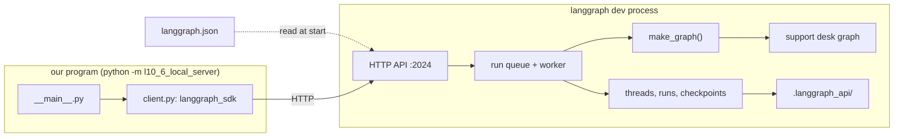
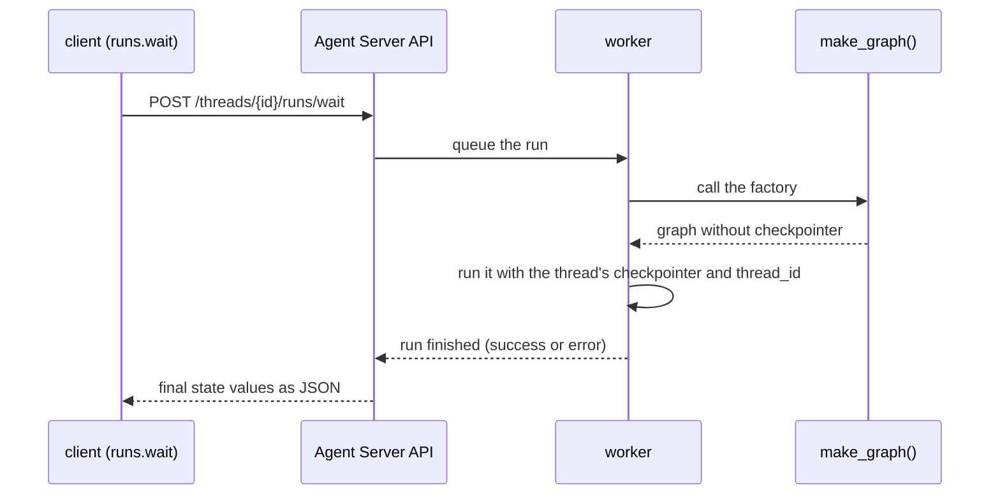

# 10.6 Application Structure and the Local Server

## The problem

Every graph in this course so far ran inside the program that built it. `__main__.py` compiled the graph, created a [checkpointer](../../../GLOSSARY.md#checkpointer), chose a [thread_id](../../../GLOSSARY.md#thread_id) and called `invoke`. That is fine for a script. It is not how a graph is used once other people depend on it.

A support desk in production is called by a web frontend, a mail gateway and a chat widget, often at the same time, and none of them is written in Python with `langgraph` installed. They need an HTTP endpoint. Behind that endpoint someone has to solve the problems the earlier lessons solved by hand inside one process:

- **Where does a conversation live?** In module 5 a thread was a string in the config, and its [checkpoints](../../../GLOSSARY.md#checkpoint) lived in whatever saver our script created. With many callers, the thread has to be something the service creates, stores and lets you look up later.
- **Who runs the graph, and when?** A request that takes ten seconds should not tie up a web worker, and two requests for the same conversation should not run on top of each other.
- **Which code is "the graph"?** A service has to find the graph without running your `__main__`, and it has to know which packages it needs.

You could write all of this yourself, as the agent-service-toolkit project from 10.5's further reading does with FastAPI and a Postgres checkpointer. LangGraph ships a ready-made server for it instead. This lesson takes the support desk of lesson 8.1, unchanged, and turns it into an application that server can load: one module the server imports, one manifest file, pinned dependencies. Then it runs the server locally and talks to it only over HTTP.

## The concept

### An application is a graph plus a manifest

A LangGraph **application** is a directory the server can load. The official [application structure](https://docs.langchain.com/oss/python/langgraph/application-structure) guide lists what it needs: the code that builds the graphs, a file with the dependencies (`pyproject.toml` or `requirements.txt`), environment variables, and a [langgraph.json](../../../GLOSSARY.md#langgraphjson) file that ties them together. Ours is the smallest useful one:

```json
{
  "dependencies": ["."],
  "graphs": {
    "support_desk": "./src/l10_6_local_server/graph.py:make_graph"
  },
  "python_version": "3.12"
}
```

- **`graphs`** maps a **graph id** to the object the server should load, written `path/to/file.py:name` (or `package.module:name`). The id, here `support_desk`, is the public name of the graph: clients use it, the code behind it can move.
- **`dependencies`** lists what must be installed for the graphs to import. `"."` means "this directory, as a package". For a local path the server also puts it on `sys.path` before it imports the graphs.
- **`python_version`** (3.11, 3.12 or 3.13, default 3.11) chooses the Python of the Docker image that `langgraph build` makes. `langgraph dev` ignores it and runs in the current interpreter.
- **`env`**, which we do not need, points at a `.env` file (or holds a mapping) of variables for the server, such as an API key for the model provider.

The [CLI reference](https://docs.langchain.com/langsmith/cli) lists many more keys (`checkpointer`, `store`, `auth`, `http`…). They configure a deployed server and are out of scope here.

### The object a graph id points at

The name after the colon can be one of two things.

- A **compiled graph** (or an uncompiled `StateGraph`, which the server compiles). The server imports it once at startup. This is what most templates do; the official `react-agent` template exports `graph`.
- A [graph factory](../../../GLOSSARY.md#graph-factory): a function that returns a graph. The server calls it every time it needs the graph. Our `make_graph` is one.

In both cases the graph comes **without persistence of its own**. That is the most important rule of this lesson, and it follows from the next idea.

### The server owns threads, runs and persistence

The program that loads `langgraph.json` and answers HTTP requests is the [Agent Server](../../../GLOSSARY.md#agent-server), the `langgraph-api` package. Its documentation calls it an API "for creating and managing agent-based applications". It adds three kinds of objects around your graph:

| Object | What it is | In-process equivalent (modules 1–9) |
|---|---|---|
| **assistant** | A graph from `langgraph.json` plus configuration, addressed by an [assistant_id](../../../GLOSSARY.md#assistant_id). The server creates one per graph at startup, named after the graph id. | The compiled graph object |
| **thread** | A conversation, created by the server with its own id, status and checkpoints. | A `thread_id` string in the config and a saver we created |
| **run** | One execution of an assistant on a thread, queued and executed by a worker, with a status of its own (`pending`, `running`, `success`, `error`, `timeout` or `interrupted`). | One `invoke` call |

The server keeps all three, and the checkpoints, in its own storage. On every run it hands the graph a checkpointer and a store and fills in the thread id. So a graph that brings its own [InMemorySaver](../../../GLOSSARY.md#inmemorysaver) would be fighting the server for the same job. In a deployment such a saver is ignored; [langgraph dev](../../../GLOSSARY.md#langgraph-dev) refuses to start with it, so you notice before you deploy (experiment 1). The LangSmith agent lifecycle workshop sums up the practice in one line: a checkpointer in development, platform-managed persistence in deployment.

### The local server and the client

`langgraph dev`, from `langgraph-cli[inmem]`, runs the Agent Server for development. It runs in your current Python environment, without Docker, and with the `langgraph-runtime-inmem` package as its storage: threads, runs and checkpoints live in memory and are saved to a `.langgraph_api/` folder in the working directory. It listens on `http://127.0.0.1:2024` by default and reloads when a source file changes. Its own banner says it plainly: the in-memory server "is designed for development and testing". A deployment (`langgraph build` / LangSmith Deployment) runs the same API on Postgres, with Redis for signalling and streaming.

On the caller's side, [langgraph_sdk](../../../GLOSSARY.md#langgraph_sdk) is a thin Python client for that HTTP API. `get_client(url=...)` returns an async client and `get_sync_client(url=...)` a sync one. Each has sub-clients that mirror the objects above: `client.assistants`, `client.threads`, `client.runs`. The SDK does not import `langgraph` at all: our [client.py](../src/l10_6_local_server/client.py) could run on a machine that has only `langgraph-sdk` installed.

The mental model: **you write the graph, the server runs it.** Your code says *what* happens in one run. The server decides *where* the state is stored, *which* thread a run belongs to and *when* it executes.

## How it works

The diagram shows the two processes of the live run and what each one owns. The only thing between them is HTTP.



One `runs.wait` call goes through the server like this:



Step by step:

1. **Startup.** `langgraph dev` reads `langgraph.json` from its working directory, puts the local dependency paths on `sys.path`, imports each graph spec and registers one assistant per graph id with metadata `created_by: "system"`. For a compiled graph it also runs the "does this graph bring its own checkpointer or store?" check (experiment 1). For a factory it only looks at the function's parameters; it does not call it yet.
2. **A thread.** `POST /threads` creates an empty thread and returns it: an id generated by the server, status `idle`, no values.
3. **A run.** [runs.wait](../../../GLOSSARY.md#runswait) sends `POST /threads/{thread_id}/runs/wait` with the assistant id and the input. The server creates a run, puts it on its queue and keeps the HTTP request open. A worker picks it up, calls `make_graph()`, and executes the graph with the thread's checkpointer and the thread id in the config. When the run ends, the response carries the thread's final state values.
4. **Reads.** `threads.get_state` and `threads.get_history` are the HTTP versions of [get_state](../../../GLOSSARY.md#get_state) and [get_state_history](../../../GLOSSARY.md#get_state_history). The server answers them from the thread's checkpoints, and calls the factory again to get the graph's structure.
5. **Shutdown.** On Ctrl+C (`SIGINT`) the in-memory runtime writes its data to `.langgraph_api/`. It also flushes that data every 10 seconds while it runs. The next start loads it again.

### What the factory receives

When the graph spec names a function, the server inspects its parameters and supports four shapes:

| Signature | What the server passes |
|---|---|
| `def make_graph()` | nothing |
| `def make_graph(config)` | the run's config, a `RunnableConfig` dict |
| `def make_graph(runtime: ServerRuntime)` | a `ServerRuntime` (from `langgraph_sdk.runtime`), recognised by the annotation |
| `def make_graph(config, runtime: ServerRuntime)` | both, by keyword |

A factory with a `config` parameter can build a different graph per run, for example with a model chosen in the assistant's configuration. That is why the server calls it for every run. In our probe of this lesson's server, `make_graph` was called once per `runs.wait`, once per `get_state`, once per `get_history`, and not at all at startup.

## In our example

The graph itself is lesson 8.1's support desk. [billing.py](../src/l10_6_local_server/billing.py) is a verbatim copy and [desk.py](../src/l10_6_local_server/desk.py) differs only in an import; [8.1's notes](../../../8-multi-agent/8.1-subgraphs-shared-state/docs/notes.md) explain them. This lesson adds the files around the graph. The [code walkthrough](readalong.md) goes through each of them line by line.

```text
10.6-local-server/
├── langgraph.json        the manifest the server reads
├── pyproject.toml        pinned dependencies, including langgraph-cli[inmem]
├── .gitignore            .langgraph_api/ and server.log
└── src/l10_6_local_server/
    ├── billing.py        from 8.1: the billing subgraph
    ├── desk.py           from 8.1: build_desk(checkpointer)
    ├── graph.py          the entry point langgraph.json names
    ├── server.py         starts and stops langgraph dev for the live run
    ├── client.py         the caller's side, langgraph_sdk only
    └── __main__.py       the live run
```

### The entry point

[graph.py](../src/l10_6_local_server/graph.py) exists only to give the server the right object:

<!-- snippet: src/l10_6_local_server/graph.py#make_graph -->
```python
def make_graph() -> CompiledStateGraph:
    """Build the support desk for the server, without a checkpointer."""
    # 1. No checkpointer: the server brings its own persistence and gives
    #    every run a checkpointer and a store. A compiled graph exported with
    #    a checkpointer of its own is refused at startup (experiment 1).
    # 2. This is a factory: the server calls it for each run and for each
    #    state read, so any build-time work belongs inside the graph, not at
    #    import time.
    # 3. The server looks at the factory's parameters: none (as here), one
    #    (it receives the run's config, or a runtime when the parameter is
    #    annotated `ServerRuntime` from langgraph_sdk.runtime), or two
    #    (config and runtime). That is why build_desk cannot be the entry
    #    point itself: its one parameter would receive the config dict
    #    (experiment 2).
    return build_desk(checkpointer=None)
```
<!-- /snippet -->

Two decisions sit in this tiny function. It passes `checkpointer=None`, because the server brings persistence. And it takes no parameters. `build_desk` from 8.1 already returns a [CompiledStateGraph](../../../GLOSSARY.md#compiledstategraph), so why not point `langgraph.json` at it directly? Because it has one parameter, and a one-parameter factory receives the run's config. The config dict would land in `compile(checkpointer=...)`, and every run would fail with `Invalid checkpointer provided ... Received dict` (experiment 2). A zero-argument wrapper keeps the graph code of 8.1 untouched and gives the server a signature it understands.

### Input travels as JSON

<!-- snippet: src/l10_6_local_server/client.py#ticket_input -->
```python
def ticket(text: str) -> dict[str, Any]:
    """Turn a ticket text into the graph's input, as JSON-friendly data."""
    # Input travels as JSON, so messages are dicts, not HumanMessage objects.
    # add_messages in DeskState turns them into messages on the server (the
    # same dict works in-process; the tests use that).
    return {"messages": [{"role": "user", "content": text}]}
```
<!-- /snippet -->

Over HTTP there are no `HumanMessage` objects, only JSON. The input is a dict with a role and a content, and the [add_messages](../../../GLOSSARY.md#add_messages) reducer in `DeskState` turns it into a `HumanMessage` on the server before `classify` reads `.content`. The way back is JSON too: the messages in the result are dicts with `"type"`, `"name"` and `"content"`, which is why `reply_line` reads `last['name']`.

### One call per run

<!-- snippet: src/l10_6_local_server/client.py#ask -->
```python
def ask(client: SyncLangGraphClient, thread_id: str, text: str) -> dict[str, Any]:
    """Run the support desk on the thread with one ticket and return the final state."""
    # runs.wait creates a run on the thread, blocks until it finishes and
    # returns the thread's final state values (a dict; messages come back as
    # dicts with "type", "name", "content"). If the graph raises, this call
    # does not: the dict is {"__error__": {"error": ..., "message": ...}}
    # (experiment 2).
    return client.runs.wait(thread_id, ASSISTANT, input=ticket(text))
```
<!-- /snippet -->

`ASSISTANT` is the graph id `support_desk`. The program never creates an assistant: the server made one at startup, and it accepts the graph id wherever an `assistant_id` is expected.

### Threads are server objects

<!-- snippet: src/l10_6_local_server/__main__.py#thread_and_runs -->
```python
print()
print("== 2. One thread, two runs ==")
# No checkpointer and no thread_id config in our code: the thread
# is a server object, the server keeps its checkpoints and passes
# the thread id to every run. The second run sees the first
# ticket because both runs share the thread.
thread = client.threads.create()
thread_id = thread["thread_id"]
print(f"  thread created, status {thread['status']}")
for text in (FIRST_TICKET, SECOND_TICKET):
    state = ask(client, thread_id, text)
    print(f"  run: {text!r} -> {state['category']}")
    print(f"    {reply_line(state)}")
    print(f"    the thread now holds {len(state['messages'])} messages")
snapshot = client.threads.get_state(thread_id)
print(
    f"  get_state: {len(snapshot['values']['messages'])} messages, "
    f"next {snapshot['next']}"
)
history = client.threads.get_history(thread_id, limit=100)
print(f"  checkpoints in the history: {len(history)}")
runs = client.runs.list(thread_id)
print(f"  runs on the thread: {', '.join(r['status'] for r in runs)}")
```
<!-- /snippet -->

Compare this with lesson 5.1. There is no saver here, no `{"configurable": {"thread_id": ...}}`, no `invoke`. The thread id comes from `threads.create()`, the server stores the checkpoints, and every run on the thread continues from its latest checkpoint. That is why the second ticket finds the first one in `messages`.

### Starting and stopping the server

A learner types `langgraph dev` in a terminal. The live run has to do it alone, so [server.py](../src/l10_6_local_server/server.py) starts it as a child process:

<!-- snippet: src/l10_6_local_server/server.py#dev_command -->
```python
# The lesson directory, where langgraph.json is. The server runs there and
# writes its .langgraph_api/ folder there.
APP_DIR = Path(__file__).resolve().parents[2]
LOG_FILE = APP_DIR / "server.log"

OFFLINE_ENV = {
    # The CLI otherwise sends a usage event.
    "LANGGRAPH_CLI_NO_ANALYTICS": "1",
    # The server otherwise asks pypi.org whether a newer version exists.
    "LANGGRAPH_NO_VERSION_CHECK": "true",
    # Keeps runs from being sent to LangSmith. No key is set anyway; this
    # makes it explicit.
    "LANGSMITH_TRACING": "false",
}


def dev_command(port: int) -> list[str]:
    """Return the `langgraph dev` command line for the given port."""
    return [
        # The CLI installed in the same venv as this Python.
        str(Path(sys.executable).with_name("langgraph")),
        "dev",
        "--port",
        str(port),
        # dev otherwise opens LangSmith Studio in a browser.
        "--no-browser",
        # The run does not edit code. By hand, leave reload on: the server
        # then restarts whenever a file changes.
        "--no-reload",
    ]
```
<!-- /snippet -->

`OFFLINE_ENV` switches off the three requests the CLI and the server would otherwise make on their own: a usage event, a version check against PyPI and LangSmith tracing. `running_server` then refuses a busy port, waits for `GET /ok` to answer 200, yields the URL and finally sends `SIGINT`, like Ctrl+C. The walkthrough explains the [readiness loop and the shutdown](readalong.md#serverpy).

### The restart

<!-- snippet: src/l10_6_local_server/__main__.py#restart -->
```python
print()
print("== 4. Restart the server ==")
# `langgraph dev` saves its in-memory data to .langgraph_api/ on shutdown
# and loads it on start. That is a development convenience; a deployment
# keeps threads in Postgres.
with running_server(port) as url:
    with get_sync_client(url=url) as client:
        print("  server stopped and started again")
        snapshot = client.threads.get_state(thread_id)
        print(f"  the first thread still holds {len(snapshot['values']['messages'])} messages")
        print(f"    last reply: {reply_line(snapshot['values'])}")
```
<!-- /snippet -->

`thread_id` is just a string kept in a Python variable. The second `running_server` is a brand-new process, and the thread is still there because the first process saved `.langgraph_api/` when it shut down.

## Run it

From the course root, `./run.sh 10.6` runs `python -m l10_6_local_server`. The verified run printed:

```text
== 1. langgraph dev serves the graph ==
  serving http://127.0.0.1:2024
  assistant: support_desk (graph support_desk, created by system)

== 2. One thread, two runs ==
  thread created, status idle
  run: 'Please refund invoice INV-1042' -> billing
    billing: Billing team: the refund for INV-1042 is on its way.
    the thread now holds 2 messages
  run: 'Where is my parcel?' -> general
    general: Support team: thanks, we will get back to you.
    the thread now holds 4 messages
  get_state: 4 messages, next []
  checkpoints in the history: 8
  runs on the thread: success, success

== 3. A second thread starts empty ==
  run: 'Hello, do you have a dark mode?' -> general
    the new thread holds 2 messages

== 4. Restart the server ==
  server stopped and started again
  the first thread still holds 4 messages
    last reply: general: Support team: thanks, we will get back to you.

server stopped
```

What to notice:

- **`created by system`.** The assistant exists because `langgraph.json` lists the graph, not because the program created it.
- **2, then 4 messages.** Both runs went to the same thread, so the second run started from the first run's checkpoint. Section 3 shows the opposite: a new thread starts with nothing, and holds only its own ticket and reply.
- **`next []`.** As in-process, an empty `next` means the graph reached END. Over HTTP it is a JSON list, not a tuple.
- **8 checkpoints.** Each run of this graph writes four on the parent graph: the input checkpoint (source `input`; step -1 for the first run, step 3 for the second, which continues the thread) and one after each super-step: `__start__`, `classify`, then `billing` or `general`. Two runs make eight. The same count appears in-process with an `InMemorySaver`. The billing [subgraph](../../../GLOSSARY.md#subgraph) saves its own checkpoints under its own `checkpoint_ns` (lesson 8.1), so they are not in this history. The code asks for `limit=100`, because the SDK's default for `get_history` is 10.
- **`success, success`.** Runs are objects of their own, kept by the server with a status each.
- **Section 4.** A different process, the same port, the same thread with its 4 messages.

The server's own log lines went to `server.log` in the lesson directory, which is the first place to look when the run fails. The output has no ids or timings, so it is the same on every run; only the URL changes if you set `LANGGRAPH_DEV_PORT`. The run takes several seconds, mostly because the in-memory queue polls for new runs.

## Details and edge cases

**`langgraph dev` does not fail on a busy port.** If 2024 is taken, it logs `Port 2024 is already in use, using port N instead.` and serves on a random free port. In a terminal you see the new URL in the banner. A script that starts the server and then connects to a fixed URL does not, which is why `running_server` checks the port first (experiment 3).

**The checkpointer check is a development check.** The "Heads up!" refusal runs only in the local dev server and only for an exported compiled graph. The source comment says the deployed server deliberately does not fail on it. There the custom saver is simply not used. A factory is not checked at startup at all, because the server does not call it then, so a factory that compiles with a saver is a mistake nobody reports. Return graphs without a checkpointer or store from factories too.

**`.langgraph_api/` is a cache of pickles.** The dev runtime writes it every 10 seconds and on a clean shutdown. A `kill -9` can lose the last few seconds of data. When the saved data no longer fits the code, for example after you rename a class whose objects are stored in a checkpoint, the server logs `Unable to load cached data` and removes the file. To start from an empty server on purpose, stop it and delete the folder. System assistants are recreated from `langgraph.json` on every start, so a graph removed from the file disappears from the assistants too.

**The sync client does not raise on a failed run.** With `langgraph-sdk` 0.4.8, `runs.wait` on the sync client only sends `raise_error=True` to the server and returns whatever comes back. For a run whose graph raised, that is `{'__error__': {'error': 'TypeError', 'message': '...'}}`. The async client's `runs.wait` checks for that key and raises an `Exception`. With the sync client, check for `"__error__"` yourself, or the failure shows up later as a confusing `KeyError` (experiment 2).

**One run per thread at a time.** The Agent Server's task queue runs at most one run for a given thread at a time. Runs on different threads are independent. What happens to a second run sent while one is active is set by `multitask_strategy` (`reject`, `interrupt`, `rollback` or `enqueue`), a parameter of `runs.wait` and `runs.stream` that this lesson leaves at its default.

**Streaming, threadless runs, and the raw API.** `client.runs.stream(..., stream_mode="updates")` delivers the same [stream modes](../../../GLOSSARY.md#stream_mode) as `graph.stream()` in module 7, as server-sent events (experiment 4). A run can also have no thread: `runs.wait(None, ASSISTANT, input=...)`, or `runs.stream(None, ...)` as in the official local-server guide. Then there is no thread id to read the state back with later. And the SDK is optional: `/docs` on the dev server lists the HTTP routes, and `curl` works too (experiment 5).

**LangSmith and Studio are optional here.** The official local-server guide asks for a LangSmith API key, and `langgraph dev` prints a Studio URL on smith.langchain.com. This lesson's server ran without a key and without network access beyond loopback. The key is needed for Studio and for tracing, not for serving the graph.

**Sync nodes are fine.** The desk's nodes are plain sync functions, and the server runs them without complaint. For async code it is stricter: unless you pass `--allow-blocking`, `langgraph dev` raises an error when it detects a blocking I/O call, so async nodes must not do blocking I/O.

## Common mistakes

> [!WARNING]
> **Exporting a graph compiled with a checkpointer.** `graph = builder.compile(checkpointer=InMemorySaver())` is the habit of every earlier lesson, and `langgraph dev` refuses it with `ValueError: Heads up! Your graph ... includes a custom checkpointer` and exit code 3 (experiment 1). Compile without one for the server, and keep the saver for scripts and tests.

> [!WARNING]
> **Pointing `langgraph.json` at a function whose parameter means something else.** A one-parameter factory receives the run's config, whatever you named the parameter. `build_desk(checkpointer)` then gets a dict, and every run fails, while the server itself starts normally (experiment 2). Give the server a factory with no parameters, or with exactly `config` and/or `runtime: ServerRuntime`.

> [!WARNING]
> **Trusting the port.** `langgraph dev --port 2024` may serve on another port without failing. A script that starts it must check the port first, or read the real URL from the server's output (experiment 3).

> [!WARNING]
> **Expecting the sync `runs.wait` to raise.** It returns a dict with `__error__` instead. Check the result before you read state keys from it.

> [!TIP]
> Keep the graph id and the client's assistant id in one place. Here `client.ASSISTANT` is the single constant, and `test_langgraph_json_is_valid` reads the config through the CLI's own validator and compares it with that constant, so a renamed graph fails a test instead of the first request.

## Experiments

Run each one from the lesson's original code with `./run.sh 10.6`, and undo the change afterwards (`git checkout -- .` in the lesson directory). If a server from an earlier attempt is still running, stop it first.

1. Export a compiled graph with its own checkpointer. In [graph.py](../src/l10_6_local_server/graph.py) add `from langgraph.checkpoint.memory import InMemorySaver` and, at the end, `graph = build_desk(InMemorySaver())`. In [langgraph.json](../langgraph.json) change the spec to `"./src/l10_6_local_server/graph.py:graph"`.

   <details><summary>What happens and why</summary>

   Nothing is printed by the lesson. The run stops with `RuntimeError: langgraph dev exited with code 3; see server.log`, and `server.log` contains `ValueError: Heads up! Your graph 'graph' from './src/l10_6_local_server/graph.py' includes a custom checkpointer (type <class 'langgraph.checkpoint.memory.InMemorySaver'>). With LangGraph API, persistence is handled automatically by the platform, ...`, followed by `Graph 'support_desk' failed to load`. The dev server checks every exported compiled graph for a checkpointer or store of its own, because persistence belongs to the server and such a saver would be ignored once deployed. `make_graph` is a factory, so it is never checked this way. Undo the change afterwards.

   </details>

2. Point the server at `build_desk` directly: in [langgraph.json](../langgraph.json) use `"./src/l10_6_local_server/desk.py:build_desk"`. To see the raw answer, also print the result of `ask(...)` in section 2 before it is used.

   <details><summary>What happens and why</summary>

   The server starts, section 1 prints the assistant as usual and the thread is created. Then section 2 fails with `KeyError: 'category'`. The raw result of `runs.wait` is `{'__error__': {'error': 'TypeError', 'message': 'Invalid checkpointer provided. Expected an instance of `BaseCheckpointSaver`, `True`, `False`, or `None`. Received dict. Pass a proper saver (e.g., InMemorySaver, AsyncPostgresSaver).'}}`. `build_desk` has one parameter, so the server treated it as a factory that takes the run's config, and the config dict ended up in `compile(checkpointer=...)`. Two lessons in one: the factory's signature matters, and the sync `runs.wait` hands you the error as data instead of raising it. Undo the change afterwards.

   </details>

3. Occupy the port first. In another terminal run `python -m http.server 2024`, then run the lesson. Then, with `http.server` still running, delete the `if port_in_use(port): raise ...` lines at the start of `running_server` in [server.py](../src/l10_6_local_server/server.py) and run again.

   <details><summary>What happens and why</summary>

   The first run stops at once with `RuntimeError: port 2024 is already in use; set LANGGRAPH_DEV_PORT to a free port`, and no server is started. Without the check, `langgraph dev` starts without error: `server.log` says `Port 2024 is already in use, using port N instead.` (a random free port) and its banner shows the API on that port. But the launcher still probes `http://127.0.0.1:2024/ok`, where `http.server` answers 404, so it keeps waiting, and after 60 seconds the run stops with `RuntimeError: langgraph dev did not start; see server.log`. The client is never reached. Here the readiness probe happened to catch the mix-up. A program on port 2024 that answered 200 on `/ok` would have received all the client's requests. A script that starts `langgraph dev` must check the port itself. Stop `http.server` with Ctrl+C and undo the change afterwards.

   </details>

4. Stream a run instead of waiting for it. In section 3 of [\_\_main\_\_.py](../src/l10_6_local_server/__main__.py), replace the `ask(...)` call and the two prints after it with:

   ```python
   for part in client.runs.stream(other, ASSISTANT, input=ticket("refund INV-9"), stream_mode="updates"):
       print(part.event, part.data)
   ```

   and add `ticket` to the import from `l10_6_local_server.client`.

   <details><summary>What happens and why</summary>

   Section 3 prints three events: `metadata` with `{'run_id': '...', 'attempt': 1}`, then `updates {'classify': {'category': 'billing'}}`, then `updates {'billing': {'messages': [...]}}`, where the list holds **both** messages, the ticket and the reply, as JSON dicts. The stream modes of module 7 travel over HTTP as server-sent events, one event per node update. The `billing` update is the subgraph's final value of the shared `messages` key, merged by `add_messages`, exactly as lesson 8.1 explained. The run id differs every time. Undo the change afterwards.

   </details>

5. Talk to the server without the SDK, and watch it reload. In the lesson directory run `LANGGRAPH_CLI_NO_ANALYTICS=1 LANGGRAPH_NO_VERSION_CHECK=true uv run langgraph dev --no-browser`. Open http://127.0.0.1:2024/docs in a browser. In a second terminal run `curl -s -X POST http://127.0.0.1:2024/threads -H 'Content-Type: application/json' -d '{}'`. Then change the text of the general reply in [desk.py](../src/l10_6_local_server/desk.py), save, and send a run: `curl -s -X POST http://127.0.0.1:2024/runs/wait -H 'Content-Type: application/json' -d '{"assistant_id": "support_desk", "input": {"messages": [{"role": "user", "content": "hi"}]}}'`.

   <details><summary>What happens and why</summary>

   `/docs` shows the server's API reference. The first `curl` returns a JSON thread: a `thread_id`, `"status": "idle"`, `"values": null`. When you save `desk.py`, the server log shows `WatchFiles detected changes in 'src/l10_6_local_server/desk.py'. Reloading...`, and the run returns the new reply text with `"category": "general"`. `langgraph_sdk` is a thin client over this HTTP API, and without `--no-reload` the dev server restarts whenever your code changes. Stop it with Ctrl+C and undo the change afterwards. Leaving the server running would make the next `./run.sh 10.6` stop on the port check.

   </details>

## Summary

- A LangGraph application is a directory with the graph code, a dependency file and `langgraph.json`, which maps a graph id to `file.py:object` and lists the dependencies.
- The server owns persistence. Export graphs without a checkpointer or store. `langgraph dev` refuses a compiled graph that has one.
- A factory named in `langgraph.json` is called for every run and state read, and its parameters decide what it receives: nothing, the config, a `ServerRuntime`, or config and runtime.
- The Agent Server adds assistants (one per graph id), threads (server-created, with checkpoints) and runs (queued, with a status). `langgraph dev` runs it locally in memory and saves its data to `.langgraph_api/`.
- `langgraph_sdk` calls it over HTTP. Input and output are JSON, so messages are dicts, and the sync `runs.wait` returns errors as `{"__error__": ...}` instead of raising.

## Self-check

1. Why does `make_graph` pass `checkpointer=None`, when every earlier lesson compiled with a saver to get threads?

   <details><summary>Answer</summary>

   Because the server provides persistence. It gives every run its own checkpointer and the thread id, and stores the checkpoints with the thread. A saver of the graph's own would be ignored when deployed. The dev server refuses an exported compiled graph that has one, so the mistake is found locally.

   </details>

2. `langgraph.json` names `my_pkg/graph.py:make_graph`, and `make_graph(model_name)` takes one parameter. What does `model_name` contain on the server?

   <details><summary>Answer</summary>

   The run's config, a `RunnableConfig` dict. The server inspects the factory's signature, and one parameter without a `ServerRuntime` annotation means "pass the config". The name of the parameter does not matter. To pick a model per run, read it from the config inside the factory.

   </details>

3. The client calls `runs.wait` twice with the same `thread_id`, then once with a new thread. Why does the second call see the first ticket, and the third does not?

   <details><summary>Answer</summary>

   The state belongs to the thread. Each run on a thread starts from that thread's latest checkpoint, and `add_messages` appends the new ticket to the messages already there. A new thread has no checkpoints, so its run starts from the input alone.

   </details>

4. `client.threads.get_history(thread_id)` returns 10 entries for a thread you know has 40 checkpoints. Is history being lost?

   <details><summary>Answer</summary>

   No. `get_history` has `limit=10` by default in `langgraph-sdk` 0.4.8. Pass a larger `limit`, or page with `before`.

   </details>

5. A script starts `langgraph dev --port 2024` and connects to `http://127.0.0.1:2024`. On a colleague's machine it talks to something that is not a LangGraph server. What happened, and how do you prevent it?

   <details><summary>Answer</summary>

   Port 2024 was already taken. `langgraph dev` does not fail in that case: it logs a warning and serves on another free port, while the script's fixed URL still points at whatever listens on 2024. Check that the port is free before starting the server, as `port_in_use` does, or take the URL from the server's own output.

   </details>

## Further reading

- [Application structure](https://docs.langchain.com/oss/python/langgraph/application-structure), LangGraph docs: the files of an application and the `dependencies`, `graphs` and `env` keys of `langgraph.json`.
- [Run a local server](https://docs.langchain.com/oss/python/langgraph/local-server), LangGraph docs: installing `langgraph-cli[inmem]`, `langgraph dev`, and calling the server with the SDK and REST.
- [LangGraph CLI](https://docs.langchain.com/langsmith/cli), LangSmith docs: every `langgraph.json` key and every `langgraph dev` option, including graph factories.
- [Agent Server](https://docs.langchain.com/langsmith/agent-server), LangSmith docs: assistants, the task queue, one run per thread, and the Postgres and Redis behind a deployment.
- [langchain-ai/react-agent](https://github.com/langchain-ai/react-agent): an official template laid out as an application, with a `langgraph.json` that exports a compiled graph and loads `.env`.
- [LangSmith agent lifecycle workshop](https://github.com/langchain-ai/langsmith-agent-lifecycle-workshop): an official workshop whose deployment module separates a development checkpointer from platform-managed persistence.
- The installed sources, which settle what the docs leave open: `langgraph_api/graph.py` (the checkpointer check), `langgraph_api/_factory_utils.py` (factory signatures), `langgraph_api/cli.py` (the port fallback), `langgraph_runtime_inmem/` (the `.langgraph_api/` files) and `langgraph_sdk/_sync/runs.py` (`runs.wait`).
