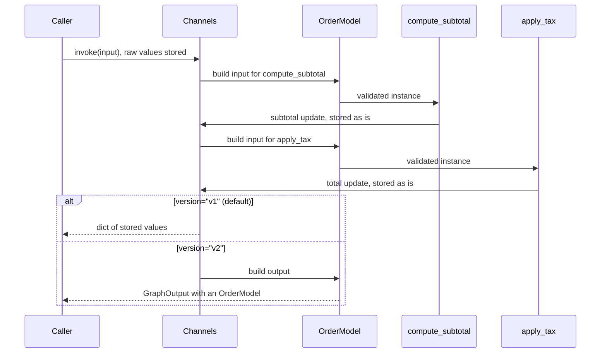

# 2.1 State Schemas: TypedDict, Dataclass and Pydantic

## The problem

In lesson 1.1 the [state schema](../../../GLOSSARY.md#state-schema) was a `TypedDict`, and the notes ended with a warning: LangGraph uses it to learn which keys exist, and checks nothing else at run time. A missing key shows up as a `KeyError` deep inside a node, and a wrong value goes through unchanged.

That is acceptable for a ticket that only carries text. Now consider an online order: a customer, a quantity, a unit price, a tax rate, a currency, and two computed amounts. Three things go wrong quickly with a plain `TypedDict`:

- **Most orders use the same tax rate and currency**, yet every caller has to pass them, because a `TypedDict` cannot hold a default value.
- **Bad data is computed, not rejected.** A quantity of `-2` produces a negative total, and nobody notices until an invoice goes out.
- **Input often arrives as text.** A web form or a JSON body may deliver the quantity as `"3"`, and `"3" * 9.5` fails inside a node with a `TypeError`.

All three are facts about the *data*, not about the pipeline. The natural place for them is the schema. LangGraph lets you write the schema in three styles, and the style decides how much the schema can do.

## The concept

[StateGraph](../../../GLOSSARY.md#stategraph) accepts three kinds of schema class:

- a **`TypedDict`**: a dict with declared keys,
- a **dataclass** (`@dataclass`): a class with fields and optional defaults,
- a **Pydantic model** (a subclass of `pydantic.BaseModel`): a class with fields, defaults and validation rules.

Some things are the same for all three. `StateGraph` reads the field names and creates one channel per field, exactly as in lesson 1.1. Keys outside the schema are dropped. Nodes return a [partial update](../../../GLOSSARY.md#partial-update) as a plain dict, and LangGraph writes each returned key into its channel.

What differs is **what a node receives** and **what gets checked**:

| | `TypedDict` | dataclass | Pydantic model |
|---|---|---|---|
| A node receives | a plain `dict` | an instance of the class | an instance of the model |
| Access in a node | `state["quantity"]` | `state.quantity` | `state.quantity` |
| Defaults | no | yes | yes |
| Missing required field | `KeyError` when a node reads it | `TypeError` before the node runs | `ValidationError` before the node runs |
| Types and constraints checked | no | no | yes, with conversion |
| Cost per node step | none | builds an instance | builds and validates an instance |

The official Graph API page sums up the choice the same way: a `TypedDict` is the main documented style, a dataclass is for defaults, and a Pydantic model is for recursive data validation, at a performance cost.

Pydantic needs two more terms. When Pydantic rejects data, it raises a [ValidationError](../../../GLOSSARY.md#validationerror) that lists every failed field with its location (`loc`) and a message (`msg`). And by default Pydantic runs in [lax mode](../../../GLOSSARY.md#lax-mode): a value of a compatible type is converted to the declared type instead of rejected. For an `int` field, the string `"3"` becomes `3`, while `"three"` is still an error.

The mental model for the rest of the lesson fits in one sentence: **the channels store raw values, and the schema class is applied only when LangGraph reads the state.** Writing never goes through the class. That explains every surprise in this lesson.

## How it works

LangGraph applies the schema class at two moments. Follow the diagram from top to bottom. It shows a Pydantic schema, but a dataclass goes through the same steps (only without validation), and a `TypedDict` skips the class entirely.



1. **Input.** `invoke(input)` writes the input values into the channels as they are. Nothing is converted here.
2. **Before each node.** LangGraph builds the node's input from the current channel values. For a dataclass or Pydantic schema it calls the class with those values, `OrderModel(**values)`. In 1.2.16 this is `_pick_mapper` and `_coerce_state` in `langgraph/graph/state.py`, and for a `TypedDict` there is no mapper at all, so the node gets the dict. This call is where defaults are filled in and where Pydantic validates and converts. It happens before **every** node, not only the first.
3. **Node updates.** The node returns a dict, and each key goes straight into its channel. The class is not involved, so an update is neither validated nor converted when it is written.
4. **Output.** By default (`version="v1"`) `invoke()` returns a plain dict of the stored values, whatever the schema type. With `version="v2"` it returns a [GraphOutput](../../../GLOSSARY.md#graphoutput), and for a dataclass or Pydantic schema LangGraph calls the class once more on the final values. This [output coercion](../../../GLOSSARY.md#output-coercion) arrived in LangGraph 1.1, and only `version="v2"` does it.

Two consequences follow, and the live run shows both. A default or a converted value exists only in the instances that nodes receive and in the v2 output, never in the channels. And an invalid value that a node writes is caught only when the state is read again: by the next node, or by v2 output coercion.

> [!NOTE]
> The "Use Pydantic models for graph state" section of the official how-to guide says that validation runs only on the input to the first node and that the output is never a Pydantic instance. In 1.2.16 both statements are out of date. The source and this lesson's tests show that every node's input is built with `schema(**values)`, and `version="v2"` returns an instance. Its claim that the validation trace does not say which node failed is also out of date: on Python 3.11+ LangGraph adds a `Before task with name '...'` note naming the node whose input failed. Two points still hold: Pydantic's recursive validation costs time, and output from a default `invoke()` is a dict.

## In our example

The storyline of module 2 is *order-pipeline*. One order goes through two nodes, `compute_subtotal` and then `apply_tax`, wired with `add_node` and `add_edge` exactly as in lesson 1.1. The lesson builds this pipeline three times, in [typed_dict_order.py](../src/l2_1_state_schemas/typed_dict_order.py), [dataclass_order.py](../src/l2_1_state_schemas/dataclass_order.py) and [pydantic_order.py](../src/l2_1_state_schemas/pydantic_order.py). The three `build_graph` functions differ in one line, the class passed to `StateGraph`. The [code walkthrough](readalong.md#typed_dict_orderpy) goes through the files line by line. Here we compare the three schemas.

**The `TypedDict`** declares seven keys and nothing more. It cannot hold defaults, so `tax_rate` and `currency` must come from the caller:

<!-- snippet: src/l2_1_state_schemas/typed_dict_order.py#typed_dict_state -->
```python
class OrderDict(TypedDict):
    """Order state as a TypedDict: seven keys, no defaults, no checks.

    LangGraph turns each key into a channel. Nothing stops a caller from
    leaving a key out or passing a wrong type.
    """

    customer: str
    quantity: int
    unit_price: float
    tax_rate: float  # e.g. 0.2 for 20% VAT; the caller must pass it
    currency: str  # e.g. "EUR"; the caller must pass it
    subtotal: float  # written by compute_subtotal
    total: float  # written by apply_tax
```
<!-- /snippet -->

**The dataclass** declares the same fields and gives the last four a default:

<!-- snippet: src/l2_1_state_schemas/dataclass_order.py#dataclass_state -->
```python
@dataclass
class OrderData:
    """Order state as a dataclass, with defaults for the optional fields.

    Before each node runs, LangGraph builds an OrderData from the stored
    values, so missing keys get their defaults. Types are not checked.
    """

    customer: str
    quantity: int
    unit_price: float
    tax_rate: float = 0.2
    currency: str = "EUR"
    subtotal: float = 0.0
    total: float = 0.0
```
<!-- /snippet -->

**The Pydantic model** has the same defaults and adds two constraints. `Field(gt=0)` means "greater than 0":

<!-- snippet: src/l2_1_state_schemas/pydantic_order.py#pydantic_state -->
```python
class OrderModel(BaseModel):
    """Order state as a Pydantic model: defaults plus validation rules."""

    customer: str
    # Field(gt=0) rejects zero and negative values with a ValidationError.
    quantity: int = Field(gt=0)
    unit_price: float = Field(gt=0)
    tax_rate: float = 0.2
    currency: str = "EUR"
    subtotal: float = 0.0
    total: float = 0.0
```
<!-- /snippet -->

The nodes change in one way only, the access syntax. The `TypedDict` nodes read keys:

<!-- snippet: src/l2_1_state_schemas/typed_dict_order.py#typed_dict_nodes -->
```python
def compute_subtotal(state: OrderDict) -> dict[str, float]:
    """Multiply quantity by unit_price into subtotal."""
    # The node receives a plain dict, so it uses key access.
    return {"subtotal": state["quantity"] * state["unit_price"]}


def apply_tax(state: OrderDict) -> dict[str, float]:
    """Add tax to subtotal and round the result into total."""
    # A missing "tax_rate" raises KeyError right here: no defaults exist.
    return {"total": round(state["subtotal"] * (1 + state["tax_rate"]), 2)}
```
<!-- /snippet -->

The dataclass nodes, like the Pydantic ones, read attributes. All of them still return a dict with the one key they own:

<!-- snippet: src/l2_1_state_schemas/dataclass_order.py#dataclass_nodes -->
```python
def compute_subtotal(state: OrderData) -> dict[str, float]:
    """Multiply quantity by unit_price into subtotal."""
    # The node receives an OrderData instance, so it uses attribute access.
    # It still returns a partial update as a dict.
    return {"subtotal": state.quantity * state.unit_price}


def apply_tax(state: OrderData) -> dict[str, float]:
    """Add tax to subtotal and round the result into total."""
    # tax_rate comes from the dataclass default when the caller left it out.
    return {"total": round(state.subtotal * (1 + state.tax_rate), 2)}
```
<!-- /snippet -->

[\_\_main\_\_.py](../src/l2_1_state_schemas/__main__.py) runs four sections on the three graphs. The first sends the same valid order through all three. The second sends `quantity=-2`, and only the Pydantic graph refuses it. `exc.errors()` returns one dict per failed field, and the code prints the first one's `loc` and `msg`:

<!-- snippet: src/l2_1_state_schemas/__main__.py#bad_input_demo -->
```python
print("\n== Bad input: quantity=-2 ==")
bad_order = {**ORDER, "quantity": -2}
# TypedDict and dataclass states are never validated: -2 goes through.
result = typed_dict_graph.invoke({**bad_order, **TYPED_DICT_EXTRAS})
print(f"TypedDict  total: {result['total']}")
result = dataclass_graph.invoke(bad_order)
print(f"dataclass  total: {result['total']}")
try:
    # LangGraph builds OrderModel(**state) for the first node's input,
    # so Field(gt=0) fails before compute_subtotal ever runs.
    pydantic_graph.invoke(bad_order)
except ValidationError as exc:
    error = exc.errors()[0]
    loc = ".".join(str(part) for part in error["loc"])
    print(f"Pydantic   ValidationError: {loc}: {error['msg']}")
```
<!-- /snippet -->

The third section sends the quantity as the string `"3"` and prints what the default `invoke()` returns. It shows the stored values, not the ones the nodes saw:

<!-- snippet: src/l2_1_state_schemas/__main__.py#coercion_demo -->
```python
print("\n== Pydantic coerces what nodes see, not what is stored ==")
# The nodes get quantity=3 (int), but the channel keeps the raw "3".
result = pydantic_graph.invoke({**ORDER, "quantity": "3"})
print(f"quantity stored: {result['quantity']!r}")
# tax_rate and currency are missing: defaults live in the model only,
# and no node ever wrote them to the state.
print(f"keys: {sorted(result)}")
```
<!-- /snippet -->

The fourth asks for `version="v2"` and reads only `.value` and `.interrupts` from the result:

<!-- snippet: src/l2_1_state_schemas/__main__.py#v2_output -->
```python
print("\n== Typed output with version='v2' ==")
# The dataclass gets the int order (it would not coerce "3"); the
# Pydantic graph gets the same string input as in the section above.
runs = [
    (dataclass_graph, ORDER),
    (pydantic_graph, {**ORDER, "quantity": "3"}),
]
for graph, order in runs:
    # version="v2" returns a GraphOutput and coerces its value into the
    # state class. Read .value and .interrupts, never out["key"].
    out = graph.invoke(order, version="v2")
    print(f"{type(out).__name__} -> {type(out.value).__name__}")
    print(f"  value: {out.value}")
    print(f"  interrupts: {out.interrupts}")
```
<!-- /snippet -->

## Run it

From the course root, run `./run.sh 2.1`. This is the output of the verified run:

```text
== Same order, three schemas ==
TypedDict  total: 34.2
dataclass  total: 34.2
Pydantic   total: 34.2

== Bad input: quantity=-2 ==
TypedDict  total: -22.8
dataclass  total: -22.8
Pydantic   ValidationError: quantity: Input should be greater than 0

== Pydantic coerces what nodes see, not what is stored ==
quantity stored: '3'
keys: ['customer', 'quantity', 'subtotal', 'total', 'unit_price']

== Typed output with version='v2' ==
GraphOutput -> OrderData
  value: OrderData(customer='Ada', quantity=3, unit_price=9.5, tax_rate=0.2, currency='EUR', subtotal=28.5, total=34.2)
  interrupts: ()
GraphOutput -> OrderModel
  value: customer='Ada' quantity=3 unit_price=9.5 tax_rate=0.2 currency='EUR' subtotal=28.5 total=34.2
  interrupts: ()
```

The program uses no LLM and no clock, so every run prints exactly this. What to notice:

- **Same order, three schemas.** All three print `34.2`, which is $3 \times 9.5 \times 1.2$. Only the `TypedDict` graph got `tax_rate` and `currency` from the caller. The other two took them from their defaults. Even for the dataclass and Pydantic graphs, `result['total']` works, because a default `invoke()` returns a dict.
- **Bad input.** `-22.8` twice: neither a `TypedDict` nor a dataclass checks values. The Pydantic graph raised before `compute_subtotal` ran, with Pydantic's own message for `gt=0`.
- **Coercion.** `quantity stored: '3'` is still the string. Yet the totals were right, because `compute_subtotal` received an `OrderModel` in which `quantity` was already the int `3`. The key list has no `tax_rate` and no `currency`: their defaults lived only in the instances the nodes received, and no node returned them.
- **Typed output.** The same string input now comes back with `quantity=3` and with `tax_rate=0.2` and `currency='EUR'` filled in, because v2 built an `OrderModel` from the final values. `OrderData` gets the same treatment, minus validation. `interrupts: ()` is empty because nothing paused the graph. Interrupts get a module of their own later.

## Details and edge cases

**Validation happens on read, before every node.** A Pydantic schema validates the input of every node, not only the first one. If a node writes an invalid value, the error appears when the *next* node's input is built, so the next node never runs. On Python 3.11 and later the traceback ends with a note added by LangGraph, such as `Before task with name 'compute_subtotal' ...`. Keep in mind that the note names the node whose input failed, which is not necessarily the node that wrote the bad value.

**Node updates are not validated when written.** If the *last* node writes an invalid value, no later node reads it. A default `invoke()` hands the value back in the dict without complaint, and only `version="v2"` raises, during output coercion. `test_node_updates_not_validated_on_write` in [test_state_schemas.py](../tests/test_state_schemas.py) shows this with a node that writes `quantity=-1`, and the second experiment below shows it on our pipeline.

**Defaults are not state.** A default fills in a missing value whenever the class is called, but it is never written to a channel. In v1 output you see only what the caller passed and the nodes wrote. A node that needs the default sees it, and v2 output shows it. If you want a default value to be part of the stored state, a node has to return it.

**Coercion is not stored either.** The same rule applies to converted values and to anything a Pydantic validator changes. The fifth experiment shows it with a `@field_validator`: the nodes see the cleaned value, the v1 output still holds the raw one.

**A dataclass checks presence, not types.** Calling `OrderData(**values)` without `quantity` raises `TypeError: OrderData.__init__() missing 1 required positional argument: 'quantity'` before the first node, so required fields are enforced. Type hints are not: `quantity="3"` is stored and passed on, and `compute_subtotal` then fails on `"3" * 9.5` with `TypeError: can't multiply sequence by non-int of type 'float'`. That is why section (d) sends the dataclass graph the integer order.

**`version="v2"` with a `TypedDict`.** There is no class to call, so `out.value` is a plain dict. `test_v2_output_types` checks this.

**Dict access on `GraphOutput` is deprecated.** `out["total"]` still works in 1.2.16, but since 1.1 it emits a `LangGraphDeprecatedSinceV11` warning, whose text says it is to be removed in V3.0. Use `out.value` for the state and `out.interrupts` for interrupts.

## Choosing a schema

- **`TypedDict`** when the data comes from code you control and you want the least machinery. The official docs use it in most examples, and this course grows the `TypedDict` pipeline in lessons 2.2 to 2.4.
- **A dataclass** when you want defaults and attribute access, but trust the values. Building one instance per node step is cheap.
- **A Pydantic model** when the input comes from outside (a form, an API, an LLM) and must be checked or converted, or when you want typed output with `version="v2"` that is validated too. You pay with validation on every node step, which the docs call out as slower, especially for nested models.

One limit to know in advance: the official docs note that LangChain's higher-level `create_agent` factory does not support Pydantic state schemas. Agents come later in the course.

## Common mistakes

> [!WARNING]
> **Trusting Pydantic to check what nodes write.** The schema validates node *inputs* and v2 output. A node that writes `total=-1.0` as the last step produces a v1 result with `-1.0` in it and no error. If an invariant matters, check it in the node, or use `version="v2"` so that the output is validated as well.

> [!WARNING]
> **Expecting the default `invoke()` to return a model.** With `version="v1"` the result is always a dict of stored values, so `result.total` raises `AttributeError` even with a Pydantic schema, and `result["quantity"]` may still be the raw string. Use `invoke(..., version="v2")` and read `out.value` when you want an instance.

> [!WARNING]
> **Mutating the state instance.** With a dataclass or Pydantic schema the node receives a fresh instance built for it. `state.total = 99.0` changes that instance and nothing else: if the node then returns `None`, the change is lost. Return the change as a dict.

> [!WARNING]
> **Returning the whole instance instead of a dict.** LangGraph accepts a returned model instance as an update, but it writes every field that is not `None`, defaults included. A node that returns `OrderModel(customer="B", quantity=2, unit_price=1)` resets `subtotal` and `total` to `0.0` and `tax_rate` to `0.2`. Return only the keys the node owns, as in lesson 1.1.

> [!WARNING]
> **Reading `out["key"]` on a `GraphOutput`.** It works, so code copied from older examples seems fine, but it emits a deprecation warning. Read `out.value` and `out.interrupts`.

> [!TIP]
> When a Pydantic error comes out of `invoke()`, read the last lines of the traceback. Pydantic names the field and the rule (`quantity`, `Input should be greater than 0`), and LangGraph's note names the node whose input failed.

## Experiments

Each experiment starts from the lesson's original code. Make the change, run `./run.sh 2.1` from the course root, and try to predict the result before you open the explanation.

1. In [pydantic_order.py](../src/l2_1_state_schemas/pydantic_order.py), import `ConfigDict` from `pydantic` and add `model_config = ConfigDict(strict=True)` as the first line of the `OrderModel` body.

   <details><summary>What happens and why</summary>

   Sections (a) and (b) print as before. Section (c) stops the program with a traceback that ends:

   ```text
   pydantic_core._pydantic_core.ValidationError: 1 validation error for OrderModel
   quantity
     Input should be a valid integer [type=int_type, input_value='3', input_type=str]
   ...
   Before task with name 'compute_subtotal' and path '('__pregel_pull', 'compute_subtotal')'
   ```

   Strict mode turns lax mode off: a string is no longer converted to an int, it is rejected. Section (c) does not catch the error, so the program ends there. You can also make a single field strict with `Field(strict=True)`. Decide per field whether you want conversion or rejection. Put the code back as it was (`git checkout -- .` in the lesson directory).

   </details>

2. In [pydantic_order.py](../src/l2_1_state_schemas/pydantic_order.py), change the `total` field to `total: float = Field(default=0.0, ge=0)` and make `apply_tax` return `{"total": -1.0}`.

   <details><summary>What happens and why</summary>

   Section (a) prints `Pydantic   total: -1.0`: the default `invoke()` hands back the invalid value without a word. Section (d) then fails on the Pydantic graph with `ValidationError` for `total`: `Input should be greater than or equal to 0`. `apply_tax` is the last node, so no node input is built after its write. Only v2 output coercion calls `OrderModel` again, and that is where the rule fires. Validation guards reads (node inputs and v2 output), never individual writes. Put the code back as it was.

   </details>

3. In the `v2_output` section of [\_\_main\_\_.py](../src/l2_1_state_schemas/__main__.py), add `print(f"  total: {out['total']}")` after the line that prints the interrupts. Run it, then run it again from the lesson directory with `uv run --package l2-1-state-schemas python -W error::DeprecationWarning -m l2_1_state_schemas`.

   <details><summary>What happens and why</summary>

   In the first run both totals print `34.2`, and stderr shows one warning:

   ```text
   LangGraphDeprecatedSinceV11: Accessing GraphOutput via `result[key]` is deprecated. Use `result.value` to access the output value directly, or `result.interrupts` for interrupts. Deprecated in LangGraph V1.1 to be removed in V3.0.
   ```

   You see it once, not twice, because Python's default warning filter reports a warning once per code location. With `-W error::DeprecationWarning` the warning becomes an exception (`LangGraphDeprecatedSinceV11` is a subclass of `DeprecationWarning`), and the run stops at the first `out['total']`. Running tests with this flag is a cheap way to find deprecated calls before they are removed. Put the code back as it was.

   </details>

4. In [\_\_main\_\_.py](../src/l2_1_state_schemas/__main__.py), remove `"tax_rate": 0.2` from `TYPED_DICT_EXTRAS`.

   <details><summary>What happens and why</summary>

   The program stops in section (a) with:

   ```text
   KeyError: 'tax_rate'
   During task with name 'apply_tax' ...
   ```

   Nothing checked the input. `compute_subtotal` ran normally, and the missing key surfaced only when `apply_tax` read `state["tax_rate"]`. The dataclass graph on the next line never needed the key, because `OrderData` declares `tax_rate: float = 0.2`. Defaults are the main practical reason to choose a dataclass over a `TypedDict`. Put the code back as it was.

   </details>

5. In [pydantic_order.py](../src/l2_1_state_schemas/pydantic_order.py), add a validator to `OrderModel` that tidies the customer name, and print what the node sees:

   ```python
   @field_validator("customer")
   @classmethod
   def tidy_customer(cls, value: str) -> str:
       return value.strip().title()
   ```

   Import `field_validator` from `pydantic`, and add `print(f"node sees: {state.customer!r}")` as the first line of `compute_subtotal`. Then, from the lesson directory, compare the v1 and v2 results for a messy name:

   ```bash
   uv run --package l2-1-state-schemas python -c '
   from l2_1_state_schemas.pydantic_order import build_graph
   graph = build_graph()
   order = {"customer": "  ada ", "quantity": 3, "unit_price": 9.5}
   print("v1:", repr(graph.invoke(order)["customer"]))
   print("v2:", repr(graph.invoke(order, version="v2").value.customer))
   '
   ```

   <details><summary>What happens and why</summary>

   The output is:

   ```text
   node sees: 'Ada'
   v1: '  ada '
   node sees: 'Ada'
   v2: 'Ada'
   ```

   The node sees the tidy name in both runs. The v1 result holds the raw `'  ada '`, and the v2 value holds `'Ada'`. A validator runs every time LangGraph builds an `OrderModel`: for each node input and for the v2 output. The channel keeps the value the caller sent, because no node returned `customer`. If you want the cleaned value stored, a node has to return it. Put the code back as it was.

   </details>

## Summary

- `StateGraph` accepts a `TypedDict`, a dataclass or a Pydantic model as the state schema. In all three, nodes return partial updates as dicts, and each field becomes a channel.
- A `TypedDict` gives a plain dict with no defaults and no checks. A dataclass adds defaults and attribute access. A Pydantic model adds validation and lax-mode conversion, at a cost on every node step.
- Channels store raw values. LangGraph calls the schema class when it builds each node's input and, with `version="v2"`, the final output. Writes go straight to the channels, unvalidated.
- Defaults and converted values therefore appear in the nodes and in v2 output, never in v1 output.
- `invoke(..., version="v2")` returns a `GraphOutput`. Read `.value` (an instance of a dataclass or Pydantic schema, a dict for a `TypedDict`) and `.interrupts`, not `out["key"]`, which is deprecated since 1.1.

## Self-check

1. The caller passes `quantity="3"` to the Pydantic graph. What type does `compute_subtotal` see, and what does `invoke(...)["quantity"]` return?

   <details><summary>Answer</summary>

   The node sees the int `3`, because LangGraph builds `OrderModel(**values)` for its input and lax mode converts the string. The default `invoke()` returns the stored channel value, the string `'3'`. Only `invoke(..., version="v2").value.quantity` is the int `3`.

   </details>

2. A node in the middle of a Pydantic-state graph writes `quantity=-1`. When does the error appear, and which node does LangGraph's traceback note name?

   <details><summary>Answer</summary>

   Not when the node writes it. The error appears when the next node's input is built, and the next node never runs. The note names that next node (`Before task with name '...'`), not the node that wrote the bad value.

   </details>

3. Why does the dataclass graph accept the order without `tax_rate`, while the v1 result still has no `tax_rate` key?

   <details><summary>Answer</summary>

   Before each node, LangGraph calls `OrderData(**values)`, which fills in the default `0.2`, so `apply_tax` can read it. The default lives only in that instance. No node returned `tax_rate`, so its channel was never written, and v1 output lists only stored values.

   </details>

4. You need defaults, but performance matters and the data comes from your own code. Which schema do you pick?

   <details><summary>Answer</summary>

   A dataclass. It gives defaults and attribute access without validation, which is cheaper than a Pydantic model. The official docs suggest exactly this when Pydantic's overhead is a concern.

   </details>

5. What does `invoke(..., version="v2")` return for a `TypedDict` schema, and how should you read the total?

   <details><summary>Answer</summary>

   A `GraphOutput` whose `.value` is a plain dict, because there is no class to build. Read `out.value["total"]`. `out["total"]` still works but emits `LangGraphDeprecatedSinceV11`.

   </details>

## Further reading

- [Graph API overview: Schema](https://docs.langchain.com/oss/python/langgraph/graph-api#schema), LangChain docs: the three schema styles and when to use each.
- [Use the Graph API: Use Pydantic models for graph state](https://docs.langchain.com/oss/python/langgraph/use-graph-api#use-pydantic-models-for-graph-state), LangChain docs: runtime type conversion, serialization and the performance note. Read its list of limitations with the 1.2.16 corrections from this chapter in mind.
- [langgraph 1.1.0 release notes](https://github.com/langchain-ai/langgraph/releases/tag/1.1.0): `version="v2"`, `GraphOutput`, output coercion for Pydantic and dataclass state, and the deprecation of dict access.
- [langgraph/graph/state.py at 1.2.16](https://github.com/langchain-ai/langgraph/blob/1.2.16/libs/langgraph/langgraph/graph/state.py): `_pick_mapper` and `_coerce_state`, which build each node's input from the schema class.
- [langgraph tests: test_pydantic.py at 1.2.16](https://github.com/langchain-ai/langgraph/blob/1.2.16/libs/langgraph/tests/test_pydantic.py): executable examples of Pydantic state, including a field validator.
- [Pydantic: Strict Mode](https://pydantic.dev/docs/validation/latest/concepts/strict_mode/): lax and strict validation, per model and per field.
- [Pydantic: Validators](https://pydantic.dev/docs/validation/latest/concepts/validators/): `field_validator` and its modes.
- [langchain-ai/react-agent](https://github.com/langchain-ai/react-agent): an official template whose graph state is a dataclass, for a look at the style in a real project.
