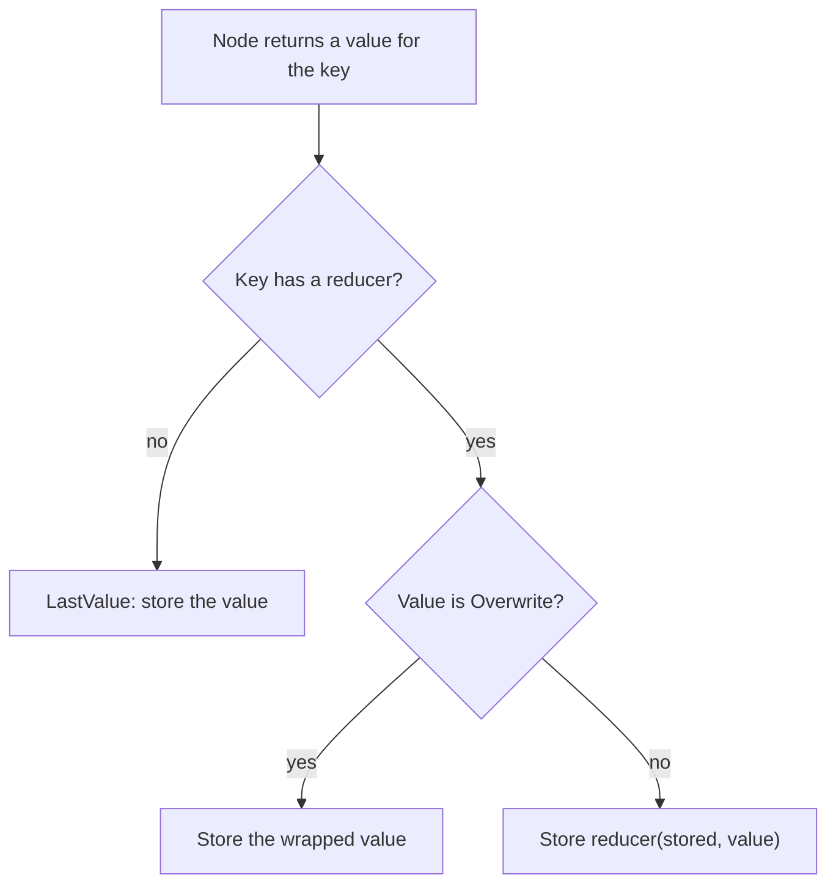
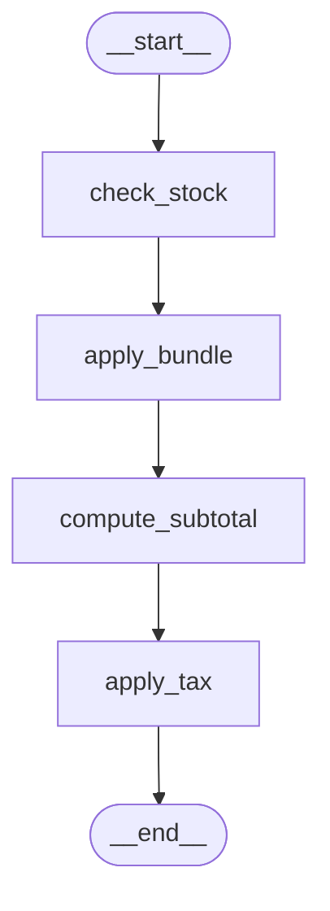

# 2.2 Reducers: How Updates Are Combined

## The problem

So far every node in the order pipeline has owned its keys outright. `compute_subtotal` writes `subtotal`, `apply_tax` writes `total`, and a new value simply replaces the old one. Lesson 1.1 called this the default rule: a [partial update](../../../GLOSSARY.md#partial-update) replaces the value of each key it returns.

Now the order gets two things that do not fit that rule.

- **A cart of line items.** A stock check finds that only two notebooks are left and that mugs are sold out. It wants to say "notebook: 2, mug: remove" and leave the pens alone. Under the replace rule it has to read the whole cart, edit a copy and send the full list back. Every node that touches the cart then repeats the same copy-and-edit code, and a node that forgets a line deletes it.
- **An audit log.** Each node should add one line saying what it did. Under the replace rule a node has to read the log, append to it and return the whole list. If one node returns only its own line, the history is gone.

In both cases the node knows *what changed*, and the question is *how to combine* that change with what is stored. LangGraph lets the state schema answer that question once per key, so the nodes don't have to.

## The concept

A [reducer](../../../GLOSSARY.md#reducer) is a function of two arguments that LangGraph calls whenever something writes to a key:

$$
\text{new value} = \text{reducer}(\text{stored value}, \text{update})
$$

The official docs name the arguments *left* (what is in the state) and *right* (what the node returned). LangGraph stores whatever the reducer returns.

You attach a reducer to a key in the state schema with `typing.Annotated`. The first argument is the type, and the last argument is the reducer:

```python
log: Annotated[list[str], operator.add]
```

`Annotated` is plain Python: static type checkers see only `list[str]` and ignore the extra item, and code can read it at run time from the type's `__metadata__`. [StateGraph](../../../GLOSSARY.md#stategraph) does exactly that when you pass it the schema.

Every key therefore follows one of two rules:

| Key declared as | Rule | In our state |
|---|---|---|
| `name: T` | the update replaces the value (last write wins) | `customer`, `tax_rate`, `currency`, `subtotal`, `total` |
| `name: Annotated[T, reducer]` | `reducer(stored, update)` becomes the value | `items` (`merge_items`), `log` (`operator.add`) |

The docs call the first rule the *default reducer*: it ignores the left argument and keeps the right one.

There is one way out of a reducer. A node that needs to *replace* a reduced value, for example to reset a list, wraps the value in [Overwrite](../../../GLOSSARY.md#overwrite) (from `langgraph.types`). LangGraph then stores the wrapped value as it is and does not call the reducer.

The mental model for the rest of the lesson: **a node never sets a key with a reducer. It sends an update, and the key's reducer decides what the update means.** "Append these lines", "replace these products", "remove this one" are all decisions of the reducer, not of the node.

## How it works

In lesson 1.1 you saw that `StateGraph` turns each key of the schema into a channel, a small container that stores one value and knows how to accept writes. The reducer decides which kind of channel a key gets. In 1.2.16 this happens in `_get_channel` in `langgraph/graph/state.py`:

- A key without a reducer gets a `LastValue` channel. It stores the single value written in a step. If it receives two values in the same step, it raises [InvalidUpdateError](../../../GLOSSARY.md#invalidupdateerror), because it has no rule to choose between them.
- A key with a reducer gets a [BinaryOperatorAggregate](../../../GLOSSARY.md#binaryoperatoraggregate) channel. It starts from an empty value of the key's type, `list()` for a list (so `[]`) or `int()` for an int (so `0`), and folds every write into the stored value with the reducer, one write after another.

The diagram shows what happens to one key of a node's return value:



Three details of this mechanism shape everything you will see in the live run.

1. **Updates are applied after the node finishes.** A node reads the state as it was before its step. Its return value is written to the channels only when the step is over. Inside `check_stock`, `state["items"]` is still the old cart, which is why the node can report `NOTEBOOK 3->2`.
2. **The `invoke` input is a write like any other.** LangGraph writes the input into the channels before the first node runs, and a reducer key's channel applies its reducer to the input too. Since the channel starts at `[]`, an input cart becomes `merge_items([], input_cart)`, and an input log becomes `[] + input_log`. The official Reducers section talks only about node updates, so this was checked on 1.2.16 by the lesson's test `test_invoke_input_goes_through_reducer`.
3. **The reducer is found when the graph is built.** `StateGraph` takes the last item of the `Annotated` metadata, and if it is callable, it must accept exactly two positional arguments. A reducer with three parameters fails right in `StateGraph(...)` with `ValueError: Invalid reducer signature. Expected (a, b) -> c. Got (a, b, c)`.

Before this lesson, a reducer key would have needed a reason to exist only for parallel nodes. In our linear graph exactly one node writes per step, so the reducers here do something more everyday: they let each node send a small change instead of the whole value.

## In our example

The pipeline from 2.1 grows two nodes in front of the two it had. The diagram was generated from the lesson's `build_graph()` with `draw_mermaid()`, with the styling removed:



Everything lives in [typed_dict_order.py](../src/l2_2_reducers/typed_dict_order.py). The [code walkthrough](readalong.md#typed_dict_orderpy) goes through it line by line. Here we follow the three rules through the code.

### The state: two reducers, five plain keys

<!-- snippet: src/l2_2_reducers/typed_dict_order.py#typed_dict_state -->
```python
class OrderDict(TypedDict):
    """Order state: two keys with reducers, the rest last-write-wins."""

    customer: str
    # merge_items combines every update with the stored cart.
    items: Annotated[list[LineItem], merge_items]
    tax_rate: float  # e.g. 0.2 for 20% VAT; the caller must pass it
    currency: str  # e.g. "EUR"; the caller must pass it
    subtotal: float  # written by compute_subtotal, replaced on each write
    total: float  # written by apply_tax, replaced on each write
    # operator.add concatenates lists: stored + update, so lines pile up.
    log: Annotated[list[str], operator.add]
```
<!-- /snippet -->

`quantity` and `unit_price` from 2.1 are gone, replaced by `items`, a list of `LineItem` dicts (`sku`, `quantity`, `unit_price`). `log` uses `operator.add`, which for two lists is `stored + update`: each update is appended at the end. The other five keys keep the default rule, which is right for them. `subtotal` and `total` are computed once per run, and a second write should replace the first.

### A custom reducer: `merge_items`

`operator.add` would be wrong for the cart: a stock correction for `NOTEBOOK` would add a second `NOTEBOOK` line instead of fixing the first. The cart needs an *upsert* (update or insert) by product code:

<!-- snippet: src/l2_2_reducers/typed_dict_order.py#merge_items_reducer -->
```python
def merge_items(current: list[LineItem], update: list[LineItem]) -> list[LineItem]:
    """Upsert update into current by sku; quantity <= 0 removes the line.

    LangGraph calls this as merge_items(stored_value, node_update) for every
    write to "items", including the invoke input. It must return a new list:
    the stored value is never mutated.
    """
    # A dict keeps insertion order, so existing lines keep their position.
    by_sku = {item["sku"]: item for item in current}
    for item in update:
        if item["quantity"] <= 0:
            by_sku.pop(item["sku"], None)  # remove the line (if it exists)
        else:
            by_sku[item["sku"]] = item  # replace in place, or append if new
    return list(by_sku.values())
```
<!-- /snippet -->

Read the function as a contract that every writer of `items` relies on:

- a line with a known `sku` replaces the stored line, in its old position,
- a line with a new `sku` is appended,
- a line with `quantity <= 0` removes that `sku`,
- lines that are not in the update stay as they are.

The function builds a new dict and returns a new list. It never changes `current`, which is the value LangGraph is holding. "Common mistakes" below shows what goes wrong otherwise.

Note that `merge_items` has no LangGraph imports. A reducer is an ordinary function, and you can test it on its own, as the third section of `__main__.py` does.

### Nodes that send changes, not values

`check_stock` returns only the lines above stock, capped to what is available. For `MUG` the stock is `0`, so the capped line has quantity `0`, and the reducer removes it:

<!-- snippet: src/l2_2_reducers/typed_dict_order.py#stock_node -->
```python
def check_stock(state: OrderDict) -> dict[str, Any]:
    """Return only the lines above stock, capped; merge_items applies them."""
    changed: list[LineItem] = []
    for item in state["items"]:
        available = STOCK.get(item["sku"], 0)
        if item["quantity"] > available:
            changed.append({**item, "quantity": available})  # 0 means remove
    if not changed:
        # An empty list goes through merge_items too and changes nothing.
        return {"items": [], "log": ["check_stock: all in stock"]}
    old = {item["sku"]: item["quantity"] for item in state["items"]}
    notes = ", ".join(f"{c['sku']} {old[c['sku']]}->{c['quantity']}" for c in changed)
    # The log line is a one-element list: operator.add needs a list.
    return {"items": changed, "log": [f"check_stock: {notes}"]}
```
<!-- /snippet -->

When everything is in stock, the node returns `"items": []`. `merge_items(cart, [])` returns the same lines, so the cart is unchanged. This is worth remembering: **with a reducer, an empty update changes nothing.** It does not clear the value, as it would for a plain key. The official docs make the same point about resetting a reducer field.

Every node returns its log line as a one-element list, because `operator.add` concatenates lists.

### Bypassing the reducer: `Overwrite`

`apply_bundle` turns a cart that matches the starter kit exactly (`PEN x3`, `NOTEBOOK x1`) into a single kit line. That is a replacement, which `merge_items` cannot express: the kit has a new `sku`, so the reducer would append it next to the pens and notebook. The node wraps the new cart in `Overwrite`:

<!-- snippet: src/l2_2_reducers/typed_dict_order.py#bundle_node -->
```python
def apply_bundle(state: OrderDict) -> dict[str, Any]:
    """Replace a cart that matches STARTER_KIT exactly with one kit line."""
    cart = {item["sku"]: item["quantity"] for item in state["items"]}
    if cart != STARTER_KIT:
        return {"log": ["apply_bundle: no bundle"]}
    # A plain [KIT_ITEM] would go through merge_items and be appended next
    # to PEN and NOTEBOOK. Overwrite skips the reducer and stores the value.
    return {
        "items": Overwrite([KIT_ITEM]),
        "log": ["apply_bundle: cart replaced by STARTER-KIT"],
    }
```
<!-- /snippet -->

`Overwrite` applies to one key only. In the same return value, `log` still goes through `operator.add`.

### The caller's side

The second section passes a log line in the input. Because the input is written through `operator.add` too, it becomes the first line of the log, and the node lines follow it:

<!-- snippet: src/l2_2_reducers/__main__.py#bundle_demo -->
```python
print("\n== Bob: apply_bundle replaces the cart with Overwrite ==")
order = {
    "customer": "Bob",
    "items": BOB_CART,
    "tax_rate": 0.2,
    "currency": "EUR",
    # The input is written through operator.add too, so it stays first.
    "log": ["web: checkout"],
}
result = graph.invoke(order)
print(f"cart in:  {fmt_items(BOB_CART)}")
print(f"cart out: {fmt_items(result['items'])}")
print("log:")
for line in result["log"]:
    print(f"  {line}")
print(f"total: {result['total']} {result['currency']}")
```
<!-- /snippet -->

The third section calls the reducer by hand, first with the kind of update `check_stock` sends, then with the kit line that `apply_bundle` would send without `Overwrite`:

<!-- snippet: src/l2_2_reducers/__main__.py#reducer_calls -->
```python
print("\n== Reducers are plain functions ==")
update: list[LineItem] = [
    {"sku": "NOTEBOOK", "quantity": 2, "unit_price": 4.0},
    {"sku": "MUG", "quantity": 0, "unit_price": 8.0},
]
print(f"current: {fmt_items(ADA_CART)}")
print(f"update:  {fmt_items(update)}")
print(f"merged:  {fmt_items(merge_items(ADA_CART, update))}")
# What apply_bundle would get from a plain list instead of Overwrite.
merged = merge_items(BOB_CART, [KIT_ITEM])
print(f"Bob's cart + [STARTER-KIT x1] without Overwrite ({len(merged)} lines):")
for item in merged:
    print(f"  {item['sku']} x{item['quantity']} @ {item['unit_price']}")
```
<!-- /snippet -->

## Run it

From the course root, run `./run.sh 2.2`. This is the output of the verified run:

```text
== Ada: check_stock updates lines through merge_items ==
cart in:  PEN x4, NOTEBOOK x3, MUG x1
cart out: PEN x4, NOTEBOOK x2
log:
  check_stock: NOTEBOOK 3->2, MUG 1->0
  apply_bundle: no bundle
  compute_subtotal: 14.0
  apply_tax: 16.8 EUR
total: 16.8 EUR

== Bob: apply_bundle replaces the cart with Overwrite ==
cart in:  PEN x3, NOTEBOOK x1
cart out: STARTER-KIT x1
log:
  web: checkout
  check_stock: all in stock
  apply_bundle: cart replaced by STARTER-KIT
  compute_subtotal: 6.0
  apply_tax: 7.2 EUR
total: 7.2 EUR

== Reducers are plain functions ==
current: PEN x4, NOTEBOOK x3, MUG x1
update:  NOTEBOOK x2, MUG x0
merged:  PEN x4, NOTEBOOK x2
Bob's cart + [STARTER-KIT x1] without Overwrite (3 lines):
  PEN x3 @ 1.5
  NOTEBOOK x1 @ 4.0
  STARTER-KIT x1 @ 6.0
```

The program uses no LLM and no clock, so every run prints exactly this. What to notice:

- **Ada's cart.** `check_stock` sent two lines, and the cart came out with `NOTEBOOK` lowered to 2 *in its old place* and `MUG` gone, while `PEN x4` survived without being mentioned. The subtotal is $4 \times 1.5 + 2 \times 4.0 = 14.0$.
- **Ada's log.** Four lines, one per node, in the order the nodes ran. No node read the log, and none returned more than its own line. Ada's input had no `log` at all: the channel started as `[]`.
- **Bob's cart.** `STARTER-KIT x1` alone: `Overwrite` replaced the list. The subtotal `6.0` is the kit price.
- **Bob's log.** Five lines, with `web: checkout` from the input first. `check_stock: all in stock` shows the empty update at work: the node returned `"items": []`, and the cart still reached `apply_bundle` intact.
- **Reducers are plain functions.** The direct call gives the same cart as Ada's graph run, because the graph does nothing more than call `merge_items(stored, update)`. The last three lines are the cart `apply_bundle` would leave without `Overwrite`.

## Details and edge cases

**Reducers fold writes one at a time.** If several nodes write a reducer key in the same step, the channel calls the reducer once per write: `reducer(reducer(stored, a), b)`. This lesson makes no claim about whether `a` or `b` comes first. Module 3 covers parallel nodes and what you can rely on there. The lesson's test `test_parallel_writes_need_a_reducer` compares the two lines sorted for that reason.

**One `Overwrite` per key per step.** If an `Overwrite` and ordinary updates reach the same key in one step, only the `Overwrite` value is stored. On 1.2.16 the result is the same whichever write the channel sees first: an ordinary update before it is replaced, and one after it is skipped. Two `Overwrite` values for the same key in one step raise `InvalidUpdateError: Can receive only one Overwrite value per super-step.` The how-to guide warns about the same case.

**`Overwrite` has a JSON form.** Code that cannot import `Overwrite`, for example a client sending updates as JSON, can write `{"__overwrite__": value}`. The how-to guide documents this form, and `BinaryOperatorAggregate` recognises it. In Python, prefer the class.

**The reducer has to accept every update shape you send.** `operator.add` on a list accepts only a list. `merge_items` reads `item["sku"]` and `item["quantity"]` from every line, so a line without `quantity` fails inside the reducer with `KeyError`. A reducer is part of the state's interface: write down what an update means, and keep nodes to it.

**The last callable in `Annotated` is the reducer.** `Annotated[list[str], "audit trail"]` has no callable at the end, so the key silently becomes a plain key with last-write-wins. LangGraph does not warn about it.

**Reducers and the earlier schemas.** Lesson 2.1 showed that writes go straight into the channels and never through the schema class. That still holds: the reducer runs on the channel, on raw values, whether the schema is a `TypedDict`, a dataclass or a Pydantic model.

## Common mistakes

> [!WARNING]
> **Expecting a plain list to replace a reduced value.** `return {"items": [KIT_ITEM]}` goes through `merge_items`, and `return {"log": []}` goes through `operator.add` and changes nothing. A normal update always goes through the reducer. To replace or reset, return `Overwrite(...)`, for example `{"log": Overwrite([])}`.

> [!WARNING]
> **Returning a bare value for a list reducer.** `{"log": "apply_tax: done"}` makes `operator.add` compute `list + str`, and the run stops with `TypeError: can only concatenate list (not "str") to list`, raised inside the channel after the node has finished. Return `["apply_tax: done"]`.

> [!WARNING]
> **Mutating the stored value in a reducer.** A reducer such as `current.extend(update); return current` seems to work: the final result is right. But `current` is the very list LangGraph has handed out as the state. On 1.2.16, with that reducer and two nodes appending `"a"` and `"b"`, every chunk of `stream(..., stream_mode="values")` ends up showing `['in', 'a', 'b']`, and the list the first node received changes after the node has returned. With `operator.add`, which builds a new list, the chunks are `['in']`, `['in', 'a']`, `['in', 'a', 'b']`. Always return a new value, as `merge_items` does.

> [!WARNING]
> **Using `Overwrite` on a key without a reducer.** It is meant for reducer channels only. On 1.2.16 a plain key does not unwrap it: the state ends up holding the `Overwrite(value=[...], type='__overwrite__')` object itself. On a plain key, just return the value.

> [!WARNING]
> **Resending the stored value to a reducer key.** The habit from 1.1 of returning `{**state, ...}` was harmless for plain keys. With `log: Annotated[list[str], operator.add]` it appends the whole log to itself again. Return only the change.

> [!TIP]
> Test a custom reducer as a plain function before you put it in a graph. Check the cases its writers rely on (replace, append, remove, empty update) and check that the input list is unchanged afterwards. `test_merge_items_upsert` in [test_reducers.py](../tests/test_reducers.py) does all of this in a few lines.

## Experiments

Each experiment starts from the lesson's original code in [typed_dict_order.py](../src/l2_2_reducers/typed_dict_order.py). Make the change, run `./run.sh 2.2` from the course root, and try to predict the result before you open the explanation.

1. In `apply_bundle`, return the plain list `[KIT_ITEM]` instead of `Overwrite([KIT_ITEM])`.

   <details><summary>What happens and why</summary>

   Ada's section is unchanged. In Bob's section the cart comes out as `PEN x3, NOTEBOOK x1, STARTER-KIT x1`, the subtotal is `14.5` and the total `17.4 EUR`, yet the log still says `apply_bundle: cart replaced by STARTER-KIT`. A normal update always goes through the key's reducer, and for `merge_items` a new `sku` means "append". The log line only says what the node *meant*. `Overwrite` is the only way for a node to replace a reduced value. Put the code back as it was (`git checkout -- .` in the lesson directory).

   </details>

2. In `OrderDict`, change `log` to a plain `list[str]` (drop the `Annotated` reducer).

   <details><summary>What happens and why</summary>

   Both runs finish, but each log holds a single line, `apply_tax: 16.8 EUR` for Ada and `apply_tax: 7.2 EUR` for Bob. Bob's `web: checkout` is gone too. Without a reducer every write replaces the stored value, so only the last node's line survives. This is the same rule that `subtotal` and `total` rely on, and it is right for them but wrong for a history. Put the code back as it was.

   </details>

3. In `compute_subtotal`, return `"log": f"compute_subtotal: {subtotal}"`, a string, not a one-element list.

   <details><summary>What happens and why</summary>

   The run stops in Ada's section with a traceback ending in `langgraph/channels/binop.py`:

   ```text
   TypeError: can only concatenate list (not "str") to list
   ```

   The node itself ran fine. The error comes when LangGraph applies the update: the channel calls `operator.add(stored_list, "compute_subtotal: 14.0")`. LangGraph does not check updates against the schema type, so the reducer is the first code to meet the wrong shape. Put the code back as it was.

   </details>

4. Change `log` to a plain `list[str]` again, and in `build_graph` add `builder.add_edge(START, "apply_bundle")` after the edge from `START` to `check_stock`. Then restore the `operator.add` reducer and keep the extra edge.

   <details><summary>What happens and why</summary>

   With the plain `log`, the first `invoke` stops with:

   ```text
   langgraph.errors.InvalidUpdateError: At key 'log': Can receive only one value per step. Use an Annotated key to handle multiple values.
   ```

   Now `check_stock` and `apply_bundle` both start from `START`, so they run in the same step, and both write `log`. A plain key accepts one value per step. It has no rule for choosing between two, so LangGraph refuses instead of guessing.

   With the reducer back, the error is gone and the totals are unchanged (`16.8 EUR`, `7.2 EUR`). But the logs are longer: 7 lines for Ada and 8 for Bob, with `apply_bundle`, `compute_subtotal` and `apply_tax` each appearing twice. `apply_bundle` now runs twice, once from `START` and once after `check_stock`, and each run triggers the rest of the chain. The reducer only decides how writes are combined, not which nodes run. Don't rely on the order of the lines written in the same step. Fan-out and its side effects are the topic of module 3. Put the code back as it was.

   </details>

5. Invoke the graph with two `PEN` lines in the input. From the lesson directory:

   ```bash
   uv run --package l2-2-reducers python -c '
   from l2_2_reducers.typed_dict_order import build_graph
   order = {"customer": "Cy", "tax_rate": 0.2, "currency": "EUR",
            "items": [{"sku": "PEN", "quantity": 1, "unit_price": 1.5},
                      {"sku": "PEN", "quantity": 2, "unit_price": 1.5}]}
   result = build_graph().invoke(order)
   print(result["items"], result["total"])
   '
   ```

   Then change `merge_items` to add the quantities when the `sku` is already in the cart, and run both the command and `./run.sh 2.2` again. One way to write it, in place of the line `by_sku[item["sku"]] = item`:

   ```python
   if item["sku"] in by_sku:
       old = by_sku[item["sku"]]
       item = {**item, "quantity": old["quantity"] + item["quantity"]}
   by_sku[item["sku"]] = item
   ```

   <details><summary>What happens and why</summary>

   With the original reducer the command prints `[{'sku': 'PEN', 'quantity': 2, 'unit_price': 1.5}] 3.6`. The input is written through the reducer before any node runs, as `merge_items([], input_items)`, and the later `PEN` line replaces the earlier one.

   With the additive reducer it prints `PEN` with quantity `3` and the total `5.4`. That looks better for the input, but the lesson run now shows Ada's cart as `PEN x4, NOTEBOOK x5`, with a subtotal of `26.0`. `check_stock` meant "set NOTEBOOK to 2", and the new reducer read it as "add 2". A reducer defines what every update to its key means, so changing it changes the meaning of every node that writes the key. Put the code back as it was.

   </details>

## Summary

- Each state key has a rule for combining a write with the stored value. Without a reducer, the write replaces the value (last write wins). With `Annotated[T, reducer]`, LangGraph stores `reducer(stored, update)`.
- A reducer is a plain function of two arguments. It must return a new value and never mutate the stored one. Nodes and reducer share a contract about what an update means.
- With a reducer, nodes send changes, not whole values. An empty update changes nothing, and the `invoke` input goes through the reducer too.
- `Overwrite(value)` stores a value for a reducer key without calling the reducer. It is the way to replace or reset an accumulated value, and only one `Overwrite` per key is allowed in a step.
- A key without a reducer accepts only one write per step. Two parallel writes raise `InvalidUpdateError`, which a reducer resolves.

## Self-check

1. The stored log is `["a"]`. A node returns `{"log": []}`. What is the log afterwards, with `operator.add` and with a plain `list[str]`?

   <details><summary>Answer</summary>

   With `operator.add` it stays `["a"]`, because `["a"] + []` is `["a"]`. With a plain key it becomes `[]`, because the write replaces the value. To clear a reduced log, return `{"log": Overwrite([])}`.

   </details>

2. The cart is `PEN x4, NOTEBOOK x3, MUG x1`. A node returns `{"items": [{"sku": "MUG", "quantity": 0, ...}, {"sku": "CUP", "quantity": 1, ...}]}`. What is the cart afterwards?

   <details><summary>Answer</summary>

   `PEN x4, NOTEBOOK x3, CUP x1`. `merge_items` removes `MUG` (quantity `<= 0`), appends the new `CUP` line at the end, and keeps the lines that were not mentioned.

   </details>

3. Why does `apply_bundle` need `Overwrite`, while `check_stock` can remove `MUG` without it?

   <details><summary>Answer</summary>

   `check_stock` expresses its change in the language of `merge_items`: quantity `0` means "remove". `apply_bundle` needs to drop lines it does not name and add a new one, and `merge_items` has no way to say "drop everything else". A new `sku` means "append", so a plain update would leave three lines. `Overwrite` skips the reducer and stores the new list as it is.

   </details>

4. Bob's input contains `log=["web: checkout"]`. Why is that line still first in the output, when every node writes `log`?

   <details><summary>Answer</summary>

   The input is written into the `log` channel through `operator.add` like any update, `[] + ["web: checkout"]`, before the first node runs. Each node's line is then appended at the end. Without the reducer, the first node's write would replace it.

   </details>

5. Two nodes run in the same step and both return a value for `total`, a key without a reducer. What happens, and what are the two ways to fix it?

   <details><summary>Answer</summary>

   `invoke` raises `InvalidUpdateError: At key 'total': Can receive only one value per step. ...`. Either give the key a reducer that combines the two values, or change the graph so that only one node writes the key per step, for example by giving each branch its own key.

   </details>

## Further reading

- [Graph API overview: Reducers](https://docs.langchain.com/oss/python/langgraph/graph-api#reducers), LangChain docs: reducer arguments, the default reducer, custom reducers, `Overwrite` and resetting a reducer field.
- [Use the Graph API](https://docs.langchain.com/oss/python/langgraph/use-graph-api), LangChain docs: the how-to sections "Process state updates with reducers" and "Bypass reducers with `Overwrite`", including the `{"__overwrite__": ...}` form and the one-`Overwrite`-per-step rule.
- [INVALID_CONCURRENT_GRAPH_UPDATE](https://docs.langchain.com/oss/python/langgraph/errors/INVALID_CONCURRENT_GRAPH_UPDATE), LangChain docs: the error raised when several nodes write a key without a reducer in one step.
- [langgraph/channels/binop.py at 1.2.16](https://github.com/langchain-ai/langgraph/blob/1.2.16/libs/langgraph/langgraph/channels/binop.py): `BinaryOperatorAggregate`, the channel that applies a reducer and handles `Overwrite`.
- [langgraph/graph/state.py at 1.2.16](https://github.com/langchain-ai/langgraph/blob/1.2.16/libs/langgraph/langgraph/graph/state.py): `_get_channel` and `_is_field_binop`, which read the reducer from `Annotated` and check its signature.
- [Merge message issues when LangGraph is called in parallel](https://forum.langchain.com/t/seeking-help-with-some-merge-message-issues-when-langgraph-is-called-in-parallel/3007), LangChain forum: a beginner's parallel graph, with an answer that separates reducers (how values combine) from joins (when a node runs).
- [typing.Annotated](https://docs.python.org/3/library/typing.html#typing.Annotated), Python docs: how metadata is attached to a type and read back at run time.
