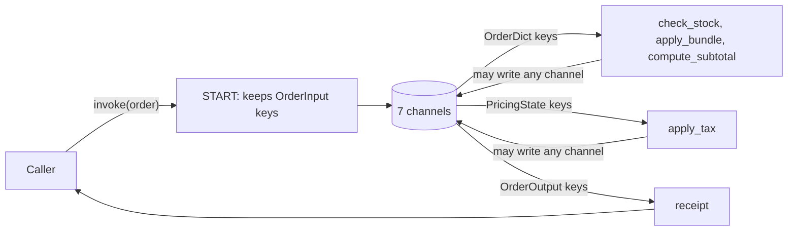

# 2.3 Input, Output and Private Schemas

## The problem

At the end of lesson 2.2 the order pipeline worked, but its edges were wide open. The graph had one schema, `OrderDict`, and that schema did three jobs at once. It listed the keys the nodes share, it listed what a caller may send, and it listed what `invoke()` returns.

Those three lists are not the same, and the overlap showed in the 2.2 run:

- **The caller could write anything.** Bob's order carried `log=["web: checkout"]`, and because the input goes through the key's [reducer](../../../GLOSSARY.md#reducer), that line ended up in his audit log. A caller could just as well send a `subtotal` or a `total`. Nothing marked those keys as "computed by the graph, not supplied".
- **The receipt showed everything.** The result held `tax_rate` and `subtotal`, which are working values. A client that reads the result as an API response now depends on them, and you can no longer rename or remove them without breaking that client.
- **Every node could read every key.** `apply_tax` needs three values, but it received the whole order.

A function in Python has parameters, a return value and local variables, and only the first two are visible from outside. This lesson gives the graph the same split.

## The concept

A graph built with [StateGraph](../../../GLOSSARY.md#stategraph) can use several schemas, each with its own role:

- The [state schema](../../../GLOSSARY.md#state-schema), the first argument of `StateGraph`, as before. It declares the shared keys and their reducers.
- The graph's [input schema](../../../GLOSSARY.md#input-schema), passed as `input_schema=`. It lists the keys that `invoke()` accepts. Other keys in the input are dropped.
- The [output schema](../../../GLOSSARY.md#output-schema), passed as `output_schema=`. It lists the keys that `invoke()` returns.
- A node's input schema. It lists the keys the node receives. You rarely pass it explicitly: LangGraph reads it from the type hint of the node's first parameter.
- A [private schema](../../../GLOSSARY.md#private-schema): a schema with keys that only some nodes use, and that appear in neither the graph's input nor its output. It is not a special kind of class. It is an ordinary `TypedDict` that reaches the graph as some node's input schema.

Both graph-level schemas default to the state schema. That is why, until now, everything went in and everything came out.

The mental model for the rest of the lesson: **the schemas are views onto one set of channels.** Every key that appears in any schema of the graph becomes exactly one channel, shared by the whole graph. A schema never owns a copy of a key. It only decides who may see that channel at one point: the caller at the entrance, a node when it reads, or the caller at the exit.

The official Graph API overview says the same thing in its own words: the graph state is the union of the channels defined at initialization, and a node may write to any channel in that union.

## How it works

### Building the channels

The channels are collected while the graph is being built, schema by schema, in a fixed order. In 1.2.16 this is `StateGraph.__init__` and `StateGraph._add_schema` in `langgraph/graph/state.py`:

1. `StateGraph(...)` registers the state schema, then the input schema, then the output schema.
2. Each `add_node(...)` call registers that node's input schema.

For every key of a schema being registered, one of three things happens:

| The key is | What `_add_schema` does |
|---|---|
| new | creates a channel from the annotation: a reducer channel for `Annotated[T, reducer]`, a last-value channel otherwise (lesson 2.2) |
| already a channel, and the new annotation is plain (`name: T`) | nothing: the existing channel and its reducer stay |
| already a channel, and the new annotation names a different reducer | raises `ValueError: Channel '<key>' already exists with a different type` |

So the first schema that mentions a key decides its channel. Later schemas can repeat the key with a plain type, or with the same reducer, but cannot change it.

### Reading and writing at run time

Once compiled, the graph uses the schemas as filters on that one set of channels. Follow the diagram from left to right:



- **Entrance.** [START](../../../GLOSSARY.md#start) writes only the input schema's keys into the channels. Any other key in the `invoke()` input is dropped without an error. The kept keys are written through their channels, so a reducer still applies to them.
- **Before each node.** LangGraph reads only the channels listed in the node's input schema and passes them in. For a `TypedDict` the node gets a dict with just those keys.
- **After each node.** The node's [partial update](../../../GLOSSARY.md#partial-update) may name any channel of the graph, not just the keys of its own input schema. A key that is not a channel at all is dropped, again without an error.
- **Exit.** `invoke()` reads the output schema's channels and returns them as a plain dict.

### Where a node's input schema comes from

When `add_node` gets a function and no explicit `input_schema=`, it looks at the type hints. If the first parameter has a hint, and that hint is a class with annotations of its own (a `TypedDict`, a dataclass or a Pydantic model), the class becomes the node's input schema and `add_node` registers it, as in step 2 above. In 1.2.16 this is in `StateGraph.add_node`. A node without a usable hint gets the state schema.

The return annotation plays no part in this. `add_node` reads it only to find the possible destinations of a node that returns a `Command`, a topic for a later module. Writing `-> PricingState` on a node does not register `PricingState`.

## In our example

The graph has the same shape and the same four nodes as in 2.2, and Ada and Bob still pay `16.8 EUR` and `7.2 EUR`. Only the schemas changed, all in [typed_dict_order.py](../src/l2_3_input_output_schemas/typed_dict_order.py). The [code walkthrough](readalong.md#typed_dict_orderpy) goes through the file line by line. Here we follow the four schemas through it.

The table shows which schema mentions which key. The last column is the channel each key gets:

| Key | `OrderDict` | `OrderInput` | `OrderOutput` | `PricingState` | Channel |
|---|---|---|---|---|---|
| `customer` | yes | yes | yes | | last value |
| `items` | yes, with `merge_items` | yes, plain | yes, plain | | `merge_items` |
| `tax_rate` | yes | yes | | yes | last value |
| `currency` | yes | yes | yes | yes | last value |
| `total` | yes | | yes | | last value |
| `log` | yes, with `operator.add` | | yes, plain | | `operator.add` |
| `subtotal` | | | | yes | last value |

`OrderDict` is the 2.2 state minus `subtotal`. Everything else in it, including both reducers, is unchanged.

### The public interface

`OrderInput` is what a caller sends, and `OrderOutput` is the receipt:

<!-- snippet: src/l2_3_input_output_schemas/typed_dict_order.py#io_schemas -->
```python
# A key is ONE channel for the whole graph. OrderDict is registered first and
# gives items and log their reducers; a plain annotation here reuses them.
class OrderInput(TypedDict):
    """What a caller sends: the cart and how to price it."""

    customer: str
    items: list[LineItem]  # plain on purpose: still merged by merge_items
    tax_rate: float
    currency: str


class OrderOutput(TypedDict):
    """The receipt: what invoke returns to the caller."""

    customer: str
    items: list[LineItem]
    total: float
    currency: str
    log: list[str]  # plain on purpose: still concatenated by operator.add
```
<!-- /snippet -->

Both annotate `items` and `log` as plain lists, on purpose. `OrderDict` is registered first, so it has already created the `merge_items` and `operator.add` channels for these keys, and a plain annotation reuses them. Neither class lists `subtotal`, and the receipt has no `tax_rate`.

Both classes go to `StateGraph` and nowhere else. No node has them as a hint:

<!-- snippet: src/l2_3_input_output_schemas/typed_dict_order.py#typed_dict_graph -->
```python
def build_graph() -> CompiledStateGraph:
    """Wire the four nodes into a linear graph and compile it."""
    # OrderDict is the shared state; input_schema filters what START writes
    # (unknown keys are dropped silently) and output_schema picks which
    # channels invoke returns.
    builder = StateGraph(OrderDict, input_schema=OrderInput, output_schema=OrderOutput)
    builder.add_node("check_stock", check_stock)
    builder.add_node("apply_bundle", apply_bundle)
    builder.add_node("compute_subtotal", compute_subtotal)
    builder.add_node("apply_tax", apply_tax)
    builder.add_edge(START, "check_stock")
    builder.add_edge("check_stock", "apply_bundle")
    builder.add_edge("apply_bundle", "compute_subtotal")
    builder.add_edge("compute_subtotal", "apply_tax")
    builder.add_edge("apply_tax", END)
    return builder.compile()
```
<!-- /snippet -->

`input_schema` and `output_schema` are the current keyword names. The older `input=` and `output=` still work in 1.2.16 but emit a deprecation warning.

### The private schema

`subtotal` is computed by one node and read by the next. No caller should send it, and no receipt should show it. It moves to its own schema:

<!-- snippet: src/l2_3_input_output_schemas/typed_dict_order.py#private_schema -->
```python
class PricingState(TypedDict):
    """Private pricing data passed from compute_subtotal to apply_tax.

    subtotal exists only here, so it is never in the input or the receipt.
    """

    subtotal: float
    tax_rate: float
    currency: str
```
<!-- /snippet -->

`PricingState` is never passed to `StateGraph`. It enters the graph through the parameter hint of `apply_tax`:

<!-- snippet: src/l2_3_input_output_schemas/typed_dict_order.py#typed_dict_nodes -->
```python
def compute_subtotal(state: OrderDict) -> dict[str, Any]:
    """Sum quantity * unit_price over the cart into subtotal."""
    lines = (item["quantity"] * item["unit_price"] for item in state["items"])
    subtotal = round(sum(lines), 2)
    # A node may write any channel; its hint (OrderDict) only decides what it reads.
    return {"subtotal": subtotal, "log": [f"compute_subtotal: {subtotal}"]}


# The first parameter's hint is the node's input schema (return annotations
# are ignored). add_node registers PricingState's keys as channels, which is
# how "subtotal" exists at all; the node receives only those three keys.
def apply_tax(state: PricingState) -> dict[str, Any]:
    """Add tax to subtotal and round the result into total."""
    total = round(state["subtotal"] * (1 + state["tax_rate"]), 2)
    return {"total": total, "log": [f"apply_tax: {total} {state['currency']}"]}
```
<!-- /snippet -->

The two nodes show the two halves of the rule:

- **The hint decides what a node reads.** `apply_tax` is typed with `PricingState`, so `add_node` registers `PricingState`. `tax_rate` and `currency` are already channels, so the only new channel is `subtotal`. At run time `apply_tax` receives a dict with exactly `subtotal`, `tax_rate` and `currency`.
- **The hint does not limit what a node writes.** `compute_subtotal` is still typed with `OrderDict`, which has no `subtotal`, and it still returns `{"subtotal": ..., "log": [...]}`. The write is accepted because `subtotal` is a channel of the graph. Who created that channel does not matter.

"Private" here means "not part of the interface". It is not access control: any node may write `subtotal`, and any node typed with `PricingState` may read it.

### The caller's side

Bob's order deliberately sends two keys that are not in `OrderInput`, the `log` line from 2.2 and a fake `subtotal`:

<!-- snippet: src/l2_3_input_output_schemas/__main__.py#input_filter_demo -->
```python
print("\n== Bob: keys outside OrderInput are dropped ==")
bob_order = {
    "customer": "Bob",
    "items": BOB_CART,
    "tax_rate": 0.2,
    "currency": "EUR",
    "log": ["web: checkout"],  # not in OrderInput
    "subtotal": 0.0,  # private, not in OrderInput
}
print("sent keys: " + ", ".join(bob_order))
# START writes only OrderInput's keys; the rest is filtered silently,
# without an error.
receipt = graph.invoke(bob_order)
print(f"cart out: {fmt_items(receipt['items'])}")
print("log:")
for line in receipt["log"]:
    print(f"  {line}")
print(f"total: {receipt['total']} {receipt['currency']}")
```
<!-- /snippet -->

The last section streams the run with `stream_mode="updates"`, which yields what each node returned, so the private write becomes visible:

<!-- snippet: src/l2_3_input_output_schemas/__main__.py#private_updates_demo -->
```python
print("\n== Inside the graph: subtotal travels between nodes ==")
# stream_mode="updates" yields {node_name: update} after each node, so
# we see the private subtotal write that the receipt hides.
for chunk in graph.stream(ada_order, stream_mode="updates"):
    for node, update in chunk.items():
        print(f"  {node} writes: {', '.join(update)}")
print(f"subtotal in receipt: {'subtotal' in graph.invoke(ada_order)}")
```
<!-- /snippet -->

## Run it

From the course root, run `./run.sh 2.3`. This is the output of the verified run:

```text
== The public interface ==
input:  customer, items, tax_rate, currency
output: customer, items, total, currency, log
channels: customer, items, tax_rate, currency, total, log, subtotal

== Ada: send a cart, get a receipt ==
receipt keys: customer, items, total, currency, log
cart in:  PEN x4, NOTEBOOK x3, MUG x1
cart out: PEN x4, NOTEBOOK x2
log:
  check_stock: NOTEBOOK 3->2, MUG 1->0
  apply_bundle: no bundle
  compute_subtotal: 14.0
  apply_tax: 16.8 EUR
total: 16.8 EUR

== Bob: keys outside OrderInput are dropped ==
sent keys: customer, items, tax_rate, currency, log, subtotal
cart out: STARTER-KIT x1
log:
  check_stock: all in stock
  apply_bundle: cart replaced by STARTER-KIT
  compute_subtotal: 6.0
  apply_tax: 7.2 EUR
total: 7.2 EUR

== Inside the graph: subtotal travels between nodes ==
  check_stock writes: items, log
  apply_bundle writes: log
  compute_subtotal writes: subtotal, log
  apply_tax writes: total, log
subtotal in receipt: False
```

The program uses no LLM and no clock, so every run prints exactly this. What to notice:

- **The interface.** `input:` and `output:` come from `get_input_jsonschema()` and `get_output_jsonschema()` on the [compiled graph](../../../GLOSSARY.md#compiledstategraph). These JSON Schemas are what a server or a client would use to describe the graph's API, and they follow `OrderInput` and `OrderOutput` exactly. `channels:` lists all seven channels. `subtotal` comes last because it was registered last, by `add_node("apply_tax", ...)`, after the three schemas passed to `StateGraph`.
- **Ada.** `tax_rate` went in but is not among the receipt keys, and `subtotal` is not there either. The cart, the log and the total are the same as in 2.2.
- **Bob.** Six keys were sent, and there is no error. His log now has four lines instead of 2.2's five: `web: checkout` was dropped at `START` before it reached the `operator.add` channel. The fake `subtotal=0.0` was dropped too, so it could not zero the bill: the total is still `7.2 EUR`.
- **Inside the graph.** `compute_subtotal writes: subtotal, log` shows the private value is really there while the graph runs. It is just never handed to the caller, as the last line confirms.

## Details and edge cases

**The input schema filters, it does not validate.** The official how-to guide says the input schema ensures the input matches the expected structure. In 1.2.16 that is true only for the key names. `START` drops unknown keys, but a missing key is not reported: invoking our graph without `tax_rate` fails only when `apply_tax` reads it, with `KeyError: 'tax_rate'`. The same holds for a Pydantic model used as `input_schema`: a quick check on 1.2.16 showed that `START` does not call the model, so with a TypedDict state schema like ours a missing field gives a `KeyError` inside a node, and the string `"3"` for an `int` field is stored as it is. If the input must be checked, let the state schema or the first node's input schema do it (lesson 2.1 showed that the schema class is applied when a node's input is built), or check it in the first node.

**Silent filtering cuts both ways.** It keeps junk out, but it also swallows typos. A caller who sends `"tax-rate"` gets no warning. A node that returns a misspelt key gets none either, because a key that is not a channel is dropped after the node runs.

**The output schema filters the result of `invoke()`, not the state.** `stream(..., stream_mode="values")` yields the full channel values after each step, and on 1.2.16 its chunks from `compute_subtotal` onwards include `subtotal`. `stream_mode="updates"` shows what each node returned, as section (d) does. A checkpointer, covered in a later module, stores every channel too. A private key is hidden from the caller's result, not from the runtime or from anyone who inspects the state.

**A key with no value is left out of the result.** The output schema lists the keys `invoke()` may return. A channel that no one wrote has no value, and it is simply absent from the result. That is why, in 2.1, `tax_rate` was missing from the result when only a default supplied it.

**Plain annotations in later schemas are not checked.** A plain annotation on an existing key is ignored, even when its type disagrees. If `OrderInput` declared `log: str`, the graph would build and the `operator.add` channel would stay. The JSON Schema from `get_input_jsonschema()` would then advertise the wrong type. Keep the types in all schemas consistent by hand, or derive the schemas from each other.

**Order of registration matters for conflicts.** The first schema to mention a key decides its channel. If the state schema has a plain `log: list[str]` and a node's input schema declares `log` with `operator.add`, `add_node` raises the same `ValueError`. Declare every reducer in the state schema, which is registered first.

**Inheritance is another way to write the same thing.** The how-to guide declares `class OverallState(InputState, OutputState)`, and the official `react-agent` template declares `class State(InputState)`, so each key and its reducer is written once and shared. This lesson spells the keys out instead, so that every schema is readable on its own. Both layouts produce the same channels.

**Explicit node input schemas.** `add_node("apply_tax", apply_tax, input_schema=PricingState)` does the same as the hint. It is useful for nodes without type hints, such as lambdas. Prefer the hint when you have one, because it also tells a type checker what the node receives.

## Common mistakes

> [!WARNING]
> **Expecting the return annotation to register a schema.** Some examples write `def node_1(state: OverallState) -> PrivateState`, and the LangChain Academy notebook says such a hint shows that a node's output "will be filtered". In 1.2.16 the return annotation is not used for channels or filtering. If no node has `PrivateState` as its *parameter* hint, its keys are not channels, and writes to them are dropped. In the official examples the private schema works because a later node reads it through its parameter hint.

> [!WARNING]
> **Narrowing a node's hint and still reading the other keys.** A node typed with `PricingState` gets only `subtotal`, `tax_rate` and `currency`. `state["customer"]` raises `KeyError`, although `customer` is in the graph's state. Add the key to the node's schema if the node needs it.

> [!WARNING]
> **Giving a key a different reducer in another schema.** `items: Annotated[list[LineItem], operator.add]` in `OrderInput` fails at `StateGraph(...)` with `ValueError: Channel 'items' already exists with a different type`. A key is one channel for the whole graph, so it has one reducer. Repeat the key with a plain type.

> [!WARNING]
> **Relying on the input schema for validation.** It drops unknown keys but does not report missing ones, and even a Pydantic `input_schema` does not validate. See "Details and edge cases" above.

> [!WARNING]
> **Using the old keyword names.** `StateGraph(OrderDict, input=OrderInput, output=OrderOutput)` still works in 1.2.16 but warns that `input` and `output` are deprecated and will be removed. Older material uses them, and LangChain Academy's text still says "input" and "output" (its current code uses the new names). Write `input_schema=` and `output_schema=`.

> [!TIP]
> When a value seems to vanish, print `graph.builder.channels`. A key missing from that list is not a channel, and every write to it is dropped without a word.

## Experiments

Each experiment starts from the lesson's original code in [typed_dict_order.py](../src/l2_3_input_output_schemas/typed_dict_order.py). Make the change, run `./run.sh 2.3` from the course root, and try to predict the result before you open the explanation.

1. Remove the hint from `apply_tax`: `def apply_tax(state) -> dict[str, Any]:`.

   <details><summary>What happens and why</summary>

   The channels line no longer lists `subtotal`:

   ```text
   channels: customer, items, tax_rate, currency, total, log
   ```

   Ada's section then stops with `KeyError: 'subtotal'`, raised in `apply_tax`, with the note `During task with name 'apply_tax' ...`. Without a hint the node gets the state schema, so `PricingState` is never registered and the `subtotal` channel never exists. `compute_subtotal` still returns `subtotal`, but the write is dropped without an error, and `apply_tax` finds nothing to read. A schema reaches the graph only through `StateGraph(...)` or a node's input schema (its parameter hint or `add_node(input_schema=...)`). Put the code back as it was (`git checkout -- .` in the lesson directory).

   </details>

2. Add `subtotal: float` to `OrderOutput`.

   <details><summary>What happens and why</summary>

   The output line and the receipt keys gain `subtotal` at the end (`output: customer, items, total, currency, log, subtotal`), Ada's receipt carries `'subtotal': 14.0`, and the last line prints `subtotal in receipt: True`. The channel was there all along. The output schema only chooses which channels `invoke()` returns, so making a private value public is one line. That is also the risk: once a client reads `subtotal`, it is part of your interface. Put the code back as it was.

   </details>

3. In `build_graph`, drop both keyword arguments: `StateGraph(OrderDict)`.

   <details><summary>What happens and why</summary>

   Both the input and the output become the six `OrderDict` keys (`customer, items, tax_rate, currency, total, log`). Ada's receipt now leaks `tax_rate`. Bob's log is back to five lines, starting with `web: checkout`, as in 2.2. But `subtotal` stays hidden, from the receipt and from Bob's input, because the defaults are the state schema and `subtotal` is not in `OrderDict`. Moving a working value out of the state schema already keeps it out of the interface. The explicit schemas narrow the interface further. Put the code back as it was.

   </details>

4. In `OrderInput`, annotate `items` as `Annotated[list[LineItem], operator.add]`.

   <details><summary>What happens and why</summary>

   Nothing is printed. `build_graph` fails at `StateGraph(...)`:

   ```text
   ValueError: Channel 'items' already exists with a different type
   ```

   The traceback goes through `_add_schema`, called for the input schema. `OrderDict` was registered first and made `items` a `merge_items` channel, and a key is one channel for the whole graph. Another schema may repeat the key with a plain type or with the same reducer, but not with a different one. The error comes at build time, before any order runs. Put the code back as it was.

   </details>

5. In `apply_tax`, change the log line to `f"apply_tax: {state['customer']} {total} {state['currency']}"`.

   <details><summary>What happens and why</summary>

   The interface section prints as before, then Ada's section stops with `KeyError: 'customer'` in `apply_tax`. A node typed with `PricingState` receives only `subtotal`, `tax_rate` and `currency`, although `customer` is in the graph's state and in the input. The hint narrows what the node reads. It does not narrow what the node writes: `apply_tax` writes `total` and `log`, neither of which is in `PricingState`. Put the code back as it was.

   </details>

## Summary

- `StateGraph(State, input_schema=..., output_schema=...)` separates the shared state from the graph's public interface. Both default to the state schema.
- Every key in every schema is one channel for the whole graph. The first schema to mention a key decides its channel and reducer. Later schemas may repeat it with a plain type, but a different reducer raises `ValueError` at build time.
- `START` writes only the input schema's keys and drops the rest without an error. `invoke()` returns only the output schema's keys. Neither one validates values.
- A node's input schema comes from its first parameter's type hint, never from its return annotation. It decides what the node reads and registers new channels. A node may write any channel.
- A private schema is an ordinary `TypedDict` that only appears as some node's input schema. Its keys are real channels, hidden from the caller's result but not from streaming or checkpoints.

## Self-check

1. Bob sends `log=["web: checkout"]`. Why did this line appear in his log in 2.2, and why not now?

   <details><summary>Answer</summary>

   In 2.2 the input schema was the state schema, which has `log`, so `START` wrote the line through `operator.add` before the first node ran. Now the input schema is `OrderInput`, which has no `log`, so `START` drops the key without an error, and the channel starts as `[]`.

   </details>

2. `compute_subtotal` is typed with `OrderDict`, which has no `subtotal`. Why is its write to `subtotal` kept?

   <details><summary>Answer</summary>

   A node may write any channel of the graph, and `subtotal` is a channel because `add_node("apply_tax", ...)` registered `PricingState`. The node's hint only decides which keys it reads.

   </details>

3. You declare `class Notes(TypedDict): draft: str` and write `def write_draft(state: OrderDict) -> Notes`, but no node has `Notes` as a parameter hint. What happens to `{"draft": "..."}`?

   <details><summary>Answer</summary>

   It is dropped without an error. The return annotation is not used to register schemas, so `draft` is not a channel. Type some node's first parameter with `Notes`, or pass `input_schema=Notes` to `add_node`, or add `draft` to the state schema.

   </details>

4. `OrderOutput` declares `log: list[str]` without `operator.add`. Does the log still accumulate? What if it declared `log: str`?

   <details><summary>Answer</summary>

   It still accumulates. `OrderDict` is registered first and created the `operator.add` channel, and a plain annotation in a later schema leaves an existing channel alone. With `log: str` the graph behaves the same, because plain annotations are not checked against the existing channel. Only the JSON Schema of the output would advertise the wrong type.

   </details>

5. Is `subtotal` secret? Name two ways to see it during a run.

   <details><summary>Answer</summary>

   No. It is left out of the interface, not protected. `stream(..., stream_mode="updates")` shows `compute_subtotal`'s write, and `stream_mode="values"` shows it in the full state after each step. A checkpointer also stores it.

   </details>

## Further reading

- [Graph API overview: Multiple schemas](https://docs.langchain.com/oss/python/langgraph/graph-api#multiple-schemas), LangChain docs: input, output and private schemas, and the rule that a node may write any channel of the graph state.
- [Use the Graph API: Define input and output schemas](https://docs.langchain.com/oss/python/langgraph/use-graph-api#define-input-and-output-schemas), LangChain docs: a runnable example of output filtering. Read its claim about the input schema with the 1.2.16 note from this chapter in mind.
- [Use the Graph API: Pass private state between nodes](https://docs.langchain.com/oss/python/langgraph/use-graph-api#pass-private-state-between-nodes), LangChain docs: private keys passed from one node to the next with `add_sequence`.
- [langgraph/graph/state.py at 1.2.16](https://github.com/langchain-ai/langgraph/blob/1.2.16/libs/langgraph/langgraph/graph/state.py): `StateGraph.__init__`, `_add_schema` and `add_node`, where the channels are collected and node input schemas are inferred, and `attach_node`, where `START` filters the input.
- [LangChain Academy: multiple-schemas.ipynb](https://github.com/langchain-ai/langchain-academy/blob/main/module-2/multiple-schemas.ipynb): the same ideas in notebook form. Parts of its text say `input`/`output` and suggest that return annotations filter a node's output; neither holds for 1.2.16.
- [langchain-ai/react-agent: state.py](https://github.com/langchain-ai/react-agent/blob/main/src/react_agent/state.py): an official template whose graph uses `input_schema=InputState`, with the state schema inheriting from the input schema.
