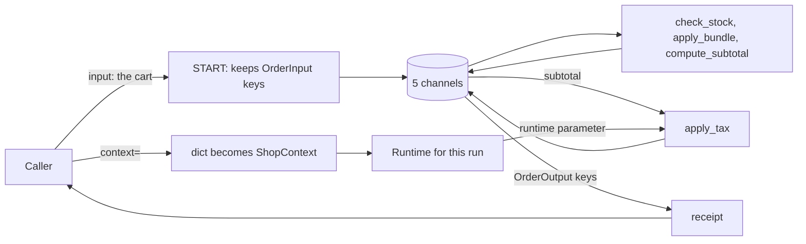

# 2.4 Runtime Context: Configuration Outside the State

## The problem

At the end of lesson 2.3 the order pipeline had a narrow interface. A caller sent the cart and got back a receipt. But two keys in that interface were not really about the order: `tax_rate` and `currency`. They described the *shop*, and every caller had to repeat them with every cart.

That caused three problems, and the 2.3 code already showed all of them:

- **Settings sat in the state.** `tax_rate` and `currency` were channels, like `items` or `total`. Any node could overwrite them, the caller could send any value it liked, and they took up space in every view of the state. Yet nothing in the run ever changed them. They were fixed before the first node ran.
- **They were part of the public API.** `OrderInput` listed them as order fields and `OrderOutput` returned `currency`. A client written against that interface treats shop settings as order data.
- **Different settings meant mixing them into the data.** To price the same cart for an EU shop and a US shop, you had to edit the input dict. The thing that varies per deployment or per tenant ended up next to the thing that varies per request.

A Python function has the same problem when a configuration value is passed as an ordinary argument through every call. The usual fix is to keep configuration separate from the data and inject it where it is needed. LangGraph has a built-in place for this.

## The concept

The [runtime context](../../../GLOSSARY.md#runtime-context) is a set of read-only values for one run of a graph. The caller passes it next to the input, every node may read it, no node can change it through the graph, and it is never part of the state or the result.

Three pieces make it work:

- **The schema.** You describe the context with a class, here a frozen dataclass, and pass it to `StateGraph` as [context_schema](../../../GLOSSARY.md#context_schema). This declares what the context looks like. It does not create any channels.
- **The value.** Each call of `invoke()` or `stream()` passes the actual settings with the keyword `context=`, either as an instance of the schema class or as a plain dict.
- **The access.** A node that needs the settings adds a parameter named `runtime`. LangGraph passes in a `Runtime` object (from `langgraph.runtime`), and `runtime.context` is the value given to this call.

The mental model: **a run gets three separate inputs.** The state is the data the nodes work on. It flows through channels, changes from node to node and comes back as the result. The context is the settings the run works *with*. It is fixed for the whole run and only read. The [run config](../../../GLOSSARY.md#run-config), the `config=` argument you used for [recursion_limit](../../../GLOSSARY.md#recursion_limit) in lesson 1.3, controls how LangGraph executes the run. It is not meant for your own settings.

| | State | Context | Run config |
|---|---|---|---|
| Declared with | the state schema and the other schemas of 2.3 | `context_schema=` | nothing (it is a `RunnableConfig` dict) |
| Passed as | the first argument of `invoke()` | `context=` | `config=` |
| Changes during the run | yes, through node updates | no | no |
| Read in a node through | the first parameter | `runtime.context` | a parameter named `config` |
| Returned or checkpointed | yes (filtered by the output schema) | no | no |
| Typical contents | the cart, the log, the total | tax rate, currency, user id, model name, a database handle | `recursion_limit`, tags, `thread_id` |

The Graph API docs list the same three things as the arguments a node may take: `state`, `config` and `runtime`.

## How it works

Follow the two inputs through one call. The diagram shows that the cart and the context take separate paths and meet only inside `apply_tax`:



**Building the graph.** `StateGraph(..., context_schema=ShopContext)` stores the class. The channels are collected exactly as in 2.3, from the state, input, output and node input schemas. The context schema is not one of them, so `tax_rate` and `currency` are no longer channels. The compiled graph keeps the class as `graph.context_schema` and can describe it with `get_context_jsonschema()`.

**Wrapping a node.** When `add_node` wraps a function, LangGraph inspects its parameter names. In 1.2.16 this happens in `langgraph/_internal/_runnable.py`, where a table called `KWARGS_CONFIG_KEYS` lists the names it can fill: `config`, `writer`, `store`, `previous`, `runtime` and `error`. For most of these names the annotation must match as well, but `runtime` (like `previous`) accepts any annotation. So the name is what counts. `Runtime[ShopContext]` is for you and for the type checker, which then knows that `runtime.context.tax_rate` is a `float`.

**Starting a run.** When `invoke()` or `stream()` starts, it builds one `Runtime` for the run. Its `context` field is the value you passed, after one conversion step. In 1.2.16 this is `_coerce_context` in `langgraph/pregel/main.py`:

- no context passed: `runtime.context` is `None`;
- a dict, and the schema is a dataclass or a Pydantic model: LangGraph calls `ShopContext(**the_dict)`;
- anything else: the value is used as it is, with no check against the schema.

**Calling the node.** Every node that has a `runtime` parameter receives that same `Runtime`. Nodes without the parameter, like `check_stock`, simply never see the context. Besides `context`, a `Runtime` carries other run-level services, such as the `store` for long-term memory and the `stream_writer` for custom streaming. Later modules use them.

## In our example

The graph has the same shape, the same nodes and the same cart numbers as in 2.3. Ada's subtotal is still `14.0` and Bob's is `6.0`. All the changes are in [typed_dict_order.py](../src/l2_4_runtime_context/typed_dict_order.py) and [\_\_main\_\_.py](../src/l2_4_runtime_context/__main__.py). The [code walkthrough](readalong.md#typed_dict_orderpy) lists every change line by line. Here we follow the shop settings.

### The context class

`tax_rate` and `currency` left `OrderDict`, `OrderInput`, `OrderOutput` and `PricingState`, and moved into a class of their own:

<!-- snippet: src/l2_4_runtime_context/typed_dict_order.py#shop_context -->
```python
# No defaults: both fields are required, so a context dict with a missing or
# misspelled field fails loudly instead of pricing with a silent fallback.
# frozen=True because the context is read-only for the whole run; a value
# that nodes change belongs in the state.
@dataclass(frozen=True)
class ShopContext:
    """Shop settings for one run: read by nodes, never part of the state."""

    tax_rate: float  # e.g. 0.2 for 20% VAT
    currency: str  # e.g. "EUR"
```
<!-- /snippet -->

Two choices in this class matter:

- **No defaults.** Both fields are required. A dict context with a misspelled key, `{"tax": 0.2, "currency": "EUR"}`, fails before any node runs with `TypeError: ShopContext.__init__() got an unexpected keyword argument 'tax'`, and a dict without `tax_rate` fails with `missing 1 required positional argument: 'tax_rate'`. With a default, a typo would price orders with the fallback rate, and nobody would notice.
- **`frozen=True`.** Python then refuses any assignment to the fields. LangGraph does not make the context read-only by itself. Freezing the class turns "settings don't change during a run" into a rule the interpreter enforces.

`ShopContext` is a dataclass, while the state schemas are `TypedDict`s. That is deliberate. A dataclass gives attribute access (`runtime.context.tax_rate`), required fields and immutability, and it is what the official templates use. A `TypedDict` also works as a context schema. Its context stays a plain dict and is read as `runtime.context["tax_rate"]`.

### The node that reads it

Only `apply_tax` needs the settings, so only `apply_tax` asks for the runtime:

<!-- snippet: src/l2_4_runtime_context/typed_dict_order.py#typed_dict_nodes -->
```python
def compute_subtotal(state: OrderDict) -> dict[str, Any]:
    """Sum quantity * unit_price over the cart into subtotal."""
    lines = (item["quantity"] * item["unit_price"] for item in state["items"])
    subtotal = round(sum(lines), 2)
    # A node may write any channel; its hint (OrderDict) only decides what it reads.
    return {"subtotal": subtotal, "log": [f"compute_subtotal: {subtotal}"]}


# The first parameter's hint is the node's input schema (return annotations
# are ignored). add_node registers PricingState's keys as channels, which is
# how "subtotal" exists at all; the node receives only that key.
# LangGraph injects the runtime by the parameter NAME "runtime" (any
# annotation is accepted, see KWARGS_CONFIG_KEYS in
# langgraph/_internal/_runnable.py). The Runtime[ShopContext] hint is for the
# reader and the type checker; runtime.context is what invoke(context=...) got.
def apply_tax(state: PricingState, runtime: Runtime[ShopContext]) -> dict[str, Any]:
    """Add the shop's tax to subtotal and round the result into total."""
    # runtime.context is the ShopContext of this run (None if none was passed).
    total = round(state["subtotal"] * (1 + runtime.context.tax_rate), 2)
    return {"total": total, "log": [f"apply_tax: {total} {runtime.context.currency}"]}
```
<!-- /snippet -->

`apply_tax` now has two sources of input. Its first parameter works as in 2.3: the hint `PricingState` is the node's [input schema](../../../GLOSSARY.md#input-schema), so `state` holds only `subtotal`. Its second parameter, `runtime`, brings the two settings. The node's [partial update](../../../GLOSSARY.md#partial-update) is the same as before: `total` and one `log` line.

### The graph

The wiring changes by one keyword:

<!-- snippet: src/l2_4_runtime_context/typed_dict_order.py#typed_dict_graph -->
```python
def build_graph() -> CompiledStateGraph:
    """Wire the four nodes into a linear graph and compile it."""
    # OrderDict is the shared state; input_schema filters what START writes
    # (unknown keys are dropped silently) and output_schema picks which
    # channels invoke returns. context_schema declares the shape of the run
    # context (the current API; config_schema= is deprecated, and your own
    # settings in config["configurable"] are the old pattern). It adds no channels.
    builder = StateGraph(
        OrderDict,
        input_schema=OrderInput,
        output_schema=OrderOutput,
        context_schema=ShopContext,
    )
    builder.add_node("check_stock", check_stock)
    builder.add_node("apply_bundle", apply_bundle)
    builder.add_node("compute_subtotal", compute_subtotal)
    builder.add_node("apply_tax", apply_tax)
    builder.add_edge(START, "check_stock")
    builder.add_edge("check_stock", "apply_bundle")
    builder.add_edge("apply_bundle", "compute_subtotal")
    builder.add_edge("compute_subtotal", "apply_tax")
    builder.add_edge("apply_tax", END)
    return builder.compile()
```
<!-- /snippet -->

The schemas from 2.3 still decide the channels and the public interface, and `context_schema` adds a fourth role next to them. Nothing in the compiled graph holds a tax rate. That is what lets one graph serve several shops.

### One graph, two shops

`main` builds the graph once and calls it with two different contexts:

<!-- snippet: src/l2_4_runtime_context/__main__.py#two_shops_demo -->
```python
print("\n== One graph, two shops ==")
receipt = graph.invoke(ada_order, context=EU_SHOP)
# invoke still returns only the OrderOutput keys; the context is not in it.
print("receipt keys: " + ", ".join(receipt))
for label, shop in [("EU shop", EU_SHOP), ("US shop", US_SHOP)]:
    # context= is per call: the same compiled graph prices with each shop.
    receipt = graph.invoke(ada_order, context=shop)
    print(f"{label}: cart out {fmt_items(receipt['items'])}")
    print(f"  {receipt['log'][-1]}")
    # The receipt has no currency: the caller knows the one it passed.
    print(f"  total: {receipt['total']} {shop.currency}")
```
<!-- /snippet -->

`EU_SHOP` and `US_SHOP` are module constants. Because `ShopContext` is frozen, sharing one instance between many runs is safe: no run can change it for the next one. The receipt has no `currency` any more, so the loop prints the currency from `shop`, the context it passed. In a real service the caller usually knows that value anyway, because it chose the shop.

### A 2.3 caller

The Bob section shows what happens to a caller that still sends settings the old way, in the input:

<!-- snippet: src/l2_4_runtime_context/__main__.py#input_filter_demo -->
```python
print("\n== Bob: shop settings in the input are ignored ==")
# How a 2.3 caller would still send it: settings mixed into the input.
bob_order = {"customer": "Bob", "items": BOB_CART, "tax_rate": 0.5, "currency": "USD"}
# A plain dict works as context too.
bob_context = {"tax_rate": 0.2, "currency": "EUR"}
print("sent keys: " + ", ".join(bob_order))
print(f"context: {bob_context}")
# START drops tax_rate and currency silently (they are not in OrderInput),
# and LangGraph turns the dict into ShopContext(**dict) before the run
# (_coerce_context in pregel/main.py, for dataclass and pydantic schemas).
receipt = graph.invoke(bob_order, context=bob_context)
for line in receipt["log"]:
    print(f"  {line}")
print(f"total: {receipt['total']} {bob_context['currency']}")
```
<!-- /snippet -->

Two things happen before any node runs. [START](../../../GLOSSARY.md#start) drops `tax_rate` and `currency` from the input, because they are not in `OrderInput`, without an error, as in 2.3. And LangGraph turns the dict `bob_context` into a `ShopContext`. The result shows the context won.

## Run it

From the course root, run `./run.sh 2.4`. This is the output of the verified run:

```text
== The public interface ==
input:   customer, items
output:  customer, items, total, log
context: tax_rate, currency
channels: customer, items, total, log, subtotal

== One graph, two shops ==
receipt keys: customer, items, total, log
EU shop: cart out PEN x4, NOTEBOOK x2
  apply_tax: 16.8 EUR
  total: 16.8 EUR
US shop: cart out PEN x4, NOTEBOOK x2
  apply_tax: 15.12 USD
  total: 15.12 USD

== Bob: shop settings in the input are ignored ==
sent keys: customer, items, tax_rate, currency
context: {'tax_rate': 0.2, 'currency': 'EUR'}
  check_stock: all in stock
  apply_bundle: cart replaced by STARTER-KIT
  compute_subtotal: 6.0
  apply_tax: 7.2 EUR
total: 7.2 EUR

== Inside the graph: subtotal travels between nodes ==
  check_stock writes: items, log
  apply_bundle writes: log
  compute_subtotal writes: subtotal, log
  apply_tax writes: total, log
subtotal in receipt: False
```

The program uses no LLM and no clock, so every run prints exactly this. What to notice:

- **The interface.** The new `context:` line comes from `get_context_jsonschema()`, which builds a JSON Schema from the dataclass. A server or a client can use it to show which settings a run needs, just as it uses the input and output schemas. Compare `channels:` with 2.3: seven channels became five, because `tax_rate` and `currency` are gone. The context added none.
- **Two shops.** The cart, the stock check and the subtotal are identical in both runs. Only the last step differs: $14.0 \times 1.2 = 16.8$ in EUR and $14.0 \times 1.08 = 15.12$ in USD. It is the same `graph` object both times.
- **Bob.** Bob sent `tax_rate: 0.5` in the input. Had it been used, his total would be `9.0`. It is `7.2 EUR`: 20 % on the `6.0` subtotal, as the dict context says.
- **Inside the graph.** No node writes `tax_rate` or `currency`. The settings are not in any update, because they are not state.

## Details and edge cases

**No context means `None`, not a default object.** `context_schema` only declares the shape. If the caller passes no `context=`, `runtime.context` is `None`, and the first attribute access fails inside the node: `AttributeError: 'NoneType' object has no attribute 'tax_rate'`. Field defaults on the dataclass do not change this. LangGraph never creates an instance by itself. The official how-to guide gives its context dataclass defaults and then passes `context=ContextSchema()` explicitly. If your graph has a sensible default, pass it the same way, or guard with `if runtime.context is None` in the node.

**Only dicts are converted, and a dataclass does not check types.** The conversion applies only to a dict, and only for a dataclass or Pydantic schema. An instance of some other class is passed through unchecked. A dataclass checks field *names*, not types: `{"tax_rate": "0.2", "currency": "EUR"}` builds a `ShopContext` with a string in it, and the error comes later, in the arithmetic. If the context comes from outside (an HTTP request, a config file), use a Pydantic model as the context schema. Its constructor validates the values, as `OrderModel` did for the state in lesson 2.1.

**The runtime is injected by name.** Rename the parameter to `rt` and the node fails with `TypeError: apply_tax() missing 1 required positional argument: 'rt'`, even though the annotation is still `Runtime[ShopContext]`. A type checker will not warn you, because nothing is wrong with the function itself.

**Context is not checkpointed.** It is not a channel, so it is not part of the state that a checkpointer saves, a topic of a later module. A run that continues from a checkpoint needs its context passed again. That is usually what you want: secrets and database handles stay out of storage. Keep it in mind when a value must survive between calls. Then it belongs in the state.

**`config["configurable"]` is still there, for LangGraph's own keys.** Before the context API existed, user settings went into `config["configurable"]` and were declared with `config_schema=`. That pattern is deprecated. The `configurable` dict itself is not: in 1.2.16 it still carries LangGraph's own keys, such as the `thread_id` that persistence uses in a later module. What changed is where *your* settings go. Values you put into `configurable` never become `runtime.context`.

**Where the change came from.** The context API arrived in LangGraph 0.6, after a public discussion in issue [#5023](https://github.com/langchain-ai/langgraph/issues/5023), "config.configurable -> context API". The maintainers proposed a typed `context_schema`, a top-level `context=` argument and a `Runtime` object for nodes, and said the old pattern would be deprecated gradually. Several commenters found the name "context" confusing next to the LLM sense of the word. In LangGraph it means the run's settings, not a prompt.

**`config_schema` is silent by default.** In 1.2.16, `StateGraph(..., config_schema=ShopContext)` still works and sets the context schema. It emits a `LangGraphDeprecatedSinceV10` warning, a subclass of `DeprecationWarning`. Python's default filters show a `DeprecationWarning` only when it is attributed to code in `__main__`, and this one points at the `StateGraph(...)` call in `typed_dict_order.py`. So a normal run prints nothing. The `StateGraph` docstring says the parameter will be removed in 2.0. The compiled graph's `config_schema()` and `get_config_jsonschema()` methods are deprecated the same way, in favour of `get_context_jsonschema()`.

**The official templates use the same pattern.** The `react-agent` template declares `StateGraph(State, input_schema=InputState, context_schema=Context)` and reads `runtime.context.model` in its `call_model` node. The `memory-agent` template reads `runtime.context.user_id` and uses `runtime.store` in the same node. Both `Context` classes have defaults, and `react-agent` fills unset fields from environment variables in `__post_init__`. That is a convenience of the template, not something LangGraph does.

## Common mistakes

> [!WARNING]
> **Forgetting `context=` on one call.** Each call of `invoke()` or `stream()` needs its own `context=`. The context is not stored in the graph or remembered from the previous call. Section (d) of `main` passes `context=EU_SHOP` to `stream()` for exactly this reason. Without it, `apply_tax` fails with `AttributeError: 'NoneType' object has no attribute 'tax_rate'`.

> [!WARNING]
> **Putting settings in `config={"configurable": ...}`.** Older tutorials and pre-0.6 code read settings with `config["configurable"]["model"]` and declare them with `config_schema=`. On 1.2.16, `graph.invoke(order, config={"configurable": {"tax_rate": 0.2, "currency": "EUR"}})` gives the same `AttributeError` as no context at all. Use `context_schema=` and `context=`.

> [!WARNING]
> **Naming the parameter anything but `runtime`.** `ctx: Runtime[ShopContext]` or `rt: Runtime[ShopContext]` is not injected, and the call fails with a `TypeError` for a missing argument. The name is what LangGraph looks at.

> [!WARNING]
> **Using the context for values that change.** A counter, a running discount or anything a node computes belongs in the state. With a frozen dataclass, an assignment fails with `dataclasses.FrozenInstanceError`. With a mutable one it would silently change the object shared by every node of the run, and of every other run that got the same instance, with no record in the updates or the checkpoints.

> [!WARNING]
> **Expecting defaults to apply when no context is passed.** `tax_rate: float = 0.2` on the dataclass does not help a caller who omits `context=`: `runtime.context` is still `None`. Defaults apply only when an instance is built, from `ShopContext()` or from a dict.

> [!TIP]
> To see what a graph expects, print `graph.get_context_jsonschema()` next to the input and output schemas. Required fields are listed under `"required"`.

## Experiments

Each experiment starts from the lesson's original code. Make the change, run `./run.sh 2.4` from the course root, and try to predict the result before you open the explanation.

1. In `main` ([\_\_main\_\_.py](../src/l2_4_runtime_context/__main__.py)), change the first call in the two-shops section to `receipt = graph.invoke(ada_order)`, without `context=`.

   <details><summary>What happens and why</summary>

   The interface section prints, then `== One graph, two shops ==`, and the run stops in `apply_tax`:

   ```text
   AttributeError: 'NoneType' object has no attribute 'tax_rate'
   During task with name 'apply_tax' and id '...'
   ```

   `context_schema` only declares the shape. With nothing passed, `runtime.context` is `None`. Adding defaults to `ShopContext` (`tax_rate: float = 0.2`, `currency: str = "EUR"`) gives exactly the same error, because LangGraph does not build an instance on its own. The first three nodes ran fine: only the node that reads the context fails. Put the code back as it was (`git checkout -- .` in the lesson directory).

   </details>

2. Pass the settings the old (pre-0.6) way: `receipt = graph.invoke(ada_order, config={"configurable": {"tax_rate": 0.2, "currency": "EUR"}})`.

   <details><summary>What happens and why</summary>

   The same `AttributeError: 'NoneType' object has no attribute 'tax_rate'`. The run config is a separate input. Its `configurable` dict is where LangGraph looks for its own keys such as `thread_id`, but nothing copies your values from there into `runtime.context`. Config is for how the run executes, context is for your settings. Put the code back as it was.

   </details>

3. In `build_graph`, replace `context_schema=ShopContext` with `config_schema=ShopContext`. Run it once normally, then from the lesson directory with `env -u VIRTUAL_ENV uv run python -W default::DeprecationWarning -m l2_4_runtime_context`.

   <details><summary>What happens and why</summary>

   The normal run prints exactly the same output as before, with no warning. With the warning filter switched on, the first lines are:

   ```text
   .../typed_dict_order.py:202: LangGraphDeprecatedSinceV10: `config_schema` is deprecated and will be removed. Please use `context_schema` instead. Deprecated in LangGraph V1.0 to be removed in V2.0.
     builder = StateGraph(
   ```

   In 1.2.16, `StateGraph` maps `config_schema` to `context_schema`, so the totals stay the same. The warning is a `DeprecationWarning` attributed to a module other than `__main__`, and Python hides those by default. That is how old code keeps "working" until the upgrade that removes the parameter. Run your tests with `-W error::DeprecationWarning` to catch such calls early. Put the code back as it was.

   </details>

4. In `apply_tax`, rename the parameter `runtime` to `rt` and update the two lines that use it. Keep the hint `Runtime[ShopContext]`.

   <details><summary>What happens and why</summary>

   The run stops in `apply_tax`:

   ```text
   TypeError: apply_tax() missing 1 required positional argument: 'rt'
   ```

   LangGraph injects the runtime by the parameter name `runtime`. It found no such name, so it called the function with the state alone. The annotation has no effect at run time, and a type checker sees nothing wrong, because the function itself is valid. Put the code back as it was.

   </details>

5. In `apply_tax`, add `runtime.context.tax_rate = 0.0` as the first line of the body.

   <details><summary>What happens and why</summary>

   The run stops in `apply_tax`:

   ```text
   dataclasses.FrozenInstanceError: cannot assign to field 'tax_rate'
   ```

   `frozen=True` makes the dataclass refuse assignments. The object is the same `EU_SHOP` instance that every run in `main` uses, so a mutable class would have let this node change the tax for all later runs, and nothing in the updates would show it. A value that nodes change belongs in the state, where a node returns it as an update. Put the code back as it was.

   </details>

## Summary

- The runtime context holds read-only settings for one run. Declare its type with `StateGraph(..., context_schema=...)` and pass the values per call with `invoke(..., context=...)` or `stream(..., context=...)`.
- A node reads it through a parameter named `runtime`, as `runtime.context`. The name is what matters. The hint `Runtime[YourContext]` is for readers and type checkers.
- The context is not state: it adds no channels, is not in the result and is not checkpointed. That is why one compiled graph can serve different shops, tenants or users.
- Without `context=`, `runtime.context` is `None`, whatever defaults the class has. A dict context becomes an instance of a dataclass or Pydantic schema. Use a frozen dataclass for read-only settings, or a Pydantic model when the values need validating.
- State is the data, context is your settings, and the run config (`recursion_limit`, `thread_id`, tags) controls how LangGraph runs the graph. `config_schema=` and settings in `config["configurable"]` are the deprecated way to pass settings.

## Self-check

1. Bob's input carries `tax_rate: 0.5`, and the context says `0.2`. Which value is used, and at which point is the other one dropped?

   <details><summary>Answer</summary>

   `0.2`, from the context. The input's `tax_rate` is dropped by `START`, because it is not a key of `OrderInput`, so it is not even a channel any more. `apply_tax` never reads the state for the tax rate. It reads `runtime.context.tax_rate`.

   </details>

2. Why can one compiled graph price Ada's cart for both the EU and the US shop?

   <details><summary>Answer</summary>

   Nothing in the compiled graph holds a tax rate or a currency. `context_schema` stores only the class. The actual values arrive with each call as `context=` and live in that run's `Runtime`, so each `invoke()` can bring different ones.

   </details>

3. You give `ShopContext` defaults for both fields and call `graph.invoke(order)`. What happens? How do you get the defaults applied?

   <details><summary>Answer</summary>

   It still fails with `AttributeError: 'NoneType' object has no attribute 'tax_rate'`: without `context=`, `runtime.context` is `None`, and LangGraph does not build an instance. Pass `context=ShopContext()` or `context={}` explicitly, and the defaults fill the fields.

   </details>

4. A node needs the current user's id and a counter of retries that it increases. Where does each go?

   <details><summary>Answer</summary>

   The user id is fixed for the run, so it goes in the context. The retry counter changes during the run, so it goes in the state, where a node returns the new value as an update. A context field cannot be updated through the graph, and with a frozen dataclass it cannot be assigned at all.

   </details>

5. Old code uses `StateGraph(State, config_schema=Settings)` and reads `config["configurable"]["model"]` in its nodes. What do you change, and why does nothing warn you on a normal run?

   <details><summary>Answer</summary>

   Use `context_schema=Settings`, pass `context={"model": ...}` to `invoke()`, and give the nodes a `runtime` parameter that reads `runtime.context.model` (with a dataclass or Pydantic schema). The `config_schema` warning is a `DeprecationWarning` raised for a module other than `__main__`, which Python's default filters hide. Run with `-W default::DeprecationWarning`, or `-W error::DeprecationWarning` in tests, to see it.

   </details>

## Further reading

- [Graph API overview: Runtime context](https://docs.langchain.com/oss/python/langgraph/graph-api#runtime-context), LangChain docs: `context_schema`, `context=` and reading `runtime.context` in a node. The "Nodes" section of the same page lists `state`, `config` and `runtime` as the node arguments.
- [Use the Graph API: Add runtime configuration](https://docs.langchain.com/oss/python/langgraph/use-graph-api#add-runtime-configuration), LangChain docs: a context used to pick an LLM and a system message per run, with a `TypedDict` and with a dataclass schema.
- [langgraph/runtime.py at 1.2.16](https://github.com/langchain-ai/langgraph/blob/1.2.16/libs/langgraph/langgraph/runtime.py): the `Runtime` class and its fields.
- [langgraph/pregel/main.py at 1.2.16](https://github.com/langchain-ai/langgraph/blob/1.2.16/libs/langgraph/langgraph/pregel/main.py): `_coerce_context`, which turns a dict into the context class, and `get_context_jsonschema`.
- [langgraph/graph/state.py at 1.2.16](https://github.com/langchain-ai/langgraph/blob/1.2.16/libs/langgraph/langgraph/graph/state.py): `StateGraph.__init__`, with the `config_schema` deprecation.
- [langgraph issue #5023: config.configurable -> context API](https://github.com/langchain-ai/langgraph/issues/5023): the proposal behind the context API and the community's feedback on it.
- [langchain-ai/react-agent](https://github.com/langchain-ai/react-agent): an official template with a `Context` dataclass, `context_schema=Context` and `runtime.context` in its model node.
- [langchain-ai/memory-agent](https://github.com/langchain-ai/memory-agent): an official template that reads `runtime.context.user_id` and uses `runtime.store` in the same nodes.
