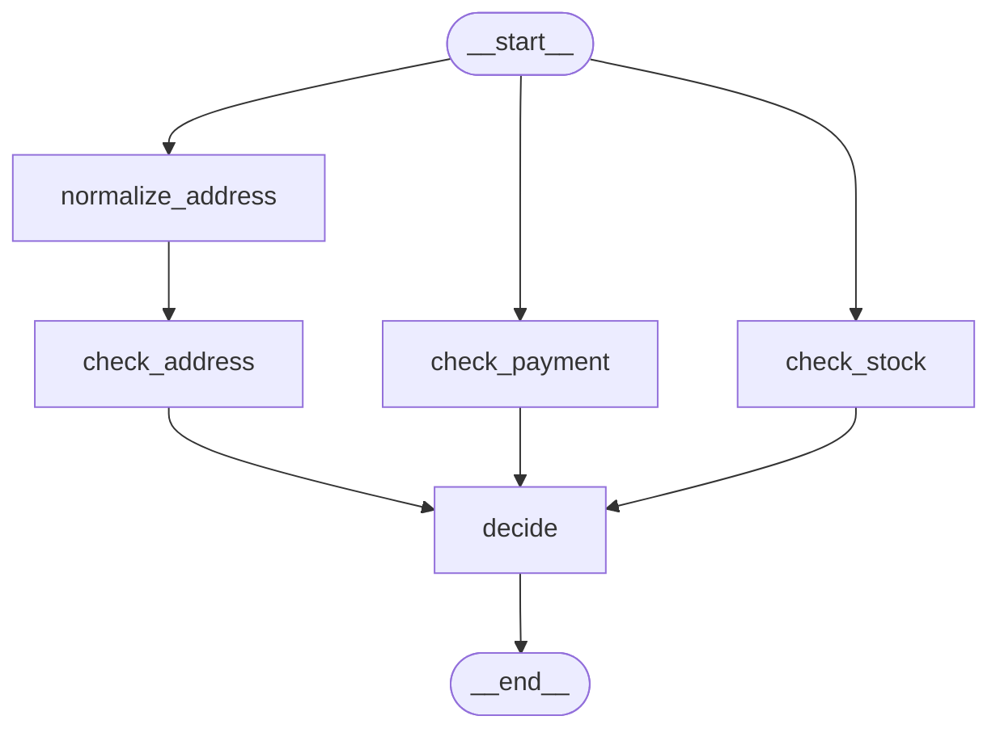

# 3.1 Parallel Branches and Joins

## The problem

Every graph so far has been a chain or a loop: one node runs, then the next. Lesson 1.3 showed that LangGraph runs a graph in [super-steps](../../../GLOSSARY.md#super-step), and in those graphs each super-step held exactly one node.

Now take a shop that checks an order before shipping it. It must check three things:

- **stock**: is every line available?
- **payment**: does the customer's balance cover the total?
- **address**: do we ship to the order's country?

None of these checks needs the result of another. Run them in a chain and the order waits for the sum of the three, and the chain claims an order (stock, then payment, then address) that does not exist in the problem. In a real shop each check is a call to a different service, so running them one after another wastes time.

What we want is: start all three at once, wait until all three are done, then make one decision. That raises three questions this lesson answers:

1. How do you make nodes run **at the same time**?
2. How do you make a node **wait** for all of them, even when one branch takes longer than the others?
3. What happens to the state when several nodes **write the same key** in the same step?

## The concept

A **branch** here is just a path through the graph that runs alongside other paths. Two terms name its ends.

- A [fan-out](../../../GLOSSARY.md#fan-out) is a point where one node (or `START`) leads to several nodes at once. In LangGraph you need no special API for it: add several plain edges from the same source. The official Graph API overview says that when a node has several outgoing edges, all their destinations run in parallel as part of the next super-step.
- A [fan-in](../../../GLOSSARY.md#fan-in) is where the branches come back together in one node that combines their results. In our example that node is `decide`.

A fan-in needs to know *when* to run. Plain edges cannot express "after all of these". For that LangGraph has the [waiting edge](../../../GLOSSARY.md#waiting-edge): `add_edge` with a **list** of sources.

```python
builder.add_edge(["check_stock", "check_payment", "check_address"], "decide")
```

The target runs once, after every listed source has finished, no matter how many super-steps each branch needs.

The third question is about state, and you already know half the answer from lesson 2.2. Nodes in one super-step all read the state as it was before the step, and their updates are applied together at the end of the step. If two of them return a value for the same key, LangGraph needs a rule to combine the two values. A [reducer](../../../GLOSSARY.md#reducer) is that rule. A key without one can take only one value per step, and a second write raises [InvalidUpdateError](../../../GLOSSARY.md#invalidupdateerror).

The mental model for the whole lesson fits in two lines, and it is worth separating them clearly (a helper on the LangChain forum puts it the same way):

- **Edges decide *when* a node runs.** A plain edge fires as soon as its one source finishes. A waiting edge fires when all its sources have finished.
- **Reducers decide *how* writes to one key combine.** They do not care which branch a write came from or when it finished.

## How it works

### Fan-out: several nodes in one super-step

When a super-step ends, LangGraph applies all writes, then looks at which nodes were triggered by them. Every triggered node becomes a task of the next super-step, and the tasks of one super-step run concurrently. The runtime waits until all of them have finished before it applies their writes and plans the next step. This is the "bulk synchronous" model from lesson 1.3, now with more than one node per step.

Three edges from `START` therefore put three nodes into super-step 1. A branch with two nodes simply continues in super-step 2, while the shorter branches are already done.

### Fan-in: the barrier behind a waiting edge

A plain edge `add_edge("a", "b")` makes `a` trigger `b` every time `a` finishes. A waiting edge is implemented differently. In 1.2.16, `StateGraph.compile()` creates one extra channel for it, a barrier named after the edge, for example `join:check_stock+check_payment+check_address:decide`. Each listed source marks itself in that channel when it finishes, and the target is triggered only when every name has been marked. After the target runs, the barrier is cleared. You can see this in `attach_edge` in `langgraph/graph/state.py`; you never touch the channel yourself.

### Parallel writes: one channel, several values

Lesson 2.2 showed that each state key becomes a channel, and the reducer decides which kind:

- A key without a reducer becomes a [LastValue](../../../GLOSSARY.md#lastvalue) channel. At the end of a step it receives the list of values written to it in that step. If there is more than one, it raises `InvalidUpdateError` with the message `At key '...': Can receive only one value per step. Use an Annotated key to handle multiple values.` (in `langgraph/channels/last_value.py`).
- A key with a reducer becomes a `BinaryOperatorAggregate` channel, which folds the values in one after another: first `reducer(stored, value1)`, then `reducer(that, value2)`, and so on.

So a parallel write needs a reducer, and the reducer runs once per write. That raises a question lesson 2.2 did not need to ask: **in which order** are the values folded in?

### The order of parallel writes

Here we have to separate what the documentation promises from what the pinned version does.

- **The documentation** ([Run graph nodes in parallel](https://docs.langchain.com/oss/python/langgraph/use-graph-api#run-graph-nodes-in-parallel)) warns that updates from a parallel super-step may not be ordered consistently. If order matters, it suggests writing each result together with a value to sort by.
- **LangGraph 1.2.16** does something predictable. Before it applies a super-step's writes, `apply_writes` in `langgraph/pregel/_algo.py` sorts the step's tasks by their *task path*. For a node started by an edge, the path is made of the node's name, so the writes of one step land **sorted by node name**, not in the order the nodes finished. Writes of an earlier step are already stored before the next step's writes arrive.

So in 1.2.16 you can predict the order, but it is an implementation detail, not a contract. Code that depends on it breaks when you rename a node, and may break in a later version. The practical rule: **make the fan-in node independent of the order of the values it combines.** Look results up by a name or ID that the value carries, and sort if you need a stable output order.

## In our example

The graph below was generated from the lesson's `build_graph()` with `draw_mermaid()`, with the styling removed. The address branch has two nodes, the other two branches have one.



> [!NOTE]
> The drawing shows the waiting edge as three ordinary arrows into `decide`. Three separate edges would be drawn the same way, although they behave differently (see "Experiments"). The picture shows the structure, not the join semantics.

Everything is in [checks.py](../src/l3_1_parallel_branches/checks.py). The [code walkthrough](readalong.md#checkspy) goes through it in detail. Here we follow the three ideas through the code.

### The shared key and its reducer

<!-- snippet: src/l3_1_parallel_branches/checks.py#order_state -->
```python
class CheckResult(TypedDict):
    """The outcome of one check: which check, whether it passed, and why."""

    check: str  # "stock" | "payment" | "address"
    ok: bool
    detail: str


class OrderBase(TypedDict):
    """Every order key except ``results``, shared by both state schemas."""

    order_id: str
    items: dict[str, int]  # sku -> quantity
    total: float
    balance: float  # the customer's wallet
    address: str  # free text; the last comma-separated part is the country
    country: str  # written by normalize_address
    decision: str  # "approved" | "on_hold"
    problems: list[str]


class OrderState(OrderBase):
    """Order state where the parallel checks can all write ``results``.

    The ``operator.add`` reducer tells LangGraph how to merge several writes
    to the same key in one super-step: it concatenates the lists.
    """

    results: Annotated[list[CheckResult], operator.add]
```
<!-- /snippet -->

Each check writes one `CheckResult` into `results`. Because `check_stock` and `check_payment` both write `results` in super-step 1, the key needs a reducer. `operator.add` concatenates lists, so each check returns a **one-element list**, and the reducer appends it to the others. The `check` field is what makes the result findable later without knowing its position.

`country` is also written in super-step 1, but only by `normalize_address`, so it needs no reducer. A reducer is needed per key, and only for keys that more than one node writes in the same step.

The lesson also defines `NoReducerOrderState`, the same state with a plain `results: list[CheckResult]`. It exists only to show the error with exactly the same nodes and wiring.

> [!NOTE]
> The branch nodes are hinted `OrderBase`, the state without `results`, because they never read it. Lesson 2.3 explained why this matters: `add_node` reads a node's first-parameter hint as its [input schema](../../../GLOSSARY.md#input-schema) and registers its keys. An `OrderState` hint would register the reducer version of `results` in the `NoReducerOrderState` graph and make `add_node` refuse the clash. For the same reason `build_graph` passes `input_schema=schema` to `decide`. The [walkthrough](readalong.md#the-check-nodes) has the details.

### The wiring: fan-out and one waiting edge

<!-- snippet: src/l3_1_parallel_branches/checks.py#build_graph -->
```python
def build_graph(schema: type = OrderState) -> CompiledStateGraph:
    """Wire the fan-out from START and the join into decide, then compile."""
    builder = StateGraph(schema)
    builder.add_node("check_stock", check_stock)
    builder.add_node("check_payment", check_payment)
    builder.add_node("normalize_address", normalize_address)
    builder.add_node("check_address", check_address)
    # decide's hint says OrderState; input_schema=schema overrides it so the
    # same function also works in the NoReducerOrderState graph.
    builder.add_node("decide", decide, input_schema=schema)

    # Fan-out: three edges from START, so all three nodes run in super-step 1.
    builder.add_edge(START, "check_stock")
    builder.add_edge(START, "check_payment")
    builder.add_edge(START, "normalize_address")
    # The address branch is two nodes long: check_address runs in step 2.
    builder.add_edge("normalize_address", "check_address")
    # Join: a list of sources makes ONE waiting edge. decide runs only after
    # all three listed nodes have finished, however long each branch is.
    builder.add_edge(["check_stock", "check_payment", "check_address"], "decide")
    builder.add_edge("decide", END)
    return builder.compile()
```
<!-- /snippet -->

- The three `add_edge(START, ...)` calls are the fan-out. All three nodes run in super-step 1.
- `add_edge("normalize_address", "check_address")` makes the address branch one step longer: `check_address` runs in super-step 2, and it can read `country` because `normalize_address`'s write was applied at the end of step 1.
- The list form of `add_edge` is the fan-in. `decide` runs once, in super-step 3, after the slowest branch has finished.

For Ada's order the run looks like this:

| Super-step | Tasks | Writes applied at the end of the step |
|---|---|---|
| 1 | `check_payment`, `check_stock`, `normalize_address` | `results` += payment, stock; `country` = `"DE"` |
| 2 | `check_address` | `results` += address |
| 3 | `decide` | `decision`, `problems` |

### The fan-in node does not trust the order

<!-- snippet: src/l3_1_parallel_branches/checks.py#decide_node -->
```python
def decide(state: OrderState) -> dict:
    """Join the three checks into a decision, independent of their order.

    The order in which parallel writes land in ``results`` is not something
    to rely on, so look each result up by its check name and sort the names.
    """
    by_check = {r["check"]: r for r in state["results"]}
    problems = [
        f"{name}: {by_check[name]['detail']}"
        for name in sorted(by_check)
        if not by_check[name]["ok"]
    ]
    return {"decision": "on_hold" if problems else "approved", "problems": problems}
```
<!-- /snippet -->

`decide` builds a dict keyed by check name and walks the names in sorted order. Whatever order `results` arrives in, the decision and the list of problems come out the same. The test `test_decide_is_order_independent` passes Bob's three results to `decide` in two different orders and compares the outputs.

### Watching the steps

The first section of [\_\_main\_\_.py](../src/l3_1_parallel_branches/__main__.py) streams Ada's order with `stream_mode="values"`, which yields the input first and then the full state after each super-step:

<!-- snippet: src/l3_1_parallel_branches/__main__.py#step_by_step -->
```python
print("== Ada A-1001: state after each super-step ==")
# stream_mode="values" yields one chunk for the input, then the full
# state after each super-step. Skip the input chunk.
chunks = list(graph.stream(ADA, stream_mode="values"))
for step, chunk in enumerate(chunks[1:], start=1):
    checks = [r["check"] for r in chunk.get("results", [])]
    country = chunk.get("country", "-")
    decision = chunk.get("decision", "-")
    print(f"step {step}: results={checks} country={country} decision={decision}")
print(f"decision: {chunks[-1]['decision']}")
```
<!-- /snippet -->

## Run it

From the course root, run `./run.sh 3.1`. This is the output of the verified run:

```text
== Ada A-1001: state after each super-step ==
step 1: results=['payment', 'stock'] country=DE decision=-
step 2: results=['payment', 'stock', 'address'] country=DE decision=-
step 3: results=['payment', 'stock', 'address'] country=DE decision=approved
decision: approved

== Decisions ==
B-1002
  payment  FAIL  balance 20.0 < total 60.0
  stock    FAIL  MUG 1>0
  address  FAIL  no shipping to UK
  -> on_hold
     address: no shipping to UK
     payment: balance 20.0 < total 60.0
     stock: MUG 1>0
C-1003
  payment  OK    balance 10.0 covers 1.5
  stock    OK    all in stock
  address  FAIL  no shipping to US
  -> on_hold
     address: no shipping to US

== Same nodes, no reducer on results ==
InvalidUpdateError: At key 'results': Can receive only one value per step. Use an Annotated key to handle multiple values.
```

What to notice:

- **Three super-steps, not five.** Five nodes ran, but the three checks of step 1 shared one super-step. After step 1 the state already holds two results *and* `country`: all writes of a step appear together.
- **The join waited.** `decision` is still `-` after step 2, although by then all three results are in. `decide` was triggered at the end of step 2 and ran in step 3. It did not run after step 1, when two of its three sources had finished.
- **Two orders side by side.** For Bob, the stored `results` are payment, stock, address: in 1.2.16, step 1's writes sorted by node name (`check_payment` before `check_stock`), then step 2's. The problems below are address, payment, stock, the order `decide` sorted them in. The decision never looked at the stored order.
- **The error comes from the state, not the nodes.** With `NoReducerOrderState` the nodes and edges are identical. The run fails at the end of super-step 1, when the `results` channel receives two values, so `check_address` and `decide` never run. The full message has a second line with a link to the `INVALID_CONCURRENT_GRAPH_UPDATE` troubleshooting page; the program prints only the first.

The program has no LLM and no randomness, so every run prints the same text on 1.2.16.

## Details and edge cases

- **A super-step is all or nothing.** The official guide says that if one of the parallel nodes raises, none of the step's updates are applied to the state. With a checkpointer (module 5), the writes of the nodes that did succeed are saved, so their work is not lost.
- **Fan-out does not need parallel code.** The checks are ordinary synchronous functions. LangGraph runs the tasks of one step concurrently for you: sync nodes in a thread pool, async nodes as concurrent coroutines. If a branch does heavy I/O, the run config key `max_concurrency` limits how many tasks run at once.
- **Finish order and write order are different things.** In the third experiment a slow `check_payment` finishes last in step 1, so its update is streamed last, but its result is still stored first. Streamed updates show when nodes finished. The stored order (in 1.2.16) follows task paths. Neither is a documented promise.
- **Writes of one node to several keys are fine.** The rule is about one key receiving several values in one step, not about how many keys a node writes.
- **A waiting edge only waits for the nodes it lists.** If a listed node never runs, for example because a conditional edge skipped its branch, the barrier never fills, `decide` never runs, and LangGraph raises nothing. The run ends normally without a `decision` key. The use-graph-api guide describes the same behaviour; the fifth experiment shows it.
- **`defer=True` is the other way to wait.** A [deferred node](../../../GLOSSARY.md#deferred-node), added with `add_node(..., defer=True)`, waits until no other task is pending anywhere in the graph. It fits a fan-in whose branches may not all run. When every branch always runs, the list-form edge is clearer, because it names exactly what it waits for.
- **`Overwrite` in parallel.** Lesson 2.2's [Overwrite](../../../GLOSSARY.md#overwrite) bypasses a reducer. The docs warn that only one node per super-step may use it on the same key; two parallel overwrites raise `InvalidUpdateError` too.

## Common mistakes

> [!WARNING]
> **A shared key without a reducer.** Two parallel nodes that both return `results` (or `messages`, or `status`) make the run fail with `InvalidUpdateError` at the end of that super-step. Give the key a reducer, or give each branch its own key and combine them in the fan-in node.

> [!WARNING]
> **Separate edges into the fan-in node.** `add_edge("check_stock", "decide")` and its two siblings look like a join in the drawing, but each plain edge fires on its own. When the branches have different lengths, the fan-in node runs more than once, the first time with partial results. With our code, Cleo's order is first approved, then put on hold. Use one list-form edge.

> [!WARNING]
> **Relying on the order of a reduced list.** `results[0]` is the payment check in 1.2.16 only because `check_payment` sorts before `check_stock`. Rename a node and the order changes; the docs do not promise any order. Find values by a field they carry, as `decide` does.

> [!WARNING]
> **Returning a bare value to an `operator.add` list.** A check that returns `{"results": {"check": ...}}` instead of a one-element list makes the reducer fail, because `operator.add` cannot add a dict to a list. Return `[result]`.

## Experiments

Each experiment starts from the original code in [checks.py](../src/l3_1_parallel_branches/checks.py). Run the program with `./run.sh 3.1`, or call the graph from a short script with `env -u VIRTUAL_ENV uv run python ...` in the lesson directory.

1. Replace the list edge in `build_graph` with three separate edges, `add_edge("check_stock", "decide")`, `add_edge("check_payment", "decide")` and `add_edge("check_address", "decide")`. Add `print(sorted(r["check"] for r in state["results"]))` at the top of `decide`. Then print the updates for Cleo with `for u in build_graph().stream(CLEO, stream_mode="updates"): print(u)`.

   <details><summary>What happens and why</summary>

   `decide` runs twice. In super-step 2 it is triggered by `check_stock` and `check_payment` (both finished in step 1), so it runs next to `check_address` and sees only `['payment', 'stock']`. It returns `{'decide': {'decision': 'approved', 'problems': []}}`. `check_address` then triggers it again, and in step 3 it sees all three results and returns `on_hold` with `address: no shipping to US`. A plain edge fires whenever its source finishes; only the list-form edge waits for all of its sources. With `invoke` you would see only the final, correct state, so this bug can hide until something downstream acts on the first decision.

   Undo the change afterwards (`git checkout -- .` in the lesson directory).

   </details>

2. Keep the three separate edges from experiment 1, and register `decide` with `defer=True`: `builder.add_node("decide", decide, input_schema=schema, defer=True)`. Stream Cleo's updates again.

   <details><summary>What happens and why</summary>

   `decide` runs once again, after `check_address`, and sees all three results. A deferred node is triggered by its edges as usual, but it does not run while any other task is still pending in the graph. It waits for "everything else", not for named nodes. That makes it useful when some branches may be skipped, while the list-form edge is the clearer choice when every branch always runs, because it says exactly what it waits for.

   Undo the change afterwards.

   </details>

3. Add `import time` and `time.sleep(0.3)` at the top of `check_payment`. Print `[list(u) for u in build_graph().stream(ADA, stream_mode="updates")]` and the check names of `build_graph().invoke(ADA)["results"]`.

   <details><summary>What happens and why</summary>

   The updates now come as `check_stock`, `normalize_address`, `check_payment`, `check_address`, `decide`: the slow node finishes last in step 1, and the stream reports updates as nodes finish. The stored results are still `['payment', 'stock', 'address']`. In 1.2.16, `apply_writes` waits for the whole step and then applies the writes sorted by task path, which for these nodes is the node name. Finish time plays no part. `check_address` still runs in step 2: it was triggered by `normalize_address`, and step 2 cannot start before the slow step 1 is over.

   Undo the change afterwards.

   </details>

4. Rename the node `"check_payment"` to `"verify_payment"`: in `add_node`, in its `add_edge(START, ...)` and in the list of the waiting edge (the function name can stay). Run the program.

   <details><summary>What happens and why</summary>

   The stored order becomes stock, payment, address, because `check_stock` now sorts before `verify_payment`. The decisions and problems for all three orders do not change, because `decide` finds results by their `check` field and sorts the names itself. A change that has nothing to do with the logic (a node name) changed the order. That is exactly why the fan-in must not depend on it.

   Undo the change afterwards.

   </details>

5. Remove `builder.add_edge("normalize_address", "check_address")` and run the program.

   <details><summary>What happens and why</summary>

   The graph compiles and runs without an error, but `check_address` is never triggered. Only the step 1 nodes run. The waiting edge never receives `check_address`'s mark, so `decide` never runs, and the final state has `results` with two entries, `country`, but no `decision` key at all. The program then fails on its own code, with a `KeyError: 'decision'` when it prints `chunks[-1]['decision']`, not on anything LangGraph raises. A waiting edge whose source cannot run fails silently; check that every listed node is reachable.

   Undo the change afterwards.

   </details>

## Summary

- Several plain edges from one node are a fan-out: their targets run in parallel in the same super-step.
- `add_edge([a, b, c], target)` is a waiting edge: `target` runs once, after all listed nodes have finished, however long each branch is. Separate edges would run it once per finished source.
- Edges decide *when* a node runs; reducers decide *how* writes to one key combine.
- A key written by more than one node in the same super-step needs a reducer; without one, its `LastValue` channel raises `InvalidUpdateError`.
- In 1.2.16 the writes of one super-step are applied sorted by task path (the node name for these nodes), earlier steps first. The docs do not promise any order, so write the fan-in node so that order does not matter.

## Self-check

1. A graph has edges `START -> a`, `START -> b`, `a -> c`, and `add_edge(["b", "c"], "d")`. In which super-step does each node run?

   <details><summary>Answer</summary>

   `a` and `b` in step 1, `c` in step 2, `d` in step 3. The waiting edge is satisfied at the end of step 2, when `c` finishes; `b` finished earlier.

   </details>

2. In the same graph, `a` and `b` both return `{"status": "done"}` and `status` is declared as `status: str`. What happens?

   <details><summary>Answer</summary>

   The run fails at the end of super-step 1 with `InvalidUpdateError` ("At key 'status': Can receive only one value per step..."). Two values arrived at a `LastValue` channel in one step, even though they are equal. `c` and `d` never run.

   </details>

3. Why does `decide` build a dict keyed by check name instead of reading `results[0]`, `results[1]` and `results[2]`?

   <details><summary>Answer</summary>

   Because the position of a result is not part of any contract. In 1.2.16 it follows the node names and the super-step in which each check ran, so renaming a node or making a branch longer changes it, and the docs say parallel updates may not be ordered consistently. Looking results up by a field they carry makes the decision independent of the order.

   </details>

4. You replace the waiting edge with three separate edges into `decide`, but all three checks are one node long and every branch always runs. Does `decide` still run twice?

   <details><summary>Answer</summary>

   No. All three sources finish in super-step 1, so all three edges trigger `decide` for the same step 2, and it runs once. The bug appears only when branches have different lengths, which is why it is easy to miss and why the address branch in this lesson is two nodes long.

   </details>

5. When is `defer=True` a better fit than a waiting edge?

   <details><summary>Answer</summary>

   When some of the branches may not run, for example because a conditional edge chose only some of them. A waiting edge would never fire then, while a deferred node simply waits until no other task is pending and runs with whatever results exist.

   </details>

## Further reading

- [Graph API overview](https://docs.langchain.com/oss/python/langgraph/graph-api): super-steps, edges, and the rule that a node's several outgoing edges run their targets in parallel.
- [Use the graph API: Run graph nodes in parallel](https://docs.langchain.com/oss/python/langgraph/use-graph-api#run-graph-nodes-in-parallel): fan-out and fan-in, the note on ordering, exception handling, and `defer=True`.
- [INVALID_CONCURRENT_GRAPH_UPDATE](https://docs.langchain.com/oss/python/langgraph/INVALID_CONCURRENT_GRAPH_UPDATE): the troubleshooting page linked from the error message.
- [`langgraph/pregel/_algo.py` at 1.2.16](https://github.com/langchain-ai/langgraph/blob/1.2.16/libs/langgraph/langgraph/pregel/_algo.py): `apply_writes`, which sorts a step's tasks by path before applying their writes.
- [LangChain Forum: Merge message issues when LangGraph is called in parallel](https://forum.langchain.com/t/seeking-help-with-some-merge-message-issues-when-langgraph-is-called-in-parallel/3007): reducers versus joins, explained on a beginner's graph.
- [LangChain Forum: Best practices for parallel nodes (fanouts)](https://forum.langchain.com/t/best-practices-for-parallel-nodes-fanouts/1900): a community checklist for larger fan-outs (reducers, aggregator nodes, `max_concurrency`). Some numbers in it, such as the recursion limit default, are out of date for 1.2.16.
- [LangChain Academy: Introduction to LangGraph](https://github.com/langchain-ai/langchain-academy): module 4 starts with a parallelization notebook; its code is partly pre-1.0 style.
