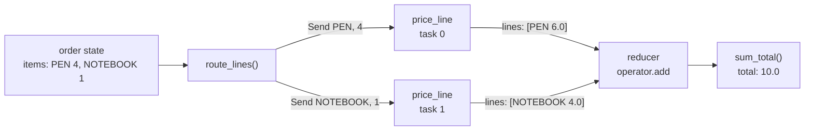
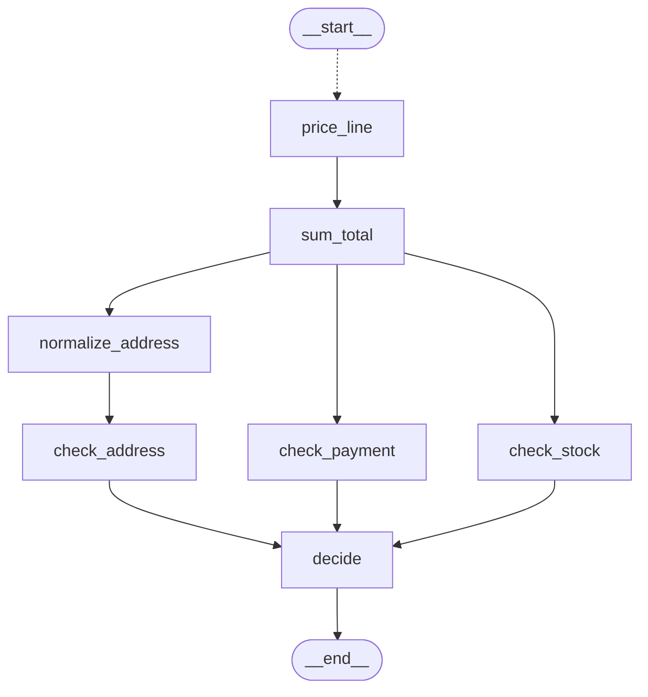

# 3.2 Map-Reduce with Send

## The problem

In lesson 3.1 the order arrived with its `total` already filled in, and three checks ran in parallel. A real shop does not trust a total sent by the client. It prices every line itself, often by calling a price service, and adds the amounts up.

Pricing one line does not depend on any other line, so the lines should be priced in parallel, just like the checks. But 3.1's tool does not fit here. A [fan-out](../../../GLOSSARY.md#fan-out) made of plain edges is fixed when you build the graph: three `add_edge` calls give exactly three parallel nodes. The number of lines is different for each order. Ada has two, Bob two, Cleo one, Dora three. You cannot write one `add_edge` per line, because you do not know the lines until the order arrives.

There is a second difference. Each check in 3.1 read the whole order. A pricing task needs only one line: a sku and a quantity. Giving it the whole order would make it pick its own line out of `items`, and two copies of the same node would have no way to know which line is theirs.

So we need two things that plain edges cannot give:

1. a fan-out whose width is decided **at run time**, from the data;
2. a separate **input for each parallel task**, different from the graph state.

## The concept

The pattern has a name older than LangGraph: [map-reduce](../../../GLOSSARY.md#map-reduce). You split the work into independent pieces, process each piece in its own task (the **map** step), then combine the results in one place (the **reduce** step). Here a piece is an order line, the map step prices it, and the reduce step adds the amounts up.

LangGraph builds the map step with [Send](../../../GLOSSARY.md#send). A `Send` is a small object with two fields:

- `node`: the name of the node to run;
- `arg`: the input to give that node.

```python
from langgraph.types import Send

Send("price_line", {"sku": "PEN", "qty": 4})
```

You know [conditional edges](../../../GLOSSARY.md#conditional-edge) from lesson 1.2: after the source finishes, LangGraph calls a [routing function](../../../GLOSSARY.md#routing-function) and follows the nodes it names. A routing function may also return a **list of `Send` objects** instead of node names. Each `Send` becomes its own task in the next [super-step](../../../GLOSSARY.md#super-step), and that task receives the Send's `arg` as its input, not the graph state. Return two Sends and two tasks run; return thirty and thirty run. They may all target the same node.

The reduce step needs nothing new. It has two parts you already know:

- a [reducer](../../../GLOSSARY.md#reducer) on the key the map tasks write, so that their parallel writes are merged instead of rejected (lesson 3.1);
- one ordinary node, triggered by a plain edge, that reads the merged result in the next super-step.

The mental model: **a `Send` is a task with its own input.** Plain edges say "run this node on the state". A `Send` says "run this node once more, on this input". Everything a task writes still goes back into the shared state through the usual channels and reducers.

## How it works

### From routing function to tasks

When the routing function returns `Send` objects, LangGraph does not run anything yet. It stores the Sends as pending tasks. When the next super-step is planned, every pending `Send` becomes a task of its own. In 1.2.16 such a task is a *push* task, and its path is the pair (push, index of the Send). The index counts every Send written in the previous step, across all routers; in this graph there is only one router, so it is the position in `route_lines`' list. The node runs with `arg` as its input, so a node used as a Send target should declare the payload type as its first-parameter hint. Lesson 2.3 explained that this hint is the node's [input schema](../../../GLOSSARY.md#input-schema).

The tasks of one super-step run concurrently, as in 3.1. When all of them have finished, their writes are applied together at the end of the step, through the channels of the state.

### From tasks back to one node

All the map tasks are copies of one node, `price_line`. A plain edge `price_line -> sum_total` fires when `price_line` has run in a step. Two kinds of task need to be told apart here. A node triggered by edges gets **at most one task per super-step**, however many edge writes triggered it. Each `Send`, on the other hand, adds a task of its own. That is why `price_line` runs twice in super-step 1 for Ada (two Sends), while `sum_total`, triggered by the edge from both copies, runs **once**, in the step after the map, and by then every price is in the state. You need no [waiting edge](../../../GLOSSARY.md#waiting-edge) here. A waiting edge joins *different* nodes; Send copies of one node are joined by the step boundary itself.

The diagram follows Ada's order through the map-reduce. Watch where the data changes shape: the order becomes two small payloads, and two one-element lists become one list.



### In which order do the results arrive?

Lesson 3.1 showed that, in 1.2.16, `apply_writes` sorts a step's tasks by task path before it applies their writes. For a push task, `task_path_str` writes the Send's position as a ten-digit, zero-padded number (`0000000000`, `0000000001`, …), so the sort keeps the positions in order. As a result, the lines are stored **in the order of the Send list**: PEN, then NOTEBOOK for Ada. Reverse Ada's `items` and the stored order reverses too.

That is how the pinned version works, not a documented guarantee. The official guide's warning from 3.1 still holds: updates from a parallel super-step may not be ordered consistently. The reduce step in this lesson does not depend on the order: a sum is the same in any order. Write your reduce steps the same way, or carry a key in each result to sort by.

Stored order and finish order are also different things. In `stream_mode="updates"` the two `price_line` updates may arrive in either order, depending on which lookup finishes first. With the lesson's equal delays they usually arrive in Send order; you would need unequal delays to see them swap.

### Limiting the parallelism

A fan-out you control in code has a known width. A Send fan-out has the width of the data: an order with 500 lines would start 500 price lookups at once and could overload the price service. The run config key [max_concurrency](../../../GLOSSARY.md#max_concurrency) caps how many tasks run at the same time:

```python
graph.invoke(order, {"max_concurrency": 2})
```

It is a top-level key of the [run config](../../../GLOSSARY.md#run-config), next to `recursion_limit`, not inside `configurable`; the official guide points this out. In a synchronous run, 1.2.16 passes it to `langchain_core`'s `get_executor_for_config`, which uses it as the `max_workers` of the thread pool for the **whole run**. The extra tasks wait for a free thread. In an async run it is the size of a semaphore. Either way it limits every super-step, not just the map: our three checks in super-step 3 are capped too.

## In our example

The graph below was generated from the lesson's `build_graph()` with `draw_mermaid()`, with the styling removed. The dotted arrow from `__start__` is the conditional edge with the Sends; everything from `sum_total` on is 3.1's graph.



> [!NOTE]
> The drawing shows `price_line` once, however many tasks it will get at run time. A graph drawing shows nodes, not tasks.

The [code walkthrough](readalong.md) goes through every file. Here we follow the map, the reduce and the limit.

### The map task knows nothing about orders

[pricing.py](../src/l3_2_map_reduce_send/pricing.py) defines the payload and the task:

<!-- snippet: src/l3_2_map_reduce_send/pricing.py#price_task -->
```python
class PriceTask(TypedDict):
    """The payload of one Send: a single line, not the whole order.

    Its shape differs from the order state on purpose. Each price_line task
    receives exactly this dict as its input.
    """

    sku: str
    qty: int


class LinePrice(TypedDict):
    """One priced line, as stored in the order's ``lines`` list."""

    sku: str
    qty: int
    amount: float
```
<!-- /snippet -->

<!-- snippet: src/l3_2_map_reduce_send/pricing.py#price_line -->
```python
# For a Send target the type hint of the first parameter is the payload type
# (lesson 2.3: a node's hint is its input schema). The task sees only the
# payload it was sent, never the order state.
def price_line(task: PriceTask) -> dict:
    """Look up the price of one line and return it for the ``lines`` reducer."""
    time.sleep(PRICE_LOOKUP_S)
    amount = PRICES[task["sku"]] * task["qty"]
    line: LinePrice = {"sku": task["sku"], "qty": task["qty"], "amount": amount}
    # A one-element list: the reducer concatenates the lists of all the tasks.
    return {"lines": [line]}
```
<!-- /snippet -->

`PriceTask` has just `sku` and `qty`, a different shape from the order state. `price_line` is hinted with it, so its input schema is the payload, and it can read `task["sku"]` directly. It never sees `items`, `balance` or `address`. You can call it as a plain function, `price_line({"sku": "MUG", "qty": 2})`, which is how the tests check it.

It returns a **one-element list** under `lines`. In the state, `lines` has the `operator.add` reducer (in `OrderBase`, so both state schemas have it), and the reducer concatenates the lists of all the tasks. `time.sleep(PRICE_LOOKUP_S)` stands in for a slow price service; it is what makes `max_concurrency` visible below.

### The routing function returns Sends

<!-- snippet: src/l3_2_map_reduce_send/checks.py#route_lines -->
```python
# The function's type hint is registered as a schema too, so it must use the
# same OrderBase as the state (another ``lines`` type would clash).
def route_lines(state: OrderBase) -> list[Send]:
    """Fan out: one Send per order line, in items order.

    A conditional edge may return Send objects instead of node names. Each
    Send becomes its own task with its own input: here a PriceTask payload.
    """
    return [Send("price_line", {"sku": sku, "qty": qty}) for sku, qty in state["items"].items()]
```
<!-- /snippet -->

`route_lines` is a routing function like the ones in lesson 1.2, attached with `add_conditional_edges(START, route_lines, ["price_line"])`. It reads the whole state, because it runs on the graph's side, and builds one payload per line. For Ada it returns two Sends, for Dora three, and for an order with no items an empty list. See [the map in the walkthrough](readalong.md#the-map-route_lines) for the details.

The third argument of `add_conditional_edges`, `["price_line"]`, is the [path map](../../../GLOSSARY.md#path-map) from lesson 1.2, here in list form: the nodes the router may send to. Sends exist only at run time, so the list is how LangGraph learns about the edge in advance. The run works without it, but `get_graph()` cannot draw the edge (experiment 4).

### The reduce step

<!-- snippet: src/l3_2_map_reduce_send/checks.py#sum_total -->
```python
def sum_total(state: OrderBase) -> dict:
    """Reduce: add up the priced lines into the order total.

    The sum does not depend on the order in which the lines were stored.
    """
    return {"total": round(sum(line["amount"] for line in state["lines"]), 2)}
```
<!-- /snippet -->

`sum_total` is an ordinary node that reads the whole state. It runs one step after the map, so `lines` already holds every task's result. It does not care about the order of the lines, which is what lets us ignore the question of write order.

### The wiring

<!-- snippet: src/l3_2_map_reduce_send/checks.py#build_graph -->
```python
def build_graph(schema: type = OrderState) -> CompiledStateGraph:
    """Wire the pricing map-reduce, the three checks and the join, then compile."""
    builder = StateGraph(schema)
    builder.add_node("price_line", price_line)
    builder.add_node("sum_total", sum_total)
    builder.add_node("check_stock", check_stock)
    builder.add_node("check_payment", check_payment)
    builder.add_node("normalize_address", normalize_address)
    builder.add_node("check_address", check_address)
    # decide's hint says OrderState; input_schema=schema overrides it so the
    # same function also works in the NoReducerOrderState graph.
    builder.add_node("decide", decide, input_schema=schema)

    # Map: route_lines returns one Send per line, so price_line runs once per
    # line in super-step 1. The list tells the graph, and its drawing, where
    # the Sends can go.
    builder.add_conditional_edges(START, route_lines, ["price_line"])
    # Reduce: one plain edge. sum_total runs ONCE in the next step, however
    # many price_line tasks ran.
    builder.add_edge("price_line", "sum_total")
    # Fan-out: three edges from sum_total, so all three run in super-step 3.
    builder.add_edge("sum_total", "check_stock")
    builder.add_edge("sum_total", "check_payment")
    builder.add_edge("sum_total", "normalize_address")
    # The address branch is two nodes long: check_address runs in step 4.
    builder.add_edge("normalize_address", "check_address")
    # Join: a list of sources makes ONE waiting edge. decide runs only after
    # all three listed nodes have finished, however long each branch is.
    builder.add_edge(["check_stock", "check_payment", "check_address"], "decide")
    builder.add_edge("decide", END)
    return builder.compile()
```
<!-- /snippet -->

Compared with 3.1, only the front of the graph changed. The three edges that started the checks now leave `sum_total` instead of `START`, so `check_payment` always finds a computed `total`. For Ada the run now has five super-steps:

| Super-step | Tasks | Writes applied at the end of the step |
|---|---|---|
| 1 | `price_line` ×2 (one per Send) | `lines` += PEN 6.0, NOTEBOOK 4.0 |
| 2 | `sum_total` | `total` = 10.0 |
| 3 | `check_payment`, `check_stock`, `normalize_address` | `results` += payment, stock; `country` = `"DE"` |
| 4 | `check_address` | `results` += address |
| 5 | `decide` | `decision`, `problems` |

### The limit

<!-- snippet: src/l3_2_map_reduce_send/__main__.py#max_concurrency_demo -->
```python
print()
print("== Dora D-1004: 3 price lookups, max_concurrency ==")
for limit in (None, 2, 1):
    # max_concurrency is a run config key: the most tasks run at once.
    # The sync executor uses it as its thread-pool size for the whole run.
    config = {} if limit is None else {"max_concurrency": limit}
    start = time.perf_counter()
    final = graph.invoke(DORA, config)
    elapsed = time.perf_counter() - start
    print(f"max_concurrency={limit}: total {final['total']} in {elapsed:.1f} s")
```
<!-- /snippet -->

Dora's order has three lines, so super-step 1 has three `price_line` tasks of 0.2 s each. The loop runs the same order with no limit, then with a limit of 2 and of 1.

## Run it

From the course root, run `./run.sh 3.2`. This is the output of the verified run:

```text
== Ada A-1001: state after each super-step ==
route_lines sends:
  Send(node='price_line', arg={'sku': 'PEN', 'qty': 4})
  Send(node='price_line', arg={'sku': 'NOTEBOOK', 'qty': 1})
step 1: lines=['PEN', 'NOTEBOOK'] total=- results=[] country=- decision=-
step 2: lines=['PEN', 'NOTEBOOK'] total=10.0 results=[] country=- decision=-
step 3: lines=['PEN', 'NOTEBOOK'] total=10.0 results=['payment', 'stock'] country=DE decision=-
step 4: lines=['PEN', 'NOTEBOOK'] total=10.0 results=['payment', 'stock', 'address'] country=DE decision=-
step 5: lines=['PEN', 'NOTEBOOK'] total=10.0 results=['payment', 'stock', 'address'] country=DE decision=approved
decision: approved

== Decisions ==
B-1002
  total 11.0 = PEN x2 3.0 + MUG x1 8.0
  payment  FAIL  balance 10.0 < total 11.0
  stock    FAIL  MUG 1>0
  address  FAIL  no shipping to UK
  -> on_hold
     address: no shipping to UK
     payment: balance 10.0 < total 11.0
     stock: MUG 1>0
C-1003
  total 1.5 = PEN x1 1.5
  payment  OK    balance 10.0 covers 1.5
  stock    OK    all in stock
  address  FAIL  no shipping to US
  -> on_hold
     address: no shipping to US

== Same nodes, no reducer on results ==
InvalidUpdateError: At key 'results': Can receive only one value per step. Use an Annotated key to handle multiple values.

== Dora D-1004: 3 price lookups, max_concurrency ==
max_concurrency=None: total 15.0 in 0.2 s
max_concurrency=2: total 15.0 in 0.4 s
max_concurrency=1: total 15.0 in 0.6 s
```

What to notice:

- **The Sends are plain data.** Calling `route_lines(ADA)` outside the graph shows exactly what the router hands over: two `Send` objects to the same node, each with its own small `arg`.
- **Both lines appear in step 1, together.** Two tasks ran in super-step 1, and their writes were applied at the same moment, at the end of the step. `total` is still missing (`-`), because `sum_total` runs only in step 2.
- **`sum_total` ran once.** Step 2 is a single step with one `total`, although two `price_line` tasks triggered it.
- **The stored order is the Send order.** PEN before NOTEBOOK for Ada, PEN before MUG for Bob, matching `items`. On 1.2.16 this follows from the task paths; it is not a documented promise, and `sum_total` does not need it.
- **Everything after the map moved two steps later.** The checks that ran in step 1 in 3.1 now run in step 3, and `decide` runs in step 5.
- **The no-reducer demo still fails at `results`, not at `lines`.** `lines` keeps its reducer in both schemas, so steps 1 and 2 work and the error comes in step 3.
- **The time grows in steps of one lookup.** Three lookups of 0.2 s: all at once (0.2 s), two then one (0.4 s), one after another (0.6 s).

Everything except the timings is the same on every run. The times are wall-clock measurements and can be slightly higher on a busy machine.

## Details and edge cases

- **An empty Send list ends the run quietly.** If `items` is empty, `route_lines` returns `[]` and no task is scheduled. `invoke` returns the input with empty `lines` and `results`, no `total`, no `decision`, and raises nothing (experiment 3). If empty input is possible, handle it in the router: return `"sum_total"` by name when there is nothing to send. The router's return type then becomes `list[Send] | str`, and `"sum_total"` must also be added to the path map: `add_conditional_edges(START, route_lines, ["price_line", "sum_total"])`. With the original `["price_line"]` the guard fails with `KeyError: 'sum_total'`.
- **A Send to an unknown node is dropped.** LangGraph logs `Ignoring unknown node name ... in pending sends` and skips the task; there is no exception (experiment 4). The path map does not protect you here. Sends bypass it: for them it only feeds the drawing, while the Send's `node` field decides at run time. For node names the router returns, the path map is also the lookup table, which is why a name missing from it raises `KeyError`.
- **A Send target sees only its payload.** Nothing from the graph state is merged into `arg`. If a task needs a value from the state, such as a currency, put it in the payload.
- **The writes still go through the state schema.** Whatever a map task returns must be keys of the graph state, merged by their channels. That is why `price_line` returns `lines`, a key of `OrderBase`, and not a free-form result.
- **The routing function's hint is a schema too.** As with the check nodes in 3.1, `add_conditional_edges` reads the routing function's first-parameter hint and registers its keys. `route_lines` and `sum_total` are hinted `OrderBase`, the same type the state uses. A router hinted with a different `lines` type makes `build_graph` fail with `ValueError: Channel 'lines' already exists with a different type`.
- **`max_concurrency` limits the whole run.** It is not a per-node setting. In our graph a limit of 1 makes the three checks in super-step 3 run one after another as well.
- **`Send` has an optional `timeout` argument in 1.2.16**, a timeout for that one task. This lesson does not use it.

## Common mistakes

> [!WARNING]
> **Routing by name when you meant to send.** `return ["price_line"]` from the routing function runs `price_line` once, with the whole order state as input, and it fails with `KeyError: 'sku'`. A node name passes the graph state; only a `Send` gives a task its own input (experiment 2).

> [!WARNING]
> **No reducer on the key the map tasks write.** `lines: list[LinePrice]` works for Cleo's one-line order and fails for Ada's two lines with [InvalidUpdateError](../../../GLOSSARY.md#invalidupdateerror) `At key 'lines': Can receive only one value per step`. The bug hides until an input happens to have two items, so add the reducer when you add the fan-out (experiment 1).

> [!WARNING]
> **Relying on the order of the mapped results.** On 1.2.16 the results land in Send-list order, but that comes from how task paths are sorted, and the documentation promises no order for parallel writes. Make the reduce step order-independent, or store a sort key in each result.

> [!WARNING]
> **Importing `Send` from `langgraph.constants`.** Older examples, including some LangChain Academy files, do this. The current place is `langgraph.types` (see the course's deprecation notes).

> [!WARNING]
> **Putting `max_concurrency` inside `configurable`.** LangGraph reads the top-level key. `{"configurable": {"max_concurrency": 2}}` sets nothing, and the run is unlimited.

## Experiments

Each experiment starts from the original code. Run the program with `./run.sh 3.2` from the course root, or call the graph from a short script with `env -u VIRTUAL_ENV uv run python ...` in the lesson directory.

1. In `OrderBase` in [checks.py](../src/l3_2_map_reduce_send/checks.py), remove the reducer from `lines`: `lines: list[LinePrice]`. Invoke the graph for `CLEO`, then for `ADA`.

   <details><summary>What happens and why</summary>

   Cleo's order still works (`on_hold`, because of the address). Ada's fails in super-step 1 with `InvalidUpdateError: At key 'lines': Can receive only one value per step. Use an Annotated key to handle multiple values.` Send tasks are parallel writers, exactly like 3.1's branches: two tasks wrote `lines` in one step, and a key without a reducer accepts one value. With one line there is one task and nothing to merge. The program itself stops already in its first section, on Ada.

   Undo the change afterwards (`git checkout -- .` in the lesson directory).

   </details>

2. Make `route_lines` return `["price_line"]` (a node name) instead of the list of Sends. Invoke the graph for `ADA`.

   <details><summary>What happens and why</summary>

   `price_line` runs once, with the whole order state as its input, and fails with `KeyError: 'sku'`. A routing function that returns a node name passes the graph state to that node. Only a `Send` gives a task its own input, and only a list of Sends makes the same node run several times in one step.

   Undo the change afterwards.

   </details>

3. Without changing the code, invoke the graph with an order that has no items: `build_graph().invoke({"order_id": "E-1", "items": {}, "balance": 5.0, "address": "x, de"})`.

   <details><summary>What happens and why</summary>

   It returns `{'order_id': 'E-1', 'items': {}, 'lines': [], 'balance': 5.0, 'address': 'x, de', 'results': []}`: no `total`, no `decision`, and no error. `route_lines` returned `[]`, so no task was scheduled and the run ended right after the input. (The empty lists are the start values of the two reducer keys.) An empty fan-out stops the run silently. If empty orders can happen, guard the router: return `"sum_total"` by name when there are no items (its return type becomes `list[Send] | str`), and add `"sum_total"` to the path map, `["price_line", "sum_total"]`. In 1.2.16 every name a router returns is looked up in the path map, while Sends bypass it, so without the second entry the guard fails with `KeyError: 'sum_total'`. With it, the empty order gets total 0 and the decision `approved`.

   </details>

4. Misspell the target in `route_lines`: `Send("price_item", ...)`. Invoke the graph for `ADA`. Then restore the name, remove the path map `["price_line"]` from `add_conditional_edges`, invoke again, and print `build_graph().get_graph().draw_mermaid()`.

   <details><summary>What happens and why</summary>

   With the misspelled name, LangGraph logs `Ignoring unknown node name price_item in pending sends` once per Send and returns a state with empty `lines` and `results`, no `total` and no `decision`. No exception is raised.

   Without the path map the run works again (total 10.0, approved): the Sends decide where tasks go at run time. The drawing, however, keeps all the nodes (the seven lesson nodes plus `__start__` and `__end__`) but has a single edge, a dotted `__start__ -.-> __end__`. In 1.2.16, `get_graph()` finds edges with a dry walk from `START` along the destinations each edge declares ahead of time. Without the path map the router declares none, so the walk never reaches `price_line`, nor anything after it.

   Undo the changes afterwards.

   </details>

5. In [pricing.py](../src/l3_2_map_reduce_send/pricing.py) set `PRICE_LOOKUP_S = 0.5`, and in the `max_concurrency_demo` loop of [\_\_main\_\_.py](../src/l3_2_map_reduce_send/__main__.py) use `for limit in (None, 3, 2, 1):`. Run the program.

   <details><summary>What happens and why</summary>

   The last section prints about 0.5, 0.5, 1.0 and 1.5 s. With no limit or a limit of 3, the three lookups run together. With 2, two run and the third waits for a free thread: two rounds. With 1, three rounds. A limit at or above the width of the fan-out changes nothing. Since `max_concurrency` is the thread-pool size for the whole run, it also caps super-step 3, but the checks are fast enough that you do not see it in the times.

   Undo the changes afterwards.

   </details>

## Summary

- A routing function may return a list of `Send(node, arg)` objects. Each one becomes its own task in the next super-step, so the width of the fan-out comes from the data.
- A Send task receives `arg` as its input, not the graph state. Hint the target node with the payload type.
- Map-reduce in LangGraph is Sends for the map, plus a reducer on the key the tasks write and one node after a plain edge for the reduce. Because an edge triggers it, that node gets one task in the next step, however many map tasks ran.
- On 1.2.16 mapped results are stored in Send-list order, an implementation detail. Write the reduce step so that order does not matter.
- An empty Send list or a Send to an unknown node ends the work quietly, without an exception.
- `max_concurrency`, a top-level run config key, caps how many tasks run at once across the whole run.

## Self-check

1. Why can't 3.1's plain-edge fan-out price the lines of an order?

   <details><summary>Answer</summary>

   Plain edges are fixed when the graph is built, so they give a fixed number of parallel nodes, and every node reads the whole state. The number of lines differs per order, and each pricing task needs only its own line. A list of Sends fixes both: one task per line, each with its own input.

   </details>

2. `route_lines` returns three Sends to `price_line`, and there is an edge `price_line -> sum_total`. How many times does `sum_total` run, and in which super-step relative to the map?

   <details><summary>Answer</summary>

   Once, in the super-step after the three `price_line` tasks. A node triggered by edges gets at most one task per step, however many edge writes triggered it; only Sends add one task each. By then all three tasks' writes have been applied.

   </details>

3. A map task returns `{"lines": [line]}`, and `lines` is declared as `list[LinePrice]` without a reducer. Which orders fail?

   <details><summary>Answer</summary>

   Every order with two or more lines. They fail at the end of the map step with `InvalidUpdateError` at key `'lines'`. One-line orders work, because only one task writes the key.

   </details>

4. Your reduce step takes `state["lines"][0]` as the "main" line. What is wrong with that?

   <details><summary>Answer</summary>

   It depends on the order in which parallel writes were stored. On 1.2.16 that is Send-list order, because of how task paths are sorted, but the documentation does not promise any order. Pick the line by a field it carries instead, and keep reduce steps order-independent.

   </details>

5. A graph fans out to 200 Sends that each call a rate-limited API. How do you keep at most 10 calls in flight, and what else does the setting affect?

   <details><summary>Answer</summary>

   Pass `{"max_concurrency": 10}` as the run config (top level, not in `configurable`). It caps every super-step of that run, not only the fan-out, because in a sync run it is the size of the thread pool for the whole run.

   </details>

## Further reading

- [Graph API overview: Send](https://docs.langchain.com/oss/python/langgraph/graph-api#send): returning `Send` from conditional edges, and the map-reduce motivation.
- [Use the graph API: Map-Reduce and the Send API](https://docs.langchain.com/oss/python/langgraph/use-graph-api#map-reduce-and-the-send-api): a complete map-reduce example with a reducer and a final node.
- [Use the graph API: Run graph nodes in parallel](https://docs.langchain.com/oss/python/langgraph/use-graph-api#run-graph-nodes-in-parallel): the note on ordering of parallel updates, and the tip on `max_concurrency` as a top-level config key.
- [`langgraph/pregel/_algo.py` at 1.2.16](https://github.com/langchain-ai/langgraph/blob/1.2.16/libs/langgraph/langgraph/pregel/_algo.py): `apply_writes` (tasks sorted by path), `task_path_str` (zero-padded Send index) and the "unknown node name" warning.
- [LangChain Forum: Best practices for parallel nodes (fanouts)](https://forum.langchain.com/t/best-practices-for-parallel-nodes-fanouts/1900): Send for dynamic fan-out, reducers with an aggregator node, and sizing `max_concurrency` for rate limits and pools.
- [LangChain Academy: map-reduce notebook](https://github.com/langchain-ai/langchain-academy/blob/main/module-4/map-reduce.ipynb): the same pattern with an LLM; some of the module's files import `Send` from the old `langgraph.constants` location.
