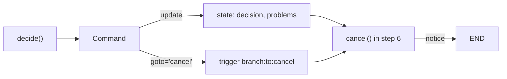
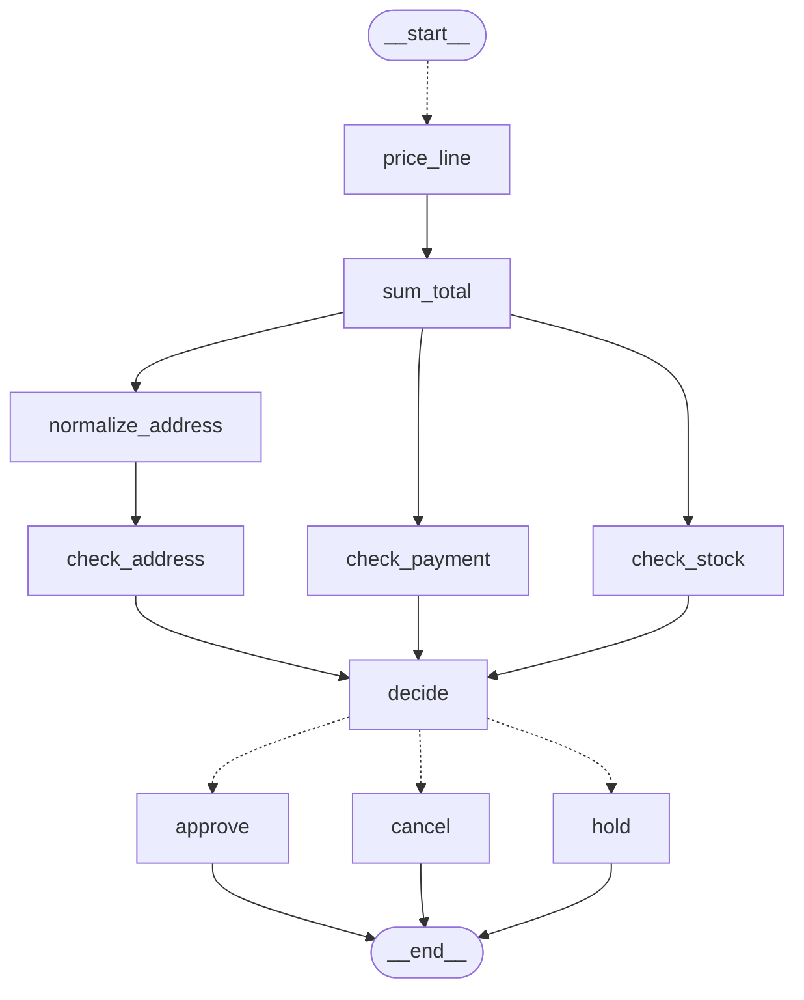

# 3.3 Command: Update State and Route in One Step

## The problem

At the end of lesson 3.2, `decide` joined the three checks and wrote a `decision`, and then the graph always went to `END` over a plain edge. The decision was only a label in the state. Nothing in the graph acted on it.

A real shop treats the outcomes differently. An approved order goes to packing. An order with a missing item or not enough money is held until the stock or the money arrives. An order to a country we never ship to is cancelled, because there is nothing to wait for. Each outcome needs its own step, and here each one writes its own notice for the customer.

Lesson 1.2 already gave you one way to do this: a [conditional edge](../../../GLOSSARY.md#conditional-edge). `decide` writes `decision`, and a [routing function](../../../GLOSSARY.md#routing-function) attached after it reads `state["decision"]` and returns the name of the next node. That works, but look at what it means for the code. The business rule "address failure means cancel, other failures mean hold" is decided in `decide`. Then a second function maps the result back to a node: `"cancelled"` to `cancel`, `"on_hold"` to `hold`. The choice is made once and written down twice, in two functions that must stay in agreement. Add a fourth outcome and you edit both.

What we want is for the node that makes the choice to also say where to go, in the same return value.

## The concept

A [Command](../../../GLOSSARY.md#command) is an object a node can return instead of a dict. It comes from `langgraph.types`, where `Send` also lives, and in our lesson it carries two fields:

- `update`: the state update, exactly what the node would otherwise return as a dict. It goes through the same channels and [reducers](../../../GLOSSARY.md#reducer).
- [goto](../../../GLOSSARY.md#goto): where to go next. Usually a node name, but also a list of names, a [Send](../../../GLOSSARY.md#send), a list of Sends, or [END](../../../GLOSSARY.md#end).

```python
from langgraph.types import Command

return Command(update={"decision": "cancelled", "problems": problems}, goto="cancel")
```

The mental model: **`goto` is an edge that the node draws at run time.** A plain edge `a -> b` says "whenever `a` runs, run `b` next". A `Command` with `goto="b"` says "this time, run `b` next". The runtime treats the two the same way: both trigger `b` in the next [super-step](../../../GLOSSARY.md#super-step). Because the route is a run-time value, the graph cannot know it in advance. You have to tell it which names are possible, and that is what the return annotation is for:

```python
def decide(state: OrderState) -> Command[Literal["approve", "hold", "cancel"]]:
```

This is the same idea as the `Literal` return hint of a routing function in lesson 1.2, moved onto the node itself. LangGraph reads the listed names as the node's possible destinations. It uses them to check the graph at `compile()` and to draw it. It does **not** check them while the graph runs.

`Command` has two more fields, `graph` and `resume`, which this lesson does not use. `resume` answers an `interrupt()` and comes in lessons 6.1 and 6.2. `graph=Command.PARENT` lets a node inside a subgraph route to a node of the parent graph, which is lesson 8.3.

## How it works

### Two writes from one return value

When a node returns a `Command`, LangGraph splits it in two:

1. The `update` dict becomes ordinary writes to the state keys, applied at the end of the super-step like any node's return value.
2. Each name in `goto` becomes a write to a hidden trigger channel named `branch:to:<node>`. In 1.2.16 a plain single-source edge `a -> b` writes to the very same channel, `branch:to:b`. (The list-form join from lesson 3.1, `add_edge([...], b)`, is different: it writes to its own `join:<sources>:b` channel, which waits for every source.) At the start of the next super-step, the node whose trigger channel was written gets a task.

The diagram follows Bob's order through `decide`. The update and the route leave `decide` together, but they take effect at different moments: the update at the end of super-step 5, and the route as a task in super-step 6.



Two things follow from this mechanism.

**The goto is not part of the state.** Only `update` is written to state keys. In `stream_mode="updates"`, Bob's `decide` chunk is `{'decide': {'decision': 'cancelled', 'problems': [...]}}`, with no trace of the route. You see the route only in the next chunk, which comes from `cancel`.

**A goto adds an edge, it never replaces one.** Static edges from `add_edge` still fire after a node that returns a `Command`. If `decide` had both an edge to `approve` and a `goto="cancel"`, both nodes would run in the same super-step. The official guide warns about exactly this and recommends one routing mechanism per node (experiment 4).

### What the annotation is used for

At `add_node`, LangGraph reads the function's type hints. You know from lesson 2.3 that the first parameter's hint becomes the node's [input schema](../../../GLOSSARY.md#input-schema). For the return hint, 1.2.16 looks for `Command[Literal[...]]`, or a union that contains one (such as `Command[Literal[...]] | dict` or `Optional[Command[Literal[...]]]`, where it takes the first `Command[...]` member), and stores the literal values as the node's `ends`. You can see them on the builder: `graph.builder.nodes["decide"].ends` is `('approve', 'hold', 'cancel')`. The return hint is used for nothing else.

The `ends` are then used in two places:

- **`compile()`** treats them like edge targets when it validates the graph. A name that is not a node fails with `ValueError: Found edge ending at unknown node ...`.
- **`get_graph()`** draws them as dotted (conditional) edges from the node.

Nothing compares `goto` with the `ends` at run time. A `goto` to a node missing from the `Literal` still runs that node. A `goto` to a name that is no node at all writes to a channel that does not exist: LangGraph logs a warning and ignores the write (experiments 2 and 3).

If you cannot or do not want to annotate, `add_node` has a `destinations=` argument that sets the same `ends`: `builder.add_node("decide", decide, destinations=("approve", "hold", "cancel"))`. The annotation keeps the list next to the code that picks from it, which is why the lesson uses it.

## In our example

The graph below was generated from the lesson's `build_graph()` with `draw_mermaid()`, with the styling removed. Everything up to `decide` is 3.2's graph. The three dotted arrows out of `decide` do not come from any `add_edge` call: they are the `ends` read from the annotation.



The [code walkthrough](readalong.md) goes through every file. Here we look at the node that routes, the nodes it routes to, and the wiring.

### The node that decides and routes

<!-- snippet: src/l3_3_command/checks.py#decide_node -->
```python
# LangGraph reads the Literal values in the return annotation as decide's
# possible destinations: in 1.2.16 this is the only use of a node's return
# annotation (StateGraph.add_node in graph/state.py). It is not checked at
# run time; it lets compile() validate the names and get_graph() draw them.
def decide(state: OrderState) -> Command[Literal["approve", "hold", "cancel"]]:
    """Join the three checks, then update the state AND choose the next node.

    One return value does both: ``Command.update`` is written to the state
    like a normal node's dict, and ``Command.goto`` names the node that runs
    in the next super-step.

    The order in which parallel writes land in ``results`` is not something
    to rely on, so look each result up by its check name and sort the names.
    """
    by_check = {r["check"]: r for r in state["results"]}
    failed = [name for name in sorted(by_check) if not by_check[name]["ok"]]
    problems = [f"{name}: {by_check[name]['detail']}" for name in failed]
    # "address" in failed, not by_check["address"]: a check that has not
    # reported yet simply is not in the list.
    if "address" in failed:
        # We never ship to that country, so there is nothing to wait for.
        return Command(update={"decision": "cancelled", "problems": problems}, goto="cancel")
    if failed:
        # Stock or money can still arrive: keep the order on hold.
        return Command(update={"decision": "on_hold", "problems": problems}, goto="hold")
    return Command(update={"decision": "approved", "problems": []}, goto="approve")
```
<!-- /snippet -->

The first three lines are 3.2's join: look each result up by check name, collect the failed names in sorted order, and build the `problems` strings. Then come three rules, checked in order. Each one returns a `Command` whose `update` writes the decision and the problems, and whose `goto` names the node for that outcome. The decision and the route are written side by side, so it is impossible for them to disagree: the `"cancelled"` decision and the `cancel` node come from the same `return` line.

The check is `"address" in failed`, not `by_check["address"]`. A check that has not reported yet is simply not in the list. One of the tests runs `decide` before the address check has finished, and a direct lookup would raise `KeyError` there (see [the walkthrough of `decide`](readalong.md#decide)).

Since a `Command` is a dataclass, `decide` is still easy to test: call it on a state, then compare `result.goto` and `result.update`, or compare two `Command` objects with `==`.

### The nodes it routes to

<!-- snippet: src/l3_3_command/checks.py#route_nodes -->
```python
# Plain nodes, hinted with OrderBase for the same reason as the check nodes:
# they never read results. Each writes only the customer notice; the graph
# runs just the one that decide's Command chose.
def approve(state: OrderBase) -> dict:
    """Write the notice for an approved order: how many items to pack."""
    count = sum(state["items"].values())
    return {"notice": f"{state['order_id']} approved: {count} items to pack"}


def hold(state: OrderBase) -> dict:
    """Write the notice for an order on hold: the problems that block it."""
    return {"notice": f"{state['order_id']} on hold: " + "; ".join(state["problems"])}


def cancel(state: OrderBase) -> dict:
    """Write the notice for a cancelled order: the country we do not ship to."""
    return {"notice": f"{state['order_id']} cancelled: we do not ship to {state['country']}"}
```
<!-- /snippet -->

`approve`, `hold` and `cancel` are ordinary nodes. They return a dict and know nothing about `Command`. Each reads keys that earlier steps wrote: `hold` reads the `problems` that `decide` wrote one super-step before, and `cancel` reads the `country` that `normalize_address` wrote in step 3. A node chosen by `goto` sees the full state, including the `Command`'s update. Only one of the three runs per order, so `notice` gets a single write and needs no reducer.

### The wiring

<!-- snippet: src/l3_3_command/checks.py#build_graph -->
```python
def build_graph(schema: type = OrderState) -> CompiledStateGraph:
    """Wire the pricing map-reduce, the three checks, the join and the routes.

    decide routes with a Command at run time, so there is no edge out of it:
    only the three route nodes have an edge, each to END.
    """
    builder = StateGraph(schema)
    builder.add_node("price_line", price_line)
    builder.add_node("sum_total", sum_total)
    builder.add_node("check_stock", check_stock)
    builder.add_node("check_payment", check_payment)
    builder.add_node("normalize_address", normalize_address)
    builder.add_node("check_address", check_address)
    # decide's hint says OrderState; input_schema=schema overrides it so the
    # same function also works in the NoReducerOrderState graph.
    # The return annotation is still read from the function itself.
    builder.add_node("decide", decide, input_schema=schema)
    builder.add_node("approve", approve)
    builder.add_node("hold", hold)
    builder.add_node("cancel", cancel)

    # Map: route_lines returns one Send per line, so price_line runs once per
    # line in super-step 1. The list tells the graph, and its drawing, where
    # the Sends can go.
    builder.add_conditional_edges(START, route_lines, ["price_line"])
    # Reduce: one plain edge. sum_total runs ONCE in the next step, however
    # many price_line tasks ran.
    builder.add_edge("price_line", "sum_total")
    # Fan-out: three edges from sum_total, so all three run in super-step 3.
    builder.add_edge("sum_total", "check_stock")
    builder.add_edge("sum_total", "check_payment")
    builder.add_edge("sum_total", "normalize_address")
    # The address branch is two nodes long: check_address runs in step 4.
    builder.add_edge("normalize_address", "check_address")
    # Join: a list of sources makes ONE waiting edge. decide runs only after
    # all three listed nodes have finished, however long each branch is.
    builder.add_edge(["check_stock", "check_payment", "check_address"], "decide")
    # No edge out of decide: its Command chooses approve, hold or cancel, and
    # the Literal in its return annotation lets compile() check those names
    # and get_graph() draw them.
    builder.add_edge("approve", END)
    builder.add_edge("hold", END)
    builder.add_edge("cancel", END)
    return builder.compile()
```
<!-- /snippet -->

The change from 3.2 is at the end. `add_edge("decide", END)` is gone, and nothing replaces it: `decide` has no outgoing edge in the builder at all. The three route nodes are registered like any other node, and each gets a plain edge to `END`. Only the node that `goto` chose runs, so only one of those edges fires.

`decide` is still added with `input_schema=schema`, so the same function works in the no-reducer graph of the last demo. That argument replaces only the input hint. `add_node` still reads the return annotation from the function, so both graphs know where `decide` can go. See [the wiring in the walkthrough](readalong.md#the-wiring).

For Ada, the run now has six super-steps. The first five are 3.2's. The sixth is new:

| Super-step | Tasks | Writes applied at the end of the step |
|---|---|---|
| 1 | `price_line` ×2 (one per Send) | `lines` += PEN 6.0, NOTEBOOK 4.0 |
| 2 | `sum_total` | `total` = 10.0 |
| 3 | `check_payment`, `check_stock`, `normalize_address` | `results` += payment, stock; `country` = `"DE"` |
| 4 | `check_address` | `results` += address |
| 5 | `decide` | `decision`, `problems` (from `Command.update`); trigger for `approve` (from `goto`) |
| 6 | `approve` | `notice` |

### Showing the routes

<!-- snippet: src/l3_3_command/__main__.py#routes_drawing -->
```python
print()
print("== Where decide can go ==")
# build_graph adds no edge out of decide: these three dotted edges come
# from its return annotation.
for line in graph.get_graph().draw_mermaid().splitlines():
    if line.strip().startswith("decide -"):
        print(f"  {line.strip()}")
```
<!-- /snippet -->

This section prints the lines of the generated Mermaid text that start at `decide`. It is a quick way to see what LangGraph believes about a node's exits, and the experiments below use it.

## Run it

From the course root, run `./run.sh 3.3`. This is the output of the verified run:

```text
== Ada A-1001: state after each super-step ==
route_lines sends:
  Send(node='price_line', arg={'sku': 'PEN', 'qty': 4})
  Send(node='price_line', arg={'sku': 'NOTEBOOK', 'qty': 1})
step 1: lines=['PEN', 'NOTEBOOK'] total=- results=[] country=- decision=- notice=-
step 2: lines=['PEN', 'NOTEBOOK'] total=10.0 results=[] country=- decision=- notice=-
step 3: lines=['PEN', 'NOTEBOOK'] total=10.0 results=['payment', 'stock'] country=DE decision=- notice=-
step 4: lines=['PEN', 'NOTEBOOK'] total=10.0 results=['payment', 'stock', 'address'] country=DE decision=- notice=-
step 5: lines=['PEN', 'NOTEBOOK'] total=10.0 results=['payment', 'stock', 'address'] country=DE decision=approved notice=-
step 6: lines=['PEN', 'NOTEBOOK'] total=10.0 results=['payment', 'stock', 'address'] country=DE decision=approved notice=A-1001 approved: 5 items to pack
decision: approved
decide returned:
  Command(update={'decision': 'approved', 'problems': []}, goto='approve')

== Decisions ==
B-1002
  total 11.0 = PEN x2 3.0 + MUG x1 8.0
  payment  FAIL  balance 10.0 < total 11.0
  stock    FAIL  MUG 1>0
  address  FAIL  no shipping to UK
  -> cancelled
     address: no shipping to UK
     payment: balance 10.0 < total 11.0
     stock: MUG 1>0
  notice: B-1002 cancelled: we do not ship to UK
C-1003
  total 1.5 = PEN x1 1.5
  payment  OK    balance 10.0 covers 1.5
  stock    OK    all in stock
  address  FAIL  no shipping to US
  -> cancelled
     address: no shipping to US
  notice: C-1003 cancelled: we do not ship to US
D-1004
  total 15.0 = PEN x2 3.0 + NOTEBOOK x1 4.0 + MUG x1 8.0
  payment  OK    balance 30.0 covers 15.0
  stock    FAIL  MUG 1>0
  address  OK    ships to NL
  -> on_hold
     stock: MUG 1>0
  notice: D-1004 on hold: stock: MUG 1>0

== Where decide can go ==
  decide -.-> approve;
  decide -.-> cancel;
  decide -.-> hold;

== Same nodes, no reducer on results ==
InvalidUpdateError: At key 'results': Can receive only one value per step. Use an Annotated key to handle multiple values.

== Dora D-1004: 3 price lookups, max_concurrency ==
max_concurrency=None: total 15.0 in 0.2 s
max_concurrency=2: total 15.0 in 0.4 s
max_concurrency=1: total 15.0 in 0.6 s
```

What to notice:

- **The route takes effect one step later.** Step 5 already has `decision=approved` but still `notice=-`. The notice appears in step 6, when `approve` runs. `decide` chose the node in step 5, and the node got its task in step 6.
- **The Command is plain data.** Calling `decide` outside the graph prints `Command(update={...}, goto='approve')`, just as calling `route_lines` prints its Sends. A `Command` describes what should happen. The graph carries it out.
- **Each outcome went its own way.** Bob fails all three checks and is cancelled, not held, because the address rule comes first. Cleo is cancelled for the address alone. Dora is held because the MUG is out of stock. Each order has the notice of exactly one route node.
- **Bob and Cleo were `on_hold` in 3.2 and are `cancelled` now.** The problems lines are unchanged. Only the rule that turns them into a decision changed.
- **The drawing knows the routes.** "Where decide can go" lists three dotted edges, although `build_graph` adds no edge out of `decide`. They come from the annotation.
- **The last two sections are unchanged from 3.2.** The no-reducer graph contains the route nodes too, but it fails at `results` in step 3, long before `decide`.

Everything except the timings is the same on every run. The times are wall-clock measurements and can be slightly higher on a busy machine.

## When Command beats a conditional edge (and when it doesn't)

Both tools route at run time, and both draw the same dotted edges when you declare the destinations. The choice is about where the routing rule lives.

**Choose `Command` when the node that computes the decision is also the one that knows the route.** In our example, "the address failed" is both the reason for `"cancelled"` and the reason to go to `cancel`. With `Command` the rule is written once. With a conditional edge you would write it in `decide`, store a label in the state, and map the label back to a node in a router (experiment 5). The official guide puts it the same way: use `Command` when a node must both update the state and route. `Command` also helps when the route depends on something the node computed but that does not belong in the state. A router can read only the state, so with an edge you would have to store that value just so the router can see it.

**Choose an edge when any of these is true:**

- **The route is fixed.** If a node always goes to the same next node, a plain `add_edge` says so in the wiring. A `Command` with a constant `goto` hides it inside the function.
- **The node only updates the state, and the route depends on the state alone.** If routing needs no extra knowledge from inside the node, a router keeps the node simple and reusable. With `Command`, the node contains the names of other nodes. Rename `cancel` and you must edit `decide`. Reuse `decide` in a graph without a `cancel` node and `compile()` rejects it.
- **The same routing rule follows several nodes.** One routing function can be attached after any number of nodes with `add_conditional_edges`. With `Command`, every node would repeat the rule.
- **You want the graph's shape to be readable from `build_graph`.** Edges are listed in one place. `Command` routes are spread over the node bodies, and the wiring shows them only through the annotations.

**Never use both on the same node.** The `goto` adds to the node's static edges, so an edge and a `goto` both fire (experiment 4). For a node that routes with `Command`, leave it without outgoing edges, as `decide` is.

Later lessons use `Command` where the case for it is strongest: routing on a human's answer after `interrupt()` (lesson 6.2), and handing control from an agent inside a subgraph to another agent with `Command.PARENT` (lesson 8.3).

## Details and edge cases

- **The annotation must be `Command[Literal[...]]`, or a union that contains one.** `-> Command[Literal[...]] | dict` still gives the node its `ends`, because `add_node` picks the first `Command[...]` out of a union. A bare `-> Command`, `-> Command[str]` or no return hint all compile and run the same, but the node gets no `ends`.
- **Without known exits, the drawing invents one.** When a node is reached by an edge but has no known way out, `get_graph()` draws a solid edge from it to `END`. Without the annotation, "Where decide can go" prints `decide --> __end__;`, and `approve`, `hold` and `cancel` appear with no edges at all. The run is fine. The picture is wrong (experiment 1).
- **The `Literal` is validated at compile time, `goto` is not checked at all.** A name in the `Literal` that is not a node fails `compile()`. A `goto` value missing from the `Literal` still works. A `goto` that is not a node is ignored with a log line. Keep the two lists in sync by hand.
- **`goto` can name several targets.** `goto=["hold", "cancel"]` runs both in the next super-step, in parallel, with the usual rules: two nodes writing `notice` in one step would need a reducer. `goto` can also hold `Send` objects, as a routing function can. `goto=END` adds no target, so the run ends unless something else triggered a node.
- **`update` keys that are not in the state are dropped.** `Command(update={"decison": ...})` raises nothing. The misspelled key is ignored, and `decision` stays unset.
- **A static edge to `END` next to a `Command` is harmless.** `add_edge("decide", END)` alongside the `goto` changes neither the run nor the drawing, because reaching `END` schedules no task. It only adds noise, so leave it out.
- **`input_schema=` does not hide the return annotation.** `add_node` reads the input hint and the return hint separately, so overriding the input schema keeps the `ends`.

## Common mistakes

> [!WARNING]
> **Leaving a static edge out of a node that routes with `Command`.** When you convert a conditional edge to `Command`, it is easy to keep an `add_edge` from the same node. The edge still fires, so two routes run in one step. In our graph `add_edge("decide", "approve")` makes Bob run `cancel` and `approve` together, and the run fails with [InvalidUpdateError](../../../GLOSSARY.md#invalidupdateerror) at key `'notice'`. Ada's orders still work, because her `goto` is also `approve`, so the bug hides until another route is taken (experiment 4).

> [!WARNING]
> **Forgetting or loosening the return annotation.** Everything runs, so nothing tells you. Only the drawing goes wrong: it shows a solid edge to `END` and the route nodes floating free. Anyone who reads the graph from the picture sees the wrong graph (experiment 1).

> [!WARNING]
> **A misspelled `goto`, or a dict where a `Command` was meant.** `goto="cancle"` writes to a channel that does not exist. LangGraph logs `wrote to unknown channel branch:to:cancle, ignoring it.` and the run ends after `decide`, with the decision set and no notice. Returning a plain dict instead of a `Command` from a node with no outgoing edges also ends the run there, without even a warning. In tests, assert on what the routed node writes, not only on the decision (experiment 3).

> [!WARNING]
> **Expecting the `Literal` to guard the run.** The annotation is read when the graph is built. At run time `goto` can name any node, listed or not.

## Experiments

Each experiment starts from the original code. Run the program with `./run.sh 3.3` from the course root, or call the graph from a short script with `env -u VIRTUAL_ENV uv run python ...` in the lesson directory.

1. In [checks.py](../src/l3_3_command/checks.py), change the signature of `decide` to `def decide(state: OrderState) -> Command:` (or delete the return hint). Run the program.

   <details><summary>What happens and why</summary>

   Every decision and notice is the same as before. "Where decide can go" now prints a single line, `decide --> __end__;`, instead of three dotted edges. Print the whole `build_graph().get_graph().draw_mermaid()` and you also see `approve`, `hold` and `cancel` listed as nodes with no edges.

   The routes are run-time values. The `Literal` was the only place the graph could learn them ahead of time. Without it `decide` has no `ends`, and the drawer gives a node with no known exit a solid edge to `END`. The run is right and the picture is wrong.

   Undo the change afterwards (`git checkout -- .` in the lesson directory).

   </details>

2. Remove `"cancel"` from the `Literal` in `decide`'s annotation, leaving the code unchanged, and run the program. Then put it back and add a fourth name, `Literal["approve", "hold", "cancel", "refund"]`, and run again.

   <details><summary>What happens and why</summary>

   Without `"cancel"`, Bob and Cleo are still cancelled, with their notices. Nobody checks `goto` against the annotation at run time. The drawing, however, loses both `decide -.-> cancel;` and `cancel --> __end__;`: "Where decide can go" lists only `approve` and `hold`, and `cancel` floats unconnected.

   With `"refund"`, the program stops before anything runs: `build_graph()` fails in `compile()` with ``ValueError: Found edge ending at unknown node `refund` ``. The listed names are validated as edge targets, just as a path map's are.

   So the `Literal` protects you against names that are not nodes, but not against forgetting a name. Keep it and the `goto` values in sync.

   Undo the change afterwards.

   </details>

3. Misspell a target: in `decide`, change `goto="cancel"` to `goto="cancle"`. Run the program.

   <details><summary>What happens and why</summary>

   Ada's section is fine. On Bob's order, LangGraph logs `Task decide with path ('__pregel_pull', 'decide') wrote to unknown channel branch:to:cancle, ignoring it.` The graph raises nothing. The run simply ends after `decide`, with `decision` set to `"cancelled"` and no `notice`. The program then stops in the Decisions section with `KeyError: 'notice'`, because `__main__.py` reads `final['notice']`. If it printed only the decision, you would not notice anything.

   `goto` becomes a write to the trigger channel `branch:to:<name>`. For a name that is no node, there is no such channel, so the write is dropped with a warning. The annotation does not help: `"cancle"` is not in the `Literal`, and the `Literal` is not consulted at run time.

   Try the related mistake too: make the cancel rule `return {"decision": "cancelled", "problems": problems}`, a plain dict. Bob's run again ends after `decide` without a notice, this time with no warning at all, because a dict carries no route and `decide` has no edges.

   Undo the change afterwards.

   </details>

4. Keep the `Command` and add a static edge from `decide`: in `build_graph`, add `builder.add_edge("decide", "approve")`. Run the program.

   <details><summary>What happens and why</summary>

   Ada's section works, and `approve` runs once: her `goto` and the edge both trigger `approve`, and a node gets at most one task per step. Bob's order fails with `InvalidUpdateError: At key 'notice': Can receive only one value per step. Use an Annotated key to handle multiple values.` His `goto` triggers `cancel`, the edge triggers `approve`, both run in super-step 6, and both write `notice`, a key without a reducer.

   A `Command` route is added to the node's edges. It does not replace them. Use one routing mechanism per node.

   Undo the change afterwards.

   </details>

5. Rewrite the routing with a conditional edge. In [checks.py](../src/l3_3_command/checks.py):
   - change `decide`'s annotation to `-> dict` and make its three `return` lines return just the update dicts;
   - add a router after it:
     ```python
     def route_decision(state: OrderBase) -> Literal["approve", "hold", "cancel"]:
         return {"approved": "approve", "on_hold": "hold", "cancelled": "cancel"}[state["decision"]]
     ```
   - in `build_graph`, add `builder.add_conditional_edges("decide", route_decision)`.

   Run the program.

   <details><summary>What happens and why</summary>

   The decisions, notices and "Where decide can go" are identical. The router's `Literal` return hint gives the conditional edge its destinations, as in lesson 1.2, so the drawing has the same three dotted edges. The only visible difference is `decide returned:`, which now prints a plain dict.

   Now compare the two versions. The rule "address failure means cancel" is in `decide`, and the mapping from `"cancelled"` to `cancel` is in `route_decision`. Add a fourth outcome and you edit both. That duplication is the case where `Command` wins. If `decide` only wrote state and the route followed from the state alone, or if the router were shared by several nodes, the edge would be the better choice, because the routing would then be visible in `build_graph`.

   Hint the router with `OrderBase`, as the check nodes are. If you write `state: OrderState`, `build_graph(NoReducerOrderState)` fails in the no-reducer section with `ValueError: Channel 'results' already exists with a different type`. A routing function's hint is registered as a schema, as lesson 3.2 showed.

   Undo the changes afterwards.

   </details>

## Summary

- A node can return `Command(update=..., goto=...)` instead of a dict. The `update` is applied like a normal return value, and `goto` names the node that runs in the next super-step.
- `goto` works like an edge drawn at run time. It adds to the node's static edges and never replaces them, so a node that routes with `Command` should have no outgoing edges.
- Annotate the node with `Command[Literal["a", "b"]]`. The names let `compile()` check the targets and `get_graph()` draw them. They are not checked at run time.
- A misspelled `goto` or a forgotten `Command` ends the run quietly after the node. Test the effect of the route, not just the decision.
- Use `Command` when the node that makes the decision also knows the route. Use an edge when the route is fixed, depends only on the state, or is shared by several nodes.

## Self-check

1. `decide` returns `Command(update={"decision": "on_hold", ...}, goto="hold")` in super-step 5. In which step is `decision` visible in the state, and in which step does `hold` run?

   <details><summary>Answer</summary>

   `decision` is applied at the end of super-step 5, so the state after step 5 has it. `hold` runs in super-step 6. The `goto` writes a trigger at the end of step 5, and the triggered node gets its task when step 6 is planned.

   </details>

2. You remove the return annotation from `decide`. What changes when you run the graph, and what changes in `get_graph()`?

   <details><summary>Answer</summary>

   The run does not change: `goto` still routes to the right node. The drawing changes. `decide` has no known destinations, so the drawer gives it a solid edge to `END`, and `approve`, `hold` and `cancel` are drawn with no edges.

   </details>

3. A colleague converts a router to `Command` but leaves `add_edge("decide", "approve")` in place. Approved orders work. What happens to the others?

   <details><summary>Answer</summary>

   Both the edge and the `goto` fire. A held or cancelled order runs `approve` and `hold` (or `cancel`) in the same super-step. Here both write `notice`, which has no reducer, so the run fails with `InvalidUpdateError`. Without such a clash, an extra node would run silently. Approved orders work only because the edge and the `goto` point to the same node.

   </details>

4. `decide` is annotated `Command[Literal["approve", "hold"]]` but can return `goto="cancel"`. Does `compile()` complain? Does the run fail?

   <details><summary>Answer</summary>

   Neither. `compile()` checks only the listed names, and both are nodes. At run time `goto="cancel"` runs `cancel` as usual, because nothing compares `goto` with the annotation. Only the drawing is incomplete: it has no edge to `cancel`.

   </details>

5. Three different nodes should each go to `summarize` when the state has more than 20 messages, and to `respond` otherwise. Would you use `Command` or a conditional edge?

   <details><summary>Answer</summary>

   A conditional edge. The route depends only on the state, and the same rule follows three nodes. One routing function attached after each of them keeps the rule in one place, and the nodes stay free of other nodes' names. With `Command`, each node would repeat the rule.

   </details>

## Further reading

- [Graph API overview: Command](https://docs.langchain.com/oss/python/langgraph/graph-api#command): the fields of `Command`, the advice to use it when a node must both update and route, the return annotation, and the warning that `goto` does not replace static edges.
- [Use the graph API: Combine control flow and state updates with Command](https://docs.langchain.com/oss/python/langgraph/use-graph-api#combine-control-flow-and-state-updates-with-command): a small edgeless graph that routes with `Command`, and why the annotation is needed for rendering.
- [`langgraph/graph/state.py` at 1.2.16](https://github.com/langchain-ai/langgraph/blob/1.2.16/libs/langgraph/langgraph/graph/state.py): `add_node` (reading `Command[Literal[...]]` into `ends`, the `destinations=` argument), `validate` (the `ends` as edge targets) and `_control_branch` (how `goto` becomes `branch:to:` writes).
- [`langgraph/types.py` at 1.2.16](https://github.com/langchain-ai/langgraph/blob/1.2.16/libs/langgraph/langgraph/types.py): the `Command` dataclass and the forms `goto` accepts.
- [`langgraph/pregel/_draw.py` at 1.2.16](https://github.com/langchain-ai/langgraph/blob/1.2.16/libs/langgraph/langgraph/pregel/_draw.py): how `get_graph()` adds an edge to `END` for a node with no known exit.
