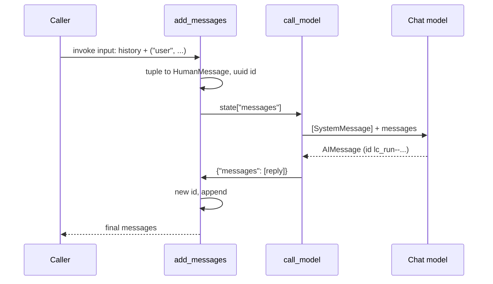
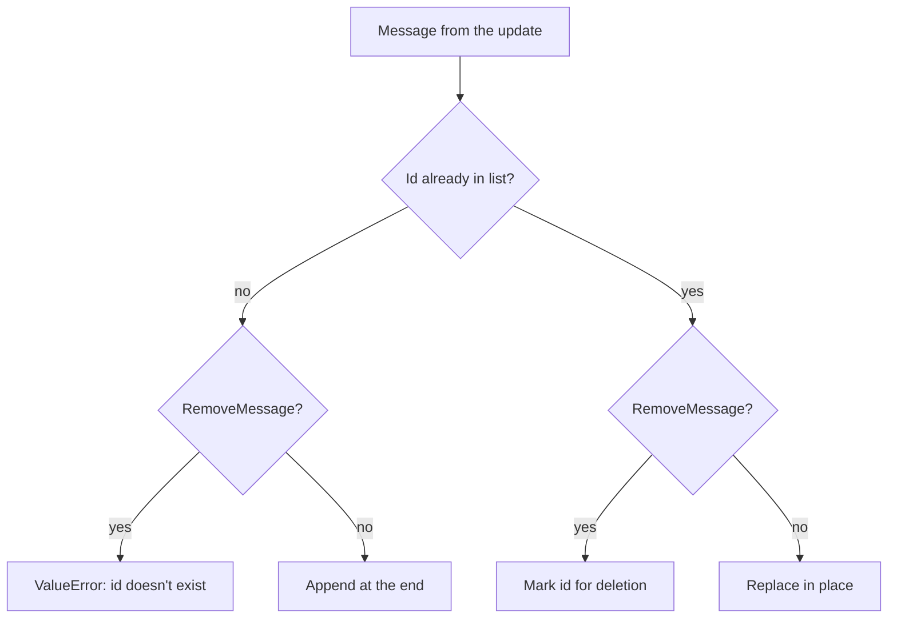

# 4.1 Messages in State and an Offline Chat Model

## The problem

Module 2 built graphs whose state was a handful of business fields: a customer, a cart, a total. An agent's state is different. Its main content is a **conversation**: what the user asked, what the model answered, and later which tools it called and what they returned. Every time the model is called, it has to see that whole conversation again, because a chat model keeps no memory between calls.

You already have the tools to store a growing list. Lesson 2.2 used `log: Annotated[list[str], operator.add]` to collect one line per node. A conversation could be stored the same way, but three things go wrong quickly:

- **Plain strings lose the roles.** The model must know which text came from the user, which from itself and which is an instruction. Chat models take *messages*, objects with a type and content, not bare strings.
- **Appending is not enough.** Sometimes a message must be corrected (a human fixes a wrong answer before the agent continues) or deleted (old turns are trimmed to save tokens). With `operator.add`, a node can only add to the end.
- **Resending the history duplicates it.** A node that returns the full list it received, plus one new message, makes `operator.add` store the history twice. Lesson 2.2 warned about this for the log. For a conversation it means the model sees every question twice on the next call.

There is also a practical problem: a real chat model needs an API key, a network connection and money, and its answers change from run to run. Lessons and tests want none of that.

This lesson solves both: a messages key with a reducer that understands messages, and a fake model that behaves like a real one without leaving your machine.

## The concept

### Messages and their ids

A [chat model](../../../GLOSSARY.md#chat-model) takes a list of message objects from `langchain_core.messages` and returns one message. This lesson uses three types:

| Type | Who writes it | `type` field |
|---|---|---|
| `SystemMessage` | the developer: instructions for the model | `"system"` |
| `HumanMessage` | the user | `"human"` |
| `AIMessage` | the model | `"ai"` |

Lesson 4.2 adds `ToolMessage`, the result of a tool call. `AnyMessage` is the type annotation that covers all of them.

Every message has an optional `id`. A [message id](../../../GLOSSARY.md#message-id) is what lets code refer to *one particular message* later: "replace this answer", "delete that question". A provider usually returns an id with its reply, and langchain-core fills one in when it doesn't.

### MessagesState and add_messages

LangGraph ships a ready-made state schema for conversations, [MessagesState](../../../GLOSSARY.md#messagesstate). In 1.2.16 it is, in full:

```python
class MessagesState(TypedDict):
    messages: Annotated[list[AnyMessage], add_messages]
```

So it is an ordinary `TypedDict` with one key, exactly the kind of schema you wrote in module 2. The interesting part is the [reducer](../../../GLOSSARY.md#reducer), [add_messages](../../../GLOSSARY.md#add_messages). Where `operator.add` simply concatenates, `add_messages` merges **by id**:

- an update whose id is **not** in the list is **appended** at the end,
- an update whose id **is** already in the list **replaces** that message, in its old position,
- a [RemoveMessage](../../../GLOSSARY.md#removemessage) with an id that is in the list **deletes** that message, and one with an unknown id raises `ValueError`.

Before merging, `add_messages` also normalizes the update. It converts message-like values into message objects (a `("user", "...")` tuple, a plain string, or a dict such as `{"type": "human", "content": "..."}`), and it gives every message that has no id a fresh uuid. After the reducer, everything in `state["messages"]` is a real message object with an id.

The mental model: **the messages key is a list keyed by id.** A node never edits the list. It sends messages, and the id of each one decides what happens: new id, append; known id, replace; `RemoveMessage`, delete.

### A fake chat model

All chat models in LangChain implement one interface, `BaseChatModel`. Its main method is `invoke(messages)`, which returns an `AIMessage`. Code that takes a `BaseChatModel` does not care which provider is behind it.

[GenericFakeChatModel](../../../GLOSSARY.md#genericfakechatmodel) from `langchain_core.language_models.fake_chat_models` is such a model with the generation step replaced by a script. You give it an iterator of replies, and each call returns the next one. It ignores what it is sent. Everything else is the real `BaseChatModel` machinery: `invoke`, callbacks, and the id langchain-core puts on the reply. That makes it a good stand-in for a real provider in lessons and tests, which is how the official unit-testing guide uses it.

## How it works

### One turn through the graph

Our graph has a single node, `call_model`, between `START` and `END`. The sequence below shows what happens in one `invoke`. Note that `add_messages` runs twice, once for the caller's input and once for the node's reply:



Three points from lesson 2.2 carry over unchanged, and they explain most of this diagram:

1. **The `invoke` input is a write like any other.** It goes into the `messages` channel through `add_messages`, so the tuple is already a `HumanMessage` with an id when the node reads the state.
2. **A node returns a [partial update](../../../GLOSSARY.md#partial-update).** `call_model` returns only the reply, and the reducer adds it to what is stored.
3. **A reducer is a plain function.** The graph calls `add_messages(stored, update)`. You can call it yourself with two lists, and the second half of the program does exactly that.

### Inside add_messages

The merge itself fits in a few lines of `langgraph/graph/message.py` at 1.2.16. For each message of the update, after conversion and id assignment:



The function starts from a copy of the stored list, applies the update to the copy, drops the marked ids at the end and returns the copy. The list you pass in is never changed.

## In our example

This lesson starts the calculator-agent example, which the rest of module 4 extends. Here it is a chatbot that answers arithmetic questions. It cannot calculate anything yet. Tools arrive in 4.2.

Everything about the graph is in [chatbot.py](../src/l4_1_messages_state/chatbot.py). The [code walkthrough](readalong.md#chatbotpy) goes through it line by line. Here we map the concept onto it.

### The model: a script, built by a factory

<!-- snippet: src/l4_1_messages_state/chatbot.py#fake_model -->
```python
def make_model(replies: list[str]) -> GenericFakeChatModel:
    """Build an offline chat model that answers with the scripted replies, in order.

    The model ignores its input and returns the next reply from the iterator.
    ``messages`` must be an iterator: a plain list fails pydantic validation
    ("Input should be an instance of Iterator"). The iterator is consumed once,
    so build a fresh model per run or test. Calling it after the script is used up raises
    ``StopIteration``. Inside a graph run, that surfaces as ``RuntimeError: generator raised
    StopIteration`` (langgraph 1.2.16 behaviour).
    """
    return GenericFakeChatModel(messages=iter(replies))
```
<!-- /snippet -->

`make_model` is the only place in the lesson that knows the model is fake. `build_graph(model)` accepts any `BaseChatModel`, so swapping in a real provider means changing this one function and nothing else. With the `langchain` package and a provider integration installed, that could be `init_chat_model("claude-sonnet-4-6")`, the model the official quickstart uses, plus the provider's API key in the environment. You don't need any of that for this course.

The `iter(...)` is required: the `messages` field is typed `Iterator`, and pydantic rejects a list. The iterator is also the model's only memory of where it is in the script. Once it is used up, the model has nothing more to say (see the experiments).

### The node: system prompt in, reply out

<!-- snippet: src/l4_1_messages_state/chatbot.py#call_model -->
```python
def call_model(state: MessagesState) -> dict:
    """Send the conversation to the model and return only its reply."""
    # The system message is built for this call only; it is NOT stored in state.
    reply = model.invoke([SystemMessage(SYSTEM_PROMPT)] + state["messages"])
    # Return just the new message: the add_messages reducer on
    # MessagesState appends it to the existing history.
    return {"messages": [reply]}
```
<!-- /snippet -->

Two decisions in these few lines matter for every agent you will build:

- **The system message is not part of the state.** The node builds `[SystemMessage(SYSTEM_PROMPT)] + state["messages"]` for this call and throws it away afterwards. The state holds only the conversation, so the prompt can change without rewriting the history, and it can never be duplicated. `SYSTEM_PROMPT` is the quickstart's calculator instruction. The fake model ignores it, but the node is written exactly as it would be for a real one.
- **The node returns only the new message.** `{"messages": [reply]}` is a partial update, and `add_messages` appends it because its id is new.

`call_model` is a closure inside `build_graph`, so it can use `model` while keeping the `(state)` signature that LangGraph calls nodes with. The rest of `build_graph` is the graph from module 1: `StateGraph(MessagesState)`, one node, `START -> call_model -> END`, and `compile()` with no checkpointer. `StateGraph(MessagesState)` is the line that attaches `add_messages` to the `messages` key.

### Two turns, with the caller carrying the history

<!-- snippet: src/l4_1_messages_state/__main__.py#two_turn_chat -->
```python
print("== A two-turn chat with a scripted model ==")
model = make_model(["2 + 3 is 5.", "5 times 4 is 20."])
graph = build_graph(model)

print("turn 1:")
# add_messages coerces the ("user", ...) tuple into a HumanMessage and gives
# it a uuid id; the fake reply gets an id like "lc_run--..." from
# langchain-core. Ids change every run, so we print booleans, not ids.
result = graph.invoke({"messages": [("user", "What is 2 + 3?")]})
show(result["messages"])
print("  every message has an id:", all(m.id for m in result["messages"]))

print("turn 2:")
# No checkpointer: pass the whole history back in, plus the new question.
result2 = graph.invoke({"messages": result["messages"] + [("user", "And times 4?")]})
show(result2["messages"])
kept = [m.id for m in result2["messages"][:2]] == [m.id for m in result["messages"]]
print("  ids from turn 1 kept:", kept)
```
<!-- /snippet -->

The [compiled graph](../../../GLOSSARY.md#compiledstategraph) has no checkpointer, so it forgets everything when `invoke` returns. For the second turn, the caller passes `result["messages"]` back in, followed by the new question. Lesson 5.1 adds a checkpointer, and then the graph keeps the history itself. The program prints booleans instead of ids, because the ids are random uuids that change on every run.

### The reducer by hand

<!-- snippet: src/l4_1_messages_state/__main__.py#reducer_calls -->
```python
print()
print("== add_messages is a plain function ==")
# A scripted wrong answer that we will correct by id.
history = [HumanMessage("What is 2 + 3?", id="q1"), AIMessage("2 + 3 is 6.", id="a1")]

print("append q2:")  # a new id goes to the end
show_ids(add_messages(history, [HumanMessage("And times 4?", id="q2")]))

print("replace a1:")  # an existing id is replaced in place
show_ids(add_messages(history, [AIMessage("2 + 3 is 5.", id="a1")]))

print("remove q1:")  # RemoveMessage deletes the message with that id
show_ids(add_messages(history, [RemoveMessage(id="q1")]))

print("operator.add with the same fix:")  # plain concatenation: a1 twice
show_ids(operator.add(history, [AIMessage("2 + 3 is 5.", id="a1")]))

# add_messages returns a new list; the input is left untouched.
print("history itself still has", len(history), "messages")
```
<!-- /snippet -->

Each call starts from the same two-message `history`, with fixed ids `q1` and `a1` and a wrong answer in `a1`. The last call uses `operator.add`, which is what the official quickstart's hand-written `messages` key uses, so you can see the difference on identical input.

## Run it

From the course root, run `./run.sh 4.1`. This is the output of the verified run:

```text
== A two-turn chat with a scripted model ==
turn 1:
  HumanMessage: What is 2 + 3?
  AIMessage: 2 + 3 is 5.
  every message has an id: True
turn 2:
  HumanMessage: What is 2 + 3?
  AIMessage: 2 + 3 is 5.
  HumanMessage: And times 4?
  AIMessage: 5 times 4 is 20.
  ids from turn 1 kept: True

== add_messages is a plain function ==
append q2:
    q1 human: What is 2 + 3?
    a1 ai: 2 + 3 is 6.
    q2 human: And times 4?
replace a1:
    q1 human: What is 2 + 3?
    a1 ai: 2 + 3 is 5.
remove q1:
    a1 ai: 2 + 3 is 6.
operator.add with the same fix:
    q1 human: What is 2 + 3?
    a1 ai: 2 + 3 is 6.
    a1 ai: 2 + 3 is 5.
history itself still has 2 messages
```

The model is scripted and the printed lines contain no ids or times, so every run prints exactly this. What to notice:

- **`HumanMessage`, not a tuple.** The caller passed `("user", "What is 2 + 3?")`. By the time the result comes back, it is a `HumanMessage`, converted by `add_messages` when the input was written.
- **No `SystemMessage` in the output.** The node sent one to the model, but never returned it.
- **Turn 2 has four messages, not five or six.** The channel starts empty on every `invoke`. The three input messages are appended, then the reply. The two old messages kept their ids, because `add_messages` assigns ids only to messages that have none.
- **The scripted answers are not computed.** "5 times 4 is 20." is right only because the script says so. The fake model would give the same reply to any question.
- **Replace keeps the position.** The corrected `a1` stays second, and the length stays 2.
- **Remove shows the old text.** "remove q1" leaves `a1` with the *wrong* answer `2 + 3 is 6.`, because each call starts from the original `history`. The correction from the previous call was never stored anywhere.
- **`operator.add` keeps both answers.** Same input, but now there are two messages with id `a1`, the wrong one first. A model reading this history would see itself contradict itself.
- **The input list is untouched.** `add_messages` returned new lists every time, and `history` still has its two messages.

## Details and edge cases

**A node's type hint is a schema too.** LangGraph reads the hint on a node's first parameter as the node's [input schema](../../../GLOSSARY.md#input-schema) (lesson 2.3) and registers its keys as channels. If `call_model` says `MessagesState` while the graph is built on another class with its own `messages` key, the two `messages` channels have different types, and `add_node` raises `ValueError: Channel 'messages' already exists with a different type` before the graph is even compiled. Keep the node's hint and the graph's state class the same.

**Extending the state.** To keep more than messages, subclass `MessagesState`: `class State(MessagesState): llm_calls: int`. The `messages` key keeps its reducer, and the new keys follow the usual rules from module 2.

**Returning the full history is harmless with `add_messages`, but wasteful.** If a node returns `state["messages"] + [reply]`, every old message comes back with an id that is already stored, so it replaces itself, and only the reply is new. The lesson's test `test_add_messages_inside_graph` checks this: one input message plus the reply gives 2 messages, not 3. With `operator.add` the same node doubles the history. Return only what is new anyway: it is cheaper, and it states the node's intent.

**Ids are filled in on your objects.** `add_messages` returns a new list, but the messages in it are the same objects you passed. A `HumanMessage` created without an id has one after it has gone through the reducer. That rarely matters, but don't build a message once and send it twice expecting two messages: the second time it carries the first one's id and replaces it.

**Remove and replace in one update.** Within one update, the last word on an id wins. `[RemoveMessage(id="q1"), HumanMessage("b", id="q1")]` leaves a `q1` with content `b`, and the reverse order deletes `q1`.

**Deleting can break a conversation.** Providers have rules about the order of messages. Some want the history to start with a human message, and a tool call must be followed by its result (lesson 4.2). The official memory guide warns that after deleting you must leave a valid history. `add_messages` does not check this for you.

**Removing everything: a known bug.** `RemoveMessage(id=REMOVE_ALL_MESSAGES)` (from `langgraph.graph.message`) clears the whole list, and the messages after it in the same update become the new list. In 1.2.16 those messages skip the normal merge: duplicate ids are not merged, a later `RemoveMessage` is stored as a message instead of deleting anything, and unknown ids raise no error. This is issue [#9326](https://github.com/langchain-ai/langgraph/issues/9326), still open for 1.2.16. If you use the marker, put only plain new messages after it.

**`MessageGraph` is deprecated.** Old tutorials build chatbots with `MessageGraph`, a graph whose whole state is a message list. The class still exists in 1.2.16, but it has been deprecated since LangGraph 1.0 and is due for removal in 2.0. Use `StateGraph(MessagesState)`, as this lesson does.

## Common mistakes

> [!WARNING]
> **Using `operator.add` for messages.** The official quickstart's graph defines `messages: Annotated[list[AnyMessage], operator.add]`, and it works there because its nodes only append. As soon as you correct, delete or resend messages, it duplicates them. It also stores input tuples as raw tuples, so `m.content` fails later. Use `MessagesState` or `add_messages`.

> [!WARNING]
> **Storing the system prompt in state.** If a node returns the `SystemMessage` along with the reply, it becomes part of the history. The next call prepends another one, and the state fills up with copies. Build the system message per call, as `call_model` does.

> [!WARNING]
> **Guessing ids for `RemoveMessage`.** An id that is not in the list raises `ValueError: Attempting to delete a message with an ID that doesn't exist (...)`. The ids of real messages are uuids or `lc_run--...` strings that you cannot know in advance. Read them from `state["messages"]` in the node that deletes, as the test's `remove_first` node does.

> [!WARNING]
> **Reusing a fake model.** `GenericFakeChatModel` consumes its iterator. A model built with two replies fails on the third call. Called directly, it raises a bare `StopIteration`; called through `graph.invoke`, the error surfaces as `RuntimeError: generator raised StopIteration`. Neither looks like "out of replies". Build a fresh model for every run and every test, as the tests do with `make_model`.

> [!TIP]
> Test message logic with `add_messages` directly, like the second section of the program. A reducer call with two lists is easier to read and debug than a graph run, and the graph does nothing more than make that call.

## Experiments

Each experiment starts from the lesson's original code. Make the change, run `./run.sh 4.1` from the course root, and try to predict the result before you open the explanation.

1. In `call_model`, return `{"messages": state["messages"] + [reply]}`, the whole history plus the reply. Run it. Then, keeping that change, replace `MessagesState` with the quickstart's hand-written state, both in `StateGraph(...)` and in `call_model`'s hint:

   ```python
   import operator
   from typing import Annotated, TypedDict
   from langchain_core.messages import AnyMessage


   class PlainMessagesState(TypedDict):
       messages: Annotated[list[AnyMessage], operator.add]
   ```

   <details><summary>What happens and why</summary>

   With `MessagesState` the output does not change at all. The old messages come back with ids that are already stored, so `add_messages` replaces each one with itself, and only the reply is new.

   With `PlainMessagesState`, turn 1 stops inside `show()` with `AttributeError: 'tuple' object has no attribute 'content'`. Print `[type(m).__name__ for m in result["messages"]]` instead and you get `['tuple', 'tuple', 'AIMessage']`. The question is stored twice, and as a raw tuple both times: `operator.add` neither merges by id nor converts anything to messages. If you go back to returning only `[reply]`, the duplicate goes away (`['tuple', 'AIMessage']`), but the tuple stays, and `show()` still fails. Only `add_messages`, or passing a real `HumanMessage` in the input, turns it into a message. Put the code back as it was (`git checkout -- .` in the lesson directory).

   </details>

2. Define `PlainMessagesState` as above and change only `StateGraph(MessagesState)` to `StateGraph(PlainMessagesState)`. Leave `call_model`'s hint as `MessagesState`.

   <details><summary>What happens and why</summary>

   `build_graph` fails in `builder.add_node(...)`, before `compile()`, with `ValueError: Channel 'messages' already exists with a different type`. The graph registered `messages` with `operator.add`, then `add_node` registered the node's hint, `MessagesState`, whose `messages` uses `add_messages`. One key cannot have two reducers. A node's state hint is a schema, so it must agree with the graph's state. Put the code back as it was.

   </details>

3. In section (a), add a third turn after turn 2 without changing the script:

   ```python
   print("turn 3:")
   result3 = graph.invoke({"messages": result2["messages"] + [("user", "Minus 1?")]})
   show(result3["messages"])
   ```

   Then add a third reply, `"20 minus 1 is 19."`, to the list in `make_model([...])`. Finally, in `make_model`, pass `messages=replies` instead of `messages=iter(replies)`.

   <details><summary>What happens and why</summary>

   The first version prints "turn 3:" and stops with `RuntimeError: generator raised StopIteration`. The fake model calls `next()` on its iterator for each reply, and the iterator is empty, so it raises `StopIteration`. The model call itself is not inside a generator, but `graph.invoke` works by iterating LangGraph's `Pregel.stream` generator, and the `StopIteration` escapes through it. Since PEP 479, Python turns a `StopIteration` that leaves a generator into `RuntimeError`. Calling `model.invoke` directly would give the bare `StopIteration`. With the third reply, turn 3 prints six messages, ending in `AIMessage: 20 minus 1 is 19.`. With a plain list, the program fails before the first turn, when the model is built: pydantic raises `ValidationError` with `Input should be an instance of Iterator`. Put the code back as it was.

   </details>

4. In section (b), change `RemoveMessage(id="q1")` to `RemoveMessage(id="q9")`.

   <details><summary>What happens and why</summary>

   The program prints "remove q1:" and stops with `ValueError: Attempting to delete a message with an ID that doesn't exist ('q9')`. Deleting is a merge by id like the other two cases, so `add_messages` looks the id up in the current list, and it is not there. It refuses rather than ignore the request silently. In a real node, read the id from `state["messages"]` instead of writing it by hand. Put the code back as it was.

   </details>

5. In section (b), remove `id="q2"` from the appended `HumanMessage("And times 4?", id="q2")`, and add `show_ids(history)` after the last `print`. Run it. Then give the same message `id="q1"` instead.

   <details><summary>What happens and why</summary>

   Without an id, the appended question gets a uuid such as `32238c71-...` (different on each run), and the two lines printed after "history itself still has 2 messages" are the original `q1` and `a1`. The reducer filled in an id for the new message and left `history` alone.

   With `id="q1"`, "append q2" prints only two messages, and the first one is now `q1 human: And times 4?`. The original question is gone. The reducer does not know you meant "new question". It sees a known id and replaces. That is why ids must be unique, and why it is best to let langchain-core and `add_messages` generate them, unless you really mean to replace a message. Put the code back as it was.

   </details>

## Summary

- A conversation lives in state as a list of message objects. `MessagesState` is a ready-made `TypedDict` with one key, `messages`, reduced by `add_messages`.
- `add_messages` merges by message id: a new id is appended, a known id is replaced in place, and a `RemoveMessage` deletes the message with its id (an unknown id raises `ValueError`). It also turns tuples, strings and dicts into messages and gives every message an id.
- A node that calls the model returns only the new reply. The system prompt is added per call and never stored.
- Without a checkpointer the graph forgets everything between `invoke` calls, so the caller passes the history back in. Lesson 5.1 changes that.
- `GenericFakeChatModel(messages=iter([...]))` is a real `BaseChatModel` that returns scripted replies, one per call, so runs and tests need no key or network. Build a fresh one each time, and swap in a real model by changing only the factory.

## Self-check

1. The stored messages are `[q1 human, a1 ai]`. A node returns `{"messages": [AIMessage("fixed", id="a1"), HumanMessage("next")]}`. What does the list look like afterwards?

   <details><summary>Answer</summary>

   Three messages: `q1`, then `a1` with content `fixed` in its old place, then the new human message with a fresh uuid at the end. `a1` is a known id, so it is replaced. `HumanMessage("next")` has no id, so it gets one and, being new, is appended.

   </details>

2. Why does the output of turn 1 contain no `SystemMessage`, although the model received one?

   <details><summary>Answer</summary>

   `call_model` builds `[SystemMessage(SYSTEM_PROMPT)] + state["messages"]` only as the model's input. It returns `{"messages": [reply]}`, so the system message never goes through the reducer and never reaches the state.

   </details>

3. In turn 2, the caller passes three messages, two of them from turn 1. Why are they not duplicated, and what would happen if the caller passed only the new question?

   <details><summary>Answer</summary>

   The graph has no checkpointer, so the `messages` channel starts empty on each `invoke`. The three input messages are simply appended to an empty list, and they keep their ids because they already have them. If the caller passed only the new question, the model would see a one-message conversation, "And times 4?", with no idea what to multiply.

   </details>

4. What is the difference between a node returning `state["messages"] + [reply]` on `MessagesState` and on a key with `operator.add`?

   <details><summary>Answer</summary>

   On `MessagesState` nothing visible changes: every old message replaces itself by id, and only the reply is added. With `operator.add`, the whole history is appended again, so it doubles on every call.

   </details>

5. Your test builds one `make_model(["ok"])` at module level and uses it in two tests. Both tests call it through `graph.invoke`. The second test fails with `RuntimeError: generator raised StopIteration`. Why?

   <details><summary>Answer</summary>

   `GenericFakeChatModel` takes one reply from its iterator per call, and the iterator can be read only once. The first test used the only reply, so the second test's call finds the iterator empty and the model raises `StopIteration`. It escapes through LangGraph's `Pregel.stream` generator, which `invoke` iterates, so Python reports it as `RuntimeError`. Calling the model directly would show the bare `StopIteration`. Build a fresh model in each test.

   </details>

## Further reading

- [Graph API overview: Working with messages in graph state](https://docs.langchain.com/oss/python/langgraph/graph-api#working-with-messages-in-graph-state), LangChain docs: why messages, `operator.add` versus `add_messages`, how inputs are converted, and `MessagesState`.
- [LangGraph quickstart](https://docs.langchain.com/oss/python/langgraph/quickstart), LangChain docs: the calculator agent this module follows, with its `operator.add` messages key and system prompt.
- [Memory: Delete messages](https://docs.langchain.com/oss/python/langgraph/add-memory#delete-messages), LangChain docs: `RemoveMessage`, `REMOVE_ALL_MESSAGES` and the warning to keep the history valid.
- [Unit testing: Mock chat model](https://docs.langchain.com/oss/python/langchain/test/unit-testing#mock-chat-model), LangChain docs: `GenericFakeChatModel` with `messages=iter(...)`, and the note that it does not implement `bind_tools`.
- [Messages](https://docs.langchain.com/oss/python/langchain/messages), LangChain docs: the message types and their `id` field.
- [Models](https://docs.langchain.com/oss/python/langchain/models), LangChain docs: `init_chat_model` and the API keys each provider needs, for when you swap the fake model for a real one.
- [langgraph/graph/message.py at 1.2.16](https://github.com/langchain-ai/langgraph/blob/1.2.16/libs/langgraph/langgraph/graph/message.py): `add_messages` and `MessagesState`, short enough to read in full.
- [Issue #9326: add_messages skips merging, deletion and format= after REMOVE_ALL_MESSAGES](https://github.com/langchain-ai/langgraph/issues/9326), GitHub: the open bug described above.
- [Merge message issues when LangGraph is called in parallel](https://forum.langchain.com/t/seeking-help-with-some-merge-message-issues-when-langgraph-is-called-in-parallel/3007), LangChain forum: a beginner's graph where `operator.add` and a pass-through node returning the full state duplicate the history.
