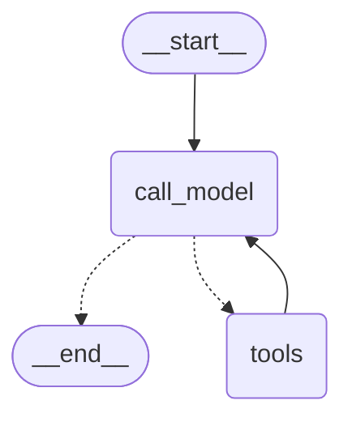
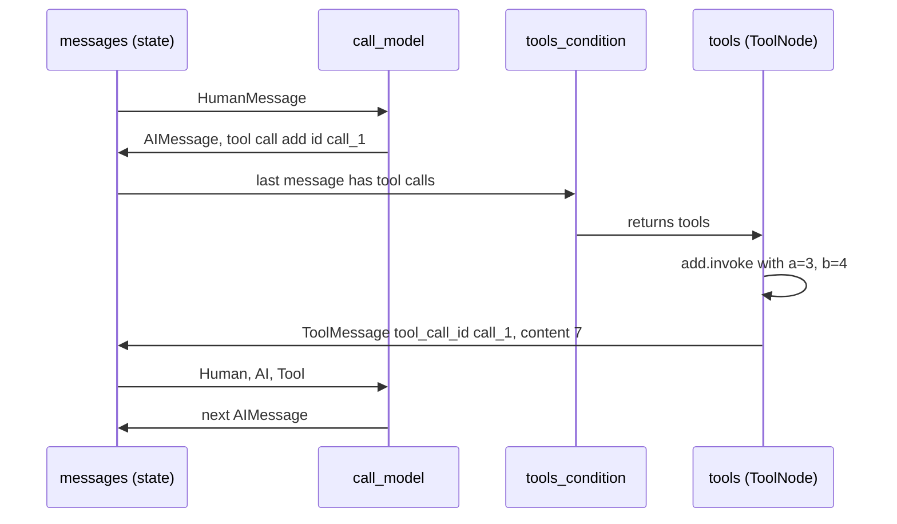

# 4.2 A Tool-Calling Agent Loop by Hand

## The problem

The chatbot from lesson 4.1 answers arithmetic questions, but it cannot calculate. Whatever it says comes from the model, and a language model asked for `(3 + 4) * 2 / 7` produces text that only *looks like* a calculation. For arithmetic that is risky. For anything that depends on the outside world (the weather, a database row, a file) the model simply cannot know the answer.

The fix is to let the model **ask for help**. The application gives it a few functions it may use. When the model needs one, it replies with a request ("run `add` with `a=3, b=4`") instead of an answer. The application runs the function and shows the model the result. The model then decides again: ask for another function, or answer.

That "decides again" is a loop, and loops are something you already know how to build. Lesson 1.3 built one with a conditional edge and a back edge, and it also showed what goes wrong when a loop never stops. This lesson builds the same kind of loop with a model inside it. You need four new things:

- a way to describe Python functions to the model,
- a message type for "here is the result you asked for",
- a node that runs the requested functions,
- a routing rule that sends the run either to that node or to the end.

## The concept

### Tool calls

A **tool** is a function the model may ask the application to run. In LangChain, the `@tool` decorator from `langchain_core.tools` turns a typed Python function into a tool object with three parts:

- a **name**, by default the function name (`add`),
- a **description**, by default the docstring, which is what the model reads to decide when the tool is useful,
- an **argument schema**, built from the type hints (`a: int, b: int`). The official tools guide calls the hints required for this reason.

A chat model learns which tools exist through [bind_tools](../../../GLOSSARY.md#bind_tools). `model.bind_tools(tools)` returns a runnable that sends the tools' schemas along with every request. The model itself never runs anything. When it wants a tool, it returns an `AIMessage` whose `tool_calls` list holds one entry per request:

```python
AIMessage(
    content="",
    tool_calls=[{"name": "add", "args": {"a": 3, "b": 4}, "id": "call_1"}],
)
```

Each entry is a [tool call](../../../GLOSSARY.md#tool-call): the tool's name, its arguments and an id. Real providers generate the id. It is the label that the answer will refer to.

The answer is a [ToolMessage](../../../GLOSSARY.md#toolmessage), the fourth message type after the three from lesson 4.1. Its `content` is the tool's result as text, `name` is the tool's name, `status` is `"success"` or `"error"`, and [tool_call_id](../../../GLOSSARY.md#tool_call_id) is the id of the call it answers. A `ToolMessage` with `tool_call_id="call_1"` says "this is the result of call `call_1`".

### The pairing rule

Request and result belong together. Most chat model providers reject a history in which an `AIMessage` asks for a tool call and no `ToolMessage` with that id follows. LangGraph's prebuilt code says so in the error it raises for this case (`INVALID_CHAT_HISTORY`): every tool call in the history must have a corresponding `ToolMessage`, as most providers require. This is the [pairing rule](../../../GLOSSARY.md#pairing-rule).

The rule is about ids, not about adjacency in your code. One `AIMessage` may contain several tool calls. It then needs several `ToolMessage`s, one per id.

### The agent loop and ReAct

Put together, the pieces form an [agent loop](../../../GLOSSARY.md#agent-loop):

1. Call the model with the conversation so far.
2. If its reply has tool calls, run them, append one `ToolMessage` per call, and go back to step 1.
3. If its reply has no tool calls, it is the answer. Stop.

This is the idea of [ReAct](../../../GLOSSARY.md#react) ("reason + act"), from the paper by Yao et al. (ICLR 2023). The paper prompted a model to alternate *thoughts*, *actions* (such as a Wikipedia search) and *observations* (the action's result), and to finish with a special `finish[answer]` action. The model's reasoning decides the next action, and each observation feeds the next round of reasoning, so errors can be noticed and corrected along the way.

Modern chat APIs give this pattern a native form. The action is a tool call, the observation is a `ToolMessage`, and "finish" is a reply without tool calls. The thoughts may appear in the reply's text or not at all. The loop is the same.

The mental model to keep: **the model decides, the graph executes.** The model never runs a tool and never touches the state. It only ever returns one message. The graph looks at that message and decides where to go.

## How it works

### The graph

LangGraph has two prebuilt pieces for this loop, both in the `langgraph-prebuilt` package (imported as `langgraph.prebuilt`):

- [ToolNode](../../../GLOSSARY.md#toolnode) is a node. It finds the latest `AIMessage` in `state["messages"]`, runs each of its tool calls and returns `{"messages": [...]}` with one `ToolMessage` per call, in call order. It sets each `tool_call_id` from the call's id, so the pairing rule holds by construction.
- [tools_condition](../../../GLOSSARY.md#tools_condition) is a [routing function](../../../GLOSSARY.md#routing-function). It looks at the **last** message in the state and returns `"tools"` if it has tool calls, otherwise `"__end__"`, the value of [END](../../../GLOSSARY.md#end).

With a model node in front, three edges make the loop. The diagram below was generated from the lesson's graph with `get_graph().draw_mermaid()` (styling removed). Dotted arrows are the [conditional edge](../../../GLOSSARY.md#conditional-edge), the solid arrow from `tools` is the [back edge](../../../GLOSSARY.md#back-edge):



Compared with lesson 1.3, nothing about the graph machinery is new. The conditional edge picks one of two paths after `call_model`, the back edge returns to a node that already ran, and every node run is one [super-step](../../../GLOSSARY.md#super-step). What is new is *who* decides when the loop stops: no counter, no flag in the state, only the content of the model's last reply.

### One round, message by message

The sequence below follows the first round of the lesson's run. Look at the id: it travels from the model's request into the `ToolMessage` that answers it.



Both nodes write through the [add_messages](../../../GLOSSARY.md#add_messages) reducer of [MessagesState](../../../GLOSSARY.md#messagesstate), exactly as in lesson 4.1. Each `call_model` run appends one message, each `tools` run appends one `ToolMessage` per call. The history therefore grows in the order human, ai, tool, ai, tool, … and always holds every request next to its answer, which is what the next model call needs.

## In our example

The example continues the calculator agent from [lesson 4.1](../../4.1-messages-state/docs/notes.md). The system prompt, the closure style of `build_graph` and the body of `call_model` are unchanged. The [code walkthrough](readalong.md) goes through every changed line. Here we map the concepts onto the code.

### The tools

[tools.py](../src/l4_2_tool_calling_loop/tools.py) defines the quickstart's three tools:

<!-- snippet: src/l4_2_tool_calling_loop/tools.py#arithmetic_tools -->
```python
# @tool turns each function into a BaseTool with .name (the function name),
# .description (the docstring, which the model reads) and .args (a schema built
# from the type hints). Tools are runnables: add.invoke({"a": 3, "b": 4}) returns 7.


@tool
def add(a: int, b: int) -> int:
    """Add `a` and `b`.

    Args:
        a: First int.
        b: Second int.
    """
    return a + b


@tool
def multiply(a: int, b: int) -> int:
    """Multiply `a` and `b`.

    Args:
        a: First int.
        b: Second int.
    """
    return a * b


@tool
def divide(a: int, b: int) -> float:
    """Divide `a` by `b`.

    Args:
        a: First int.
        b: Second int.
    """
    return a / b


# The list handed both to the model (bind_tools) and to ToolNode.
TOOLS = [add, multiply, divide]
```
<!-- /snippet -->

After decoration `add` is a `StructuredTool`, not a function: you call it as `add.invoke({"a": 3, "b": 4})`. With the default settings of langchain-core 1.6.12, the whole docstring, including its `Args:` section, becomes the description, and the schema holds only the types (`{"a": {"type": "integer"}, ...}`). `@tool(parse_docstring=True)` would split the `Args:` lines off into per-argument descriptions. For three self-explanatory tools the default is enough.

`TOOLS` is the single list given to both `bind_tools` and `ToolNode`. If the two lists differed, the model could ask for a tool the node cannot run.

### The fake model that "calls" tools

The model is still offline. Two small additions to lesson 4.1's `make_model` make it usable in an agent:

<!-- snippet: src/l4_2_tool_calling_loop/chatbot.py#fake_model -->
```python
class ToolCallingFakeModel(GenericFakeChatModel):
    """A scripted chat model that accepts bind_tools.

    GenericFakeChatModel.bind_tools raises NotImplementedError in
    langchain-core 1.6.12. A real model would send the tool schemas to the
    provider; this fake ignores them because its replies are scripted. Same
    pattern as FakeChatModel in langgraph's own libs/langgraph/tests/fake_chat.py.
    """

    def bind_tools(self, tools: Sequence[Any], **kwargs: Any) -> "ToolCallingFakeModel":
        """Return the model itself: the scripted replies already say which tools to call."""
        return self


def make_model(replies: Iterable[AIMessage | str]) -> ToolCallingFakeModel:
    """Build an offline chat model that answers with the scripted replies, in order.

    The model ignores its input and returns the next reply from the iterator
    (any iterable works, including an endless generator). The iterator is
    consumed once, so build a fresh model per run or test. Calling it after the
    script is used up raises ``StopIteration``. Inside a graph run, that
    surfaces as ``RuntimeError: generator raised StopIteration`` (langgraph
    1.2.16 behaviour).

    The fake sets an id on each scripted AIMessage object it returns (it
    mutates the object). So build the script fresh per model and never put the
    same AIMessage object in a script twice: with a repeated object,
    add_messages sees an existing id, replaces the earlier message in place,
    and tools_condition then sees a ToolMessage last and ends the run early.
    """
    return ToolCallingFakeModel(messages=iter(replies))


def tool_call(name: str, call_id: str, **args: int) -> AIMessage:
    """Build a model reply that asks for one tool call.

    This is what a real model returns when it wants a tool: empty content and
    a ``tool_calls`` entry with the tool name, its arguments and a call id.
    langchain-core adds ``"type": "tool_call"`` to each entry.
    """
    return AIMessage(content="", tool_calls=[{"name": name, "args": args, "id": call_id}])
```
<!-- /snippet -->

- `ToolCallingFakeModel` exists only because [GenericFakeChatModel](../../../GLOSSARY.md#genericfakechatmodel) raises `NotImplementedError` from `bind_tools`. A real model would send the schemas to the provider. The fake's replies are scripted, so it can ignore them and return itself. LangGraph's own test suite uses the same trick in `tests/fake_chat.py`.
- `tool_call` builds a reply exactly as a real model would send it: empty content, one tool call. The script picks readable ids such as `call_1` so the output can show how ids pair up.

The script plays the model's part in the ReAct loop. A real model would *read* `ToolMessage [call_1] add = 7` and then decide to multiply 7 by 2. The fake doesn't read anything, so the script already contains the decisions a sensible model would make. Swapping in a real model means changing `make_model` only. The graph code stays the same.

### The graph

<!-- snippet: src/l4_2_tool_calling_loop/chatbot.py#build_graph -->
```python
def build_graph(model: BaseChatModel) -> CompiledStateGraph:
    """Compile the agent loop START -> call_model -> (tools -> call_model)* -> END.

    call_model asks the model; if its reply has tool calls, tools_condition
    routes to the "tools" node, which runs them and loops back to call_model.
    A reply without tool calls routes to END. There is no checkpointer, so
    the graph forgets everything between invokes.
    """
    # Tell the model which tools exist, once. A real model now includes their
    # schemas in every request; the fake returns itself.
    model_with_tools = model.bind_tools(TOOLS)

    def call_model(state: MessagesState) -> dict:
        """Send the conversation to the model and return only its reply."""
        # The system message is built for this call only; it is NOT stored in state.
        reply = model_with_tools.invoke([SystemMessage(SYSTEM_PROMPT)] + state["messages"])
        # Return just the new message: the add_messages reducer on
        # MessagesState appends it to the existing history.
        return {"messages": [reply]}


    # MessagesState has one key, "messages", reduced by add_messages.
    builder = StateGraph(MessagesState)
    builder.add_node("call_model", call_model)
    # ToolNode runs every tool call of the last AIMessage and returns one
    # ToolMessage per call, with tool_call_id set to the call's id. The node
    # must be named "tools": that is the name tools_condition returns.
    builder.add_node("tools", ToolNode(TOOLS))
    builder.add_edge(START, "call_model")
    # tools_condition returns "tools" if the last message has tool calls,
    # otherwise "__end__" (END). This replaces 4.1's call_model -> END edge.
    builder.add_conditional_edges("call_model", tools_condition)
    # The back edge makes it a loop (ReAct): act, observe, think again.
    builder.add_edge("tools", "call_model")
    return builder.compile()
```
<!-- /snippet -->

Map the concepts onto these lines:

- `model.bind_tools(TOOLS)` runs once, when the graph is built. `call_model` uses the bound model and otherwise knows nothing about tools: it returns whatever the model replied.
- `add_node("tools", ToolNode(TOOLS))` is the executor. The name is not a free choice: `tools_condition` returns the string `"tools"`, and LangGraph looks that string up as a node name (third experiment).
- `add_conditional_edges("call_model", tools_condition)` replaces lesson 4.1's `call_model -> END` edge. `END` is still reachable, but only through the router. That is why `END` is no longer imported.
- `add_edge("tools", "call_model")` is the back edge. Without it, the run would stop after the first tool result (second experiment).

### Checking the pairing rule

The fake model accepts any history, so it would never complain about a missing `ToolMessage`. The lesson checks the rule itself:

<!-- snippet: src/l4_2_tool_calling_loop/chatbot.py#pairing_check -->
```python
def unanswered_tool_calls(messages: Sequence[AnyMessage]) -> list[str]:
    """Return the ids of tool calls that no ToolMessage answers, in order.

    This is the pairing rule providers enforce: every tool call in the history
    must be followed by a ToolMessage answering its id, or the next model call
    is rejected. The fake model does not check it, so the lesson checks it
    itself. It mirrors langgraph's private _validate_chat_history in
    langgraph.prebuilt.chat_agent_executor (not imported: it is private and
    lives in the deprecated create_react_agent module).
    """
    answered = {m.tool_call_id for m in messages if isinstance(m, ToolMessage)}
    return [
        tc["id"]
        for m in messages
        if isinstance(m, AIMessage)
        for tc in m.tool_calls
        if tc["id"] not in answered
    ]
```
<!-- /snippet -->

It collects the ids that some `ToolMessage` answers, then lists the tool call ids of all `AIMessage`s that are not among them. This is the same logic as `_validate_chat_history` in `langgraph.prebuilt.chat_agent_executor`. That function is private and sits in the module of the deprecated `create_react_agent`, so the lesson writes its own few lines rather than import it.

### Watching the loop

The first section of [\_\_main\_\_.py](../src/l4_2_tool_calling_loop/__main__.py) streams the run with `stream_mode="updates"`, so each item is one node's update:

<!-- snippet: src/l4_2_tool_calling_loop/__main__.py#agent_loop -->
```python
print("== The agent loop, step by step ==")
# Built fresh here: the fake model sets ids on these message objects.
script = [
    tool_call("add", "call_1", a=3, b=4),
    tool_call("multiply", "call_2", a=7, b=2),
    tool_call("divide", "call_3", a=14, b=7),
    AIMessage("(3 + 4) * 2 / 7 is 2.0."),
]
graph = build_graph(make_model(script))
question = "What is (3 + 4) * 2 / 7?"
print("question:", question)

# Each node run is one super-step; this run takes 7. A run of N steps
# needs recursion_limit >= N + 1 (lesson 1.3). The default in 1.2.16 is
# 10007, so set a small limit on agent loops.
steps = 0
for update in graph.stream(
    {"messages": [HumanMessage(question)]},
    {"recursion_limit": 10},
    stream_mode="updates",
):
    # "updates" yields {node_name: what_the_node_returned} per step.
    for node, delta in update.items():
        steps += 1
        for m in delta["messages"]:
            print(f"  {node:<10} {describe(m)}")
print(
    f"  {steps} steps; tools_condition found no tool calls in the last reply and routed to END"
)
```
<!-- /snippet -->

The [recursion_limit](../../../GLOSSARY.md#recursion_limit) of 10 is deliberate. In an agent loop, the limit is the only thing that stops a model that keeps asking for tools, and the default in 1.2.16 is 10007.

The second section builds one reply with two tool calls and checks the pairing rule on the result, then on a copy with one answer removed:

<!-- snippet: src/l4_2_tool_calling_loop/__main__.py#parallel_calls -->
```python
print()
print("== Two tool calls in one reply ==")
two_calls = AIMessage(
    content="",
    tool_calls=[
        {"name": "add", "args": {"a": 3, "b": 4}, "id": "call_a"},
        {"name": "multiply", "args": {"a": 5, "b": 6}, "id": "call_b"},
    ],
)
graph = build_graph(make_model([two_calls, AIMessage("3 + 4 is 7 and 5 * 6 is 30.")]))
result = graph.invoke(
    {"messages": [HumanMessage("What are 3 + 4 and 5 * 6?")]},
    {"recursion_limit": 10},
)
messages = result["messages"]
# ToolNode answers every call of the reply, in call order, each
# ToolMessage carrying the tool_call_id it answers.
for m in messages:
    print(f"  {describe(m)}")
print("unanswered tool calls:", unanswered_tool_calls(messages))

broken = [
    m for m in messages if not (isinstance(m, ToolMessage) and m.tool_call_id == "call_b")
]
# Sent to a real provider, this history is rejected: the model may never
# see a tool call without its result. The fake does not check, so we do.
print("after dropping the answer to call_b:", unanswered_tool_calls(broken))
```
<!-- /snippet -->

## Run it

From the course root, run `./run.sh 4.2`. This is the output of the verified run:

```text
== The agent loop, step by step ==
question: What is (3 + 4) * 2 / 7?
  call_model AIMessage asks for add(a=3, b=4) [call_1]
  tools      ToolMessage [call_1] add = 7
  call_model AIMessage asks for multiply(a=7, b=2) [call_2]
  tools      ToolMessage [call_2] multiply = 14
  call_model AIMessage asks for divide(a=14, b=7) [call_3]
  tools      ToolMessage [call_3] divide = 2.0
  call_model AIMessage: (3 + 4) * 2 / 7 is 2.0.
  7 steps; tools_condition found no tool calls in the last reply and routed to END

== Two tool calls in one reply ==
  HumanMessage: What are 3 + 4 and 5 * 6?
  AIMessage asks for add(a=3, b=4) [call_a], multiply(a=5, b=6) [call_b]
  ToolMessage [call_a] add = 7
  ToolMessage [call_b] multiply = 30
  AIMessage: 3 + 4 is 7 and 5 * 6 is 30.
unanswered tool calls: []
after dropping the answer to call_b: ['call_b']
```

The model is scripted and the program never prints message ids, so every run prints exactly this. What to notice:

- **The loop is visible.** `call_model` and `tools` alternate: four model calls, three tool runs, 7 super-steps. Each `tools` line carries the id of the request just above it.
- **The numbers come from the tools.** `7`, `14` and `2.0` were computed by `add`, `multiply` and `divide`. Only the final sentence is scripted text. `divide` returns a `float`, which is why the result reads `2.0`.
- **Results are strings.** The output can't show it, but the `ToolMessage` contents are `'7'`, `'14'` and `'2.0'`. `ToolNode` turns the result into text, because that is what goes back to the model. The test `test_full_loop` checks this.
- **The end is not a node.** There is no `END` line in the stream. After the last `call_model`, `tools_condition` returned `"__end__"` and the run finished. The last summary line is printed by the program, not by LangGraph.
- **Two calls, one tool step, two answers.** In the second section the model asked for two independent results in one reply. A single `tools` step answered both, in the order of the calls, so the whole run took 3 super-steps instead of 5.
- **The pairing check.** The complete history has no unanswered call. Remove the `ToolMessage` for `call_b`, and the check reports `['call_b']`. Sent to a real provider, that broken history would be rejected.

## Details and edge cases

**`tools_condition` reads the last message, `ToolNode` the latest `AIMessage`.** The router checks only `state["messages"][-1]`. `ToolNode` searches backwards for the most recent `AIMessage` and runs all of its tool calls. In this graph the two always agree, because `tools` runs right after `call_model`. In a bigger graph, a node that appends something after the model's reply would make `tools_condition` end the run even though tool calls are waiting.

**Tool errors: two kinds, two behaviours.** Mistakes in the *call* become an error `ToolMessage` (status `"error"`) that goes back to the model. `ToolNode` answers an unknown tool name itself, before running anything: `Error: subtract is not a valid tool, try one of [add, multiply, divide].` Arguments that don't fit the schema (`a="three"`) are caught by the default `handle_tool_errors`, which gives a message starting `Error invoking tool 'add' with kwargs`. An exception raised *inside* the tool, such as `ZeroDivisionError` from `divide(a=1, b=0)`, is re-raised and ends the whole run. `ToolNode(TOOLS, handle_tool_errors=True)` catches every exception and reports it to the model instead (first experiment). The test `test_tool_errors_default_handling` covers the two default cases.

**Parallel calls run concurrently.** When one reply has several tool calls, `ToolNode` runs them in a thread pool (`asyncio.gather` in async graphs), but it returns the `ToolMessage`s in call order. All of them are written in one super-step. Tools that share mutable state need to be safe to run at the same time.

**The recursion limit is your stop button.** A run of $N$ super-steps needs `recursion_limit` of at least $N + 1$ (lesson 1.3). Our first run takes 7 steps, so it fails with 7 and works with 8 (fourth experiment). A confused model that keeps asking for tools would loop until the limit, and every round costs a model call. Set a limit that fits the task. Lesson 1.3's [RemainingSteps](../../../GLOSSARY.md#remainingsteps) works here too: the official `react-agent` template uses the related `is_last_step` value to replace the last tool request with a polite "no answer in time" reply instead of raising [GraphRecursionError](../../../GLOSSARY.md#graphrecursionerror).

**The fake model writes ids onto your messages.** `GenericFakeChatModel` sets an id on each scripted `AIMessage` *object* it returns. If the same object appears twice in a script, the second reply carries the id of the first, so `add_messages` replaces the earlier message in place instead of appending (the [message id](../../../GLOSSARY.md#message-id) rule from lesson 4.1). The history then ends with a `ToolMessage`, `tools_condition` sees no tool calls and ends the run early. Build each script fresh, as `main` and the tests do.

**`ToolNode` needs a graph.** Calling `ToolNode(TOOLS).invoke(...)` on its own fails with `ValueError: Missing required config key`, because the node expects the configuration a graph run provides. Test tools directly with `tool.invoke(...)`, the router directly with a state dict, and `ToolNode` through the graph.

**The prebuilt agent.** The loop you built here is what lesson 4.3 gets in one call from `langchain.agents.create_agent`. Older tutorials use `create_react_agent` from `langgraph.prebuilt`, which has been deprecated since LangGraph 1.0. `ToolNode` and `tools_condition` are not deprecated and remain the building blocks for a hand-built loop.

## Common mistakes

> [!WARNING]
> **Naming the tool node something else.** `add_node("tool_node", ToolNode(TOOLS))` with a plain `add_conditional_edges("call_model", tools_condition)` fails in `compile()` with `ValueError: At 'call_model' node, 'tools_condition' branch found unknown target 'tools'`. Either name the node `"tools"` or pass a [path map](../../../GLOSSARY.md#path-map): `{"tools": "tool_node", END: END}`.

> [!WARNING]
> **Forgetting the back edge.** Without `add_edge("tools", "call_model")` the graph still compiles. The run stops after the first tool result, with no answer, and no error tells you why. A node without outgoing edges simply ends the run.

> [!WARNING]
> **Breaking the pairing rule.** Trimming the history, building messages by hand or resuming a run can leave a tool call without its `ToolMessage`. The fake model in this course accepts that, and a real provider rejects the next request. LangGraph documents the case as `INVALID_CHAT_HISTORY`. When you edit a history, remove a tool call together with its answers, or answer it.

> [!WARNING]
> **Expecting a tool exception to reach the model.** With the default `handle_tool_errors`, only invalid calls become error messages. A bug or a `ZeroDivisionError` inside the tool ends the run. Decide per agent whether the model should see tool errors (`handle_tool_errors=True`, a message string, a function, or a tuple of exception types) or whether they should fail loudly.

> [!TIP]
> Keep one tool list. Pass the same `TOOLS` to `bind_tools` and to `ToolNode`, so the model is never offered a tool the node cannot run.

## Experiments

Each experiment starts from the lesson's original code. Make the change, run `./run.sh 4.2` from the course root, and guess the result before you open the explanation.

1. In section (a) of `main`, replace the script with `tool_call("divide", "call_1", a=1, b=0)` followed by `AIMessage("You cannot divide by zero.")`. Run it. Then, in `build_graph`, change the node to `ToolNode(TOOLS, handle_tool_errors=True)` and run again.

   <details><summary>What happens and why</summary>

   The first run prints the model's request, `call_model AIMessage asks for divide(a=1, b=0) [call_1]`, and then stops with `ZeroDivisionError: division by zero` (the traceback adds `During task with name 'tools'`). The default error handler only turns invalid calls into a `ToolMessage` and re-raises everything else.

   With `handle_tool_errors=True` the run completes:

   ```text
     call_model AIMessage asks for divide(a=1, b=0) [call_1]
     tools      ToolMessage [call_1] divide = Error: ZeroDivisionError('division by zero')
    Please fix your mistakes.
     call_model AIMessage: You cannot divide by zero.
     3 steps; tools_condition found no tool calls in the last reply and routed to END
   ```

   The `ToolMessage` content contains a newline, so " Please fix your mistakes." lands on its own line. Its status is `"error"`. The exception became an observation the model can react to, which is the ReAct idea: act, observe, reason again. Put the code back as it was (`git checkout -- .` in the lesson directory).

   </details>

2. In `build_graph`, delete `builder.add_edge("tools", "call_model")` and run.

   <details><summary>What happens and why</summary>

   The graph still compiles. Section (a) prints `call_model` and one `tools` line, then `2 steps; ...`, and the second section ends with the two `ToolMessage`s and no final answer. The summary line still claims that `tools_condition` routed to `END`, because it is fixed text: in fact the run ended because `tools` had no outgoing edge. A node without edges ends the run, and the back edge is what turns the two nodes into a loop. Put the code back as it was.

   </details>

3. Rename the tool node: `add_node("tool_node", ToolNode(TOOLS))` and `add_edge("tool_node", "call_model")`. Run it. Then also pass a path map: `add_conditional_edges("call_model", tools_condition, {"tools": "tool_node", END: END})` (import `END` from `langgraph.graph`).

   <details><summary>What happens and why</summary>

   The first version fails inside `builder.compile()` with `ValueError: At 'call_model' node, 'tools_condition' branch found unknown target 'tools'`. `tools_condition` is declared to return `"tools"` or `"__end__"`, and `compile()` checks that each possible destination is a node. With the path map, the labels are translated to node names and the run works again. The output is unchanged except that the tool lines are labelled `tool_node`. Put the code back as it was.

   </details>

4. In section (a), change `{"recursion_limit": 10}` to `{"recursion_limit": 7}`.

   <details><summary>What happens and why</summary>

   All seven updates are printed, including the final answer, and then the stream raises `GraphRecursionError: Recursion limit of 7 reached without hitting a stop condition.` The run needs exactly 7 super-steps, but LangGraph checks the limit before it looks for more work, so $N$ steps need a limit of at least $N + 1$ (lesson 1.3). With 8 the run finishes. Because the updates were already streamed, a caller using `stream` sees the answer and still gets the exception. Put the code back as it was.

   </details>

5. In section (a), replace the final `AIMessage("(3 + 4) * 2 / 7 is 2.0.")` with `tool_call("add", "call_4", a=2, b=0)`.

   <details><summary>What happens and why</summary>

   The run prints four tool rounds, the last one `ToolMessage [call_4] add = 2`, and then stops with `RuntimeError: generator raised StopIteration`. The last reply had a tool call, so `tools_condition` routed to `tools` once more, and the next `call_model` found the script used up (lesson 4.1 explains why `StopIteration` becomes `RuntimeError`). The loop ends only when the model replies without tool calls. The graph has no other exit, apart from the recursion limit. Put the code back as it was.

   </details>

## Summary

- `@tool` turns a typed function into a tool with a name, a description (the docstring) and an argument schema (the type hints). `bind_tools` sends those schemas to the model.
- A model asks for tools by returning an `AIMessage` with `tool_calls`. Each result goes back as a `ToolMessage` whose `tool_call_id` names the call it answers, and every call must be answered before the next model call (the pairing rule).
- The agent loop is `call_model`, a conditional edge with `tools_condition`, a `ToolNode` named `"tools"`, and the back edge `tools -> call_model`. It ends when the model replies without tool calls.
- This is ReAct in native form: the tool call is the action, the `ToolMessage` the observation, and a plain reply is "finish".
- By default `ToolNode` reports invalid calls to the model but lets exceptions from the tool end the run. `handle_tool_errors` changes that.
- Always set a small `recursion_limit` on an agent loop: it is the only guard against a model that never stops calling tools.

## Self-check

1. After `call_model`, the last message is an `AIMessage` with two tool calls. What do `tools_condition` and then `ToolNode` do, and how many messages does the `tools` step add?

   <details><summary>Answer</summary>

   `tools_condition` sees tool calls in the last message and returns `"tools"`. `ToolNode` runs both calls (concurrently) and returns two `ToolMessage`s in call order, each with the `tool_call_id` of its call. So the step adds two messages, and then the back edge leads to `call_model` again.

   </details>

2. Where in the graph is the decision to stop made, and what has to happen for the run to end normally?

   <details><summary>Answer</summary>

   In `tools_condition`, the conditional edge after `call_model`. The run ends normally only when the model returns a reply without tool calls. Then `tools_condition` returns `"__end__"`. Otherwise the run stops only on an error, for example `GraphRecursionError` when the limit is reached.

   </details>

3. A history has an `AIMessage` with tool calls `x` and `y`, followed by one `ToolMessage` with `tool_call_id="x"`. What does `unanswered_tool_calls` return, and what would a real provider do with this history?

   <details><summary>Answer</summary>

   `['y']`. Most providers reject the next request, because the tool call `y` has no result. Answer it with a `ToolMessage` for `y`, or remove the call.

   </details>

4. Why does `divide(a=1, b=0)` stop the run while a call to an unknown tool `subtract` does not?

   <details><summary>Answer</summary>

   `ToolNode` checks the tool name before running anything and answers an unknown name with an error `ToolMessage`. Its default `handle_tool_errors` also turns invalid arguments into such a message. An exception raised inside a valid tool, like `ZeroDivisionError`, is re-raised, so the run fails. `handle_tool_errors=True` would report it to the model instead.

   </details>

5. The first run takes 7 super-steps. What is the smallest `recursion_limit` that lets it finish, and why does setting a small limit matter more here than in a fixed pipeline?

   <details><summary>Answer</summary>

   8, because $N$ super-steps need a limit of $N + 1$. In an agent loop the number of rounds is chosen by the model, not by the code. A model that keeps asking for tools would loop until the limit, and the default of 10007 means thousands of paid model calls.

   </details>

## Further reading

- [LangGraph quickstart](https://docs.langchain.com/oss/python/langgraph/quickstart): the official calculator agent, with a hand-written tool node and `should_continue` router instead of the prebuilt pieces.
- [LangChain: Tools](https://docs.langchain.com/oss/python/langchain/tools): `@tool`, names, descriptions and argument schemas.
- [LangChain: Messages](https://docs.langchain.com/oss/python/langchain/messages): `AIMessage.tool_calls` and `ToolMessage` fields.
- [INVALID_CHAT_HISTORY](https://docs.langchain.com/oss/python/langgraph/errors/INVALID_CHAT_HISTORY): the error for unanswered tool calls and how to repair a history.
- [`tool_node.py` at langgraph 1.2.16](https://github.com/langchain-ai/langgraph/blob/1.2.16/libs/prebuilt/langgraph/prebuilt/tool_node.py): `ToolNode`, `tools_condition` and the default error handler (langgraph-prebuilt 1.1.1).
- [langchain-ai/react-agent](https://github.com/langchain-ai/react-agent): the official template with the same hand-built loop, plus an `is_last_step` guard.
- Yao et al., [ReAct: Synergizing Reasoning and Acting in Language Models](https://arxiv.org/abs/2210.03629), ICLR 2023.
