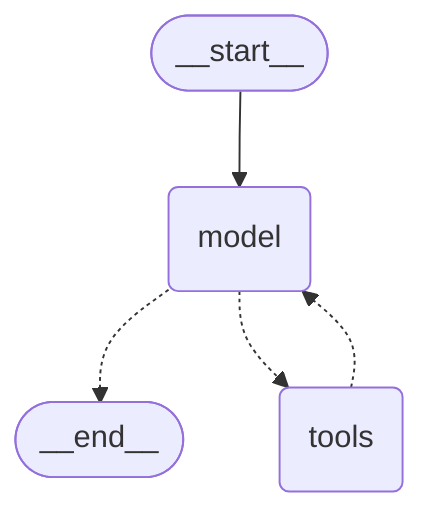
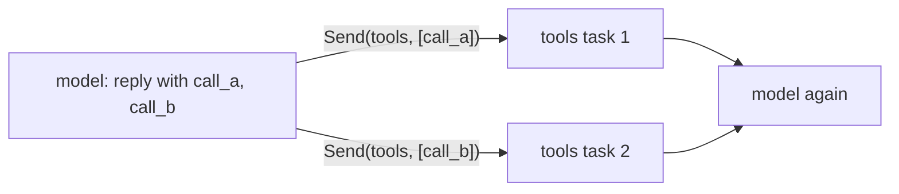

# 4.3 The Prebuilt Agent with create_agent

## The problem

In lesson 4.2 you built the [agent loop](../../../GLOSSARY.md#agent-loop) yourself: a `call_model` node, a [ToolNode](../../../GLOSSARY.md#toolnode) named `"tools"`, [tools_condition](../../../GLOSSARY.md#tools_condition) as the [conditional edge](../../../GLOSSARY.md#conditional-edge), and the [back edge](../../../GLOSSARY.md#back-edge) `tools -> call_model`. That took about thirty lines, and almost none of them were specific to a calculator. Put in other tools and another system prompt, and you get a weather agent, a SQL agent or a support agent. The wiring stays the same.

Code that every project writes the same way usually ends up in a library. For the agent loop that library function is `create_agent`. This raises two questions, and they are what this lesson is about:

- What exactly does the library build? Is it a black box, or the graph you already know?
- When is the library version enough, and when do you still write the graph yourself?

## The concept

### create_agent

[create_agent](../../../GLOSSARY.md#create_agent) lives in the `langchain` package, not in `langgraph`: `from langchain.agents import create_agent`. You give it a model, a list of tools and a [system_prompt](../../../GLOSSARY.md#system_prompt). It returns a compiled graph that runs the loop from lesson 4.2:

```python
agent = create_agent(model, TOOLS, system_prompt=SYSTEM_PROMPT)
agent.invoke({"messages": [HumanMessage("What is (3 + 4) * 2 / 7?")]})
```

The model and the tools are passed by position. Everything after them is keyword-only. The model can be a chat model object, as in this course, or a `"provider:model"` string that langchain resolves with `init_chat_model`. The string form needs the provider's integration package and an API key.

The return value is the most important fact in this lesson. It is a [CompiledStateGraph](../../../GLOSSARY.md#compiledstategraph), the same class `builder.compile()` returned in every lesson so far. `create_agent` builds a [StateGraph](../../../GLOSSARY.md#stategraph), adds nodes and edges and calls `compile()`, just as you did. So the mental model is:

> **`create_agent` is a function that writes the graph from lesson 4.2 for you.** What it returns is an ordinary LangGraph graph, so everything from modules 1 to 3 applies to it.

LangChain's own docs call `create_agent` a configurable harness around an agent, which they define as "a model calling tools in a loop until a given task is complete". The LangGraph overview puts the split in one sentence: if you are getting started with agents or want a higher-level abstraction, use LangChain's agents. LangGraph itself is the low-level orchestration layer underneath.

### What the graph contains

With a non-empty tool list, `create_agent` (langchain 1.4.6) builds:

- a node `"model"`, which plays the part of `call_model`,
- a node `"tools"`, which is a `ToolNode` from `langgraph.prebuilt`, the same class as in 4.2,
- its own conditional edge after `"model"` and a conditional edge from `"tools"` back to `"model"`.

The state schema is [AgentState](../../../GLOSSARY.md#agentstate), imported from `langchain.agents`. Its `messages` key has the [add_messages](../../../GLOSSARY.md#add_messages) reducer, so it behaves exactly like [MessagesState](../../../GLOSSARY.md#messagesstate). It has two more keys. `structured_response` stays empty unless you ask for structured output with `response_format=`. `jump_to` is private: middleware uses it to redirect the run. It is not part of the input or output schema and never appears in an `invoke` result, although it can show up in stream updates from middleware nodes.

### The migration from create_react_agent

Tutorials and code from before LangGraph 1.0 use a different function for the same job:

```python
# Old, deprecated since LangGraph 1.0. Do not use in new code.
from langgraph.prebuilt import create_react_agent

agent = create_react_agent(model, tools, prompt=SYSTEM_PROMPT)
```

[create_react_agent](../../../GLOSSARY.md#create_react_agent) still works in 1.2.16, but it warns with `LangGraphDeprecatedSinceV10`: it "has been moved to `langchain.agents`" and will be removed in V2.0. The [LangGraph v1 migration guide](https://docs.langchain.com/oss/python/migrate/langgraph-v1) maps it to `create_agent`. When you move old code across, check these points:

| Before (`langgraph.prebuilt`) | Now (`langchain.agents`) |
|---|---|
| `from langgraph.prebuilt import create_react_agent` | `from langchain.agents import create_agent` |
| `prompt=...` | `system_prompt=...` (a string or a `SystemMessage`). `prompt=` raises `TypeError` |
| model node named `"agent"` | model node named `"model"` |
| `AgentState` and Pydantic variants from `langgraph.prebuilt` | `AgentState` from `langchain.agents` (a `TypedDict`, no Pydantic variant) |
| new package: none | add `langchain` to your dependencies |

The node name matters more than it looks. Code that refers to the model node by name breaks after the move, and not always loudly. A filter on stream updates that looks for `"agent"` simply stops matching, without any error. `interrupt_before=["agent"]` or `interrupt_after=["agent"]` fails when the agent is built, with `` ValueError: Interrupt node `agent` not found ``, because `StateGraph` checks every interrupt node name at compile time. Tests that assert node names fail. `ToolNode` and `tools_condition` are **not** deprecated. They remain the building blocks for a hand-built loop like 4.2's.

## How it works

### The graph, drawn

The diagram below was generated from the lesson's agent with `build_agent(...).get_graph().draw_mermaid()`, with the styling lines removed. Compare it with the drawing in [lesson 4.2](../../4.2-tool-calling-loop/docs/notes.md#the-graph):



The shape is the same: start, model, a choice between `tools` and the end, and a way back. Two differences are visible. The model node has a different name, and the edge from `tools` back to `model` is dotted, which means conditional. A third difference is not visible in the drawing: how the conditional edge after `"model"` starts the tools.

### Inside one model step

On every visit of `"model"`, `create_agent`'s node does three things:

1. It calls `model.bind_tools(tools, tool_choice=None)`. In 4.2, `build_graph` called [bind_tools](../../../GLOSSARY.md#bind_tools) once, when the graph was built. `create_agent` binds again for every model call, because [agent middleware](../../../GLOSSARY.md#agent-middleware) may change the model or the tool list per call.
2. It invokes the bound model with `[SystemMessage(system_prompt), *state["messages"]]`. The system prompt is put in front for that call only, as `call_model` did in lessons 4.1 and 4.2. It is never written to the state.
3. It returns the model's reply as an update to `messages`.

### Routing: one Send per tool call

`tools_condition` in 4.2 returned the name `"tools"`, and one `tools` task ran all tool calls of the reply. `create_agent`'s router works differently. It looks at the last `AIMessage` and collects its *pending* tool calls, the ones no `ToolMessage` answers yet. Then:

- no tool calls at all: go to the end,
- pending calls: return one [Send](../../../GLOSSARY.md#send)`("tools", [tool_call])` per call.

`Send` is the fan-out mechanism from lesson 3.2. Each call becomes its own `tools` task, and all of these tasks run in the same [super-step](../../../GLOSSARY.md#super-step). For a reply with two calls it looks like this:



Both tasks finish in one super-step, so the run still takes three steps (model, tools, model), the same count as in 4.2. The difference shows up in a stream. You get two separate `tools` updates, and their order is not fixed.

The edge back from `"tools"` is conditional because a tool can be declared with `return_direct=True`. When every tool that just ran is such a tool, the run ends right after the tools step, without asking the model again. None of the calculator's tools does that, so the edge always leads back to `"model"`. That is also why the drawing shows only one target for it.

### A built-in recursion limit

`create_agent` attaches a default config with `.with_config({"recursion_limit": 9999, ...})`. A plain compiled graph uses LangGraph's general default, which is 10007 in 1.2.16. A [recursion_limit](../../../GLOSSARY.md#recursion_limit) that you pass to `invoke` or `stream` replaces the attached one. Either way the default is large: a model that never stops asking for tools would make thousands of paid calls before [GraphRecursionError](../../../GLOSSARY.md#graphrecursionerror) stops it.

## In our example

The example continues the calculator agent. [tools.py](../src/l4_3_create_agent/tools.py) and [chatbot.py](../src/l4_3_create_agent/chatbot.py) are copied from 4.2 unchanged, apart from the package name. That means the hand-built `build_graph`, the fake model, `SYSTEM_PROMPT` and `unanswered_tool_calls` are all still here, so the two versions of the agent can run side by side. The [code walkthrough](readalong.md) goes through every line. Here we map the concepts onto the code.

### The agent in one call

[agent.py](../src/l4_3_create_agent/agent.py) holds the whole prebuilt agent:

<!-- snippet: src/l4_3_create_agent/agent.py#build_agent -->
```python
def build_agent(model: BaseChatModel) -> CompiledStateGraph:
    """Compile the calculator agent with create_agent (langchain 1.4.6).

    create_agent builds a StateGraph with a node "model" that calls the model
    and, because tools were given, a node "tools" that is a ToolNode from
    langgraph.prebuilt, and compiles it: the same loop as build_graph.

    The state schema is langchain's AgentState: "messages" plus
    "structured_response" (only filled when response_format is given) and a
    private "jump_to" key used by middleware.
    """
    # What happens inside, per run:
    # - The "model" node calls model.bind_tools(tools, tool_choice=None) on
    #   EVERY model call (build_graph binds once), then invokes the result with
    #   [SystemMessage(system_prompt), *state messages]. 4.2's fake model
    #   returns itself from bind_tools, so it works unchanged. The system
    #   prompt is prepended per call and never stored in state.
    # - The routing after "model" is create_agent's own conditional edge, not
    #   tools_condition: no tool calls -> END; otherwise one Send("tools",
    #   [tool_call]) per pending call, so each call runs as its own task in
    #   the same super-step. The edge tools -> model is conditional too: it
    #   can exit early for tools declared with return_direct=True.
    # - The compiled graph carries a default config recursion_limit of 9999
    #   (via .with_config); a recursion_limit passed to invoke/stream wins.
    #
    # Other keyword arguments are the extension points (not used here):
    #   middleware=[...]     hooks before/after the model and around tool
    #                        calls; each becomes graph nodes or wrappers
    #   response_format=...  structured output into "structured_response"
    #   state_schema=, context_schema=   extra state keys, run-time context
    #   checkpointer=, store=            memory (module 5)
    #   interrupt_before=, interrupt_after=, name=
    return create_agent(model, TOOLS, system_prompt=SYSTEM_PROMPT)
```
<!-- /snippet -->

The one line that matters is the `return`. The same `TOOLS` and the same `SYSTEM_PROMPT` go in as in `build_graph`, so the two graphs differ only in who wrote them. The comments list the keyword arguments the lesson does not use. They are the extension points of the prebuilt agent: `middleware=`, `response_format=`, `state_schema=`, `context_schema=`, `checkpointer=` and `store=` (module 5), `interrupt_before=`, `interrupt_after=` and `name=`.

The fake model needs no change. `create_agent` calls `bind_tools(tools, tool_choice=None)`, and the fake's `bind_tools(self, tools, **kwargs)` accepts the extra keyword and returns itself. Any chat model that implements `bind_tools` works the same way. That is why a real model is a drop-in replacement for `make_model`.

To compare the two graphs, the module has a small helper that works on any compiled graph:

<!-- snippet: src/l4_3_create_agent/agent.py#inspect_graph -->
```python
def edges(graph: CompiledStateGraph) -> list[str]:
    """List a compiled graph's edges as sorted "source --> target" strings.

    Works on any compiled graph, the prebuilt agent and the hand-built one
    alike. "-.->" marks a conditional edge, as in the Mermaid drawing;
    "-->" is a fixed edge.
    """
    return sorted(
        f"{e.source} {'-.->' if e.conditional else '-->'} {e.target}"
        for e in graph.get_graph().edges
    )
```
<!-- /snippet -->

It reads the drawable graph from `get_graph()`, the same one that produced the Mermaid diagrams in this course, and prints each edge in Mermaid notation: `-.->` for conditional, `-->` for fixed. It doesn't care whether you or `create_agent` built the graph. That is the point.

### The same loop

The first section of [\_\_main\_\_.py](../src/l4_3_create_agent/__main__.py) streams the agent with the same script and the same settings that 4.2 used for its own graph. Then it streams the hand-built graph and compares the node names:

<!-- snippet: src/l4_3_create_agent/__main__.py#same_loop -->
```python
print("== create_agent runs the same loop ==")
agent = build_agent(make_model(script()))
question = "What is (3 + 4) * 2 / 7?"
print("question:", question)

agent_nodes: list[str] = []
for update in agent.stream(
    {"messages": [HumanMessage(question)]},
    {"recursion_limit": 10},
    stream_mode="updates",
):
    # "updates" yields {node_name: what_the_node_returned} per step,
    # exactly as for the hand-built graph.
    for node, delta in update.items():
        agent_nodes.append(node)
        for m in delta["messages"]:
            print(f"  {node:<6} {describe(m)}")

# The hand-built graph from 4.2, run with its own fresh script.
hand_nodes: list[str] = []
for update in build_graph(make_model(script())).stream(
    {"messages": [HumanMessage(question)]},
    {"recursion_limit": 10},
    stream_mode="updates",
):
    hand_nodes.extend(update)
# Same super-steps, same messages: only the model node's name differs.
print("  create_agent: " + " -> ".join(agent_nodes))
print("  by hand:      " + " -> ".join(hand_nodes))
```
<!-- /snippet -->

Nothing here is specific to `create_agent`. `stream`, `stream_mode="updates"` and `recursion_limit` are the calls you used on your own graphs. The [walkthrough of \_\_main\_\_.py](readalong.md#__main__py) explains, just before its section on this code, why `script()` returns a new list for each model.

### Underneath: a compiled graph

The second section inspects the agent like any other graph:

<!-- snippet: src/l4_3_create_agent/__main__.py#under_the_hood -->
```python
print()
print("== Underneath: a compiled LangGraph graph ==")
# Never invoked, so an empty script is fine.
hand = build_graph(make_model([]))
# create_agent returns a CompiledStateGraph, so everything from modules
# 1-3 applies: stream modes, get_graph, recursion_limit, and later
# checkpointers and interrupts.
print("type:", type(agent).__name__)
print("create_agent edges:", edges(agent))
print("hand-built edges:  ", edges(hand))
print(
    "output keys:",
    list(agent.get_output_jsonschema()["properties"]),
    "vs",
    list(hand.get_output_jsonschema()["properties"]),
)
# The agent's default limit is 9999: a stuck model could loop a long
# time, so pass your own recursion_limit, as this file does.
print("default recursion_limit:", agent.config["recursion_limit"])
```
<!-- /snippet -->

`get_output_jsonschema()` describes the keys a run returns, which is the [output schema](../../../GLOSSARY.md#output-schema) from lesson 2.3. `agent.config` is the config `create_agent` attached with `.with_config`.

### Two calls in one reply

The third section repeats 4.2's two-call reply through the agent:

<!-- snippet: src/l4_3_create_agent/__main__.py#parallel_calls -->
```python
print()
print("== Two tool calls in one reply ==")
two_calls = AIMessage(
    content="",
    tool_calls=[
        {"name": "add", "args": {"a": 3, "b": 4}, "id": "call_a"},
        {"name": "multiply", "args": {"a": 5, "b": 6}, "id": "call_b"},
    ],
)
agent = build_agent(make_model([two_calls, AIMessage("3 + 4 is 7 and 5 * 6 is 30.")]))
result = agent.invoke(
    {"messages": [HumanMessage("What are 3 + 4 and 5 * 6?")]},
    {"recursion_limit": 10},
)
messages = result["messages"]
# create_agent sends each call to its own "tools" task (Send); both run
# in one super-step. The state keeps call order, but the order of the two
# "tools" updates in a stream is not fixed, so we print the final state.
for m in messages:
    print(f"  {describe(m)}")
print("unanswered tool calls:", unanswered_tool_calls(messages))
print("system messages in state:", sum(isinstance(m, SystemMessage) for m in messages))
```
<!-- /snippet -->

It prints the final state, not the stream, because the state has a fixed order and the stream does not (see "Details and edge cases"). The [pairing rule](../../../GLOSSARY.md#pairing-rule) check from 4.2 and a count of `SystemMessage`s confirm two claims from "How it works": every call got its answer, and the system prompt never reached the state.

## Run it

From the course root, run `./run.sh 4.3`. This is the output of the verified run:

```text
== create_agent runs the same loop ==
question: What is (3 + 4) * 2 / 7?
  model  AIMessage asks for add(a=3, b=4) [call_1]
  tools  ToolMessage [call_1] add = 7
  model  AIMessage asks for multiply(a=7, b=2) [call_2]
  tools  ToolMessage [call_2] multiply = 14
  model  AIMessage asks for divide(a=14, b=7) [call_3]
  tools  ToolMessage [call_3] divide = 2.0
  model  AIMessage: (3 + 4) * 2 / 7 is 2.0.
  create_agent: model -> tools -> model -> tools -> model -> tools -> model
  by hand:      call_model -> tools -> call_model -> tools -> call_model -> tools -> call_model

== Underneath: a compiled LangGraph graph ==
type: CompiledStateGraph
create_agent edges: ['__start__ --> model', 'model -.-> __end__', 'model -.-> tools', 'tools -.-> model']
hand-built edges:   ['__start__ --> call_model', 'call_model -.-> __end__', 'call_model -.-> tools', 'tools --> call_model']
output keys: ['messages', 'structured_response'] vs ['messages']
default recursion_limit: 9999

== Two tool calls in one reply ==
  HumanMessage: What are 3 + 4 and 5 * 6?
  AIMessage asks for add(a=3, b=4) [call_a], multiply(a=5, b=6) [call_b]
  ToolMessage [call_a] add = 7
  ToolMessage [call_b] multiply = 30
  AIMessage: 3 + 4 is 7 and 5 * 6 is 30.
unanswered tool calls: []
system messages in state: 0
```

The model is scripted and no message ids are printed, so every run prints this. What to notice:

- **The same seven steps.** The first block is line for line 4.2's first run, with `model` in place of `call_model`. The two node orders printed below it have the same length and pattern. The tests also check that both graphs produce the same messages.
- **An ordinary class.** `type: CompiledStateGraph` is the class every `builder.compile()` in this course has returned.
- **One edge differs.** In the edge lists, only `tools -.-> model` against `tools --> call_model` differs in kind. That is the `return_direct` check. The `Send` routing appears as a plain `model -.-> tools`: the drawing shows where a step can go, not how many tasks it starts.
- **One extra output key.** `structured_response` comes from `AgentState`. It stays absent from the result until you use `response_format=`.
- **The default limit is 9999.** `main` passes `{"recursion_limit": 10}` everywhere, so it never applies here.
- **State in call order, no system prompt.** In the third block the two `ToolMessage`s follow the order of the calls, although they came from two separate tasks. The pairing check finds nothing missing, and the system prompt that went into every model call is not in the history.

## Details and edge cases

**The stream order of parallel calls is not fixed.** In the two-call run, the two `tools` tasks run concurrently and each sends its own update. Most runs stream the `call_a` update first, but a few runs in a hundred deliver `call_b` first. The final state always lists the answers in call order. So if you consume a stream, don't rely on the order of updates within one super-step. If you need order, read the state.

**Tool errors behave as in 4.2, and you change them differently.** `create_agent` creates its `ToolNode` with the default error handling. An unknown tool name such as `subtract` becomes an error `ToolMessage` (`Error: subtract is not a valid tool, try one of [add, multiply, divide].`) that the model can react to. An exception inside a tool, such as `ZeroDivisionError` from `divide(a=1, b=0)`, ends the run. In 4.2 you would pass `handle_tool_errors=True` to `ToolNode`. Here you never create the `ToolNode`, so that argument is out of reach. The prebuilt way is middleware, for example `ToolErrorMiddleware` (third experiment).

**Middleware hooks become nodes.** Agent middleware has node-style hooks (`before_agent`, `before_model`, `after_model`, `after_agent`) and wrap-style hooks (`wrap_model_call`, `wrap_tool_call`). The node-style hooks are added as real graph nodes, named after the middleware, for example `ModelCallLimitMiddleware.before_model`. You see them in `get_graph()`, in `edges()` and in the stream (fourth experiment). Their updates can be `None` or hold keys other than `messages`, so stream code that assumes every update has `delta["messages"]` breaks as soon as middleware is added. The wrap-style hooks wrap the existing `model` and `tools` nodes and add no nodes.

**No tools, no loop.** With an empty tool list, `create_agent` builds only `__start__ --> model --> __end__`. If the model then asks for a tool anyway, nobody answers, and the history breaks the pairing rule (second experiment).

**The router is more careful than `tools_condition`.** It ends the run if there is no `AIMessage` at all (for example after the history was cleared), and it sends only tool calls that have no `ToolMessage` yet. If all calls of the last reply are already answered, for example because middleware or a human inserted the answers, it goes back to `"model"` instead of running the tools again.

**Input can be plain dicts.** The agent's input schema accepts `{"role": "user", "content": "..."}` as well as message objects. `add_messages` converts the dicts into messages.

**Recursion limits count the same way.** The agent's first run takes 7 super-steps. It fails with a limit of 7 and works with 8, exactly as in 4.2, because $N$ super-steps need a limit of $N + 1$ (lesson 1.3). The two-call run takes 3 super-steps, so the smallest limit that works is 4.

**Memory comes later.** The agent forgets everything between `invoke` calls, like 4.2's graph. `create_agent(..., checkpointer=...)` is how you give it memory. Module 5 starts there.

## When the prebuilt agent is enough

`create_agent` gives you one shape: model, tools, back to the model, until the model stops asking. Middleware lets you change a lot *inside* that shape: the prompt per call, the tool list, retries, call limits, tool error handling, human approval before a tool runs. The limits are about the shape itself.

Use `create_agent` when:

- the task is "a model with tools until it answers". This covers most single agents.
- your changes fit into the hooks: before or after the model, around a model or tool call, at the start or end of a run.
- you want the standard pieces (structured output, human-in-the-loop, call limits) without writing them.

Write the graph yourself when:

- the flow has steps that are neither "model" nor "tools", with their own routing. Examples are a classifier that picks a branch first, a verification step that can send the run back, or a fixed pipeline with a model in one stage.
- several loops or agents work together in one shared state.
- you need control over the state and the edges that hooks don't give you: custom reducers, `Command` routing between your own nodes, waiting edges.

The two options mix. The returned agent is a compiled graph, so it can be one node of a bigger graph you write yourself. Module 8 uses compiled graphs as subgraph nodes and wraps `create_agent` agents as tools for a supervisor. The official LangSmith agent lifecycle workshop takes a similar path: first a hand-built tool loop, then `create_agent`, then several agents working together, and only for customer verification with `interrupt()` and query classification with routing does it go back to a hand-written LangGraph graph.

> [!TIP]
> Start with `create_agent`. When you notice that you are bending middleware to emulate an extra node or a second router, the shape has outgrown the prebuilt loop. Copy the idea of 4.2's `build_graph` and add what you need.

## Common mistakes

> [!WARNING]
> **Keeping `prompt=` after the migration.** `create_agent(model, tools, prompt=...)` fails at once with `TypeError: create_agent() got an unexpected keyword argument 'prompt'`. The parameter is called `system_prompt` now.

> [!WARNING]
> **Copying `create_react_agent` from an old tutorial.** It still runs in 1.2.16, so nothing forces you to notice. It warns with `LangGraphDeprecatedSinceV10` and will be removed in LangGraph 2.0. Many tutorials written before October 2025, including ones that call themselves "v1.0" guides, still build on it. Import `create_agent` from `langchain.agents` instead.

> [!WARNING]
> **Matching on the old node name.** Code that filters stream updates by `"agent"` stops matching after the move. Nothing raises an error, the filter simply never fires. (An `interrupt_before=["agent"]` or `interrupt_after=["agent"]` left in the call is louder: building the agent raises `` ValueError: Interrupt node `agent` not found ``.) The model node of `create_agent` is `"model"`.

> [!WARNING]
> **Relying on the default recursion limit.** The agent's built-in 9999 is a safety net against infinite loops, not a budget. Pass a `recursion_limit` that fits the task, or cap model calls with `ModelCallLimitMiddleware`.

> [!WARNING]
> **Trying to pass `handle_tool_errors`.** `create_agent` has no such parameter, and you can't reach its `ToolNode`. Tool exceptions end the run until you add middleware such as `ToolErrorMiddleware`.

## Experiments

Each experiment starts from the lesson's original code. Make the change, run `./run.sh 4.3` from the course root (or the scratch command given), and guess the result before you open the explanation.

1. In `build_agent`, replace `system_prompt=SYSTEM_PROMPT` with `prompt=SYSTEM_PROMPT` and run. Then put it back and, from the lesson directory, run the old function in a scratch command:

   ```bash
   uv run python -W error::DeprecationWarning -c "from langgraph.prebuilt import create_react_agent; from l4_3_create_agent.chatbot import make_model; from l4_3_create_agent.tools import TOOLS; create_react_agent(make_model([]), TOOLS, prompt='hi')"
   ```

   <details><summary>What happens and why</summary>

   The first run fails before anything streams, with `TypeError: create_agent() got an unexpected keyword argument 'prompt'`. `create_agent` has no `prompt` parameter. The migration renamed it to `system_prompt`.

   The scratch command fails with `langgraph.warnings.LangGraphDeprecatedSinceV10: create_react_agent has been moved to `langchain.agents`. Please update your import to `from langchain.agents import create_agent`. Deprecated in LangGraph V1.0 to be removed in V2.0.` The `-W error::DeprecationWarning` flag turns the warning into an error so you can see it. Without the flag the old function builds and runs the same loop, with edges `__start__ --> agent`, `agent -.-> tools`, `agent -.-> __end__` and a *fixed* `tools --> agent`. Its model node is named `agent`. Put the code back as it was (`git checkout -- .` in the lesson directory).

   </details>

2. In `build_agent`, pass an empty tool list: `create_agent(model, [], system_prompt=SYSTEM_PROMPT)`. Run it.

   <details><summary>What happens and why</summary>

   Nothing fails, which is the trap. The first section prints a single agent line, `model  AIMessage asks for add(a=3, b=4) [call_1]`, and the node order is just `create_agent: model`. The edges are `['__start__ --> model', 'model --> __end__']`: no tools node, no conditional edge, no loop. In the third section the history ends with the two-call `AIMessage`, and the pairing check prints `unanswered tool calls: ['call_a', 'call_b']`. The model asked for tools that nobody ran, and the run ended anyway.

   `create_agent` builds the loop only when there are tools to run. With no tools it doesn't call `bind_tools` at all, so a real model wouldn't be offered any tools and would normally just answer. The scripted fake asks anyway, and the result is a history that a real provider would reject on the next call. Put the code back as it was.

   </details>

3. In section (a), replace the script with `tool_call("divide", "call_1", a=1, b=0)` followed by `AIMessage("You cannot divide by zero.")`, and run. Then add error-handling middleware. Put the import at the top of `agent.py`, next to the other imports:

   ```python
   from langchain.agents.middleware import ToolErrorMiddleware
   ```

   and change the `return` in `build_agent`:

   ```python
   return create_agent(
       model,
       TOOLS,
       system_prompt=SYSTEM_PROMPT,
       middleware=[ToolErrorMiddleware(lambda exc, request: f"Error: {type(exc).__name__}")],
   )
   ```

   <details><summary>What happens and why</summary>

   The first run prints the model's request and stops with `ZeroDivisionError: division by zero`, as in 4.2's first experiment. `create_agent`'s `ToolNode` uses the default error handling, which re-raises exceptions from inside a tool.

   With the middleware, the agent's run completes:

   ```text
     model  AIMessage asks for divide(a=1, b=0) [call_1]
     tools  ToolMessage [call_1] divide = Error: ZeroDivisionError
     model  AIMessage: You cannot divide by zero.
   ```

   The `ToolMessage` has status `"error"`. `ToolErrorMiddleware` wraps every tool call. When its `on_error` function returns text, the exception becomes an error `ToolMessage`. When it returns `None`, the exception propagates. In 4.2 you changed the `ToolNode`. Here you change the prebuilt loop from the outside, without rewriting it. Put the code back as it was.

   </details>

4. Cap the model calls. In `build_agent`, add `middleware=[ModelCallLimitMiddleware(run_limit=2)]` to the `create_agent` call, with `from langchain.agents.middleware import ModelCallLimitMiddleware` at the top of `agent.py`, and run. If the run fails, change the inner loop of section (a) to `for m in (delta or {}).get("messages", []):` and run again.

   <details><summary>What happens and why</summary>

   The first run fails in section (a) with `TypeError: 'NoneType' object is not subscriptable`, on `delta["messages"]`. The middleware added nodes to the graph, and their updates don't look like the model's or the tools' updates. `before_model` returns `None` when it has nothing to change, and `after_model` returns call counters (`{'thread_model_call_count': 1, 'run_model_call_count': 1}`) without a `messages` key. Code that reads stream updates has to expect every node in the graph, not only `model` and `tools`.

   With the tolerant loop, the run prints two rounds of `model` and `tools`, then:

   ```text
     ModelCallLimitMiddleware.before_model AIMessage: Model call limits exceeded: run limit (2/2)
     create_agent: ModelCallLimitMiddleware.before_model -> model -> ModelCallLimitMiddleware.after_model -> tools -> ModelCallLimitMiddleware.before_model -> model -> ModelCallLimitMiddleware.after_model -> tools -> ModelCallLimitMiddleware.before_model
   ```

   The edges in section (b) now include the two new nodes. The run starts at `before_model`, `model` leads to `after_model`, and `tools` goes back to `before_model`. Before the third model call, `before_model` finds the limit reached and ends the run itself with that `AIMessage`, so the `divide` step never happens. (Section (c) needs only two model calls, so it is not affected.) Node-style middleware hooks are real graph nodes that you can inspect and stream like your own. The default `exit_behavior="end"` ends the run with a message, and `"error"` would raise instead. Put the code back as it was.

   </details>

5. Find the edge of the prebuilt agent. Suppose you want a `check_answer` step that runs after the agent has answered and checks the result. Try `agent.add_node("check_answer", ...)` on the agent from `build_agent`. Then think about where such a step could go instead.

   <details><summary>What happens and why</summary>

   `AttributeError: 'CompiledStateGraph' object has no attribute 'add_node'`. A compiled graph is finished. You add nodes to a `StateGraph` builder before `compile()`, and `create_agent` keeps its builder to itself. You have three options:

   - Express the step as middleware. An `after_model` or `after_agent` hook can look at the reply. This works if the check fits into one of the hook points.
   - Use the agent as a node in your own graph. `StateGraph(MessagesState)` with `add_node("agent", agent)`, `add_node("check_answer", check_answer)` and the edges `START -> agent -> check_answer -> END` works, because the agent is a graph. Module 8 uses compiled graphs as subgraph nodes in the same way, and also wraps `create_agent` agents as tools for a supervisor.
   - Go back to `build_graph` in `chatbot.py` and add the node and edges yourself, if the check has to sit *inside* the loop, for example between the last tool and the model.

   Rule of thumb: the standard model and tools loop with tweaks belongs to `create_agent`. Custom routing, extra steps inside the loop or several cooperating loops mean writing the graph.

   </details>

## Summary

- `create_agent(model, tools, system_prompt=...)` from `langchain.agents` builds and compiles the agent loop from lesson 4.2: a `"model"` node, a `ToolNode` named `"tools"`, and conditional edges between them.
- The result is an ordinary `CompiledStateGraph`. `invoke`, `stream`, stream modes, `get_graph`, `recursion_limit`, and later checkpointers and interrupts work on it as on your own graphs.
- Differences from the hand-built loop: the model node is `"model"`, tools are bound on every model call, each tool call runs as its own `Send` task in one super-step, the state is `AgentState` with an extra `structured_response`, and the default `recursion_limit` is 9999.
- `create_react_agent` from `langgraph.prebuilt` is deprecated since LangGraph 1.0. Migrate to `create_agent` and rename `prompt=` to `system_prompt=`. Anything that matched the old node name `"agent"` needs updating.
- Middleware changes the prebuilt loop from the outside, for example tool error handling or call limits. Write the graph yourself when the flow needs steps or routing beyond model and tools.

## Self-check

1. A colleague says `create_agent` hides the graph, so you can no longer stream node updates or inspect edges. What do you answer?

   <details><summary>Answer</summary>

   `create_agent` returns a `CompiledStateGraph`, the same class `builder.compile()` returns. You can call `stream(..., stream_mode="updates")` on it and see `model` and `tools` updates, call `get_graph()` to see its nodes and edges, and pass a `recursion_limit`, exactly as with a hand-built graph. Section (b) of the lesson does all of this.

   </details>

2. Which three changes do you make when you move `create_react_agent(model, tools, prompt=P)` to the current API, and which one fails silently if you forget it?

   <details><summary>Answer</summary>

   Import `create_agent` from `langchain.agents` (and add the `langchain` package), rename `prompt=` to `system_prompt=`, and update anything that refers to the model node as `"agent"`, because it is now `"model"`. Forgetting the rename fails loudly with a `TypeError`. An `interrupt_before` or `interrupt_after` list that still says `"agent"` fails loudly too: building the agent raises `` ValueError: Interrupt node `agent` not found ``. The silent one is a stream filter on `"agent"`: it just never matches, without any error.

   </details>

3. The model replies with two tool calls. How many `tools` tasks run, in how many super-steps, and why should you print the final state rather than the stream to show the results in call order?

   <details><summary>Answer</summary>

   Two tasks, one per call, because `create_agent`'s router returns one `Send("tools", [call])` for each pending call. Both run in the same super-step, so the run still takes three steps. Each task sends its own update, and the order of those two updates in a stream varies from run to run. The final state always holds the `ToolMessage`s in the order of the calls.

   </details>

4. Your agent's tools sometimes raise exceptions, and you want the model to see the error instead of the run failing. In 4.2 you used `ToolNode(TOOLS, handle_tool_errors=True)`. What do you do with `create_agent`?

   <details><summary>Answer</summary>

   `create_agent` builds its own `ToolNode` with the default error handling and has no `handle_tool_errors` parameter. You add middleware: `middleware=[ToolErrorMiddleware(on_error)]`, where `on_error(exc, request)` returns the text for an error `ToolMessage`, or `None` to let the exception propagate.

   </details>

5. Which of these would make you write the graph yourself rather than use `create_agent`: (a) limiting the agent to five model calls, (b) classifying the question first and sending billing questions to a different flow than technical ones, (c) giving the agent memory across turns?

   <details><summary>Answer</summary>

   (b). It adds a step with its own routing before the loop, which is outside the model and tools shape. You can write that graph yourself, possibly with `create_agent` agents as nodes. (a) is `ModelCallLimitMiddleware(run_limit=5)`, and (c) is the `checkpointer=` argument (module 5). Both stay within the prebuilt agent.

   </details>

## Further reading

- [LangChain: Agents](https://docs.langchain.com/oss/python/langchain/agents): `create_agent`, its model, tools and `system_prompt` arguments.
- [LangGraph v1 migration guide](https://docs.langchain.com/oss/python/migrate/langgraph-v1): the deprecation of `create_react_agent` and the related prebuilt classes.
- [LangChain: Middleware](https://docs.langchain.com/oss/python/langchain/middleware), with the [built-in middleware](https://docs.langchain.com/oss/python/langchain/middleware/built-in) (`ModelCallLimitMiddleware`, `ToolErrorMiddleware`, …) and [custom middleware](https://docs.langchain.com/oss/python/langchain/middleware/custom) (the hook names).
- [LangGraph overview](https://docs.langchain.com/oss/python/langgraph/overview): where LangGraph sits below LangChain's agents.
- [`factory.py` at langchain 1.4.6](https://github.com/langchain-ai/langchain/blob/langchain%3D%3D1.4.6/libs/langchain_v1/langchain/agents/factory.py): the source of `create_agent`, its router, the `Send` per tool call and the 9999 default.
- [LangGraph quickstart](https://docs.langchain.com/oss/python/langgraph/quickstart): the calculator agent this module is based on, written as a graph.
- [LangSmith Agent Lifecycle Workshop](https://github.com/langchain-ai/langsmith-agent-lifecycle-workshop): an official workshop that goes from a manual tool loop to `create_agent` and then to a custom LangGraph graph.
- [agent-service-toolkit](https://github.com/JoshuaC215/agent-service-toolkit): a production-style project that builds its sub-agents with `create_agent`.
- [LangGraph Tutorial: Build a ReAct Agent With the v1.0 API](https://agentsindex.ai/blog/langgraph-tutorial): a third-party view of prebuilt agents versus custom graphs. It is written around the deprecated `create_react_agent`, so read its code with the migration table above in mind.
