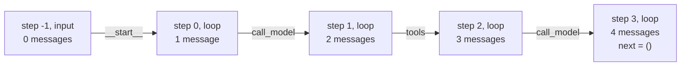
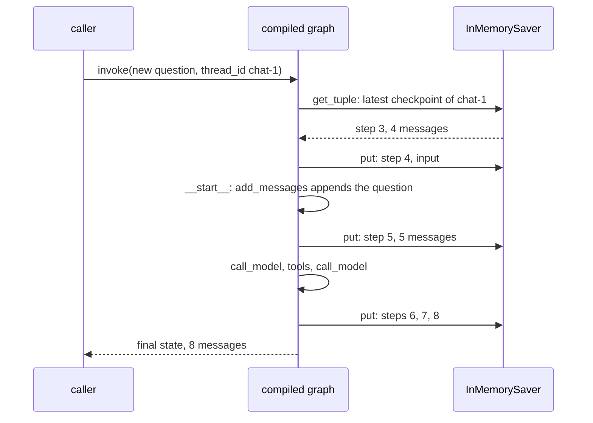

# 5.1 Checkpointers and Threads

## The problem

Lesson 4.1 ran a two-turn conversation by having the caller carry the history. After the first `invoke`, the program took `result["messages"]` and passed all of it back in, followed by the new question. The graph remembered nothing. Each `invoke` started from empty state, and whatever was not in the input simply did not exist.

That works in a script. It breaks down in a real application:

- **Many conversations at once.** A chat service talks to many users. Someone has to keep each conversation, find the right one for each request and never mix them up.
- **Long runs that fail.** An agent loop can take many steps and many model calls. If step 7 raises an exception, `invoke` returns nothing, and lesson 1.3 showed that the run's work is lost.
- **Pausing.** Module 6 stops a run halfway to ask a human, then continues it later, maybe in another request. That only works if the run's state is saved somewhere outside the Python call stack.

All three need the same thing: the graph saves its own state as it runs, under a name for the conversation, and picks it up again from there. In LangGraph that is the job of a checkpointer.

## The concept

### Checkpoints

A [checkpoint](../../../GLOSSARY.md#checkpoint) is a saved snapshot of a graph run between two steps. It holds three things:

- the **values** of every state channel, here the `messages` list,
- what runs **next**, the nodes scheduled for the following super-step (empty when the run is over),
- **metadata**, such as the step number and the reason the checkpoint was written.

You already know where the run pauses between steps: the [super-step](../../../GLOSSARY.md#super-step) boundary from lesson 1.3. All nodes of a super-step run, their updates are applied through the reducers, and only then does the next super-step begin. That boundary is the one moment when the state is complete and consistent, and it is where LangGraph writes a checkpoint. The official checkpointers guide puts it simply: a checkpoint is created at each super-step boundary.

### Checkpointers

A [checkpointer](../../../GLOSSARY.md#checkpointer) is the object that stores checkpoints and reads them back. You hand it to the graph once, at compile time:

```python
graph = builder.compile(checkpointer=InMemorySaver())
```

From then on the graph saves a checkpoint after every super-step and, at the start of each run, loads the latest saved one. Your nodes never see the checkpointer: they still receive a state and return an update.

Every checkpointer implements [BaseCheckpointSaver](../../../GLOSSARY.md#basecheckpointsaver) from `langgraph.checkpoint.base`. Its core methods are `put` (save a checkpoint), `put_writes` (save the writes of single tasks), `get_tuple` (fetch one checkpoint) and `list` (iterate over checkpoints), each with an async twin. The graph only talks to that interface, so the storage behind it can be swapped:

| Checkpointer | Package | Where it stores | Lesson |
|---|---|---|---|
| [InMemorySaver](../../../GLOSSARY.md#inmemorysaver) | `langgraph-checkpoint` | a dict inside the Python object | this one |
| `SqliteSaver` | `langgraph-checkpoint-sqlite` | a SQLite file | 5.2 |
| `PostgresSaver` | `langgraph-checkpoint-postgres` | a Postgres database | 5.6 |

`InMemorySaver` is meant for experiments and tests. Its docstring says to use it only for debugging or testing and recommends `PostgresSaver` for production. Keep in mind that everything it holds is gone when the process exits.

### Threads

A checkpointer stores the checkpoints of many conversations side by side. The conversation, called a *thread*, is chosen per run by the [thread_id](../../../GLOSSARY.md#thread_id) in the run's config:

```python
config = {"configurable": {"thread_id": "chat-1"}}
graph.invoke({"messages": [HumanMessage("What is 3 + 4?")]}, config)
```

This is the [run config](../../../GLOSSARY.md#run-config) from lesson 2.4. The `thread_id` is any string you choose: a user id, a chat id, a uuid. The guide calls it the primary key for storing and retrieving checkpoints. There is no "create thread" call. A thread exists as soon as its first checkpoint is saved, and an unknown thread_id simply starts from empty state.

The mental model to keep: **the graph is the program, the thread is the data.** One compiled graph serves every thread, and it holds no conversation data itself. A run is "the graph, applied to the latest checkpoint of one thread". Same thread_id, same history. Different thread_id, a blank page.

### Reading the state back

[get_state](../../../GLOSSARY.md#get_state) reads the latest checkpoint of a thread without running anything:

```python
snapshot = graph.get_state({"configurable": {"thread_id": "chat-1"}})
```

It returns a [StateSnapshot](../../../GLOSSARY.md#statesnapshot), a `NamedTuple` from `langgraph.types` with eight fields:

| Field | What it holds |
|---|---|
| `values` | the state channels at this checkpoint, for example `{"messages": [...]}` |
| `next` | a tuple of the nodes that run next; `()` means the run finished |
| `config` | the address of this checkpoint: `thread_id`, `checkpoint_ns` and `checkpoint_id` |
| `metadata` | `step`, `source` and `parents` |
| `created_at` | an ISO timestamp |
| `parent_config` | the address of the checkpoint saved just before this one, or `None` for the first |
| `tasks` | the tasks of the next step; a task that already failed carries its error |
| `interrupts` | pending interrupts (module 6) |

`metadata["source"]` says why the checkpoint was written. This lesson sees two values: `"input"` for the checkpoint a run writes before applying its input, and `"loop"` for the one at the end of each super-step. (`"update"` and `"fork"` come from editing state and time travel, lesson 6.5.)

## How it works

### When checkpoints are written

One run writes one checkpoint before its first step and one after each super-step. The diagram follows turn 1 of the lesson's run: the boxes are checkpoints, the arrows are the super-steps that run between them.



- **step -1, `input`.** The run has received its input and saved it, but in an internal `__start__` channel, not yet in `messages`. That is why it shows 0 messages and `next` is `__start__`.
- **step 0, `loop`.** The `__start__` step ran: the input went through the `add_messages` reducer into `messages`. Next is `call_model`.
- **steps 1 to 3, `loop`.** One checkpoint after each node run of the [agent loop](../../../GLOSSARY.md#agent-loop) from lesson 4.2. The last has nothing next: the run is over.

The official guide describes the same pattern for a two-node graph: an empty checkpoint, one with the input, then one per node.

### A second run on the same thread

When a run starts, the graph asks the checkpointer for the thread's latest checkpoint and restores the channels from it. The input is then applied *on top* of that state, through the reducers, exactly like a node's update. With [MessagesState](../../../GLOSSARY.md#messagesstate) that means [add_messages](../../../GLOSSARY.md#add_messages) appends the new question to the saved history.



Two consequences follow. First, `invoke` returns the whole state of the thread, not just this turn's messages. Second, the step counter in the metadata continues across runs: turn 2 starts at step 4. The [recursion_limit](../../../GLOSSARY.md#recursion_limit) still counts per call, as lesson 1.3 pointed out, so a long thread doesn't run out of steps.

## In our example

The example is a compact copy of the calculator agent from [lesson 4.2](../../../4-agents/4.2-tool-calling-loop/docs/notes.md): the same tools, the same scripted model, the same graph `START -> call_model -> (tools -> call_model)* -> END`. Only the checkpointer is new. The [code walkthrough](readalong.md) goes through every line; here we map the concepts onto the code.

### The checkpointer is a parameter

<!-- snippet: src/l5_1_checkpointers_and_threads/chatbot.py#build_graph -->
```python
def build_graph(
    model: BaseChatModel, checkpointer: BaseCheckpointSaver | None
) -> CompiledStateGraph:
    """Compile the agent loop START -> call_model -> (tools -> call_model)* -> END.

    call_model asks the model; if its reply has tool calls, tools_condition
    routes to the "tools" node, which runs them and loops back to call_model.
    A reply without tool calls routes to END. With a checkpointer, the graph
    saves its state after every super-step under the thread_id of the run's
    config, and the next invoke on that thread continues from it. With
    ``None`` the graph forgets everything between invokes, as in 4.2.
    """
    # Tell the model which tools exist, once. A real model now includes their
    # schemas in every request; the fake returns itself.
    model_with_tools = model.bind_tools(TOOLS)

    def call_model(state: MessagesState) -> dict:
        """Send the conversation to the model and return only its reply."""
        # The system message is built for this call only; it is NOT stored in state.
        reply = model_with_tools.invoke([SystemMessage(SYSTEM_PROMPT)] + state["messages"])
        # Return just the new message: the add_messages reducer on
        # MessagesState appends it to the existing history.
        return {"messages": [reply]}


    # MessagesState has one key, "messages", reduced by add_messages.
    builder = StateGraph(MessagesState)
    builder.add_node("call_model", call_model)
    # ToolNode runs every tool call of the last AIMessage and returns one
    # ToolMessage per call, with tool_call_id set to the call's id. The node
    # must be named "tools": that is the name tools_condition returns.
    builder.add_node("tools", ToolNode(TOOLS))
    builder.add_edge(START, "call_model")
    # tools_condition returns "tools" if the last message has tool calls,
    # otherwise "__end__" (END). This replaces 4.1's call_model -> END edge.
    builder.add_conditional_edges("call_model", tools_condition)
    # The back edge makes it a loop (ReAct): act, observe, think again.
    builder.add_edge("tools", "call_model")
    # The only change from 4.2. The checkpointer saves the whole state after
    # every super-step, keyed by the thread_id in config["configurable"].
    # Every invoke on the same thread starts from that thread's latest
    # checkpoint, so its input is added to the saved history. None compiles
    # without persistence, as in 4.2.
    return builder.compile(checkpointer=checkpointer)
```
<!-- /snippet -->

Compared with 4.2, two things changed: the `checkpointer` parameter and the `compile(checkpointer=checkpointer)` call. The wiring and `call_model` are untouched. `call_model` still sends `state["messages"]` to the model, but that list now holds the whole thread, because the graph loaded it before the node ran. The node has no idea.

The type hint is `BaseCheckpointSaver | None`, so any saver fits, and `None` gives 4.2's forgetful graph. The saver itself is created in [\_\_main\_\_.py](../src/l5_1_checkpointers_and_threads/__main__.py), once per process: `checkpointer = InMemorySaver()`. Lesson 5.2 changes only that line.

`main` builds one graph and two configs, `chat1` and `chat2`, that differ only in their `thread_id`. The fake model's script holds the replies of *all* runs, in call order, because one model object serves every `invoke` of the graph.

### Watching checkpoints being written

<!-- snippet: src/l5_1_checkpointers_and_threads/__main__.py#checkpoint_stream -->
```python
print("== Turn 1 in thread chat-1, one checkpoint at a time ==")
# stream_mode="checkpoints" emits one event each time a checkpoint is
# saved, in the same shape as get_state() (a dict here, with next as a
# list). The run writes an "input" checkpoint first (step -1: the input is
# not applied yet, next is ['__start__']), then one "loop" checkpoint at
# the end of every super-step: step 0 after the input is written into
# state, then one after each node run. A checkpoint = channel values +
# what runs next + metadata, saved under the thread.
last = None
for cp in graph.stream(
    {"messages": [HumanMessage("What is 3 + 4?")]}, chat1, stream_mode="checkpoints"
):
    md = cp["metadata"]
    n_messages = len(cp["values"].get("messages", []))
    print(
        f"  step {md['step']:>2}  {md['source']:<5}  messages={n_messages}  next={cp['next']}"
    )
    last = cp
# Without a checkpointer the stream emits no checkpoint events at all.
if last is not None:
    print("answer:", last["values"]["messages"][-1].content)
```
<!-- /snippet -->

`stream_mode="checkpoints"` emits one event each time a checkpoint is saved, in the same shape as `get_state()` returns, but as a dict. It is a debugging view: normally you would not stream checkpoints, but here it makes the moments in the first diagram visible. The `.get("messages", [])` is only a defensive default: `cp["values"]["messages"]` would work too. Even at step -1, `values` is `{'messages': []}`. The input still sits in the internal `__start__` channel, and the `messages` channel, which applies a reducer, starts out as an empty list.

### The same thread remembers, a new thread doesn't

<!-- snippet: src/l5_1_checkpointers_and_threads/__main__.py#same_thread -->
```python
print("== Turn 2 in the same thread ==")
# The input holds one message. The checkpointer loads the 4 messages of
# turn 1 first and add_messages appends the new one, so the model
# (call_model sends the whole state) sees the earlier turn. The fake model
# ignores its input; the state is what a real model would receive.
result = graph.invoke({"messages": [HumanMessage("Now multiply that by 2.")]}, chat1)
for m in result["messages"]:
    print(f"  {describe(m)}")
print(f"sent 1 message, the thread now holds {len(result['messages'])}")
```
<!-- /snippet -->

The input is a single message, "Now multiply that by 2." On its own it is meaningless: multiply *what*? With `chat1`, the graph first loads the four messages of turn 1, so the history a real model would receive contains the 7 it needs.

<!-- snippet: src/l5_1_checkpointers_and_threads/__main__.py#new_thread -->
```python
print("== The same follow-up in a new thread chat-2 ==")
# A new thread_id starts from empty state: nothing from chat-1 is visible.
result = graph.invoke({"messages": [HumanMessage("Now multiply that by 2.")]}, chat2)
for m in result["messages"]:
    print(f"  {describe(m)}")
```
<!-- /snippet -->

The same input on `chat2` starts from nothing. Same graph, same saver, different key.

### Inspecting the saved state

<!-- snippet: src/l5_1_checkpointers_and_threads/__main__.py#inspect_state -->
```python
print("== get_state(chat-1) ==")
# get_state reads the latest checkpoint of the thread as a StateSnapshot.
snap = graph.get_state(chat1)
print(f"  type: {type(snap).__name__}")
messages = snap.values["messages"]
print(f"  values: {len(messages)} messages, last: {messages[-1].content!r}")
# next == () means the run finished: no node is waiting to run.
print(f"  next: {snap.next}")
# The config points at this exact checkpoint. checkpoint_id is a
# time-based uuid, so print only whether it is set.
conf = snap.config["configurable"]
print(
    f"  config: thread_id={conf['thread_id']!r} checkpoint_ns={conf['checkpoint_ns']!r}"
    f" checkpoint_id set: {bool(conf['checkpoint_id'])}"
)
# step continues across turns: turn 2 wrote steps 4..8, with step 4 as its
# "input" checkpoint. (metadata also holds parents; the snapshot has a
# created_at timestamp, which changes per run, so it is not printed.)
print(f"  metadata: step={snap.metadata['step']} source={snap.metadata['source']!r}")
# parent_config points at the checkpoint saved just before this one.
print(f"  has parent checkpoint: {snap.parent_config is not None}")
# checkpointer.list is the saver's own read API, newest first.
# graph.get_state_history reads the same data (lesson 6.5).
n1 = len(list(checkpointer.list(chat1)))
n2 = len(list(checkpointer.list(chat2)))
print(f"  checkpoints saved: chat-1 = {n1}  chat-2 = {n2}")
# A thread that never ran has no checkpoint: empty values, nothing next.
unused = graph.get_state({"configurable": {"thread_id": "chat-3"}})
print(f"  unused thread chat-3: values = {unused.values}  next = {unused.next}")
```
<!-- /snippet -->

This section reads the fields of the `StateSnapshot`. Two details: `checkpoint_id` is a time-based uuid that changes on every run, so the program only prints whether it is set; and `checkpointer.list(config)` is the saver's own read method, used here to count the checkpoints of each thread. (`graph.get_state_history` reads the same data as snapshots; that is lesson 6.5.)

## Run it

From the course root, run `./run.sh 5.1`. This is the output of the verified run:

```text
== Turn 1 in thread chat-1, one checkpoint at a time ==
  step -1  input  messages=0  next=['__start__']
  step  0  loop   messages=1  next=['call_model']
  step  1  loop   messages=2  next=['tools']
  step  2  loop   messages=3  next=['call_model']
  step  3  loop   messages=4  next=[]
answer: 3 + 4 is 7.

== Turn 2 in the same thread ==
  HumanMessage: What is 3 + 4?
  AIMessage asks for add(a=3, b=4) [call_1]
  ToolMessage [call_1] add = 7
  AIMessage: 3 + 4 is 7.
  HumanMessage: Now multiply that by 2.
  AIMessage asks for multiply(a=7, b=2) [call_2]
  ToolMessage [call_2] multiply = 14
  AIMessage: 7 * 2 is 14.
sent 1 message, the thread now holds 8

== The same follow-up in a new thread chat-2 ==
  HumanMessage: Now multiply that by 2.
  AIMessage: Multiply what? This conversation has no earlier result.

== get_state(chat-1) ==
  type: StateSnapshot
  values: 8 messages, last: '7 * 2 is 14.'
  next: ()
  config: thread_id='chat-1' checkpoint_ns='' checkpoint_id set: True
  metadata: step=8 source='loop'
  has parent checkpoint: True
  checkpoints saved: chat-1 = 10  chat-2 = 3
  unused thread chat-3: values = {}  next = ()
```

The model is scripted and the program prints no ids or timestamps, so every run prints exactly this. What to notice:

- **Five checkpoints for a three-node run.** One `input` checkpoint, then one `loop` checkpoint per super-step: `__start__`, `call_model`, `tools`, `call_model`. `next` names the node that runs from each checkpoint, so you can read the agent loop straight off this column.
- **One message in, eight out.** Turn 2 sent one `HumanMessage` and got back the whole thread. Turn 1's four messages came from the checkpointer, not from the caller. That is the difference from lesson 4.1.
- **Threads don't leak.** `chat-2` got the identical question and saw only that question. The scripted reply plays what a real model would have to say with no earlier result to refer to.
- **The step counter is per thread.** `get_state(chat-1)` reports `step=8`, not 3: turn 2 wrote steps 4 to 8. The ten saved checkpoints of `chat-1` are five per turn. `chat-2` has three: `input`, step 0 and one `call_model` step.
- **`next: ()` means done.** No node is waiting in `chat-1`. After a crash you will see a node name here instead (fourth experiment).
- **An unknown thread is not an error.** `chat-3` never ran, and `get_state` returns an empty snapshot rather than raising.
- **Lists in the stream, tuples in the snapshot.** The stream events show `next` as a list, `get_state` as a tuple. Same information, different container.

## Details and edge cases

**What a checkpoint does not contain.** Only state channels are saved. `SYSTEM_PROMPT` is added inside `call_model` on every call, so it appears in no checkpoint. The model, the tools and the graph's structure aren't saved either: they come from your code on each run. If you change the code between two runs of a thread, the saved state meets the new code.

**`checkpoint_ns` is empty for the top-level graph.** The namespace separates the checkpoints of subgraphs from those of their parent graph (module 8). For a graph without subgraphs it is always `''`.

**Failed runs keep their progress.** Each finished super-step is saved, so an exception in step 2 leaves the checkpoint of step 1 in place. `get_state` then shows `next == ("tools",)`, the node that did not finish, and the failed task in `tasks` with its error. That error has passed through the checkpointer's serializer, which stores an exception as its `repr`, so `tasks[0].error` is the *string* `"ZeroDivisionError('division by zero')"`, not an exception object. The guide adds a finer point for graphs with parallel nodes: when one node of a super-step fails, the writes of the nodes that succeeded in that step are saved as pending writes (`put_writes`), so a resumed run doesn't repeat them.

**Saving every step is the default, not the only option.** By default (`durability="async"`) each checkpoint is persisted in the background while the next step runs. `"sync"` waits for the save before the next step, and `"exit"` saves only when the run ends. The fifth experiment peeks at `"exit"`; lesson 5.2 compares the three. `stream_mode="checkpoints"` shows every checkpoint the run creates, whatever the durability mode decides to store.

**One model, many runs.** The scripted fake reads its replies from one iterator. A real model is stateless, so this is a quirk of the fake: the script must contain the replies for every turn and every thread, in the order the model is called. If it runs out, the run fails with `RuntimeError: generator raised StopIteration`, and the thread keeps the checkpoint taken before the failed `call_model`.

**Threads grow forever.** A checkpointer never forgets on its own. Each turn adds checkpoints, and each checkpoint holds the full message list, so long threads cost memory (or disk) and send ever longer histories to the model. Lesson 5.3 trims and summarizes the message history. The persistence guide's troubleshooting section also recommends pruning old checkpoints.

**Checkpointers are per thread; stores are across threads.** A checkpointer remembers *one conversation*. Facts that should survive into every future conversation of a user, such as their name or preferences, belong in a store, lesson 5.4.

## Common mistakes

> [!WARNING]
> **Creating the checkpointer per request.** `build_graph(model, InMemorySaver())` inside a request handler gives every request a new, empty saver. The thread_id is only a key *into* a saver, so the history is gone on every call, and no error tells you why. Create the saver once per process (second experiment).

> [!WARNING]
> **Forgetting the config.** On a checkpointed graph, `graph.invoke(input)` without a config fails with `ValueError: Checkpointer requires one or more of the following 'configurable' keys: thread_id, checkpoint_ns, checkpoint_id`. There is no default thread (first experiment).

> [!WARNING]
> **One fixed thread_id for everyone.** The opposite mistake: hard-coding `{"thread_id": "1"}` makes the error go away, and then every user writes into the same conversation. Derive the thread_id from the conversation you are serving, such as a chat id from the request.

> [!WARNING]
> **Expecting `InMemorySaver` to survive a restart.** It keeps everything in the Python object. A new process, or a new `InMemorySaver()`, starts empty. Use `SqliteSaver` (lesson 5.2) or `PostgresSaver` (lesson 5.6) for anything that must outlive the process.

> [!WARNING]
> **Treating `tasks[...].error` as an exception.** After a failed run, the error in the snapshot is the saved `repr` string. `isinstance(snap.tasks[0].error, ZeroDivisionError)` is `False`, and `raise snap.tasks[0].error` fails with a `TypeError`. Compare strings, or catch the real exception around `invoke`.

> [!NOTE]
> Older tutorials, including the LangChain Academy notebooks, write `MemorySaver`. In langgraph-checkpoint 4.3.0 that is just a backwards-compatible alias, `MemorySaver = InMemorySaver`. It still works, but `InMemorySaver` is the current name.

> [!WARNING]
> Only pass `durability=` to a graph that has a checkpointer. Without one, LangGraph warns that the setting has no effect, and `durability="sync"` currently crashes the run with `AttributeError: 'SyncPregelLoop' object has no attribute '_put_checkpoint_fut'` before any node runs ([langgraph issue #9267](https://github.com/langchain-ai/langgraph/issues/9267), open at the time of writing).

## Experiments

Each experiment starts from the lesson's original code. Make the change in [\_\_main\_\_.py](../src/l5_1_checkpointers_and_threads/__main__.py), run `./run.sh 5.1` from the course root, and guess the result before you open the explanation.

1. Forget the thread_id: in section `same_thread`, call `graph.invoke({"messages": [HumanMessage("Now multiply that by 2.")]})` without `chat1`.

   <details><summary>What happens and why</summary>

   Turn 1 prints as before, then the program stops at the heading of turn 2 with `ValueError: Checkpointer requires one or more of the following 'configurable' keys: thread_id, checkpoint_ns, checkpoint_id`. The check happens before the run starts, so nothing is written. With a checkpointer, every run has to say which thread it belongs to; LangGraph will not guess. Put the code back as it was (`git checkout -- .` in the lesson directory).

   </details>

2. Create the checkpointer in the wrong place. In `main`, replace `graph = build_graph(make_model(script), checkpointer)` with two lines, `model = make_model(script)` and `graph = build_graph(model, checkpointer)`. Then add `graph = build_graph(model, InMemorySaver())` as the first line inside `# region same_thread`, so turns 2 and later use a second graph with its own, new saver.

   <details><summary>What happens and why</summary>

   Turn 1 is unchanged. Turn 2 prints only its own four messages, starting with `HumanMessage: Now multiply that by 2.`, and ends with `sent 1 message, the thread now holds 4`. `get_state(chat-1)` on the second graph shows 4 messages and `step=3`, and the counts read `chat-1 = 5  chat-2 = 0`: the five checkpoints of turn 1 sit in the first saver, which the second graph never sees.

   Same thread_id, different saver, no history. The thread_id is only a key, and `InMemorySaver` keeps its data inside the object. This is what happens when a web handler creates the saver per request. Put the code back as it was.

   </details>

3. Compile without persistence: pass `None` instead of `checkpointer` to `build_graph`.

   <details><summary>What happens and why</summary>

   Section `checkpoint_stream` prints its heading and nothing else: without a checkpointer, `stream_mode="checkpoints"` emits no events, so not even the `answer:` line appears. Turn 2 holds only its own 4 messages, and `chat-2` its 2. Then `get_state` raises `ValueError: No checkpointer set`. This is the behaviour of lessons 4.1 and 4.2, where the caller had to carry the history. Put the code back as it was.

   </details>

4. Break a run halfway. Add `tool_call("divide", "call_9", a=1, b=0)` as the last entry of `script`. At the end of section `inspect_state`, run the graph on a new thread and look at its state:

   ```python
   chatx: RunnableConfig = {"configurable": {"thread_id": "chat-x"}}
   try:
       graph.invoke({"messages": [HumanMessage("What is 1 / 0?")]}, chatx)
   except ZeroDivisionError as e:
       print("caught:", repr(e))
   s = graph.get_state(chatx)
   print(len(s.values["messages"]), s.next, s.metadata["step"], s.tasks[0].name, repr(s.tasks[0].error))
   ```

   <details><summary>What happens and why</summary>

   The program prints `caught: ZeroDivisionError('division by zero')` and then `2 ('tools',) 1 tools "ZeroDivisionError('division by zero')"`. The question and the model's tool call (2 messages) were saved at step 1, after `call_model`. The `tools` step raised, so its checkpoint was never written, and `next` still names `tools`: the snapshot says exactly where the run stopped. The task's error is a string, the `repr` the serializer stored. This saved progress is what human-in-the-loop (module 6) and fault tolerance build on. Put the code back as it was.

   </details>

5. Peek at durability: add `durability="exit"` to the `graph.stream(...)` call in section `checkpoint_stream`.

   <details><summary>What happens and why</summary>

   The same five checkpoint lines print, and everything else is identical, except `checkpoints saved: chat-1 = 6  chat-2 = 3`. With `"exit"`, turn 1 stores only its final checkpoint; turn 2 and `chat-2` still use the default and store all of theirs ($1 + 5 = 6$). The stream shows every checkpoint the run creates; the durability mode decides which of them reach the saver. The trade-off is safety: with `"exit"`, a crash in the middle of a run leaves nothing of that run behind. Lesson 5.2 compares `exit`, `async` and `sync`. Put the code back as it was.

   </details>

## Summary

- A checkpoint is the state of a run at a super-step boundary: channel values, what runs next and metadata. A run writes an `input` checkpoint first, then a `loop` checkpoint after every super-step.
- `compile(checkpointer=...)` makes the graph save checkpoints and load the latest one at the start of each run. Nodes don't change.
- The `thread_id` in `config["configurable"]` names the conversation. Same thread_id, same history; a new thread_id starts empty. On a checkpointed graph, it is required.
- A new run applies its input on top of the saved state through the reducers, so with `add_messages` you send only the new message, and `invoke` returns the whole thread.
- `get_state(config)` returns a `StateSnapshot` of the latest checkpoint: `values`, `next` (`()` when finished), `config`, `metadata`, `parent_config`, `tasks` and more.
- `InMemorySaver` lives in the Python object: create it once per process, and use a database saver when state must outlive the process.

## Self-check

1. A graph with a checkpointer runs `START -> a -> b -> END` once on a new thread. How many checkpoints does the thread have afterwards, and what are their `source` values?

   <details><summary>Answer</summary>

   Four: an `input` checkpoint at step -1, then `loop` checkpoints at step 0 (after `__start__` applied the input), step 1 (after `a`) and step 2 (after `b`). The last one has `next == ()`.

   </details>

2. Thread `t` holds 6 messages. You call `graph.invoke({"messages": [HumanMessage("hi")]}, {"configurable": {"thread_id": "t"}})` on a `MessagesState` graph whose model node adds one reply. How many messages does the result have, and why?

   <details><summary>Answer</summary>

   Eight. The graph loads the 6 saved messages, `add_messages` appends the new question during the `__start__` step, and the model node appends its reply. `invoke` returns the whole state of the thread, not just this turn.

   </details>

3. Your web app builds the graph with `InMemorySaver()` inside the request handler and passes the user's chat id as `thread_id`. Users complain that the bot forgets everything between messages. What is wrong?

   <details><summary>Answer</summary>

   Every request creates a new, empty saver, so every run finds no checkpoint under that thread_id. Create the saver (and the graph) once per process and reuse it; for restarts or several processes, use a persistent saver such as `SqliteSaver` or `PostgresSaver`.

   </details>

4. After a failed run, `get_state` shows `next == ("tools",)`. What does that tell you, and what type is `snapshot.tasks[0].error`?

   <details><summary>Answer</summary>

   The run stopped before the `tools` step finished: the latest checkpoint is the one saved after the previous step, and `tools` is still scheduled. `tasks[0].error` is a string, the `repr` of the exception (for example `"ZeroDivisionError('division by zero')"`), because the error went through the checkpointer's serializer.

   </details>

5. Why does `get_state` on a finished turn 2 report `metadata["step"] == 8`, while the run used only a few super-steps, and does this affect `recursion_limit`?

   <details><summary>Answer</summary>

   The step number continues across the runs of a thread: turn 1 wrote steps -1 to 3, turn 2 wrote steps 4 to 8. `recursion_limit` counts the super-steps of each call separately, so a long thread does not run out of steps.

   </details>

## Further reading

- [Persistence](https://docs.langchain.com/oss/python/langgraph/persistence), LangGraph docs: checkpointers versus stores, and troubleshooting notes (in-memory savers lost on restart, checkpoint growth).
- [Checkpointers](https://docs.langchain.com/oss/python/langgraph/checkpointers), LangGraph docs: threads, when checkpoints are created, the `StateSnapshot` fields, the saver interface, pending writes and serializers.
- [`InMemorySaver` source](https://github.com/langchain-ai/langgraph/blob/1.2.16/libs/checkpoint/langgraph/checkpoint/memory/__init__.py) at tag 1.2.16 (langgraph-checkpoint 4.3.0): the nested `thread ID -> namespace -> checkpoint ID` storage and the `MemorySaver` alias.
- [`langgraph/types.py`](https://github.com/langchain-ai/langgraph/blob/1.2.16/libs/langgraph/langgraph/types.py) at tag 1.2.16: `StateSnapshot`, the stream modes and the durability modes.
- [langgraph issue #9267](https://github.com/langchain-ai/langgraph/issues/9267): `durability="sync"` on a graph without a checkpointer.
