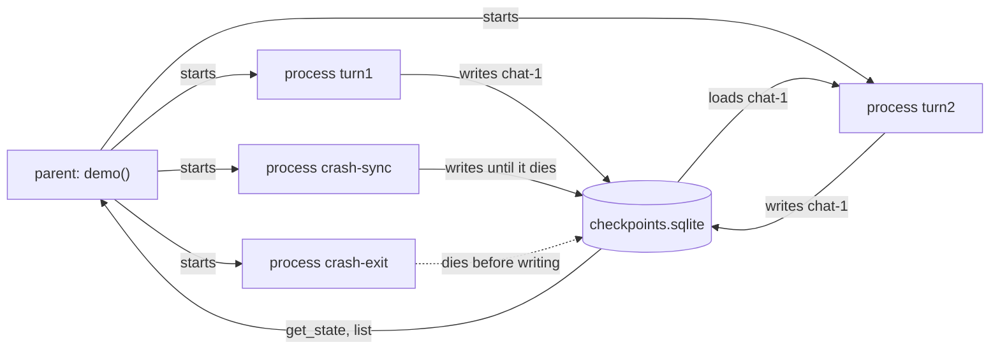

# 5.2 Durable Checkpoints with SQLite

## The problem

Lesson 5.1 gave the calculator agent a memory. With a [checkpointer](../../../GLOSSARY.md#checkpointer) compiled into the graph, turn 2 of a conversation found turn 1's messages under the same [thread_id](../../../GLOSSARY.md#thread_id), and the caller sent only the new question.

That memory had a weak spot, and 5.1 named it: [InMemorySaver](../../../GLOSSARY.md#inmemorysaver) keeps every [checkpoint](../../../GLOSSARY.md#checkpoint) in a dict inside the Python object. The checkpoints are gone as soon as the process ends. In a real application, processes end all the time:

- **Restarts.** You deploy a new version, the server restarts, and every open conversation is gone.
- **Several processes.** A web server often runs several worker processes. Turn 1 of a chat may land on worker A and turn 2 on worker B. B's saver has never seen the conversation.
- **Crashes.** A process can be killed halfway through an agent run: out of memory, a container stopped, a power cut. Lesson 5.1 showed that a failed run keeps its finished steps, but only while the process that holds the saver is alive.

So the checkpoints have to live outside the process, in storage that the next process can open. The simplest such storage is a file. This lesson keeps the agent's threads in a SQLite file and checks two things: whether a new process can continue a conversation, and what is left on disk when a process dies in the middle of a turn.

## The concept

### A checkpointer backed by a file

[SqliteSaver](../../../GLOSSARY.md#sqlitesaver) is a checkpointer that stores checkpoints in a SQLite database. Like `InMemorySaver`, it implements [BaseCheckpointSaver](../../../GLOSSARY.md#basecheckpointsaver), with the same `put`, `put_writes`, `get_tuple` and `list` methods. The difference is where the data goes: two tables in a database file, `checkpoints` (one row per checkpoint) and `writes` (the outputs of single tasks).

Since the graph only talks to the `BaseCheckpointSaver` interface, nothing else changes. Nodes, edges, the state schema, `invoke` and [get_state](../../../GLOSSARY.md#get_state) all work as in 5.1. What you gain is that a thread now outlives the process that wrote it.

`SqliteSaver` is in its own package, `langgraph-checkpoint-sqlite` (3.1.2 here), which `langgraph` does not install. The official checkpointers guide calls SQLite ideal for experimentation and local workflows, and the class docstring describes it as meant for lightweight, synchronous use: demos and small projects. For a production service with many concurrent writers, the guide recommends Postgres (lesson 5.6).

### Opening the saver: from_conn_string

A saver needs an open `sqlite3` connection. The usual way to get one is the classmethod [from_conn_string](../../../GLOSSARY.md#from_conn_string), which is a context manager:

```python
with SqliteSaver.from_conn_string("checkpoints.sqlite") as checkpointer:
    graph = builder.compile(checkpointer=checkpointer)
    graph.invoke(..., config)
# the connection is closed here
```

On entry it opens the file with `sqlite3.connect(path, check_same_thread=False)` and yields a saver that uses that connection. When the block ends, it closes the connection. Three consequences:

- **Use the graph inside the block.** After the block, the saver's connection is closed and any `invoke` or `get_state` on that graph fails.
- **No setup step.** The first time the saver touches the database, it creates both tables (`CREATE TABLE IF NOT EXISTS`) and switches the file to SQLite's write-ahead log (WAL) mode. A path that doesn't exist yet becomes a new, empty database.
- **`check_same_thread=False` is required.** LangGraph hands checkpoint writes to a background thread, so the saver is used from a thread other than the one that opened the connection. (A step with a single task, which is every step in this lesson, runs on the calling thread; only the writes move.) By default, Python's `sqlite3` refuses to use a connection from any thread except the one that created it. `SqliteSaver` puts a lock around the connection so that only one thread uses it at a time, which makes turning that check off safe.

The special path `":memory:"` gives a SQLite database that lives in memory and dies with its connection. It is handy in tests, but across processes it is no better than `InMemorySaver`.

### The thread_id is the address

In 5.1, the thread_id chose a conversation inside one saver object. With a file, it is the only way for a *new process* to find the conversation again. Process 2 knows nothing about process 1 except the file path and the thread_id. If it uses another thread_id, it starts from an empty thread, even though the old conversation is still in the file.

So a real application stores the thread_id somewhere: with the user's session, in a chat table, in a cookie. Generating a fresh `uuid4()` in each process, or on each request, silently starts a new conversation every time.

`SqliteSaver` stores the thread_id in a `TEXT` column and converts it with `str()` before every query. The int `1` and the string `"1"` therefore address the same thread.

### When checkpoints reach the disk: durability modes

A run creates one checkpoint before its first step and one after each [super-step](../../../GLOSSARY.md#super-step). The [durability mode](../../../GLOSSARY.md#durability-mode) decides when these checkpoints are handed to the saver. You choose it per call, as an argument of `invoke` or `stream`:

```python
graph.invoke(inputs, config, durability="sync")
```

| Mode | When checkpoints are written | Cost | After a hard crash |
|---|---|---|---|
| `"sync"` | each one before the next step starts | every step waits for its write | every finished step is on disk |
| `"async"` (default) | in the background while the next step runs | writes overlap with work | the newest checkpoints may be lost; how many varies |
| `"exit"` | only once, when the run ends | one write per run | nothing of this run |

The official guide lists them from least to most durable: `exit`, `async`, `sync`. More safety costs more waiting. `"exit"` is the fastest for long runs, but it gives up recovery from a crash in the middle of a run. `"async"` is the compromise, and the guide is honest about it: there is a small risk that checkpoints are not written if the process crashes during the run.

The final state is the same in all three modes. When a turn finishes normally, the thread ends up with the same messages. The only differences are how many of the intermediate checkpoints were stored and when.

### What a checkpoint can hold

Every checkpoint passes through the saver's serializer, `checkpointer.serde`. By default this is [JsonPlusSerializer](../../../GLOSSARY.md#jsonplusserializer), which encodes values with msgpack. It knows LangChain messages, primitives, lists and dicts, `datetime`, `UUID`, enums, sets, dataclasses and Pydantic models. Anything else, such as an API client, a database connection or an open file, raises `TypeError: Type is not msgpack serializable: ...` when the checkpoint is written.

That is not specific to SQLite: `InMemorySaver` uses the same serializer. With a file, though, a second rule matters. A checkpoint is read back in *another* process, so every custom class it names must be importable there too.

## How it works

The demo runs every step in its own Python process. The parent creates a temporary database file and starts the children one after another. The diagram shows the only thing they share.



The two crash processes run the same turn as `turn1`: the model asks for `add(3, 4)`, the tool answers 7, and then the second model call kills the process. Up to that moment, the run has created the checkpoints of four steps. The table follows them under each durability mode.

| Checkpoint | Content | `"sync"` | `"exit"` |
|---|---|---|---|
| step -1, input | input not applied yet | on disk | not written |
| step 0 | the question | on disk | not written |
| step 1, after `call_model` | question, tool call | on disk | not written |
| step 2, after `tools` | question, tool call, tool result | on disk | not written |
| step 3, after `call_model` | the process dies inside this step | never created | never created |

With `"sync"`, step 2's checkpoint was written before step 3 started, so it is safe. Its `next` is `('call_model',)`: the saved thread says exactly where the run was cut off. With `"exit"`, the one write was planned for the end of the run, and the run never ended.

The demo kills the process with `os._exit(1)`, not with an exception, and that difference matters. When a node raises an ordinary exception, the exception travels up through LangGraph's run loop, and the loop still saves the run's last checkpoint on the way out, even with `"exit"`. Only a process that dies outright, like `kill -9`, gives LangGraph no chance to write anything.

## In our example

The example extends the calculator agent of [lesson 5.1](../../5.1-checkpointers-and-threads/docs/notes.md). [tools.py](../src/l5_2_sqlite_checkpointer/tools.py) and [chatbot.py](../src/l5_2_sqlite_checkpointer/chatbot.py) are copied unchanged. `build_graph` already took any `BaseCheckpointSaver`, so the switch to SQLite happens entirely in [\_\_main\_\_.py](../src/l5_2_sqlite_checkpointer/__main__.py). The [code walkthrough](readalong.md) goes through it line by line, starting with [what changed since 5.1](readalong.md#what-changed-since-lesson-51). Here we map the concepts onto it.

### One turn against the file

<!-- snippet: src/l5_2_sqlite_checkpointer/__main__.py#run_turn -->
```python
def run_turn(
    db_path: str,
    thread_id: str,
    question: str,
    script: Iterable[AIMessage],
    durability: Durability = "async",
) -> None:
    """Run one turn of a thread against the SQLite file and print what it holds.

    ``durability`` decides when checkpoints reach the file:

    - ``"async"`` (the default) writes each checkpoint in the background while
      the next step already runs.
    - ``"sync"`` waits until the checkpoint is written before the next step
      starts: the safest mode, but every step pays for a write.
    - ``"exit"`` writes only once, when the run ends: the cheapest mode, but a
      process that dies mid-run leaves nothing of that run.
    """
    # The thread_id is the only key to the saved conversation. A new process
    # can resume only if it knows the same thread_id, so a real app stores it
    # with the user or session (never a fresh uuid4 per process). SqliteSaver
    # stores it as TEXT (str(thread_id)), so 1 and "1" are the same thread.
    config: RunnableConfig = {"configurable": {"thread_id": thread_id}}

    # This `with` line is the one change from 5.1, where __main__ did
    # `checkpointer = InMemorySaver()`: build_graph takes any
    # BaseCheckpointSaver. from_conn_string is a @contextmanager. It opens
    # sqlite3.connect(db_path, check_same_thread=False) (langgraph writes
    # checkpoints from worker threads; SqliteSaver guards the connection with
    # a lock), yields a saver, and closes the connection when the block ends.
    # So the graph must be used inside the block.
    # The tables (checkpoints, writes) are created on first use: SQLite needs
    # no setup() call (its docstring says it is called automatically).
    # ":memory:" instead of a path gives a database that dies with the connection.
    with SqliteSaver.from_conn_string(db_path) as checkpointer:
        graph = build_graph(make_model(script), checkpointer)

        # What did this process find in the file before doing anything?
        saved = graph.get_state(config).values.get("messages", [])
        print(f"  loaded from the file: {len(saved)} messages", flush=True)

        # The input holds only the new question; add_messages appends it to
        # the messages loaded from the file.
        result = graph.invoke({"messages": [HumanMessage(question)]}, config, durability=durability)

        # Print only this turn's messages: the earlier ones are in the file.
        for m in result["messages"][len(saved) :]:
            print(f"  {describe(m)}")

        # checkpointer.list reads the saved checkpoints of the thread, newest first.
        n = len(list(checkpointer.list(config)))
        print(f"  the thread now holds {len(result['messages'])} messages in {n} checkpoints")
```
<!-- /snippet -->

Every child process runs `run_turn` once. The `with SqliteSaver.from_conn_string(db_path)` line replaces 5.1's `checkpointer = InMemorySaver()`, and everything that uses the graph sits inside the block. Before the turn, `get_state` reports what this process found in the file. That count is the proof that the thread survived the previous process. `durability` is passed to `invoke`, so the same graph can run one call in `"sync"` and the next in `"exit"`. At the end, `checkpointer.list(config)` counts the checkpoints this thread now has in the file.

### Two processes, one conversation

<!-- snippet: src/l5_2_sqlite_checkpointer/__main__.py#run_step -->
```python
def run_step(step: str, db_path: str) -> None:
    """Run one step of the demo in this (child) process.

    Each process builds its own model with only the replies of its own turn.
    In 5.1 one model and one script served both turns; here turn 2 runs in a
    process that never saw turn 1's script. The scripts are built inside this
    function because the fake model mutates the scripted messages.
    """
    match step:
        case "turn1":
            run_turn(
                db_path,
                "chat-1",
                "What is 3 + 4?",
                [tool_call("add", "call_1", a=3, b=4), AIMessage("3 + 4 is 7.")],
            )
        case "turn2":
            run_turn(
                db_path,
                "chat-1",
                "Now multiply that by 2.",
                [tool_call("multiply", "call_2", a=7, b=2), AIMessage("7 * 2 is 14.")],
            )
        case "crash-sync":
            run_turn(db_path, "crash-sync", "What is 3 + 4?", crash_script(), durability="sync")
        case "crash-exit":
            run_turn(db_path, "crash-exit", "What is 3 + 4?", crash_script(), durability="exit")
        case _:
            raise ValueError(f"unknown step {step!r}")


def run_process(step: str, db_path: str) -> int:
    """Run one step in a new Python process and return its exit code.

    This is a real new Python process, with no memory shared with the parent:
    only the SQLite file connects them. No check=True, because the crash steps
    exit with code 1. The child inherits stdout, so the header is flushed first
    to keep the output in order.
    """
    print(f"== process: {step} ==", flush=True)
    return subprocess.run([sys.executable, "-m", PACKAGE, step, db_path]).returncode
```
<!-- /snippet -->

`run_step` is the child side of the program. `turn1` and `turn2` use the same thread, `chat-1`. Each process builds its own model with only the replies of its own turn. In 5.1, one script held the replies of every turn, because one model object served the whole process. Here the turn 2 process never sees turn 1's script. It doesn't need to, because the history comes from the file.

`run_process` starts `python -m l5_2_sqlite_checkpointer <step> <db_path>` as a real new interpreter. It shares no objects with the parent, only the path to the file.

<!-- snippet: src/l5_2_sqlite_checkpointer/__main__.py#two_processes -->
```python
# Process 1 runs turn 1 and exits. Process 2 starts with the 4 messages
# process 1 saved, add_messages appends the new question, and the step
# counter and checkpoint list continue (10 checkpoints in the end).
run_process("turn1", db_path)
print()
run_process("turn2", db_path)
print()
```
<!-- /snippet -->

### Pulling the plug

<!-- snippet: src/l5_2_sqlite_checkpointer/__main__.py#crash_script -->
```python
def crash_script() -> Iterator[AIMessage]:
    """Yield one tool call, then kill the process on the second model call.

    This simulates pulling the plug: the process dies at once, with no
    exception, no ``finally`` blocks and no clean exit, like ``kill -9`` or a
    power cut. make_model accepts any iterable, including a generator, so the
    second model call runs the code after the ``yield``.
    """
    yield tool_call("add", "call_1", a=3, b=4)
    # os._exit drops buffered output, so flush what was printed so far.
    sys.stdout.flush()
    os._exit(1)
```
<!-- /snippet -->

`crash_script` is a generator that serves as the fake model's script. The first model call gets the tool call. The second call resumes the generator after the `yield` and runs `os._exit(1)`, which ends the process on the spot: no exception, no `finally` blocks, nothing queued gets written.

<!-- snippet: src/l5_2_sqlite_checkpointer/__main__.py#crash_demo -->
```python
# Two processes die halfway through a turn, one per durability mode.
for step in ("crash-sync", "crash-exit"):
    code = run_process(step, db_path)
    print(f"  the process died, exit code {code}")
    print()

# Now the parent opens the file and looks at what each crash left.
with SqliteSaver.from_conn_string(db_path) as checkpointer:
    # Only for get_state: the model is never called.
    graph = build_graph(make_model([]), checkpointer)
    print("== after the crashes ==")
    # With "sync", every checkpoint up to the last finished step was on
    # disk before the next step started: the thread holds the question,
    # the tool call and the tool result, and next=('call_model',) says
    # where to continue. With "exit", the process died before the run's
    # only write, so the thread does not exist.
    # "async" (not shown: its result varies from run to run) can lose
    # the newest checkpoints in a hard crash. An ordinary exception is
    # different: the run still exits through langgraph, and even "exit"
    # saves the final checkpoint then.
    for thread_id in ("crash-sync", "crash-exit"):
        snap = graph.get_state({"configurable": {"thread_id": thread_id}})
        n = len(snap.values.get("messages", []))
        step = snap.metadata["step"] if snap.metadata else None
        print(f"  {thread_id}: {n} messages  next={snap.next}  step={step}")
```
<!-- /snippet -->

After both crashes, the parent opens the file with a saver of its own and reads each crashed thread with `get_state`. The graph is built with an empty script because `get_state` never calls the model. A thread that was never saved is not an error: `get_state` returns empty `values`, `next=()` and `metadata=None`, which is why the code checks `snap.metadata` before it reads the step.

<!-- snippet: src/l5_2_sqlite_checkpointer/__main__.py#saved_threads -->
```python
print("== threads in the file ==")
# list(None) lists the checkpoints of every thread in the database.
# crash-exit is absent because nothing of it was saved.
counts = Counter(c.config["configurable"]["thread_id"] for c in checkpointer.list(None))
for thread_id, n in sorted(counts.items()):
    print(f"  {thread_id}: {n} checkpoints")
```
<!-- /snippet -->

`checkpointer.list(None)` lists the checkpoints of every thread in the database, not just one. Each item's `config` names its thread, so a `Counter` gives the checkpoints per thread.

### What the serializer accepts

<!-- snippet: src/l5_2_sqlite_checkpointer/__main__.py#serialization -->
```python
print("== what a checkpoint can hold ==")
# checkpointer.serde is the serializer that writes every checkpoint
# (JsonPlusSerializer, msgpack-based). It knows messages,
# primitives, dicts/lists, datetime, UUID, Enum, sets, dataclasses
# and pydantic models. Anything else fails with TypeError when the
# checkpoint is written, so state must hold data, not live objects.
# InMemorySaver serializes the same way.
# Custom classes (dataclasses, pydantic) are restored by import path
# in the process that loads them, so they must be importable there.
# langgraph-checkpoint 4.3.0 logs "Deserializing unregistered type
# ..." for them and blocks them under LANGGRAPH_STRICT_MSGPACK=true.
values = (
    HumanMessage("What is 3 + 4?"),
    datetime(2026, 1, 1, tzinfo=UTC),
    CalculatorClient(),
)
for value in values:
    try:
        kind, _ = checkpointer.serde.dumps_typed(value)
        print(f"  {type(value).__name__}: saved as {kind}")
    except TypeError as e:
        print(f"  {type(value).__name__}: TypeError: {e}")
```
<!-- /snippet -->

`checkpointer.serde.dumps_typed` is the call the saver makes for every value it stores. It returns a format tag and the bytes. A message and a `datetime` pass. `CalculatorClient`, a stand-in for a live object such as an API client, fails exactly as it would if a node put it into the state.

## Run it

From the course root, run `./run.sh 5.2`. This is the output of the verified run:

```text
== process: turn1 ==
  loaded from the file: 0 messages
  HumanMessage: What is 3 + 4?
  AIMessage asks for add(a=3, b=4) [call_1]
  ToolMessage [call_1] add = 7
  AIMessage: 3 + 4 is 7.
  the thread now holds 4 messages in 5 checkpoints

== process: turn2 ==
  loaded from the file: 4 messages
  HumanMessage: Now multiply that by 2.
  AIMessage asks for multiply(a=7, b=2) [call_2]
  ToolMessage [call_2] multiply = 14
  AIMessage: 7 * 2 is 14.
  the thread now holds 8 messages in 10 checkpoints

== process: crash-sync ==
  loaded from the file: 0 messages
  the process died, exit code 1

== process: crash-exit ==
  loaded from the file: 0 messages
  the process died, exit code 1

== after the crashes ==
  crash-sync: 3 messages  next=('call_model',)  step=2
  crash-exit: 0 messages  next=()  step=None

== threads in the file ==
  chat-1: 10 checkpoints
  crash-sync: 4 checkpoints

== what a checkpoint can hold ==
  HumanMessage: saved as msgpack
  datetime: saved as msgpack
  CalculatorClient: TypeError: Type is not msgpack serializable: CalculatorClient
```

The model is scripted and the database is a fresh file on every run, so every run prints exactly this. What to notice:

- **`loaded from the file: 4 messages`.** This is the whole lesson in one line. Process 2 is a new interpreter, and it found turn 1 in the file. With 5.1's `InMemorySaver` it would print 0.
- **The thread carries on as if nothing happened.** Process 2 sent one message and the thread holds 8, with 10 checkpoints: five per turn, as in 5.1. The step counter also continued from where process 1 stopped, because the new process started from the last saved checkpoint.
- **`crash-sync` stopped at a known point.** 3 messages (question, tool call, tool result), step 2, and `next=('call_model',)`. The run died inside the second `call_model`, and the file says exactly that.
- **`crash-exit` left nothing.** Not even the question was saved. Since the thread doesn't exist, it is also missing from the list of threads.
- **`crash-sync: 4 checkpoints`.** Steps -1, 0, 1 and 2: every step that finished before the crash.
- **The live object is rejected.** The `TypeError` comes from the serializer, before anything touches the database.

## Details and edge cases

**`"async"` crashes are not reproducible.** The demo leaves out `"async"` on purpose. When the lesson was designed, 15 hard crashes in the same spot left anywhere from 1 to 4 of the 4 checkpoints, and a later re-run of 15 crashes left 1 checkpoint seven times, 2 six times, 3 twice and 4 never. How many survive depends on how far the background writes had got when the process died. The steps in this demo take microseconds, so often only the first one or two writes were on disk. With slow steps, such as real model calls, one would expect the earlier writes to finish in time, so that mostly the newest checkpoints are at risk; that is reasoning, not a measurement. Either way, nothing is guaranteed. Use `"sync"` where losing the last steps would hurt, for example when a step has side effects you don't want to repeat (third experiment).

**A crash and an exception are different failures.** When a tool raises `ZeroDivisionError`, `invoke` raises, and `get_state` shows the question and the tool call (step 1, `next=('tools',)`) in all three modes. Even `"exit"` saves that final checkpoint, because the run loop writes it on its way out. Only the number of stored checkpoints differs: 3 with `"sync"` and `"async"`, 1 with `"exit"`. Losing the whole run with `"exit"` takes a process that dies without running any more Python code.

**A crashed run can be finished.** The `crash-sync` thread is not a dead end. Invoking the graph with `None` instead of an input on the same thread_id continues from the saved checkpoint: the run starts at the node in `next` and does not repeat the tool call. The official fault-tolerance guide uses the same `invoke(None, config)` call to resume a run that was stopped cleanly. The fourth experiment does it here, and module 6 builds human-in-the-loop on this mechanism.

**Durability needs a checkpointer.** Pass `durability=` only to a graph that has one. Without a checkpointer, LangGraph warns that the setting has no effect, and `durability="sync"` currently crashes with `AttributeError: ... '_put_checkpoint_fut'` ([issue #9267](https://github.com/langchain-ai/langgraph/issues/9267), open at the time of writing). Lesson 5.1 showed this already.

**WAL files next to the database.** Because the saver switches the file to WAL mode, SQLite keeps `checkpoints.sqlite-wal` and `checkpoints.sqlite-shm` next to the database while it is in use. Normally the last connection to close removes them. A crashed process leaves them behind, and the next clean close tidies them up. They hold recent writes, so if you copy a database while it is in use, copy all three files, or close every connection first. The demo's temporary directory removes everything at the end.

**One writer at a time.** SQLite lets many connections read, but only one write at a time, and the `SqliteSaver` docstring says the class does not scale to many threads. The demo runs its processes one after another. A service with many workers writing checkpoints at once is the job for `PostgresSaver` (lesson 5.6).

**No async methods.** `SqliteSaver` is synchronous. Its `aget_tuple`, `alist` and `aput` raise `NotImplementedError` and point to `AsyncSqliteSaver` in the same package, so `graph.ainvoke` needs the async saver.

**Custom classes in state.** Dataclasses and Pydantic models are stored with their import path and rebuilt from it when they are loaded. The loading process must be able to import them. langgraph-checkpoint 4.3.0 also logs `Deserializing unregistered type ... This will be blocked in a future version` for classes outside its built-in safe list. With the environment variable `LANGGRAPH_STRICT_MSGPACK=true`, such classes are blocked now and come back as plain dicts. Plain messages, primitives and dicts don't have this problem.

**Threads grow forever, on disk too.** Every turn adds checkpoints, and each one holds the full message list. `SqliteSaver.delete_thread(thread_id)` removes a whole thread. Lesson 5.3 keeps the message history itself short.

## Common mistakes

> [!WARNING]
> **Opening the connection yourself without `check_same_thread=False`.** `SqliteSaver(sqlite3.connect("checkpoint.db"))` looks fine, and `get_state` even works, but the first checkpoint write fails with `sqlite3.ProgrammingError: SQLite objects created in a thread can only be used in that same thread`, in every durability mode. The encryption example in the official checkpointers guide opens its connection exactly like this. Use `from_conn_string`, or pass `check_same_thread=False` and close the connection yourself (fifth experiment).

> [!WARNING]
> **Using the graph after the `with` block.** `from_conn_string` closes the connection when the block ends. A graph compiled inside the block and called afterwards fails because its saver has no open connection. Keep the block open for as long as the graph is in use, for example for the lifetime of the application.

> [!WARNING]
> **A new thread_id per process or request.** `thread_id = str(uuid.uuid4())` at startup makes every restart begin a fresh conversation. The old one is still in the file, but nothing points to it any more (first experiment). Store the thread_id with the user or session.

> [!WARNING]
> **`":memory:"` outside tests.** `from_conn_string(":memory:")` is a real SQLite database, but it exists only while its connection is open. Across processes it remembers nothing (second experiment).

> [!WARNING]
> **Live objects in state.** Putting a client, a connection or a function into the state makes the checkpoint write fail with `TypeError: Type is not msgpack serializable`. Keep data in the state. Create clients inside the node, or pass them in from outside, for example through the [runtime context](../../../GLOSSARY.md#runtime-context) of lesson 2.4.

> [!WARNING]
> **Trusting `"async"` to survive a hard crash.** The default mode writes in the background, so a killed process can lose the newest checkpoints, and in this lesson's quick demo often all but the first one or two. If a lost step would be expensive or would run a side effect twice, use `"sync"`.

## Experiments

Each experiment starts from the lesson's original code. Make the change in [\_\_main\_\_.py](../src/l5_2_sqlite_checkpointer/__main__.py), run `./run.sh 5.2` from the course root, and guess the result before you open the explanation.

1. Lose the thread_id: in `run_step`, change the thread of `turn2` from `"chat-1"` to `"chat-2"`, as code that makes a new id per process would.

   <details><summary>What happens and why</summary>

   Process 2 prints `loaded from the file: 0 messages` and ends with `the thread now holds 4 messages in 5 checkpoints`. The list of threads shows `chat-1: 5 checkpoints` and `chat-2: 5 checkpoints`. Turn 1 is still in the file, untouched, but the thread_id is the only way back to it. A real app must store the id with the user or session. Put the code back as it was (`git checkout -- .` in the lesson directory).

   </details>

2. Keep the database in memory: in `run_turn`, change `SqliteSaver.from_conn_string(db_path)` to `SqliteSaver.from_conn_string(":memory:")`.

   <details><summary>What happens and why</summary>

   Process 2 loads 0 messages again and holds only 4. After the crashes, `crash-sync` shows `0 messages  next=()  step=None` like `crash-exit`, and under `== threads in the file ==` nothing is printed at all. Each child had its own in-memory database, which vanished when its connection closed. The parent still reads the real file, but nobody wrote to it. Across processes, this is no better than 5.1's `InMemorySaver`. Put the code back as it was.

   </details>

3. Crash with the default mode. In `run_step`, add a case before `case _:`:

   ```python
   case "crash-async":
       run_turn(db_path, "crash-async", "What is 3 + 4?", crash_script(), durability="async")
   ```

   Then add `"crash-async"` to both tuples in section `crash_demo`, the one that starts the processes and the one that reads the threads. Run the program several times.

   <details><summary>What happens and why</summary>

   The `crash-async` lines change from run to run. In six runs while these notes were written, the thread held 1, 2 or 3 checkpoints, for example `crash-async: 2 messages  next=('tools',)  step=1` with `crash-async: 3 checkpoints` in one run and `crash-async: 1 messages  next=()  step=-1` with `crash-async: 1 checkpoints` in another. When the lesson was designed, the range was 1 to 4. The input checkpoint (step -1) was always among the survivors, which is why `crash-async`, unlike `crash-exit`, never vanishes from the list of threads. The `crash-sync` and `crash-exit` lines never change.

   `"async"` hands each checkpoint to a background write and lets the next step start right away. When the process is killed, the newest writes may not have finished. That is the trade-off: `"async"` doesn't make steps wait for the disk, `"sync"` always has every finished step on disk but each step waits, and `"exit"` writes once and loses the whole run.

   Don't read `next=()` as "finished" here. `get_state` adds the saved outputs of tasks that already finished, the [pending writes](../../../GLOSSARY.md#pending-writes), to the values of the last checkpoint, and lists in `next` only the tasks of that step that still have to run. When the closing checkpoint of a step is lost, that can leave nothing in `next`. Put the code back as it was.

   </details>

4. Finish the crashed turn. In section `crash_demo`, right after `print("== after the crashes ==")`, add:

   ```python
   build_graph(make_model([AIMessage("3 + 4 is 7.")]), checkpointer).invoke(
       None, {"configurable": {"thread_id": "crash-sync"}}
   )
   ```

   <details><summary>What happens and why</summary>

   The output now reads `crash-sync: 4 messages  next=()  step=3`, and the list of threads shows `crash-sync: 5 checkpoints`. Invoking with `None` adds no input. The run continues from the latest checkpoint of the thread, whose `next` was `('call_model',)`. The model was given only the final answer and was called once. `add` did not run again: the thread still has a single tool result. That is what the `"sync"` checkpoint bought. Module 6 builds human-in-the-loop on exactly this. Put the code back as it was.

   </details>

5. Open the connection yourself. Add `import sqlite3` and `from contextlib import closing` to the imports. In `run_turn`, replace the line `with SqliteSaver.from_conn_string(db_path) as checkpointer:` with these two lines:

   ```python
   with closing(sqlite3.connect(db_path)) as conn:
       checkpointer = SqliteSaver(conn)
   ```

   <details><summary>What happens and why</summary>

   Each child still prints `loaded from the file: 0 messages`, because `get_state` only reads, on the thread that opened the connection. Then the first checkpoint write fails, and the child prints a traceback ending in `sqlite3.ProgrammingError: SQLite objects created in a thread can only be used in that same thread. The object was created in thread id ... and this is thread id ...`. The thread ids differ per run. This happens in `turn1`, `turn2` and `crash-sync`. `crash-exit` dies before its only write, so it never reaches the error. The parent finds no threads in the file.

   LangGraph writes checkpoints from a background thread, and a `sqlite3` connection refuses that unless it was opened with `check_same_thread=False`. That is exactly what `from_conn_string` adds. It is safe because `SqliteSaver` serializes access with a lock. With your own connection, you must pass the flag and close the connection yourself. Put the code back as it was.

   </details>

## Summary

- `SqliteSaver` (package `langgraph-checkpoint-sqlite`) stores checkpoints in a SQLite file, so a thread survives the end of the process. The graph code doesn't change: only the saver passed to `compile` does.
- `SqliteSaver.from_conn_string(path)` is a context manager: it opens the connection with `check_same_thread=False`, creates the tables on first use and closes the connection at the end of the block. Use the graph inside the block.
- A new process continues a conversation only if it uses the same thread_id. Store it with the user or session. SQLite keeps it as text.
- `durability` on `invoke`/`stream` decides when checkpoints are written: `"sync"` before each next step (safest), `"async"` in the background (the default; a hard kill loses a varying number of the newest checkpoints), `"exit"` once at the end (cheapest, a crash loses the run). An exception still saves the last checkpoint; only a killed process loses unsaved steps.
- Checkpoints go through `JsonPlusSerializer`. State must hold data such as messages, primitives, dicts, datetimes and dataclasses, not live objects, and custom classes must be importable in the process that loads them.

## Self-check

1. Process A runs a turn on thread `"user-42"` with `SqliteSaver.from_conn_string("chat.sqlite")` and exits. Process B opens the same file and invokes with `{"configurable": {"thread_id": 42}}`. Does B see A's turn?

   <details><summary>Answer</summary>

   No. `SqliteSaver` converts the thread_id with `str()`, so `42` becomes `"42"`, which is not `"user-42"`. B starts an empty thread, and A's turn stays in the file, unreachable under that id. The int itself is not the problem: had A used the thread_id `"42"`, B would see the turn.

   </details>

2. Why does `from_conn_string` open the connection with `check_same_thread=False`, and why is that safe?

   <details><summary>Answer</summary>

   LangGraph hands checkpoint writes to a background thread, not the thread that opened the connection (a single-task step itself runs on the calling thread). With the default setting, `sqlite3` raises `ProgrammingError` on the first such use. It is safe because `SqliteSaver` guards the connection with a lock, so only one thread uses it at a time.

   </details>

3. A run of four steps is killed with `kill -9` during step 3. How many of its checkpoints are in the database under `"sync"`, under `"exit"`, and under `"async"`?

   <details><summary>Answer</summary>

   Under `"sync"`, every checkpoint up to the last finished step (the input checkpoint and steps 0 to 2 here). Under `"exit"`, none: the only write was planned for the end of the run. Under `"async"`, it varies from run to run: the newest checkpoints may be missing, and how many depends on how far the background writes had got. In this lesson's fast demo, often only the first one or two survived.

   </details>

4. A tool raises an exception in a run with `durability="exit"`. Is anything of the run saved?

   <details><summary>Answer</summary>

   Yes. The exception passes through LangGraph's run loop, which saves the run's last checkpoint on the way out. `get_state` shows the state before the failed step and that step in `next`. Only a process that dies outright loses an `"exit"` run.

   </details>

5. A node stores an `httpx.Client` in the state so the next node can reuse it. What happens with a checkpointer, and what should you do instead?

   <details><summary>Answer</summary>

   Writing the checkpoint fails with `TypeError: Type is not msgpack serializable: Client`, because the serializer only handles data types. Keep the client out of the state: create it inside the node, or pass it in from outside the graph, for example through the runtime context.

   </details>

## Further reading

- [Checkpointers](https://docs.langchain.com/oss/python/langgraph/checkpointers), LangGraph docs: the durability modes, the checkpointer libraries (SQLite for local work, Postgres for production), the saver interface and the serializer.
- [Persistence](https://docs.langchain.com/oss/python/langgraph/persistence), LangGraph docs: checkpointers versus stores and troubleshooting notes.
- [Fault tolerance](https://docs.langchain.com/oss/python/langgraph/fault-tolerance), LangGraph docs: resuming a stopped run with `invoke(None, config)` on the same thread.
- [`SqliteSaver` source](https://github.com/langchain-ai/langgraph/blob/1.2.16/libs/checkpoint-sqlite/langgraph/checkpoint/sqlite/__init__.py) at tag 1.2.16 (langgraph-checkpoint-sqlite 3.1.2): `from_conn_string`, `setup`, the two tables and the lock.
- [`JsonPlusSerializer` source](https://github.com/langchain-ai/langgraph/blob/1.2.16/libs/checkpoint/langgraph/checkpoint/serde/jsonplus.py) at tag 1.2.16 (langgraph-checkpoint 4.3.0): the msgpack encoder, the unregistered-type warning and `LANGGRAPH_STRICT_MSGPACK`.
- [sqlite3](https://docs.python.org/3/library/sqlite3.html), Python docs: `check_same_thread` and `":memory:"` databases.
- [Write-Ahead Logging](https://www.sqlite.org/wal.html), SQLite docs: the `-wal` and `-shm` files.
- [langgraph issue #9267](https://github.com/langchain-ai/langgraph/issues/9267): `durability="sync"` on a graph without a checkpointer.
- [LangGraph Tutorial: Build a ReAct Agent With the v1.0 API](https://agentsindex.ai/blog/langgraph-tutorial), agentsindex.ai: a short `SqliteSaver.from_conn_string` example. It uses the deprecated `create_react_agent`, so don't copy its agent code.
