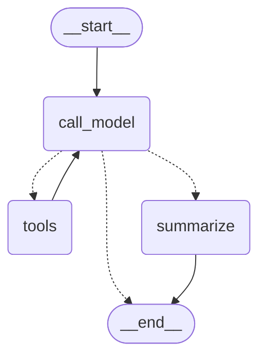
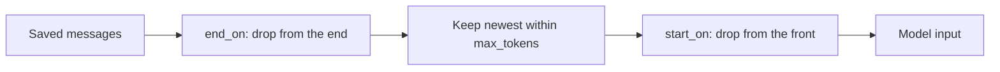

# 5.3 Trimming and Summarizing Message History

## The problem

Since lesson 5.1 the calculator agent remembers. Every turn starts from the thread's latest [checkpoint](../../../GLOSSARY.md#checkpoint), `add_messages` appends the new question, and `call_model` sends the whole history to the model. Lesson 5.2 made that history survive restarts by writing it to a SQLite file.

Remembering everything has a price that grows with every turn. A turn with one tool call adds four messages (question, tool call, tool result, answer). After fifty turns the agent sends two hundred messages on every model call, and that causes three problems:

- **It stops fitting.** A model accepts a limited amount of input per request, its [context window](../../../GLOSSARY.md#context-window). The system prompt, the tool schemas and every message count towards it. Once the history is larger, the provider rejects the request, and the conversation cannot go on.
- **It gets slow and expensive.** Providers bill by input token, and a long input takes longer to process. Every call pays again for messages the model has already seen many times.
- **It gets worse.** The official memory overview notes that models can lose focus in a long context, distracted by stale or off-topic messages, even when it fits.

The cure is not to stop saving. It is to decide two separate things: what the model **sees** on each call, and what the thread **keeps**. This lesson handles both inside the graph, with three tools: trimming the request, deleting old messages from the state, and folding the deleted messages into a summary.

## The concept

### Two lists, not one

Until now, the request and the saved state were the same list: `call_model` sent `state["messages"]`. This lesson separates them:

- **The saved history** is `state["messages"]`, the list the [checkpointer](../../../GLOSSARY.md#checkpointer) writes. It changes only through node updates and the `add_messages` reducer.
- **The model input** is a list a node builds just for one call. It can be any selection of the saved messages, plus anything else, such as a system prompt. Building it changes nothing in the state.

Keep these two apart and the rest follows. Trimming shapes the model input. Deleting shrinks the saved history. Summarizing makes deleting safe, by keeping what the deleted messages said.

### Trimming the model input

[trim_messages](../../../GLOSSARY.md#trim_messages) from `langchain_core.messages` takes a list of messages and returns the part of it that fits a budget. Four arguments define the cut:

- `max_tokens` is the budget.
- `token_counter` measures a list of messages. Pass `"approximate"` for a quick estimate (`count_tokens_approximately`), a chat model to count with its own tokenizer, or any function. With `len`, every message counts as 1, and `max_tokens` becomes a message count. The lesson uses `len` so that the numbers are easy to follow.
- `strategy="last"` keeps the newest messages and drops the oldest. That is what a conversation needs: the latest question and what led up to it.
- `start_on="human"` repairs the front of the window. After the cut, it drops messages from the start until the first one is a `HumanMessage`.

Why the repair is needed: a cut at a fixed size lands anywhere, including in the middle of a turn. If the window starts with a [ToolMessage](../../../GLOSSARY.md#toolmessage) whose [tool call](../../../GLOSSARY.md#tool-call) was cut off, the request breaks the [pairing rule](../../../GLOSSARY.md#pairing-rule) from lesson 4.2: every tool result must follow the `AIMessage` that asked for it. Real providers reject such a request. A window that starts with a `HumanMessage` starts at a turn boundary, so every tool result in it comes with its call. The `trim_messages` reference also points out that most chat models expect the history to start with a human message, after an optional system message.

The price is that the window can be shorter than the budget, and empty if it contains no `HumanMessage` at all.

`trim_messages` has a mirror argument, `end_on`, which drops messages from the **end** until the last one has the given type. It is useful for histories that should end on a finished turn, but dangerous for a model call in the middle of a turn, as experiment 2 shows.

`trim_messages` never changes its input. It returns a new list that holds the same message objects. So a node can trim as much as it likes for a request: the state does not notice.

### Deleting from the saved history

Trimming leaves the saved history growing forever. To shrink it, a node has to send an update that removes messages, and lesson 4.1 showed the only way to do that with `add_messages`: a [RemoveMessage](../../../GLOSSARY.md#removemessage) with the [message id](../../../GLOSSARY.md#message-id) of a saved message. A node that returns `{"messages": [RemoveMessage(id=m.id) for m in old]}` deletes exactly those messages.

Returning a shorter list does **not** work. `add_messages` merges an update into the stored list by id, so a list of messages that are already stored only replaces each one with itself. Nothing is removed.

A deletion is an ordinary state update. The checkpointer saves the smaller list as the thread's next checkpoint, and the next turn starts from it. Older checkpoints are not touched, as the end of the run shows.

The deleted part has to leave a valid history behind, which `add_messages` does not check. The safe rule is the same as for trimming: delete a prefix of complete turns, so that the history left over starts with a `HumanMessage`.

### Keeping what was deleted: a running summary

Deleting old messages makes the agent forget them. In our run, turn 3 asks "What have we computed so far?" after turn 1 was deleted. Without help, the model has no idea that 3 + 4 was ever computed.

The help is a summary. Before deleting, a node asks a chat model to describe the messages that are about to go, and stores the text in a new state key, next to `messages`. Every later model call gets the summary in its system prompt.

The summary is a [running summary](../../../GLOSSARY.md#running-summary): the next time the node runs, it does not re-read the whole history (it cannot, the old messages are gone). It sends the summarizer only the messages about to be deleted, together with the previous summary, and asks for an extended version. The size of each summarization call is bounded by what is deleted at that point, however long the conversation has been.

### When to summarize

Summarizing costs a model call, so it should not run on every turn. The graph checks a threshold, and only past it does the summary step run. The check also has to run at the right moment: only when a turn is finished. Between a tool call and its result the history is in the middle of a turn, and the agent still needs every message of that turn for its next call. After a reply without tool calls, the turn is complete, and its messages can be summarized safely.

## How it works

The graph is the agent loop from 4.2 with one more node. The diagram below was generated from the lesson's graph with `get_graph().draw_mermaid()` (styling removed). Dotted arrows are the [conditional edges](../../../GLOSSARY.md#conditional-edge) out of `call_model`.



The [routing function](../../../GLOSSARY.md#routing-function) after `call_model` has three answers. A reply with tool calls goes to `tools`, as before. A reply without tool calls ends the turn: it goes to `summarize` if the saved history is longer than the threshold, otherwise straight to `END`. `summarize` always ends the turn, because the answer was given before it ran.

Inside `call_model`, the request goes through `trim_messages` with `strategy="last"`. Look at the order of its three steps:



The lesson does not pass `end_on`, so the first step does nothing. The budget is applied before `start_on`, which is why `start_on` can only make the window shorter, never longer. `start_on` is only allowed with `strategy="last"`; with `"first"`, `trim_messages` raises `ValueError`.

## In our example

The example extends the calculator agent of [lesson 5.2](../../5.2-sqlite-checkpointer/docs/notes.md). [tools.py](../src/l5_3_message_history/tools.py) is unchanged, and all the new ideas are in [chatbot.py](../src/l5_3_message_history/chatbot.py). [\_\_main\_\_.py](../src/l5_3_message_history/__main__.py) runs one four-turn thread on a `SqliteSaver` and prints what the model received on every call. The [code walkthrough](readalong.md) goes through every line, starting with [what changed since 5.2](readalong.md#what-changed-since-lesson-52). Here we map the concepts onto it.

### The state gets a summary key

`State` adds one key to [MessagesState](../../../GLOSSARY.md#messagesstate):

<!-- snippet: src/l5_3_message_history/chatbot.py#state -->
```python
class State(MessagesState):
    """The agent's state: messages plus a running summary.

    ``messages`` comes from MessagesState and is reduced by add_messages.
    ``summary`` holds a summary of the messages already deleted from the
    state. It has no reducer, so a node's update replaces it. It is missing
    until the first summary is written, so read it with
    ``state.get("summary", "")``.
    """

    summary: str
```
<!-- /snippet -->

`summary` has no reducer, so each update replaces it. Until the first summary is written, the key is simply missing from the state, which is why the code reads it with `state.get("summary", "")`. The limits that shape the run live next to it in region `history_limits`: the model sees at most `MAX_MODEL_MESSAGES = 5` messages, a summary runs once a finished turn leaves more than `SUMMARIZE_AFTER = 6`, and it keeps `KEEP_AFTER_SUMMARY = 4`.

### Trimming: recent_messages and model_input

All trimming goes through one helper:

<!-- snippet: src/l5_3_message_history/chatbot.py#recent_messages -->
```python
def recent_messages(messages: Sequence[BaseMessage], max_messages: int) -> list[BaseMessage]:
    """Return the newest messages, at most ``max_messages``, starting at a turn boundary.

    trim_messages returns a new list holding the same message objects; it
    never changes its input. The window can be shorter than ``max_messages``,
    and it is empty if it contains no HumanMessage.
    """
    return trim_messages(
        messages,
        # Keep the newest messages and drop the oldest.
        strategy="last",
        # Count every message as 1 "token", so max_tokens is a message count.
        token_counter=len,
        max_tokens=max_messages,
        # Then drop messages from the front of that window until it starts
        # with a HumanMessage. This keeps tool calls and their ToolMessages
        # together (the pairing rule from 4.2): without it, a window of 5 can
        # start with a ToolMessage whose AIMessage tool call was cut off, which
        # real providers reject. The cost: fewer messages than allowed.
        start_on="human",
        # No end_on here: in the middle of a turn the last message is a
        # ToolMessage the model must see. include_system is not needed either:
        # the system message is never stored in state.
    )
```
<!-- /snippet -->

`model_input` builds the request from it. The summary rides in the system prompt, so it is never trimmed away and never counts against the window:

<!-- snippet: src/l5_3_message_history/chatbot.py#model_input -->
```python
def model_input(state: State) -> list[BaseMessage]:
    """Build exactly what call_model sends: system prompt (+ summary) + recent messages.

    The summary rides in the system prompt, so the model still knows what the
    deleted messages said.
    """
    system = SYSTEM_PROMPT
    summary = state.get("summary", "")
    if summary:
        system += f"\n\n{SUMMARY_PREFIX} {summary}"
    # This only shapes the request; the saved state is untouched.
    return [SystemMessage(system)] + recent_messages(state["messages"], MAX_MODEL_MESSAGES)
```
<!-- /snippet -->

`call_model` now invokes the model with `model_input(state)` instead of the whole history, and still returns only the reply, which `add_messages` appends to the full history. See the walkthrough of [`recent_messages`](readalong.md#recent_messages) and [`model_input`](readalong.md#model_input).

### When to summarize: route_after_model

`route_after_model` replaces `tools_condition` as the edge out of `call_model`:

<!-- snippet: src/l5_3_message_history/chatbot.py#route_after_model -->
```python
def route_after_model(state: State) -> Literal["tools", "summarize", "__end__"]:
    """Pick the next node after call_model: tools, summarize or END.

    This replaces tools_condition as the edge out of call_model.
    """
    # A reply with tool calls goes to the tools node, exactly as before.
    if tools_condition(state) == "tools":
        return "tools"
    # A reply without tool calls ends the turn, and only then is the history
    # checked. So a summary never runs between a tool call and its result: the
    # last message is a final AIMessage and the state ends on a complete turn.
    # Below the threshold the turn ends as before.
    return "summarize" if len(state["messages"]) > SUMMARIZE_AFTER else END
```
<!-- /snippet -->

It reuses `tools_condition` for the tool case, and only the end of the turn is new. The threshold looks at the **saved** history, not at the model input: trimming keeps the request small, the summary keeps the state small.

### Deleting and summarizing: summarize

<!-- snippet: src/l5_3_message_history/chatbot.py#summarize_history -->
```python
def summarize(state: State) -> dict:
    """Fold the old messages into the running summary and delete them from state."""
    # The kept part is chosen with the same recent_messages, so it starts
    # with a HumanMessage and the deleted part is a prefix of complete
    # turns: no ToolMessage loses its tool call.
    kept = recent_messages(state["messages"], KEEP_AFTER_SUMMARY)
    # A turn longer than KEEP_AFTER_SUMMARY (say, two tool calls: human ai
    # tool tool ai) leaves no HumanMessage in the window, so kept is empty
    # and every message, the latest answer included, would be deleted.
    # Skip the summary this turn instead; a later turn that fits summarizes.
    # Size the limits for the longest turn you expect.
    if not kept:
        return {}
    kept_ids = {m.id for m in kept}
    old = [m for m in state["messages"] if m.id not in kept_ids]
    # The summarizer reads only the messages about to be deleted plus the
    # previous summary, so the summary is running: each run extends it
    # instead of re-reading the whole history.
    summary = state.get("summary", "")
    if summary:
        instruction = (
            f"This is the summary so far: {summary}\nExtend it with the new messages above."
        )
    else:
        instruction = "Summarize the conversation above."
    reply = summarizer.invoke(old + [HumanMessage(instruction)])
    # A node cannot shrink the list by returning a shorter one: add_messages
    # would merge it into the history. Instead it returns RemoveMessage
    # entries, and add_messages deletes the messages with those ids. Every
    # message in state has an id (add_messages assigns a uuid to messages
    # without one), and the id must exist, otherwise add_messages raises
    # ValueError. The deletion is a normal state update, so the
    # checkpointer saves the smaller state as the thread's latest
    # checkpoint; earlier checkpoints still contain the deleted messages.
    # add_messages also supports RemoveMessage(id=REMOVE_ALL_MESSAGES)
    # (from langgraph.graph.message) to clear the whole list, but open
    # issue #9326 (reproduced on 1.2.16): messages after it are returned
    # without id merging, so duplicate ids survive. This lesson deletes by id.
    return {"summary": reply.content, "messages": [RemoveMessage(id=m.id) for m in old]}
```
<!-- /snippet -->

The node uses all three ideas at once:

- **The split** reuses `recent_messages`. `kept` starts with a `HumanMessage`, so `old` is a run of complete turns, and no tool result in `kept` loses its call.
- **The summary is running.** The summarizer gets only `old` plus an instruction. On the second run, the instruction carries the previous summary and asks to extend it.
- **The deletion** is a list of `RemoveMessage`, built from the ids of messages that are in the state right now. Both keys go into one update, so the checkpoint written after `summarize` holds the smaller history and the new summary together.

Before any of that, the guard `if not kept: return {}` handles the case where the split finds no turn boundary. `recent_messages` returns an empty list when the newest `KEEP_AFTER_SUMMARY` messages hold no `HumanMessage`, and that happens as soon as the last turn is longer than 4 messages, for example `human ai tool tool ai` after one reply with two tool calls. With an empty `kept`, `old` would be the whole history, and the node would delete every message, the answer it was just given included. Returning `{}`, an update with no keys, changes nothing instead: the turn ends with its full history and the old summary, and the summary waits for a later turn that fits in 4 messages. The run never takes this branch; the test `test_long_turn_skips_the_summary` does.

`summarizer` is a third argument of `build_graph`: a separate [chat model](../../../GLOSSARY.md#chat-model), never bound to tools. In the run it is a second scripted fake, so the node has exactly the shape it has in production, prompt in and `AIMessage` out. With a real model, that argument changes, and the limits need a second look: a real model decides how many tool calls a turn takes, and the limits must fit the longest turn it may produce (see "One turn is not a fixed size" under [Details and edge cases](#details-and-edge-cases)). See the walkthrough of [`build_graph`](readalong.md#build_graph).

## Run it

From the course root, run `./run.sh 5.3`. This is the output of the verified run:

```text
== turn 1: What is 3 + 4? ==
    model gets: system human
    model gets: system human ai tool
  answer: 3 + 4 is 7.
  saved: 4 messages (human ai tool ai)
  summary: (none yet)

== turn 2: Now multiply that by 2. ==
    model gets: system human ai tool ai human
    model gets: system human ai tool
    summarizer gets: human ai tool ai human
  answer: 7 * 2 is 14.
  saved: 4 messages (human ai tool ai)
  summary: The user asked for 3 + 4 (7).

== turn 3: What have we computed so far? ==
    model gets: system+summary human ai tool ai human
  answer: So far: 3 + 4 = 7, then 7 * 2 = 14.
  saved: 6 messages (human ai tool ai human ai)
  summary: The user asked for 3 + 4 (7).

== turn 4: Divide that by 7. ==
    model gets: system+summary human ai human
    model gets: system+summary human ai human ai tool
    summarizer gets: human ai tool ai human ai human
  answer: 14 / 7 is 2.0.
  saved: 4 messages (human ai tool ai)
  summary: The user asked for 3 + 4 (7), multiplied it by 2 (14) and asked for a recap.

== the thread's checkpoints ==
  latest: 4 messages; most in any checkpoint: 10; checkpoints: 20
```

Both models are scripted and the database is a fresh temporary file, so every run prints exactly this. The `model gets` lines come from `PeekingModel` in `__main__.py`, which prints the type of every message a model call receives. A real model would receive the same list. What to notice:

- **`model gets: system human ai tool` in turn 2.** The saved history is `human ai tool ai human ai tool` at that moment (7 messages). The newest 5 are `tool ai human ai tool`, which would start with turn 1's tool result, cut off from its call. `start_on="human"` cuts the window back to turn 2's question, so the model gets 3 messages although 5 were allowed.
- **`saved: 4 messages` after turn 2.** The turn reached 8 messages, more than 6, so `summarize` ran. It kept turn 2 and deleted the 4 messages of turn 1. The summarizer saw exactly those 4, plus its instruction, the last `human` in its line.
- **No summary after turn 3.** The turn ends with exactly 6 messages, and the check is "more than 6". The summary text is unchanged.
- **`system+summary` in turn 3.** The question needs turn 1, which is gone from the state. The model still knows about it through the summary in its system prompt, and its answer covers both calculations.
- **Turn 4's first call: `system+summary human ai human`.** Again `start_on` at work: the newest 5 of 7 begin with `tool ai`, which are dropped.
- **The second summary extends the first.** The summarizer got turns 2 and 3 (6 messages) plus an instruction that carries the first summary, and never saw turn 1 again.
- **`latest: 4 messages; most in any checkpoint: 10`.** The thread's current state is small, but the checkpoint written just before turn 4's summary still holds all 10 messages. Deleting changes the state from now on. It does not rewrite the past.

## Details and edge cases

**Counting tokens for real.** The lesson counts messages with `token_counter=len`. A real app sets `max_tokens` to a token budget below the context window and passes `token_counter="approximate"` or the chat model itself. Expect surprises in the sizes: on the turn-2 history of this lesson, `count_tokens_approximately` gives each message `8, 26, 7, 8, 10, 27, 8` tokens. An `AIMessage` with a tool call and empty text costs more than three times a short question, because its tool calls are counted. With `max_tokens=40` and `start_on="human"`, that whole history trims to an empty list, while `max_tokens=60` gives `human ai tool`.

**One turn is not a fixed size.** Every turn in the run has at most one tool call, so a complete turn is 4 messages or fewer, and both limits fit it. A real model decides itself how many tools to call, and each call adds messages. One reply with two parallel tool calls makes the turn `human ai tool tool ai` (5 messages); two sequential calls make it `human ai tool ai tool ai` (6). Both limits suffer:

- `KEEP_AFTER_SUMMARY = 4`: after such a turn the newest 4 messages hold no `HumanMessage`, so `recent_messages` keeps nothing. Without the guard, `summarize` would delete the entire history. With it, the summary is skipped and the history stays over the threshold until a shorter turn comes.
- `MAX_MODEL_MESSAGES = 5`: in a turn with three sequential tool rounds, the call after the third tool result has the history `human ai tool ai tool ai tool`. The newest 5 start with `tool`, `start_on` drops them all, and the model gets only the system prompt, without the question or any tool result.

Size both limits for the longest turn you expect. With real token counts that means a budget that holds a full turn with all its tool calls and results. The guard keeps the history safe when a turn is longer anyway, but it cannot help the model call.

**The system message is not in the state.** The lesson builds the `SystemMessage` fresh on every call, in front of the trimmed window, so the window never has to make room for it. If your system message is stored as the first message in state, pass `include_system=True`, which keeps a leading `SystemMessage` and counts it against the budget.

**`end_on` in the official example.** The official guide "Add and manage memory" trims with `end_on=("human", "tool")`. Right before a model call, the last message is always the user's question or a tool result, so that setting changes nothing there. It would drop a trailing `AIMessage`. `end_on="human"` alone is different, and it hides the current tool round from the model (experiment 2).

**The summarizer has a context window too.** A running summary keeps each summarizer call bounded by what is being deleted. But if a single summary step has to delete a very long run of messages, that call can itself be too large. Summarize often enough that the deleted part stays small, or trim it before it goes to the summarizer.

**Summarizing adds latency at the end of a turn.** `summarize` runs after the answer is ready but before `invoke` returns, so the user of a turn that crosses the threshold waits for one more model call. Streaming (module 7) can deliver the answer before the summary step finishes.

**A naive delete breaks tool turns.** The LangChain Academy summarization notebook deletes everything except the last two messages, `state["messages"][:-2]`. That works for its chatbot, which has no tools. With tools, the last two messages of a turn can be a tool result and the final answer, and the kept part then starts with a `ToolMessage` whose call was deleted. Choosing the kept part with `start_on="human"`, as this lesson does, avoids it.

**Earlier checkpoints still hold the deleted messages.** `RemoveMessage` writes a new checkpoint with a shorter list; the older checkpoints of the thread keep their full lists. Time travel (lesson 6.5) relies on that. It also means that deleting messages is not a way to erase data: to really remove a conversation, delete the thread with `checkpointer.delete_thread(thread_id)`.

**Clearing the whole list.** `add_messages` accepts `RemoveMessage(id=REMOVE_ALL_MESSAGES)` (from `langgraph.graph.message`) to clear the whole list. Lesson 4.1 explained the open issue [#9326](https://github.com/langchain-ai/langgraph/issues/9326), still reproducible on 1.2.16: messages after the marker in the same update skip the normal merge, so duplicate ids survive. The lesson deletes by id instead.

**The prebuilt alternative.** If you build agents with `create_agent` (lesson 4.3), langchain 1.4.6 ships a [SummarizationMiddleware](../../../GLOSSARY.md#summarizationmiddleware) in `langchain.agents.middleware`. It is an [agent middleware](../../../GLOSSARY.md#agent-middleware) that does what this lesson's `summarize` node does: `trigger` sets the threshold (for example `("messages", 50)` or `("tokens", 3000)`), `keep` sets how much recent context survives, and it keeps AI and tool message pairs together. In a graph you write yourself, the pattern of this lesson does the same job.

**Memory across threads is a different problem.** Everything here lives in one thread. Facts that should survive into a new conversation, such as a user's preferences, belong in a store (lesson 5.4).

## Common mistakes

> [!WARNING]
> **Returning a trimmed list to shrink the state.** `return {"messages": trim_messages(state["messages"], ...)}` looks like it should keep only the recent messages. It does not: `add_messages` merges the update by id, every message in it is already stored, and each one simply replaces itself. The history stays the same size. Trim for the request inside the node; delete from the state with `RemoveMessage`.

> [!WARNING]
> **Trimming without `start_on`.** A window of a fixed size can start with a `ToolMessage` whose tool call was cut off, or with an `AIMessage` that answers a question the model never sees. The fake model accepts anything, so tests pass, and the bug shows up only against a real provider, which rejects the orphaned tool result. Always pass `start_on="human"` (experiment 1).

> [!WARNING]
> **A budget smaller than one turn.** `trim_messages` with `start_on` returns an empty list when the window holds no `HumanMessage`. In the model call, the model then gets only the system prompt and answers without any context (experiment 3). In the summary step, an empty kept part means that every message is "old": the guard in `summarize` then skips the summary (experiment 4), and without it the whole history would be deleted. Turn length varies, because every tool call adds messages, and with real token counts tool calls are expensive too. Size both `MAX_MODEL_MESSAGES` and `KEEP_AFTER_SUMMARY` for the longest turn you expect, and guard the empty case.

> [!WARNING]
> **Summarizing in the middle of a turn.** A summary step that runs after every model call, or that keeps a fixed number of messages, can delete a tool call while its result is still to come, or keep a result without its call. Run the summary only after a reply without tool calls, and choose the kept part so that it starts on a `HumanMessage`, as `route_after_model` and `summarize` do. "A naive delete breaks tool turns" above shows the fixed-size version going wrong.

> [!WARNING]
> **Inventing ids for `RemoveMessage`.** An id that is not in the state makes `add_messages` raise `ValueError: Attempting to delete a message with an ID that doesn't exist (...)`, and the whole turn fails. Take the ids from `state["messages"]` in the node that deletes (experiment 5).

> [!WARNING]
> **Treating deletion as erasure.** After `RemoveMessage`, the messages are gone from the thread's latest state, but every earlier checkpoint still contains them, in memory or in the database file. If data has to be removed for privacy, delete the thread.

## Experiments

Each experiment starts from the lesson's original code. Make the change in [chatbot.py](../src/l5_3_message_history/chatbot.py), run `./run.sh 5.3` from the course root, and guess the result before you open the explanation.

1. Drop the repair: in `recent_messages`, delete the line `start_on="human",`.

   <details><summary>What happens and why</summary>

   Turn 2's second call now prints `model gets: system tool ai human ai tool`, and turn 4's first call prints `model gets: system+summary tool ai human ai human`. Both windows are the newest 5 messages, and both begin with a `ToolMessage` whose `AIMessage` tool call was trimmed away. The rest of the output is unchanged, because the fake ignores its input. A real provider would reject these two requests. `start_on="human"` moves the start of the window to a turn boundary, at the price of sending fewer messages than allowed. Put the code back as it was (`git checkout -- .` in the lesson directory).

   </details>

2. Add `end_on`. In `model_input`, replace the `recent_messages(...)` call with the `trim_messages` call written out, and add one argument:

   ```python
   return [SystemMessage(system)] + trim_messages(
       state["messages"],
       strategy="last",
       token_counter=len,
       max_tokens=MAX_MODEL_MESSAGES,
       start_on="human",
       end_on="human",
   )
   ```

   <details><summary>What happens and why</summary>

   Every second call of a tool turn changes. Turn 1's prints `model gets: system human`, turn 2's prints `model gets: system human ai tool ai human` and turn 4's prints `model gets: system+summary human ai human`. `end_on="human"` first drops messages from the end until the last one is a `HumanMessage`, so the model never sees its own tool call or the tool result. The scripted fake still answers correctly, but a real model would see the same unanswered question again, call the tool again, and loop until the recursion limit. `end_on` fits a history that should end on a finished turn, not a request in the middle of one. Put the code back as it was.

   </details>

3. Make the window too small: set `MAX_MODEL_MESSAGES = 2`.

   <details><summary>What happens and why</summary>

   Turn 1's second call prints `model gets: system`, and the same happens in turn 2 and, as `system+summary`, in turn 4. The newest two messages are `ai tool`, `start_on` finds no `HumanMessage` among them and drops both, so `trim_messages` returns an empty list. The first calls get only `human`. A real model would answer the tool round without knowing the question or the tool result. Real token budgets fail the same way: with `token_counter="approximate"` and `max_tokens=40`, the turn-2 history trims to nothing, because a tool-call `AIMessage` alone costs about 26 approximate tokens. Choose a budget that holds at least one full turn. Put the code back as it was.

   </details>

4. Keep too little after a summary: set `KEEP_AFTER_SUMMARY = 2`.

   <details><summary>What happens and why</summary>

   The program runs to the end, but the summaries move. Every tool turn ends on `tool ai`, so the newest 2 messages hold no `HumanMessage`, `recent_messages` keeps nothing, and the guard in `summarize` skips the summary. Turn 2 ends with `saved: 8 messages` and `summary: (none yet)`, although 8 is past `SUMMARIZE_AFTER`. Turn 3 has no tool call and ends on `human ai`, which fits in 2: it is the only turn that summarizes. Its line `summarizer gets: human ai tool ai human ai tool ai human` shows all 8 old messages plus the instruction, and `saved` drops to `2 messages (human ai)`. Turn 4 adds a tool turn to those 2 and ends with exactly 6 messages. The check is `> SUMMARIZE_AFTER`, so `route_after_model` goes straight to `END`: turn 4 never reaches `summarize`, and the run ends with 6 saved messages. The second scripted summary is never used. Without the guard, this setting would have deleted every message in turn 2, the answer included, and the program would have crashed with `IndexError` when it printed `result["messages"][-1]`. The kept part, like the model's window, must hold the longest turn. Put the code back as it was.

   </details>

5. Delete an id that is not there: in `summarize`, change `RemoveMessage(id=m.id)` to `RemoveMessage(id="nope")`.

   <details><summary>What happens and why</summary>

   Turn 1 runs as before. Turn 2 prints its model calls and the summarizer call, then fails with `ValueError: Attempting to delete a message with an ID that doesn't exist ('nope')`. The traceback ends in `add_messages`, called by LangGraph when it applies the node's update after the step. The summarizer had already been called by then: the node itself ran fine, and only its update was refused. `RemoveMessage` deletes by the id of a message in the state, so take the ids from the state. Put the code back as it was.

   </details>

## Summary

- Keep two lists apart: the saved history in `state["messages"]` and the model input that a node builds for one call. Trimming shapes the input, deleting shrinks the history.
- `trim_messages(messages, strategy="last", token_counter=..., max_tokens=..., start_on="human")` keeps the newest messages that fit the budget and starts the window at a turn boundary, so tool calls and results stay together. It never changes its input, and it returns an empty list if the budget is smaller than the current turn, so size it for the longest turn you expect.
- A node shrinks the saved history only by returning `RemoveMessage(id=...)` for the ids of saved messages. Delete a prefix of complete turns, so the history left starts with a `HumanMessage`.
- A running summary in an extra state key keeps what the deleted messages said. Each summary step reads only the messages being deleted plus the old summary, and the summary goes into the system prompt.
- Summarize from a conditional edge, only after a reply without tool calls and only past a threshold.
- Deleting writes a new checkpoint. Earlier checkpoints still hold the deleted messages; to erase a conversation, delete the thread.

## Self-check

1. In turn 2 of the run, `MAX_MODEL_MESSAGES` is 5, but the second model call gets only 3 saved messages. Why, and what would go wrong with 5?

   <details><summary>Answer</summary>

   The saved history is `human ai tool ai human ai tool`. The newest 5 are `tool ai human ai tool`, and the first of them is turn 1's tool result, whose tool call is not in the window. `start_on="human"` drops messages from the front until the window starts with turn 2's question, which leaves `human ai tool`. With all 5, the request would contain a tool result without its call, and a real provider would reject it.

   </details>

2. A node returns `{"messages": state["messages"][-4:]}` to keep only the last four messages. What does the state hold afterwards?

   <details><summary>Answer</summary>

   All the messages it held before. `add_messages` merges the update by id. The four messages are already stored, so each replaces itself in place, and nothing is deleted. To remove messages, the node must return `RemoveMessage(id=m.id)` for each one it wants gone.

   </details>

3. Why does the summary check sit in `route_after_model`, in the branch for a reply without tool calls, instead of running after every model call?

   <details><summary>Answer</summary>

   After a reply with tool calls the turn is still running: the tool result has not arrived, and the next model call needs the tool call and its result. A summary at that point could delete the call while its result is still to come. After a reply without tool calls the turn is complete, the history ends on a final answer, and old turns can be summarized and deleted safely. It also limits the extra summarizer call to at most one per turn.

   </details>

4. After the run, is turn 1's question "What is 3 + 4?" still stored anywhere?

   <details><summary>Answer</summary>

   Yes. It is gone from the thread's latest state, but the checkpoints written before turn 2's summary still contain it, in the SQLite file: the five checkpoints of turn 1 and those of turn 2 up to the step before `summarize`. `most in any checkpoint: 10` shows the same principle for turn 4: the checkpoint written just before turn 4's summary holds all 10 messages that the summary then cut to 4, though by then turn 1 was already gone. `RemoveMessage` changes the state from the next checkpoint on and never rewrites older ones. Only `checkpointer.delete_thread(...)` removes them.

   </details>

5. On its second run, `summarize` sends the summarizer only 6 messages and the old summary, not the whole conversation. Why is that enough, and why is it better?

   <details><summary>Answer</summary>

   The old summary already describes everything deleted earlier, so the old summary plus the messages about to be deleted cover the whole conversation. The messages of turn 1 no longer exist anyway. It is also better because each summary call stays about the same size however long the conversation runs, instead of growing with it.

   </details>

## Further reading

- [Add and manage memory](https://docs.langchain.com/oss/python/langgraph/add-memory), LangGraph docs: the "Manage short-term memory" section on trimming, deleting and summarizing messages, with the warning that the history left after deleting must stay valid for the provider.
- [Memory overview](https://docs.langchain.com/oss/python/concepts/memory), LangChain docs: why long conversations are a problem (context window, distraction, cost and latency).
- [`trim_messages` reference](https://reference.langchain.com/python/langchain-core/messages/utils/trim_messages), LangChain API reference: every argument, including the note on `start_on="human"` and valid chat histories.
- [Graph API overview](https://docs.langchain.com/oss/python/langgraph/graph-api), LangGraph docs: reducers, `MessagesState` and conditional edges.
- [Built-in middleware: Summarization](https://docs.langchain.com/oss/python/langchain/middleware/built-in#summarization), LangChain docs: `SummarizationMiddleware` for agents built with `create_agent`.
- [`add_messages` source](https://github.com/langchain-ai/langgraph/blob/1.2.16/libs/langgraph/langgraph/graph/message.py) at tag 1.2.16: id assignment, deletion with `RemoveMessage` and the `ValueError` for unknown ids.
- [`test_messages_state.py`](https://github.com/langchain-ai/langgraph/blob/1.2.16/libs/langgraph/tests/test_messages_state.py), langgraph tests at tag 1.2.16: executable cases for `add_messages` and `RemoveMessage`.
- [langgraph issue #9326](https://github.com/langchain-ai/langgraph/issues/9326): `add_messages` skips merging after `RemoveMessage(id=REMOVE_ALL_MESSAGES)`.
- [chatbot-summarization.ipynb](https://github.com/langchain-ai/langchain-academy/blob/main/module-2/chatbot-summarization.ipynb), LangChain Academy module 2: the same summary pattern for a chatbot without tools. It uses `MemorySaver`, the older name of `InMemorySaver`.
