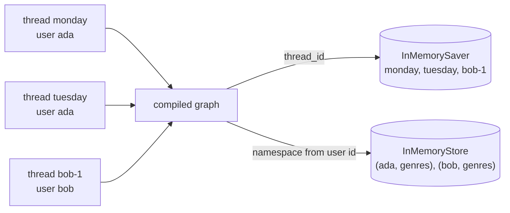
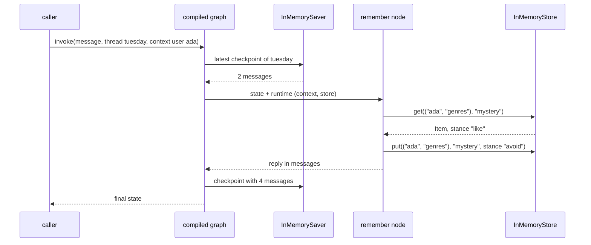
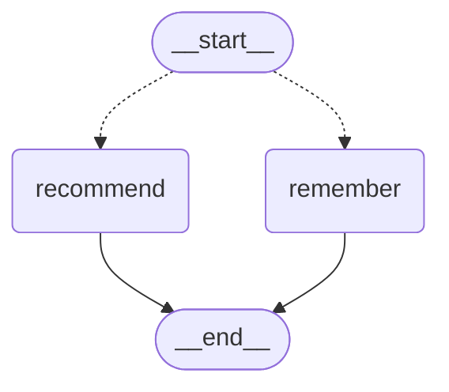

# 5.4 Long-Term Memory with a Store

## The problem

Lessons 5.1 to 5.3 gave the graph a memory for conversations. A [checkpointer](../../../GLOSSARY.md#checkpointer) saves the state of each run under its [thread_id](../../../GLOSSARY.md#thread_id). The next run on that thread continues where the last one stopped. A run with a new thread_id starts from a blank page ([lesson 5.1](../../5.1-checkpointers-and-threads/docs/notes.md)). That blank page is what you want for a new conversation, but not for everything.

Some things a user says are about the user, not about the conversation. "I love sci-fi" is still true tomorrow, in a new chat window, on another device. With only a checkpointer, an assistant has two bad ways to keep it:

- **Never start a new thread.** Put the user's whole life into one thread. The history grows without end, every turn sends it all to the model, and [lesson 5.3](../../5.3-message-history/docs/notes.md) has to trim or summarize it, which can drop exactly the facts you wanted to keep. Unrelated conversations also get mixed into one.
- **Let the caller carry the facts.** Look up the user's preferences outside the graph and paste them into every new thread's input. This is lesson 4.1's situation again, where the caller did the remembering and the graph knew nothing.

What's missing is a second kind of memory. It should be keyed by the **user** instead of the thread, nodes should be able to read and write it from any thread, and it should hold only the facts worth keeping, not every message. LangGraph calls this a store.

## The concept

### Two kinds of memory

The checkpointer gives a graph [short-term memory](../../../GLOSSARY.md#short-term-memory): the state of one thread. [Long-term memory](../../../GLOSSARY.md#long-term-memory) is information that outlives any single conversation, such as a user's preferences, and that every later thread can use. In LangGraph it lives in a *store*. The persistence guide puts the split in one sentence: a checkpointer tracks the current thread, and a store tracks durable information across threads. An application can use both.

The two differ in more than scope:

| | Checkpointer (5.1–5.3) | Store (this lesson) |
|---|---|---|
| Remembers | one conversation | facts across conversations |
| Keyed by | `thread_id` in the run's config | a namespace and a key that your code builds |
| Holds | the whole graph state, as checkpoints | small dicts that you choose to save |
| Who writes | the graph, after every super-step | your node code, with an explicit `put` |
| Who reads | the graph, at the start of every run | your node code, with `get` or `search` |
| Compile argument | `checkpointer=` | `store=` |

The last three rows matter most. A checkpointer works automatically, so nodes never see it. A store does nothing on its own. It is a database that your nodes call, and nothing goes into it unless a node puts it there.

### Items, namespaces and keys

Every store implements [BaseStore](../../../GLOSSARY.md#basestore) from `langgraph.store.base`. This lesson uses [InMemoryStore](../../../GLOSSARY.md#inmemorystore) from `langgraph.store.memory`, which keeps everything in Python dicts inside the object. It is the store counterpart of `InMemorySaver`, and the same warning applies to it: its docstring says the data is lost when the process exits and recommends a database-backed store such as `PostgresStore` (lesson 5.6).

A store holds *items*. An item has three parts that you choose and two that the store fills in:

- a **namespace**: a tuple of strings such as `("ada", "genres")`,
- a **key**: a string that is unique within the namespace, such as `"sci-fi"`,
- a **value**: a dict with string keys and JSON-serialisable values, such as `{"genre": "sci-fi", "stance": "like"}`,
- `created_at` and `updated_at`: timestamps.

The [store namespace](../../../GLOSSARY.md#store-namespace) is the part that needs the most thought. Think of the store as a filing cabinet shared by every thread. The namespace is a folder path, the key is a file name, and the value is what is written in the file. The namespace can be any length and can mean anything. The stores guide uses `(user_id, "memories")`. What matters is that **the namespace is the only thing that separates one user's memory from another's.** If the user id is not in it, all users share one folder.

### The operations

The `BaseStore` methods this lesson uses, with their signatures in langgraph-checkpoint 4.3.0:

- `put(namespace, key, value)` saves an item. It is an [upsert](../../../GLOSSARY.md#upsert): the first `put` for a namespace and key creates the item, and a later one replaces its value.
- `get(namespace, key)` returns that one item as an `Item` object, or `None` if there is none. A missing key is not an error.
- `search(namespace_prefix, /, *, query=None, filter=None, limit=10, offset=0)` returns a list of [SearchItem](../../../GLOSSARY.md#searchitem) objects. Each one is an `Item` with an extra `score`. The first argument is a **prefix**, so `("ada",)` also finds items under `("ada", "genres")`. `filter` keeps the items whose `value` matches every given field. A plain value means equality, and the operators \$eq, \$ne, \$gt, \$gte, \$lt and \$lte allow comparisons. Without a `query`, nothing is ranked and every `score` is `None`.
- `list_namespaces()` returns the store's namespaces as a sorted list of tuples.
- `delete(namespace, key)` removes an item. The lesson doesn't need it.

`search(query=...)` is semantic search: finding memories by meaning instead of by key. It needs a store configured with embeddings, which is the subject of lesson 5.5. This lesson passes no query.

### Reaching the store from a node

You hand the store to the graph at compile time, next to the checkpointer:

```python
graph = builder.compile(checkpointer=checkpointer, store=store)
```

A node reaches it through the `runtime` parameter you know from [lesson 2.4](../../../2-state/2.4-runtime-context/docs/notes.md). The `Runtime` object holds both the [runtime context](../../../GLOSSARY.md#runtime-context) (`runtime.context`) and the store (`runtime.store`). The node needs both, because it needs to know *whose* memory to use. That information comes from the caller, through `context=`:

- the **thread_id** goes in the config, and picks *which conversation* the checkpointer loads;
- the **user id** goes in the context, and the node builds *whose namespace* to use from it.

The two are independent on purpose. One user has many threads, and the store must find the same namespace from all of them.

## How it works

The lesson's run sends three conversations through one compiled graph. Look at where each key goes: the thread_id selects the checkpointer's entry, and the user id selects the store's namespace.



The checkpointer ends up with three separate histories, one per thread. The store ends up with two namespaces, one per user. Ada's two threads share one namespace, and Bob's thread has its own.

Now follow one run in detail, the Tuesday turn "Please skip mystery for now.":



Two paths leave the node, and they work differently:

- **The reply goes through the state.** The node returns `{"messages": [...]}`, the [add_messages](../../../GLOSSARY.md#add_messages) reducer appends it, and the checkpointer saves it under `tuesday`, as in 5.1.
- **The memory goes straight to the store.** `put` is an ordinary method call on the store object. It takes effect while the node is still running. It is not part of the node's return value, so no reducer sees it and no [checkpoint](../../../GLOSSARY.md#checkpoint) contains it. The thread's saved state holds only `messages`.

That second point has consequences. Store writes are not undone by anything that works on checkpoints: rewinding a thread to an older checkpoint (time travel, lesson 6.5) leaves the store as it is. A node that calls `put` and then fails has still written. With an upsert keyed by the genre, running the same write twice leaves the same single item, so a retry does no harm here.

## In our example

The example is a new one, a rule-based reading-list assistant with no LLM. Lesson 5.5 extends it, and lesson 5.6 moves it to Postgres. The user names genres they like ("I love sci-fi and mystery.") or want to skip ("Please skip mystery for now."), or asks for a book. The assistant remembers the genres per user and recommends one book per liked genre. The [code walkthrough](readalong.md) goes through every line. Here we map the concepts onto the code.

The graph is as small as it can be. This diagram was generated from the code with `get_graph().draw_mermaid()` (styling removed):



`route` is a [conditional edge](../../../GLOSSARY.md#conditional-edge) from `START`. A message that names a catalog genre goes to `remember`, anything else to `recommend`. The state is the built-in [MessagesState](../../../GLOSSARY.md#messagesstate). Nothing about genres is in the state: they live only in the store.

### Whose memory: the context and the namespace

<!-- snippet: src/l5_4_long_term_memory_store/assistant.py#user_context -->
```python
@dataclass(frozen=True)
class UserContext:
    """Who is talking, for one run: the store namespace is built from it."""

    # The user id comes from the caller (the app's login), not from the
    # messages, so a user cannot read another user's memory by typing a name.
    user_id: str
```
<!-- /snippet -->

<!-- snippet: src/l5_4_long_term_memory_store/assistant.py#namespace -->
```python
def genres_namespace(user_id: str) -> tuple[str, ...]:
    """Return the store namespace that holds one user's genres."""
    # A namespace is a tuple of strings, like a folder path. Putting the user
    # id first gives every user their own folder; "genres" leaves room for
    # other kinds of memory per user later (("ada", "profile"), ...).
    # Labels must be non-empty strings without periods, and the root cannot
    # be "langgraph": the store raises InvalidNamespaceError otherwise.
    return (user_id, "genres")
```
<!-- /snippet -->

`UserContext` is the run context from 2.4, declared on the graph with [context_schema](../../../GLOSSARY.md#context_schema). `genres_namespace` is the one place that turns a user id into a namespace. Both nodes and `__main__.py` call it, so a reader and a writer can't disagree about where the genres live. The user id comes first in the tuple. That gives every user one folder, and leaves room for other kinds of memory under the same user later, such as `("ada", "profile")`.

The comment on `user_id` makes a point about trust. The id comes from the caller, which in a real application means from the login, and not from the messages. A user who types "I am Bob" still gets Ada's namespace, because the node never reads the id from the text.

### Writing: `remember`

<!-- snippet: src/l5_4_long_term_memory_store/assistant.py#remember_node -->
```python
def remember(state: MessagesState, runtime: Runtime[UserContext]) -> dict[str, Any]:
    """Save each mentioned genre as liked or avoided in the user's namespace."""
    text = state["messages"][-1].content
    stance = "avoid" if "skip" in text.lower() else "like"
    # runtime.context is the UserContext the caller passed with context=...
    namespace = genres_namespace(runtime.context.user_id)
    notes: list[str] = []
    for genre in mentioned_genres(text):
        # runtime.store is the store passed to compile(store=...): the same
        # object for every thread and every run. get returns an Item (with
        # .namespace, .key, .value, .created_at, .updated_at) or None.
        old = runtime.store.get(namespace, genre)
        if old is None:
            notes.append(f"{genre} ({stance})")
        elif old.value["stance"] == stance:
            notes.append(f"{genre} (already {stance})")
        else:
            notes.append(f"{genre} ({old.value['stance']} -> {stance})")
        # put(namespace, key, value) is an upsert: the same namespace + key
        # replaces the value. The value must be a dict of JSON-serialisable
        # values. The write happens right now, inside the node: it is not a
        # state update and is not part of any checkpoint.
        runtime.store.put(namespace, genre, {"genre": genre, "stance": stance})
    # A node may also declare a parameter named `store: BaseStore` (the older
    # style, still injected in 1.2.16). runtime.store is the current way and
    # gives context and store from one object.
    return {"messages": [AIMessage("Noted: " + ", ".join(notes) + ".")]}
```
<!-- /snippet -->

The node gets `runtime: Runtime[UserContext]` and reads both halves from it: `runtime.context.user_id` for the namespace and `runtime.store` for the store. For each genre in the message it does a `get` and then a `put`.

The `get` is not needed for storing. `put` would replace the value anyway. It is there so the reply can say what changed: `(like)` for a new item, `(already like)` when nothing changed, `(like -> avoid)` when the stance flipped. The genre is the key, so a second mention of mystery replaces one item instead of adding a second. The value repeats the genre and adds the stance. The key is the item's address, and the value holds the fields that `filter=` can match.

The return value contains only the reply. The store write has already happened by then.

### Reading: `recommend`

<!-- snippet: src/l5_4_long_term_memory_store/assistant.py#recommend_node -->
```python
def recommend(state: MessagesState, runtime: Runtime[UserContext]) -> dict[str, Any]:
    """Recommend one book for every genre the user likes."""
    # search takes a namespace PREFIX (positional) and returns SearchItem
    # objects: an Item plus .score, which is None here because no query was
    # given. filter= keeps items whose value matches every key exactly
    # (operators such as $ne and $gt exist too). The default limit is 10.
    # Lesson 5.5 adds query= here for semantic search.
    liked = runtime.store.search(
        genres_namespace(runtime.context.user_id), filter={"stance": "like"}
    )
    # Without a query the order of results is not something to rely on, so
    # sort the keys yourself.
    genres = sorted(item.key for item in liked)
    if not genres:
        return {"messages": [AIMessage("Tell me a genre you like and I will pick a book.")]}
    picks = "; ".join(f"{CATALOG[genre]} ({genre})" for genre in genres)
    return {"messages": [AIMessage(f"Try: {picks}.")]}
```
<!-- /snippet -->

`search` gets the user's namespace and `filter={"stance": "like"}`, so an avoided genre is dropped without any `if` in the node. The result is a list of `SearchItem`s, and the node only needs their keys. It sorts them itself. The reply's order comes from that `sorted`, not from the store (see "Details and edge cases").

### Wiring: `build_graph` and the caller

<!-- snippet: src/l5_4_long_term_memory_store/assistant.py#build_graph -->
```python
def build_graph(
    checkpointer: BaseCheckpointSaver | None, store: BaseStore | None
) -> CompiledStateGraph:
    """Build the assistant: START routes to remember or recommend, both end."""
    # context_schema tells LangGraph what context= holds (as in lesson 2.4).
    builder = StateGraph(MessagesState, context_schema=UserContext)
    builder.add_node(remember)
    builder.add_node(recommend)
    builder.add_conditional_edges(START, route)
    builder.add_edge("remember", END)
    builder.add_edge("recommend", END)
    # The two arguments are independent: the checkpointer is keyed by
    # thread_id (from config), the store by namespace (built by your code).
    # __main__ creates both, so lesson 5.6 only changes those lines.
    return builder.compile(checkpointer=checkpointer, store=store)
```
<!-- /snippet -->

`compile(checkpointer=..., store=...)` takes the two memories as independent arguments. Either may be `None`. Both are created once in `main` and passed in, so lesson 5.6 changes only those two lines.

<!-- snippet: src/l5_4_long_term_memory_store/__main__.py#chat_helper -->
```python
def chat(graph: CompiledStateGraph, thread_id: str, user_id: str, text: str) -> None:
    """Send one user message on a thread and print the exchange."""
    # thread_id goes in config (which conversation); user_id goes in context
    # (whose memory). They are different keys on purpose.
    config: RunnableConfig = {"configurable": {"thread_id": thread_id}}
    result = graph.invoke(
        {"messages": [HumanMessage(text)]}, config, context=UserContext(user_id=user_id)
    )
    print(f"  {user_id}> {text}")
    print(f"  bot> {result['messages'][-1].content}")


def message_count(graph: CompiledStateGraph, thread_id: str) -> int:
    """Return how many messages the checkpointer holds for a thread."""
    config: RunnableConfig = {"configurable": {"thread_id": thread_id}}
    return len(graph.get_state(config).values.get("messages", []))
```
<!-- /snippet -->

`chat` shows the two keys side by side: `thread_id` in the config, `UserContext(user_id=...)` in `context=`. It has to pass the context on every call. As 2.4 showed, the context is not remembered between calls, and a checkpoint doesn't contain it either.

### Looking into the store from outside

<!-- snippet: src/l5_4_long_term_memory_store/__main__.py#inspect_store -->
```python
print("== What the store holds ==")
# The caller can read and write the same store outside the graph (seeding
# a profile, an admin view). Timestamps (created_at, updated_at) are left
# out because they change on every run.
print(f"  namespaces: {store.list_namespaces()}")
for user_id in ["ada", "bob"]:
    items = sorted(store.search(genres_namespace(user_id)), key=lambda i: i.key)
    for item in items:
        print(f"  {item.namespace} {item.key!r}: {item.value}")
ns = genres_namespace("ada")
print(f"  get({ns}, 'sci-fi').value = {store.get(ns, 'sci-fi').value}")
print(f"  get({ns}, 'fantasy') = {store.get(ns, 'fantasy')}")
counts = ", ".join(
    f"{thread}={message_count(graph, thread)}" for thread in ["monday", "tuesday", "bob-1"]
)
print(f"  messages per thread: {counts}")
```
<!-- /snippet -->

The last section uses the `store` object directly, with no graph involved. The nodes and the application share the same object, so the application can read what the nodes wrote. It could also write, for example to seed a profile before the first conversation (a test in [test_memory_store.py](../tests/test_memory_store.py) does exactly that). The program leaves out the timestamps, because they change on every run.

## Run it

From the course root, run `./run.sh 5.4`. This is the output of the verified run:

```text
== Monday: Ada shares her taste (thread monday) ==
  ada> I love sci-fi and mystery.
  bot> Noted: mystery (like), sci-fi (like).
  ada> Any book for tonight?
  bot> Try: The Hound of the Baskervilles (mystery); Dune (sci-fi).

== Tuesday: a new thread, the same user (thread tuesday) ==
  thread tuesday starts with 0 messages; thread monday holds 4
  ada> Recommend something.
  bot> Try: The Hound of the Baskervilles (mystery); Dune (sci-fi).
  ada> Please skip mystery for now.
  bot> Noted: mystery (like -> avoid).
  ada> Recommend something.
  bot> Try: Dune (sci-fi).

== Bob: his own namespace (thread bob-1) ==
  bob> Recommend something.
  bot> Tell me a genre you like and I will pick a book.
  bob> I love fantasy.
  bot> Noted: fantasy (like).
  bob> Recommend something.
  bot> Try: The Hobbit (fantasy).

== What the store holds ==
  namespaces: [('ada', 'genres'), ('bob', 'genres')]
  ('ada', 'genres') 'mystery': {'genre': 'mystery', 'stance': 'avoid'}
  ('ada', 'genres') 'sci-fi': {'genre': 'sci-fi', 'stance': 'like'}
  ('bob', 'genres') 'fantasy': {'genre': 'fantasy', 'stance': 'like'}
  get(('ada', 'genres'), 'sci-fi').value = {'genre': 'sci-fi', 'stance': 'like'}
  get(('ada', 'genres'), 'fantasy') = None
  messages per thread: monday=4, tuesday=6, bob-1=6
```

The assistant is rule-based and the program prints no timestamps, so every run prints exactly this. What to notice:

- **A blank thread that still knows Ada.** Tuesday starts with 0 messages, so the checkpointer gave it nothing. Yet the first recommendation names both of Monday's genres. They came from the store, under `("ada", "genres")`, which doesn't depend on the thread.
- **"mystery, sci-fi", whatever the user typed.** `mentioned_genres` walks `CATALOG` in its alphabetical order, and `recommend` sorts the keys. The output order is decided by the code, never by the store.
- **`like -> avoid` proves the `get` found Monday's item.** The skip turn ran on a thread that had never heard of mystery. The old stance came from the store.
- **Replaced, not added.** After the skip, Ada has two items, not three. `put` with the same namespace and key replaced the mystery item, and the following recommendation dropped it because of `filter={"stance": "like"}`.
- **Bob starts empty.** Same graph, same store object, but his namespace has no items, so his first request gets the empty-memory reply. Ada's genres never reach him.
- **One namespace per user, one history per thread.** `list_namespaces()` shows two entries. The checkpointer holds three conversations of 4, 6 and 6 messages. The two memories grew independently.
- **`get` on a missing key returns `None`.** Ada never mentioned fantasy, and asking for it is not an error.

## Details and edge cases

**Don't rely on the order of `search` results.** Without a query nothing is ranked, and the stores guide says outright not to rely on a particular order across store implementations. Different backends return items in different orders. If order matters, sort the results yourself, by key as here or by `updated_at`. Lesson 5.6 swaps `InMemoryStore` for `PostgresStore`, and the output stays the same only because the code sorts.

**`search` stops at 10 items by default.** Items beyond `limit` are dropped silently, with no warning and no "more" flag. Four genres never reach the limit, but a real memory list would. Pass a larger `limit`, or page through with `offset`.

**Prefixes match whole labels.** `search(("ada",))` finds items in `("ada", "genres")` and in any deeper namespace that starts with `"ada"`. It does not find `("adam", "genres")`. The comparison is label by label, not character by character. This is one reason to put the user id first. With `("ada", ...)` you can search one user's entire memory with a single prefix. The official `memory-agent` template puts it second, `("memories", user_id)`. That works too, but then the prefix that collects one user's items is the full namespace.

**Namespace labels have rules.** Every label must be a non-empty string without a period. `get`, `search`, `delete` and `put` all check this and raise [InvalidNamespaceError](../../../GLOSSARY.md#invalidnamespaceerror). `put` also refuses an empty namespace and `"langgraph"` as the first label, which is reserved. The period rule is not arbitrary: `PostgresStore` stores a namespace as its labels joined with periods, so a period inside a label would make the path ambiguous. User ids that look like emails or domain names must be mapped before they go into a namespace (fifth experiment).

**Values are dicts of plain data.** `put` takes a mapping with string keys and JSON-serialisable values. It's the same idea as the checkpointer's serializer in [lesson 5.2](../../5.2-sqlite-checkpointer/docs/notes.md): store data, not live objects. A database store has to write the value to disk. `InMemoryStore` does not check this, so a non-serialisable value only fails later, after you switch to a database store.

**A store without a checkpointer, and the reverse.** The two compile arguments are independent. With `store=` and no checkpointer, the genres are still remembered between `invoke` calls (no thread_id needed), but each call starts with an empty message list. With a checkpointer and no store, `runtime.store` is `None` (third experiment). A checkpointer is not a store, and it never provides one.

**The older `store` parameter.** Before `Runtime` existed, a node received the store through a parameter named `store` annotated as `BaseStore`. In 1.2.16 that parameter is still injected, without a warning (it is one of the `KWARGS_CONFIG_KEYS` that lesson 2.4 described). `runtime.store` is the current way, and it gives you the context and the store from one object. Older tutorials, including the LangChain Academy notebooks, also read the user id from `config["configurable"]`. On 1.2.16 that is the deprecated pattern from 2.4: use `context_schema` and `context=`.

**Every method has an async twin** (`aget`, `aput`, `asearch` and so on) for async nodes; this course stays synchronous until async execution comes up.

**Who decides what to remember.** Here, string rules decide. In an LLM application the model usually decides. It gets a tool like the `memory-agent` template's `upsert_memory`, or a node extracts facts from the conversation. The DeepLearning.AI course on agentic memory calls such learned facts about a user *semantic memory*. The storage side is what this lesson shows: whatever decides, the write is a `put` into a namespace tied to the user.

## Common mistakes

> [!WARNING]
> **Leaving the user out of the namespace.** A namespace like `("genres",)` or `("memories",)` works perfectly in a demo with one user. With two users, everyone reads and writes the same folder, and no error tells you. This is the most common store bug, and the first experiment shows it. Build the namespace from the user id, in one helper that every reader and writer calls.

> [!WARNING]
> **Taking the user id from the conversation.** If a node reads "whose memory" from the messages or from a field the client controls, a user can read someone else's memory by typing their name. Take the id from your authentication layer and pass it with `context=`.

> [!WARNING]
> **Creating the store per request.** `build_graph(checkpointer, InMemoryStore())` inside a request handler gives every request an empty store. The namespace is only a key *into* one store object. This is the same trap as creating the checkpointer per request in 5.1 (second experiment).

> [!WARNING]
> **Forgetting `store=` in `compile`.** The graph compiles fine, and the first node that touches the store fails with `AttributeError: 'NoneType' object has no attribute 'get'` (or `'search'`, `'put'`). Pass the store at compile time (third experiment).

> [!WARNING]
> **Putting the user id in `config["configurable"]`.** It never reaches `runtime.context`, which stays `None`, and the node fails with `AttributeError: 'NoneType' object has no attribute 'user_id'`. The thread_id goes in the config, and the user id goes in `context=` (fourth experiment).

> [!WARNING]
> **Changing a memory by editing what `get` returned.** In `InMemoryStore`, `get` and `search` hand you the stored value dict itself. `store.get(ns, "sci-fi").value["stance"] = "avoid"` really does change the stored item, with no `put`. A database store returns a copy, so the same code silently does nothing after you switch. Treat returned values as read-only and write changes with `put`.

> [!TIP]
> The store is an ordinary object, and you can use it outside any graph. In tests, `store.put(...)` a known memory before the run, then assert on `store.get(...)` or `store.search(...)` afterwards. The lesson's tests do both.

## Experiments

Each experiment starts from the lesson's original code. Make the change, run `./run.sh 5.4` from the course root, and guess the result before you open the explanation.

1. Forget the user in the namespace: in [assistant.py](../src/l5_4_long_term_memory_store/assistant.py), make `genres_namespace` return `("genres",)`.

   <details><summary>What happens and why</summary>

   Monday and Tuesday look the same as before. Bob's first request now gets `Try: Dune (sci-fi).`, which is Ada's liked genre. After he adds fantasy, he gets `Try: The Hobbit (fantasy); Dune (sci-fi).`. The store section prints `namespaces: [('genres',)]`, and the inspection loop prints the same three items twice, once for "ada" and once for "bob", because both calls search the same folder. Even the last `get` changes: `get(('genres',), 'fantasy')` now returns Bob's fantasy item instead of `None`, and since this line prints a whole `Item`, its timestamps differ from run to run. The namespace was the only thing that separated the users. Put the code back as it was (`git checkout -- .` in the lesson directory).

   </details>

2. Give Tuesday a fresh store: in [\_\_main\_\_.py](../src/l5_4_long_term_memory_store/__main__.py), add `graph = build_graph(checkpointer, InMemoryStore())` right before `# region tuesday`.

   <details><summary>What happens and why</summary>

   Tuesday's first answer becomes `Tell me a genre you like and I will pick a book.`, and the skip turn says `Noted: mystery (avoid).`, a new item rather than `like -> avoid`. The last Tuesday request also gets the empty-memory reply, because the only item in the new store is an avoided genre. Bob behaves as before, but inside the new store. The store section still reads the original `store` variable, so it shows only `('ada', 'genres')` with mystery as `like`: Monday's writes sit in the first store, and everything later went into the second. The namespace is only a key into one store object, and `InMemoryStore` keeps its data inside that object. A new object, or a new process, starts empty. That is why lesson 5.6 moves to `PostgresStore`. Put the code back as it was.

   </details>

3. Compile without a store: in `main`, call `build_graph(checkpointer, None)`.

   <details><summary>What happens and why</summary>

   Only the Monday heading prints, then the first turn fails inside `remember` with `AttributeError: 'NoneType' object has no attribute 'get'`. `runtime.store` is set only when you pass `store=` to `compile()`. The checkpointer is still there, but a checkpointer is not a store: it holds thread state, not your memories. Put the code back as it was.

   </details>

4. Drop the context: in `chat`, remove `context=UserContext(user_id=user_id)` from the `graph.invoke(...)` call. Then try again with the user id moved into the config, `{"configurable": {"thread_id": thread_id, "user_id": user_id}}`.

   <details><summary>What happens and why</summary>

   Both versions fail on the first turn with `AttributeError: 'NoneType' object has no attribute 'user_id'`, raised where `remember` builds the namespace. `context_schema` only declares the shape of the context. The caller must pass a value on every run, as in 2.4, and keys in `configurable` never become `runtime.context`. Put the code back as it was.

   </details>

5. Use an email-like user id: in section `monday`, change the first `chat` call's user from `"ada"` to `"ada.lovelace"`.

   <details><summary>What happens and why</summary>

   The first turn raises `InvalidNamespaceError: Invalid namespace label 'ada.lovelace' found in ('ada.lovelace', 'genres'). Namespace labels cannot contain periods ('.').`. The error comes from the `get` in `remember`, before anything is written, because `get` checks the labels too. Database-backed stores join the labels with periods, so a period inside a label is not allowed. Map such ids before building the namespace, for example by replacing the period or by using a stable internal user id or a hash. Put the code back as it was.

   </details>

## Summary

- A checkpointer is short-term memory: the state of one thread, keyed by `thread_id`, written automatically. A store is long-term memory: small dicts keyed by a namespace and a key that your code chooses, readable from every thread.
- A store holds items: a namespace (a tuple of strings, like a folder path), a key and a dict value. `put` is an upsert, `get` returns an `Item` or `None`, and `search(prefix, filter=...)` returns `SearchItem`s (at most 10 by default, and in no order you should rely on).
- `compile(store=...)` gives every node `runtime.store`. The node builds the namespace from `runtime.context.user_id`, and the caller passes the user id with `context=` on every run, separate from the `thread_id` in the config.
- Put the user id in the namespace. It is the only thing that keeps users apart.
- Store writes happen immediately inside the node. They are not state updates and are not in any checkpoint.
- `InMemoryStore` lives inside the Python object. Create it once per process, and use a database store (lesson 5.6) when memory must outlive the process.

## Self-check

1. A user chats on thread `t1` and says "call me Sam". On thread `t2` the next day, the assistant should still use that name. Which memory holds the name, and what key does the node use to find it?

   <details><summary>Answer</summary>

   The store. The checkpointer only gives `t2` the messages of `t2`. The node saves the name with `put` in a namespace built from the user id, such as `(user_id, "profile")`, and on `t2` reads it back with `get` from the same namespace. The user id comes from `context=`, so it is the same on both threads.

   </details>

2. `remember` calls `store.put(("ada", "genres"), "mystery", {...})` twice in a row with different values. How many items are in the namespace afterwards, and why?

   <details><summary>Answer</summary>

   One. `put` is an upsert: the namespace and key together are the item's address, so the second call replaces the value of the existing item.

   </details>

3. A node returns `{"messages": [reply]}` after calling `runtime.store.put(...)`. Later you rewind the thread to a checkpoint from before that run. Is the stored item gone?

   <details><summary>Answer</summary>

   No. The `put` went straight to the store while the node was running. It was never part of the node's return value, so no reducer applied it and no checkpoint contains it. Rewinding the thread changes only the thread's state.

   </details>

4. Your app works in development with one tester. In production, users report seeing each other's preferences. The nodes call `runtime.store.search(("prefs",))`. What is wrong, and how do you fix it?

   <details><summary>Answer</summary>

   The namespace does not contain the user, so every user reads and writes the same folder. Build it from the user id, for example `(user_id, "prefs")`, in one helper used by every node, and pass the user id from the login with `context=`.

   </details>

5. `recommend` sorts the keys from `search` before building the reply. Why not just use the order the store returns?

   <details><summary>Answer</summary>

   Without a query, `search` does not rank anything, and the docs say not to rely on a particular result order across store implementations. Sorting in the code makes the reply the same with `InMemoryStore` and with `PostgresStore` (lesson 5.6).

   </details>

## Further reading

- [Persistence](https://docs.langchain.com/oss/python/langgraph/persistence), LangGraph docs: checkpointers for thread state versus stores for cross-thread memory, and compiling with both.
- [Stores](https://docs.langchain.com/oss/python/langgraph/stores), LangGraph docs: namespaces, `put`, `search` and `list_namespaces`, using the store from a node with `Runtime` and `context_schema`, the note on result order, and production stores.
- [`langgraph/store/base/__init__.py`](https://github.com/langchain-ai/langgraph/blob/1.2.16/libs/checkpoint/langgraph/store/base/__init__.py) at tag 1.2.16 (langgraph-checkpoint 4.3.0): `BaseStore`, `Item`, `SearchItem`, the filter operators and the namespace validation behind `InvalidNamespaceError`.
- [`langgraph/store/memory/__init__.py`](https://github.com/langchain-ai/langgraph/blob/1.2.16/libs/checkpoint/langgraph/store/memory/__init__.py) at tag 1.2.16: how `InMemoryStore` keeps items in dicts, matches prefixes and applies filters.
- [`langgraph/runtime.py`](https://github.com/langchain-ai/langgraph/blob/1.2.16/libs/langgraph/langgraph/runtime.py) at tag 1.2.16: the `Runtime` object with its `context` and `store` fields.
- [langchain-ai/memory-agent](https://github.com/langchain-ai/memory-agent): the official long-term memory template, with `runtime.context.user_id`, `runtime.store` and an `upsert_memory` tool.
- [Long-Term Agentic Memory With LangGraph](https://deeplearning.ai/courses/long-term-agentic-memory-with-langgraph), DeepLearning.AI: the semantic, episodic and procedural kinds of agent memory.
