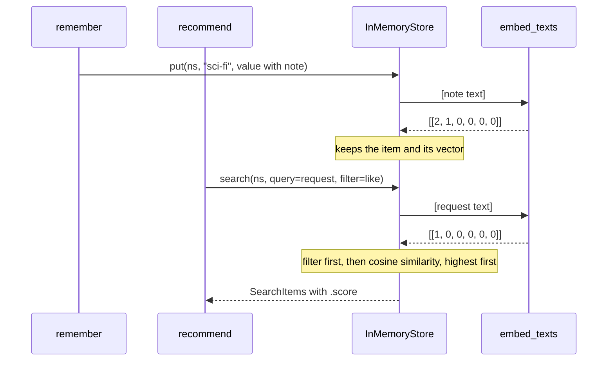
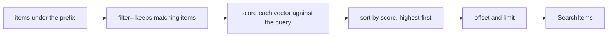
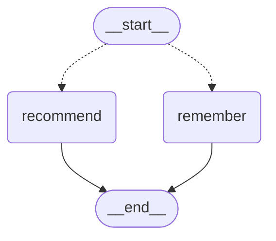

# 5.5 Semantic Search over Memories

## The problem

[Lesson 5.4](../../5.4-long-term-memory-store/docs/notes.md) gave the reading-list assistant a [long-term memory](../../../GLOSSARY.md#long-term-memory): a store that keeps each user's genres under a [store namespace](../../../GLOSSARY.md#store-namespace) built from the user id. Every lookup in that lesson was exact. `get(("ada", "genres"), "sci-fi")` finds the item whose key is exactly `"sci-fi"`. `search(..., filter={"stance": "like"})` keeps the items whose `stance` field is exactly `"like"`. When Ada asked for a book, the assistant could only list every liked genre, because it had no way to tell which of them her request was about.

People rarely talk in keys. Ada says "Something with a spaceship, please." The word "sci-fi" is not in that sentence, and neither is any other key in her namespace. A keyed lookup for `"spaceship"` or `"space"` returns `None`. A filter can't help either, because filters compare whole field values. Still, any person who had heard Ada say "I love sci-fi: robots and distant planets." would connect the two sentences at once. They mean related things.

So the store needs a second way to look things up: by **meaning**. That is what this lesson adds. The graph, the routing and the namespaces from 5.4 stay as they are. Only the store gets a new capability, and `recommend` starts using it.

## The concept

### Embeddings: meaning as a direction

A computer can't compare meanings directly, but it can compare numbers. An [embedding](../../../GLOSSARY.md#embedding) is a list of numbers, a vector, that stands for a text. It is built so that texts with similar meaning get vectors that point in similar directions. The component that produces embeddings is an *embedding model*. You give it texts, and it returns one vector per text, always of the same length.

A real embedding model is a neural network trained on large amounts of text. Its vectors have hundreds or thousands of components (1536 for OpenAI's `text-embedding-3-small`, for example). No single component has a meaning you could name. The training has arranged them so that "spaceship" and "distant planets" end up close together, and "detective" ends up somewhere else.

This course runs offline, with no API keys, so the lesson can't call a real model. Instead it uses a hand-written stand-in, small enough to read. Each of its six components is a **theme** with a word list: `space`, `robots`, `crime`, `magic`, `past`, and an extra `other` axis. A text's value on a theme is how many of its words are on that theme's list. "spaceship" and "planet" are both on the `space` list, so both push a vector in the same direction, even though they are different words. That is the core idea of embeddings, done by hand. A real model learns its axes from data, and it understands words that no list mentions. The theme embedding only knows the 28 words in its lists. It is a teaching device that makes the numbers in the output easy to check, not a technique to use in an application.

### Cosine similarity: comparing directions

Once texts are vectors, "how similar are these two texts?" becomes "how closely do these two vectors point the same way?". The standard measure is [cosine similarity](../../../GLOSSARY.md#cosine-similarity): the cosine of the angle between the two vectors. It is computed from the dot product and the two lengths:

$$
\cos(a, b) = \frac{a \cdot b}{\lVert a \rVert \, \lVert b \rVert} = \frac{\sum_i a_i b_i}{\sqrt{\sum_i a_i^2} \, \sqrt{\sum_i b_i^2}}
$$

- 1.0 means the vectors point in exactly the same direction.
- 0.0 means they share no direction at all. With the theme embedding, that happens when two texts have no theme in common.
- In general the value can go down to −1.0, for opposite directions. The theme embedding only counts words, so its components are never negative and its scores stay between 0 and 1.

Dividing by the lengths is what makes this a comparison of *directions*. A long note with many theme words and a short query with one can still score high, as long as they lean toward the same themes. It also means that a vector of all zeros has no direction, and the formula divides by zero. Real models don't produce zero vectors, but a fake can. That is why the theme embedding has its `other` axis (see "Details and edge cases").

Here is the lesson's first match worked through. The axes are `[space, robots, crime, magic, past, other]`:

- Ada's note "I love sci-fi: robots and distant planets." gives $a = (2, 1, 0, 0, 0, 0)$: "sci-fi" and "planet" count toward `space`, "robot" toward `robots`.
- The request "Something with a spaceship, please." gives $b = (1, 0, 0, 0, 0, 0)$.
- The dot product is $2$, the lengths are $\sqrt{5}$ and $1$, so the score is $2/\sqrt{5} \approx 0.89$.

That 0.89 is the number the program prints.

### Semantic search in a LangGraph store

[Semantic search](../../../GLOSSARY.md#semantic-search) is finding stored items by meaning: embed every item once, embed the query, and return the items whose vectors are most similar to the query vector, best first. A LangGraph store does this for you when you give it an index configuration, an [IndexConfig](../../../GLOSSARY.md#indexconfig), at creation time:

```python
store = InMemoryStore(index={"dims": ..., "embed": ..., "fields": [...]})
```

`IndexConfig` is a `TypedDict` from `langgraph.store.base` with three keys:

- **`embed`**: how text becomes a vector. It can be a LangChain `Embeddings` object, a provider string such as `"openai:text-embedding-3-small"`, or simply an [embedding function](../../../GLOSSARY.md#embedding-function): a function that takes a list of texts and returns a list of vectors. The store wraps a plain function in an `Embeddings` adapter itself (`ensure_embeddings` in `langgraph.store.base.embed`), so no subclass is needed.
- **`dims`**: the length of the vectors.
- **`fields`**: which parts of each stored value are embedded, as JSON paths. The default is the root path \$, which embeds the whole value serialised as JSON. `["note"]` embeds only the `note` field.

With an index in place, the store embeds the chosen fields on every `put` and keeps the vectors next to the items. `search(namespace_prefix, query="...")` embeds the query and returns [SearchItem](../../../GLOSSARY.md#searchitem) objects sorted by `score`, highest first. For `InMemoryStore` the score is the cosine similarity. The `filter=`, `limit=` and `offset=` parameters from 5.4 still work, and they combine with `query=`.

> [!NOTE]
> The LangGraph memory guide points out that *semantic memory* and *semantic search* are different things. Semantic memory means remembering facts about the user, which is what the store already did in 5.4. Semantic search is a way to retrieve them. This lesson adds the retrieval technique and leaves the kind of memory unchanged.

## How it works

The index sits inside the store. The nodes keep calling the same `put` and `search` methods as in 5.4, and the store adds the embedding steps behind them. This diagram follows Ada's first Monday sentence into the store, and then the Tuesday spaceship request out of it:



Inside `search`, the steps come in a fixed order, and the order matters:



The filter chooses the candidates **before** anything is ranked. An item that fails the filter is never scored, however close its meaning is. Ranking then orders whatever is left, and `limit` (default 10) cuts the list after the ranking, so you get the best `limit` candidates. Nothing in these steps throws away an item for scoring low. A vector search always ranks; it never decides that an item is irrelevant. If the namespace holds only unrelated memories, `search` still returns them, at the top of the list, with low scores. Deciding what counts as relevant is the caller's job.

## In our example

The program is the reading-list assistant from 5.4, with the same graph:



This diagram was generated from the code with `get_graph().draw_mermaid()` (styling removed). It is identical to 5.4's, because the index belongs to the store and the graph doesn't know about it. The [code walkthrough](readalong.md) explains every changed line. Here we map the concepts onto the code.

### The embedding function

<!-- snippet: src/l5_5_semantic_memory_search/assistant.py#fake_embedding -->
```python
# Each vector dimension is a THEME. Words with a similar meaning share a theme,
# so "spaceship" and "planets" land on the same axis. That is a hand-made,
# very small version of what a real embedding model learns from data (with
# hundreds or thousands of dimensions). This one has six that we can read:
# [space, robots, crime, magic, past, other].
THEMES: dict[str, set[str]] = {
    "space": {"sci-fi", "space", "spaceship", "planet", "star", "alien"},
    "robots": {"robot", "android", "machine", "computer"},
    "crime": {"mystery", "detective", "crime", "murder", "clue", "whodunit"},
    "magic": {"fantasy", "magic", "wizard", "dragon", "spell", "quest"},
    "past": {"history", "ancient", "empire", "rome", "king", "war"},
}


def embed_texts(texts: Sequence[str]) -> list[list[float]]:
    """Turn each text into a vector: one count per theme, plus an "other" axis.

    This is an embedding function: texts in, vectors out. The store calls it
    with a batch of texts, both for the memories it indexes on put and for
    the query on search, and expects one vector of the same length per text.
    Similar meaning gives vectors pointing the same way, and so a higher
    cosine similarity.
    """
    vectors: list[list[float]] = []
    for text in texts:
        # A naive plural strip ("planets" -> "planet"); the hyphen in the
        # pattern keeps "sci-fi" one word.
        words = [w.removesuffix("s") for w in re.findall(r"[a-z-]+", text.lower())]
        # A text's value on a theme is how many of its words belong to it.
        vector = [float(sum(w in theme_words for w in words)) for theme_words in THEMES.values()]
        # The "other" axis is 1.0 only when no theme word appears, so no vector
        # is ever all zeros. Cosine similarity divides by the vector length,
        # and a zero vector has no direction (the score would be nan). Real
        # models never return zero vectors; this guard exists only because
        # the fake is so small.
        vector.append(0.0 if any(vector) else 1.0)
        vectors.append(vector)
    return vectors
```
<!-- /snippet -->

`embed_texts` has exactly the shape the store expects from an embedding function: a sequence of texts in, one list of floats per text out, all of the same length. The store calls it in two situations. On `put`, it passes the texts to index. On `search` with a query, it passes a one-item list with the query. The function doesn't know which of the two is happening, and it doesn't need to. Documents and queries must be embedded by the same function, or their vectors would not be comparable.

These are the vectors behind every score in the run:

| Text | space | robots | crime | magic | past | other |
|---|---|---|---|---|---|---|
| "I love sci-fi: robots and distant planets." (Ada's sci-fi note) | 2 | 1 | 0 | 0 | 0 | 0 |
| "I like mystery too, a detective in ancient Rome." (Ada's first mystery note) | 0 | 0 | 2 | 0 | 2 | 0 |
| "Please skip mystery for now." (Ada's mystery note after the skip) | 0 | 0 | 1 | 0 | 0 | 0 |
| "I love fantasy: dragons, wizards and an old king." (Bob's note) | 0 | 0 | 0 | 3 | 1 | 0 |
| "Something with a spaceship, please." | 1 | 0 | 0 | 0 | 0 | 0 |
| "I am in the mood for a whodunit." | 0 | 0 | 1 | 0 | 0 | 0 |
| "Anything with a wizard?" | 0 | 0 | 0 | 1 | 0 | 0 |
| "Any book for tonight?" | 0 | 0 | 0 | 0 | 0 | 1 |
| "space robots" | 1 | 1 | 0 | 0 | 0 | 0 |

You can check any score from this table with the formula above. The whodunit request against the first mystery note: $2/\sqrt{8} \approx 0.71$. The wizard request against Bob's note: $3/\sqrt{10} \approx 0.95$. "space robots" against the sci-fi note: $3/(\sqrt{2}\sqrt{5}) \approx 0.95$.

### The index configuration

<!-- snippet: src/l5_5_semantic_memory_search/assistant.py#memory_index -->
```python
# The store's embedding index. A plain function is enough for "embed": the
# store wraps it itself (no Embeddings subclass needed).
# - dims: the vector length. InMemoryStore does not check it, but stores that
#   keep vectors in a database column use it to size that column.
# - embed: how text becomes a vector.
# - fields: WHICH part of a value is embedded. Only "note" (what the user
#   said), not "genre" or "stance". The default is ["$"], the whole value as
#   JSON.
# A real model plugs in here without other changes, for example
#   {"dims": 1536, "embed": init_embeddings("openai:text-embedding-3-small"),
#    "fields": ["note"]}
# with `from langchain.embeddings import init_embeddings` (needs the
# langchain and langchain-openai packages and an API key), or
# "embed": "openai:text-embedding-3-small" as a string, which the store
# resolves through the same init_embeddings.
# The config lives here, not in __main__, so lesson 5.6 can pass the same
# MEMORY_INDEX to PostgresStore.
MEMORY_INDEX: IndexConfig = {"dims": len(THEMES) + 1, "embed": embed_texts, "fields": ["note"]}

# search always returns the nearest memories, even unrelated ones (score 0.00
# here, a low but non-zero number with real models), so the caller decides
# what counts as relevant. The value has to be tuned for each embedding model.
MIN_SCORE = 0.5
```
<!-- /snippet -->

`MEMORY_INDEX` is the whole semantic-search setup in one value. `fields=["note"]` is a deliberate choice. The value `remember` stores is `{"genre": ..., "stance": ..., "note": ...}`, and only the note, the user's own sentence, carries the meaning we want to match. The stance is a flag for `filter=`, not text to understand. The genre is already the key. The config lives in `assistant.py`, not in `__main__.py`, so that lesson 5.6 can hand the same value to a database-backed store.

`main` creates the store with it, `store = InMemoryStore(index=MEMORY_INDEX)`. The index is part of the store from the moment it is created.

### Plugging in a real embedding model

Nothing in the nodes depends on the theme embedding. To use a real model you change the `embed` and `dims` values in `MEMORY_INDEX`, and nothing else. The code comment shows the usual form, which this course does not run:

```python
from langchain.embeddings import init_embeddings

MEMORY_INDEX: IndexConfig = {
    "dims": 1536,
    "embed": init_embeddings("openai:text-embedding-3-small"),
    "fields": ["note"],
}
```

This needs the `langchain` and `langchain-openai` packages and an OpenAI API key. Writing `"embed": "openai:text-embedding-3-small"` as a plain string works too: the store resolves the string through the same `init_embeddings`. A third option is your own function that calls any embedding API and returns its vectors, because a plain function is all the store requires. The `InMemoryStore` docstring shows one that wraps the OpenAI SDK. In every case `dims` must match the model's output length. `IndexConfig`'s docstring lists the lengths for common models.

The official [memory-agent](https://github.com/langchain-ai/memory-agent) template uses the string form in its `langgraph.json`, with `dims` 1536 and `openai:text-embedding-3-small`, so that the LangGraph server can create the indexed store for it.

### Writing: `remember` stores the sentence

`remember` changed in one line. The value it puts is now `{"genre": genre, "stance": stance, "note": text}`, where `text` is the whole user message. Because the store has an index, that same `put` also embeds the note. The node doesn't call `embed_texts` itself. The key is still the genre, so `put` is still an [upsert](../../../GLOSSARY.md#upsert), and an upsert replaces the vector along with the value. When Ada says "Please skip mystery for now.", the mystery item gets that sentence as its note and a new vector. The old vector for "a detective in ancient Rome" is gone, and so is the item's match with "ancient Rome".

### Reading: `recommend` ranks by meaning

<!-- snippet: src/l5_5_semantic_memory_search/assistant.py#recommend_node -->
```python
def recommend(state: MessagesState, runtime: Runtime[UserContext]) -> dict[str, Any]:
    """Recommend the liked genres that match the request, or all of them."""
    text = state["messages"][-1].content
    # search takes a namespace PREFIX (positional). With query= the store
    # embeds the request, compares it with each memory's vector and returns
    # SearchItems sorted by .score (cosine similarity, 1.0 = same direction),
    # highest first. filter= is applied BEFORE ranking, so an avoided genre
    # never comes back however close it is. limit (default 10) caps how many
    # come back.
    liked = runtime.store.search(
        genres_namespace(runtime.context.user_id), query=text, filter={"stance": "like"}
    )
    if not liked:
        return {"messages": [AIMessage("Tell me a genre you like and I will pick a book.")]}
    # score is None when the store has no index (then query= is ignored) or
    # for an item put with index=False, hence the `is not None` check.
    relevant = [item for item in liked if item.score is not None and item.score >= MIN_SCORE]
    if relevant:
        # Keep the store's order: highest score first.
        picks = "; ".join(
            f"{CATALOG[item.key]} ({item.key}, score {item.score:.2f})" for item in relevant
        )
    else:
        # Nothing is relevant: fall back to every liked genre. Tied or None
        # scores give no useful order, so sort the keys yourself.
        picks = "; ".join(f"{CATALOG[genre]} ({genre})" for genre in sorted(i.key for i in liked))
    return {"messages": [AIMessage(f"Try: {picks}.")]}
```
<!-- /snippet -->

The node now makes one call with both kinds of lookup. `query=text` ranks the user's memories by meaning, and `filter={"stance": "like"}` removes avoided genres before the ranking. The result is then read in three steps:

1. **No liked memories at all**: the 5.4 reply asking for a genre. This is the only case in which `search` returns an empty list. With a query, the store still returns every liked memory (up to `limit`), however unrelated.
2. **Some memories reach `MIN_SCORE`**: recommend those, in the store's order (highest score first), each with its score.
3. **None reaches it**: the request was too vague to match anything, so fall back to 5.4's behaviour and list every liked genre. The keys are sorted in the code, because scores that are all equal (or all `None`) say nothing about which item should come first.

`MIN_SCORE = 0.5` is a threshold for this fake. An unrelated memory scores exactly 0.00 here, because it shares no theme with the query. With a real model, unrelated texts usually still get a positive score, and where "related" begins depends on the model. The threshold has to be tuned for each model, with real examples.

### Keys versus meaning, side by side

<!-- snippet: src/l5_5_semantic_memory_search/__main__.py#keys_vs_meaning -->
```python
print("== Keys versus meaning ==")
# get needs the exact key, while search with a query ranks every memory in
# the namespace prefix by meaning. No filter here, so the avoided mystery
# memory is listed too, with score 0.00.
print(f"  get({ns}, 'space') = {store.get(ns, 'space')}")
hits = store.search(ns, query="space robots")
print(
    f"  search({ns}, query='space robots'): "
    + ", ".join(f"{i.key}={i.score:.2f}" for i in hits)
)
```
<!-- /snippet -->

The last section of the run asks the store the same thing in two ways. `get` looks for an item whose key is exactly `"space"`, and there is none. `search` with a query compares the meaning of "space robots" with every memory in the namespace and ranks them. There's no filter here, so Ada's avoided mystery memory appears too, with score 0.00.

## Run it

From the course root, run `./run.sh 5.5`. This is the output of the verified run:

```text
== Monday: Ada shares her taste (thread monday) ==
  ada> I love sci-fi: robots and distant planets.
  bot> Noted: sci-fi (like).
  ada> I like mystery too, a detective in ancient Rome.
  bot> Noted: mystery (like).
  ada> Any book for tonight?
  bot> Try: The Hound of the Baskervilles (mystery); Dune (sci-fi).

== Tuesday: a new thread, the same user (thread tuesday) ==
  thread tuesday starts with 0 messages; thread monday holds 6
  ada> Something with a spaceship, please.
  bot> Try: Dune (sci-fi, score 0.89).
  ada> I am in the mood for a whodunit.
  bot> Try: The Hound of the Baskervilles (mystery, score 0.71).
  ada> Please skip mystery for now.
  bot> Noted: mystery (like -> avoid).
  ada> I am in the mood for a whodunit.
  bot> Try: Dune (sci-fi).

== Bob: his own namespace (thread bob-1) ==
  bob> Recommend something.
  bot> Tell me a genre you like and I will pick a book.
  bob> I love fantasy: dragons, wizards and an old king.
  bot> Noted: fantasy (like).
  bob> Anything with a wizard?
  bot> Try: The Hobbit (fantasy, score 0.95).

== What the store holds ==
  namespaces: [('ada', 'genres'), ('bob', 'genres')]
  ('ada', 'genres') 'mystery': {'genre': 'mystery', 'stance': 'avoid', 'note': 'Please skip mystery for now.'}
  ('ada', 'genres') 'sci-fi': {'genre': 'sci-fi', 'stance': 'like', 'note': 'I love sci-fi: robots and distant planets.'}
  ('bob', 'genres') 'fantasy': {'genre': 'fantasy', 'stance': 'like', 'note': 'I love fantasy: dragons, wizards and an old king.'}
  get(('ada', 'genres'), 'sci-fi').value = {'genre': 'sci-fi', 'stance': 'like', 'note': 'I love sci-fi: robots and distant planets.'}
  get(('ada', 'genres'), 'fantasy') = None
  messages per thread: monday=6, tuesday=8, bob-1=6

== Keys versus meaning ==
  get(('ada', 'genres'), 'space') = None
  search(('ada', 'genres'), query='space robots'): sci-fi=0.95, mystery=0.00
```

The assistant is rule-based and the embedding is a fixed function, so every run prints exactly this. What to notice:

- **Requests that name no genre still find one.** "Something with a spaceship, please." contains no key from Ada's namespace, so `route` sends it to `recommend`, and the search picks sci-fi with 0.89. "whodunit" finds mystery with 0.71, through the `crime` theme that it shares with "mystery" and "detective".
- **A vague request gets the old reply.** "Any book for tonight?" has no theme words, so its vector lies on the `other` axis alone and every memory scores 0.00. Nothing reaches `MIN_SCORE`, and the reply is 5.4's list of all liked genres, with no scores.
- **The filter wins over the ranking.** After the skip, the same whodunit request answers "Dune (sci-fi)". Mystery would have been the best match: its new note contains "mystery" and would score 1.00 against "whodunit". But `filter={"stance": "like"}` removed it before ranking. The only candidate left, sci-fi, scores 0.00, so the fallback answers, without a score.
- **Namespaces still separate users.** Bob's first request finds nothing at all, which gives the "Tell me a genre" reply: semantic search never looks outside the namespace prefix you pass. His wizard request is compared only with his own fantasy memory.
- **The note is part of the value.** The store section shows each note, and mystery's is the skip sentence: the upsert replaced the note, and its vector with it. The vectors themselves are not part of `item.value`, so they are not printed.
- **`get` and `search` answer different questions.** `get(..., 'space')` is `None`, while `search(..., query='space robots')` ranks sci-fi first at 0.95. The avoided mystery memory is listed too, at 0.00, because this search has no filter. It shows the point of the threshold: unrelated items come back as well.

## Details and edge cases

**Keyed or semantic, and when each fits.** The two lookups are complementary, and the lesson uses both:

| | `get(namespace, key)` and `filter=` | `search(namespace, query=...)` |
|---|---|---|
| Finds | the item with exactly this key or field value | the items whose meaning is closest |
| Answer | yes or no, deterministic | a ranking with scores, never "nothing found" |
| Needs | nothing extra | an index, and an embedding call per `put` and per query |
| Fits | known addresses: the user's profile, a setting, "is mystery avoided?" | free-text requests, large collections of notes, "what do I know that relates to this?" |

`remember` still uses `get` to find out whether a genre was already stored, and that is the right tool: it knows the exact key. `recommend` uses semantic search because it gets free text from the user.

**The score is not a probability.** A score of 0.89 does not mean "89% relevant". It only says how this text's vector compares with that one's under this embedding. Scores from different models are not comparable, and a good threshold for one model can be useless for another.

**What you embed decides what can match.** With `fields=["note"]` only the user's words count. Embedding a short label like the genre name gives perfect scores for requests that use the right word, but misses everything else the user said (second experiment). Embedding the whole value with the default root path \$ mixes field names, flags and keys into the text, which here counts the genre twice and with a real model adds noise. `put` also accepts an `index` argument that overrides `fields` for one item: a list of paths embeds those fields instead, and `index=False` stores the item without a vector. `get` and filter-only searches still find such an item. The stores guide only says it is "still retrievable, but not searchable". `InMemoryStore`, in particular, puts unscored items after the scored ones with `score=None`, and only while fewer than `limit` results have been found. That is its own behaviour, so don't assume another store does the same.

**Several embedded fields.** `fields` can list more than one path, and a path into a list (`"items[*].text"`) gives one vector per element. In `InMemoryStore` an item with several vectors gets the best score among them.

**A store without an index ignores `query=`.** `InMemoryStore()` without `index=` accepts `search(..., query="...")` without any error or warning. It just doesn't rank anything, and every `score` is `None` (fourth experiment). The `index` argument of `put` is ignored too. This is why `recommend` checks `item.score is not None` before comparing it with `MIN_SCORE`.

**`dims` is not checked by `InMemoryStore`.** It stores whatever vectors the function returns. Stores that keep vectors in a database column use `dims` to create that column, so that is where a mismatch would show up. `PostgresStore` with an index, for example, needs the pgvector extension in the database server. That setup belongs to lesson 5.6. The lesson's tests check that every vector has `MEMORY_INDEX["dims"]` components, so a mistake shows up before the switch.

**Changing the model means re-embedding.** Vectors from two different models live in different spaces, and comparing them gives meaningless scores. If you switch models, every stored memory has to be embedded again with the new one, for example by putting each value again.

**Every indexed `put` and every query costs an embedding call.** With the theme embedding that costs almost nothing. With a hosted model it is a network request, with its latency, its price and its failure modes, inside your node. The store has async versions of its methods for async nodes (`aput`, `asearch`). This course stays synchronous for now.

**Zero vectors, and why the fake has an `other` axis.** Cosine similarity divides by the length of both vectors, and an all-zero vector has length 0. `InMemoryStore` computes the score with numpy when numpy is installed. For a zero query vector, the division gives `nan` and numpy prints a `RuntimeWarning: invalid value encountered in divide` (third experiment). Every comparison with `nan` is false, so `nan >= MIN_SCORE` silently fails. Real embedding models don't return zero vectors. The `other` axis exists only because the theme embedding knows so few words. Without numpy, `InMemoryStore` uses a pure-Python fallback that returns 0.0 for a zero vector instead, and it logs a one-time "NumPy not found" message to stderr. The lesson adds `numpy` to its dependencies, so the run stays quiet, as the store's docstring recommends.

**Equal scores have no meaningful order.** When several memories tie, which one comes first is not something to build on. The lesson never relies on it: the fallback sorts the keys itself, and the tests compare tied scores as a dict instead of a list.

**Why not `DeterministicFakeEmbedding`?** `langchain_core` has fake embedding classes for tests. Their vectors are random numbers seeded from a hash of the text, so they are stable but carry no meaning, and the scores they produce are as good as random. They are fine for checking that code runs. They are useless for showing that "spaceship" finds sci-fi, which is why the lesson writes its own function.

## Common mistakes

> [!WARNING]
> **Creating the store without an index and passing `query=` anyway.** Nothing fails. `search` ignores the query, every score is `None`, and the results look like any filter-only search. If your app suddenly "recommends everything", check that the store was created with `index=`. Code that formats `score` as a number then fails with `TypeError: unsupported format string passed to NoneType.__format__` (fourth experiment).

> [!WARNING]
> **Treating the top result as relevant.** `search` with a query returns the nearest items even when none of them relates to the request. Without a threshold, an assistant answers "Something with a spaceship" with a detective novel whenever that is all the user has stored. Decide what counts as relevant in your code, and tune the threshold for your model (first experiment).

> [!WARNING]
> **Embedding the whole value by accident.** When `fields` is left out, the default root path \$ embeds the entire value as JSON, keys, flags and all. Choose the fields that carry meaning, usually the user's own text.

> [!WARNING]
> **Expecting a filter to be a ranking hint.** `filter=` removes items before ranking. An avoided memory never comes back, however well it matches. That is what you want for "skip mystery", and it is easy to forget when you wonder why the best match is missing.

> [!WARNING]
> **Making up an embedding that can return all zeros.** A hand-made or keyword-based embedding gives a zero vector for a text with none of its words. The score then becomes `nan`, every comparison with it is false, and the only sign is a numpy warning (third experiment). Make sure such a function never returns a zero vector.

> [!TIP]
> When a score surprises you, call your embedding function directly on the two texts and compute the cosine yourself. With a real model you can't read the components, but you can still compare a few hand-picked pairs to see where your threshold should go.

## Experiments

Each experiment starts from the lesson's original code. Make the change, run `./run.sh 5.5` from the course root, and guess the result before you open the explanation.

1. Drop the threshold: in [assistant.py](../src/l5_5_semantic_memory_search/assistant.py), set `MIN_SCORE = 0.0`.

   <details><summary>What happens and why</summary>

   Every liked memory now passes, related or not, and each reply lists it with its score. The spaceship request gets `Try: Dune (sci-fi, score 0.89); The Hound of the Baskervilles (mystery, score 0.00).`, the first whodunit request lists mystery at 0.71 and then Dune at 0.00, and the whodunit request after the skip gets `Try: Dune (sci-fi, score 0.00).`. "Any book for tonight?" lists both books with score 0.00. Those two scores are tied, so their order means nothing. Search ranks; it never decides that something is irrelevant. That decision is the threshold's job, and you have to tune it for each embedding model. Put the code back as it was (`git checkout -- .` in the lesson directory).

   </details>

2. Embed a different field: in `MEMORY_INDEX`, change `"fields": ["note"]` to `"fields": ["genre"]`. Then try the root path, `["$"]`.

   <details><summary>What happens and why</summary>

   With `["genre"]` only the genre name is embedded. The spaceship, whodunit and wizard requests each score 1.00, because each hits exactly the one theme of its genre word ("sci-fi" is on the `space` list, "mystery" on `crime`, "fantasy" on `magic`). "space robots" drops from 0.95 to 0.71, because "robots" appeared only in the note. With the root path the whole value is embedded as JSON, so the genre is counted twice (as the `genre` value and in the note) and the scores become 0.95 (spaceship), 0.83 (whodunit), 0.97 (wizard), and 0.89 for "space robots". What you choose to embed decides what can match. With a real model, keys and flags such as `stance` only add noise. Put the code back as it was.

   </details>

3. Remove the `other` axis: in `embed_texts`, delete the `vector.append(...)` line, and change `dims` to `len(THEMES)`.

   <details><summary>What happens and why</summary>

   Monday's "Any book for tonight?" now embeds to all zeros. The run also prints `RuntimeWarning: invalid value encountered in divide` from `langgraph/store/memory/__init__.py`: the scores are `nan`. The reply is unchanged only because `nan >= MIN_SCORE` is false, so the fallback answers as before. Cosine similarity divides by the vector length, and a zero vector has no direction. Real models never produce one, but a hand-made fake can. Put the code back as it was.

   </details>

4. Forget the index: in [\_\_main\_\_.py](../src/l5_5_semantic_memory_search/__main__.py), create the store with `InMemoryStore()`, without `index=`.

   <details><summary>What happens and why</summary>

   Every request now gets the keyed 5.4 behaviour. The spaceship request lists both books, with no scores, and Bob's wizard request gets `Try: The Hobbit (fantasy).`. The program gets all the way to the last section, prints the `get` line, and then crashes with `TypeError: unsupported format string passed to NoneType.__format__`, because every `score` is `None`. The store never complained about `query=`: without an index it silently ignores it. That mistake is easy to miss. Put the code back as it was.

   </details>

5. Plug in a real model by name: in `MEMORY_INDEX`, set `"embed": "openai:text-embedding-3-small"` and `"dims": 1536`.

   <details><summary>What happens and why</summary>

   No conversation runs. `InMemoryStore(index=MEMORY_INDEX)` fails at once with `ValueError: Could not load embeddings from string 'openai:text-embedding-3-small'. langchain is not installed; ...`. The string form goes through `init_embeddings` from the `langchain` package, and also needs the provider package (`langchain-openai`) and an API key, none of which this course installs. The error comes when the store is built, not on the first search. With those packages and a key, nothing else in the program would have to change: the nodes only see `put` and `search`, which is the point of keeping the index in one `IndexConfig`. Put the code back as it was.

   </details>

## Summary

- An embedding is a vector that stands for a text, built so that similar meanings point in similar directions. Cosine similarity compares directions: 1.0 for the same direction, 0.0 for nothing in common.
- `InMemoryStore(index={"dims": ..., "embed": ..., "fields": [...]})` turns on semantic search. `embed` can be a plain function from texts to vectors, an `Embeddings` object or a provider string. `fields` chooses what is embedded, and `put` embeds it automatically.
- `search(prefix, query=..., filter=...)` filters first, then returns `SearchItem`s ranked by `score`, highest first. It always returns the nearest items, so the caller sets a relevance threshold, tuned for the model.
- `get` and filters find exact keys and values. Semantic search finds meaning. Use each where it fits, and both together when a request is free text but some items must be excluded.
- A store without an index silently ignores `query=`, and every score is `None`.
- The lesson's theme embedding is a readable stand-in for a real model. A real model plugs in by changing `embed` and `dims` in one `IndexConfig`.

## Self-check

1. Ada's store holds a sci-fi memory with the note "robots and distant planets". She asks "anything about aliens?". Why does `store.get(ns, "aliens")` return `None` while `store.search(ns, query="anything about aliens?")` can return the sci-fi memory first?

   <details><summary>Answer</summary>

   `get` looks for an item whose key is exactly `"aliens"`, and there is none. `search` with a query embeds the request and compares its vector with the vector of each memory's note. "alien" is on the same `space` theme as "planet", so the two vectors share a direction and the sci-fi memory scores above zero. A real model makes the same kind of connection without any word list.

   </details>

2. A search returns one memory with score 0.12. Should the assistant recommend it?

   <details><summary>Answer</summary>

   Not just because it came back. `search` with a query always returns the nearest items, related or not. Whether 0.12 is relevant depends on the embedding model and on a threshold you tuned for it. With the lesson's `MIN_SCORE = 0.5` it is not relevant, and the assistant falls back to the general reply.

   </details>

3. Ada has said "Please skip mystery for now." Why does "I am in the mood for a whodunit." no longer find mystery, even though mystery is the best match?

   <details><summary>Answer</summary>

   `recommend` passes `filter={"stance": "like"}`, and the filter is applied before ranking. The mystery item's stance is now `"avoid"`, so it is never a candidate and never gets scored. The only candidate left, sci-fi, scores 0.00, so the fallback answers.

   </details>

4. You moved from the theme embedding to a real model, and now every recommendation lists all liked genres. The scores are low but not zero. What would you check first?

   <details><summary>Answer</summary>

   The threshold. `MIN_SCORE = 0.5` was chosen for the fake. A real model gives different score ranges, so tune the threshold with real examples of related and unrelated requests. If the scores are `None` instead, the store was created without `index=`.

   </details>

5. Why does the lesson embed only `note` and not the whole value?

   <details><summary>Answer</summary>

   Only the user's sentence carries the meaning that requests should match. The genre is already the key, and the stance is a flag for `filter=`. Embedding the whole value (the default root path) mixes field names and flags into the text, which distorts the scores.

   </details>

## Further reading

- [Stores](https://docs.langchain.com/oss/python/langgraph/stores), LangGraph docs: the "Semantic search" section with `index`, `dims`, `embed` and `fields`, natural-language queries, and `put` with `index=False` or a list of fields.
- [Memory overview](https://docs.langchain.com/oss/python/langgraph/memory), LangGraph docs: long-term memory types, and the difference between semantic memory and semantic search.
- [Persistence](https://docs.langchain.com/oss/python/langgraph/persistence), LangGraph docs: checkpointers for thread state versus stores for cross-thread memory.
- [`langgraph/store/base/__init__.py`](https://github.com/langchain-ai/langgraph/blob/1.2.16/libs/checkpoint/langgraph/store/base/__init__.py) at tag 1.2.16 (langgraph-checkpoint 4.3.0): `IndexConfig` with the `dims` values of common models and the `fields` path syntax, `SearchItem`, and the `index` argument of `put`.
- [`langgraph/store/base/embed.py`](https://github.com/langchain-ai/langgraph/blob/1.2.16/libs/checkpoint/langgraph/store/base/embed.py) at tag 1.2.16: `ensure_embeddings`, which wraps a plain function or resolves a provider string.
- [`langgraph/store/memory/__init__.py`](https://github.com/langchain-ai/langgraph/blob/1.2.16/libs/checkpoint/langgraph/store/memory/__init__.py) at tag 1.2.16: how `InMemoryStore` embeds on `put`, filters before ranking, and computes cosine similarity with or without numpy.
- [langchain-ai/memory-agent](https://github.com/langchain-ai/memory-agent): the official long-term memory template, which configures the store index in `langgraph.json` and searches memories with `query=`.
- [Long-Term Agentic Memory With LangGraph](https://deeplearning.ai/courses/long-term-agentic-memory-with-langgraph), DeepLearning.AI: semantic memory as storing facts about the user and searching them in later interactions.
