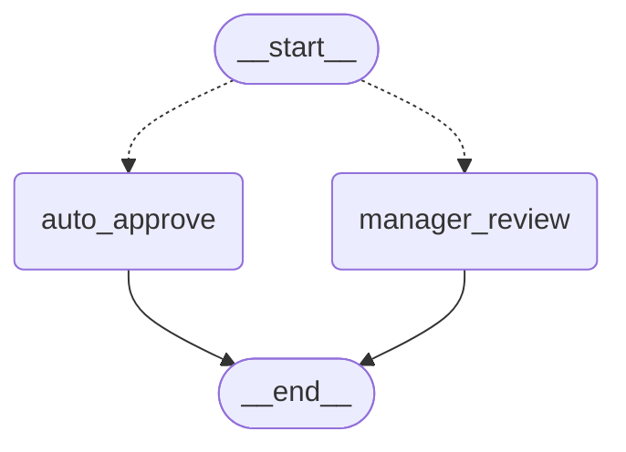
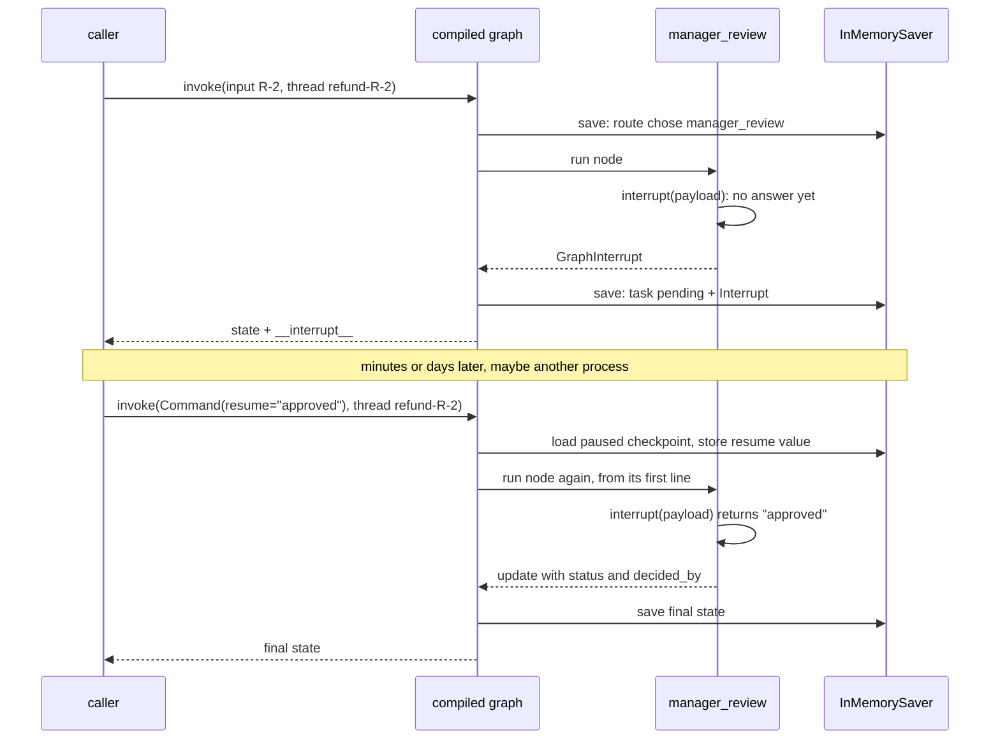

# 6.1 Pausing with interrupt() and Resuming with Command

## The problem

Every graph so far ran from `START` to `END` in one call. Nodes called functions, a model, tools, but never a person. Many real workflows need a person somewhere in the middle:

- a refund above some amount needs a manager's approval,
- an agent wants to delete data and should ask first,
- a draft should be reviewed before it is sent.

The obvious approach is to wait inside the node: call `input()`, or poll a database until someone answers. Neither works in a service. The manager may answer in ten minutes or tomorrow, from a different web request, maybe after the server restarted. You can't keep a Python call stack alive that long, and you don't want a worker thread blocked while nobody is looking.

What you want instead: the run **stops** at the point where it needs a person, its progress is **saved**, the caller gets told **what to ask**, and later, from anywhere, someone **continues** the run with the answer. Lesson 5.1 already gave you half of that. A [checkpointer](../../../GLOSSARY.md#checkpointer) saves a thread's state after every step, and a [thread_id](../../../GLOSSARY.md#thread_id) finds it again. Its notes ended with this very use case: "Module 6 stops a run halfway to ask a human". This lesson adds the other half: a way for a node to stop the run and a way to send the answer back in.

## The concept

[Human-in-the-loop](../../../GLOSSARY.md#human-in-the-loop) (often shortened to HITL) means a running graph stops at a chosen point, hands information to a person and continues with that person's answer. LangGraph builds it from two pieces, both in `langgraph.types`.

### interrupt(): stop here and ask

[interrupt()](../../../GLOSSARY.md#interrupt) is a function you call inside a node:

```python
decision = interrupt({"question": "Approve a refund of $250 for R-2?"})
```

Its argument is the **payload**: whatever the person needs to see in order to decide. The call behaves differently depending on whether an answer exists yet:

- **No answer yet.** `interrupt()` does not return. It stops the node, LangGraph saves the thread with this node still pending, and the run ends. The caller gets the payload back.
- **An answer was sent.** The same call returns the answer, and the node carries on from there.

From the node's point of view, `interrupt()` is a function call that takes a very long time and returns what a human typed. That is the mental model to keep, with one correction that comes up under [How it works](#how-it-works): the node does not continue from the middle; it runs again from its first line.

### The pending interrupt

While a thread is paused, LangGraph describes the pause with an [Interrupt object](../../../GLOSSARY.md#interrupt-object) (`langgraph.types.Interrupt`). It has three fields:

| Field | What it holds |
|---|---|
| `value` | the payload passed to `interrupt()`, unchanged |
| `id` | a string that identifies this interrupt (lesson 6.3 uses it) |
| `response_schema` | a schema for the expected answer, `None` unless you pass one |

You can read pending interrupts in three places: in the result of the `invoke` that paused, in `get_state()` of the thread, and per task inside that snapshot. The example prints all three and shows they are the same interrupt.

### Command(resume=...): send the answer

In lesson 3.3 a node *returned* a [Command](../../../GLOSSARY.md#command) to update state and choose the next node. Here the caller *passes* one to `invoke` in place of the input:

```python
graph.invoke(Command(resume="approved"), {"configurable": {"thread_id": "refund-R-2"}})
```

The value in `resume` is the [resume value](../../../GLOSSARY.md#resume-value). LangGraph loads the paused thread named by the thread_id, runs the pending node again, and this time `interrupt()` returns `"approved"`. The official guide is explicit that `Command(resume=...)` is the only kind of `Command` meant as input to `invoke()` or `stream()`; `update` and `goto` belong in nodes.

### Why a checkpointer and a thread_id are required

The pause *is* a saved [checkpoint](../../../GLOSSARY.md#checkpoint). Nothing stays in memory between the pausing call and the resuming call. The resume only works because it can load the checkpoint again, and it finds it by thread_id. So:

- **No checkpointer, no resume.** The graph can still stop and report the interrupt, but nothing was saved, so there is nothing to continue.
- **The thread_id is the address of the paused run.** The code that resumes needs nothing but this id: not the original result, not the original input, not the same process.

## How it works

### The graph

The example graph is small: a [conditional edge](../../../GLOSSARY.md#conditional-edge) from `START` picks one of two nodes by amount, and both end the run. The diagram was generated from the code with `build_graph(None).get_graph().draw_mermaid()` (styling removed). The dotted arrows are the conditional edge.



Nothing in the graph's structure marks `manager_review` as special. The pause happens inside the node, at run time, when it calls `interrupt()`. That is the main difference from static breakpoints (`interrupt_before`/`interrupt_after` at compile time), which the guide lists as a debugging tool and which this course does not use for human-in-the-loop.

### Pause and resume, step by step

Follow refund R-2 through two separate `invoke` calls. Look at where the checkpointer is read and written, and at the fact that `manager_review` starts twice.



The first call:

1. The routing function sends R-2 to `manager_review`. As in lesson 5.1, a checkpoint is written at the end of that [super-step](../../../GLOSSARY.md#super-step), with `manager_review` as the next node.
2. `manager_review` runs and calls `interrupt(payload)`. There is no resume value, so `interrupt()` raises [GraphInterrupt](../../../GLOSSARY.md#graphinterrupt), an exception that carries an `Interrupt` with the payload.
3. LangGraph catches the exception. The node does not count as failed. The `Interrupt` is saved with the checkpoint as a write of the pending `manager_review` task, and the run ends.
4. `invoke` returns normally. It does not raise. The result is the state so far plus the interrupt (the exact shape depends on the output version, below).

The second call:

1. `Command(resume="approved")` with the same thread_id. LangGraph loads the thread's latest checkpoint, which still has `manager_review` pending, and saves the resume value with it.
2. The pending task runs again. Routing does not run again: the run continues from the checkpoint, not from `START`.
3. `manager_review` starts **from its first line**. When it reaches `interrupt()`, the call finds the resume value and returns it.
4. The node returns its update, the graph reaches `END`, and the final state is saved and returned.

> [!IMPORTANT]
> A resumed node runs again from the top. Python cannot freeze a function halfway and continue it later in another process, so LangGraph replays the node instead, and `interrupt()` returns the saved answer the second time. Everything before the `interrupt()` call runs twice. Lesson 6.3 explains the rules this implies.

### Reading the pending interrupt: v1, v2 and get_state

`invoke` has two output formats, which you met in lesson 2.1:

- **v1, the default.** `invoke` returns the state dict. When the run paused, the dict has one extra key, [\_\_interrupt\_\_](../../../GLOSSARY.md#__interrupt__), holding a **list** of `Interrupt` objects. When the run finished, the key is absent. (`stream()` emits the same key with a tuple instead of a list.)
- **v2, opt-in since 1.1.** `invoke(..., version="v2")` returns a [GraphOutput](../../../GLOSSARY.md#graphoutput). `.value` is the state and never contains `__interrupt__`; `.interrupts` is a tuple, empty when the run finished.

And from the thread itself, without any invoke result, [get_state](../../../GLOSSARY.md#get_state) returns a [StateSnapshot](../../../GLOSSARY.md#statesnapshot) whose fields describe the pause:

| Field | While paused | After the resume |
|---|---|---|
| `next` | `('manager_review',)`: the node that will run again | `()` |
| `values` | the state without the node's output | the final state |
| `interrupts` | a tuple with the pending `Interrupt` | `()` |
| `tasks` | one task, `name='manager_review'`, with the same `Interrupt` in its `interrupts` | `()` |

`get_state` is how a different part of the application finds work to do. A web page with the manager's inbox doesn't have the original `invoke` result. It has thread_ids, and for each one it can read `snapshot.interrupts[0].value` to show the question.

## In our example

The "refund-approval" example is new in this lesson; 6.2, 6.3 and 6.5 extend it. A refund has an id and an amount in whole dollars. Up to `REFUND_LIMIT = 100` it is approved by policy; above that a manager decides. The [code walkthrough](readalong.md) goes through every line; here we map the concepts onto the code.

### The node that asks

<!-- snippet: src/l6_1_interrupt_and_resume/refunds.py#manager_review -->
```python
def manager_review(state: RefundState) -> dict[str, str]:
    """Pause the graph until a manager approves or rejects the refund.

    First run: ``interrupt()`` raises internally (a ``GraphInterrupt``) and the
    graph stops right here. LangGraph saves a checkpoint with this task still
    pending and the payload attached, and hands the payload to the caller.
    The payload must be JSON-serialisable, because it is stored with the
    checkpoint and sent to whoever answers it.

    Resume: when the caller invokes the same thread with
    ``Command(resume=...)``, this node runs again FROM ITS FIRST LINE (so the
    "started" print shows up twice), and this time ``interrupt()`` does not
    pause: it returns the value from ``Command(resume=...)``.
    Lesson 6.3 explains the rules this implies.
    """
    # Runs on the first run AND again on resume: the node restarts from the top.
    print(f"  [manager_review] started for {state['request_id']}")
    decision = interrupt(
        {
            "request_id": state["request_id"],
            "amount": state["amount"],
            "question": f"Approve a refund of ${state['amount']} for {state['request_id']}?",
        }
    )
    # Only reached on resume: `decision` is the human's answer, e.g. "approved".
    print(f"  [manager_review] resumed with {decision!r}")
    return {"status": decision, "decided_by": "manager"}
```
<!-- /snippet -->

The payload is a plain dict with the id, the amount and a ready-made question, so whoever answers needs nothing else. It contains only strings and an int on purpose: the payload is stored with the checkpoint and sent to the caller, and the guide asks for JSON-serializable values.

The two prints frame the `interrupt()` call. The first one runs on every start of the node, the second one only after a resume. Counting them in the output is how you see the restart.

`decision` goes into the state as it is. The node doesn't check it, and nothing routes on it yet: that is lesson 6.2.

### The checkpointer is a parameter

<!-- snippet: src/l6_1_interrupt_and_resume/refunds.py#build_graph -->
```python
def build_graph(checkpointer: BaseCheckpointSaver | None) -> CompiledStateGraph:
    """Build the refund graph: START routes by amount, both nodes end the run.

    interrupt() needs a checkpointer: the pause *is* a saved checkpoint, and
    resuming means loading that checkpoint again by thread_id. Without one the
    first run still returns the interrupt to the caller, but nothing is saved,
    so nothing can resume it.
    """
    builder = StateGraph(RefundState)
    builder.add_node("auto_approve", auto_approve)
    builder.add_node("manager_review", manager_review)
    builder.add_conditional_edges(START, route_by_amount)
    builder.add_edge("auto_approve", END)
    builder.add_edge("manager_review", END)
    return builder.compile(checkpointer=checkpointer)
```
<!-- /snippet -->

The same pattern as lesson 5.1: `build_graph` takes the saver, and [\_\_main\_\_.py](../src/l6_1_interrupt_and_resume/__main__.py) creates one [InMemorySaver](../../../GLOSSARY.md#inmemorysaver) for the whole run. `None` is allowed so the tests and the first experiment can show what goes wrong without one. A small helper, `config(request_id)`, gives every refund its own thread, `refund-R-2` and so on. This is the [run config](../../../GLOSSARY.md#run-config) from lesson 2.4.

### The pause, as the caller sees it

<!-- snippet: src/l6_1_interrupt_and_resume/__main__.py#pause -->
```python
print("== R-2: $250 pauses for the manager (v1 output) ==")
# In the default v1 format, invoke does not raise when the graph pauses.
# It returns the state so far plus an "__interrupt__" key holding a list
# of Interrupt objects (fields: value, id, response_schema). "status" is
# missing because manager_review has not returned yet.
result = graph.invoke({"request_id": "R-2", "amount": 250}, config("R-2"))
print(f"  keys: {sorted(result)}")
pending = result["__interrupt__"]
print(f"  pending interrupts: {len(pending)}")
print(f"  payload: {pending[0].value}")
# The id is a long generated string; print only whether it is set.
print(f"  interrupt id set: {bool(pending[0].id)}")
print()
```
<!-- /snippet -->

A normal `invoke` call, and it returns normally. The caller tells a pause from a finished run by the `__interrupt__` key, and reads the question from `pending[0].value`.

### The pause, as the thread sees it

<!-- snippet: src/l6_1_interrupt_and_resume/__main__.py#pending_state -->
```python
print("== get_state while paused ==")
# This is how a separate process (say a web handler showing the manager's
# inbox) finds pending requests without the invoke result: it loads the
# thread's latest checkpoint. `next` names the node that will run again,
# `interrupts` lists the interrupts still waiting for an answer, and
# `tasks[i].interrupts` holds the same interrupts per task.
snap = graph.get_state(config("R-2"))
print(f"  next: {snap.next}")
print(f"  values: {snap.values}")
print(
    f"  snap.interrupts: {len(snap.interrupts)}  "
    f"question: {snap.interrupts[0].value['question']!r}"
)
task = snap.tasks[0]
print(f"  tasks[0]: name={task.name!r} interrupts={len(task.interrupts)}")
same = pending[0].id == snap.interrupts[0].id == task.interrupts[0].id
print(f"  same interrupt everywhere: {same}")
print()
```
<!-- /snippet -->

Only the thread_id is used here. The last line compares the three ids: the invoke result, `snap.interrupts` and `snap.tasks[0].interrupts` all describe one saved interrupt.

### The answer

<!-- snippet: src/l6_1_interrupt_and_resume/__main__.py#resume -->
```python
print("== Resume R-2 with Command(resume='approved') ==")
# A Command is passed in place of the input. The same thread_id is what
# makes this a resume of R-2. manager_review prints "started" a second
# time because it re-runs from its top; this time interrupt() returns
# "approved" instead of pausing.
result = graph.invoke(Command(resume="approved"), config("R-2"))
print(f"  status={result['status']!r} decided_by={result['decided_by']!r}")
snap = graph.get_state(config("R-2"))
print(f"  next: {snap.next}  interrupts: {len(snap.interrupts)}")
print()
```
<!-- /snippet -->

`Command(resume="approved")` takes the place of the input dict. Nothing else marks this call as a resume: the same thread_id does that.

### The v2 format

<!-- snippet: src/l6_1_interrupt_and_resume/__main__.py#output_v2 -->
```python
print("== R-3: $500 with version='v2' ==")
# version="v2" (new in 1.1, opt-in) returns a GraphOutput: .value is the
# state (it never contains "__interrupt__") and .interrupts is a tuple,
# empty when the run finished. out["key"] still works on a GraphOutput
# but emits LangGraphDeprecatedSinceV11, so always use .value and
# .interrupts.
out = graph.invoke({"request_id": "R-3", "amount": 500}, config("R-3"), version="v2")
print(f"  {type(out).__name__}: value={out.value} interrupts={len(out.interrupts)}")
print(f"  question: {out.interrupts[0].value['question']!r}")
out = graph.invoke(Command(resume="rejected"), config("R-3"), version="v2")
print(f"  {type(out).__name__}: value={out.value} interrupts={len(out.interrupts)}")
```
<!-- /snippet -->

Same graph, same pause, same resume. Only the shape of the return value changes: `len(out.interrupts)` instead of looking for a key.

## Run it

From the course root, run `./run.sh 6.1`. This is the output of the verified run:

```text
== R-1: $40 is within the $100 limit ==
  status='approved' decided_by='policy'
  paused: False

== R-2: $250 pauses for the manager (v1 output) ==
  [manager_review] started for R-2
  keys: ['__interrupt__', 'amount', 'request_id']
  pending interrupts: 1
  payload: {'request_id': 'R-2', 'amount': 250, 'question': 'Approve a refund of $250 for R-2?'}
  interrupt id set: True

== get_state while paused ==
  next: ('manager_review',)
  values: {'request_id': 'R-2', 'amount': 250}
  snap.interrupts: 1  question: 'Approve a refund of $250 for R-2?'
  tasks[0]: name='manager_review' interrupts=1
  same interrupt everywhere: True

== Resume R-2 with Command(resume='approved') ==
  [manager_review] started for R-2
  [manager_review] resumed with 'approved'
  status='approved' decided_by='manager'
  next: ()  interrupts: 0

== R-3: $500 with version='v2' ==
  [manager_review] started for R-3
  GraphOutput: value={'request_id': 'R-3', 'amount': 500} interrupts=1
  question: 'Approve a refund of $500 for R-3?'
  [manager_review] started for R-3
  [manager_review] resumed with 'rejected'
  GraphOutput: value={'request_id': 'R-3', 'amount': 500, 'status': 'rejected', 'decided_by': 'manager'} interrupts=0
```

There is no model and the program prints no ids, so every run prints exactly this. What to notice:

- **R-1 never pauses.** `interrupt()` is only called if the node that contains it runs. Small refunds take the other branch, and the v1 result has no `__interrupt__` key.
- **The pause is a normal return.** In the R-2 section, `invoke` came back with a dict. The `keys:` line shows the extra `__interrupt__` key and no `status`: `manager_review` never returned, so its update was never applied.
- **The payload arrives unchanged.** `payload:` is exactly the dict built inside the node.
- **The thread remembers the pause.** `get_state` shows `next: ('manager_review',)`: the node did not finish, so it is still the next to run. `values` holds only the two input keys, and the interrupt lives in its own fields, not in `values`.
- **"started" appears twice for R-2, "resumed" once.** The first "started" comes from the first call, the second from the resume. The resume ran the node from its top, and only the second time did `interrupt()` return.
- **After the resume the thread is done.** `next: ()` and no interrupts left. `decided_by='manager'` shows the answer went through the node.
- **v2 says the same thing differently.** `value` never contains `__interrupt__`, and `interrupts=1` turns into `interrupts=0` once the run finishes.

## Details and edge cases

**`invoke` does not raise on a pause.** The `GraphInterrupt` exception stays inside LangGraph. If your code only checks for exceptions, a paused run looks like a successful one with a strange result. Check for `__interrupt__` (v1) or `out.interrupts` (v2) after every call that can pause.

**Without a checkpointer the pause still happens.** In 1.2.16, `build_graph(None)` pauses R-2 and returns `__interrupt__` exactly as before. The failure comes later: `get_state` raises `ValueError: No checkpointer set`, and the resume raises `RuntimeError: Cannot use Command(resume=...) without checkpointer`. So a missing checkpointer is not caught when the graph pauses, only when someone tries to answer. The tests check both errors.

**A checkpointed graph needs a thread_id on every call.** As in lesson 5.1, `graph.invoke(input)` without a config raises `ValueError: Checkpointer requires one or more of the following 'configurable' keys: thread_id, checkpoint_ns, checkpoint_id`. That includes the call that resumes.

**A resume on a finished thread does nothing, silently.** `Command(resume=...)` sent to a thread with nothing pending, such as `refund-R-1`, runs no node, raises nothing and returns that thread's final state. The second experiment shows how this turns a typo in the thread_id into a lost answer.

**A plain input is not an answer.** Sending the original input dict to a paused thread starts a new run on that thread: routing runs again, `manager_review` starts again and pauses again, with a new interrupt id. Only a `Command(resume=...)` answers the pending interrupt (third experiment).

**Any value except `None` can be a resume value.** Strings, numbers, dicts and even an empty string are passed through to `interrupt()`. `None` is different: LangGraph treats `resume=None` as "no resume value". In 1.2.16, `graph.invoke(Command(resume=None), config)` on a paused thread even crashes with `UnboundLocalError: cannot access local variable 'resume_is_map'`; the thread stays paused. That is a bug in 1.2.16, not a rule, but the practical advice holds: never use `None` as an answer. If "no decision" is a valid answer, send a string such as `"skipped"`.

**The interrupt id is stable per task.** `Interrupt.id` is computed from the pending task's namespace, so reading the same pause twice (from the result, from `get_state`) gives the same id. A new run on the thread creates a new task and a new id. You don't need the id for a single pending interrupt. Lesson 6.3 uses it when several interrupts wait at once.

**`InMemorySaver` keeps the pause in this process only.** The example resumes in the same Python process a moment later. In a real service, the resume comes from another request, possibly another server, so the saver must be shared and durable: `SqliteSaver` or `PostgresSaver` from module 5. The guide says the same: use a durable checkpointer in production.

## Common mistakes

> [!WARNING]
> **Resuming with a different thread_id.** The answer goes to whatever thread the config names. If that thread has nothing pending, the call returns its state and the real paused run keeps waiting, with no error anywhere. Build the thread_id from the business object (here `refund-<request id>`) in one helper, and use that helper both when starting and when resuming.

> [!WARNING]
> **Side effects before `interrupt()`.** Anything above the `interrupt()` call runs again on resume. An email sent there is sent twice, a card charged there is charged twice. Put such work after the `interrupt()` call, in a later node, or make it safe to repeat (lesson 6.3).

> [!WARNING]
> **Passing the input again to "continue".** `graph.invoke(original_input, config)` on a paused thread does not continue it; it starts over and pauses again. Use `Command(resume=value)`.

> [!WARNING]
> **Treating a paused result like a finished one.** In this example, reading `result["status"]` right after the pause raises `KeyError`, because the node that writes `status` hasn't returned. Branch on `"__interrupt__" in result` (v1) or `out.interrupts` (v2) first.

> [!WARNING]
> **Dict access on a v2 result.** `out["__interrupt__"]` still works on a `GraphOutput`, but it has been deprecated since 1.1 (`LangGraphDeprecatedSinceV11`, to be removed in 3.0). Use `out.interrupts` and `out.value`.

> [!NOTE]
> Older tutorials stop a node by raising `NodeInterrupt`. It has been deprecated since 1.0; `interrupt()` replaces it. Likewise `Interrupt.interrupt_id` survives only as a deprecated property that returns `Interrupt.id` and emits a `LangGraphDeprecatedSinceV10` warning; use `Interrupt.id`.

## Experiments

Each experiment starts from the lesson's original code. Make the change, run `./run.sh 6.1` from the course root, and guess the result before you open the explanation.

1. Compile without a checkpointer: in `main` in [\_\_main\_\_.py](../src/l6_1_interrupt_and_resume/__main__.py), call `build_graph(None)` instead of `build_graph(InMemorySaver())`.

   <details><summary>What happens and why</summary>

   The R-1 and R-2 sections print exactly as before: the pause itself works, and the payload reaches the caller. Then the program stops right after the heading `== get_state while paused ==` with `ValueError: No checkpointer set`. If you also delete the `pending_state` region, it gets one section further and stops after `== Resume R-2 with Command(resume='approved') ==` with `RuntimeError: Cannot use Command(resume=...) without checkpointer`.

   The pause is a saved checkpoint. Without a checkpointer nothing is saved, so there is nothing to read and nothing to resume. Put the code back as it was (`git checkout -- .` in the lesson directory).

   </details>

2. Resume the wrong thread: in the `resume` region, send `Command(resume="approved")` with `config("R-1")` instead of `config("R-2")`. Leave the `get_state(config("R-2"))` line as it is.

   <details><summary>What happens and why</summary>

   The section prints no `[manager_review]` lines at all, then `status='approved' decided_by='policy'`, which is R-1's finished state, and `next: ('manager_review',)  interrupts: 1` for R-2. No node ran, no error was raised, and R-2 is still waiting.

   `refund-R-1` has nothing pending, so the resume value has nothing to answer, and LangGraph just returns that thread's state. The thread_id alone decides where an answer goes, so a wrong id fails silently. Put the code back as it was.

   </details>

3. Send the input again instead of a Command: in the `resume` region, replace `Command(resume="approved")` with `{"request_id": "R-2", "amount": 250}`.

   <details><summary>What happens and why</summary>

   The section prints `[manager_review] started for R-2`, but no `resumed with` line, and then the program stops with `KeyError: 'status'`. The result has no `status` because `manager_review` paused again: the dict holds the two input keys plus a fresh `__interrupt__`, and `get_state` would still show `next: ('manager_review',)`. The new interrupt even has a different id from the first one, because it belongs to a new task.

   A plain input starts a new run on the thread: routing, then `manager_review`, then a new pause. Only `Command(resume=...)` answers the pending interrupt. Put the code back as it was.

   </details>

4. Watch the node restart: in `manager_review` in [refunds.py](../src/l6_1_interrupt_and_resume/refunds.py), add `print(f"  [manager_review] sending an email about {state['request_id']}")` just before the `interrupt(` call.

   <details><summary>What happens and why</summary>

   For R-2 and R-3 the new line appears twice, right after each `started` line, once on the first run and once on the resume. The `resumed with` line still appears once per request.

   On resume the node is executed from its first line, and only the `interrupt()` call behaves differently the second time. If this were a real email, the manager and the customer would get it twice. Lesson 6.3 shows how to make such code safe. Put the code back as it was.

   </details>

5. Use the deprecated v2 access: in the `output_v2` region, replace `out.interrupts[0]` in the `question:` line with `out['__interrupt__'][0]`. Run it with `./run.sh 6.1`, then from the lesson directory with `env -u VIRTUAL_ENV uv run python -W error::DeprecationWarning -m l6_1_interrupt_and_resume`.

   <details><summary>What happens and why</summary>

   The normal run prints the same output as before, plus one warning on stderr:

   ```text
   LangGraphDeprecatedSinceV11: Accessing GraphOutput via `result[key]` is deprecated. Use `result.value` to access the output value directly, or `result.interrupts` for interrupts. Deprecated in LangGraph V1.1 to be removed in V3.0.
   ```

   You see it because the warning is reported for code in the `__main__` module, which Python's default filter shows. With `-W error::DeprecationWarning` the warning becomes an exception and the run stops at that line.

   `GraphOutput` keeps dict-style access only to ease migration from v1. `.value` and `.interrupts` are the v2 API. Put the code back as it was.

   </details>

## Summary

- `interrupt(payload)` inside a node stops the run, saves the thread with that node pending, and hands the payload to the caller. `invoke` returns normally; it does not raise.
- `invoke(Command(resume=value), config)` on the same thread continues the run. The pending node runs again, and this time `interrupt()` returns `value`.
- The resumed node starts again from its first line, so code before `interrupt()` runs twice.
- Interrupts need a checkpointer and a thread_id: the pause is a saved checkpoint, and the thread_id is its address. Without a checkpointer the pause is reported but can never be resumed.
- Read pending interrupts from `result["__interrupt__"]` (v1, a list), `out.interrupts` (v2, a tuple), or `get_state(config).interrupts` and `.tasks[i].interrupts` from anywhere that knows the thread_id.
- A resume sent to the wrong or a finished thread fails silently, and a plain input starts a new run instead of answering.

## Self-check

1. A teammate calls `graph.invoke(...)` in a `try` block and logs "success" when no exception is raised. Why does that log "success" for refunds that are still waiting for a manager, and what should the code check instead?

   <details><summary>Answer</summary>

   `interrupt()` raises `GraphInterrupt` inside the node, but LangGraph catches it, saves the pending task and returns from `invoke` normally. A pause is not an exception for the caller. Check for the `__interrupt__` key in a v1 result, or for a non-empty `out.interrupts` with `version="v2"`.

   </details>

2. In the output, `[manager_review] started for R-2` appears twice but `resumed with` only once. Explain both counts.

   <details><summary>Answer</summary>

   The first call ran the node until `interrupt()`, which paused it: one "started", no "resumed". The resume ran the pending node again from its first line: a second "started". This time `interrupt()` returned `"approved"`, so the line after it ran once.

   </details>

3. The manager's inbox page is served by a different process than the one that started the refund. How does it find the question for refund R-2, and what does it need to know?

   <details><summary>Answer</summary>

   It needs the same checkpointer (a shared, durable one in practice) and the thread_id `refund-R-2`. `graph.get_state(config).interrupts[0].value["question"]` gives the question, and `next == ('manager_review',)` shows the request is still waiting. The original `invoke` result is not needed.

   </details>

4. What does `graph.invoke(Command(resume="approved"), config("R-1"))` return in this example, and why is that dangerous?

   <details><summary>Answer</summary>

   R-1's final state, `status='approved'` and `decided_by='policy'`, without running any node or raising an error. R-1 has nothing pending, so the answer is simply dropped. If the thread_id was meant to be R-2, R-2 keeps waiting and nobody is told.

   </details>

5. Why does `values` in `get_state` show only `request_id` and `amount` while R-2 is paused?

   <details><summary>Answer</summary>

   `status` and `decided_by` are written only by the return value of a node. `manager_review` stopped inside `interrupt()` and never returned, so its update was never applied. The pending interrupt is kept in the snapshot's `interrupts` and `tasks`, not in `values`.

   </details>

## Further reading

- [Interrupts](https://docs.langchain.com/oss/python/langgraph/interrupts), the official guide: requirements, resuming, the rules of interrupts and common patterns (lessons 6.2 to 6.4 follow it further).
- [Persistence](https://docs.langchain.com/oss/python/langgraph/persistence), the official overview of checkpointers and threads that interrupts build on.
- [langgraph 1.1.0 release notes](https://github.com/langchain-ai/langgraph/releases/tag/1.1.0): `version="v2"`, `GraphOutput` and the deprecation of dict-style access.
- [langgraph/types.py at 1.2.16](https://github.com/langchain-ai/langgraph/blob/1.2.16/libs/langgraph/langgraph/types.py): the source and docstrings of `interrupt()`, `Interrupt`, `Command` and `GraphOutput`.
