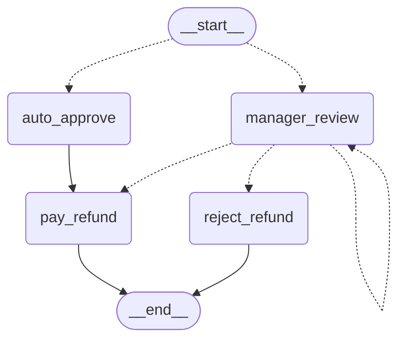
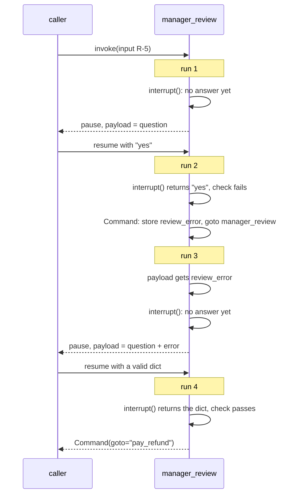

# 6.2 Approve, Edit and Validate: Interrupt Patterns

## The problem

Lesson 6.1 taught the mechanics. A node calls [interrupt()](../../../GLOSSARY.md#interrupt), the thread pauses, and a later `invoke(Command(resume=...))` on the same [thread_id](../../../GLOSSARY.md#thread_id) runs the node again. This time `interrupt()` returns the answer. In 6.1, `manager_review` did very little with that answer:

```python
decision = interrupt({...})
return {"status": decision, "decided_by": "manager"}
```

This works for a demo, but it is not how a refund review works. Look at what is missing:

- **The answer changes nothing.** Whatever the manager says, the graph goes `manager_review -> END`. Nothing pays an approved refund, and nothing different happens for a rejected one. The decision is just a string stored in the state.
- **The manager can only say yes or no.** A real reviewer often says "yes, but only \$120". There is no way to send that.
- **Any answer is accepted.** `"aproved"`, `"yes"`, `42` or a dict all end up in `status`. The [resume value](../../../GLOSSARY.md#resume-value) comes from outside: a web form, a chat message, another service. The node stores it without looking at it.

None of this needs a new LangGraph feature. Once `interrupt()` has returned, the node holds a normal Python value, and everything you already know applies: `if` statements, a [Command](../../../GLOSSARY.md#command) from lesson 3.3, input checks. This lesson puts these pieces together into three of the patterns the official guide lists for [human-in-the-loop](../../../GLOSSARY.md#human-in-the-loop) work: approve or reject, review and edit, and validate.

## The concept

The mental model: **`interrupt()` is a function call that returns untrusted input from a person.** It is like `input()` in a script or reading a request body in a web handler. What you do with the return value is ordinary code. The three patterns are three things you do with it.

### Approve or reject: the answer picks the next node

In the [approve-or-reject pattern](../../../GLOSSARY.md#approve-or-reject-pattern), the human's answer decides where the graph goes next. The node that asked is also the node that knows the possible routes, so it returns a `Command`. You know this from lesson 3.3: `update` changes the state, and [goto](../../../GLOSSARY.md#goto) names the next node.

```python
answer = interrupt(request)
if answer["decision"] == "reject":
    return Command(update={"decided_by": "manager"}, goto="reject_refund")
return Command(update={...}, goto="pay_refund")
```

What is new is where the route comes from. In 3.3 the node computed it from the state. Here it comes from a person, who may answer days after the run paused. The node can't return a `Command` before the answer exists, so the route is decided only on the resume.

### Review and edit: the answer carries a corrected value

In the [review-and-edit pattern](../../../GLOSSARY.md#review-and-edit-pattern), the payload shows a proposed value, and the resume value sends back a corrected one. The node then writes the corrected value into the state. Here the proposal is the requested amount, and the manager may answer `{"decision": "approve", "amount": 120}`.

One design choice matters: **where the edited value goes.** The official guide's example writes the edited text over the original field. For a refund that would lose information. If the manager's \$120 replaced the customer's \$300 in `amount`, nobody could later see what was requested. So the example keeps both: `amount` stays the request, and a new key, `approved_amount`, holds what is paid.

### Validate: ask again until the answer makes sense

In a [validation loop](../../../GLOSSARY.md#validation-loop), the node checks the resume value before acting on it. When the answer is invalid, it does not crash and does not guess. It asks again and tells the person what was wrong.

The question is how to "ask again". The official guide is firm about it: **call `interrupt()` exactly once per run of the node, and loop through the graph, not inside the node.** One run of the node handles one answer:

1. It calls `interrupt()` once and gets the answer.
2. It checks the answer. If it is invalid, the node does not act on it. It writes the error into the state and routes the graph back to itself.
3. The next run of the node is a fresh run. It reads the error from the state, adds it to the payload next to the same question, and calls `interrupt()`. There is no answer for this run yet, so the graph pauses again, exactly as it did the first time.

The error has to go through the state because a node keeps nothing between runs. Whatever the next run must know, here "why am I asking again", must be in the state. The example uses a new key, `review_error`, for this.

### The answer is structured data

All three patterns need more than a bare string, so the resume value becomes a dict, the kind of data a review form would post:

| Answer | Meaning |
|---|---|
| `{"decision": "approve"}` | pay the full requested amount |
| `{"decision": "approve", "amount": 120}` | pay a lower, edited amount |
| `{"decision": "reject"}` | pay nothing |
| anything else | invalid: ask again |

LangGraph passes a dict resume value to the node unchanged. There is one exception, covered under [Details and edge cases](#details-and-edge-cases): a dict whose keys all look like interrupt ids.

## How it works

### The graph

The diagram was generated from the code with `build_graph(None).get_graph().draw_mermaid()`, with the styling removed. Look at what leaves `manager_review`:



- `build_graph` adds no edge out of `manager_review`. The three dotted edges come from its return annotation, `Command[Literal["pay_refund", "reject_refund", "manager_review"]]`. As in lesson 3.3, `add_node` stores those names as the node's possible destinations (`builder.nodes["manager_review"].ends`). `compile()` checks them against the registered nodes, and `get_graph()` draws them. At run time the `goto` alone decides.
- **The dotted self-loop is the validation loop.** It is the route a rejected answer takes: back into `manager_review`, which then asks again.
- `pay_refund` is reached in two ways: by a normal edge from `auto_approve`, and by a `goto` from `manager_review`. It does not need to know which one led to it, because both write `approved_amount`.
- There is still no sign in the structure that `manager_review` pauses. As in 6.1, the pause happens inside the node at run time.

### Approve and reject, step by step

Follow refund R-3 (\$500, rejected) through its two `invoke` calls:

1. **First call.** Routing sends R-3 to `manager_review`. The node builds the payload and calls `interrupt()`. There is no answer yet, so the node stops there and never returns. No `Command` exists yet, and no route has been chosen. The thread is saved with `manager_review` pending.
2. **Resume** with `Command(resume={"decision": "reject"})`. `manager_review` runs again from its first line. This time `interrupt()` returns the dict, the check accepts it, and the node returns `Command(update={"decided_by": "manager", "review_error": None}, goto="reject_refund")`.
3. LangGraph applies the update as it would a returned dict, and schedules `reject_refund` for the next [super-step](../../../GLOSSARY.md#super-step). `reject_refund` writes `status`, and its edge leads to [END](../../../GLOSSARY.md#end).

R-2 takes exactly the same steps. Only its answer differs, so its `goto` names `pay_refund`.

### Asking again, step by step

The validation part of `manager_review` is four lines around a single `interrupt()` call:

```python
if state.get("review_error"):
    request["error"] = state["review_error"]
answer = interrupt(request)
error = check_answer(answer, state["amount"])
if error is not None:
    return Command(update={"review_error": error}, goto="manager_review")
```

The diagram follows refund R-5 (\$180) through one bad answer and one good one. Watch how many separate runs of `manager_review` there are, and that each one calls `interrupt()` once.



What to take from it:

- **One answer, one check.** Run 2 receives `"yes"`, rejects it and ends by returning a `Command`. Run 4 receives the valid dict. No run ever sees an earlier answer again, so `check_answer` runs exactly once per resume. The tests count this.
- **A bad answer costs two runs, inside one `invoke`.** Run 2 and run 3 happen in the same `invoke` call, one super-step after the other. Run 2 ends with `goto="manager_review"`, and run 3 is a new task in the next step. The answer was delivered to the paused run 2, not to run 3, so run 3's `interrupt()` has nothing to return and pauses the graph. From the caller's side a re-ask looks like any other pause, with an `"error"` key in the payload.
- **The state carries the reason.** Run 3 knows nothing about run 2 except what is in the state. That is why the error goes into `review_error` before the `goto`.

### Why `Command(goto=...)` and not a conditional edge

The guide's own example builds the same loop differently. Its node only updates the state, and a route function attached with `add_conditional_edges` sends the graph back to the node while the answer is missing, or on to `END` once it is valid. Both versions do the same thing: one `interrupt()` per run, and the loop goes through the graph.

This lesson loops with `Command(goto="manager_review")` because `manager_review` already returns a `Command` for its two other exits. A conditional edge for the re-ask would add a second routing mechanism to the same node: part of the routing in the node's return value, part in a separate function wired up in `build_graph`. With `Command`, all three exits are in one place, in the node, and the annotation lists all three.

## In our example

The example extends 6.1's "refund-approval" graph. The [code walkthrough](readalong.md) goes through every changed line. Here we map the three patterns onto the code.

### The check

The validation rules are a plain function with no LangGraph in it, so they can be tested on their own:

<!-- snippet: src/l6_2_interrupt_patterns/refunds.py#check_answer -->
```python
def check_answer(answer: Any, requested: int) -> str | None:
    """Check the manager's answer and return an error message, or None if it is fine.

    The answer looks like ``{"decision": "approve"}``, ``{"decision": "reject"}``
    or ``{"decision": "approve", "amount": 120}`` (an edited, lower amount).
    A manager may lower a refund but never raise it above what was requested.
    The amount of a reject is ignored.
    """
    # The resume value comes from outside (a web form, a chat message), so it
    # can be anything; check it before acting on it.
    if not isinstance(answer, dict) or answer.get("decision") not in ("approve", "reject"):
        return "decision must be 'approve' or 'reject'"
    amount = answer.get("amount", requested)
    if not isinstance(amount, int) or not 1 <= amount <= requested:
        return f"amount must be a whole number from 1 to {requested}"
    return None
```
<!-- /snippet -->

It returns a message meant for the person who answered, not an exception. That message is what the re-ask shows. The amount rule, `1 <= amount <= requested`, is the business rule of the edit pattern: a manager may lower a refund but never raise it. A missing `amount` means "the full amount", so `{"decision": "approve"}` is a complete answer.

### The state key for the error

<!-- snippet: src/l6_2_interrupt_patterns/refunds.py#refund_state -->
```python
REFUND_LIMIT = 100
"""Refunds up to this many whole dollars are approved without a human."""


class RefundState(TypedDict):
    """The state of one refund request.

    The caller only sends ``request_id`` and ``amount``. ``amount`` is what
    the customer asked for and is never overwritten. ``decided_by`` and
    ``approved_amount`` are written by the deciding node (auto_approve or
    manager_review), ``status`` by pay_refund / reject_refund at the end.
    """

    request_id: str
    amount: int
    status: NotRequired[str]
    decided_by: NotRequired[str]
    # The amount actually paid; may be lower than `amount` when the manager
    # edits it.
    approved_amount: NotRequired[int]
    # The last validation error, stored so that the next run of manager_review
    # can show it to the manager; set back to None once an answer is accepted.
    review_error: NotRequired[str | None]
```
<!-- /snippet -->

`approved_amount` serves the edit pattern, `review_error` the validation loop. `review_error` allows `None`, because an accepted answer writes `None` there to clear it.

### The node where the patterns meet

<!-- snippet: src/l6_2_interrupt_patterns/refunds.py#manager_review -->
```python
# Command[Literal[...]] tells compile() and the graph drawing where this node
# can go (as in 3.3), including back to itself. There is no add_edge out of
# manager_review any more: the Command picks the next node from the human's
# answer.
def manager_review(
    state: RefundState,
) -> Command[Literal["pay_refund", "reject_refund", "manager_review"]]:
    """Ask a manager to approve, reject or lower the refund, and route on the answer.

    First run: ``interrupt()`` pauses the graph here, saves a checkpoint and
    hands the payload to the caller. Resume: the caller invokes the same
    thread with ``Command(resume=...)``; the node runs again from its first
    line and this time ``interrupt()`` returns the resume value.
    """
    # Runs on the first run AND on every resume: the node restarts from the top.
    print(f"  [manager_review] started for {state['request_id']}")
    request = {
        "request_id": state["request_id"],
        "amount": state["amount"],
        "question": f"Approve a refund of ${state['amount']} for {state['request_id']}?",
    }
    # A stored error from the previous run is shown to the manager together
    # with the same question, so they see why they are asked again.
    if state.get("review_error"):
        request["error"] = state["review_error"]
    answer = interrupt(request)
    error = check_answer(answer, state["amount"])
    if error is not None:
        # An invalid answer is not acted on. It is stored in review_error and
        # the Command sends the graph back into manager_review, whose new run
        # pauses again with the error. This follows the Interrupts guide:
        # call interrupt() once per node run and loop through the graph, so
        # each answer is checked exactly once. The guide loops with a
        # conditional edge; Command(goto=...) is used here because this node
        # already routes with Command, which keeps one routing mechanism.
        return Command(update={"review_error": error}, goto="manager_review")
    print(f"  [manager_review] accepted {answer!r}")
    # Both success branches clear review_error, so a decided request carries
    # no stale error.
    if answer["decision"] == "reject":
        return Command(
            update={"decided_by": "manager", "review_error": None},
            goto="reject_refund",
        )
    # The edited amount goes into approved_amount; the requested amount stays
    # in `amount`, so both are visible later.
    return Command(
        update={
            "decided_by": "manager",
            "approved_amount": answer.get("amount", state["amount"]),
            "review_error": None,
        },
        goto="pay_refund",
    )
```
<!-- /snippet -->

Read it from the patterns' point of view:

- **Validate:** `interrupt(request)` appears once. If the previous run stored an error, it goes into the payload next to the unchanged question. `check_answer` decides. An invalid answer is not acted on: the node returns `Command(update={"review_error": error}, goto="manager_review")`, and the next run asks again. A later error replaces an earlier one, because `review_error` has no reducer.
- **Approve or reject:** the two `return Command(...)` statements at the end. By then `answer` is known to be a dict with a valid decision, so `answer["decision"]` is safe. Both clear `review_error`, so a decided request carries no old error.
- **Edit:** `approved_amount` is set from `answer.get("amount", state["amount"])`. The edited amount goes there, and `amount` is left alone.
- **The annotation** lists all three `goto` targets, including the node itself. It is the only place the graph learns them ahead of time.

### The two outcomes

<!-- snippet: src/l6_2_interrupt_patterns/refunds.py#outcome_nodes -->
```python
def pay_refund(state: RefundState) -> dict[str, str]:
    """Pay approved_amount (never amount), so an edited value is what gets applied."""
    print(f"  [pay_refund] paying ${state['approved_amount']} for {state['request_id']}")
    return {"status": "approved"}


def reject_refund(state: RefundState) -> dict[str, str]:
    """Close the request without paying anything."""
    print(f"  [reject_refund] no refund for {state['request_id']}")
    return {"status": "rejected"}
```
<!-- /snippet -->

`pay_refund` reads `approved_amount`, never `amount`. That one choice is what makes an edit take effect. Because `auto_approve` now also writes `approved_amount` (the full amount), `pay_refund` works the same for both ways in.

### The wiring

<!-- snippet: src/l6_2_interrupt_patterns/refunds.py#build_graph -->
```python
def build_graph(checkpointer: BaseCheckpointSaver | None) -> CompiledStateGraph:
    """Build the refund graph: route by amount, decide, then pay or reject.

    interrupt() needs a checkpointer: the pause *is* a saved checkpoint, and
    resuming means loading that checkpoint again by thread_id. Without one the
    first run still returns the interrupt to the caller, but nothing is saved,
    so nothing can resume it. manager_review has no outgoing edge here because
    its Command chooses the next node.
    """
    builder = StateGraph(RefundState)
    builder.add_node("auto_approve", auto_approve)
    builder.add_node("manager_review", manager_review)
    builder.add_node("pay_refund", pay_refund)
    builder.add_node("reject_refund", reject_refund)
    builder.add_conditional_edges(START, route_by_amount)
    builder.add_edge("auto_approve", "pay_refund")
    builder.add_edge("pay_refund", END)
    builder.add_edge("reject_refund", END)
    return builder.compile(checkpointer=checkpointer)
```
<!-- /snippet -->

Compared with 6.1, `add_edge("manager_review", END)` is gone, `auto_approve` leads to `pay_refund`, and both outcome nodes end the run. The self-loop needs no `add_edge` either. The `Command` and its annotation cover it.

### The caller of the validation loop

<!-- snippet: src/l6_2_interrupt_patterns/__main__.py#validate -->
```python
print("== R-5: $180, invalid answers are asked again ==")
out = graph.invoke({"request_id": "R-5", "amount": 180}, config("R-5"), version="v2")
# Each bad answer leads to a new run of manager_review that asks again,
# with the error in the payload; the caller just resumes the same thread
# with the next answer.
for answer in [
    "yes",
    {"decision": "approve", "amount": 900},
    {"decision": "approve", "amount": 150},
]:
    print(f"  answer: {answer!r}")
    out = graph.invoke(Command(resume=answer), config("R-5"), version="v2")
    if out.interrupts:
        print(f"  asked again: {out.interrupts[0].value['error']!r}")
print(outcome(out.value))
```
<!-- /snippet -->

The caller does nothing special after a bad answer. It sees a non-empty `out.interrupts`, shows the error, and resumes the same thread with the next answer. Every invoke uses `version="v2"` (from 6.1), so `out.value` is the state and `out.interrupts` holds what is pending. They never mix.

## Run it

From the course root, run `./run.sh 6.2`. This is the output of the verified run:

```text
== R-1: $40 is paid by policy ==
  [pay_refund] paying $40 for R-1
  status='approved' decided_by='policy' approved_amount=40

== R-2: $250, the manager approves ==
  [manager_review] started for R-2
  question: 'Approve a refund of $250 for R-2?'
  [manager_review] started for R-2
  [manager_review] accepted {'decision': 'approve'}
  [pay_refund] paying $250 for R-2
  status='approved' decided_by='manager' approved_amount=250

== R-3: $500, the manager rejects ==
  [manager_review] started for R-3
  [manager_review] started for R-3
  [manager_review] accepted {'decision': 'reject'}
  [reject_refund] no refund for R-3
  status='rejected' decided_by='manager' approved_amount=None

== R-4: $300, the manager approves $120 instead ==
  [manager_review] started for R-4
  [manager_review] started for R-4
  [manager_review] accepted {'decision': 'approve', 'amount': 120}
  [pay_refund] paying $120 for R-4
  status='approved' decided_by='manager' approved_amount=120
  requested amount kept: 300

== R-5: $180, invalid answers are asked again ==
  [manager_review] started for R-5
  answer: 'yes'
  [manager_review] started for R-5
  [manager_review] started for R-5
  asked again: "decision must be 'approve' or 'reject'"
  answer: {'decision': 'approve', 'amount': 900}
  [manager_review] started for R-5
  [manager_review] started for R-5
  asked again: 'amount must be a whole number from 1 to 180'
  answer: {'decision': 'approve', 'amount': 150}
  [manager_review] started for R-5
  [manager_review] accepted {'decision': 'approve', 'amount': 150}
  [pay_refund] paying $150 for R-5
  status='approved' decided_by='manager' approved_amount=150
```

There is no model and no ids are printed, so every run prints exactly this. What to notice:

- **R-1 now also goes through `pay_refund`.** The policy branch and the manager branch end in the same node.
- **R-2 and R-3 differ only in the answer.** The same node ran twice in each section. After the accepted answer, R-2 continues to `[pay_refund]` and R-3 to `[reject_refund]`. That is the approve-or-reject pattern: the route came from the resume value.
- **`approved_amount=None` for R-3.** The reject branch never writes the key, and `outcome` uses `values.get`. A rejected request has no paid amount at all, not a zero.
- **R-4 is paid \$120 and keeps \$300.** The edit reached `pay_refund`, and the request survived in `amount`.
- **R-5 pauses three times and starts six times.** One start for the first run. Then two per bad answer: the resumed run that receives the answer and routes back, and the new run that pauses with the error. Then one for the run that accepts the valid answer. Each bad answer produces an `asked again:` line instead of a payment, with a message that says what to fix. `accepted` appears only once.

## Details and edge cases

**The route does not exist until the answer does.** While R-3 is paused, nothing in the checkpoint says whether it will be paid. `get_state().next` is `('manager_review',)`, and the state has no `decided_by`. Code that lists "refunds about to be paid" must not count paused threads.

**A re-ask is a new pause.** After an invalid answer, `out.interrupts` has one entry, and `get_state().next` is still `('manager_review',)`. The state now holds `review_error` with the message, and no `status`. The thread stays paused until a valid answer arrives, however long that takes. After the valid answer, `next` is `()`, no interrupts are left, and `review_error` is `None`. The re-ask comes from a new run of the node, so its `Interrupt.id` is new, too: R-5's three pauses have three different ids. To tell a re-ask from the first question, read the `"error"` key in the payload, not the id.

**`review_error` stays in the final state as `None`.** Every request that went through `manager_review` ends with `'review_error': None` in its state. R-3's final value, for example, is `{'request_id': 'R-3', 'amount': 500, 'status': 'rejected', 'decided_by': 'manager', 'review_error': None}`. R-1 never has the key, because only `manager_review` writes it. `outcome` doesn't print it, so the output doesn't show it.

**The code before `interrupt()` runs twice per bad answer.** The `started` print and the payload construction run in the resumed run and again in the new run. That is a fixed cost per answer, and it is cheap here. Keep the code before `interrupt()` cheap and free of side effects in general: lesson 6.3 is about exactly that.

**The self-loop does not use up the recursion limit.** The [recursion_limit](../../../GLOSSARY.md#recursion_limit) (lesson 1.3) counts super-steps within one `invoke` call. A bad answer costs two steps of `manager_review` and then the call returns at the pause. However many times the manager answers wrongly, no single `invoke` comes close to the limit.

**The variant to avoid: a loop inside the node.** An obvious way to write "ask again" is a `while True` loop around `interrupt()` inside the node:

```python
while True:
    answer = interrupt(request)
    error = check_answer(answer, state["amount"])
    if error is None:
        break
    request = {**request, "error": error}
```

It works, and it needs no extra state key, but the Interrupts guide opens its "Validating human input" section with a Warning against exactly this. The reason is replay. Each resume starts the node from its first line, and the loop meets its first `interrupt()` call again. LangGraph hands that call the first answer once more, the second call gets the second answer, and so on. Only the newest call gets the newest answer. So every resume runs all earlier answers through the loop body again. Counting the calls in a scratch copy of the example (experiment 6) gives 1, 2, 3 and 4 `check_answer` calls for four resumes. With $n$ answers the total is $n(n+1)/2$, against $n$ for the graph loop. With a pure check that costs little, but if the loop body calls a model, writes to a database or sends a message, all of that is repeated on every resume. Why the earlier answers are handed back, and what that means for your code, is lesson 6.3's topic: LangGraph matches resume values to the `interrupt()` calls of a node by their order. The graph loop avoids the question altogether, because each run of `manager_review` contains a single `interrupt()` call.

**Dict answers are safe, with one exception.** In 1.2.16, LangGraph reads a resume dict as a map of interrupt ids (lesson 6.3) only when every key is a 32-character hex string, so `{"decision": ...}` arrives unchanged. "Every key" is also true for a dict with no keys at all. `Command(resume={})` is therefore taken as an empty id map and delivers no answer. The node still runs (a `started` line is printed), but its `interrupt()` finds no answer and pauses again before `check_answer` is reached. `next` stays `('manager_review',)`. The payload is the original question or, if an earlier answer was bad, the question plus the stored `error`. This is reported as a bug ([#8693](https://github.com/langchain-ai/langgraph/issues/8693)). Don't let an empty form submit as `{}`.

**`True` is a valid amount.** In Python `bool` is a subclass of `int`, and `True == 1`. So `{"decision": "approve", "amount": True}` passes `check_answer`, and the run prints `[pay_refund] paying $True for R-4`. A stricter check would test `type(amount) is int`, or reject `bool` first.

**A static edge to `END` next to the `Command` changes nothing.** If 6.1's `add_edge("manager_review", END)` is left in place, the run and even the drawing stay the same (third experiment). As lesson 3.3 showed, reaching `END` schedules no task, and the drawer already has edges out of the node. The leftover is harmless, which is exactly why it goes unnoticed. Delete it anyway, so that the code shows only one routing mechanism.

**Same check, other front ends.** Nothing in the three patterns depends on who answers. A web form, a chat bot or a script can all resume the thread with the same dict. Lesson 6.4 applies the same idea to tool calls an agent wants to make.

## Common mistakes

> [!WARNING]
> **Acting on the resume value without checking it.** Without the check, whatever arrives is applied: in the first experiment, a \$300 request is paid \$900, and a plain `"yes"` crashes the node with `TypeError`. Check the type and the business rules before the value touches the state or picks a route.

> [!WARNING]
> **Writing the edited value over the original.** If `manager_review` wrote the manager's amount into `amount`, the state would no longer show what the customer asked for. `RefundState` has no [reducer](../../../GLOSSARY.md#reducer), so every update replaces the old value. Keep the proposal and the human's version in separate keys.

> [!WARNING]
> **Forgetting the `Command[Literal[...]]` annotation.** The run is unaffected, so nothing warns you. But `ends` is `()`, and the drawing shows a solid edge from `manager_review` to `__end__`, no way to `reject_refund` and no self-loop (second experiment). If you can't annotate, use `add_node(..., destinations=(...))` (lesson 3.3).

> [!WARNING]
> **Expecting form values to arrive with the right type.** HTML forms send every field as a string, so `"120"` is not `120`. Convert values at the edge of your application, or let the validation loop reject them (fourth experiment). 6.1-style answers such as `"approved"` are rejected too.

> [!WARNING]
> **Looping around `interrupt()` inside the node.** A `while True` loop that calls `interrupt()` again after a bad answer replays every earlier answer on each resume, and with them any work in the loop body. Call `interrupt()` once per run, keep the error in the state and route back to the node (sixth experiment).

## Experiments

Each experiment starts from the lesson's original code. Make the change, run `./run.sh 6.2` from the course root (or the snippet shown), and guess the result before you open the explanation.

1. Remove the check: in `manager_review` in [refunds.py](../src/l6_2_interrupt_patterns/refunds.py), replace `error = check_answer(answer, state["amount"])` with `error = None`. Then, in the `edit` region of [\_\_main\_\_.py](../src/l6_2_interrupt_patterns/__main__.py), resume R-4 with `{"decision": "approve", "amount": 900}`.

   <details><summary>What happens and why</summary>

   R-4 prints `[manager_review] accepted {'decision': 'approve', 'amount': 900}`, then `[pay_refund] paying $900 for R-4` and `approved_amount=900`, on a \$300 request. The run continues to R-5, whose first answer is `"yes"`. The node prints `accepted 'yes'`, then `answer["decision"]` fails with `TypeError: string indices must be integers, not 'str'`, and the exception comes out of `invoke`.

   The resume value is outside input, and `interrupt()` returns it as is. Without the check and the route back to `manager_review`, whatever the person sends is applied, or crashes the node. Put the code back as it was (`git checkout -- .` in the lesson directory).

   </details>

2. Remove the return annotation of `manager_review` (leave `def manager_review(state: RefundState):`). Run the program, then from the lesson directory print the drawing: `env -u VIRTUAL_ENV uv run python -c "from l6_2_interrupt_patterns.refunds import build_graph; print(build_graph(None).get_graph().draw_mermaid())"`.

   <details><summary>What happens and why</summary>

   The program prints exactly the same lines as before, re-asks included. The drawing changes: instead of the three dotted edges, it has a solid `manager_review --> __end__;`. `reject_refund` appears with no edges at all, the self-loop is gone, and `builder.nodes["manager_review"].ends` is `()`.

   `goto` works at run time without any declaration, also when it points back at the same node. The annotation is the only way the graph learns the possible destinations ahead of time. Without it, the drawer gives a node with no known exit a fallback edge to `END`, and the picture no longer matches the graph that runs. Put the code back as it was.

   </details>

3. Leave 6.1's edge in place: in `build_graph`, add `builder.add_edge("manager_review", END)` next to the other edges. Run the program and print the drawing as in experiment 2.

   <details><summary>What happens and why</summary>

   Nothing changes: the output is identical, and so is the drawing. It still shows the three dotted edges from `manager_review` and no edge from it to `__end__`.

   The `goto` still schedules `pay_refund`, `reject_refund` or `manager_review` again, and the extra edge to `END` triggers no task, as lesson 3.3 found for `decide`. A leftover edge like this breaks nothing, so neither the run nor the picture will point you to it. Only reading `build_graph` will. Put the code back as it was.

   </details>

4. Send the answers a careless client would send. In the `edit` region, resume R-4 with `{"decision": "approve", "amount": "120"}` (a string, as an HTML form posts it) and print `out.interrupts[0].value["error"]`. Then resume the same thread with a plain string like 6.1's `"approved"` and print the error again.

   <details><summary>What happens and why</summary>

   Nothing is paid. The first resume prints `started` twice more and returns a pending interrupt whose error is `'amount must be a whole number from 1 to 300'`. The second does the same and returns `"decision must be 'approve' or 'reject'"`. `out.value` holds `request_id`, `amount` and the latest `review_error`, and no `status`.

   `check_answer` checks types, not just values, and the node asks again instead of guessing. The thread stays paused until a well-formed answer arrives. (The `outcome(out.value)` line that follows in the section raises `KeyError: 'status'`, because the request was never decided.) Put the code back as it was.

   </details>

5. Count the runs: in the `validate` region, add a fourth bad answer, `"no"`, to the list before the good one.

   <details><summary>What happens and why</summary>

   One more `answer: 'no'` / `asked again: "decision must be 'approve' or 'reject'"` pair appears, with two more `[manager_review] started for R-5` lines before the `asked again`: eight in total. The final lines are the same, `paying $150` and `approved_amount=150`.

   Each bad answer costs exactly two runs of the node: the resumed run that receives the answer, checks it and routes back, and the new run that pauses with the error. The new answer is checked once, in one run. Nothing earlier is checked again. Put the code back as it was.

   </details>

6. Try the variant to avoid. First run the script below from the lesson directory as it is, to see the counts of the original code. Then, in `manager_review`, replace the lines from `answer = interrupt(request)` to the bad-answer `return` (with its comment) by the `while True` loop from [Details and edge cases](#details-and-edge-cases), and run the script again.

   ```bash
   env -u VIRTUAL_ENV uv run python -c "
   import l6_2_interrupt_patterns.refunds as r
   from langgraph.checkpoint.memory import InMemorySaver
   from langgraph.types import Command
   calls = [0]; check = r.check_answer
   def counted(*args):
       calls[0] += 1
       return check(*args)
   r.check_answer = counted
   g = r.build_graph(InMemorySaver()); cfg = {'configurable': {'thread_id': 'x'}}
   g.invoke({'request_id': 'R-5', 'amount': 180}, cfg, version='v2')
   for a in ['yes', {'decision': 'approve', 'amount': 900}, 'no', {'decision': 'approve', 'amount': 150}]:
       calls[0] = 0
       g.invoke(Command(resume=a), cfg, version='v2')
       print('checks:', calls[0])
   "
   ```

   <details><summary>What happens and why</summary>

   The original code prints `checks: 1` four times. The variant prints `1`, `2`, `3`, `4`: ten checks for four answers. The variant also prints only one `started` line per resume, because nothing routes back through the graph. It looks cheaper in the output, while it actually does more work.

   Every resume runs the node from the top, and the loop hands each earlier answer to its earlier `interrupt()` call again, so the earlier checks run again before the new answer is reached. That gives $n(n+1)/2$ checks for $n$ answers. Why LangGraph hands the old answers back is lesson 6.3's rule. This is the pattern the Warning in the guide's "Validating human input" section tells you to avoid. Put the code back as it was.

   </details>

## Summary

- After `interrupt()` returns, the node holds an ordinary value from a person. The three patterns are ordinary code around that value.
- **Approve or reject:** return `Command(update=..., goto=...)` chosen from the answer, and annotate the node with `Command[Literal[...]]`, so `compile()` and the drawing know the routes. Remove static edges that the `Command` replaces.
- **Review and edit:** send back the corrected value in the resume dict, and write it to a separate key, so the original proposal stays visible.
- **Validate:** check the resume value before using it. When it is invalid, store the error in the state and route back to the node (here with `Command(goto="manager_review")`, in the guide with a conditional edge). The new run shows the error and pauses again.
- Call `interrupt()` once per run of the node. Then each answer is checked exactly once. A `while True` loop around `interrupt()` replays all earlier answers on every resume.

## Self-check

1. While R-3 is paused, can you tell from the checkpoint whether it will be paid? Why?

   <details><summary>Answer</summary>

   No. The route is chosen by the `Command` that `manager_review` returns, and the node returns only after `interrupt()` has an answer. While paused, `next` is `('manager_review',)`, and the state has no `decided_by`. Neither outcome node has been scheduled.

   </details>

2. Why does the example need `approved_amount` instead of writing the manager's amount into `amount`?

   <details><summary>Answer</summary>

   `RefundState` has no reducers, so an update replaces the old value. Writing \$120 into `amount` would erase the \$300 the customer asked for. With two keys, the state shows both the request and the decision, and `pay_refund` pays `approved_amount`.

   </details>

3. In the R-5 section, `[manager_review] started for R-5` appears six times but `accepted` only once. Explain both counts, and say how the run that asks again knows what the error was.

   <details><summary>Answer</summary>

   One start for the first run, which pauses. Each of the two bad answers costs two starts: the resumed run receives the answer, rejects it and returns `Command(goto="manager_review")`, then the new run pauses again. The valid answer costs one start. That makes 1 + 2 + 2 + 1 = 6. Only the last run gets an answer through `check_answer`, so only it reaches the `accepted` print. The new run knows the error because the rejecting run wrote it into `review_error`. A node keeps nothing between runs, so the state is the only way to pass it on.

   </details>

4. A teammate removes the `Command[Literal[...]]` annotation because "the tests still pass". What did they lose?

   <details><summary>Answer</summary>

   The graph's knowledge of where `manager_review` can go. `ends` becomes `()`, so `compile()` no longer checks the target names, and `get_graph()` draws a fallback edge to `__end__` instead of the edges to `pay_refund`, `reject_refund` and back to `manager_review`. The run is unaffected, so the tests (except the one that checks `ends`) can't notice.

   </details>

5. A manager has already sent ten invalid answers to the same request. How many times does `check_answer` run on the eleventh resume in the lesson's code, and how many times would it run with a `while True` loop inside the node?

   <details><summary>Answer</summary>

   Once in the lesson's code: the eleventh answer goes to a run with a single `interrupt()` call, and the ten earlier answers were each checked in their own run. With the in-node loop it would run eleven times, because the node starts from the top and all ten earlier answers are replayed through the loop before the new one is checked. Over all eleven resumes that is $11 \cdot 12 / 2 = 66$ checks instead of 11.

   </details>

## Further reading

- [Interrupts](https://docs.langchain.com/oss/python/langgraph/interrupts), the official guide. See "Common patterns" (approve or reject, review and edit, validating human input). The "Validating human input" section opens with a Warning: "Avoid `while True` + `interrupt()` loops inside a single node". Its example calls `interrupt()` once per run and loops with `add_conditional_edges`. "Rules of interrupts" repeats the advice.
- [langgraph/types.py at 1.2.16](https://github.com/langchain-ai/langgraph/blob/1.2.16/libs/langgraph/langgraph/types.py): the source of `interrupt()` and `Command`, including how answers are matched to `interrupt()` calls by index (the reason the in-node loop replays).
- [langgraph/pregel/\_loop.py at 1.2.16](https://github.com/langchain-ai/langgraph/blob/1.2.16/libs/langgraph/langgraph/pregel/_loop.py): where a resume dict is checked for interrupt-id keys, and where the recursion limit is set per call.
- [Issue #7780: Interrupt() in a loop will cause extra resumes](https://github.com/langchain-ai/langgraph/issues/7780), a report that shows the replay of earlier answers in an in-node validation loop.
- [Issue #8693: Command resume misclassifies ordinary dictionary values as interrupt maps](https://github.com/langchain-ai/langgraph/issues/8693), which includes the empty-dict case.
