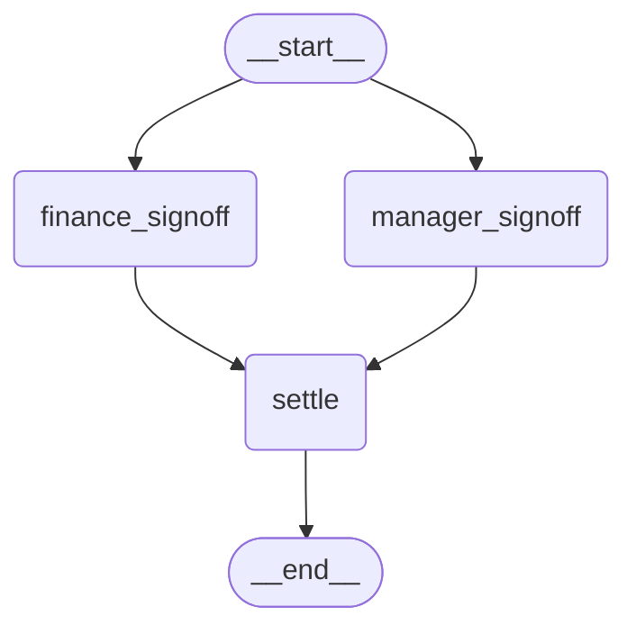
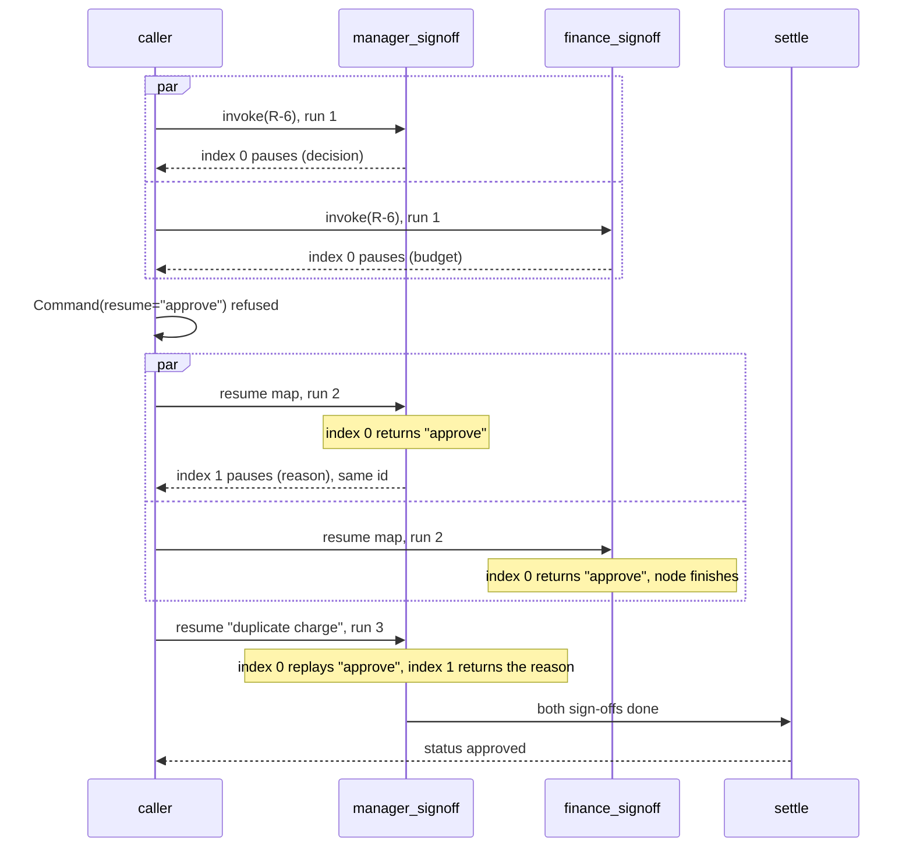

# 6.3 The Rules of Interrupts

## The problem

Lessons 6.1 and 6.2 kept repeating one fact: a resumed node does not continue from the middle. It runs again from its first line, and only the [interrupt()](../../../GLOSSARY.md#interrupt) call behaves differently the second time, because now it has an answer to return. In 6.1 you saw it as two `started` lines. In 6.2 you saw that a bad answer costs two runs of `manager_review`, and that a `while True` loop around `interrupt()` hands every earlier answer back on each resume.

So far that replay was harmless. The code before `interrupt()` printed a line and built a dict. Real nodes do more. They send an email to the manager, open a ticket, write an audit record or charge a card. Every such call before `interrupt()` runs once when the node pauses and once more on every resume. Nothing in LangGraph warns you about it.

Replay also raises questions that a node with one `interrupt()` never meets:

- If a node calls `interrupt()` twice, how does LangGraph know which stored answer belongs to which call on the next run?
- `interrupt()` stops the node by raising an exception. What happens if your own error handling catches it?
- If two parallel nodes pause in the same [super-step](../../../GLOSSARY.md#super-step), there are two open questions at once. Which one does `Command(resume="approve")` answer?

The official Interrupts guide answers the first two with its short list of rules, and the third in a separate section, "Handling multiple interrupts". This chapter explains them from the mechanism, so that you can tell for any node whether it is safe.

## The concept

### One mechanism: replay with stored answers

Everything in this chapter follows from how `interrupt()` works in 1.2.16 (its source is in `langgraph/types.py`):

1. Each run of a node is a **task**. LangGraph keeps a list of the [resume values](../../../GLOSSARY.md#resume-value) that this task has received so far.
2. Inside one run, every `interrupt()` call gets an **index**: the first call in the run gets 0, the second gets 1, and so on. The counter starts again at 0 on every run.
3. When `interrupt()` is called, it looks up its index in the task's list. If an answer is stored there, it returns it at once. If not, and a new resume value has arrived, it stores that value at this index and returns it. If there is neither, it raises [GraphInterrupt](../../../GLOSSARY.md#graphinterrupt), and the graph pauses.

That is the whole mechanism. The node is plain Python and LangGraph cannot freeze it halfway, so it runs the node again, and the earlier `interrupt()` calls are "answered" from the stored list. The mental model to keep:

> **A resumed node is a replay.** All its code runs again. The `interrupt()` calls that already have an answer return it immediately, by position. The first one without an answer either takes the new value or pauses again.

### The rules that follow

The guide's "Rules of interrupts" section lists four rules. Three of them follow directly from replay, and this lesson shows each with a counter:

| Rule | Why, in terms of replay |
|---|---|
| Side effects before `interrupt()` must be [idempotent](../../../GLOSSARY.md#idempotent) | All code before the unanswered `interrupt()` runs again on every resume. |
| Do not reorder `interrupt()` calls within a node | Stored answers are matched to calls by index, nothing else. The guide puts it as "Matching is strictly index-based". |
| Do not wrap `interrupt()` in a bare `try/except` | The pause *is* an exception. If your code catches it, the node never pauses. |

The fourth rule is about the payload: pass values that can be serialized (strings, numbers, lists, dicts of simple values), not functions or class instances, because the payload is saved in the [checkpoint](../../../GLOSSARY.md#checkpoint). The lesson's payloads are small dicts of strings and follow it without needing a demonstration.

Next to the rules, the guide's "Handling multiple interrupts" pattern covers the parallel case: when several interrupts are pending at once, you answer them with a [resume map](../../../GLOSSARY.md#resume-map), a dict from `Interrupt.id` to the answer: `Command(resume={interrupt_id: value, ...})`.

### Idempotent: safe to repeat

An operation is idempotent when running it twice has the same effect as running it once. "Set the status of ticket 42 to open" is idempotent. "Create a new ticket" is not, and neither is "send an email". There are three ways to make code before `interrupt()` safe, and the guide names all of them:

- **Make it idempotent.** Check before you act, or use an upsert or an idempotency key in the external system, so a repeated call changes nothing.
- **Move it after `interrupt()`.** Code after the last `interrupt()` only runs in the run that receives the final answer.
- **Move it into its own node** before the one that pauses. A finished node is saved in the checkpoint and is not run again on a resume.

### Why the id belongs to the task

Lesson 6.1 introduced `Interrupt.id` and noted that it is stable per task. In 1.2.16, `Interrupt.from_ns` computes it as a hash of the task's checkpoint namespace, which names the node's task. It does not depend on the question. So:

- Two parallel nodes paused in the same step are two tasks, with **two different ids**. The id tells LangGraph which task an answer is for.
- Two `interrupt()` calls in the same run of one node belong to one task and get **the same id**. The id cannot tell them apart, which is why the index has to.
- A new run of a node in a later step is a new task with a new id. That is why the re-asks in 6.2's [validation loop](../../../GLOSSARY.md#validation-loop) had three different ids.

## How it works

### The sign-off graph

The new graph in this lesson is the [fan-out](../../../GLOSSARY.md#fan-out) with a [waiting edge](../../../GLOSSARY.md#waiting-edge) from lesson 3.1. It was generated from the code with `build_signoff_graph(None).get_graph().draw_mermaid()`, with the styling removed. Nothing in it shows that two of the nodes pause; as always, the pause happens inside the nodes at run time.



Both sign-offs run in the first step. `settle` runs only once both have finished. `manager_signoff` asks two questions (the decision, then a reason), `finance_signoff` asks one.

### Four invokes, step by step

The diagram follows refund R-6 through the lesson's four calls. The `par` blocks mark work that happens in one step, in no fixed order. Look at which node runs in each call, and which index each `interrupt()` call has.



1. **First invoke.** Both nodes start in the same step, and both reach their first `interrupt()` with no answer. The thread now has two pending interrupts with two different ids. `get_state().next` names both nodes. In which order they start, and in which order `out.interrupts` lists them, varies from run to run in 1.2.16, so the code never relies on it.
2. **A plain resume value is refused.** With more than one interrupt pending, `Command(resume="approve")` raises `RuntimeError` before any node runs. LangGraph has no way to know whose answer it is. Nothing changes: both nodes are still pending, and neither has run again.
3. **The resume map.** Each key is the id of one pending interrupt, each value the answer for it. Both tasks run again. `finance_signoff` finds its answer at index 0 and finishes. `manager_signoff` finds its answer at index 0, goes on, and its second `interrupt()`, index 1, has no answer, so it pauses again. The new pending interrupt has the same id as the manager's first one.
4. **The second question.** Only one interrupt is pending, so a plain value works again. Only `manager_signoff` runs. Its index 0 replays the stored `"approve"`, and its index 1 takes `"duplicate charge"`. The node returns, both sign-offs are done, and `settle` runs.

Two details in step 3 are worth noticing:

- **Finance's answer is saved, although the step is not finished.** After step 3, the state already holds `finance_decision`, but no manager keys. A finished task's output is kept as [pending writes](../../../GLOSSARY.md#pending-writes) (lesson 5.2) until the whole step completes. So in step 4 `finance_signoff` does not run again, and `settle` sees its value.
- **How a map value reaches the right call.** LangGraph checks a resume dict before it runs anything. When every key is a 32-character hex string (the format of an `Interrupt.id`), the dict is a resume map. Each value is then added to the stored answers of the task whose id matches, so it lands at that task's next unanswered index. Any other value is one answer for one pending interrupt, which is why it is refused when there are two. This check is in `pregel/_loop.py` and `pregel/_algo.py`.

## In our example

The example extends 6.2's "refund-approval" graph. The [code walkthrough](readalong.md) goes through every changed line. Here we map the rules onto the code.

### Rule 1: the notification before the pause

`manager_review` in [refunds.py](../src/l6_3_rules_of_interrupts/refunds.py) has one new line. Right after the `started` print, and before `interrupt()`, it calls `notify_manager`:

```python
print(f"  [manager_review] started for {state['request_id']}")
notify_manager(state["request_id"], state["amount"])
```

The rest of the node is unchanged from [6.2](../../6.2-interrupt-patterns/docs/notes.md#the-node-where-the-patterns-meet). The notification itself:

<!-- snippet: src/l6_3_rules_of_interrupts/refunds.py#notify_manager -->
```python
NOTIFY_CALLS: Counter[str] = Counter()
"""How many times notify_manager ran per request_id.

It shows how often the code before interrupt() in manager_review runs.
"""

MANAGER_INBOX: list[str] = []
"""Stands in for an email or ticket system: the messages the manager actually received."""


def notify_manager(request_id: str, amount: int) -> None:
    """Tell the manager that a refund waits for review.

    Safe to call again for the same request: a repeated call sends nothing.
    """
    NOTIFY_CALLS[request_id] += 1
    message = f"Refund {request_id} for ${amount} waits for your review"
    # This check makes the call idempotent: a second call for the same request
    # sends nothing. A real system would use an idempotency key or an upsert.
    # It matters because manager_review calls this before interrupt(), and the
    # node runs again from the top on every resume.
    if message not in MANAGER_INBOX:
        MANAGER_INBOX.append(message)
```
<!-- /snippet -->

Two records make the rule visible. `NOTIFY_CALLS` counts how often the function *ran*, before any check, so it shows how often the code before `interrupt()` runs. `MANAGER_INBOX` stands in for the mail system and holds what the manager actually *received*. The `if message not in MANAGER_INBOX` check is what makes the call idempotent: the message text works as the key, and a repeat sends nothing. In production the check belongs in the external system, as an idempotency key or an upsert, because a Python list in one process does not survive a restart, and the resume may run in another process.

Both records are module globals, not graph state. The checkpointer neither saves nor resets them, just as it would not undo a real email. That is the point: replay restores the graph's state, not the world outside it.

### Rules 2 and 3: two questions in one node

The second graph, [signoff.py](../src/l6_3_rules_of_interrupts/signoff.py), is separate from the refund graph. Its module docstring says why: `refunds.py` keeps 6.2's design, one `interrupt()` per run, with the re-ask going through the graph. Several interrupts in one node is a rule you need to know, and here it is used for two *different* questions that are always asked in the same order. It does not replace the validation loop.

<!-- snippet: src/l6_3_rules_of_interrupts/signoff.py#manager_signoff -->
```python
def manager_signoff(state: SignoffState) -> dict[str, str]:
    """Ask the manager two questions in one node: the decision, then a reason."""
    NODE_RUNS["manager_signoff"] += 1
    # On resume the node restarts, so the first interrupt() returns the stored
    # first answer and the second one pauses or returns the next answer.
    # Resume values are matched to interrupt() calls strictly by their index
    # in the node: always call them in the same order and never skip one
    # conditionally.
    # Both pauses of this node have the SAME Interrupt.id (the id belongs to
    # the node's task, not to the question), which is why LangGraph matches
    # by order inside a node.
    # Do not wrap interrupt() in a bare try/except: it pauses by raising
    # GraphInterrupt, an Exception subclass, and catching it would swallow
    # the pause.
    # The "role" key lets the caller tell the pending interrupts apart.
    decision = interrupt(
        {
            "role": "manager",
            "question": f"Approve a refund of ${state['amount']} for {state['request_id']}?",
        }
    )
    reason = interrupt(
        {
            "role": "manager",
            "question": f"You chose {decision!r}. Why? (kept in the audit log)",
        }
    )
    return {"manager_decision": decision, "manager_reason": reason}
```
<!-- /snippet -->

Read it with the replay in mind:

- **The order is fixed.** The decision is always index 0 and the reason always index 1. There is no `if` that could skip the first call, and no loop over data that could change between runs. If a later version of the code swapped the two calls while a thread is paused, the stored decision would come back as the reason (experiment 4).
- **The second question uses the first answer.** `f"You chose {decision!r}..."` is safe because on every later run `decision` is the replayed value, so the question text is the same each time.
- **No `try/except` around either call.** In 1.2.16, `GraphInterrupt` subclasses [GraphBubbleUp](../../../GLOSSARY.md#graphbubbleup), which subclasses `Exception` (`langgraph/errors.py`). An `except Exception` around `interrupt()` would catch the pause (experiment 3).
- **`NODE_RUNS` instead of prints.** The two sign-offs run in the same step, and their start order varies, so prints from them could swap places between runs. Counts give the same output every time. `settle` is the only node that prints, because it runs alone in its step.
- **The `"role"` key** in each payload is for the caller. With two interrupts pending, it is how `__main__.py` tells the manager's question from finance's.

The graph wiring is lesson 3.1's: two edges from `START` and one waiting edge into `settle`.

<!-- snippet: src/l6_3_rules_of_interrupts/signoff.py#build_signoff_graph -->
```python
def build_signoff_graph(checkpointer: BaseCheckpointSaver | None) -> CompiledStateGraph:
    """Build the sign-off graph: two parallel sign-offs joined by settle.

    The two sign-offs run in the same step, so when both pause the thread has
    two pending interrupts.
    """
    builder = StateGraph(SignoffState)
    builder.add_node("manager_signoff", manager_signoff)
    builder.add_node("finance_signoff", finance_signoff)
    builder.add_node("settle", settle)
    # Two edges from START: both sign-offs run in the first step (as in 3.1).
    builder.add_edge(START, "manager_signoff")
    builder.add_edge(START, "finance_signoff")
    # The waiting edge: settle runs only once BOTH sign-offs have finished.
    builder.add_edge(["manager_signoff", "finance_signoff"], "settle")
    builder.add_edge("settle", END)
    return builder.compile(checkpointer=checkpointer)
```
<!-- /snippet -->

`SignoffState` has no [reducer](../../../GLOSSARY.md#reducer). That is safe because each sign-off writes its own keys, so the two parallel writes never meet in one [LastValue](../../../GLOSSARY.md#lastvalue) channel.

### Answering parallel interrupts by id

The caller in [\_\_main\_\_.py](../src/l6_3_rules_of_interrupts/__main__.py) builds the resume map from the pending interrupts:

<!-- snippet: src/l6_3_rules_of_interrupts/__main__.py#resume_by_id -->
```python
print("== R-6: resume both at once, keyed by Interrupt.id ==")
answers = {"manager": "approve", "finance": "approve"}
first_ids = {item.value["role"]: item.id for item in out.interrupts}
# The map's keys are the ids of the pending interrupts and its values are
# the answers, picked by the "role" in each payload, as in the guide's
# resume_map.
out = signoffs.invoke(
    Command(resume={item.id: answers[item.value["role"]] for item in out.interrupts}),
    config("R-6"),
    version="v2",
)
# finance_signoff got its answer and finished. manager_signoff restarted:
# its first interrupt() returned "approve" and its second one paused, with
# the same id, because both pauses belong to the same task.
show_pending(out.interrupts)
same_id = out.interrupts[0].id == first_ids["manager"]
print(f"  same id as the manager's first question: {same_id}")
show_runs()
print()
```
<!-- /snippet -->

The answer for each interrupt is picked by the `"role"` in its payload, never by its position in `out.interrupts`, whose order is not stable for parallel nodes. The guide's example builds the same `resume_map` with a dict comprehension over the pending interrupts. It reads them from an event stream (`stream_events(version="v3")`); this lesson reads them from `out.interrupts` of `invoke(version="v2")`, as in 6.1. The interrupts are the same objects either way.

The program never prints an id, because ids differ between runs. It prints only whether two ids are equal: `same id as the manager's first question: True`.

## Run it

From the course root, run `./run.sh 6.3`. This is the output of the verified run:

```text
== R-2: $250, manager_review restarts on resume ==
  [manager_review] started for R-2
  [manager_review] started for R-2
  [manager_review] accepted {'decision': 'approve'}
  [pay_refund] paying $250 for R-2
  status='approved'
  notify_manager calls for R-2: 2
  manager inbox: ['Refund R-2 for $250 waits for your review']

== R-6: $1500 needs a manager and finance, in parallel ==
  pending interrupts: 2
    finance: 'Is there budget for $1500?'
    manager: 'Approve a refund of $1500 for R-6?'
  node runs: manager_signoff=1 finance_signoff=1
  one plain value: RuntimeError: When there are multiple pending interrupts, you must specify the interrupt id when resuming.

== R-6: resume both at once, keyed by Interrupt.id ==
  pending interrupts: 1
    manager: "You chose 'approve'. Why? (kept in the audit log)"
  same id as the manager's first question: True
  node runs: manager_signoff=2 finance_signoff=2

== R-6: the manager's second question ==
  [settle] R-6 approved
  pending interrupts: 0
  node runs: manager_signoff=3 finance_signoff=2
  status='approved' manager_reason='duplicate charge'
```

There is no model, the pending interrupts are sorted by role before printing, and no ids are printed, so every run prints exactly this. What to notice:

- **R-2: two calls, one message.** `notify_manager calls for R-2: 2` matches the two `started` lines: the code before `interrupt()` ran on the pausing run and again on the resume. The inbox still holds one message, because the second call found it there.
- **Two pending interrupts, and a plain value refused.** The node counts are 1 and 1 both before and after the refused resume: `RuntimeError` is raised before anything runs. The printed message drops the docs URL that follows it in the real error.
- **After the resume map, one interrupt is left, and both counts are 2.** Both nodes ran again. Finance finished. The manager's new question quotes `'approve'`, the answer its first `interrupt()` just returned, and it has the same id as the first question.
- **The second question: manager 3, finance 2.** Only `manager_signoff` ran again; finance's result was already saved. `[settle] R-6 approved` comes before `pending interrupts: 0`, because `settle` prints during the `invoke`, and the summary is printed after it returns.
- **`manager_reason='duplicate charge'`.** The second answer went to the second `interrupt()`, matched by index.

## Details and edge cases

**"Before `interrupt()`" includes code between two calls.** In `manager_signoff`, anything between the decision and the reason runs on every run after the decision has arrived: in run 2 and again in run 3. The safe place for a side effect is after the *last* `interrupt()` of the node, or in a node of its own.

**The validation loop multiplies the repeats.** In 6.2's re-ask loop, every bad answer costs two runs of `manager_review`, and each run calls `notify_manager`. One bad answer before the good one gives four calls (experiment 2 and the second test). The own-node fix is especially clean here: a `notify` node before `manager_review` runs once, and the `goto="manager_review"` of the re-ask does not lead back through it.

**Counters outside the state count every replay.** `NOTIFY_CALLS` and `NODE_RUNS` are module globals, so they also count runs that LangGraph later throws away. That is what makes them useful here. It also means you should never keep business data in globals that a node updates before `interrupt()`.

**A resume map may answer only some of the pending interrupts.** The map does not have to cover every pending id. Answering only finance's id makes finance finish, while the manager node runs again, finds no answer at index 0 and pauses again on its first question, with the same id (experiment 5). Note that the manager node *ran* although it got nothing: its counter went up. Code before `interrupt()` pays for every resume of the thread, not only for the ones meant for it.

**An unknown id is silently ignored.** If every key of the map is a 32-character hex string but none matches a pending interrupt, 1.2.16 raises nothing. Both nodes run again, both pause again with the same ids, and `next` still names both. This is reported as [#8836](https://github.com/langchain-ai/langgraph/issues/8836). Always build the map from the interrupts you just read, as the example does, never from ids stored somewhere for a long time.

**Mixing an id with other keys makes it not a map.** `{interrupt_id: "approve", "note": "x"}` has a key that is not an id, so LangGraph treats the whole dict as one plain answer, and with two interrupts pending it raises the same `RuntimeError`. With one pending interrupt it would be delivered unchanged, as 6.2's dict answers are. The opposite case, an empty dict `{}`, is read as an empty map ([#8693](https://github.com/langchain-ai/langgraph/issues/8693), covered in [6.2](../../6.2-interrupt-patterns/docs/notes.md#details-and-edge-cases)).

**A resume map also works for one pending interrupt.** In section (d) the program sends a plain value because only one interrupt is pending. `Command(resume={manager_id: "duplicate charge"})` would work just as well. Code that may face one or several pending interrupts can always use a map.

**Narrow `except` clauses are fine.** The rule is about catching `GraphInterrupt` by accident. A `try` around `interrupt()` with `except ValueError` does not touch the pause. `except Exception`, `except BaseException` and a bare `except:` all catch it. If you need cleanup code, keep `interrupt()` outside the `try` block.

## Common mistakes

> [!WARNING]
> **Sending an email, creating a record or charging a card before `interrupt()`.** It happens again on every resume, and again on every re-ask. In experiment 1 the manager gets the same notification twice for one request. Make the call idempotent (check first, upsert, idempotency key), move it after the last `interrupt()`, or put it into its own node.

> [!WARNING]
> **Wrapping `interrupt()` in `try/except Exception`.** The `except` catches `GraphInterrupt`, the node finishes with your fallback value, and the graph never pauses. In experiment 3 the refund is settled without a reason, and the caller finds no pending interrupt where it expected one. Catch only the exceptions you expect, or keep `interrupt()` outside the `try`.

> [!WARNING]
> **Changing the order or the number of `interrupt()` calls between runs.** Skipping a call with an `if`, looping over data that changes, or deploying a version that swaps two questions while threads are paused all shift the indexes. Stored answers then land in the wrong variables, without any error (experiment 4).

> [!WARNING]
> **Resuming parallel interrupts with one plain value.** With two pending interrupts, `Command(resume=value)` raises `RuntimeError`. Build a resume map from the pending interrupts' ids, and pick each answer from the payload (here the `"role"` key), not from the position in `out.interrupts`, whose order changes between runs.

## Experiments

Each experiment starts from the lesson's original code. Make the change, run `./run.sh 6.3` from the course root, and guess the result before you open the explanation.

1. Make the side effect non-idempotent: in `notify_manager` in [refunds.py](../src/l6_3_rules_of_interrupts/refunds.py), replace the two lines `if message not in MANAGER_INBOX:` / `MANAGER_INBOX.append(message)` with a plain `MANAGER_INBOX.append(message)`.

   <details><summary>What happens and why</summary>

   Section (a) now prints `manager inbox: ['Refund R-2 for $250 waits for your review', 'Refund R-2 for $250 waits for your review']`, while `notify_manager calls for R-2: 2` stays the same. The rest of the output is unchanged.

   The node ran twice, once to pause and once to resume, so the manager got the same message twice. LangGraph did nothing wrong: replay is how a resume works. Only the code can make a repeated call harmless. Put the code back as it was (`git checkout -- .` in the lesson directory).

   </details>

2. Count the restarts in the validation loop: in the `restart` region of [\_\_main\_\_.py](../src/l6_3_rules_of_interrupts/__main__.py), add `graph.invoke(Command(resume="yes"), config("R-2"), version="v2")` just before the resume with `{"decision": "approve"}`.

   <details><summary>What happens and why</summary>

   Section (a) shows four `[manager_review] started for R-2` lines and `notify_manager calls for R-2: 4`, but the inbox still holds one message. The rest of the output is unchanged.

   One run pauses. The bad answer `"yes"` costs two runs: the resumed run that rejects it and routes back with `goto="manager_review"`, and the new run that pauses with the error. The good answer costs one more. Each of those runs calls `notify_manager` before `interrupt()`, so idempotency matters even more in a loop. Put the code back as it was.

   </details>

3. Wrap the second question in a bare `try/except`: in `manager_signoff` in [signoff.py](../src/l6_3_rules_of_interrupts/signoff.py), put the `reason = interrupt({...})` statement inside `try:` and add `except Exception: reason = "no reason given"`.

   <details><summary>What happens and why</summary>

   In section (c), `[settle] R-6 approved` appears right after the header, followed by `pending interrupts: 0`. Then the script stops with `IndexError: tuple index out of range` on the `same_id` line, because there is nothing pending to compare. The manager was never asked: the saved state already holds `manager_reason: 'no reason given'` when the error is raised.

   On run 2, the second `interrupt()` had no answer and raised `GraphInterrupt` to pause. In 1.2.16 `GraphInterrupt` subclasses `Exception` through `GraphBubbleUp`, so the `except` caught it, the node used the fallback and returned, and `settle` ran. No error tells you this happened. Put the code back as it was.

   </details>

4. Change the order of the two questions while R-6 is paused, as if a new version had been deployed in between. In [signoff.py](../src/l6_3_rules_of_interrupts/signoff.py), add `REASON_FIRST = False` at module level. In `manager_signoff`, when `REASON_FIRST` is true, ask the reason first with a fixed text such as `"Why? (kept in the audit log)"` (the decision is not known yet), then the decision. In [\_\_main\_\_.py](../src/l6_3_rules_of_interrupts/__main__.py), add `from l6_3_rules_of_interrupts import signoff` and set `signoff.REASON_FIRST = True` just before the resume in the `second_question` region.

   <details><summary>What happens and why</summary>

   Sections (a) to (c) are unchanged. Section (d) prints `[settle] R-6 rejected` and ends with `status='rejected' manager_reason='approve'`.

   The task's stored answers are `["approve"]` and the new value is `"duplicate charge"`. On run 3 the first `interrupt()` is now the reason question, and index 0 gets the stored `"approve"`. The second is the decision, and index 1 gets `"duplicate charge"`, which is not `"approve"`, so `settle` rejects the refund. Nothing raised an error: LangGraph matched by index, as it always does. Changing the order of `interrupt()` calls is only safe when no thread is paused inside that node. Put the code back as it was.

   </details>

5. Answer only one of the parallel interrupts: in the `resume_by_id` region of [\_\_main\_\_.py](../src/l6_3_rules_of_interrupts/__main__.py), resume with `Command(resume={first_ids["finance"]: "approve"})` instead of the full map.

   <details><summary>What happens and why</summary>

   Section (c) shows `pending interrupts: 1` with the manager's *first* question again, `'Approve a refund of $1500 for R-6?'`, then `same id ... True` and `node runs: manager_signoff=2 finance_signoff=2`. In section (d), the plain `"duplicate charge"` is taken as the manager's decision: the pending question becomes `"You chose 'duplicate charge'. Why? (kept in the audit log)"`, the counts are 3 and 2, and the script stops with `KeyError: 'status'` on the last line, because the refund is still not settled.

   A resume map may answer any subset of the pending ids. Finance got its answer and finished. The manager task ran again, found nothing at index 0 and paused again on the same question, with the same id. Each answer in a map goes to the next unanswered `interrupt()` of its task, so the answer meant as a reason became the decision. Put the code back as it was.

   </details>

## Summary

- A resumed node is a replay: it runs from its first line, and `interrupt()` calls that already have an answer return it at once. All code before the first unanswered `interrupt()` runs again.
- Side effects before `interrupt()` must be idempotent, or move after the last `interrupt()`, or into their own node. Each re-ask of a validation loop repeats them too.
- Several `interrupt()` calls in one node share one `Interrupt.id` and are matched to answers strictly by index. Keep their order and number the same on every run.
- `interrupt()` pauses by raising `GraphInterrupt`, an `Exception` subclass in 1.2.16. Never wrap it in `except Exception` or a bare `except`.
- When parallel nodes pause together, a plain resume value is refused with `RuntimeError`. Resume with `Command(resume={interrupt.id: value, ...})`, built from the pending interrupts and keyed by something in the payload, not by position.

## Self-check

1. `manager_review` paused for R-2, then was resumed once. How many times did `notify_manager` run, and why did the manager get only one message?

   <details><summary>Answer</summary>

   Twice: once in the run that paused, and once in the resumed run, which starts again from the first line. The manager got one message because `notify_manager` checks whether the message is already in the inbox before it sends. That check makes it idempotent.

   </details>

2. Both questions of `manager_signoff` have the same `Interrupt.id`. Why, and how does LangGraph know which answer goes to which question?

   <details><summary>Answer</summary>

   The id is computed from the task's checkpoint namespace, which names the node's task, not the question, and both calls run in the same task. Inside a task, answers are matched by index: the first `interrupt()` call in a run gets the first stored answer, the second gets the second. That is why the order of the calls must not change.

   </details>

3. A colleague writes `try: reason = interrupt(q) except Exception: reason = ""` "to be safe". What happens on the first run of that node?

   <details><summary>Answer</summary>

   `interrupt()` has no answer yet and raises `GraphInterrupt` to pause. Because `GraphInterrupt` is a subclass of `Exception` (through `GraphBubbleUp`), the `except` catches it. The node continues with `reason = ""` and finishes, and the graph never pauses for that question. No error is shown.

   </details>

4. Two interrupts are pending. Which of these resumes work, and what do the others do: `Command(resume="approve")`, `Command(resume={id_a: "approve", id_b: "approve"})`, `Command(resume={id_a: "approve"})`?

   <details><summary>Answer</summary>

   The first raises `RuntimeError` ("When there are multiple pending interrupts, you must specify the interrupt id when resuming.") before any node runs. The second answers both. The third answers only task A. Task B's node still runs again, finds no answer and pauses again with the same id, so one interrupt stays pending.

   </details>

5. After the resume map in section (c), `out.value` contains `finance_decision` but no manager keys, and `settle` has not run. Explain both, and say why `finance_signoff` does not run again in section (d).

   <details><summary>Answer</summary>

   `finance_signoff` finished, so its write is saved as a pending write of the step. `manager_signoff` paused at its second question and returned nothing, so it wrote nothing. The waiting edge starts `settle` only when both sign-offs have finished, and the step is not complete yet. In section (d), LangGraph reuses finance's saved write and runs only the task that has not finished, `manager_signoff`.

   </details>

## Further reading

- [Interrupts](https://docs.langchain.com/oss/python/langgraph/interrupts), the official guide. See "Rules of interrupts" (no bare try/except, do not reorder calls, serializable values, idempotent side effects) and "Handling multiple interrupts" under "Common patterns", whose example builds the `resume_map`.
- [langgraph/types.py at 1.2.16](https://github.com/langchain-ai/langgraph/blob/1.2.16/libs/langgraph/langgraph/types.py): `interrupt()`, with its per-task index and list of stored answers, and `Interrupt.from_ns`, which computes the id.
- [langgraph/errors.py at 1.2.16](https://github.com/langchain-ai/langgraph/blob/1.2.16/libs/langgraph/langgraph/errors.py): `GraphBubbleUp(Exception)` and `GraphInterrupt(GraphBubbleUp)`.
- [langgraph/pregel/\_loop.py at 1.2.16](https://github.com/langchain-ai/langgraph/blob/1.2.16/libs/langgraph/langgraph/pregel/_loop.py): where a resume dict is recognised as a resume map, and where a plain value is refused when several interrupts are pending.
- [langgraph/pregel/\_algo.py at 1.2.16](https://github.com/langchain-ai/langgraph/blob/1.2.16/libs/langgraph/langgraph/pregel/_algo.py): `_scratchpad`, which adds a map value to the stored answers of the task whose id matches.
- [Issue #8836: Command(resume={...}) with 32-hex keys that match no pending interrupt id is silently ignored](https://github.com/langchain-ai/langgraph/issues/8836).
- [Issue #8693: Command resume misclassifies ordinary dictionary values as interrupt maps](https://github.com/langchain-ai/langgraph/issues/8693).
