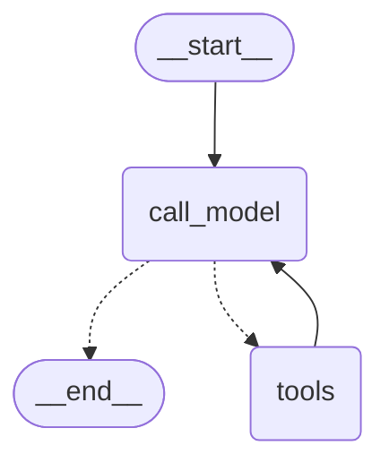
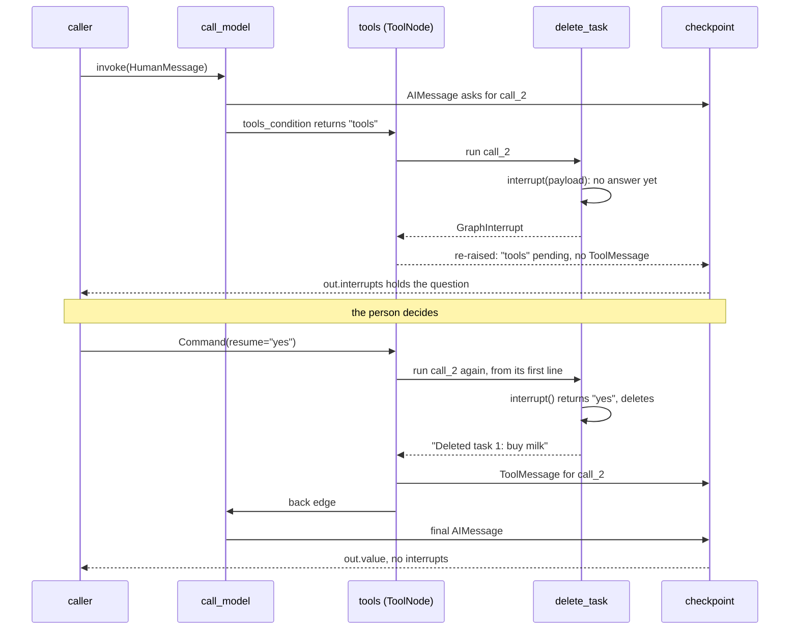

# 6.4 Approving Tool Calls Inside an Agent

## The problem

Lessons 6.1 to 6.3 paused a graph you designed node by node. The refund graph had a `manager_review` node, and you decided where the question was asked. An agent is different. In the [agent loop](../../../GLOSSARY.md#agent-loop) from lesson 4.2, the model decides which tool to call and when. You never write "now delete task 1". The model asks for it, and [ToolNode](../../../GLOSSARY.md#toolnode) runs it.

Most tools are harmless: looking something up or adding a line to a list. Some are not. Deleting data, sending an email or paying money cannot be undone, and a model can misread a request ("delete the milk one" when there are two). For those tools you want a person to confirm before the action happens, while the harmless tools keep running freely.

You could add an approval node to the graph between the model and the tools. But then the graph has to know which tools are risky, look inside the model's reply, and handle replies that mix risky and harmless calls. The Interrupts guide suggests a simpler place for the check: the tool itself. A tool is a Python function, [interrupt()](../../../GLOSSARY.md#interrupt) works in any code that runs inside a graph, and the tool knows best what it is about to do.

This lesson builds a to-do agent with two tools. `add_task` runs freely. `delete_task` asks first. It answers three questions:

1. How does a tool pause the agent, and how does the person's answer get back into the tool?
2. How does the model learn what the person decided?
3. What does the pause look like in the [checkpoint](../../../GLOSSARY.md#checkpoint), and what runs again on resume?

## The concept

### A tool that asks first

The pattern is the guide's "Interrupts in tools": call `interrupt()` inside the tool function, before the risky line.

```python
@tool
def delete_task(task_id: int) -> str:
    """Delete a task from the to-do list. The user must approve it first."""
    answer = interrupt({"question": f"Delete task {task_id}?"})
    if answer == "yes":
        ...  # delete
```

Nothing else changes. The model sees an ordinary tool. The graph is 4.2's loop, unchanged. When the model asks for `delete_task`, ToolNode calls the function, the function calls `interrupt()`, and the whole agent run pauses, exactly as a node paused in 6.1. The approval logic sits next to the action it protects. Any agent that uses the tool gets the check, with no extra wiring.

### The answer becomes the tool result

When the person answers with `Command(resume=...)`, that value is what `interrupt()` returns inside the tool, as in 6.1. The tool then decides what to do, and **returns a string, as any tool does**. ToolNode wraps that string into a [ToolMessage](../../../GLOSSARY.md#toolmessage) for the pending call, and the model reads it on its next turn.

This settles the second question. There is no special channel for "the human said no". A rejection is just a tool result:

| Answer | What the tool does | ToolMessage the model reads |
|---|---|---|
| `"yes"` | deletes the task | `Deleted task 1: buy milk` |
| anything else | keeps the task | `Not deleted: the user answered 'no, I still need to do it'` |

Both ToolMessages have status `"success"`. A rejection is a normal, expected outcome, not a failure of the tool. The loop goes back to the model as after any other tool call, and the model, which now sees the person's own words, can answer the user ("OK, I kept it") or ask what to do instead.

The check accepts only the exact string `"yes"`. Everything else counts as a no. This is called [failing closed](../../../GLOSSARY.md#fail-closed): when the answer is unclear, the tool takes the safe path and does nothing. Lesson 6.2 handled an unclear answer with a [validation loop](../../../GLOSSARY.md#validation-loop) that asked again. A tool could do that too, but for a "may I delete this?" question, treating anything unclear as "no" is simpler, and the model can always ask again.

### Where the pause sits in the agent loop

From 6.1 you know that a pause is a saved checkpoint with a pending task, and that the pending task runs again from its first line on resume. Apply that to the agent loop:

- `call_model` finished in an earlier [super-step](../../../GLOSSARY.md#super-step). Its reply, the `AIMessage` with the [tool call](../../../GLOSSARY.md#tool-call), is already saved in the state.
- The pending task is `tools`, the ToolNode. It did not finish, so it wrote nothing: there is **no ToolMessage yet** for the call. For the length of the pause, the history breaks 4.2's [pairing rule](../../../GLOSSARY.md#pairing-rule). The resume is what completes it.
- On resume, **only the `tools` node runs again**. The model is not called again. Its reply, with the same tool call ids, is read from the checkpoint.

One more consequence follows from how ToolNode is built. It runs **all** tool calls of one `AIMessage` inside **one** task. So if the model asked for `add_task` and `delete_task` in the same reply, and `delete_task` paused, then on resume the whole node runs again, and `add_task` runs a second time, although it never paused. This is 6.3's rule ("side effects before `interrupt()` must be [idempotent](../../../GLOSSARY.md#idempotent)") one level down: the code that repeats is not above the `interrupt()` in the same function, but a sibling tool in the same node.

The mental model to keep:

> **A tool interrupt pauses the `tools` node.** The model's request is saved, its answer is not. On resume the `tools` node replays every call of that request, and the paused tool's `interrupt()` returns the person's answer, which the tool turns into its ToolMessage.

## How it works

### The graph

The graph is the loop from lesson 4.2, compiled with a [checkpointer](../../../GLOSSARY.md#checkpointer). The diagram was generated from the code with `build_agent(make_model([]), None).get_graph().draw_mermaid()`, with the styling removed. Nothing in it mentions approval: the pause happens inside a tool, at run time.



### One approved delete, step by step

The diagram follows Turn 2 of the lesson's run: "Delete 'buy milk'", then the answer `"yes"`. Look at which nodes run in the second call, and when the ToolMessage appears.



The first call:

1. `call_model` returns an `AIMessage` with one tool call, id `call_2`. The step ends and the message is saved.
2. [tools_condition](../../../GLOSSARY.md#tools_condition) sees the tool call and routes to `tools`.
3. ToolNode calls `delete_task(task_id=1)`. The tool finds the task, builds the payload and calls `interrupt()`. There is no [resume value](../../../GLOSSARY.md#resume-value), so `interrupt()` raises [GraphInterrupt](../../../GLOSSARY.md#graphinterrupt).
4. ToolNode normally catches exceptions from tools, so that it can report them to the model. In `langgraph-prebuilt` 1.1.1, its `_execute_tool_sync` method has an `except GraphBubbleUp: raise` clause **before** its general `except Exception` handler. `GraphInterrupt` is a subclass of [GraphBubbleUp](../../../GLOSSARY.md#graphbubbleup) (lesson 6.3), so the pause passes straight through ToolNode and stops the run. It never becomes an "Error: ..." ToolMessage, whatever `handle_tool_errors` says.
5. LangGraph saves the checkpoint with `tools` as the pending task and the `Interrupt` attached to it. `invoke` returns normally, with the payload in `out.interrupts`.

The second call:

1. `Command(resume="yes")` on the same thread. LangGraph loads the checkpoint and runs the pending `tools` task. `call_model` does not run.
2. ToolNode reads the same `AIMessage` and calls `delete_task(task_id=1)` again. The tool starts from its first line (its run counter goes to 2). This time `interrupt()` returns `"yes"`.
3. The tool deletes the task and returns `"Deleted task 1: buy milk"`. ToolNode turns that into a ToolMessage with `tool_call_id="call_2"`, and the `tools` step finishes.
4. The back edge leads to `call_model`, which reads the ToolMessage and gives its final answer. The run ends with no pending interrupt.

### Two calls in one reply

When one `AIMessage` asks for several tools, ToolNode's `_func` runs them with `executor.map` on a thread pool, inside the one `tools` task, and returns their ToolMessages together, in call order, when all of them are done. Turn 4 of the lesson asks for `add_task` and `delete_task` in one reply:

1. **First call.** Both calls start on the thread pool. `delete_task` pauses. ToolNode collects the results in call order, so it waits for `add_task`, which adds "water the plants" and returns, before the pause leaves the node. The pause is an exception inside the node, so the node then returns nothing at all. The list already holds the new task, but no ToolMessage for `call_4` is saved.
2. **Resume.** The `tools` task runs again with the same `AIMessage`, so both calls run again. `add_task` starts a second time with the same id, `call_4`. `delete_task` gets its answer. Now both finish, and both ToolMessages are written.

Every tool that may share a model reply with an interrupting tool must therefore be safe to run twice. Its side effects stay done (the to-do list is outside the graph state, like 6.3's `MANAGER_INBOX`), but its result is thrown away and computed again.

> [!NOTE]
> The lesson puts `add_task` **first** in that reply on purpose. `Executor.map` reads the results in call order. When it reaches a call that raised, it cancels the calls that have not started yet. With `add_task` first, its result is collected before the pause is seen. With `delete_task` first, whether `add_task` even starts depends on thread timing. A real model chooses the order of the calls, so don't build anything on it. Make every tool safe to repeat instead.

## In our example

The "todo-agent" example is new in this lesson. Its loop mirrors 4.2's `chatbot.py`, so the [code walkthrough](readalong.md) only points out what is new. Here we map the concepts onto the code.

### The tool that asks

`delete_task` in [todos.py](../src/l6_4_interrupts_in_tools/todos.py) holds all of the approval logic:

<!-- snippet: src/l6_4_interrupts_in_tools/todos.py#delete_task -->
```python
@tool
def delete_task(task_id: int) -> str:
    """Delete a task from the to-do list. The user must approve it first."""
    TOOL_RUNS["delete_task"] += 1
    # An unknown task needs no approval: the tool answers without pausing.
    if task_id not in TODO_LIST:
        return f"There is no task {task_id}."
    title = TODO_LIST[task_id]
    # The tool pauses the whole agent run here. The payload (JSON-serialisable,
    # stored with the checkpoint) tells the human what is about to happen.
    # interrupt() raises GraphInterrupt; ToolNode re-raises it (GraphBubbleUp)
    # before any error handling, so it never becomes an error ToolMessage, even
    # with handle_tool_errors=True. On resume ToolNode calls this tool again
    # from its first line (TOOL_RUNS shows 2 runs per approved delete), and
    # this time interrupt() returns the resume value.
    answer = interrupt(
        {
            "tool": "delete_task",
            "task_id": task_id,
            "title": title,
            "question": f"Delete task {task_id} {title!r}? Answer 'yes' to confirm.",
        }
    )
    # Only the exact answer "yes" deletes; anything else (any text, a dict,
    # "Yes") is a rejection. Failing closed also means a malformed answer can
    # never crash the tool after interrupt(): a crash here would leave the
    # thread stuck, because the saved resume value is replayed on every resume.
    if answer == "yes":
        del TODO_LIST[task_id]
        # Whatever the tool returns becomes the ToolMessage the model reads.
        return f"Deleted task {task_id}: {title}"
    # A rejection is a normal tool result (status "success"), not an error: it
    # carries the human's own words to the model, which can then answer the user.
    return f"Not deleted: the user answered {answer!r}"
```
<!-- /snippet -->

Read it from top to bottom:

- **`TOOL_RUNS["delete_task"] += 1`** counts how often the function *starts*. It is how the output proves that the tool runs again on resume.
- **An unknown task needs no approval.** `There is no task 9.` is returned at once, and the run does not pause. Only the risky path asks.
- **The payload** tells the person what is about to happen: which tool, which task, its title and a ready-made question. It is a small dict of strings and numbers, because it is saved with the checkpoint (6.3's serialization rule). The caller prints only the `question`.
- **`if answer == "yes":`** is the [fail-closed](../../../GLOSSARY.md#fail-closed) check. `"Yes"`, `"no, I still need to do it"` and a dict like `{"approved": True}` are all rejections. The tests run all three.
- **The two `return` lines** are how the decision reaches the model. The rejection text quotes the answer with `!r`, so the model reads the person's own words.

Compare it with the guide's `send_email` example. That tool expects a dict answer with an `"action"` key and lets the answer override the email's fields, the [review-and-edit pattern](../../../GLOSSARY.md#review-and-edit-pattern) of 6.2 inside a tool. Ours takes a plain string, because deleting has nothing to edit.

### The tool that runs freely, and safely twice

<!-- snippet: src/l6_4_interrupts_in_tools/todos.py#add_task -->
```python
# Adding needs no approval, so this tool has no interrupt().
@tool
def add_task(title: str, tool_call_id: Annotated[str, InjectedToolCallId]) -> str:
    """Add a task to the to-do list."""
    # (The docstring above stays one line: @tool sends it whole to the model
    # as the tool description.)
    # tool_call_id is filled in by ToolNode with the id of the model's tool
    # call. It is hidden from the model: the schema the model sees has only
    # "title".
    TOOL_RUNS["add_task"] += 1
    # If this call shares a model reply with delete_task, the whole "tools"
    # node runs again on resume, and so does this function (Turn 4). The same
    # tool call keeps the same id, so the id is a natural idempotency key: the
    # second run adds nothing and returns the same text. This is 6.3's rule
    # (side effects before an interrupt must be safe to repeat), applied to a
    # SIBLING tool of the one that pauses.
    if tool_call_id not in ADDED_BY_CALL:
        task_id = max(TODO_LIST, default=0) + 1
        TODO_LIST[task_id] = title
        ADDED_BY_CALL[tool_call_id] = task_id
    return f"Added task {ADDED_BY_CALL[tool_call_id]}: {title}"
```
<!-- /snippet -->

`add_task` has no `interrupt()`, yet it still has to deal with replay, because of Turn 4. It needs a key that is the same on both runs of the same request and different for different requests. The [tool call](../../../GLOSSARY.md#tool-call) id is exactly that: the model's reply is saved and read back on resume, so a replayed call keeps its id. ([tool_call_id](../../../GLOSSARY.md#tool_call_id) on a ToolMessage refers to the same id.)

To receive it, the parameter is annotated with [InjectedToolCallId](../../../GLOSSARY.md#injectedtoolcallid) from `langchain_core.tools`. ToolNode fills it in with the id of the call it is running, and the annotation hides it from the model: `add_task.tool_call_schema` has only `title`. `ADDED_BY_CALL` then remembers which task number each call id created, so the second run adds nothing and returns the same text. In a real application this map would be an idempotency key or a unique column in the database, for the reason 6.3 gave: a Python dict does not survive a restart, and the resume may happen in another process.

### The loop and the checkpointer

`build_agent` in [agent.py](../src/l6_4_interrupts_in_tools/agent.py) is 4.2's graph without the system prompt and with one addition: `builder.compile(checkpointer=checkpointer)`. A tool that calls `interrupt()` needs a checkpointer for the same reason a node does (6.1). Everything else, the `ToolCallingFakeModel`, `tools_condition`, the node named `"tools"` and the back edge, is as in 4.2. The node knows nothing about approval.

The fake model matters for one claim. `make_model` wraps the script in an iterator, so each model call uses up one reply, across the pause and the resume. The script has eight replies for four turns, two per turn, and none for a resume. If the model were called again on resume, it would run out of replies and the run would fail. The test with a two-reply script uses the same argument.

### The caller

The caller in [\_\_main\_\_.py](../src/l6_4_interrupts_in_tools/__main__.py) uses one `thread_id`, `todo-chat`, for the whole conversation. The checkpoint carries the chat history from turn to turn, and each resume finds its pause by the same id. Turn 2 pauses, looks at the saved state, and resumes:

<!-- snippet: src/l6_4_interrupts_in_tools/__main__.py#approve_delete -->
```python
print("== Turn 2: deleting pauses inside the tool ==")
step(graph, {"messages": [HumanMessage("Delete 'buy milk'.")]})
# The pause happened inside delete_task, inside the "tools" node. The
# checkpoint holds the AIMessage with the tool call and the pending
# "tools" task, but no answer to call_2 yet: 4.2's pairing rule is only
# fulfilled after the resume.
snap = graph.get_state(CONFIG)
last = snap.values["messages"][-1]
print(f"  saved: next={snap.next} tasks={[task.name for task in snap.tasks]}")
print(
    f"  last saved message: {last.type}, asks for {[tc['id'] for tc in last.tool_calls]}, "
    "no ToolMessage yet"
)
# "yes" is what interrupt() returns inside the tool. The tool runs twice
# (once to pause, once to finish), and the string it returns is the ToolMessage.
step(graph, Command(resume="yes"))
print(f"  delete_task runs: {TOOL_RUNS['delete_task']}")
print(f"  to-do list: {TODO_LIST}")
```
<!-- /snippet -->

The `step` helper (see the [walkthrough](readalong.md)) calls `invoke(..., version="v2")`, prints only the messages that invoke added and the question of each pending interrupt. It never prints interrupt ids, which change between runs. The tool call ids, `call_1` to `call_5`, are fixed in the script, so they can be printed and matched: each `tool [...]` line shows the id of the request it answers.

Turn 4 shows the sibling replay:

<!-- snippet: src/l6_4_interrupts_in_tools/__main__.py#add_and_delete -->
```python
print("== Turn 4: one reply adds and deletes ==")
before = TOOL_RUNS["add_task"]
step(graph, {"messages": [HumanMessage("Add 'water the plants' and delete 'pay rent'.")]})
# Both calls run in the same "tools" task. add_task finished and changed
# the list, but its ToolMessage was not saved because the task paused.
print(f"  saved: tasks={[task.name for task in graph.get_state(CONFIG).tasks]}")
print(f"  add_task ran {TOOL_RUNS['add_task'] - before}x, to-do list: {TODO_LIST}")
# On resume the node runs both calls again: add_task runs a second time,
# and only its tool-call-id check keeps 'water the plants' from being
# added twice. add_task is FIRST in the reply on purpose: with delete_task
# first, whether add_task starts before the pause depends on thread timing.
step(graph, Command(resume="yes"))
print(f"  add_task ran {TOOL_RUNS['add_task'] - before}x, to-do list: {TODO_LIST}")
```
<!-- /snippet -->

## Run it

From the course root, run `./run.sh 6.4`. This is the output of the verified run:

```text
== Turn 1: adding needs no approval ==
  human: Add 'pay rent' to my list.
  ai asks for add_task(title='pay rent') [call_1]
  tool [call_1] add_task: Added task 3: pay rent
  ai: Added 'pay rent' as task 3.
  to-do list: {1: 'buy milk', 2: 'call the bank', 3: 'pay rent'}

== Turn 2: deleting pauses inside the tool ==
  human: Delete 'buy milk'.
  ai asks for delete_task(task_id=1) [call_2]
  paused, asking: "Delete task 1 'buy milk'? Answer 'yes' to confirm."
  saved: next=('tools',) tasks=['tools']
  last saved message: ai, asks for ['call_2'], no ToolMessage yet
  tool [call_2] delete_task: Deleted task 1: buy milk
  ai: Done, 'buy milk' is off your list.
  delete_task runs: 2
  to-do list: {2: 'call the bank', 3: 'pay rent'}

== Turn 3: a rejection becomes the tool result ==
  human: Delete 'call the bank'.
  ai asks for delete_task(task_id=2) [call_3]
  paused, asking: "Delete task 2 'call the bank'? Answer 'yes' to confirm."
  tool [call_3] delete_task: Not deleted: the user answered 'no, I still need to do it'
  ai: OK, I kept 'call the bank'.
  to-do list: {2: 'call the bank', 3: 'pay rent'}

== Turn 4: one reply adds and deletes ==
  human: Add 'water the plants' and delete 'pay rent'.
  ai asks for add_task(title='water the plants') [call_4], delete_task(task_id=3) [call_5]
  paused, asking: "Delete task 3 'pay rent'? Answer 'yes' to confirm."
  saved: tasks=['tools']
  add_task ran 1x, to-do list: {2: 'call the bank', 3: 'pay rent', 4: 'water the plants'}
  tool [call_4] add_task: Added task 4: water the plants
  tool [call_5] delete_task: Deleted task 3: pay rent
  ai: Added 'water the plants' and removed 'pay rent'.
  add_task ran 2x, to-do list: {2: 'call the bank', 4: 'water the plants'}
```

The model is a scripted fake and nothing depends on time, so every run prints exactly this. What to notice:

- **Turn 1 never pauses.** One invoke runs model, tools, model to the end. `add_task` has no `interrupt()`.
- **Turn 2's first invoke stops after the request.** The lines go `ai asks for ... [call_2]`, then `paused, asking: ...`, with no `tool [call_2]` line in between. The saved state says why: `next=('tools',)`, and the last saved message is the `AIMessage` asking for `call_2`. The pause is in the tool node, and the answer to `call_2` does not exist yet.
- **The resume adds the ToolMessage and one model reply.** `tool [call_2] delete_task: Deleted task 1: buy milk` comes from the string the tool returned. No second `ai asks for` line appears: the model was not asked again for the request, only for its final answer.
- **`delete_task runs: 2`.** One run paused, the other finished. The task was deleted once, because the deletion comes after `interrupt()`.
- **Turn 3's rejection looks like any tool result.** `Not deleted: the user answered 'no, I still need to do it'`, then the model's reply, and nothing raised. Task 2 is still on the list.
- **Turn 4 at the pause: `add_task ran 1x` and task 4 is already on the list,** but no `tool [call_4]` line was printed, because no ToolMessage was saved.
- **Turn 4 after the resume: `add_task ran 2x`,** both ToolMessages appear in call order, and "water the plants" is on the list once, as task 4. The second run found `call_4` in `ADDED_BY_CALL`.
- **The fake's answers are fixed.** "Done, 'buy milk' is off your list." would be printed even if the tool had refused. A real model reads the ToolMessage and answers accordingly (experiment 5 shows the difference).

## Details and edge cases

**`handle_tool_errors` does not affect pauses.** `ToolNode(TOOLS, handle_tool_errors=True)` turns every exception raised in a tool into an error ToolMessage, except `GraphBubbleUp`, which is re-raised first. The lesson's output is exactly the same with it (experiment 4). The same holds for a `wrap_tool_call` wrapper: ToolNode re-raises `GraphBubbleUp` from it too.

**The model is not asked again, so the arguments cannot change.** The resumed tool receives exactly the arguments of the saved request. If the person wants a different action ("delete task 2 instead"), the tool can only refuse and report that in its result, and the model can then make a new request in its next step. The guide's `send_email` example takes a different route: its resume value may carry edited fields, which the tool uses in place of the model's arguments.

**A new message instead of a resume abandons the call.** While the thread is paused, `graph.invoke({"messages": [HumanMessage(...)]}, config)` does not answer the pending interrupt. It starts a new run from the input, as 6.1 showed for nodes. Nothing raises, the paused tool never finishes, and `next` becomes `()`. The history keeps the `AIMessage` asking for the call, with no ToolMessage for it. A real provider rejects such a history on the next model call (4.2's pairing rule), and the scripted fake does not notice (experiment 2).

**Code after `interrupt()` must not crash on the answer.** By 6.3's mechanism, the first resume value is stored for the task at the position of its `interrupt()` call, and every later run of the task gets that stored value back. If the tool raises on it, for example by indexing `answer["approved"]` into the string `"yes"`, each further resume replays the same answer and raises the same error, even with a corrected answer or a [resume map](../../../GLOSSARY.md#resume-map) by id. The thread is stuck in `tools` (experiment 3; the open issue [#8837](https://github.com/langchain-ai/langgraph/issues/8837) reports a related problem with stale resume values). Failing closed avoids this. `handle_tool_errors=True` would also get the run moving, but the model would then read `Error: TypeError(...) Please fix your mistakes.`, an error it cannot fix, because the bad value came from a person.

**Without a checkpointer, the tool still pauses.** The first invoke returns the interrupt, but the resume raises `RuntimeError: Cannot use Command(resume=...) without checkpointer`, as in [6.1](../../6.1-interrupt-and-resume/docs/notes.md#details-and-edge-cases). The lesson's `step` helper would fail even earlier, at `get_state`.

**Several approvals in one reply.** If one reply asks for two calls that both pause, only one question surfaces at first in 1.2.16: the other call was cancelled or not reached yet. What happens next depends on thread timing, so the lesson avoids the case. If your agent can ask for several risky calls in one reply, test that case, or use the middleware described below, which asks about all of them in one interrupt.

**`create_agent` does not replay sibling calls.** Lesson 4.3 showed that [create_agent](../../../GLOSSARY.md#create_agent) sends each tool call to its own `tools` task with [Send](../../../GLOSSARY.md#send). With the same two tools in langchain 1.4.6, a finished `add_task` is kept as a [pending write](../../../GLOSSARY.md#pending-writes) of the step while `delete_task` waits, so on resume only `delete_task` runs again, and `add_task` runs once in total. The sibling replay of this lesson is a property of ToolNode running all calls in one task. Idempotent tools are still the safer habit, since a tool may later be used in either kind of loop.

**A stream bug, not an invoke bug.** Open issue [#8218](https://github.com/langchain-ai/langgraph/issues/8218) reports that an `interrupt()` inside a tool shows up as a `tool-error` event on the `tools` stream mode. It concerns streaming only. With `invoke`, as here, the pause is reported correctly.

### The prebuilt alternative: HumanInTheLoopMiddleware

For agents built with `create_agent` (lesson 4.3), the `langchain` package ships [HumanInTheLoopMiddleware](../../../GLOSSARY.md#humanintheloopmiddleware), an [agent middleware](../../../GLOSSARY.md#agent-middleware) that gates tool calls by configuration. Module 6 does not install `langchain`, so the lesson code does not use it, but you should know how it differs. In langchain 1.4.6:

- You list the tools to gate: `HumanInTheLoopMiddleware(interrupt_on={"delete_task": True})`, or an `InterruptOnConfig` per tool that sets the allowed decisions.
- In the default `interrupt_mode="batched"`, the middleware calls `interrupt()` in its `after_model` hook, once per model turn, **before any tool runs**. The payload is an `HITLRequest` listing every gated call of that reply. You resume with one decision per call: `approve`, `edit` (run with changed arguments), `reject` (skip it and send feedback to the model) or `respond` (use your text as the tool result).
- With `interrupt_mode="per_call"`, each gated call pauses on its own, from the middleware's `wrap_tool_call` hook.

| | Interrupt in the tool (this lesson) | HumanInTheLoopMiddleware |
|---|---|---|
| Where the check lives | in the tool's code | in the agent's configuration |
| When it asks | when the tool runs | batched: after the model, before any tool |
| What the person can do | whatever the tool implements | approve, edit, reject, respond |
| Works with | any graph, including a hand-built ToolNode loop | `create_agent` |

Put the check in the tool when the tool decides itself whether it needs approval (here: only when the task exists) or when the tool is used in hand-built graphs. Use the middleware when you build with `create_agent` and want a standard review flow for several tools.

## Common mistakes

> [!WARNING]
> **A non-idempotent tool next to an interrupting one.** If the model asks for a harmless tool and a gated one in the same reply, a hand-built ToolNode loop runs the harmless one again on resume. Without its `ADDED_BY_CALL` check, `add_task` adds "water the plants" twice (experiment 1). Key side effects by the tool call id, or keep them idempotent another way.

> [!WARNING]
> **Answering with a new message instead of `Command(resume=...)`.** A chat UI that sends the person's "yes" as a new `HumanMessage` does not resume the paused tool. The deletion never happens, and the history is left with an unanswered tool call (experiment 2). While `out.interrupts` is non-empty, the next input must be a `Command`.

> [!WARNING]
> **Trusting the shape of the answer.** `answer["approved"]` crashes when the answer is a string, and because the stored answer is replayed on every resume, the thread cannot recover (experiment 3). Compare against the exact values you expect, and treat everything else as "no".

> [!WARNING]
> **Raising an exception to reject.** A rejection is information for the model, not an error. Return it as the tool's result, with the person's words if they gave any. An exception either ends the run (default `handle_tool_errors`) or becomes an error ToolMessage that tells the model to "fix its mistakes".

> [!TIP]
> Give the person a fixed set of answers, such as an Approve and a Reject button that send `"yes"` and `"no"`, instead of a free text box. Free text leads to `"Yes"`, `"ok"` and `"sure"`, which a fail-closed check treats as "no" (experiment 5).

## Experiments

Each experiment starts from the lesson's original code. Make the change, run `./run.sh 6.4` from the course root, and guess the result before you open the explanation.

1. Remove the idempotency check: in `add_task` in [todos.py](../src/l6_4_interrupts_in_tools/todos.py), replace the `if tool_call_id not in ADDED_BY_CALL:` block and the `return` line with `task_id = max(TODO_LIST, default=0) + 1`, `TODO_LIST[task_id] = title` and `return f"Added task {task_id}: {title}"`.

   <details><summary>What happens and why</summary>

   Turns 1 to 3 print the same as before. In Turn 4, the line at the pause is unchanged (`add_task ran 1x`, task 4 on the list), but after the resume you see `tool [call_4] add_task: Added task 5: water the plants`, and the turn ends with `add_task ran 2x, to-do list: {2: 'call the bank', 4: 'water the plants', 5: 'water the plants'}`.

   The first run of `add_task` changed the list, and its result was thrown away when `delete_task` paused in the same `tools` task. On resume ToolNode ran both calls again, and without the check the second run added the task again, under a new number. The ToolMessage the model reads is from the second run, so it reports task 5. Put the code back as it was (`git checkout -- .` in the lesson directory).

   </details>

2. Send a new message instead of resuming: in the `approve_delete` region of [\_\_main\_\_.py](../src/l6_4_interrupts_in_tools/__main__.py), replace `step(graph, Command(resume="yes"))` with `step(graph, {"messages": [HumanMessage("Never mind.")]})`.

   <details><summary>What happens and why</summary>

   No error. Turn 2 now shows `human: Never mind.` and then `ai: Done, 'buy milk' is off your list.`, followed by `delete_task runs: 1` and `to-do list: {1: 'buy milk', 2: 'call the bank', 3: 'pay rent'}`. "buy milk" stays on the list for the rest of the run, so every later to-do list line contains it too.

   The new input started a new run: `call_model` received the conversation with the new message and gave the next scripted reply. The paused `delete_task` never ran again. The saved history now holds the `AIMessage` asking for `call_2` with no ToolMessage for it, which a real provider would reject on the next model call. The fake does not check, and its fixed script claims the task is gone. Only `Command(resume=...)` answers a pending tool call. Put the code back as it was.

   </details>

3. Let a malformed answer crash the tool: in `delete_task`, change `if answer == "yes":` to `if answer["approved"]:`, and keep `Command(resume="yes")` in `__main__.py`. Then, to see that the thread is stuck, catch the error in a small script of your own and resume again with `Command(resume={"approved": True})`.

   <details><summary>What happens and why</summary>

   Turn 2 prints up to `last saved message: ai, asks for ['call_2'], no ToolMessage yet`, then the program stops with `TypeError: string indices must be integers, not 'str'`. Resuming again with `{"approved": True}` raises the same `TypeError`, and so does a resume map keyed by the interrupt's id. After each attempt, `get_state(CONFIG).next` is still `('tools',)` with one pending interrupt, `delete_task` has run once more, and "buy milk" is still on the list.

   The first answer, `"yes"`, was stored for the `tools` task at the position of its `interrupt()` call. Every later run of the task replays that stored answer (6.3's mechanism), so the new value is never used, and the tool crashes the same way each time. That is why `delete_task` compares the answer instead of indexing into it. Put the code back as it was.

   </details>

4. Turn on ToolNode's error handling: in `build_agent` in [agent.py](../src/l6_4_interrupts_in_tools/agent.py), use `ToolNode(TOOLS, handle_tool_errors=True)`.

   <details><summary>What happens and why</summary>

   The output is exactly the same, every pause included. `interrupt()` raises `GraphInterrupt`, and ToolNode re-raises `GraphBubbleUp` before its error handler runs, so a pause never becomes an `Error: ...` ToolMessage. Error handling and approvals do not interfere. Put the code back as it was.

   </details>

5. Answer differently: in the `approve_delete` region, resume with `Command(resume="Yes")` instead of `"yes"`.

   <details><summary>What happens and why</summary>

   Turn 2 prints `tool [call_2] delete_task: Not deleted: the user answered 'Yes'`, `delete_task runs: 2`, and "buy milk" stays on the list (in every later turn too). Yet the next line is still `ai: Done, 'buy milk' is off your list.`

   The tool fails closed: only the exact string `"yes"` deletes. A real model would read that ToolMessage and tell the user that nothing was deleted. The fake's fixed script cannot. The fix is not a more forgiving check, but an answer format that leaves no room for doubt, such as a button value. Put the code back as it was.

   </details>

## Summary

- Call `interrupt()` inside a tool, before the risky action, to make the tool ask for approval itself. The graph, the model and the other tools stay unchanged.
- The resume value is what `interrupt()` returns inside the tool. The string the tool returns becomes the ToolMessage, so a rejection reaches the model as a normal tool result with status `"success"`, not as an error.
- While paused, the checkpoint holds the model's `AIMessage` with the tool call and a pending `tools` task, but no ToolMessage. On resume only the `tools` node runs again; the model is not called again.
- ToolNode runs every call of one reply in one task, so on resume every sibling call runs again. Tools that can share a reply with a gated tool must be idempotent, for example keyed by their `InjectedToolCallId`.
- ToolNode re-raises `GraphBubbleUp`, so pauses pass through it even with `handle_tool_errors=True`. Make the code after `interrupt()` fail closed: a crash there leaves the thread stuck.
- With `create_agent`, `HumanInTheLoopMiddleware` is the prebuilt alternative: it gates tools by configuration and, by default, asks once per model turn before any tool runs.

## Self-check

1. After `Command(resume="yes")` in Turn 2, the script still has enough replies, although the model answered after the resume. Why is `call_model` not called a second time for the tool request?

   <details><summary>Answer</summary>

   `call_model` finished in an earlier step, so its `AIMessage` with the tool call is saved in the checkpoint. The pending task is `tools`, and a resume runs only the pending task. After the tool finishes, the back edge calls the model once, for its final answer, which is the second reply of the turn.

   </details>

2. The person answers "no, I still need to do it". What does the model receive, and why is it good that this is not an error?

   <details><summary>Answer</summary>

   A ToolMessage for `call_3` with content `Not deleted: the user answered 'no, I still need to do it'` and status `"success"`. Because it is a normal tool result, the loop continues to the model, which can read the person's reason and answer the user. An exception would either end the run or reach the model as an error that suggests it made a mistake.

   </details>

3. In Turn 4, `add_task` ran twice, but "water the plants" is on the list once. Explain both facts.

   <details><summary>Answer</summary>

   Both calls of the reply run in the same `tools` task. When `delete_task` paused, the task wrote nothing, so `add_task`'s result was lost, although its change to the list stayed. On resume the whole task ran again, including `add_task`. The second run had the same tool call id, `call_4`, found it in `ADDED_BY_CALL` and added nothing.

   </details>

4. A colleague wraps the whole body of `delete_task` in `try/except Exception` and also sets `handle_tool_errors=True`, "to be safe". Which of the two can swallow the pause?

   <details><summary>Answer</summary>

   The `try/except Exception` inside the tool. `GraphInterrupt` is a subclass of `Exception` (through `GraphBubbleUp`), so the tool's own `except` catches it before ToolNode sees it, and the tool never pauses (6.3's rule). `handle_tool_errors=True` is harmless: ToolNode re-raises `GraphBubbleUp` before its error handling runs.

   </details>

5. Why does `delete_task` check `answer == "yes"` instead of reading `answer["approved"]` from a dict?

   <details><summary>Answer</summary>

   The resume value can be anything the caller sends. Indexing into an unexpected value raises after `interrupt()`, and the stored answer is replayed on every later resume, so the thread stays stuck in `tools`. Comparing with one exact value never raises, and treating everything else as a rejection fails closed.

   </details>

## Further reading

- [Interrupts](https://docs.langchain.com/oss/python/langgraph/interrupts), the official guide. See "Interrupts in tools" under "Common patterns" (the `send_email` example) and "Rules of interrupts".
- [Human-in-the-loop](https://docs.langchain.com/oss/python/langchain/human-in-the-loop), the official guide to `HumanInTheLoopMiddleware` for `create_agent`: `interrupt_on`, the batched and per-call modes, and the four decision types.
- [langgraph/prebuilt/tool_node.py at 1.2.16](https://github.com/langchain-ai/langgraph/blob/1.2.16/libs/prebuilt/langgraph/prebuilt/tool_node.py) (identical to the installed `langgraph-prebuilt` 1.1.1): `ToolNode._func` with `executor.map`, and `_execute_tool_sync` with `except GraphBubbleUp: raise` before the error handler.
- [langchain/agents/middleware/human_in_the_loop.py at langchain 1.4.6](https://github.com/langchain-ai/langchain/blob/langchain%3D%3D1.4.6/libs/langchain_v1/langchain/agents/middleware/human_in_the_loop.py): `HumanInTheLoopMiddleware`, its `after_model` and `wrap_tool_call` hooks.
- [Issue #8837: consumed resume values are re-delivered to later interrupts](https://github.com/langchain-ai/langgraph/issues/8837).
- [Issue #8218: interrupt() inside a tool is reported as a tool-error on the tools stream](https://github.com/langchain-ai/langgraph/issues/8218).
