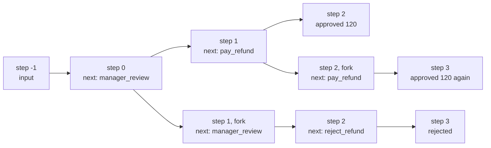
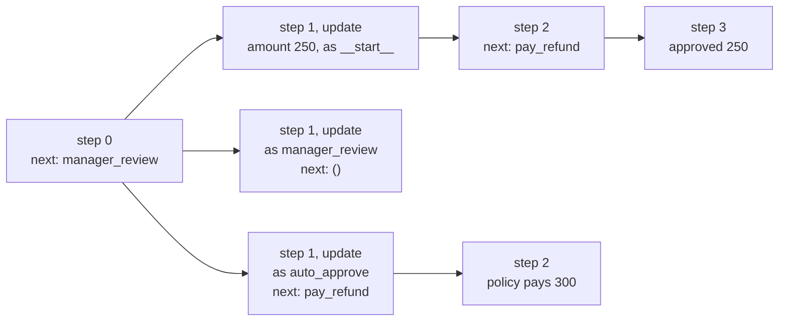

# 6.5 Time Travel: History, Replay and Forks

## The problem

Refund R-4 is closed. The customer asked for \$300, the manager approved \$120, and `pay_refund` paid it. That is 6.2's edit case. Now three people come back to it:

- **Support** asks: "What did the manager see when they decided?" The final state says `approved_amount=120`. It does not say what the state looked like at the moment of the question.
- **The manager** says: "I clicked the wrong button. I meant to reject it." Lesson 6.2 has no way to take back an answer. The thread is finished, and resuming it does nothing.
- **The customer** writes: "I made a typo, the amount should have been \$250." You could start a new thread. Then the history of R-4 would be split across two threads, and the new run would have to start again from scratch.

All three questions are about the past of one thread, and you already have that past. Lesson [5.1](../../../5-persistence/5.1-checkpointers-and-threads/docs/notes.md) showed that a [checkpointer](../../../GLOSSARY.md#checkpointer) keeps every [checkpoint](../../../GLOSSARY.md#checkpoint) of a thread, not only the last one: one for the input and one after each [super-step](../../../GLOSSARY.md#super-step). Lesson 6.1 showed that a pause is a checkpoint the run can continue from later. What is missing is a way to *read* any one of those checkpoints and to *continue* from it, instead of from the newest one.

That is what LangGraph calls time travel. It needs no change to the graph: this lesson's [refunds.py](../src/l6_5_time_travel/refunds.py) is byte-identical to 6.2's. Everything happens on the caller's side.

## The concept

[Time travel](../../../GLOSSARY.md#time-travel) means running a thread from one of its earlier checkpoints instead of its newest one. It is built from three operations.

### History: every checkpoint, newest first

[get_state_history](../../../GLOSSARY.md#get_state_history)`(config)` yields one [StateSnapshot](../../../GLOSSARY.md#statesnapshot) per saved checkpoint of the thread, newest first. It is the same object [get_state](../../../GLOSSARY.md#get_state) returns (5.1): `values`, `next`, `config`, `metadata` with `step` and `source`, and `parent_config`.

Each snapshot's `config` holds the three keys you saw in 5.1: `thread_id`, `checkpoint_ns` and the [checkpoint_id](../../../GLOSSARY.md#checkpoint_id), the id of this one checkpoint. This lesson is where the third one matters. A config with only a `thread_id` means "the newest checkpoint of the thread". A config that also has a `checkpoint_id` means "this checkpoint". Every time-travel call takes such a config.

### Replay: continue from a past checkpoint as it is

A **replay** is `graph.invoke(None, config_with_checkpoint_id)`. The input `None` means "no new input, continue", as in 5.2. The `checkpoint_id` says from where. LangGraph loads that checkpoint and runs what its `next` names.

The rule that decides everything else:

> **Nodes before the checkpoint do not run again: their writes are saved in it. Nodes after the checkpoint run again for real.**

"For real" means that a replay is not a read from a cache. The official guide is explicit: replay re-executes nodes, and LLM calls, API requests and interrupts fire again and may give different results. If a node after the checkpoint pays money, a replay pays again.

> [!NOTE]
> Lesson 6.3 used "replay" for something else: a resumed node runs again from its first line, and its earlier [interrupt()](../../../GLOSSARY.md#interrupt) calls get their stored answers back. In this chapter, "replay" always means time travel: invoking the graph from a past checkpoint.

### Fork: change the past state, then continue

A **fork** changes the state at a past checkpoint and continues from the changed version. It takes two calls:

```python
fork_config = graph.update_state(config_with_checkpoint_id, {"amount": 250})
graph.invoke(None, fork_config)
```

[update_state](../../../GLOSSARY.md#update_state) does not edit the checkpoint you give it. It writes a **new** checkpoint on top of it, with the changed values, and returns that new checkpoint's config. The guide puts it as "`update_state` does **not** roll back a thread". The `invoke(None, fork_config)` that follows is an ordinary continuation from the new checkpoint.

The values are applied as if a node had returned them. They go through that node's writers and the state's [reducers](../../../GLOSSARY.md#reducer), exactly like a real node's update. `RefundState` has no reducers, so `{"amount": 250}` simply replaces `amount`. Which node? That is the third argument, [as_node](../../../GLOSSARY.md#as_node):

- `as_node="auto_approve"` means "pretend `auto_approve` just returned these values".
- Without `as_node`, LangGraph picks the node that wrote last before that checkpoint, if that is not ambiguous.

The choice matters because **the graph continues along that node's edges**. The node named in `as_node` decides what runs next.

### Nothing is overwritten

Neither a replay nor a fork deletes or changes a checkpoint. Both start a new branch whose first checkpoint has the chosen checkpoint as its parent:

| | Replay | Fork |
|---|---|---|
| Call | `invoke(None, cfg)` | `update_state(cfg, values, as_node=...)`, then `invoke(None, fork_cfg)` |
| State it starts from | the checkpoint unchanged | the checkpoint plus your values |
| First new checkpoint | `source="fork"`, a copy of the chosen one, one step later | `source="update"`, one step later |
| What runs | the chosen checkpoint's `next` | the edges of the `as_node` node |

The thread's history becomes a tree. `get_state(thread)` and a plain `invoke` on the thread always work on the newest checkpoint, which after a replay or a fork is the tip of the new branch. The old branches stay in `get_state_history`.

## How it works

### The checkpoints of one run

The first run of R-4 writes four checkpoints (output below):

| step | source | next | what it holds |
|---|---|---|---|
| -1 | `input` | `('__start__',)` | the input, not yet applied (5.1) |
| 0 | `loop` | `('manager_review',)` | `request_id`, `amount`; `START` has routed |
| 1 | `loop` | `('pay_refund',)` | plus `decided_by` and `approved_amount` |
| 2 | `loop` | `()` | plus `status`; nothing left to run |

There is no checkpoint for the pause. The run was at step 0 when `manager_review` called `interrupt()`, and the pause is recorded on that checkpoint (6.1). The resume continued from step 0. So "the moment the manager was asked" is the step 0 checkpoint, and "the moment after the manager decided" is step 1.

### Replay from two places

Pick a checkpoint and the rule tells you what happens:

- **From step 1** (`next = ('pay_refund',)`): `manager_review` ran before this checkpoint. Its result is saved, so it does not run, and the manager is not asked. `pay_refund` comes after, so it runs again and pays \$120 a second time.
- **From step 0** (`next = ('manager_review',)`): `manager_review` comes after this checkpoint, so it runs again from its first line and reaches `interrupt()`. The \$120 answer from the original run is not reused: the guide says that interrupts are always re-triggered during time travel. The thread is paused again and waits for a new answer, which you send as in 6.1, with `Command(resume=...)` on the thread.

The diagram shows the thread after both replays. Read it from the left: the original run is the top row, and each replay starts a new branch from the checkpoint it chose.



Each replay's first checkpoint is a `fork` checkpoint: a copy of the chosen checkpoint, saved as a child of it. The run continues from the copy, so everything it writes lands on the new branch. A comment in LangGraph's `_loop.py` gives the reason: without the copy, a replay that hits an interrupt before its first step ends would write no checkpoint at all. The newest checkpoint of the thread would still be the old one, and the next resume would load the wrong state.

### Forks from step 0

Forks start from the same step 0 checkpoint, with different values and different `as_node`:



- **`{"amount": 250}` without `as_node`.** The last writer before step 0 is the input step, `__start__`. Writing "as `__start__`" means the edges out of `START` run again, and the only one is the [conditional edge](../../../GLOSSARY.md#conditional-edge) `route_by_amount`. It sees \$250, which is above the limit, so `next` is `('manager_review',)`, and the manager is asked about \$250.
- **The policy's decision as `manager_review`.** `manager_review` has no static edge: it routes only with the [goto](../../../GLOSSARY.md#goto) of the [Command](../../../GLOSSARY.md#command) it returns at run time (6.2). A plain dict carries no `goto`, so nothing follows. `next` is `()` and the branch ends at once, without paying.
- **The same values as `auto_approve`.** `auto_approve` has the static edge `auto_approve -> pay_refund`, so `next` is `('pay_refund',)`. The graph acts as if the policy had decided: `manager_review` and its interrupt are skipped, and \$300 is paid.

The values are identical in the last two forks. Only `as_node` differs, and it alone decides whether anything is paid.

## In our example

The graph is 6.2's, unchanged. The [code walkthrough](readalong.md) goes through every line of the new entry point, [`__main__.py`](../src/l6_5_time_travel/__main__.py). Here are the parts that carry the concept.

### Addressing a checkpoint

<!-- snippet: src/l6_5_time_travel/__main__.py#at_checkpoint -->
```python
def at_checkpoint(request_id: str, checkpoint_id: str) -> dict[str, dict[str, str]]:
    """Return the config of one saved checkpoint of the request's thread."""
    # A snapshot's .config already holds these three keys. This helper shows
    # what is inside, the way an app builds it when it stored only the
    # checkpoint_id (in an audit log, in a URL).
    return {
        "configurable": {
            "thread_id": f"refund-{request_id}",
            # "" is the namespace of the top-level graph. Keep it:
            # update_state with InMemorySaver fails with KeyError
            # 'checkpoint_ns' without it (invoke does not).
            "checkpoint_ns": "",
            # Which saved checkpoint of the thread to start from.
            "checkpoint_id": checkpoint_id,
        }
    }
```
<!-- /snippet -->

A snapshot's own `.config` is already such a config, and the tests use it directly. The helper exists to show what a checkpoint address is made of: the thread, the namespace (`""` for the top-level graph) and the checkpoint id. An application that stored only the id, in an audit log or a URL, builds the config the same way. Keep all three keys. The fifth experiment shows what breaks without `checkpoint_ns`.

### Reading the history

<!-- snippet: src/l6_5_time_travel/__main__.py#history -->
```python
print("== get_state_history: the checkpoints of the thread, newest first ==")
# The same StateSnapshot as get_state (5.1), one per saved checkpoint,
# newest first: the input checkpoint at step -1, then one per super-step.
# The pause did not add a checkpoint: step 0 is where manager_review
# paused, and the resume continued from it.
history = list(graph.get_state_history(thread))
for snap in history:
    print(describe(snap))
# Pick a checkpoint by what it was about to do (next), never by its
# position in the list: once the thread branches, positions and step
# numbers repeat.
paused = next(s for s in history if s.next == ("manager_review",))
before_pay = next(s for s in history if s.next == ("pay_refund",))
paused_id = paused.config["configurable"]["checkpoint_id"]
before_pay_id = before_pay.config["configurable"]["checkpoint_id"]
print(
    f"  {len(history)} checkpoints; picked step {paused.metadata['step']} "
    f"(before manager_review) and step {before_pay.metadata['step']} (before pay_refund)"
)
print()
```
<!-- /snippet -->

The two checkpoints are found by **what they were about to do**, their `next`. That is how you describe a moment in a run: "before the manager was asked", "before the payment". `history[2]` would also find step 0 now, but only while the thread has a single branch. Once it branches, new checkpoints land at the top of the list and step numbers repeat (the output below shows two `step 3` lines). `describe` prints step, source, `next` and the refund fields, never the id: checkpoint ids are generated from the current time and differ on every run.

### The two replays

<!-- snippet: src/l6_5_time_travel/__main__.py#replay_after_decision -->
```python
print("== Replay from step 1: manager_review is not run again, pay_refund is ==")
# Input None plus a config with a checkpoint_id means "continue from this
# past checkpoint": a replay. manager_review ran before this checkpoint
# and its result (decided_by, approved_amount) is saved in it, so it does
# not run again and the manager is not asked. pay_refund comes after it
# and really runs again: the refund is paid twice. Replay re-executes
# nodes, it is not a cached re-read, so side effects after the
# checkpoint must be idempotent (6.3).
out = graph.invoke(None, at_checkpoint("R-4", before_pay_id), version="v2")
print(outcome(out.value))
print()
```
<!-- /snippet -->

<!-- snippet: src/l6_5_time_travel/__main__.py#replay_before_decision -->
```python
print("== Replay from step 0: manager_review runs again and asks again ==")
# Step 0 is where manager_review paused. Replaying it runs the node from
# its top, and interrupt() pauses again: the $120 answer from the
# original run is not reused, so a different answer can be given.
out = graph.invoke(None, at_checkpoint("R-4", paused_id), version="v2")
print(f"  asked again: {out.interrupts[0].value['question']!r}")
# Resume with the plain thread config: the replay's new checkpoint is now
# the newest one of the thread, so the resume finds the new pause. Do not
# resume through at_checkpoint(paused_id) (see the experiments).
out = graph.invoke(Command(resume={"decision": "reject"}), thread, version="v2")
print(outcome(out.value))
print()
```
<!-- /snippet -->

The two calls look the same. Only the checkpoint differs, and with it which nodes lie "after". The second replay is how the manager takes back the answer: replay from the checkpoint where they were asked, then resume **on the thread** with the new answer. After the replay, its `fork` checkpoint is the newest one of the thread, and the new pause is recorded there. A resume with the plain `thread` config finds it. LangGraph's own time-travel tests resume the same way after a replay.

### The fork

<!-- snippet: src/l6_5_time_travel/__main__.py#fork_with_update -->
```python
print("== Fork from step 0: update_state(amount=250), no as_node ==")
# The customer corrected the request to $250. update_state does not
# change the past checkpoint: it writes a new one (source "update") whose
# parent is step 0, and returns its config.
fork = graph.update_state(at_checkpoint("R-4", paused_id), {"amount": 250})
snap = graph.get_state(fork)
print(describe(snap))
print(
    "  parent is the step 0 checkpoint: "
    f"{snap.parent_config['configurable']['checkpoint_id'] == paused_id}"
)
# Without as_node the update is applied as the node that wrote last
# before step 0, which is the input (__start__). So START's conditional
# edge route_by_amount runs again: $250 is still above the limit, and
# next is manager_review. Its interrupt fires again in the fork, and the
# fork is resumed on the thread like any pause.
out = graph.invoke(None, fork, version="v2")
print(f"  asked: {out.interrupts[0].value['question']!r}")
out = graph.invoke(Command(resume={"decision": "approve"}), thread, version="v2")
print(outcome(out.value))
print()
```
<!-- /snippet -->

`update_state` returns the config of the new `update` checkpoint, and `get_state(fork)` reads it before anything runs. Its `next` is already `('manager_review',)`: `route_by_amount` ran inside `update_state`, as part of applying the update "as `__start__`". The `invoke(None, fork)` then runs `manager_review`, which asks about \$250. Interrupts fire in a fork just as in a replay.

### as_node decides the route

<!-- snippet: src/l6_5_time_travel/__main__.py#fork_as_node -->
```python
print("== Fork from step 0 with as_node: the node named decides what runs next ==")
# as_node says which node the update pretends to come from; the graph
# then continues along that node's edges. manager_review routes only with
# Command(goto=...) and has no static edge, so a plain dict "from" it
# leads nowhere: next is () and nothing would be paid. auto_approve has
# the edge auto_approve -> pay_refund, so the policy pays $300 and
# manager_review (with its interrupt) is skipped.
decision = {"decided_by": "policy", "approved_amount": 300}
for node in ["manager_review", "auto_approve"]:
    fork = graph.update_state(at_checkpoint("R-4", paused_id), decision, as_node=node)
    print(f"  as_node={node!r}: next={graph.get_state(fork).next}")
# The last fork (auto_approve) is the one continued.
out = graph.invoke(None, fork, version="v2")
print(outcome(out.value))
print()
```
<!-- /snippet -->

The loop creates two forks from the same checkpoint with the same values. Only the second is continued. The first stays in the history as a branch that ended at once, with `approved_amount=300` and no `status`.

## Run it

From the course root, run `./run.sh 6.5`. This is the output of the verified run:

```text
== R-4: the original run, the manager approves $120 of $300 ==
  [manager_review] started for R-4
  [manager_review] started for R-4
  [manager_review] accepted {'decision': 'approve', 'amount': 120}
  [pay_refund] paying $120 for R-4
  status='approved' decided_by='manager' approved_amount=120

== get_state_history: the checkpoints of the thread, newest first ==
  step  2  loop    next=()                    amount=300  approved_amount=120  status=approved
  step  1  loop    next=('pay_refund',)       amount=300  approved_amount=120  status=None
  step  0  loop    next=('manager_review',)   amount=300  approved_amount=None  status=None
  step -1  input   next=('__start__',)        amount=None  approved_amount=None  status=None
  4 checkpoints; picked step 0 (before manager_review) and step 1 (before pay_refund)

== Replay from step 1: manager_review is not run again, pay_refund is ==
  [pay_refund] paying $120 for R-4
  status='approved' decided_by='manager' approved_amount=120

== Replay from step 0: manager_review runs again and asks again ==
  [manager_review] started for R-4
  asked again: 'Approve a refund of $300 for R-4?'
  [manager_review] started for R-4
  [manager_review] accepted {'decision': 'reject'}
  [reject_refund] no refund for R-4
  status='rejected' decided_by='manager' approved_amount=None

== get_state_history after two replays: old checkpoints are kept ==
  step  3  loop    next=()                    amount=300  approved_amount=None  status=rejected
  step  2  loop    next=('reject_refund',)    amount=300  approved_amount=None  status=None
  step  1  fork    next=('manager_review',)   amount=300  approved_amount=None  status=None
  step  3  loop    next=()                    amount=300  approved_amount=120  status=approved
  step  2  fork    next=('pay_refund',)       amount=300  approved_amount=120  status=None
  step  2  loop    next=()                    amount=300  approved_amount=120  status=approved
  step  1  loop    next=('pay_refund',)       amount=300  approved_amount=120  status=None
  step  0  loop    next=('manager_review',)   amount=300  approved_amount=None  status=None
  step -1  input   next=('__start__',)        amount=None  approved_amount=None  status=None
  get_state(thread) reads the newest: status='rejected'

== Fork from step 0: update_state(amount=250), no as_node ==
  step  1  update  next=('manager_review',)   amount=250  approved_amount=None  status=None
  parent is the step 0 checkpoint: True
  [manager_review] started for R-4
  asked: 'Approve a refund of $250 for R-4?'
  [manager_review] started for R-4
  [manager_review] accepted {'decision': 'approve'}
  [pay_refund] paying $250 for R-4
  status='approved' decided_by='manager' approved_amount=250

== Fork from step 0 with as_node: the node named decides what runs next ==
  as_node='manager_review': next=()
  as_node='auto_approve': next=('pay_refund',)
  [pay_refund] paying $300 for R-4
  status='approved' decided_by='policy' approved_amount=300

== Every branch is still in the thread ==
  15 checkpoints, 6 of them with nothing left to run
  (status, approved_amount) at those ends, newest first: [('approved', 300), (None, 300), ('approved', 250), ('rejected', None), ('approved', 120), ('approved', 120)]
```

There is no model and no id is printed, so every run prints exactly this. What to notice:

- **The replay from step 1 prints one line before the outcome: `[pay_refund] paying $120`.** There is no `[manager_review]` line, so the manager was not asked, and yet the refund was paid a second time. In a real system the customer would now have \$240.
- **The replay from step 0 prints `started` twice and `accepted` once.** The first `started` is the replayed node reaching `interrupt()`, the second is the resume (6.1's pattern). The question is the original \$300 one, and the answer is new.
- **The kept history has nine lines, and step numbers repeat.** Read it from the bottom: the four original checkpoints, then the step 1 replay (`fork` at step 2, then step 3), then the step 0 replay (`fork` at step 1, `reject_refund` pending at step 2, the end at step 3). The list is ordered by time across branches. `parent_config` is what ties a branch together.
- **`get_state(thread)` reports `rejected`.** The newest checkpoint is the end of the last branch. The approved run is still in the history, but it is no longer the "current" state of the thread.
- **The `update` checkpoint already shows `next=('manager_review',)`** before anything is invoked: `route_by_amount` ran while `update_state` applied the new amount.
- **Six branch ends, 15 checkpoints.** 4 from the original run, 2 and 3 from the replays, 3 from the \$250 fork (update, after `manager_review`, after `pay_refund`), and 3 from the `as_node` forks (two updates and one payment). The pauses added none. `(None, 300)` is the `manager_review` fork that never paid.

## Details and edge cases

**Replaying the final checkpoint runs nothing.** A checkpoint with `next == ()` has nothing after it, so a replay from it runs no node and returns the same values. The guide calls this a no-op, and LangGraph's test `test_replay_from_final_checkpoint_is_noop` checks that no node runs. On 1.2.16 it still writes one more checkpoint, a `fork` copy one step later (experiment 1). That is observed behaviour, not a documented promise, so do not build on it either way.

**`update_state` returns the new head of the thread.** The returned config points at the `update` checkpoint, and that checkpoint is now the newest in the thread. A plain `invoke(None, thread)` or a resume on the thread works on the fork from then on. Calling `update_state` twice, as the `as_node` loop does, gives two sibling branches. The thread's head is the last one written.

**Inferring `as_node` is not always what you want.** In the R-4 thread, LangGraph infers `__start__` at steps -1 and 0, `manager_review` at step 1 and `pay_refund` at step 2. A fork from step 1 without `as_node` is therefore applied "as `manager_review`", which has no static edge. `next` is `()`, and the fork pays nothing (experiment 3). The guide lists the cases in which you should name the node yourself: parallel branches that wrote in the same step (inference is ambiguous and raises [InvalidUpdateError](../../../GLOSSARY.md#invalidupdateerror)), a fresh thread with no history, and skipping nodes. A name that is not a node, such as `as_node="nope"`, raises `InvalidUpdateError` with "Node nope does not exist".

**Nodes that route with `Command` are poor `as_node` targets.** A dict "from" `manager_review` has no `goto`, so the update leads nowhere. Name a node with a static edge to where you want to go, as the example does with `auto_approve`. On 1.2.16, `update_state` also accepts a `Command` as the value, but no documentation or test in the repository covers that, so this course does not use it.

**A replay re-runs the routing too.** A [routing function](../../../GLOSSARY.md#routing-function) after the chosen checkpoint runs again on the saved state, and a fork's routing runs on the changed state. That is why the \$250 fork went to `manager_review` and a \$90 fork goes to `auto_approve` (experiment 2). If a routing function or a node reads the clock, a random number or a model, a replay may take a different path from the original.

**Resuming through a past checkpoint does not do what it seems to.** After the step 0 replay, it is tempting to resume with the same `at_checkpoint(paused_id)` config. On 1.2.16 that resume ignores the new answer: the answer saved at that checkpoint in the original run is applied again, and \$120 is paid (experiment 4). This is observed behaviour, not a documented contract. The rule to follow is the one the tests use: after a replay or a fork, resume on the plain thread config.

**History has a cost.** Every branch adds checkpoints and none are deleted, so a thread you travel through a lot keeps growing. `InMemorySaver` loses everything when the process ends. With the SQLite and Postgres savers of 5.2 and 5.6 the branches survive restarts, and you can travel back days later. `get_state_history` also accepts `filter`, `before` and `limit`, to read a part of a long history.

**Subgraphs are a separate topic.** By default the parent graph treats a whole subgraph as one super-step, so you cannot travel to a point between its nodes. The guide's "Subgraphs" section covers the variant with its own checkpointer.

## Common mistakes

> [!WARNING]
> **Expecting a replay to be a read-only look at the past.** Replay re-executes every node after the checkpoint, with every side effect. In this lesson's output the refund is paid twice. Use `get_state_history` (or `get_state` with a `checkpoint_id`) to look at the past. When you do replay, the nodes after the checkpoint must be [idempotent](../../../GLOSSARY.md#idempotent), the rule from [6.3](../../6.3-rules-of-interrupts/docs/notes.md#idempotent-safe-to-repeat).

> [!WARNING]
> **Expecting the old answer to be reused.** Replaying from a checkpoint before or at an `interrupt()` asks the human again: the original [resume value](../../../GLOSSARY.md#resume-value) is not applied. Code that replays a paused step must be ready to receive a new pause and resume it.

> [!WARNING]
> **Picking checkpoints by position or step number.** `history[1]` or "the step 1 checkpoint" stops being unique after the first replay: the output above has two `step 3` and two `step 2` lines. Pick a checkpoint by its `next` or its values, and keep its `checkpoint_id` if you need it later.

> [!WARNING]
> **Leaving `as_node` to inference at a node that routes with `Command`.** A fork from step 1 without `as_node` ends at once with nothing paid (experiment 3). Check `get_state(fork).next` before you invoke, and name the node whose edges you want.

> [!WARNING]
> **Building the checkpoint config without `checkpoint_ns`.** `invoke` and `get_state` work without it, so the mistake goes unnoticed until `update_state` raises `KeyError: 'checkpoint_ns'` inside `InMemorySaver.put` (experiment 5). Use a snapshot's own `.config`, or build all three keys.

## Experiments

Each experiment starts from the lesson's original code. Make the change in [\_\_main\_\_.py](../src/l6_5_time_travel/__main__.py), run `./run.sh 6.5` from the course root, and guess the result before you open the explanation.

1. Replay the finished run: in the `replay_after_decision` region, replace `before_pay_id` with `history[0].config["configurable"]["checkpoint_id"]` (the step 2 checkpoint, `next=()`).

   <details><summary>What happens and why</summary>

   The section prints only the outcome line, `status='approved' decided_by='manager' approved_amount=120`, with no `[pay_refund]` line before it. In the kept history, the two lines `step 3 loop` and `step 2 fork` of that branch are replaced by a single `step  3  fork    next=()` line with `status=approved`, and the final count is 14 checkpoints instead of 15.

   A replay runs only what comes after the chosen checkpoint, and nothing comes after the end of a run. On 1.2.16 the replay still writes its `fork` copy, which is observed behaviour: the guide only promises that it is a no-op. Put the code back as it was (`git checkout -- .` in the lesson directory).

   </details>

2. Fork with a small amount: in the `fork_with_update` region, change `{"amount": 250}` to `{"amount": 90}`.

   <details><summary>What happens and why</summary>

   The `describe` line shows `next=('auto_approve',)` and `amount=90`. The invoke prints `[pay_refund] paying $90 for R-4` without asking anyone, and the next line crashes with `IndexError: tuple index out of range` at `out.interrupts[0]`, because the run did not pause.

   Without `as_node`, the update counts as coming from `__start__`, so `START`'s conditional edge `route_by_amount` runs again on the new amount. \$90 is within the limit, so the fork takes the policy path. A fork can change the route, not only the values. Put the code back as it was.

   </details>

3. Leave `as_node` to inference at the wrong place: just before the `fork_with_update` region, add

   ```python
   fork = graph.update_state(at_checkpoint("R-4", before_pay_id), {"approved_amount": 150})
   print(describe(graph.get_state(fork)))
   print(graph.invoke(None, fork, version="v2").value)
   ```

   <details><summary>What happens and why</summary>

   The new lines print `step  2  update  next=()  amount=300  approved_amount=150  status=None` and `{'request_id': 'R-4', 'amount': 300, 'decided_by': 'manager', 'approved_amount': 150, 'review_error': None}`. No node line appears: nothing is paid, and there is no `status`. The last section now counts 16 checkpoints and 7 ends, with `(None, 150)` among them.

   The last node that wrote before step 1 is `manager_review`, so LangGraph applies the update as `manager_review`. That node routes only with `Command(goto=...)`, so no edge follows it. To pay \$150, name a node whose edges lead to `pay_refund`, or fork from a checkpoint where the inferred node is the right one. Put the code back as it was.

   </details>

4. Resume through the old checkpoint: in the `replay_before_decision` region, resume with `at_checkpoint("R-4", paused_id)` instead of `thread`.

   <details><summary>What happens and why</summary>

   The question is asked again as before, but then the output shows `[manager_review] accepted {'decision': 'approve', 'amount': 120}` and `[pay_refund] paying $120 for R-4` instead of the reject. `get_state(thread)` reports `status='approved'`. In the kept history, the replay's `step 1 fork next=('manager_review',)` checkpoint is left with its question unanswered, and two new checkpoints follow it in time, `step 1 loop` and `step 2 loop`, the approved path once more.

   On 1.2.16 the new answer is ignored and the answer saved at that checkpoint in the original run is applied again. This is observed behaviour, not a documented contract, so don't rely on it in either direction. After a replay or a fork, resume on the plain thread config, which reads the newest checkpoint. Put the code back as it was.

   </details>

5. Drop the namespace: in `at_checkpoint`, delete the line `"checkpoint_ns": "",`.

   <details><summary>What happens and why</summary>

   Sections up to the kept history print exactly the same. Then the program stops with a traceback that ends in `checkpoint_ns = config["configurable"]["checkpoint_ns"]` inside `InMemorySaver.put` and `KeyError: 'checkpoint_ns'`, called from `update_state` in the `fork_with_update` region.

   `invoke` and `get_state` fill in the default namespace themselves, `update_state` with `InMemorySaver` (langgraph-checkpoint 4.3.0) does not. Use a snapshot's own `.config`, which always has all three keys, or build the config with all three. Put the code back as it was.

   </details>

## Summary

- A checkpointer keeps every checkpoint of a thread. `get_state_history(config)` lists them newest first as `StateSnapshot`s, and a `checkpoint_id` in the config addresses one of them.
- **Replay** is `invoke(None, config_with_checkpoint_id)`. Nodes before the checkpoint don't run again, nodes after it do, with all their side effects. Interrupts after it fire again, and the old answer is not reused.
- **Fork** is `update_state(config, values, as_node=...)` followed by `invoke(None, fork_config)`. The values go through `as_node`'s writers and reducers, and the graph continues along that node's edges. Without `as_node`, LangGraph infers the last writer, so check `next` before you continue.
- Neither replay nor fork rewrites history. Each starts a new branch (`source` `"fork"` or `"update"`), and `get_state(thread)` reads the tip of the newest one.
- After a replay or a fork, resume a pause with `Command(resume=...)` on the plain thread config.

## Self-check

1. You replay R-4 from the checkpoint whose `next` is `('pay_refund',)`. Which nodes run, is the manager asked, and what happens to the customer's account?

   <details><summary>Answer</summary>

   Only `pay_refund` runs. `manager_review` ran before that checkpoint, and its result (`decided_by`, `approved_amount`) is saved in it, so it does not run and the manager is not asked. `pay_refund` comes after the checkpoint and really runs, so \$120 is paid a second time. That is why nodes after a replay point must be idempotent.

   </details>

2. The manager wants to change their answer on a finished refund. Which checkpoint do you replay, and how do you send the new answer?

   <details><summary>Answer</summary>

   The checkpoint whose `next` is `('manager_review',)`, the one where the manager was asked (step 0 in R-4: the pause has no checkpoint of its own). The replay runs `manager_review` again, and its `interrupt()` pauses with the original question. Then resume with `Command(resume=...)` on the plain thread config, because the replay's `fork` checkpoint is now the newest one of the thread.

   </details>

3. After the two replays, the history has two `step 3` checkpoints and `get_state(thread)` says `rejected`. Was the approved run deleted? How do you find it?

   <details><summary>Answer</summary>

   No. Replays and forks only add checkpoints. The approved run's checkpoints are still in `get_state_history(thread)`, further down the list than the rejected branch. `get_state(thread)` reads only the newest checkpoint. Find the approved end by its values (`status == "approved"`, `next == ()`), not by a step number or a position, and follow `parent_config` to walk back along its branch.

   </details>

4. `update_state(cfg_step0, {"decided_by": "policy", "approved_amount": 300})` is called once with `as_node="manager_review"` and once with `as_node="auto_approve"`. Why is `next` `()` in the first case and `('pay_refund',)` in the second?

   <details><summary>Answer</summary>

   The graph continues along the edges of the node named in `as_node`. `manager_review` has no static edge: it routes only through the `goto` of the `Command` it returns at run time, and a dict passed to `update_state` has no `goto`. So nothing follows, and the branch ends without paying. `auto_approve` has the static edge `auto_approve -> pay_refund`, so `pay_refund` is next and \$300 is paid by policy.

   </details>

5. A fork from step 0 with `{"amount": 250}` and no `as_node` ends up asking the manager. Why did `route_by_amount` run again, although the fork started after routing?

   <details><summary>Answer</summary>

   Without `as_node`, LangGraph applies the update as the node that wrote last before the checkpoint. Before step 0 that is the input step, `__start__`. An update "from `__start__`" triggers the edges out of `START`, and the only one is the conditional edge `route_by_amount`. It sees \$250, which is above the limit, and schedules `manager_review`. With \$90 it would pick `auto_approve`.

   </details>

## Further reading

- [Use time-travel](https://docs.langchain.com/oss/python/langgraph/use-time-travel), the official guide. Its sections "Replay", "Fork" (with "From a specific node" on `as_node`), "Interrupts" and "Subgraphs" cover everything in this chapter. It states that replay re-executes nodes, that `update_state` does not roll back a thread, and that interrupts are always re-triggered during time travel.
- [tests/test_time_travel.py at 1.2.16](https://github.com/langchain-ai/langgraph/blob/1.2.16/libs/langgraph/tests/test_time_travel.py): LangGraph's own tests. `test_replay_from_before_interrupt_then_resume` shows the `fork` checkpoint and the resume on the thread config, and `test_replay_creates_branch_preserving_old_checkpoints` shows that history is append-only.
- [langgraph/pregel/main.py at 1.2.16](https://github.com/langchain-ai/langgraph/blob/1.2.16/libs/langgraph/langgraph/pregel/main.py): the source of `get_state_history`, `update_state` and `_infer_as_node`, the function that picks the default `as_node`.
- [langgraph/pregel/\_loop.py at 1.2.16](https://github.com/langchain-ai/langgraph/blob/1.2.16/libs/langgraph/langgraph/pregel/_loop.py): where a replay saves its `fork` checkpoint, with a comment that explains why.
- [LangChain Academy, module 3: Time travel](https://github.com/langchain-ai/langchain-academy/blob/main/module-3/time-travel.ipynb): the same three steps (browsing history, replaying, forking) on a small agent, with diagrams of the branches.
