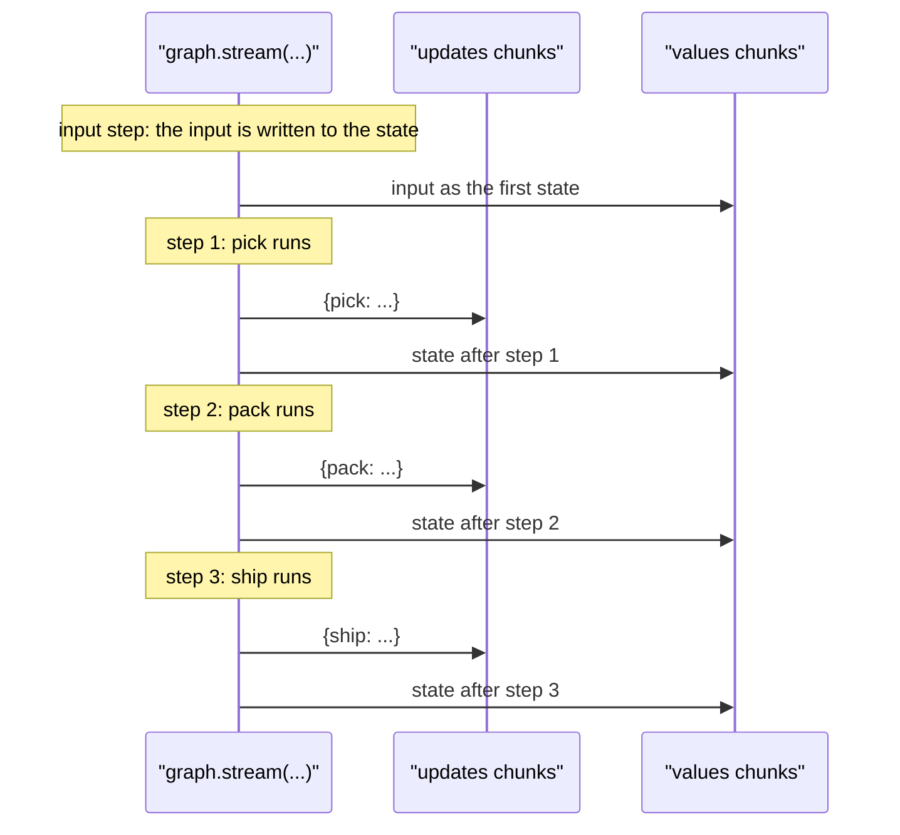

# 7.1 Stream Modes: values, updates and Typed v2 Parts

## The problem

So far almost every lesson ran its graph with `invoke()`. You pass the input, the graph runs to the end, and you get the final state back. Nothing comes back while the graph is running.

That is fine for a test or a batch job. It is a problem when someone is waiting. Take the order tracker this module builds: an order goes through `pick`, `pack` and `ship`. A customer looking at the order page wants to see "picked", then "packed", then "shipped" as each step finishes, not a spinner followed by everything at once. Real graphs make this worse. A node that calls a model or a remote service can take seconds, an agent loop can run for minutes, and with `invoke()` the caller learns nothing until the very end. It cannot tell a slow run from a stuck one.

Streaming solves this. The graph sends out pieces of its progress *while it runs*, and the caller handles each piece as soon as it arrives. You have seen a small example already: lesson 1.1 printed `stream(stream_mode="updates")` to show one update per node. This module looks at streaming properly:

- **7.1 (this lesson):** streaming the graph's *state*, as full snapshots or as per-node changes, several kinds at once, and the typed `version="v2"` output.
- **7.2:** a node sends its own progress messages ("custom" data).
- **7.3:** a chat model inside a node streams its answer token by token ("messages").
- **7.4:** `stream_events(version="v3")`, the newer event-streaming API that the official docs now recommend for new applications.

Everything in this lesson is still fully supported in 1.2.16, and the later lessons build on it.

## The concept

### stream(): the same run, delivered in pieces

`stream()` takes the same input and config as `invoke()` and runs the graph the same way. The difference is the return value: instead of the final state, it returns an iterator. Each item the iterator yields is called a **chunk**. You consume the chunks with a `for` loop, and the loop body runs while the graph is still working on the next step.

What a chunk *contains* is chosen by the [stream_mode](../../../GLOSSARY.md#stream_mode) argument. LangGraph 1.2.16 has seven modes (the `StreamMode` literal in `langgraph.types`):

| Mode | Each chunk carries | Where in the course |
|---|---|---|
| `"values"` | the full state after a step | this lesson |
| `"updates"` | what each node returned in a step, keyed by node name | this lesson |
| `"custom"` | any data a node sends with a stream writer | 7.2 |
| `"messages"` | model output, token by token, with metadata | 7.3 |
| `"checkpoints"` | a record each time a checkpoint is saved (nothing without a checkpointer) | not covered |
| `"tasks"` | an event when a node starts and when it finishes | not covered |
| `"debug"` | checkpoint and task events with extra detail | not covered |

### values and updates: snapshot or change

The two modes of this lesson answer different questions.

- **`"values"` answers "what does the state look like now?"** After every [super-step](../../../GLOSSARY.md#super-step), it yields the whole state. The very first chunk is the input itself, before any node has run.
- **`"updates"` answers "what just happened, and who did it?"** For every node that ran, it yields `{node_name: what_the_node_returned}`. The input produces no chunk, because no node produced it.

They are two views of the same run. Lesson 1.1 introduced the [partial update](../../../GLOSSARY.md#partial-update): a node returns only the keys it changes, and LangGraph merges that into the state. `"updates"` shows the partial updates as the nodes returned them. `"values"` shows the state after they were merged. In a graph without [reducers](../../../GLOSSARY.md#reducer), like ours, merging is a plain overwrite of the returned keys, so the next `values` chunk equals the previous one with the update applied.

Which one you need depends on the client:

- A screen that redraws the whole order from scratch wants `"values"`: every chunk is complete and can be rendered on its own. The cost is size. Every chunk repeats the whole state, and a state that holds a long message history or a large document is sent again after every step.
- A progress display, a log, or a client that already has the order wants `"updates"`: the chunks are small and say which node did what. The cost is that a chunk is not the state. To rebuild the state from updates, the client must apply them the way LangGraph does, reducers included.

If you call `stream()` without `stream_mode`, a [compiled graph](../../../GLOSSARY.md#compiledstategraph) built from a `StateGraph` uses `"updates"`.

### Several modes at once

You can ask for more than one mode by passing a list: `stream_mode=["values", "updates"]`. Both kinds of chunk then come out of the *same* run, interleaved in the order they are produced. To tell them apart, each chunk changes shape: in the default output format it becomes a tuple `(mode, chunk)`.

That shape change is the weak point of the default format. A loop written for one mode (`for chunk in ...`) breaks when you switch to a list, and a loop written for a list (`for mode, chunk in ...`) breaks when you go back to one mode. `subgraphs=True` changes the shape again, to `(namespace, chunk)` or `(namespace, mode, chunk)`.

### The v2 format: one shape for every chunk

LangGraph 1.1 added an opt-in [v2 format](../../../GLOSSARY.md#v2-format), selected with `version="v2"`. You met its `invoke()` side in lesson 6.1, where `invoke(..., version="v2")` returns a [GraphOutput](../../../GLOSSARY.md#graphoutput) instead of a dict ([6.1 notes](../../../6-human-in-the-loop/6.1-interrupt-and-resume/docs/notes.md#the-v2-format)). On `stream()`, v2 makes every chunk a [StreamPart](../../../GLOSSARY.md#streampart): a plain dict with the same keys whatever you asked for.

| Key | Meaning |
|---|---|
| `type` | the stream mode that produced this part: `"values"`, `"updates"`, ... |
| `ns` | the namespace: the path of the subgraph that produced the part, `()` for the top-level graph |
| `data` | the payload: what the v1 chunk of that mode would have been, except that values parts move `__interrupt__` into `interrupts` and give typed state back as an instance (see below) |
| `interrupts` | only on `values` parts: a tuple of [Interrupt objects](../../../GLOSSARY.md#interrupt-object), empty unless the run paused |

One mode or five, with or without subgraphs, the loop is always `for part in graph.stream(...)`, and you branch on `part["type"]`. The default is still `version="v1"`, so existing code keeps working; v2 is something you switch on.

`StreamPart` is also a type. In `langgraph.types` it is a union of seven TypedDicts, one per mode (`ValuesStreamPart`, `UpdatesStreamPart`, `MessagesStreamPart`, `CustomStreamPart`, `CheckpointStreamPart`, `TasksStreamPart`, `DebugStreamPart`). The `type` key tells them apart, so after `if part["type"] == "values"` (or a `match` case) a type checker knows what `part["data"]` holds and that `part["interrupts"]` exists. At run time the parts are ordinary dicts.

## How it works

LangGraph runs a graph in super-steps (lesson 1.3). Chunks of `"values"` and `"updates"` come from the same places in that cycle, which is why the two modes interleave so regularly. The diagram follows one run of our three-node graph streamed with both modes.



The rules behind it:

1. **The input step** writes the input into the state channels. No node ran, so there is no `updates` chunk, but the state now has values, so `"values"` yields them.
2. **In each super-step**, every node that ran produces one `updates` chunk with its own return value. Nodes that run in parallel in the same step produce separate chunks, one per node.
3. **At the end of the step**, LangGraph applies all writes of the step to the state. If the step wrote at least one state key, `"values"` yields the full state once. In the 1.2.16 source this check is `map_output_values` in `langgraph/pregel/_io.py`: no written key, no values chunk.
4. **The order in the list does not matter.** `["values", "updates"]` and `["updates", "values"]` produce the identical sequence, because the chunks are emitted as the run reaches each point, not grouped by mode.

The output format (v1 or v2) is applied last, as each chunk leaves `stream()` (the `_output` function in `langgraph/pregel/main.py`). It changes the wrapping and never the order. The content stays the same too, with two exceptions for values parts: `__interrupt__` moves into `interrupts`, and Pydantic or dataclass state comes back as an instance (both below).

## In our example

The graph lives in [orders.py](../src/l7_1_stream_modes/orders.py). Each node returns only the keys it sets:

<!-- snippet: src/l7_1_stream_modes/orders.py#nodes -->
```python
# Each node returns ONLY the keys it changes, not the whole state. LangGraph
# merges that partial dict into the state. This is exactly what makes the two
# stream modes differ: "updates" shows these partial dicts as they are,
# "values" shows the full state after they were merged.
def pick(state: OrderState) -> dict:
    """Pick the items from the shelves."""
    return {"status": "picked"}


def pack(state: OrderState) -> dict:
    """Pack the items; two items or fewer fit in a small box."""
    return {"status": "packed", "box": "small" if len(state["items"]) <= 2 else "large"}


def ship(state: OrderState) -> dict:
    """Hand the parcel to the carrier and record its tracking number."""
    return {"status": "shipped", "tracking": f"TRK-{state['order_id']}"}
```
<!-- /snippet -->

These three small dicts are exactly what `"updates"` reports, and they are why the two modes look different. If the nodes returned the whole state, `updates` would carry nearly the same data as `values`.

[\_\_main\_\_.py](../src/l7_1_stream_modes/__main__.py) streams the same order four times. Sections (a) and (b) are one-line loops, `graph.stream(ORDER, stream_mode="values")` and `graph.stream(ORDER, stream_mode="updates")`, that print each chunk. Section (c) asks for both modes in the default format and has to unpack a tuple:

<!-- snippet: src/l7_1_stream_modes/__main__.py#multiple_modes -->
```python
print("== stream_mode=['values', 'updates'] (v1): (mode, chunk) tuples ==")
# With a list, the v1 output changes shape: every chunk becomes a
# (mode, chunk) tuple, so the loop has to change when you go from one mode
# to several. The order of the list does not change the order of the
# chunks: step by step, the updates of a step come before the values after it.
for mode, chunk in graph.stream(ORDER, stream_mode=["values", "updates"]):
    print(f"  {mode:<7} {chunk}")
print()
```
<!-- /snippet -->

Section (d) asks for the same two modes with `version="v2"`:

<!-- snippet: src/l7_1_stream_modes/__main__.py#v2_parts -->
```python
print("== version='v2': every chunk is a StreamPart dict ==")
# version="v2" (opt-in since 1.1; v1 stays the default) gives every chunk
# the same dict shape whether you stream one mode or several, so one loop
# that branches on part["type"] works for both. It is the stream
# counterpart of invoke(version="v2") returning GraphOutput (lesson 6.1).
# The parts are collected into a list here only so the keys of the first
# two can be printed; in real code, iterate over the stream directly.
parts = list(graph.stream(ORDER, stream_mode=["values", "updates"], version="v2"))
print(f"  values part keys:  {sorted(parts[0])}")
print(f"  updates part keys: {sorted(parts[1])}")
for part in parts:
    print(f"  {describe(part)}")
```
<!-- /snippet -->

The loop no longer unpacks anything. Each part goes to `describe` in [render.py](../src/l7_1_stream_modes/render.py), which decides what to print from `part["type"]`:

<!-- snippet: src/l7_1_stream_modes/render.py#describe -->
```python
def describe(part: StreamPart) -> str:
    """Return a one-line description of a v2 stream part.

    StreamPart is a union of TypedDicts discriminated by the "type" key
    (ValuesStreamPart, UpdatesStreamPart, MessagesStreamPart,
    CustomStreamPart, CheckpointStreamPart, TasksStreamPart and
    DebugStreamPart, all in langgraph.types). Matching on part["type"] lets a
    type checker narrow part["data"] to the right shape in each case.

    Every part has "ns": the subgraph path that produced it, () for the
    top-level graph. It is only non-empty when you stream with subgraphs=True.
    """
    match part["type"]:
        case "values":
            # data is the full state. Only values parts carry "interrupts": a
            # tuple of Interrupt objects, empty unless the run paused.
            return (
                f"[values]  ns={part['ns']} status={part['data'].get('status', '-')} "
                f"interrupts={len(part['interrupts'])}"
            )
        case "updates":
            # data maps node name -> what that node returned. An updates chunk
            # normally holds one node; the join keeps this correct if a chunk
            # ever holds more.
            return "; ".join(
                f"[updates] ns={part['ns']} {node} -> {update}"
                for node, update in part["data"].items()
            )
        case other:
            # Every other part type ("messages", "custom", ...) lands here.
            # Later lessons add one case each above this fallback.
            return f"[{other}] (not shown in this lesson)"
```
<!-- /snippet -->

The `case other` fallback is there for the rest of the module: 7.2 adds a `case "custom"` and 7.3 a `case "messages"` above it, and the loop in `__main__.py` stays as it is. The [code walkthrough](readalong.md#v2-parts-lines-51-64) goes through these files line by line.

## Run it

From the course root, `./run.sh 7.1` prints (the run has no model and no clock, so it prints the same every time):

```text
== stream_mode='values': the whole state after every step ==
  {'order_id': 'A-1001', 'items': ['PEN', 'NOTEBOOK']}
  {'order_id': 'A-1001', 'items': ['PEN', 'NOTEBOOK'], 'status': 'picked'}
  {'order_id': 'A-1001', 'items': ['PEN', 'NOTEBOOK'], 'status': 'packed', 'box': 'small'}
  {'order_id': 'A-1001', 'items': ['PEN', 'NOTEBOOK'], 'status': 'shipped', 'box': 'small', 'tracking': 'TRK-A-1001'}

== stream_mode='updates': only what each node returned ==
  {'pick': {'status': 'picked'}}
  {'pack': {'status': 'packed', 'box': 'small'}}
  {'ship': {'status': 'shipped', 'tracking': 'TRK-A-1001'}}

== stream_mode=['values', 'updates'] (v1): (mode, chunk) tuples ==
  values  {'order_id': 'A-1001', 'items': ['PEN', 'NOTEBOOK']}
  updates {'pick': {'status': 'picked'}}
  values  {'order_id': 'A-1001', 'items': ['PEN', 'NOTEBOOK'], 'status': 'picked'}
  updates {'pack': {'status': 'packed', 'box': 'small'}}
  values  {'order_id': 'A-1001', 'items': ['PEN', 'NOTEBOOK'], 'status': 'packed', 'box': 'small'}
  updates {'ship': {'status': 'shipped', 'tracking': 'TRK-A-1001'}}
  values  {'order_id': 'A-1001', 'items': ['PEN', 'NOTEBOOK'], 'status': 'shipped', 'box': 'small', 'tracking': 'TRK-A-1001'}

== version='v2': every chunk is a StreamPart dict ==
  values part keys:  ['data', 'interrupts', 'ns', 'type']
  updates part keys: ['data', 'ns', 'type']
  [values]  ns=() status=- interrupts=0
  [updates] ns=() pick -> {'status': 'picked'}
  [values]  ns=() status=picked interrupts=0
  [updates] ns=() pack -> {'status': 'packed', 'box': 'small'}
  [values]  ns=() status=packed interrupts=0
  [updates] ns=() ship -> {'status': 'shipped', 'tracking': 'TRK-A-1001'}
  [values]  ns=() status=shipped interrupts=0
```

What to notice:

- **values: four chunks for three nodes.** The first is the input, with only `order_id` and `items`. Each later line repeats everything before it plus what the step added, so the lines get longer.
- **updates: three chunks, one per node.** `ship`'s chunk has no `box`, because `ship` did not return one. An update is a change, not a state.
- **The list of modes is a merge of the first two sections.** Take the values lines and the updates lines and interleave them: input, then for each step its update followed by the state after it. Every line now starts with the mode name, the first element of the tuple.
- **v2 carries the same payloads in a fixed wrapper.** The `data` of the parts is exactly what the v1 section printed. The wrapper differs only in one key: values parts have `interrupts`, updates parts do not. `ns=()` everywhere means every part came from the top-level graph. `status=-` on the first part is the input again, which has no `status` yet.

## Details and edge cases

**A node that writes nothing.** If a node returns `None` (or `{}`), `"updates"` still reports it as `{"pack": None}`, but `"values"` yields no chunk for that step, because no state key was written. A values stream has one chunk per step *that changed something*, not one per node. Experiment 3 shows it.

**Parallel nodes.** When several nodes run in one super-step ([fan-out](../../../GLOSSARY.md#fan-out), lesson 3.1), `"updates"` yields one chunk per node and `"values"` yields one chunk for the whole step with all writes merged. Do not rely on the order of the updates chunks within a step: the docs do not promise one. Experiment 4 shows it.

**Interrupts.** When a run pauses at `interrupt()` (lesson 6.1), each format reports it differently. In v1, `"updates"` yields an extra chunk `{"__interrupt__": (Interrupt(...),)}`, and `"values"` yields the state once more with an extra [\_\_interrupt\_\_](../../../GLOSSARY.md#__interrupt__) key mixed into it. In v2, the values part keeps `data` clean and puts the interrupts in `part["interrupts"]`; the updates part still has `{"__interrupt__": ...}` in its `data`. So in v2, `values` parts are the place to look for a pause.

**Subgraphs and `ns`.** By default a parent graph streams only its own steps; a subgraph's inner nodes are invisible. With `subgraphs=True`, the inner chunks come through too, and in v2 their `ns` names the path, like `("fulfil:<task_id>",)`. In v1 the same option turns every chunk into a `(namespace, chunk)` tuple, another shape change that v2 avoids.

**`invoke()` takes `stream_mode` too.** `invoke()` is built on `stream()`. With the default `"values"` it returns the last state; with another mode it collects every chunk and returns them as a list. `graph.invoke(ORDER, stream_mode="updates")` returns the three update dicts, and with `version="v2"` a list of `StreamPart` dicts.

**Pass a list, not a tuple.** In v1 only a `list` of modes switches to `(mode, chunk)` tuples: `_output` checks `isinstance(stream_mode, list)`. In 1.2.16, `stream_mode=("values", "updates")` streams both modes but yields bare chunks, so you cannot tell a values chunk from an updates chunk. In v2 the difference does not matter, because every part carries its `type`.

**Typed state in v2.** If the state schema is a Pydantic model or a dataclass, v2 `values` parts carry an instance of it, while v1 gives a plain dict. This is the same [output coercion](../../../GLOSSARY.md#output-coercion) that lesson 2.1 showed for `invoke(version="v2")`.

## Common mistakes

> [!WARNING]
> **A misspelt mode streams nothing, silently.** LangGraph 1.2.16 does not check mode names. `stream_mode="value"` yields no chunks at all, and `["values", "update"]` yields only the values chunks, with no error and no warning. An empty stream looks like a graph that did nothing. Check the mode string first. A type checker catches it: mypy reports `Argument "stream_mode" to "stream" of "Pregel" has incompatible type "Literal['value']"`.

> [!WARNING]
> **The v1 loop must match the number of modes.** Change a list to a single mode and keep `for mode, chunk in ...`, and Python tries to unpack each bare chunk into two names. With `"updates"` that fails at once (`ValueError: not enough values to unpack (expected 2, got 1)`, a one-key dict). With `"values"` it is worse: the first chunk has exactly two keys, so it "unpacks" into `mode="order_id"` and `chunk="items"`, prints a nonsense line, and only the next chunk fails. Use `version="v2"` and loop over parts; the shape no longer depends on the mode list.

> [!WARNING]
> **An update is not the state.** A client that keeps its own copy of the state and applies `updates` with `dict.update` is right only for keys without reducers. For a key with a reducer, such as a message list with `add_messages` (lesson 4.1), the update holds just the new items, and overwriting the list with it loses the history. Either apply the same merge rule as the graph or stream `"values"`.

> [!TIP]
> Do not stream `"values"` "just in case" to a remote client. Each chunk repeats the whole state, so the cost grows with the state and with the number of steps. Ask for `"updates"` for progress and fetch the final state once, or stream both and send only what the client renders.

## Experiments

Each experiment starts from the original code. Run the lesson with `./run.sh 7.1` from the course root after each change.

1. **Misspell a mode.** In section (a) of `__main__.py`, change `stream_mode="values"` to `stream_mode="value"`. Then also change section (c) to `stream_mode=["values", "update"]`.

   <details><summary>What happens and why</summary>

   Section (a) prints only its header: no chunk, no error, no warning. Section (c) prints the four `values` lines and no `updates` line. In 1.2.16 `stream()` never validates mode names; it simply emits a chunk only for modes that are in `stream_mode`, and `"value"` matches nothing. That is why an empty stream should make you check the mode string before you suspect the graph. Running mypy on the file reports the typo, because `stream_mode` is typed with the `StreamMode` literal. Put the code back as it was (`git checkout -- .` in the lesson directory).

   </details>

2. **Drop to one mode with the tuple loop.** In section (c), change `stream_mode=["values", "updates"]` to `stream_mode="updates"`, keeping `for mode, chunk in ...`. Then switch the call to `graph.stream(ORDER, stream_mode="updates", version="v2")` and the loop to `for part in ...: print(f"  {describe(part)}")` (`describe` is already imported). Try it with `"updates"`, `["values", "updates"]` and `["updates"]`.

   <details><summary>What happens and why</summary>

   The first change crashes with `ValueError: not enough values to unpack (expected 2, got 1)`. In v1 a single mode yields bare chunks, here the one-key dict `{'pick': {...}}`, and unpacking a dict into two names iterates its keys. With the v2 loop all three variants work: `"updates"` and `["updates"]` print the three `[updates]` lines, and the pair prints the seven lines of section (d). The v2 shape does not depend on how many modes you ask for. The reverse mistake fails too: `for mode, chunk in` over v2 parts raises `ValueError: too many values to unpack (expected 2)`, because a part is a dict with three or four keys. Put the code back as it was.

   </details>

3. **A node that writes nothing.** In `orders.py`, make `pack` end with `return None` instead of its dict, and run again.

   <details><summary>What happens and why</summary>

   `updates` shows `{'pack': None}`: the node ran, and this mode reports every node that ran. `values` now has three chunks instead of four. The chunk after `pack` is gone, and the state jumps from `'status': 'picked'` straight to `'status': 'shipped'`, with no `box` key. A values chunk is emitted only when the step wrote at least one state key, and `pack` wrote none. `ship` still runs, because a plain edge fires when its source node finishes, whatever the node returned. In section (c) you see two `updates` lines in a row for the same reason. Put the code back as it was.

   </details>

4. **Two nodes in parallel.** In `orders.py`, add a node

   ```python
   def print_label(state: OrderState) -> dict:
       return {"tracking": f"TRK-{state['order_id']}"}
   ```

   make `ship` return only `{"status": "shipped"}`, and in `build_graph` register it with `builder.add_node("print_label", print_label)` and replace the edge `pick -> pack -> ship` with `builder.add_edge("pick", "pack")`, `builder.add_edge("pick", "print_label")` and `builder.add_edge(["pack", "print_label"], "ship")`.

   <details><summary>What happens and why</summary>

   `updates` now has four chunks: `pick`, then `pack` and `print_label` as two separate chunks from the same super-step, then `ship`. `values` still has four chunks, and the one after the parallel step already holds both `'box': 'small'` and `'tracking': 'TRK-A-1001'`: one values chunk per step, after all writes of the step are applied. The two nodes write different keys, so no reducer is needed (lesson 3.1 explains what happens when they write the same key). Do not write code that depends on whether `pack` or `print_label` comes first in the updates stream; the documentation does not guarantee an order within a step, and lesson 3.1 showed the related order of writes is an implementation detail. Put the code back as it was.

   </details>

5. **Compare the sizes.** In section (a), print `len(str(state))` instead of `state`, and in section (b) print `list(chunk)` instead of `chunk`.

   <details><summary>What happens and why</summary>

   Section (a) prints `52`, `72`, `88`, `115`: every values chunk is bigger than the last, because it carries the whole state so far. Section (b) prints `['pick']`, `['pack']`, `['ship']`: the node names alone are enough for a progress bar that already knows the order. The updates chunks are sized by what each node returned, not by the state. With three short fields the difference is small, but a state with a long message list repeats that list in every values chunk. Put the code back as it was.

   </details>

## Summary

- `stream()` runs the graph like `invoke()` but yields chunks while it runs; `stream_mode` decides what each chunk carries.
- `"values"` yields the full state after every step that wrote something, starting with the input. `"updates"` yields `{node: return value}` for every node that ran, and is the default for a compiled `StateGraph`.
- A list of modes streams them all from one run, interleaved in the order they happen; in v1 every chunk becomes a `(mode, chunk)` tuple, so the loop shape depends on the mode list.
- `version="v2"` (opt-in since 1.1) makes every chunk a `StreamPart` dict with `type`, `ns` and `data`, plus `interrupts` on values parts. Branch on `part["type"]`.
- Mode names are not validated: a typo gives an empty stream, not an error.

## Self-check

1. A graph has four nodes in a straight line. How many chunks does `stream_mode="values"` yield, and how many does `"updates"` yield? Why the difference?

   <details><summary>Answer</summary>

   Five values chunks and four updates chunks (if every node writes something). `"values"` also yields the input, written in the input step before any node runs. `"updates"` reports only what nodes returned, and no node produced the input.

   </details>

2. Your code has `for state in graph.stream(inp, stream_mode="values")` and you add `"updates"` to get both. What else must change in v1, and what would you do instead?

   <details><summary>Answer</summary>

   With a list, each v1 chunk becomes a `(mode, chunk)` tuple, so the loop must unpack two names and check `mode`. Instead, pass `version="v2"` and loop `for part in ...`, branching on `part["type"]`. That loop keeps working when you add or remove modes.

   </details>

3. A node returns `None`. What does each mode show for that step?

   <details><summary>Answer</summary>

   `"updates"` yields `{"node_name": None}`, because the node ran. `"values"` yields nothing for that step, because a values chunk is emitted only when the step wrote at least one state key.

   </details>

4. A run pauses at an interrupt while you stream `["values", "updates"]` with `version="v2"`. Where do you find the `Interrupt`?

   <details><summary>Answer</summary>

   In the `interrupts` field of the last `values` part; its `data` holds the state without any `__interrupt__` key. The `updates` stream also gets a part whose `data` is `{"__interrupt__": (...)}`.

   </details>

5. `graph.stream(order, stream_mode="update")` returns an empty iterator. What is the most likely cause, and what tool would have caught it?

   <details><summary>Answer</summary>

   The mode name is misspelt (`"update"` instead of `"updates"`). LangGraph does not validate it and simply streams nothing. A type checker such as mypy flags it, since `stream_mode` is typed as the `StreamMode` literal.

   </details>

## Further reading

- [Streaming](https://docs.langchain.com/oss/python/langgraph/streaming), LangChain docs: all stream modes, the v2 output format, subgraph outputs and the migration to v2.
- [langgraph 1.1.0 release notes](https://github.com/langchain-ai/langgraph/releases/tag/1.1.0): the introduction of `version="v2"` for `stream`, `astream`, `invoke` and `ainvoke`, the `StreamPart` types and the backward-compatibility rules.
- LangGraph 1.2.16 source: `StreamMode` and the `*StreamPart` TypedDicts in `langgraph/types.py`, `Pregel.stream` and `_output` in `langgraph/pregel/main.py`, `map_output_values` and `map_output_updates` in `langgraph/pregel/_io.py`.
- [LangChain Academy, module 3: streaming-interruption.ipynb](https://github.com/langchain-ai/langchain-academy/blob/main/module-3/streaming-interruption.ipynb): `"values"` and `"updates"` on a chat graph, in the default v1 format. Its `version="v2"` belongs to the older `astream_events` API, not to the stream output format of this lesson.
