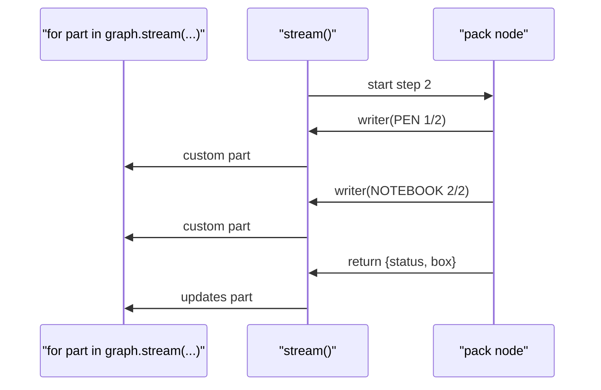

# 7.2 Custom Progress Events with get_stream_writer

## The problem

Lesson 7.1 streamed the order's *state*. With `"updates"` the caller learns that `pick` finished, then `pack`, then `ship`. That is as fine-grained as state streaming gets: one chunk per node, sent when the node returns.

Now suppose `pack` is slow. A real packing step might pack fifty items, call a label printer or wait for a scale. For the whole time it runs, an `"updates"` stream says nothing, because `pack` has not returned yet. The order page shows "picked" and then freezes. The node knows exactly how far it has got ("item 12 of 50"), but it has no way to say so.

One idea is to put the progress into the state. That does not help. A node's state changes are applied only when it returns, so all the progress would arrive in one piece, after the work is done. It would also stay in the state for good, in the final result and in every [checkpoint](../../../GLOSSARY.md#checkpoint), even though nobody needs "item 12 of 50" once packing is finished.

What is missing is a side channel: a way for a node to send data to whoever is watching *while it runs*, without touching the state. That is the `"custom"` [stream mode](../../../GLOSSARY.md#stream_mode), which the table in [7.1](../../7.1-stream-modes/docs/notes.md#stream-the-same-run-delivered-in-pieces) listed for this lesson.

## The concept

### The stream writer

A [stream writer](../../../GLOSSARY.md#stream-writer) is a function a node calls to put a value on the stream of the current run:

```python
writer({"node": "pack", "item": "PEN", "done": 1, "total": 2})
```

That is the whole interface. The type in `langgraph.types` is `StreamWriter = Callable[[Any], None]`: one argument, no return value. The argument can be any Python object. A dict is the usual choice, because the caller can read fields from it. This chapter calls the argument the *payload*. The docs call it *custom data*, and in a v2 part it is the `data` field.

The caller receives the payloads by asking for `stream_mode="custom"`, alone or in a list next to other modes. Three properties make the writer different from a node's return value:

- **It is immediate.** The value goes onto the stream at the moment of the call, not when the node returns. A node can call the writer as often as it likes.
- **It is outside the state.** Payloads are not merged into the state, are not part of the result of `invoke()` and are never checkpointed. Nothing later in the graph can read them.
- **It is for the watcher only.** If the caller did not ask for `"custom"`, the payloads are dropped without an error.

The mental model: **the return value is the node's contribution to the order, the writer is the node talking to the person watching.** The first is part of the record, the second is a running commentary that nobody keeps.

### Where the writer comes from

The writer belongs to one run. Each call of `stream()` builds its own, so a node cannot import a writer or keep one between runs. It has to ask the current run for it. In 1.2.16 there are three ways, all current:

1. **[get_stream_writer()](../../../GLOSSARY.md#get_stream_writer)** from `langgraph.config`. Call it inside the node, and it returns the writer of the run that is executing the node. This is what the official streaming guide shows, and what `pack` uses.
2. **A `runtime` parameter.** Lesson 2.4 showed that a node with a parameter named `runtime` receives the run's `Runtime` object, and read `runtime.context` from it ([2.4 notes](../../../2-state/2.4-runtime-context/docs/notes.md#how-it-works)). The same object has a `stream_writer` field, and it is the very function `get_stream_writer()` returns. In the source, `get_stream_writer()` is just a lookup of `runtime.stream_writer` in the current run's config. `ship` uses this way.
3. **A `writer: StreamWriter` parameter.** LangGraph also injects the writer itself into a parameter named `writer` (annotated `StreamWriter` or not annotated). The docs mention it as the workaround for async nodes on Python older than 3.11. It works on any version.

The first is the shortest. The second makes the node easy to test, because the writer arrives as an argument (section (d) of the program shows it).

### What the caller sees

What a custom chunk looks like depends on the output format from 7.1:

| Call | Each custom chunk |
|---|---|
| `stream_mode="custom"` (v1) | the bare payload, exactly as the node passed it |
| `stream_mode=["updates", "custom"]` (v1) | a tuple `("custom", payload)` |
| any modes with `version="v2"` | a dict `{"type": "custom", "ns": (), "data": payload}` |

The v2 dict is the `CustomStreamPart` member of the [StreamPart](../../../GLOSSARY.md#streampart) union. It has exactly three keys. Unlike a values part it has no `interrupts`. `ns` is `()` for writes made by the top-level graph.

Note what a custom chunk does *not* contain: the name of the node that wrote it. LangGraph adds nothing to the payload. If the caller needs to know who is talking, the payload has to say so, which is why every payload in this lesson has a `"node"` key.

## How it works

When `stream()` starts a run, it decides what the writer does. In the 1.2.16 source (`Pregel.stream` in `langgraph/pregel/main.py`), there are three cases:

- `"custom"` is among the requested modes: the writer puts `(namespace, "custom", payload)` on the run's internal stream, the same queue the other modes use.
- The run is a [subgraph](../../../GLOSSARY.md#subgraph) streaming into a parent: it reuses the parent's writer (see "Details and edge cases").
- Otherwise: the writer is `def stream_writer(c): pass`. It does nothing.

The result is stored in the run's `Runtime`, where both `get_stream_writer()` and the `runtime` parameter find it. So a node never has to check whether anybody is listening. It always gets a callable, and calling it is always safe inside a run.

Requesting `"custom"` changes one more thing. The same function turns on [eager streaming](../../../GLOSSARY.md#eager-streaming) when `"custom"` (or `"messages"`, or `subgraphs=True`) is requested: `stream()` hands each chunk to your loop as soon as it is queued, while the node that produced it is still running. That is what makes progress reports useful. A payload written halfway through a slow node reaches the caller halfway through, not at the end. This uses the waiter `Pregel.stream` passes to the runner. Without it, `stream()` collects the queued chunks only each time a node finishes.

The diagram follows the `pack` step of our run, streamed with `["updates", "custom"]`. Look at where the two progress payloads leave compared with the update:



The update exists only once `pack` has returned. The progress exists from the moment `pack` writes it. In this linear graph, a node's custom parts therefore always come before that node's updates part, and the program and its tests check exactly that order. If you stream `["values", "custom"]`, the custom parts of a step come before the values part after that step, for the same reason.

## In our example

[orders.py](../src/l7_2_custom_stream_data/orders.py) is 7.1's graph with two changed nodes. `pick` and `build_graph` are byte-for-byte the same. `pack` gets the writer the first way and `ship` the second:

<!-- snippet: src/l7_2_custom_stream_data/orders.py#nodes -->
```python
# Each node returns ONLY the keys it changes, not the whole state. LangGraph
# merges that partial dict into the state. This is exactly what makes the two
# stream modes differ: "updates" shows these partial dicts as they are,
# "values" shows the full state after they were merged.
def pick(state: OrderState) -> dict:
    """Pick the items from the shelves."""
    return {"status": "picked"}


def pack(state: OrderState) -> dict:
    """Pack the items one by one, reporting progress after each item."""
    # get_stream_writer() returns the writer of the CURRENT run: it reads it
    # from the run's context, so call it inside the node while the run
    # executes it, never at import time (outside a run it raises RuntimeError).
    writer = get_stream_writer()
    total = len(state["items"])
    for done, sku in enumerate(state["items"], start=1):
        # The writer is a plain callable: writer(data). data can be any value;
        # a dict is the convention. It goes to the stream at once, not when the
        # node returns, and it does NOT go into the state.
        # Build a fresh dict for every call: the writer does not copy what you
        # pass, so reusing and mutating one dict would change what the caller sees.
        writer({"node": "pack", "item": sku, "done": done, "total": total})
    return {"status": "packed", "box": "small" if total <= 2 else "large"}


def ship(state: OrderState, runtime: Runtime) -> dict:
    """Hand the parcel to the carrier, report the label, record tracking."""
    # The second way to get the same writer: LangGraph sees the
    # `runtime: Runtime` parameter and injects the run's Runtime (lesson 2.4).
    # Its stream_writer field is the writer get_stream_writer() would return.
    # Because it arrives as an argument, ship can be called in a test with a
    # hand-made Runtime (section d of __main__.py).
    tracking = f"TRK-{state['order_id']}"
    runtime.stream_writer({"node": "ship", "label": tracking})
    return {"status": "shipped", "tracking": tracking}
```
<!-- /snippet -->

A few things to notice:

- `pack` calls `get_stream_writer()` *inside* the function. That is the only place it works.
- It writes once per item, with a fresh dict each time. The writer does not copy its argument (experiment 2 shows why that matters).
- The return values are the same as in 7.1. The progress never touches the state, so `invoke()` gives the same final state as before.
- `ship`'s `runtime: Runtime` parameter needs no extra registration. `add_node("ship", ship)` finds it in the signature, as in lesson 2.4.

The caller side is 7.1's v2 loop with one more mode. Section (b) of [\_\_main\_\_.py](../src/l7_2_custom_stream_data/__main__.py) streams both modes in the [v2 format](../../../GLOSSARY.md#v2-format):

<!-- snippet: src/l7_2_custom_stream_data/__main__.py#custom_with_updates -->
```python
print("== stream_mode=['updates', 'custom'], version='v2': progress between the updates ==")
# A custom part is {"type": "custom", "ns": ..., "data": ...}. The two pack
# progress parts arrive BEFORE pack's updates part: the writer sends while
# the node runs, and the update is only emitted when the node returns.
# Requesting "custom" also turns on eager streaming, so a slow node's
# progress reaches the caller live. The order of the mode list does not
# matter: ["custom", "updates"] gives the same sequence.
for part in graph.stream(ORDER, stream_mode=["updates", "custom"], version="v2"):
    print(f"  {describe(part)}")
print()
```
<!-- /snippet -->

and `describe` in [render.py](../src/l7_2_custom_stream_data/render.py) got one new case above the fallback, which prints `part["data"]` untouched:

```python
case "custom":
    # data is exactly what the node passed to the writer, untouched.
    return f"[custom]  ns={part['ns']} {part['data']}"
```

Section (d) calls the two nodes as plain functions, outside any run, and shows the difference between the two ways of getting the writer:

<!-- snippet: src/l7_2_custom_stream_data/__main__.py#writer_outside_run -->
```python
print("== the nodes called directly, outside a run ==")
# Outside a graph run there is no run context, so get_stream_writer()
# inside pack raises RuntimeError.
try:
    pack(ORDER)
except RuntimeError as error:
    print(f"  pack(ORDER) -> RuntimeError: {error}")
# A node that takes the writer through `runtime` is an ordinary function:
# call it with any Runtime, here one whose writer appends to a list.
# (A plain Runtime() also works: its default stream_writer does nothing.)
written: list = []
result = ship(ORDER, Runtime(stream_writer=written.append))
print(f"  ship(ORDER, Runtime(stream_writer=written.append)) -> {result}")
print(f"  written: {written}")
```
<!-- /snippet -->

`list.append` takes one value and returns nothing, so it is a perfectly good writer. That is the whole trick behind testing a node's progress output without building a graph. The [code walkthrough](readalong.md#orderspy) goes through the files line by line.

## Run it

From the course root, `./run.sh 7.2` prints (no model, no clock, so the output is the same every time):

```text
== stream_mode='custom': only what the nodes wrote ==
  {'node': 'pack', 'item': 'PEN', 'done': 1, 'total': 2}
  {'node': 'pack', 'item': 'NOTEBOOK', 'done': 2, 'total': 2}
  {'node': 'ship', 'label': 'TRK-A-1001'}

== stream_mode=['updates', 'custom'], version='v2': progress between the updates ==
  [updates] ns=() pick -> {'status': 'picked'}
  [custom]  ns=() {'node': 'pack', 'item': 'PEN', 'done': 1, 'total': 2}
  [custom]  ns=() {'node': 'pack', 'item': 'NOTEBOOK', 'done': 2, 'total': 2}
  [updates] ns=() pack -> {'status': 'packed', 'box': 'small'}
  [custom]  ns=() {'node': 'ship', 'label': 'TRK-A-1001'}
  [updates] ns=() ship -> {'status': 'shipped', 'tracking': 'TRK-A-1001'}

== stream_mode='updates' only: the writer calls go nowhere ==
  {'pick': {'status': 'picked'}}
  {'pack': {'status': 'packed', 'box': 'small'}}
  {'ship': {'status': 'shipped', 'tracking': 'TRK-A-1001'}}
  invoke() -> status=shipped

== the nodes called directly, outside a run ==
  pack(ORDER) -> RuntimeError: Called get_config outside of a runnable context
  ship(ORDER, Runtime(stream_writer=written.append)) -> {'status': 'shipped', 'tracking': 'TRK-A-1001'}
  written: [{'node': 'ship', 'label': 'TRK-A-1001'}]
```

What to notice:

- **Custom alone shows only what was written.** Three payloads, exactly the dicts the nodes built. `pick` wrote nothing, so it does not appear at all. No state, no node names except the ones inside the payloads.
- **The progress sits between the updates.** Both `pack` lines come before `pack -> {...}`, and the label comes before `ship -> {...}`. Each node reports while it works and delivers its update when it returns.
- **Without `"custom"` the run is 7.1's run.** Section (c) has the same three updates as 7.1. The nodes still called their writers, but the writers did nothing. `invoke()` finished normally too.
- **Outside a run the two nodes differ.** `pack` fails, because `get_stream_writer()` has no run to ask. The message names `get_config`, the function `get_stream_writer()` uses to find the run's config. `ship` works with a hand-made `Runtime`, and its payload lands in the list.

## Details and edge cases

**`invoke()` collects custom data too.** As 7.1 showed for other modes, `invoke()` with a non-default `stream_mode` returns all chunks as a list. `graph.invoke(ORDER, stream_mode="custom")` returns the three payloads. With `version="v2"` it returns the three `CustomStreamPart` dicts.

**Any value, no serialization, no copy.** In-process, the payload object travels from the node to your loop as it is: a string, a dict or an instance of your own class all work, and nothing is converted. The flip side is that it is the *same* object. If the node changes it after writing it, the caller may see the changed version (experiment 2). If you forward payloads to a browser, as the agent-service-toolkit does over server-sent events with `json.dumps`, keep them to plain JSON-friendly values.

**Tools.** A tool run by [ToolNode](../../../GLOSSARY.md#toolnode) inside a graph can stream progress the same way: call `get_stream_writer()` in the tool, or take a `runtime: ToolRuntime` parameter and call `runtime.stream_writer(...)`. The payloads arrive as custom parts with `ns=()`, like a node's. Calling such a tool directly with `tool.invoke(...)` outside a graph fails with `KeyError: '__pregel_runtime'`. When the model asks for several tools at once, do not rely on the order of their custom parts.

**Subgraphs.** By default a parent graph's stream carries only the parent's own chunks. Custom writes inside a subgraph are dropped unless the parent streams with `subgraphs=True`. Then they come through with `ns` set to the subgraph path, like `("fulfil:<task_id>",)`. Module 8 covers subgraphs.

**Async.** `get_stream_writer()` relies on context variables. LangGraph starts async nodes with `asyncio.create_task(..., context=...)` so they see the run's context variables, and that `context` argument exists only from Python 3.11. This course requires Python 3.12, so an `async def` node can call `get_stream_writer()` under `astream()` as usual. On Python 3.10 you would use the `writer` parameter instead.

**Streaming model output.** The official guide also uses the writer to stream text from an LLM client that is not a LangChain chat model: the node writes each chunk it receives. For LangChain chat models there is a dedicated mode, `"messages"`, which is the subject of lesson 7.3.

## Common mistakes

> [!WARNING]
> **Getting the writer at import time.** `writer = get_stream_writer()` at module level, or in `__init__` of a class built before the run, raises `RuntimeError: Called get_config outside of a runnable context` the moment the module is imported. The writer exists only while a run executes the node, so ask for it inside the node (experiment 4).

> [!WARNING]
> **Reusing one dict for every progress message.** The writer passes your object on by reference. A loop that updates one `progress` dict and writes it after each item can deliver several copies of the *last* state of that dict. Whether it does depends on timing: a fast node finishes changing the dict before the caller prints it, a slow one does not. So the bug can stay hidden in a slow real run and show up in a fast test, or the other way round. Build a new dict for every call (experiment 2).

> [!WARNING]
> **Calling the writer from another thread.** The writer finds its run through context variables, and a thread does not inherit them. Inside a node, `get_stream_writer()` in a new `threading.Thread` raises the same `RuntimeError`, and so does a writer you got in the node and then *call* in a `ThreadPoolExecutor` worker, because the writer itself reads the run's config to compute `ns`. Submit the call through a copy of the context instead: `executor.submit(contextvars.copy_context().run, writer, payload)`, with a fresh `copy_context()` for each call (one context cannot be entered by two threads at once).

> [!WARNING]
> **`stream_writer.write(...)` does not exist.** The `ToolRuntime` docstring in langgraph-prebuilt 1.1.1 shows `tool_runtime.stream_writer.write("Processing...")`. That line is wrong: the writer is a plain function and has no `write` attribute, so the call raises `AttributeError`. Call it directly: `runtime.stream_writer("Processing...")`.

> [!WARNING]
> **Forgetting to request `"custom"`.** Progress that never shows up is usually a stream started with `"updates"` alone. Nothing fails, because without `"custom"` every writer does nothing. The same goes for a misspelt mode: `stream_mode="custum"` yields no chunks at all, silently, as 7.1 showed for other modes.

> [!TIP]
> **State or writer?** Ask who needs the data. If a later node, the final result or a resumed run needs it, it belongs in the state. If only the person watching the run needs it, and only while it runs, write it to the stream. A progress counter, a "now calling the carrier" message or a partial result for display are stream data.

## Experiments

Each experiment starts from the original code. Run the lesson with `./run.sh 7.2` from the course root after each change.

1. **Make `pack` slow.** In `orders.py`, add `import time` at the top and `time.sleep(1)` just before the `writer(...)` call in `pack`. Run it and watch the output appear.

   <details><summary>What happens and why</summary>

   Section (a) prints one progress line per second. Section (b) prints the `pick` update at once, then one `pack` progress line per second, and the `pack` update right after the second one. Section (c) prints the `pick` update, sits silent for two seconds and then prints the `pack` update, and `invoke()` takes another two silent seconds. With `"custom"` requested, each payload reaches the loop the moment it is written (eager streaming), while an update exists only after the node has returned. That gap is what progress events fill. Put the code back as it was (`git checkout -- .` in the lesson directory).

   </details>

2. **Reuse one dict.** In `pack`, create `progress = {"node": "pack", "item": "", "done": 0, "total": total}` before the loop, and inside the loop replace the `writer(...)` call with `progress["item"] = sku`, `progress["done"] = done` and `writer(progress)`.

   <details><summary>What happens and why</summary>

   On a typical run, both progress lines in sections (a) and (b) now read `{'node': 'pack', 'item': 'NOTEBOOK', 'done': 2, 'total': 2}` (the exact result depends on thread timing; if you see the correct lines, run it again). The writer passes the dict by reference, and usually, by the time your loop prints the first chunk, `pack` has already changed the same dict for the second item. Now also add `time.sleep(0.5)` after `writer(progress)`: the output is correct again, because the caller prints each chunk while the node sleeps. A bug that depends on timing like this is easy to miss. Write a fresh value every time. Put the code back as it was.

   </details>

3. **Write the progress into the state instead.** Add `progress: NotRequired[list[str]]` to `OrderState`. Rewrite `pack` without the writer, returning `"progress": [f"{i}/{total} {sku}" for i, sku in enumerate(state["items"], start=1)]` in its update next to `status` and `box`. To see the final state, change the `invoke()` line in section (c) to print `graph.invoke(ORDER)` instead of only its `status`.

   <details><summary>What happens and why</summary>

   Section (a) now has only `ship`'s label. In section (b) there are no `pack` progress parts. The progress arrives inside the `pack` update, all at once, as `'progress': ['1/2 PEN', '2/2 NOTEBOOK']`, after packing is done. Section (c) shows it in the update too, and the final state from `invoke()` keeps it for good (with a [checkpointer](../../../GLOSSARY.md#checkpointer), every checkpoint would too). In section (d) the `RuntimeError` line disappears, because `pack` no longer calls `get_stream_writer()`. Use the state for facts that later nodes or a resumed run need, and the writer for progress meant only for the watcher. Put the code back as it was.

   </details>

4. **Ask for the writer too early.** In `orders.py`, move `writer = get_stream_writer()` out of `pack` to module level, below the imports.

   <details><summary>What happens and why</summary>

   The program does not start. Importing `orders.py` raises `RuntimeError: Called get_config outside of a runnable context`, the same error as in section (d), and the traceback points at the module-level line. At import time there is no run, so there is no writer to return. The writer belongs to one run and can only be fetched while that run executes the node. Put the code back as it was.

   </details>

5. **Inject the writer into `pack`.** Give `pack` a second parameter `runtime: Runtime` and replace `get_stream_writer()` with `runtime.stream_writer`. In section (d), replace the `try`/`except` block with `progress: list = []`, a call `pack(ORDER, Runtime(stream_writer=progress.append))`, and a print of `progress`.

   <details><summary>What happens and why</summary>

   Sections (a) to (c) print exactly what they printed before: inside a run, `runtime.stream_writer` is the same writer `get_stream_writer()` returns. Section (d) now prints `pack`'s return value and the two progress dicts in `progress` instead of a `RuntimeError`. Injection turns the node into an ordinary function you can test without a graph. Two side effects: if you keep the old `pack(ORDER)` call, it fails with `TypeError: pack() missing 1 required positional argument: 'runtime'`, and the `get_stream_writer` import is now unused, which the linter reports. Put the code back as it was.

   </details>

## Summary

- A stream writer is a plain function, `writer(value)`, that a node calls to send any value to the caller while it runs. The caller receives the values with `stream_mode="custom"`.
- Get it with `get_stream_writer()` inside the node, from an injected `runtime: Runtime` as `runtime.stream_writer`, or as a `writer: StreamWriter` parameter. All three give the same per-run function.
- Payloads are not part of the state, the result or any checkpoint, and LangGraph neither copies them nor adds the node name. Put who is talking into the payload, and write a fresh object each time.
- Without `"custom"` the writer does nothing, so nodes need no "is anyone listening" check. Outside a run, `get_stream_writer()` raises `RuntimeError`.
- Requesting `"custom"` turns on eager streaming: progress reaches the caller while the node is still running, before its update.

## Self-check

1. A node writes three progress messages and then returns `{"status": "done"}`. You stream it with `["updates", "custom"]` and `version="v2"`. What parts do you get for that node, and in what order?

   <details><summary>Answer</summary>

   Three parts with `type` `"custom"`, whose `data` are the three payloads, and then one part with `type` `"updates"` and `data` `{"node_name": {"status": "done"}}`. The writer sends while the node runs, and the update exists only after it returns.

   </details>

2. The same graph is run with `graph.invoke(inp)`. What happens to the three writer calls?

   <details><summary>Answer</summary>

   Nothing. `"custom"` was not requested, so the run gives the node a writer that does nothing. The node runs normally, there is no error and no warning, and the progress is not in the result.

   </details>

3. A colleague wants to show "3 of 10 files converted" on a dashboard and adds a `progress` key to the state. Why is the writer the better choice?

   <details><summary>Answer</summary>

   A state change is applied only when the node returns, so the dashboard would get all progress at once, after the work. The progress would also stay in the final state and in every checkpoint, although nothing needs it later. The writer delivers each message while the node works and keeps the state clean.

   </details>

4. Your unit test calls a node function directly and gets `RuntimeError: Called get_config outside of a runnable context`. What causes it, and how can you test the node's progress output?

   <details><summary>Answer</summary>

   The node calls `get_stream_writer()`, which needs a running graph. Either run the node inside a small graph with `stream_mode="custom"`, or change it to take `runtime: Runtime` and call it with `Runtime(stream_writer=collected.append)`, then check `collected`.

   </details>

5. Inside a node you hand the writer to a `ThreadPoolExecutor` and call it in the workers. The node fails. Why, and what is the fix?

   <details><summary>Answer</summary>

   The writer finds its run through context variables, and worker threads do not inherit them, so its call to `get_config()` raises `RuntimeError`. Submit each call through a copy of the current context: `executor.submit(contextvars.copy_context().run, writer, payload)`.

   </details>

## Further reading

- [Streaming: custom data](https://docs.langchain.com/oss/python/langgraph/streaming#custom-data), LangChain docs: `get_stream_writer` in nodes and tools, combining `"custom"` with other modes, streaming any LLM through the writer, subgraph outputs and the async note for Python older than 3.11.
- LangGraph 1.2.16 source: `get_stream_writer` and `get_config` in `langgraph/config.py`, `Runtime` in `langgraph/runtime.py`, `StreamWriter` and `CustomStreamPart` in `langgraph/types.py`, the writer setup and eager streaming in `Pregel.stream` (`langgraph/pregel/main.py`), and `KWARGS_CONFIG_KEYS` in `langgraph/_internal/_runnable.py`.
- [agent-service-toolkit, service.py](https://github.com/JoshuaC215/agent-service-toolkit/blob/main/src/service/service.py): a FastAPI service that streams `["updates", "messages", "custom"]` with `subgraphs=True` in the v1 format and forwards custom payloads to the client as server-sent events.
- [contextvars: manual context management](https://docs.python.org/3/library/contextvars.html#manual-context-management), Python docs: `copy_context()` and `Context.run()`, used in the thread pitfall above.
