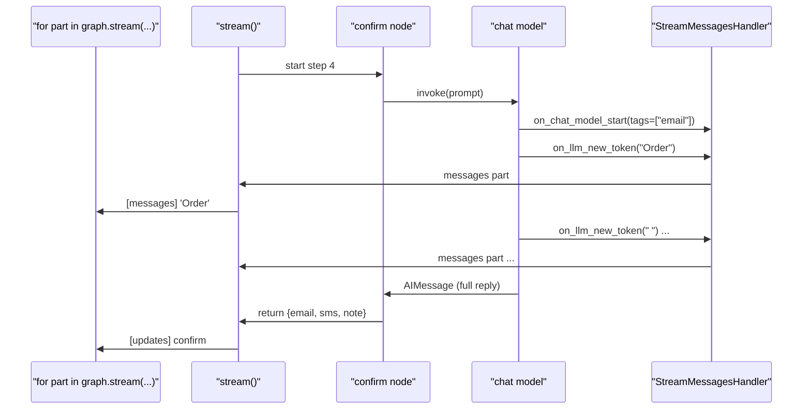

# 7.3 Streaming LLM Tokens

## The problem

The order tracker now has one more step. After `ship`, a new node `confirm` asks a [chat model](../../../GLOSSARY.md#chat-model) to write a shipping email and an SMS for the customer, plus a short note for the warehouse log. With a real provider, each reply takes a second or two to generate, and the model produces it a few characters at a time.

Lesson 7.1 streamed the graph's state and lesson 7.2 streamed progress that nodes write themselves. Neither helps here. An `"updates"` part for `confirm` exists only after the node returns, so all three replies would arrive at once, after the last word was generated. The customer would watch an empty box and then see the full email pop in. Chat interfaces type the reply out as it is generated because that wait feels much shorter.

You could make the node stream by hand: call `model.stream()` instead of `model.invoke()` and pass each chunk to the [stream writer](../../../GLOSSARY.md#stream-writer) from 7.2. That works, but every node that calls a model would need the same loop, and prebuilt pieces such as `create_agent` (lesson 4.3) call their models with `invoke()` and know nothing about your writer.

LangGraph has a stream mode for exactly this case. You do not change the nodes at all, and the caller asks for `stream_mode="messages"`.

## The concept

### Messages mode

In [messages mode](../../../GLOSSARY.md#messages-mode), LangGraph watches every LangChain chat model call made inside the graph's nodes and forwards each piece of output to the caller as soon as the model produces it. Each item is a pair:

```python
(message_chunk, metadata)
```

- `message_chunk` is an [AIMessageChunk](../../../GLOSSARY.md#aimessagechunk): one piece of the reply. Its `content` is the new text. The chunks of one reply share one [message id](../../../GLOSSARY.md#message-id), and adding them with `+` joins them back into the full message. The official docs call these pieces *tokens*, and this chapter does too, but a chunk is whatever the provider sends in one go. That may be a word, part of a word or a few words. The fake model in this lesson sends one word or one space per chunk.
- `metadata` is a dict that says where the chunk came from. Its key [langgraph_node](../../../GLOSSARY.md#langgraph_node) names the node that made the call. Next to it are `langgraph_step`, `langgraph_triggers`, `langgraph_path`, the checkpoint namespace and some provider fields. If the call carried tags, there is also a `tags` key.

The mental model: **the node asks for a complete answer, and the caller watches it being written.** The node's code is the same as in a run without streaming. It calls `invoke()`, waits and gets the full `AIMessage` back. The stream is a copy of the same output, sent to the caller while the node is still waiting.

### Telling the calls apart

A graph may call models in several nodes, and one node may call several models. Messages mode sends all of them through one stream, so the caller has to sort the chunks. It has two keys to sort by:

| Filter | Works when | Code |
|---|---|---|
| by node | each node makes at most one visible model call | `metadata["langgraph_node"] == "confirm"` |
| by tag | you need one particular call, wherever it runs | `"email" in metadata.get("tags", [])` |

Tags are labels you give the model call. Every LangChain chat model has a `tags` field, set when you build it (`init_chat_model(..., tags=["email"])`). You can also add tags to a single call through its config (`model.invoke(prompt, config={"tags": ["email"]})`), and then the call carries both sets. LangGraph copies the call's tags into the metadata of every chunk of that call. It leaves out its own internal `seq:step:*` tags, and if nothing is left, it leaves out the whole `tags` key.

### Keeping a call out of the stream

Some model calls are not meant for the user: a router that picks the next node, a classifier, a summary for the log. If the UI shows every token, it would type those out too. The tag `"nostream"`, available as the constant [TAG_NOSTREAM](../../../GLOSSARY.md#tag_nostream) in `langgraph.constants`, marks such a call. Messages mode skips its tokens. The call itself still runs, and the node still gets its reply. Only the copy for the caller is dropped.

## How it works

Messages mode is built on LangChain's callbacks. A [callback handler](../../../GLOSSARY.md#callback-handler) is an object that LangChain notifies about events of a run: a chat model call starts, the model produces a new token, the call ends. Handlers in a run's config are inherited by everything that runs inside it, including model calls made inside a node, because LangGraph runs each node with the run's config in the context.

When `stream()` sees `"messages"` among the requested modes, it adds one more handler to the run, [StreamMessagesHandler](../../../GLOSSARY.md#streammessageshandler) from `langgraph/pregel/_messages.py`. In 1.2.16 it does four things:

1. **On `on_chat_model_start`**, it checks the call's tags. If `"nostream"` is among them, it ignores the call. Otherwise it records the call's metadata and adds the user tags to it as `metadata["tags"]`.
2. **On `on_llm_new_token`**, it puts `(namespace, "messages", (chunk, metadata))` on the run's stream, the same internal queue that `"updates"` and `"custom"` use.
3. **On `on_llm_end`**, it would emit the complete message, but it skips any message whose id it has already sent. The chunks carry the id of the final message, so after a streamed call nothing extra is sent.
4. **On `on_chain_end` of a node**, it looks through the node's return value and emits any message object in it that it has not sent yet. That is how a node that returns a hand-made `AIMessage` shows up in messages mode too. Messages that were already in the node's input are marked as seen when the node starts, so they are not sent again.

Why does a node that calls `invoke()` stream at all? Because `BaseChatModel` decides for itself whether to generate in chunks. In langchain-core 1.6.12 its `_should_stream` method says yes when a streaming callback handler is attached to the call, and `StreamMessagesHandler` is one. The model then generates through its streaming code path, fires `on_llm_new_token` for each chunk and finally joins the chunks into the `AIMessage` that `invoke()` returns. Without `"messages"` the handler is absent, and the same `invoke()` generates the reply in one piece. The docs put it in one line: message events are emitted even when the model is run with `.invoke` rather than `.stream`.

Requesting `"messages"` also turns on [eager streaming](../../../GLOSSARY.md#eager-streaming), as `"custom"` did in 7.2, so each chunk reaches your loop while the node is still running.

The diagram follows the email call inside `confirm` during a run streamed with `["updates", "messages"]`. Look at where the chunks leave compared with the node's update:



The node is not in the path of the chunks at all. They go from the model through the handler to the run's queue, and the node only sees the joined result.

## In our example

The graph is the one from 7.2, `pick -> pack -> ship`, with `confirm` added after `ship`. `pick`, `pack` and `ship` are unchanged apart from comments and call no model, so they contribute nothing to messages mode.

The model is [GenericFakeChatModel](../../../GLOSSARY.md#genericfakechatmodel) from lesson 4.1. It returns a scripted reply whatever the prompt says, needs no API key and gives the same output every run. It also streams: its streaming code path splits the reply at whitespace and yields each word and each space as its own chunk. The helper builds a fresh one for every call, because it reads its replies from an iterator and can answer only once:

<!-- snippet: src/l7_3_streaming_llm_tokens/orders.py#chat_model -->
```python
# In a real app this would be init_chat_model("...", tags=...), created once at
# module level. The fake model replies with the scripted text whatever the
# prompt says, and it can answer only once (it reads its replies from an
# iterator), so confirm builds a fresh one for every call.
def chat_model(reply: str, tags: list[str]) -> GenericFakeChatModel:
    """A stand-in for a real chat model that streams `reply` word by word."""
    # `tags` is a standard field of every LangChain chat model. The tags of a
    # call end up in the metadata of each of its tokens, which is how the
    # caller tells the calls apart.
    return GenericFakeChatModel(messages=iter([reply]), tags=tags)
```
<!-- /snippet -->

`confirm` is an ordinary node with three ordinary `invoke()` calls. Nothing in it mentions streaming except the tag on the note:

<!-- snippet: src/l7_3_streaming_llm_tokens/orders.py#confirm -->
```python
def confirm(state: OrderState) -> dict:
    """Write the customer email, the SMS and the warehouse note with a chat model."""
    order, tracking = state["order_id"], state["tracking"]
    # The node calls .invoke(), not .stream(), and still streams: when the
    # caller asks for stream_mode="messages", LangGraph attaches a streaming
    # callback handler to the run, so the model streams under the hood and
    # every token is forwarded to the caller. The node still gets the complete
    # AIMessage back. Without "messages" the same invoke() returns the whole
    # reply in one go.
    email = chat_model(f"Order {order} shipped. Tracking {tracking}.", tags=["email"]).invoke(
        f"Write a one-line shipping email for order {order}, tracking {tracking}."
    )
    sms = chat_model(f"Shipped: {tracking}", tags=["sms"]).invoke(
        f"Write a two-word shipping SMS with tracking {tracking}."
    )
    # TAG_NOSTREAM ("nostream") keeps this call out of the token stream. The
    # call still runs, and its text still goes into the state.
    note = chat_model(f"Box {state['box']} handed to carrier.", tags=[TAG_NOSTREAM]).invoke(
        f"Write a warehouse log line for order {order}."
    )
    # `.text` is the message content as a string (a property in langchain-core
    # 1.x, no parentheses). The state holds plain strings, not messages, so
    # messages mode has no node-output messages to emit here.
    return {"email": email.text, "sms": sms.text, "note": note.text}
```
<!-- /snippet -->

Two things in it matter for streaming:

- Each call has its own tag: `["email"]`, `["sms"]` and `[TAG_NOSTREAM]`. These tags are what lets the caller separate the email from the SMS later.
- The node stores `.text`, the reply as a plain string, not the `AIMessage`. Since the update holds no message objects, step 4 of the handler (node outputs) finds nothing to emit, and the only messages in the stream are the model's own chunks. Experiment 5 shows what happens otherwise.

On the caller side, the simplest loop takes the pairs one by one. Section (a) of [\_\_main\_\_.py](../src/l7_3_streaming_llm_tokens/__main__.py) prints the node, the tags and the chunk text:

<!-- snippet: src/l7_3_streaming_llm_tokens/__main__.py#messages_mode -->
```python
print("== stream_mode='messages': one (chunk, metadata) pair per token ==")
# In v1 every item is a tuple (AIMessageChunk, metadata). The metadata says
# where the token came from: langgraph_node, langgraph_step,
# langgraph_triggers, ... and "tags" (only the tags you set; the key is
# MISSING for a call without tags, hence .get, see experiment 4).
# Only confirm calls a model, so pick, pack and ship add nothing, and the
# warehouse note is absent because its call is tagged nostream.
# The fake model sends each space as its own chunk. A real provider chunks
# differently, so never rely on chunk boundaries, only on the joined text.
for chunk, metadata in graph.stream(ORDER, stream_mode="messages"):
    print(f"  {metadata['langgraph_node']} {metadata.get('tags', [])} {chunk.content!r}")
print()
```
<!-- /snippet -->

With one mode in the default v1 format, the items are the bare pairs. With a list of modes and `version="v2"`, as in section (b), each item is a [StreamPart](../../../GLOSSARY.md#streampart) dict `{"type": "messages", "ns": (), "data": (chunk, metadata)}`, the `MessagesStreamPart` member of the union from 7.1. `describe` in [render.py](../src/l7_3_streaming_llm_tokens/render.py) got its fourth case above the fallback:

```python
case "messages":
    # data is a (message chunk, metadata) pair: one part per token.
    chunk, metadata = part["data"]
    return f"[messages] ns={part['ns']} {metadata['langgraph_node']} {chunk.content!r}"
```

Sections (c) and (d) print the stream the way a chat UI would: `print(chunk.content, end="", flush=True)`, so the text grows on one line. They differ only in the filter. The tag filter in section (d) is the one to copy:

<!-- snippet: src/l7_3_streaming_llm_tokens/__main__.py#filter_by_tag -->
```python
print("== filtered by tag 'email': only the customer email ==")
# Tags select single model calls, whichever node makes them. Use `in` (a
# call can carry several tags) and .get (untagged calls have no "tags" key).
print("  ", end="")
for chunk, metadata in graph.stream(ORDER, stream_mode="messages"):
    if "email" in metadata.get("tags", []):
        print(chunk.content, end="", flush=True)
print()
print()
```
<!-- /snippet -->

Section (e) collects every tag seen in the stream and then checks the final state:

<!-- snippet: src/l7_3_streaming_llm_tokens/__main__.py#nostream_call -->
```python
print("== tags=[TAG_NOSTREAM]: the note is written but never streamed ==")
# The note call ran (its text is in the state), but none of its tokens
# reached the stream: "nostream" hides a model call from
# stream_mode="messages" only, it does not skip the call. Typical use: a
# classifier, a router or a summary the user should not see typed out.
streamed_tags: set[str] = set()
for _chunk, metadata in graph.stream(ORDER, stream_mode="messages"):
    streamed_tags.update(metadata.get("tags", []))
print(f"  tags in the token stream: {sorted(streamed_tags)}")
print(f"  note in the final state: {graph.invoke(ORDER)['note']!r}")
```
<!-- /snippet -->

The [code walkthrough](readalong.md#confirm) goes through the files line by line.

## Run it

From the course root, `./run.sh 7.3` prints (the fake model and the absence of a clock make the output the same every run; a real model would chunk its replies differently):

```text
== stream_mode='messages': one (chunk, metadata) pair per token ==
  confirm ['email'] 'Order'
  confirm ['email'] ' '
  confirm ['email'] 'A-1001'
  confirm ['email'] ' '
  confirm ['email'] 'shipped.'
  confirm ['email'] ' '
  confirm ['email'] 'Tracking'
  confirm ['email'] ' '
  confirm ['email'] 'TRK-A-1001.'
  confirm ['sms'] 'Shipped:'
  confirm ['sms'] ' '
  confirm ['sms'] 'TRK-A-1001'

== stream_mode=['updates', 'messages'], version='v2': tokens while confirm runs ==
  [updates] ns=() pick -> {'status': 'picked'}
  [updates] ns=() pack -> {'status': 'packed', 'box': 'small'}
  [updates] ns=() ship -> {'status': 'shipped', 'tracking': 'TRK-A-1001'}
  [messages] ns=() confirm 'Order'
  [messages] ns=() confirm ' '
  [messages] ns=() confirm 'A-1001'
  [messages] ns=() confirm ' '
  [messages] ns=() confirm 'shipped.'
  [messages] ns=() confirm ' '
  [messages] ns=() confirm 'Tracking'
  [messages] ns=() confirm ' '
  [messages] ns=() confirm 'TRK-A-1001.'
  [messages] ns=() confirm 'Shipped:'
  [messages] ns=() confirm ' '
  [messages] ns=() confirm 'TRK-A-1001'
  [updates] ns=() confirm -> {'email': 'Order A-1001 shipped. Tracking TRK-A-1001.', 'sms': 'Shipped: TRK-A-1001', 'note': 'Box small handed to carrier.'}

== filtered by node 'confirm': both replies run together ==
  Order A-1001 shipped. Tracking TRK-A-1001.Shipped: TRK-A-1001

== filtered by tag 'email': only the customer email ==
  Order A-1001 shipped. Tracking TRK-A-1001.

== tags=[TAG_NOSTREAM]: the note is written but never streamed ==
  tags in the token stream: ['email', 'sms']
  note in the final state: 'Box small handed to carrier.'
```

What to notice:

- **Only model output is streamed.** Section (a) has 12 lines, all from `confirm`: nine chunks of the email, three of the SMS. `pick`, `pack` and `ship` do not appear, because they call no model. There is no complete message after the chunks either: the handler skipped it because its id was already sent.
- **Spaces are chunks.** The `' '` lines are how the fake model splits its reply. Never build logic on chunk boundaries. Only the joined text is stable across providers.
- **Tokens arrive while the node runs.** In section (b) the 12 messages parts come after `ship`'s update and before `confirm`'s update. The update can exist only after `confirm` returns, and by then every token has been sent.
- **The node filter glues the calls.** Section (c) prints `...TRK-A-1001.Shipped: TRK-A-1001`: the email and the SMS, back to back, because both calls run in `confirm`. The tag filter in section (d) prints the email alone.
- **`nostream` hides, it does not skip.** In section (e) no chunk carried the `"nostream"` tag, yet the note is in the final state. The model call ran in every one of the six runs; its tokens were simply not forwarded.

## Details and edge cases

**`langgraph_node` is always there, `tags` is not.** Every chunk's metadata has `langgraph_node`, so indexing it is safe. `tags` appears only when the call has user tags. The tag filter example in the official streaming guide uses `metadata["tags"] == ["joke"]`, which raises `KeyError: 'tags'` as soon as an untagged call streams a token, and fails to match when a call carries more than one tag. Use `"joke" in metadata.get("tags", [])` (experiment 4).

**`disable_streaming` is not `nostream`.** The docs' "disable streaming" advice is about a different problem: models that cannot stream, or should not. [disable_streaming](../../../GLOSSARY.md#disable_streaming)`=True` makes the model generate its reply in one piece. Messages mode still reports that call, as one complete `AIMessage` from `on_llm_end`, instead of chunks (experiment 1). To hide a call from the caller, tag it `"nostream"`.

**Nodes that return messages.** A graph whose state is a message list, such as `MessagesState` from module 4, returns `AIMessage` objects from its nodes. The model's chunks already carried that message's id, so the handler does not send it twice. But a message that a node builds itself, such as a `ToolMessage` from `ToolNode` or a hand-written `AIMessage("Done")`, is emitted once when the node ends, as a complete message rather than an `AIMessageChunk`. The agent-service-toolkit drops these on the client with `if not isinstance(msg, AIMessageChunk): continue`. Tagging the model call does not hide a message the node returns. The handler finds it in the node's output at `on_chain_end`, and that path never looks at the model call's tags (experiment 5). The open issue [langgraph #7509](https://github.com/langchain-ai/langgraph/issues/7509) reports a related gap: even a node tagged `nostream` still emits the messages it returns.

**`invoke()` collects the pairs.** As with other modes in 7.1 and 7.2, `graph.invoke(ORDER, stream_mode="messages")` returns the list of all 12 `(chunk, metadata)` pairs instead of the final state.

**Calling the node outside a graph.** Unlike `pack` in 7.2, `confirm` needs no run context. Called as a plain function, it returns the same dict: the models simply do not stream, because no streaming handler is attached. The tests rely on this.

**Async.** With `astream()`, the same handler works for `await model.ainvoke(...)` inside an `async def` node. The chunks and metadata look the same.

**Subgraphs.** In 1.2.16 the handler ignores model calls made inside a [subgraph](../../../GLOSSARY.md#subgraph) unless the parent streams with `subgraphs=True`. Then the items carry the subgraph's namespace, and `langgraph_node` names the node inside the subgraph. Module 8 covers subgraphs.

**Other ways to set the tag.** The docs attach `"nostream"` with `model.with_config({"tags": ["nostream"]})`, which works the same as passing `tags=` to the constructor. Tags passed in a call's config are added to the model's own tags.

## Common mistakes

> [!WARNING]
> **Indexing `metadata["tags"]`.** A stream that worked in a demo with tagged models crashes with `KeyError: 'tags'` once an untagged model call is added anywhere in the graph, possibly in a node the UI code never cared about. Read tags with `metadata.get("tags", [])` and test membership with `in` (experiment 4).

> [!WARNING]
> **Misspelling the tag.** `tags=["no-stream"]` or `tags=["no_stream"]` is a valid tag that means nothing to LangGraph. The call streams as usual, with no warning, and the hidden text appears in the user's chat. Import `TAG_NOSTREAM` from `langgraph.constants`: a misspelt constant name is a `NameError` at once (experiment 3).

> [!WARNING]
> **Filtering by node when a node makes several calls.** Several model calls in one node, or an agent loop that calls the model on every turn, all share one `langgraph_node`. A node filter then runs their texts together, as section (c) shows. Give the calls tags and filter by tag.

> [!WARNING]
> **Expecting `nostream` to hide everything.** `nostream` stops the model's tokens only. If the node puts the reply into a message-typed state key, the full message is still emitted when the node ends (experiment 5). Keep hidden output in plain fields, or filter on the client by node, tag and `AIMessageChunk` type.

> [!WARNING]
> **Using `disable_streaming=True` to hide a call.** It turns the chunks into one complete message, which messages mode still delivers (experiment 1). It is meant for models that cannot stream, not for hiding output.

> [!TIP]
> **Plan the tags with the UI.** Decide which model calls the user should see, and give each one a tag that names its purpose (`"answer"`, `"email"`), not its node. Tag everything else `TAG_NOSTREAM`. The client then needs one rule, "show tagged calls I know", which survives refactoring the graph.

## Experiments

Each experiment starts from the original code. Run the lesson with `./run.sh 7.3` from the course root after each change.

1. **Use `disable_streaming` instead of `nostream`.** In `confirm`, build the note model as `GenericFakeChatModel(messages=iter([f"Box {state['box']} handed to carrier."]), disable_streaming=True)` (no `tags`, no `chat_model` helper) and keep the `.invoke(...)` call.

   <details><summary>What happens and why</summary>

   Section (a) gets a 13th line, `confirm [] 'Box small handed to carrier.'`. Section (b) gets one more messages part with the whole note, right before `confirm`'s update, and section (c) ends with `...TRK-A-1001Box small handed to carrier.`. Sections (d) and (e) do not change, because the note call has no tags. `disable_streaming=True` only stops the model from generating in chunks. The handler still sees the call and sends the finished message in one piece from `on_llm_end`, as a complete `AIMessage`. To keep a call out of the stream, tag it `nostream`. Put the code back as it was (`git checkout -- .` in the lesson directory).

   </details>

2. **Make the tokens visible.** In `orders.py`, import `FakeListChatModel` from the same module as `GenericFakeChatModel`, and in `chat_model` return `FakeListChatModel(responses=[reply], sleep=0.05, tags=tags)` (change the return type to match).

   <details><summary>What happens and why</summary>

   Every chunk is now one character, and the characters appear 0.05 s apart. Section (a) has 61 lines: about 3 s of characters, then a pause of about 1.4 s after the last SMS character while the hidden note is still generated, character by character, with the same pauses. Sections (c) and (d) type the text out live, and the whole program takes over 20 seconds. The final `invoke()` in section (e) is quick, because without messages mode the model does not stream and sleeps only once per call. Chunk size and speed come from the model; LangGraph forwards whatever the model yields. Put the code back as it was.

   </details>

3. **Misspell the tag.** In `confirm`, replace `tags=[TAG_NOSTREAM]` with `tags=["no-stream"]`.

   <details><summary>What happens and why</summary>

   The note's tokens (`'Box'`, `' '`, `'small'`, ...) now appear in sections (a), (b) and (c), and section (e) prints `tags in the token stream: ['email', 'no-stream', 'sms']`. There is no error or warning. The handler checks for the exact string `"nostream"`, and any other string is just a user tag. With the imported constant a typo such as `TAG_NOSTRAEM` fails at once with a `NameError`. Put the code back as it was.

   </details>

4. **Index the tags like the docs do.** In section (d) of `__main__.py`, write `if "email" in metadata["tags"]:`, and in `confirm` build the SMS model with `tags=[]`.

   <details><summary>What happens and why</summary>

   Sections (a) to (c) still run; in (a) the SMS lines now read `confirm [] ...`, printed through `.get`. Section (d) prints the email and then stops with `KeyError: 'tags'` at the first SMS token. A call without tags gets no `"tags"` key in its metadata at all, not an empty list. Use `metadata.get("tags", [])` whenever some calls may be untagged. Put the code back as it was.

   </details>

5. **Return the note as a message.** In `confirm`, return `"note": note` (the `AIMessage`) instead of `"note": note.text`.

   <details><summary>What happens and why</summary>

   Section (a) now ends with a 13th line, `confirm [] 'Box small handed to carrier.'`, and section (c) appends the note text, although the note model is still tagged `nostream`. Section (b) shows the whole note as one messages part before `confirm`'s update, which now holds an `AIMessage`, and section (e) still lists only `['email', 'sms']`, because the extra item has no tags. When `confirm` ends, the handler looks through its update, finds a message it has not sent and emits it. `nostream` only stopped the model's tokens (see "Nodes that return messages" above). Keep hidden output out of message-typed state keys, or filter on the client. Put the code back as it was.

   </details>

## Summary

- `stream_mode="messages"` streams the output of LangChain chat models called inside nodes as `(AIMessageChunk, metadata)` pairs, while the nodes still call plain `invoke()` and get the full reply.
- It works through a callback handler, `StreamMessagesHandler`, which LangGraph attaches to the run. The model sees a streaming handler and generates in chunks.
- `metadata["langgraph_node"]` is always present and selects by node. Tags select single calls; read them with `metadata.get("tags", [])` and `in`.
- A call tagged `TAG_NOSTREAM` (`"nostream"`) still runs and returns its reply, but its tokens are not streamed. `disable_streaming=True` is different: the call still shows up, as one message.
- Messages mode also emits message objects that nodes return, and `nostream` does not stop those. Never rely on chunk boundaries, only on the joined text.

## Self-check

1. A node calls `model.invoke(prompt)` and returns `{"answer": reply.text}`. You stream the graph with `stream_mode="messages"`. Do you get tokens, and what does the node receive?

   <details><summary>Answer</summary>

   You get tokens. LangGraph attaches its streaming callback handler to the run, so the model generates in chunks even inside `invoke()`, and the handler forwards each chunk. The node still receives the complete `AIMessage` from `invoke()`, joined from the chunks.

   </details>

2. One node calls the model twice, for a title and for a body. How do you show only the body in the UI?

   <details><summary>Answer</summary>

   Give the body call a tag, for example `tags=["body"]` on the model or in the call's config, and keep only chunks with `"body" in metadata.get("tags", [])`. A filter on `langgraph_node` would let both calls through, because they run in the same node.

   </details>

3. A router node calls a model to pick the next step, and users see its raw output typed out in the chat. What is the fix, and does the router still work afterwards?

   <details><summary>Answer</summary>

   Tag the router's model call with `TAG_NOSTREAM`. Messages mode then ignores the call's tokens, but the call still runs and returns its reply, so routing is unchanged. If the router also stores the reply as a message in the state, the full message would still be emitted when the node ends; store a plain value instead.

   </details>

4. Your stream loop reads `metadata["tags"]` and crashes with `KeyError` after a colleague adds a summarizing node. Why?

   <details><summary>Answer</summary>

   The new node calls a model without tags. LangGraph puts a `tags` key into the metadata only when the call has user tags, so that call's chunks have no `tags` key. Use `metadata.get("tags", [])`.

   </details>

5. Your graph streams with `["updates", "messages"]` and `version="v2"`. A node calls a model and returns its update. In what order do that node's parts arrive?

   <details><summary>Answer</summary>

   First the messages parts, one per chunk, while the node is still running, then the node's updates part after it returns. Requesting `"messages"` turns on eager streaming, so each chunk reaches the caller at once.

   </details>

## Further reading

- [Streaming: LLM tokens](https://docs.langchain.com/oss/python/langgraph/streaming#llm-tokens), LangChain docs: the `(message_chunk, metadata)` pair, filtering by tags and by node, the `nostream` tag, tokens from `.invoke()`, and disabling streaming for specific chat models.
- LangGraph 1.2.16 source: `StreamMessagesHandler` in `langgraph/pregel/_messages.py`, `TAG_NOSTREAM` in `langgraph/constants.py`, `filter_to_user_tags` in `langgraph/_internal/_config.py`, `MessagesStreamPart` in `langgraph/types.py`, and the handler setup in `Pregel.stream` (`langgraph/pregel/main.py`). In langchain-core 1.6.12: `BaseChatModel._should_stream` in `language_models/chat_models.py` and `GenericFakeChatModel` in `language_models/fake_chat_models.py`.
- [langgraph #7509: TAG_NOSTREAM inconsistency in StreamMessagesHandler](https://github.com/langchain-ai/langgraph/issues/7509): a related open issue, in which `nostream` on a node does not hide the messages the node returns.
- [agent-service-toolkit, service.py](https://github.com/JoshuaC215/agent-service-toolkit/blob/main/src/service/service.py): a FastAPI service that streams `"messages"` to a client, skips calls tagged `skip_stream` with `metadata.get("tags", [])` and drops non-chunk messages from nodes.
