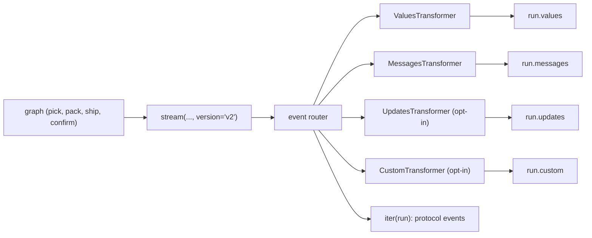

# 7.4 Event Streaming with stream_events v3

## The problem

The first three lessons of this module used one tool, `stream()`, with a growing list of [stream modes](../../../GLOSSARY.md#stream_mode). 7.1 streamed the state, 7.2 added the progress events that `pack` and `ship` write, and 7.3 added the tokens of the chat model calls in `confirm`. Each new need meant one more mode in the list, and each mode brought its own payload shape. The [v2 format](../../../GLOSSARY.md#v2-format) made every chunk the same kind of dict, but the caller's loop is still one big branch on `part["type"]`, followed by more sorting inside each branch.

7.3 showed where that leads. [Messages mode](../../../GLOSSARY.md#messages-mode) delivers loose token chunks. To show the email and the SMS as two separate replies, the caller had to group chunks by tag or message id, and the simplest filter, by node, glued both replies into one line. To get the final state as well, the caller either kept the last `values` chunk or ran the graph a second time with `invoke()`. Every UI that streams a graph ends up writing the same bookkeeping: group chunks into messages, keep the latest state, remember whether the run was interrupted.

LangGraph 1.2 adds a second, higher-level API that does this bookkeeping for you: `stream_events(version="v3")`, which the docs call *event streaming*. This lesson runs the unchanged order graph from 7.3 through it.

## The concept

### A run stream instead of a chunk iterator

[stream_events](../../../GLOSSARY.md#stream_events) with `version="v3"` takes the same input and config as `stream()`, but it does not return an iterator of chunks. It returns one object for the whole run, a [GraphRunStream](../../../GLOSSARY.md#graphrunstream):

```python
run = graph.stream_events(ORDER, version="v3")
```

Calling it starts nothing. The graph moves forward only while your code pulls items out of `run`, in your own thread, as with `stream()`. There is no background thread that runs ahead.

The run stream offers several **views of the same run**. Each view is a [stream projection](../../../GLOSSARY.md#stream-projection): an iterable that yields one kind of item, already in a useful shape.

| Attribute | What it gives you | Compared with `stream()` |
|---|---|---|
| `run.values` | the full state after each step, starting with the input | `stream_mode="values"` |
| `run.messages` | one [ChatModelStream](../../../GLOSSARY.md#chatmodelstream) per chat model call | `stream_mode="messages"`, but grouped per call |
| `run.output` | the final state (a property) | the last `values` chunk |
| `run.interrupted`, `run.interrupts` | whether the run paused, and the [Interrupt objects](../../../GLOSSARY.md#interrupt-object) (properties) | `interrupts` on v2 values parts |
| `run.extensions` | a read-only mapping from every projection name to its channel | |
| `iter(run)` | every raw [protocol event](../../../GLOSSARY.md#protocol-event) | all parts of all requested modes |

A `ChatModelStream` stands for one whole model call. `message.node` names the node that made the call. `message.text` is an iterable of text deltas, and `str(message.text)` waits for the call to finish and returns the full text. `message.output` is the assembled `AIMessage`, and `message.reasoning` and `message.tool_calls` cover the other parts a reply can have.

The mental model: **`stream()` hands you the raw material, `stream_events` v3 hands you the finished parts.** Under the hood both run the graph the same way. v3 adds a layer between the graph and your loop that turns the raw output into typed objects.

### Projections come from transformers

Each projection is filled by a [stream transformer](../../../GLOSSARY.md#stream-transformer), an object that watches the run's events and pushes items into one or more projections. Each transformer declares the stream modes it needs in `required_stream_modes`, and v3 asks the graph for exactly the union of those modes, nothing more.

A default run has four transformers, and so four projections: `values`, `messages`, `lifecycle` and `subgraphs` (the last two report subgraph runs, which module 8 covers). Projections such as `updates` and `custom` are opt-in. You add them by passing transformer classes:

```python
run = graph.stream_events(
    ORDER, version="v3", transformers=[UpdatesTransformer, CustomTransformer]
)
```

A mode that no transformer requests is never produced. In a default v3 run, the [stream writer](../../../GLOSSARY.md#stream-writer) calls in `pack` and `ship` go nowhere, just as they did in 7.2 when `"custom"` was not among the modes.

### One consumer per projection

The queue behind each projection is a [StreamChannel](../../../GLOSSARY.md#streamchannel). Two rules about it shape how you write the loop:

1. **A channel keeps items only after someone subscribes.** Iterating a projection subscribes to it. Items pushed before that are dropped.
2. **A channel allows one subscriber.** Iterating the same projection a second time raises `RuntimeError`. `run.values.tee(n)` gives `n` independent cursors if you need more.

Since the run is driven by whatever you are iterating, draining `run.values` completes the whole run. A `run.messages` loop afterwards finds an empty channel, because nobody was subscribed while the messages went by. To read two projections in one run, subscribe to both before the run moves on. `run.interleave("values", "messages")` does that and yields `(name, item)` pairs in the order the items were produced.

The official guide says that several consumers can read the projections concurrently, and that is true: with async tasks, or with `interleave`, the projections are all subscribed while the run is going. What does not work is reading them one *after* another.

## How it works

The diagram shows the two layers. `stream()` is the bottom layer and still does all the work; v3 is a router plus transformers on top of it:



Step by step, in langgraph 1.2.16:

1. `stream_events(version="v3")` builds the transformers (the four defaults, any compile-time ones, then yours) and collects their `required_stream_modes`. It then calls `self.stream(...)` with that union as `stream_mode`, `subgraphs=True` and `version="v2"`. This is why v3 refuses your own `stream_mode=` and `subgraphs=` with a `TypeError`: it sets them itself.
2. Each v2 part from `stream()` is converted into a protocol event: a dict with `type`, `method` (the channel name, such as `"values"` or `"messages"`), `params` (the namespace, `[]` for the root graph, a timestamp in milliseconds, and the data) and `seq`, a counter that increases strictly within the run. Use `seq` for ordering, not the timestamp.
3. Every transformer sees every event and pushes items into its own projections. `MessagesTransformer`, for example, collects the events of one model call into one `ChatModelStream`.
4. When you pull from a projection and its channel is empty, the run stream pulls the next part from `stream()`, which may run the next node. That is the "no background thread" rule from above.

Messages work differently from 7.3 in one detail. In 7.3, `stream()` attached [StreamMessagesHandler](../../../GLOSSARY.md#streammessageshandler), which forwarded each token as an [AIMessageChunk](../../../GLOSSARY.md#aimessagechunk). Under v3 the run config carries a flag that swaps in `StreamMessagesHandlerV2`. It still makes `confirm`'s plain `.invoke()` calls stream, but it reports each call as a sequence of content-block events:

```text
message-start
content-block-start
content-block-delta   (one per text delta)
content-block-finish
message-finish
```

The [TAG_NOSTREAM](../../../GLOSSARY.md#tag_nostream) rule from 7.3 still holds: a call tagged `"nostream"` is not registered when it starts, so none of its events reach the stream.

## In our example

The graph does not change. [orders.py](../src/l7_4_event_streaming/orders.py) is a byte-for-byte copy of 7.3's, `confirm` included. Only the caller in [\_\_main\_\_.py](../src/l7_4_event_streaming/__main__.py) changes, and 7.3's `render.py` is gone: its `describe` turned v2 part dicts into text, and v3 projections hand out state dicts and `ChatModelStream` objects that need no such translation.

`main` starts by hiding a warning. In 1.2.16 both `stream_events(version="v3")` and the `GraphRunStream` class are marked `@beta`, so each run emits a [LangChainBetaWarning](../../../GLOSSARY.md#langchainbetawarning):

<!-- snippet: src/l7_4_event_streaming/__main__.py#beta_warning -->
```python
# stream_events(version="v3") is experimental in langgraph 1.2.16: each call
# emits a LangChainBetaWarning ("The v3 streaming protocol on Pregel is
# experimental."). LangChainBetaWarning subclasses DeprecationWarning, so
# filtering on that category plus the start of the message silences exactly
# this warning without importing the private langchain_core._api module.
# The filter must be set AFTER langchain_core has been imported (it is, by
# the `from langgraph.stream import ...` line above): importing it calls
# surface_langchain_beta_warnings(), which puts its own "default" filter in
# front of any filter set earlier (experiment 5).
# In an app you would leave the warning visible while you evaluate the API;
# the lesson hides it so the output stays readable.
warnings.filterwarnings(
    "ignore", message="The v3 streaming protocol", category=DeprecationWarning
)
```
<!-- /snippet -->

`LangChainBetaWarning` is a subclass of `DeprecationWarning`, so a filter on that category plus the start of the message catches exactly this warning, without importing the private `langchain_core._api` module where the class lives. Experiment 5 shows why the filter has to come after the imports.

Section (a) reads the state snapshots and then the final output:

<!-- snippet: src/l7_4_event_streaming/__main__.py#values_projection -->
```python
print("== run.values and run.output: state snapshots, then the final state ==")
# stream_events(version="v3") does not start the run. It returns a
# GraphRunStream, and the caller's for loop is what drives the graph forward
# (there is no background thread). stream_mode= and subgraphs= are refused
# with a TypeError (experiment 3): v3 decides which modes it needs.
run = graph.stream_events(ORDER, version="v3")
# run.values yields the full state after each step, like
# stream_mode="values", starting with the input.
for snapshot in run.values:
    print(f"  status={snapshot.get('status', '-')} keys={len(snapshot)}")
# run.output is a property that runs the graph to the end (if it has not
# finished yet) and returns the final state. Here the loop already finished
# the run, so it returns at once. The note is in the output although it was
# never streamed (nostream, lesson 7.3). run.interrupted and run.interrupts
# work the same way (lesson 6; not used here, there is no checkpointer).
print(f"  output: email={run.output['email']!r} note={run.output['note']!r}")
print()
```
<!-- /snippet -->

The loop drives the whole run, so by the time `run.output` is read the run is over, and the property returns the last state at once. Had the code read `run.output` first, the property would have run the graph to the end itself.

Section (b) is where v3 pays off compared with 7.3. One loop iteration per model call, an inner loop over that call's deltas:

<!-- snippet: src/l7_4_event_streaming/__main__.py#messages_projection -->
```python
print("== run.messages: one stream per model call, tokens in message.text ==")
# Each item is a ChatModelStream (langchain_core.language_models.
# chat_model_stream) for ONE model call, not one token: compare 7.3, where
# the node filter glued the email and the SMS together.
# message.node is the node that made the call. Iterating message.text yields
# the text deltas as they arrive; str(message.text) gives the whole text,
# message.output the assembled AIMessage, and message.reasoning and
# message.tool_calls the other parts of a reply.
# A ChatModelStream carries no tags, so here the email and the SMS are told
# apart by their order; the raw events in the last section still carry the
# metadata with the tags. The note call is absent: nostream works in v3 too.
run = graph.stream_events(ORDER, version="v3")
for message in run.messages:
    print(f"  {message.node}: ", end="")
    for token in message.text:
        print(token, end="", flush=True)
    print()
print()
```
<!-- /snippet -->

There is no grouping by tag or id here: the projection already did that. A `ChatModelStream` has no `tags`, though. The two calls in `confirm` are told apart by their order. If you need the tags, they are in the metadata of the raw events (section (e)).

Section (c) reads two projections of one run in arrival order:

<!-- snippet: src/l7_4_event_streaming/__main__.py#interleave_projections -->
```python
print("== run.interleave('values', 'messages'): both projections in arrival order ==")
# A projection only buffers items once something subscribes to it, and each
# one can be subscribed only once (experiments 1 and 2). Reading two
# projections one after the other therefore loses the second one.
# interleave(*names) subscribes to all the named projections and yields
# (name, item) pairs in the order they were produced.
# The two messages arrive after ship's snapshot and before confirm's, while
# confirm is still running: the v3 counterpart of 7.3's updates-plus-messages
# section. str(item.text) pulls the rest of that reply before the loop goes on.
run = graph.stream_events(ORDER, version="v3")
for name, item in run.interleave("values", "messages"):
    if name == "values":
        print(f"  [values]   status={item.get('status', '-')}")
    else:
        print(f"  [messages] {item.node} {str(item.text)!r}")
print()
```
<!-- /snippet -->

Section (d) adds the two opt-in projections, and with them the progress events of 7.2:

<!-- snippet: src/l7_4_event_streaming/__main__.py#opt_in_transformers -->
```python
print("== transformers=[UpdatesTransformer, CustomTransformer]: opt-in projections ==")
# By default a v3 run has only the values, messages, lifecycle and subgraphs
# projections, and the graph streams only the modes some transformer asks
# for (each transformer declares required_stream_modes). So pack's and
# ship's writer events from 7.2 were not even produced in the sections above.
# Passing transformer CLASSES (not instances: v3 builds one per scope) adds
# run.updates and run.custom. run.extensions maps every projection name to
# its channel. Reading run.updates without UpdatesTransformer raises
# AttributeError (experiment 3). Your own projections are StreamTransformer
# subclasses (the docs' "custom transformers"; not in this lesson).
run = graph.stream_events(
    ORDER, version="v3", transformers=[UpdatesTransformer, CustomTransformer]
)
print(f"  projections: {sorted(run.extensions)}")
for name, item in run.interleave("updates", "custom"):
    print(f"  [{name}] {item}")
print()
```
<!-- /snippet -->

The transformers are passed as classes. v3 builds one instance per scope (the root graph, and each subgraph when there are any), and an instance you built yourself is rejected with a `TypeError`.

Section (e) looks under the projections, at the raw protocol events, and then runs the same graph through `stream()` for comparison:

<!-- snippet: src/l7_4_event_streaming/__main__.py#raw_events -->
```python
print("== iter(run): the raw protocol events behind the projections ==")
# Iterating the run itself yields protocol events: dicts with "type", "seq"
# (strictly increasing, use it for ordering), "method" (the channel name)
# and "params" (namespace [] for the root graph, timestamp, data).
# A model call becomes message-start, a content block start / deltas /
# finish, and message-finish. The projections are built from these events,
# and ChatModelStream assembles them for you. The metadata next to each
# messages payload is the same as in 7.3 (langgraph_node, tags).
run = graph.stream_events(ORDER, version="v3")
counts: Counter[str] = Counter()
for event in run:
    method = event["method"]
    if method == "messages":
        payload, _metadata = event["params"]["data"]
        method = f"messages/{payload['event']}"
    counts[method] += 1
for method, n in counts.items():
    print(f"  {method}: {n}")
# The same run through stream(): 12 bare token chunks instead of 2 message
# objects. stream() with stream_mode is the stable, low-level API: its
# values/updates/custom parts are plain dicts, but messages parts hold
# AIMessageChunk objects you convert before sending them over SSE. v3 is the
# higher-level, in-process API, experimental in 1.2.16 (the beta warning).
parts = Counter(
    part["type"]
    for part in graph.stream(ORDER, stream_mode=["values", "messages"], version="v2")
)
print(f"  stream(..., version='v2') with the same modes: {dict(parts)}")
```
<!-- /snippet -->

The [code walkthrough](readalong.md#what-changed-since-lesson-73) goes through the files line by line.

## Run it

From the course root, `./run.sh 7.4` prints (the fake model and the absence of a clock make the output the same every run):

```text
== run.values and run.output: state snapshots, then the final state ==
  status=- keys=2
  status=picked keys=3
  status=packed keys=4
  status=shipped keys=5
  status=shipped keys=8
  output: email='Order A-1001 shipped. Tracking TRK-A-1001.' note='Box small handed to carrier.'

== run.messages: one stream per model call, tokens in message.text ==
  confirm: Order A-1001 shipped. Tracking TRK-A-1001.
  confirm: Shipped: TRK-A-1001

== run.interleave('values', 'messages'): both projections in arrival order ==
  [values]   status=-
  [values]   status=picked
  [values]   status=packed
  [values]   status=shipped
  [messages] confirm 'Order A-1001 shipped. Tracking TRK-A-1001.'
  [messages] confirm 'Shipped: TRK-A-1001'
  [values]   status=shipped

== transformers=[UpdatesTransformer, CustomTransformer]: opt-in projections ==
  projections: ['custom', 'lifecycle', 'messages', 'subgraphs', 'updates', 'values']
  [updates] {'pick': {'status': 'picked'}}
  [custom] {'node': 'pack', 'item': 'PEN', 'done': 1, 'total': 2}
  [custom] {'node': 'pack', 'item': 'NOTEBOOK', 'done': 2, 'total': 2}
  [updates] {'pack': {'status': 'packed', 'box': 'small'}}
  [custom] {'node': 'ship', 'label': 'TRK-A-1001'}
  [updates] {'ship': {'status': 'shipped', 'tracking': 'TRK-A-1001'}}
  [updates] {'confirm': {'email': 'Order A-1001 shipped. Tracking TRK-A-1001.', 'sms': 'Shipped: TRK-A-1001', 'note': 'Box small handed to carrier.'}}

== iter(run): the raw protocol events behind the projections ==
  values: 5
  messages/message-start: 2
  messages/content-block-start: 2
  messages/content-block-delta: 12
  messages/content-block-finish: 2
  messages/message-finish: 2
  stream(..., version='v2') with the same modes: {'values': 5, 'messages': 12}
```

What to notice:

- **Same snapshots as `"values"` mode.** Section (a) shows the input (2 keys) and one snapshot per node, ending with 8 keys after `confirm`. The `note` is in `run.output` although its call was never streamed: `nostream` hides a call from the stream, not from the state.
- **Two messages, not twelve chunks.** Section (b) prints each reply on its own line. In 7.3 the node filter printed `...TRK-A-1001.Shipped: TRK-A-1001` because it saw only chunks. The third call, the warehouse note, is absent here as well.
- **Messages arrive while `confirm` runs.** In section (c) both messages come after `ship`'s snapshot and before `confirm`'s, the same position the token chunks had among the updates in 7.3.
- **Opt-in projections bring back 7.2.** Section (d) lists six projections instead of four, and each `custom` event comes before the update of the node that wrote it, because a node's update exists only once the node returns.
- **The same data, at two levels.** Section (e) counts 12 content-block deltas, nine for the email and three for the SMS, the same 12 pieces that `stream()` delivers as bare `messages` parts. v3 wraps each call in a start and a finish event, and the `ChatModelStream` in section (b) is built from exactly those events.

## Choosing between stream() and stream_events v3

Both APIs run the graph the same way, and v3 is built on `stream()`. The choice is about what your consumer needs and how much change you can absorb.

| Your client | Use | Why |
|---|---|---|
| Application code in the same process: a CLI, a notebook, a Python UI, a test | `stream_events(version="v3")` | per-call message objects, `run.output` and `run.interrupted` built in, `interleave()` for arrival order, opt-in and custom projections |
| Production code that must not change on a minor upgrade | `stream()` with `stream_mode` | v3 is experimental in 1.2.16 ("may change", in the method's docstring); `stream()` and the v2 format are the stable API |
| An endpoint that relays a run to a browser (SSE, a websocket) | `stream()` v2 parts, or the raw v3 protocol events | `values`, `updates` and `custom` parts are plain dicts; `messages` parts hold `AIMessageChunk` objects that you convert before sending. Raw v3 events are plain dicts, but the protocol is still in beta |
| A consumer that needs `checkpoints`, `tasks` or `debug` output, or one exact mode with its exact payload | `stream()` | direct access to any mode, nothing in between. v3 has transformers for these modes too, but you then read them through projections |
| A graph deployed on LangSmith's Agent Server | the LangSmith streaming API | the docs point there for remote graphs; both APIs above are in-process |

The short rule: **event streaming for application code that consumes a run in-process, `stream()` when you need raw modes, a stable contract, or a wire format you control.** The streaming guide recommends event streaming for new applications, and that is the direction the API is moving. In 1.2.16 the beta warning is the reminder that its shape may still change.

Two consequences of the projections are easy to miss when choosing. First, a `ChatModelStream` is a live Python object, not data: it cannot be sent over a socket as it is. Second, v3 decides the stream modes for you, so if you rely on `stream_mode` options that v3 does not expose, stay with `stream()`.

## Details and edge cases

**The `version` argument is required.** `stream_events` defaults to `version="v2"`, the older callback-event format inherited from LangChain runnables. On a graph, `graph.stream_events(ORDER)` without `version="v3"` fails with `NotImplementedError: stream_events(version='v2') is not supported. Use astream_events() for v1/v2, or stream_events(version='v3') ...`. The old `astream_events(version="v2")` that you may know from tutorials is a different API, made of `on_chain_start` and `on_chat_model_stream` events.

**Async.** `run = await graph.astream_events(input, version="v3")` gives an `AsyncGraphRunStream`, whose projections you consume with `async for`. Note the `await`: the call itself returns an awaitable. There, `output()`, `interrupted()` and `interrupts()` are coroutine methods (`await run.output()`), not properties, and the docs show `interleave()` for synchronous code only. In async code you subscribe to several projections by starting one task per projection (for example with `asyncio.gather`).

**Reading `run.output` first empties the projections.** `run.output` drives the run to the end without subscribing to anything, so a `run.values` or `run.messages` loop afterwards yields nothing. Read the projections first, then `run.output`.

**Stopping early.** `run.abort()` closes the underlying run, cancelling nodes that are still running, and `GraphRunStream` is a context manager that aborts when the `with` block ends.

**Compile-time transformers.** Instead of `transformers=` on each call, `builder.compile(transformers=[...])` registers transformers for every run of the compiled graph. Call-time transformers are appended after them.

**Interrupts and resuming.** `run.interrupted` and `run.interrupts` drive the run to the end like `run.output`. To resume a graph paused with `interrupt()` (module 6), call `stream_events` again with `Command(resume=...)` and the same `thread_id`, on a graph compiled with a [checkpointer](../../../GLOSSARY.md#checkpointer). This lesson's graph has neither, so `run.interrupted` is `False`.

**Nested streaming inside a node.** The docstring of `stream_events` warns that a node calling `stream(stream_mode="messages")` on an inner graph during a v3 run does not get token chunks, because the outer v3 handler reroutes the model calls. Use v3 for the inner graph as well, or call the model's `.stream()` directly.

**Tags are only in the raw events.** A `ChatModelStream` carries `node` but no tags. To select calls by tag, as 7.3 recommended, read the metadata of the raw `messages` events, which still holds `langgraph_node` and `tags`, or keep one visible model call per node.

## Common mistakes

> [!WARNING]
> **Reading projections one after another.** `list(run.values)` followed by `for m in run.messages` prints no messages. The first loop ran the whole run while nobody was subscribed to `messages`. Use `run.interleave(...)`, or call `iter()` on every projection before draining any of them (experiment 1).

> [!WARNING]
> **Treating a projection as a list.** A projection is a single-use cursor. Iterating it twice raises `RuntimeError: StreamChannel already has a subscriber; use .tee(n) for fan-out.` Store the items in a list if you need them again, or use `tee` (experiment 2).

> [!WARNING]
> **Passing `stream_mode=` to v3, or reading a projection you did not register.** `stream_mode=` and `subgraphs=` raise `TypeError`, and `run.updates` on a default run raises `AttributeError` that lists the registered projections. Add projections with `transformers=[...]` (experiment 3).

> [!WARNING]
> **Trusting the error from `run.output`.** In 1.2.16, when a node raises an `AttributeError`, `run.output` reports `'GraphRunStream' object has no attribute 'output'` instead of the node's error (open issue [langgraph #9091](https://github.com/langchain-ai/langgraph/issues/9091)). While you debug a failing run, iterate a projection, which raises the real error, or run the graph with `invoke()` (experiment 4).

> [!WARNING]
> **Setting the warning filter too early.** A filter for `LangChainBetaWarning` placed before the third-party imports has no effect, because importing `langchain_core` installs its own filter in front of yours (experiment 5).

> [!TIP]
> **Keep the beta warning visible while you evaluate v3.** The lesson hides it to keep the output readable. In your own project, leave it on until you have decided to depend on the API, then filter it with a precise filter like the one in `main` rather than turning off all `DeprecationWarning`s.

## Experiments

Each experiment starts from the original code. Run the lesson with `./run.sh 7.4` from the course root after each change.

1. **Read two projections one after the other.** In section (b), add `snapshots = list(run.values)` and `print(len(snapshots))` between the `stream_events(...)` call and the `for message in run.messages:` loop.

   <details><summary>What happens and why</summary>

   Section (b) prints `5` and then nothing else: no `confirm:` lines. `list(run.values)` pulled the run to the end, and `run.messages` was not subscribed while the two calls in `confirm` produced their messages, so its channel never buffered them. Now replace the two lines with `values, messages = iter(run.values), iter(run.messages)` followed by `print(len(list(values)), len(list(messages)))`: it prints `5 2`, because both channels were subscribed before the run started. `interleave()` does this for you and also keeps the arrival order. Put the code back as it was (`git checkout -- .` in the lesson directory).

   </details>

2. **Iterate a projection twice.** In section (a), add `print(len(list(run.values)))` right after the `print(f"  output: ...")` line.

   <details><summary>What happens and why</summary>

   Section (a) prints as before, then the program stops with `RuntimeError: StreamChannel already has a subscriber; use .tee(n) for fan-out.` A projection is a single-consumer cursor, not a list: the `for` loop was its one subscriber. If two parts of your code need the same items, call `a, b = run.values.tee(2)` before reading, which gives two independent cursors (5 snapshots each). Put the code back as it was.

   </details>

3. **Ask v3 for a stream mode.** In section (d), replace `transformers=[UpdatesTransformer, CustomTransformer]` with `stream_mode="updates"`. Then remove that argument altogether, so the call is `graph.stream_events(ORDER, version="v3")`, and add `print(run.updates)` after it.

   <details><summary>What happens and why</summary>

   Sections (a) to (c) run as before. The first change stops section (d) with `TypeError: stream_events(version='v3') / astream_events(version='v3') do not accept stream_mode; v3 owns these (stream_mode is built from the transformer mux, subgraphs is forced True so nested namespaces flow through scoped muxes).` The second stops it with `AttributeError: 'GraphRunStream' object has no attribute 'updates' (registered projections: lifecycle, messages, subgraphs, values)`. v3 builds the mode list from its transformers, so the way to get `updates` is `UpdatesTransformer`, and without it the graph does not even produce updates. Put the code back as it was.

   </details>

4. **Break a node with an `AttributeError`.** In `orders.py`, make `pick` return `{"status": state["items"].upper()}`. Run, then also delete the `for snapshot in run.values:` loop (both lines) in section (a) and run again.

   <details><summary>What happens and why</summary>

   With the loop, section (a) prints `status=- keys=2` (the input) and then stops with the real error, `AttributeError: 'list' object has no attribute 'upper'`, with `During task with name 'pick'` and a traceback into `orders.py`. Without the loop, `run.output` is the first thing read, and the error becomes `AttributeError: 'GraphRunStream' object has no attribute 'output' (registered projections: lifecycle, messages, subgraphs, values)`, with no trace of `pick`. An `AttributeError` that escapes a property getter makes Python fall back to the class's `__getattr__`, and `GraphRunStream.__getattr__` reports a missing projection (open issue langgraph #9091). Other exception types are re-raised by `run.output` unchanged. Put the code back as it was.

   </details>

5. **Move the warning filter.** Cut the `warnings.filterwarnings(...)` call out of `main` and paste it at module level, right after `from collections import Counter` and above `from langgraph.stream import ...` (ruff will then ask for `# noqa: E402` on the imports below it).

   <details><summary>What happens and why</summary>

   stdout is unchanged, but stderr shows two warnings:

   ```text
   .../langgraph/pregel/main.py:3805: LangChainBetaWarning: The v3 streaming protocol on Pregel is experimental.
     return self._pregel_stream_v3(
   .../langgraph/pregel/main.py:3647: LangChainBetaWarning: The v3 streaming protocol on Pregel is experimental.
     return GraphRunStream(graph_iter, mux)
   ```

   One comes from the decorated method, one from the decorated class. Python checks warning filters newest first. `from langgraph.stream import ...` is the first import that loads `langchain_core`, and importing `langchain_core` runs `surface_langchain_beta_warnings()`, which adds a `"default"` filter for `LangChainBetaWarning` in front of yours. The `"default"` action shows a warning once per code location, which is why five runs produce two lines rather than ten. If you paste the filter only above the `from l7_4_event_streaming.orders import ...` line, `langchain_core` is already loaded by then and the filter works. Put the code back as it was.

   </details>

## Summary

- `graph.stream_events(input, version="v3")` returns a `GraphRunStream`: one lazy object per run, driven by the caller's loop, with typed projections instead of mode-tagged chunks.
- `run.values` gives state snapshots, `run.messages` one `ChatModelStream` per model call (`node`, `text`, `output`), and `run.output` the final state. `iter(run)` gives the raw protocol events they are built from.
- Projections come from transformers, and the graph streams only the modes they declare. Add `updates` and `custom` with `transformers=[UpdatesTransformer, CustomTransformer]` (classes, not instances). `stream_mode=` is refused.
- Each projection is a single-consumer cursor that buffers only after it is subscribed. Read several projections with `interleave()` or by subscribing to all first, never one after another.
- Use v3 for in-process application code. Use `stream()` for raw modes, a stable contract and wire formats you control. In 1.2.16 v3 is experimental and warns with `LangChainBetaWarning`.

## Self-check

1. You call `run = graph.stream_events(ORDER, version="v3")` and then `time.sleep(5)`. How far has the graph got after the sleep?

   <details><summary>Answer</summary>

   Nowhere. `stream_events` only builds the run stream. The graph advances only when your code pulls from a projection, iterates the run, or reads a property such as `run.output`. There is no background thread.

   </details>

2. Your code prints every state snapshot with `for s in run.values: ...` and then shows the replies with `for m in run.messages: ...`. No replies appear. Why, and what is the fix?

   <details><summary>Answer</summary>

   The first loop drove the whole run while `run.messages` had no subscriber, and a projection keeps items only after it is subscribed. Use `for name, item in run.interleave("values", "messages")`, or call `iter()` on both projections before reading either.

   </details>

3. A node in your graph calls the model twice. In 7.3 the node filter glued both replies together. What changes with `run.messages`, and what does it not give you?

   <details><summary>Answer</summary>

   Each call becomes its own `ChatModelStream`, so the replies arrive as two separate items with their own `text` and `output`, without any grouping code. A `ChatModelStream` has no tags, though. To pick a call by tag you need the metadata of the raw `messages` events, or you tell the calls apart by order.

   </details>

4. You want the progress events that a node writes with `get_stream_writer()` in a v3 run. What do you pass, and why are they missing otherwise?

   <details><summary>Answer</summary>

   `transformers=[CustomTransformer]`, which adds `run.custom`. v3 asks the graph only for the stream modes its transformers declare, and the default transformers do not declare `"custom"`, so without it the writer's events are never produced.

   </details>

5. A backend relays a graph run to a browser over SSE and must keep working across minor LangGraph upgrades. Which API do you pick in 1.2.16, and what must you watch for?

   <details><summary>Answer</summary>

   `stream()` with `stream_mode` and `version="v2"`: it is the stable API, and v3 is marked experimental. `values`, `updates` and `custom` parts are plain dicts, but `messages` parts contain `AIMessageChunk` objects, which you have to convert (for example to their text) before encoding them as JSON.

   </details>

## Further reading

- [Event streaming](https://docs.langchain.com/oss/python/langgraph/event-streaming), LangChain docs: the projections, `interleave`, the raw protocol events and their channels, transformers with `required_stream_modes`, `StreamChannel`, and call-time versus compile-time registration.
- [Streaming](https://docs.langchain.com/oss/python/langgraph/streaming), LangChain docs: the stream-mode API from lessons 7.1 to 7.3, and its recommendation of event streaming for new applications.
- [LangGraph quickstart](https://docs.langchain.com/oss/python/langgraph/quickstart) and [Interrupts](https://docs.langchain.com/oss/python/langgraph/interrupts), LangChain docs: both already use `stream_events(version="v3")` in their examples.
- LangGraph 1.2.16 source: `Pregel.stream_events`, `_pregel_stream_v3` and `_reject_v3_invariant_kwargs` in `langgraph/pregel/main.py`; `GraphRunStream` in `langgraph/stream/run_stream.py`; the transformers in `langgraph/stream/transformers.py`; `StreamChannel` in `langgraph/stream/stream_channel.py`; `StreamMessagesHandlerV2` in `langgraph/pregel/_messages.py`; and the tests `test_stream_events_v3*.py` in `libs/langgraph/tests`. In langchain-core 1.6.12: `ChatModelStream` in `language_models/chat_model_stream.py`.
- [langgraph #9091: GraphRunStream.output masks an AttributeError raised inside a node](https://github.com/langchain-ai/langgraph/issues/9091), open: the issue behind experiment 4.
