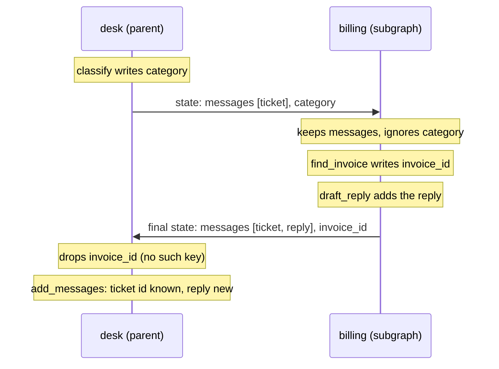
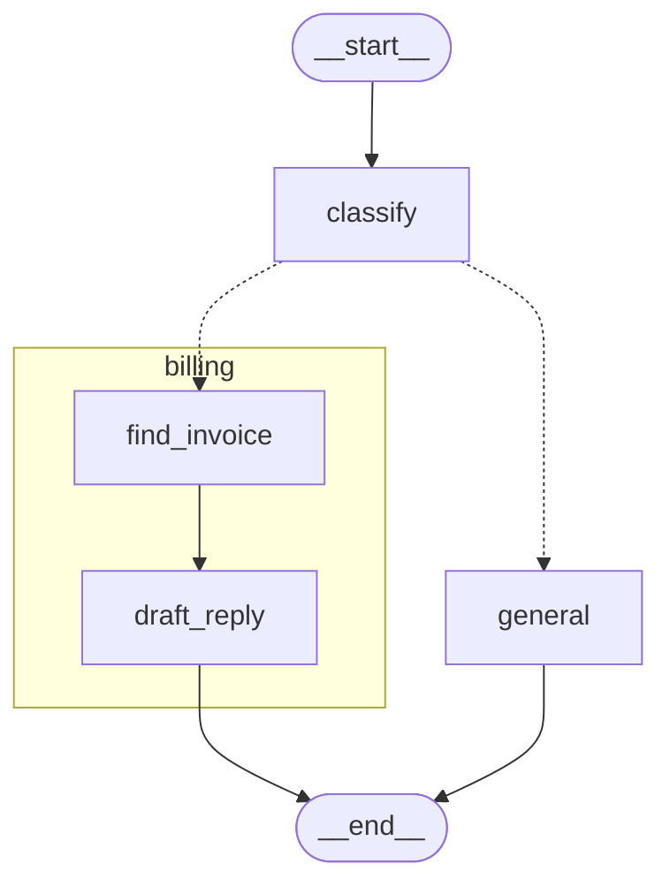

# 8.1 Subgraphs with Shared State

## The problem

Every graph in this course so far has been one flat graph: one state schema, one set of nodes, one builder. That works while the graph is small. Real applications grow in a less tidy way.

Take a support desk. Tickets come in, a classifier decides which team should answer, and each team has its own procedure. The billing team looks up the invoice, checks the payment and drafts a reply. Later a tech team arrives with a quite different procedure, then perhaps a returns team. If all of that lives in one graph, the builder fills up with nodes that have nothing to do with each other, the state collects every key any team ever needed, and two developers working on two teams keep editing the same file. You also cannot test the billing procedure on its own, because it only exists as a part of the desk.

What you want is the same thing you want in ordinary code: put each team's procedure in its own unit, test it alone, and let the desk call it. In LangGraph that unit is a graph of its own, used as a part of a bigger graph.

### This module

Module 8 is about building graphs out of graphs, and then about using that to make several agents work together:

- **8.1 (this lesson):** a compiled graph used directly as a node, talking to the outer graph through state keys both share.
- **8.2:** a team whose state looks nothing like the desk's, called from inside a node that translates between the two, and reading the inner graph's saved state.
- **8.3:** handoffs: a node deep inside one team sends the ticket to another team with `Command.PARENT`.
- **8.4:** a different multi-agent shape, a supervisor agent that calls specialist agents as tools.

The official docs give three reasons to split a graph this way: building multi-agent systems, reusing a set of nodes in several graphs, and letting separate teams develop parts independently, as long as the parts agree on their interface. All three rest on the mechanism of this lesson.

## The concept

### Subgraph and parent graph

A [subgraph](../../../GLOSSARY.md#subgraph) is a compiled graph that runs inside another graph. The graph that contains it is the [parent graph](../../../GLOSSARY.md#parent-graph). From the parent's point of view the subgraph is one node: it runs in one [super-step](../../../GLOSSARY.md#super-step) of the parent, receives the parent's state like any node, and returns an update like any node. From the subgraph's point of view nothing special happens at all: it gets an input, runs its own nodes through its own super-steps, and finishes with a final state.

There are two ways to connect them, and the choice depends on the state schemas:

| Schemas | How to connect | Lesson |
|---|---|---|
| Share some keys | Pass the [compiled graph](../../../GLOSSARY.md#compiledstategraph) straight to `add_node` | 8.1 |
| Have nothing in common | Call the subgraph from inside a node function and map the keys yourself | 8.2 |

This lesson is the first row. It needs no extra code at all, which is exactly why it only works when the schemas fit together.

### Shared keys

A [shared key](../../../GLOSSARY.md#shared-key) is a state key that the parent and the subgraph both declare under the same name. Shared keys are the whole interface between the two graphs. There is no mapping, no configuration, no list of exported fields: the name is the connection.

Three rules describe what crosses the boundary:

1. **In:** the subgraph starts with the parent's current value of every shared key. Keys only the parent has are not part of the subgraph's state, so the subgraph cannot see them.
2. **Out:** when the subgraph finishes, its final values of the shared keys become the parent node's update. Keys only the subgraph has are dropped, because the parent has no channel to store them in.
3. **Merge:** that update goes through the **parent's** [reducers](../../../GLOSSARY.md#reducer), exactly like the return value of a function node.

Rule 3 is the one that bites. "Final values" means the whole value of the key at the end of the subgraph's run, not only what the subgraph added. For a list of messages that is everything the subgraph started with plus its own messages. Whether that leads to duplicates depends entirely on the parent's reducer for that key.

> [!IMPORTANT]
> A subgraph added as a node hands back the **final value** of every shared key, not a diff. The parent's reducer must be able to take a value that repeats what the parent already has. [add_messages](../../../GLOSSARY.md#add_messages) can, because it matches messages by id; a plain appending reducer such as `operator.add` cannot.

## How it works

### One ticket through both graphs

The sequence below follows a billing ticket. Watch which keys go into the subgraph, which come back, and what the parent's reducer does with them.



In the 1.2.16 source, the parent treats the compiled graph like any other runnable node. The node's input schema is the parent's state schema, so the parent hands over its state; the subgraph reads from that input only the keys it declares as channels. When the subgraph returns its final state, the parent's node writer keeps only the keys that are parent channels (`attach_node` in `langgraph/graph/state.py`) and applies them with the parent's reducers.

The ticket was given an id by the parent's `add_messages` when the input was first written ([lesson 4.1](../../../4-agents/4.1-messages-state/docs/notes.md#messagesstate-and-add_messages)). The subgraph receives that same message, id included, and returns it again. So when the parent's `add_messages` sees `[ticket, reply]`, it finds the ticket's id already in the list, replaces the ticket with itself, and appends only the reply. The thread ends with two messages, as it should.

### What the parent sees: one node or the whole tree

Because the subgraph is a node, the parent's ordinary tools treat it as one: `get_graph()` draws one box called `billing`, and `stream()` reports one update from `billing` when the whole subgraph has finished. Both tools have an option to look inside.

**Drawing.** `get_graph(xray=True)` asks the graph for its subgraphs (`get_subgraphs()`) and draws each one in place of its node. The [xray](../../../GLOSSARY.md#xray) argument also takes an integer, the number of levels to expand, which matters once subgraphs contain subgraphs. Inner nodes get the subgraph node's name as a prefix, `billing:find_invoice`, so they cannot clash with parent nodes of the same name.

**Streaming.** `stream(..., subgraphs=True)` also forwards the parts the subgraph produces. To tell them apart, every part carries a [subgraph namespace](../../../GLOSSARY.md#subgraph-namespace): the path of nested subgraph runs that produced it, one `"node_name:<task_id>"` string per level. With `version="v2"` it is the `ns` field of each [StreamPart](../../../GLOSSARY.md#streampart), which in [lesson 7.1](../../../7-streaming/7.1-stream-modes/docs/notes.md#the-v2-format-one-shape-for-every-chunk) was always `()`. Now it finally says something: `()` still means the top-level graph, and `("billing:<task_id>",)` means "inside the billing subgraph, in this particular run of it".

### Whose checkpointer?

A subgraph compiled with `compile()` and no `checkpointer` argument has `checkpointer=None`. That does not mean "never save". When the parent runs a node, it puts its own [checkpointer](../../../GLOSSARY.md#checkpointer) into that task's config. A subgraph whose own setting is `None` uses the saver it finds there (`Pregel._resolve_checkpointer` in `langgraph/pregel/main.py`; the parent sets the config key per task in `langgraph/pregel/_algo.py`). So one saver on the parent covers the whole tree.

The subgraph saves its [checkpoints](../../../GLOSSARY.md#checkpoint) under the same `thread_id` as the parent but in its own namespace, kept in the config key [checkpoint_ns](../../../GLOSSARY.md#checkpoint_ns). The parent's checkpoints have `checkpoint_ns == ""`; the subgraph's have the subgraph namespace as a string, `"billing:<task_id>"` (levels would be joined with `|`). Because the task id is part of it, every run of the subgraph gets a fresh namespace and a fresh history. The docs call this per-invocation persistence and recommend it for most applications: the subgraph remembers nothing between tickets, but within one run its progress is saved, which is what lets an interrupt inside a subgraph pause and resume. Reading that saved state with `get_state(config, subgraphs=True)` is lesson 8.2's topic.

`compile(checkpointer=False)` opts the subgraph out: it saves nothing, even inside a parent with a saver. (A third setting, `checkpointer=True`, gives a subgraph memory across runs on the same thread; this lesson does not use it.)

## In our example

The example is a new storyline, the support desk, which 8.2 and 8.3 extend. The desk lives in [desk.py](../src/l8_1_subgraphs_shared_state/desk.py), the billing team in [billing.py](../src/l8_1_subgraphs_shared_state/billing.py). Every node writes a fixed message, so there is no model and no service, and the run prints the same lines every time.

### Two schemas, one shared key

The billing team's state:

<!-- snippet: src/l8_1_subgraphs_shared_state/billing.py#billing_state -->
```python
class BillingState(TypedDict):
    """State of the billing subgraph."""

    # Same name AND same reducer as in DeskState. A key with the same name is
    # the channel parent and subgraph share: the subgraph gets the parent's
    # value as its input and hands its final value back when it finishes.
    messages: Annotated[list[AnyMessage], add_messages]
    # Private to the subgraph: the parent has no such key, so it never
    # reaches the parent (section 1 of the run shows it missing).
    invoice_id: NotRequired[str]
```
<!-- /snippet -->

And the desk's:

<!-- snippet: src/l8_1_subgraphs_shared_state/desk.py#desk_state -->
```python
class DeskState(TypedDict):
    """State of the parent (desk) graph."""

    # Shared with the billing subgraph: same name, same reducer.
    messages: Annotated[list[AnyMessage], add_messages]
    # Exists only in the parent: the subgraph never sees it and cannot
    # overwrite it.
    category: NotRequired[Category]
```
<!-- /snippet -->

`messages` is declared identically in both, so it is the shared key. `invoice_id` exists only in the subgraph: `find_invoice` writes it and `draft_reply` reads it, and it never leaves the subgraph. `category` exists only in the desk: `classify` writes it and the [routing function](../../../GLOSSARY.md#routing-function) `route_ticket` reads it, as in [lesson 1.2](../../../1-foundations/1.2-conditional-edges/docs/notes.md#the-concept), and the subgraph can neither read nor overwrite it.

Note that `find_invoice` reads `state["messages"][-1]` although no node of the subgraph ever wrote a message at that point. The ticket is there because the desk passed its `messages` in (rule 1).

### The subgraph as a node

`build_billing()` is an ordinary graph: two nodes in a line, compiled without a checkpointer. The desk uses it like this:

<!-- snippet: src/l8_1_subgraphs_shared_state/desk.py#build_desk -->
```python
def build_desk(checkpointer: BaseCheckpointSaver | None) -> CompiledStateGraph:
    """Build the desk graph with the billing subgraph as one of its nodes."""
    builder = StateGraph(DeskState)
    builder.add_node("classify", classify)
    # A compiled graph is a node like a function: no wrapper. The parent
    # passes its state in and applies what comes back. That works because the
    # two schemas share keys (messages); with no shared key the subgraph
    # would get an empty input (experiment 4). A subgraph with a different
    # schema is called inside a node function instead (lesson 8.2).
    #
    # How the result merges: when the subgraph finishes, the parent node
    # "billing" writes the subgraph's FINAL values of the shared keys as ONE
    # update, through the PARENT's reducers. Here that is the whole messages
    # list (the ticket plus the reply), not just the new reply. add_messages
    # matches messages by id, so the ticket already in the parent is
    # replaced by itself and only the reply is new; with a plain list
    # reducer such as operator.add the ticket would be appended a second
    # time (experiment 1). Keys only the subgraph has (invoice_id) are
    # dropped; keys only the parent has (category) are left alone.
    builder.add_node("billing", build_billing())
    builder.add_node("general", general)
    builder.add_edge(START, "classify")
    builder.add_conditional_edges(
        "classify", route_ticket, {"billing": "billing", "general": "general"}
    )
    builder.add_edge("billing", END)
    builder.add_edge("general", END)
    # Only the parent gets the checkpointer; the parent lends it to the
    # subgraph on every run.
    return builder.compile(checkpointer=checkpointer)
```
<!-- /snippet -->

`builder.add_node("billing", build_billing())` is the whole integration: the compiled graph sits where a function would go. The rest is the conditional-edge pattern from 1.2 with a [path map](../../../GLOSSARY.md#path-map), and the node name `"billing"` is what later appears in the drawing and in the namespace. The checkpointer goes to the parent only. The [code walkthrough](readalong.md#deskpy) goes through these lines one by one.

### Watching both levels

Section 3 of [\_\_main\_\_.py](../src/l8_1_subgraphs_shared_state/__main__.py) streams a second ticket on a fresh thread:

<!-- snippet: src/l8_1_subgraphs_shared_state/__main__.py#stream_subgraphs -->
```python
print("== 3. stream(subgraphs=True, version='v2'): updates from both levels ==")
# subgraphs=True adds the subgraph's own updates, and each part's ns says
# where it came from (the promise of lesson 7.1). Without it only the two
# root lines appear (experiment 3). In v1 (no version="v2") every chunk
# becomes a (ns, chunk) tuple instead of a dict.
# A fresh thread, so the message count below is not mixed with section 1.
for part in desk.stream(
    {"messages": [HumanMessage(BILLING_TICKET)]},
    ticket_2,
    stream_mode="updates",
    subgraphs=True,
    version="v2",
):
    for node, update in part["data"].items():
        print(f"  {node_path(part['ns']):<8} {node} -> {brief(update)}")
# The last root line is the merge described in desk.py: the billing
# node's update holds both messages, yet the thread holds 2, not 3,
# because add_messages matched the ticket by its id.
count = len(desk.get_state(ticket_2).values["messages"])
print(f"  messages in thread ticket-2: {count}")
print()
```
<!-- /snippet -->

`subgraphs=True` brings in the subgraph's updates, `version="v2"` makes every part a dict with `ns`, and the helper `node_path` from [show.py](../src/l8_1_subgraphs_shared_state/show.py) turns the namespace into node names, because the task id after the colon is a new uuid on every run. `brief` prints a message list as the labels of its messages, so you can see how many messages an update holds.

### The saver holds both graphs

Section 4 looks into the parent's saver after the first ticket:

<!-- snippet: src/l8_1_subgraphs_shared_state/__main__.py#checkpoints -->
```python
print("== 4. One checkpointer, checkpoints in two namespaces ==")
# The subgraph has no saver of its own (None), yet the parent's
# InMemorySaver holds checkpoints of both graphs under thread ticket-1.
# The parent puts its checkpointer into the config of every task it runs
# (pregel/_algo.py) and the subgraph uses the lent one
# (Pregel._resolve_checkpointer in pregel/main.py). The subgraph's
# checkpoints are stored under checkpoint_ns "billing:<task_id>".
billing = dict(desk.get_subgraphs())["billing"]
print(f"  billing subgraph compiled with checkpointer={billing.checkpointer}")
# Each graph saved 4: the input checkpoint (step -1) and one per
# super-step (lesson 5.1). With the default checkpointer=None the
# namespace contains the task id, so every run of the subgraph starts a
# fresh history (per invocation); that is what lets an interrupt inside
# the subgraph resume (lesson 8.2 reads that saved subgraph state).
counts = Counter(
    node_path(saved.config["configurable"]["checkpoint_ns"].split("|"))
    for saved in checkpointer.list(ticket_1)
)
for name, n in sorted(counts.items()):
    print(f"  {name:<8} {n} checkpoints")
```
<!-- /snippet -->

`checkpointer.list(ticket_1)` passes only a `thread_id`, so `InMemorySaver` returns the checkpoints of every namespace in that thread. The `Counter` groups them by namespace.

## Run it

From the course root, `./run.sh 8.1` prints:

```text
== 1. A billing ticket runs through the billing subgraph ==
  human: Please refund invoice INV-1042, I was charged twice.
  billing: Billing team: the refund for INV-1042 is on its way.
  state keys: ['category', 'messages']

== 2. get_graph() vs get_graph(xray=True) ==
  nodes:      ['__start__', 'classify', 'billing', 'general', '__end__']
  xray nodes: ['__start__', 'classify', 'general', '__end__', 'billing:find_invoice', 'billing:draft_reply']
  xray Mermaid:
---
config:
  flowchart:
    curve: linear
---
graph TD;
	__start__([<p>__start__</p>]):::first
	classify(classify)
	general(general)
	__end__([<p>__end__</p>]):::last
	__start__ --> classify;
	classify -.-> billing\3afind_invoice;
	classify -.-> general;
	billing\3adraft_reply --> __end__;
	general --> __end__;
	subgraph billing
	billing\3afind_invoice(find_invoice)
	billing\3adraft_reply(draft_reply)
	billing\3afind_invoice --> billing\3adraft_reply;
	end
	classDef default fill:#f2f0ff,line-height:1.2
	classDef first fill-opacity:0
	classDef last fill:#bfb6fc

== 3. stream(subgraphs=True, version='v2'): updates from both levels ==
  (root)   classify -> {'category': 'billing'}
  billing  find_invoice -> {'invoice_id': 'INV-1042'}
  billing  draft_reply -> {'messages': ['billing']}
  (root)   billing -> {'messages': ['human', 'billing']}
  messages in thread ticket-2: 2

== 4. One checkpointer, checkpoints in two namespaces ==
  billing subgraph compiled with checkpointer=None
  (root)   4 checkpoints
  billing  4 checkpoints
```

Here is the same xray drawing rendered, generated from the code (styling dropped, ids simplified, structure unchanged). The dotted arrows are the conditional edge; the box is the subgraph.



What to notice:

- **Section 1: two messages, two keys.** The ticket appears once, although the subgraph handed it back. `invoice_id` is missing from the final state (rule 2), and `category` is still there, because the subgraph's update did not contain it and so could not touch it.
- **Section 2: the box disappears.** Without xray, `billing` is one node. With it, `billing` is gone from the node list and two prefixed nodes take its place. The edges from `classify` and to `__end__` now lead to the subgraph's first and last node. In the Mermaid text, `\3a` is the escaped colon, and `subgraph billing … end` is Mermaid's own grouping syntax.
- **Section 3: read the lines in order.** `classify` runs in the root. Then come the subgraph's own updates, *before* the root reports `billing`: the parent learns about its `billing` node only when the whole subgraph has finished. The last line is rule 3 in action. `draft_reply`'s update has one message, but the root `billing` update has two, `['human', 'billing']`: the subgraph's final `messages`. The thread still ends with 2 messages, not 3, because `add_messages` recognised the ticket by its id.
- **Section 4: one saver, two histories.** The subgraph has no saver of its own, yet the parent's saver holds 4 checkpoints for each graph. Each graph saved an input checkpoint, one after its input was written into state, and one after each of its two nodes ([lesson 5.1](../../../5-persistence/5.1-checkpointers-and-threads/docs/notes.md#when-checkpoints-are-written)): `classify` and `billing` for the desk, `find_invoice` and `draft_reply` for the subgraph.

## Details and edge cases

**The parent's reducer decides, not the subgraph's.** The duplicate in experiment 1 depends only on the parent's reducer for the shared key. In a scratch run with `operator.add` in `DeskState` and `add_messages` left in `BillingState`, the ticket still appears twice; with the reverse combination it appears once. Inside the subgraph, its own reducer still governs how its nodes' updates merge into its own state.

**A key the subgraph only reads comes back too.** The subgraph hands back the final value of every key in its schema, whether a node wrote it or not. In a small test graph whose subgraph never writes a shared `log: Annotated[list[str], operator.add]` key, the parent still ends with `['a', 'a']`. If a subgraph needs a parent key only as input, give the subgraph an [output schema](../../../GLOSSARY.md#output-schema) without it ([lesson 2.3](../../../2-state/2.3-input-output-schemas/docs/notes.md#the-concept)): with `StateGraph(S, output_schema=...)` the key is no longer returned and the parent keeps `['a']`. The LangChain Academy subgraph notebook uses an output schema for exactly this reason.

**A run that never enters the subgraph.** When `route_ticket` picks `general`, the subgraph does not run at all. Even with `subgraphs=True` the stream then has only root parts, and the saver gets no checkpoints in a billing namespace (the test `test_general_ticket_never_enters_subgraph` checks the stream).

**A second ticket on the same thread.** Running the billing ticket twice on one thread gives 8 checkpoints for each graph, in two different billing namespaces, one per run (the test `test_parent_checkpointer_saves_subgraph_checkpoints`). That is per-invocation persistence: the subgraph starts each run from what the parent passes in, not from its previous run. The parent's `messages`, on the other hand, are restored from the thread, so the second run's subgraph receives the whole conversation as its input.

**A subgraph with its own saver.** Compiling the subgraph with `checkpointer=InMemorySaver()` does not give it separate storage when it runs inside a parent: the saver lent through the config wins, and the subgraph's own saver stays empty (experiment 5). Give the checkpointer to the top-level graph only.

**`checkpointer=False` hides the subgraph from more than persistence.** `get_subgraphs()` skips subgraphs compiled with `checkpointer=False` (`find_subgraph_pregel` in `langgraph/pregel/_utils.py`). The xray drawing is built from `get_subgraphs()`, so it draws such a subgraph as one plain node, and code that looks the subgraph up by name fails. Streaming with `subgraphs=True` is not affected (experiment 2).

**Another way to stream subgraphs.** The streaming docs now also show subgraphs through `stream_events(version="v3")`, the event-streaming API of lesson 7.4. Everything in this lesson works the same in 1.2.16; `stream(subgraphs=True)` is documented and supported.

## Common mistakes

> [!WARNING]
> **An appending reducer on a shared list.** With `operator.add` on the parent's `messages`, every pass through the subgraph appends the messages it received a second time: section 1 prints the ticket twice and the thread holds 3 messages (experiment 1). Use `add_messages` for message lists, or keep the key out of the subgraph's output schema.

> [!WARNING]
> **A typo in a shared key name.** Rename `messages` to `msgs` in `BillingState` only, and the two graphs share no key. The subgraph starts with an empty `msgs` list, and `find_invoice` fails with `IndexError: list index out of range`. A subgraph that did not read the key would fail silently instead: its reply goes to `msgs`, which the parent does not have, so the answer just disappears (experiment 4). Nothing in LangGraph checks that a subgraph added as a node shares any key with its parent.

> [!WARNING]
> **Indexing v1 parts as dicts.** With `subgraphs=True` and the default v1 format, every chunk becomes an `(ns, chunk)` tuple, and code written for v2 parts fails with `TypeError: tuple indices must be integers or slices, not str` (experiment 3). Pass `version="v2"`, as in lesson 7.1.

> [!TIP]
> Print node names, not raw namespaces. A namespace contains a fresh task id on every run, so tests and logs that compare raw `ns` or `checkpoint_ns` values break on the next run. Strip the part after the colon, as `node_path` does.

## Experiments

Each experiment starts from the original code. Run the lesson with `./run.sh 8.1` from the course root after each change.

1. **Swap the reducer.** In both `DeskState` and `BillingState`, replace `add_messages` with `operator.add` (add `import operator` to both files).

   <details><summary>What happens and why</summary>

   Section 1 prints the human ticket twice before the billing reply, and section 3 ends with `messages in thread ticket-2: 3`. The streamed updates look exactly as before: the root `billing` update is still `['human', 'billing']`. What changed is how the parent merges it. The subgraph hands back its whole `messages` list, the ticket plus the reply, as one update; `operator.add` concatenates it to the parent's `[ticket]`, while `add_messages` replaced the ticket by its id. Only the parent's reducer matters here: changing `DeskState` alone gives the same duplicate. Any shared list key with an appending reducer has this trap. Put the code back as it was (`git checkout -- .` in the lesson directory).

   </details>

2. **Opt the subgraph out of persistence.** In `build_billing`, return `builder.compile(checkpointer=False)`.

   <details><summary>What happens and why</summary>

   Section 1 and section 3 are unchanged: the subgraph still runs, and `subgraphs=True` still streams its two inner updates. Section 2 now draws `billing` as one plain node even with xray, and section 4 stops with `KeyError: 'billing'` at `dict(desk.get_subgraphs())["billing"]`. Both have the same cause: `get_subgraphs()` skips subgraphs compiled with `checkpointer=False`. To see the persistence side, replace that line and the `print` after it with `print(f"  billing subgraph compiled with checkpointer={build_billing().checkpointer}")` (and import `build_billing` from `l8_1_subgraphs_shared_state.billing`). Section 4 then prints `checkpointer=False` and only `(root)   4 checkpoints`. The subgraph now runs like a plain function: nothing inside it is saved, so an interrupt inside it could not pause and resume. Put the code back as it was.

   </details>

3. **Hide the inner steps.** In section 3 of `__main__.py`, remove `subgraphs=True`. Then put it back and remove `version="v2"` instead.

   <details><summary>What happens and why</summary>

   Without `subgraphs=True`, section 3 shows two lines: `(root)   classify -> {'category': 'billing'}` and `(root)   billing -> {'messages': ['human', 'billing']}`. By default the parent streams the subgraph as one node and reports it only when it has finished. Without `version="v2"`, the loop fails with `TypeError: tuple indices must be integers or slices, not str`: in v1, `subgraphs=True` turns every chunk into an `(ns, chunk)` tuple, and `part["data"]` indexes a tuple with a string. Put the code back as it was.

   </details>

4. **Break the shared key.** In `billing.py` only, rename `messages` to `msgs`: in `BillingState`, in `find_invoice` and in the dict `draft_reply` returns.

   <details><summary>What happens and why</summary>

   The run fails in section 1 with `IndexError: list index out of range` inside `find_invoice` (the traceback names the tasks `find_invoice` and `billing`). The subgraph's `msgs` is an empty list, because only keys with the same name pass from parent to subgraph. If you also make `find_invoice` stop reading the list (for example, search a fixed string), section 1 prints only the human ticket: the reply was written to `msgs`, which the parent does not have, so it is dropped without an error. (Section 3 then crashes in `brief`, because the root `billing` update is `None`.) For graphs with different schemas, call the subgraph inside a node and map the keys yourself, as lesson 8.2 does. Put the code back as it was.

   </details>

5. **Give the subgraph its own saver.** In `billing.py`, create a module-level `BILLING_SAVER = InMemorySaver()` (import it from `langgraph.checkpoint.memory`) and compile with `builder.compile(checkpointer=BILLING_SAVER)`. At the end of `main`, import `BILLING_SAVER` and print `len(list(BILLING_SAVER.list(None)))`.

   <details><summary>What happens and why</summary>

   The new line prints `0`. The checkpoint counts in section 4 are unchanged, `(root)   4` and `billing  4`; only its first line now shows the saver object instead of `None`. Inside a parent, the subgraph uses the saver the parent lends it through the config, and its own saver is never asked. So compile the checkpointer once, on the top-level graph. Put the code back as it was.

   </details>

## Summary

- A subgraph is a compiled graph used inside a parent graph; to the parent it is one node, to itself it is a normal graph run.
- When the two schemas share keys, pass the compiled graph straight to `add_node`. The shared keys are the interface: the subgraph starts with the parent's values, and keys only one side has stay on that side.
- The subgraph hands back the **final** value of each shared key, and the parent merges it with its own reducer. `add_messages` copes because it matches ids; an appending reducer duplicates.
- `get_graph(xray=True)` draws the subgraph's nodes inside the parent, and `stream(subgraphs=True, version="v2")` streams their updates with an `ns` such as `("billing:<task_id>",)`.
- A subgraph compiled with the default `checkpointer=None` uses the parent's checkpointer and saves under its own `checkpoint_ns`, a fresh one per run; `checkpointer=False` turns that off.

## Self-check

1. `BillingState` has `messages` and `invoice_id`; `DeskState` has `messages` and `category`. After a billing ticket, which keys does the desk's final state have, and why?

   <details><summary>Answer</summary>

   `category` and `messages`. `messages` is shared, so the subgraph's final value comes back. `invoice_id` exists only in the subgraph and the parent has no channel for it, so it is dropped. `category` was written by `classify`; the subgraph never saw it and its update does not contain it, so the parent's value stays.

   </details>

2. `draft_reply` returns one message, yet the root `billing` update in the stream contains two. Why, and why does the thread still hold only two messages afterwards?

   <details><summary>Answer</summary>

   The parent node's update is the subgraph's final value of `messages`: the ticket it received plus the reply. The parent applies it with `add_messages`, which finds the ticket's id already in its list and replaces the message with itself, then appends the reply.

   </details>

3. You compile the subgraph with `compile()` and the parent with `compile(checkpointer=InMemorySaver())`. Does the subgraph save checkpoints? Where?

   <details><summary>Answer</summary>

   Yes. With `checkpointer=None`, the subgraph uses the saver the parent puts into each task's config. Its checkpoints go into the parent's saver under the same `thread_id`, with `checkpoint_ns` set to `"billing:<task_id>"`, so they do not mix with the parent's checkpoints (namespace `""`).

   </details>

4. A teammate renames the shared key in the subgraph schema only. The subgraph's nodes never read it, they only write a reply to it. What does the user see?

   <details><summary>Answer</summary>

   No error, and no reply. The subgraph writes to a key the parent does not have, so the value is dropped when the subgraph finishes. The parent's state contains only what it had before. Nothing in LangGraph warns that the two schemas no longer share a key.

   </details>

5. Your stream loop prints `part["ns"]` directly and a test compares it with a fixed tuple. Why does the test fail on the next run, and what should it compare instead?

   <details><summary>Answer</summary>

   Each namespace entry is `"node_name:<task_id>"`, and the task id changes on every run. Compare only the node names, the part before the colon, as `node_path` does, or check that the entry starts with `"billing:"`.

   </details>

## Further reading

- [Subgraphs](https://docs.langchain.com/oss/python/langgraph/use-subgraphs), LangChain docs: when to use subgraphs, adding a subgraph as a node versus calling it inside a node, and the three persistence settings (`None`, `True`, `False`).
- [Streaming: subgraph outputs](https://docs.langchain.com/oss/python/langgraph/streaming), LangChain docs: `subgraphs=True`, the namespace format, and the v1 tuple versus v2 `StreamPart` shapes.
- [LangChain Academy, module 4: sub-graph.ipynb](https://github.com/langchain-ai/langchain-academy/blob/main/module-4/sub-graph.ipynb): two subgraphs added as nodes, communicating through overlapping keys, with output schemas to limit what each one returns and `get_graph(xray=1)`.
- LangGraph 1.2.16 source: `StateGraph.add_node` and `attach_node` in `langgraph/graph/state.py`; `Pregel.get_graph`, `get_subgraphs` and `_resolve_checkpointer` in `langgraph/pregel/main.py`; the per-task config in `langgraph/pregel/_algo.py`; `find_subgraph_pregel` in `langgraph/pregel/_utils.py`.
