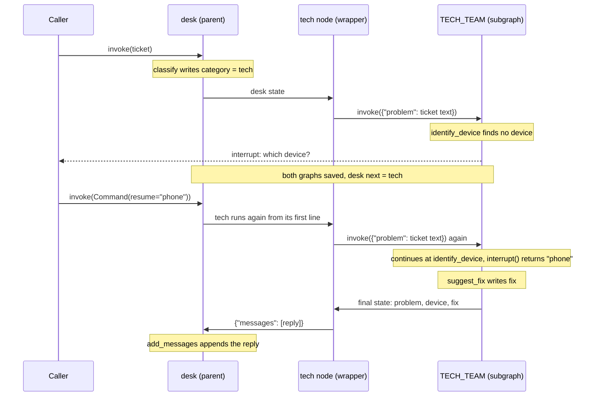
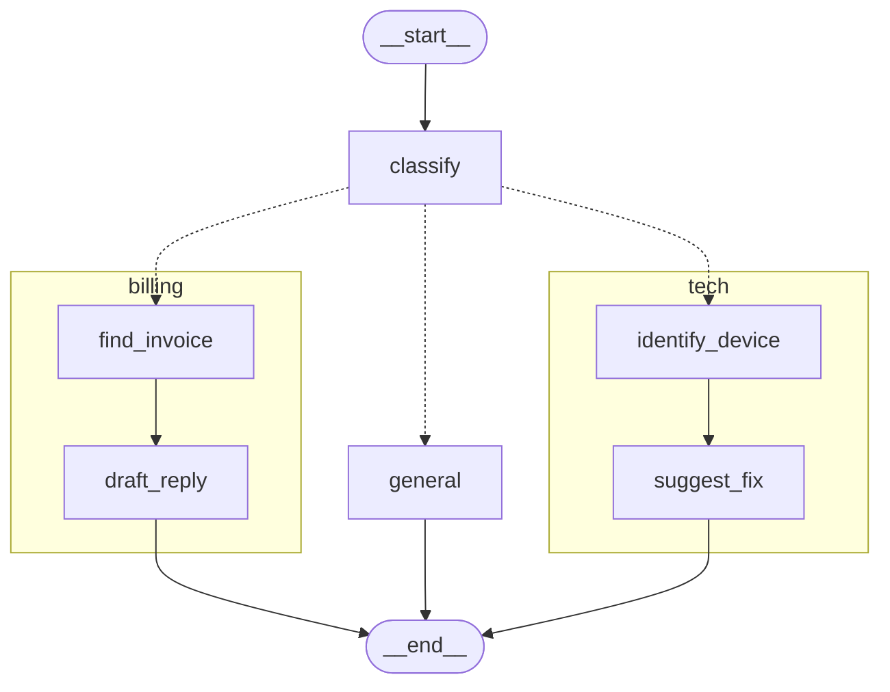

# 8.2 Subgraphs with Their Own State

## The problem

In [lesson 8.1](../../8.1-subgraphs-shared-state/docs/notes.md) the billing team joined the desk with one line, `add_node("billing", build_billing())`. That worked because both graphs declare `messages` with the same reducer. A [shared key](../../../GLOSSARY.md#shared-key) is the whole interface between two graphs: the parent passes its value in, and the subgraph hands its final value back.

Now a tech team arrives, and its procedure does not involve a conversation at all. It needs the text of the problem, finds out which device is affected, and picks a fix. Its natural state is `problem`, `device` and `fix`, with no `messages` and no `category`. Experiment 4 of lesson 8.1 showed what happens if you add such a graph with `add_node` anyway: no key matches, so the subgraph starts with an empty input, and anything it writes has nowhere to go in the parent.

You could rename the tech team's keys to match the desk, but then the tech team depends on the desk's schema, and every change to `DeskState` becomes a change to the tech team. The tech team could no longer be built, tested or reused without the desk. What you want is the opposite: let each graph keep the state that suits it, and translate at the boundary.

## The concept

### Calling a subgraph from inside a node

A compiled graph is a runnable, so a node function can simply call it with `invoke`, like any other function. When the parent's and the [subgraph](../../../GLOSSARY.md#subgraph)'s schemas have nothing in common, that is the way to connect them. The official docs describe the same split: add the compiled graph as a node when the graphs share state keys, and invoke it inside a node when the schemas differ or the state has to be transformed on the way.

The node that makes the call is a [wrapper node](../../../GLOSSARY.md#wrapper-node). It does three things, and nothing does them for you:

1. **Map in.** Build the subgraph's input from the parent state. The subgraph gets exactly this dict and nothing else.
2. **Invoke.** Call the compiled subgraph. It runs its own nodes over its own state and returns its whole final state.
3. **Map out.** Turn that final state into an update for the parent, written in the parent's keys. Only this return value reaches the parent, and it goes through the parent's [reducers](../../../GLOSSARY.md#reducer) like any node's update.

To the [parent graph](../../../GLOSSARY.md#parent-graph), the wrapper is an ordinary function node. To the subgraph, nothing is unusual either: it receives an input that fits its schema and runs. The translation lives in one place, the wrapper, so neither graph has to know the other's keys.

### Still a real subgraph

The call inside the wrapper is not a separate, detached run. When a node calls a runnable without passing a config, LangChain gives the nested call the config of the run that is in progress. LangGraph uses that to treat the inner graph as a subgraph of the node that called it. The inner run:

- gets its own [subgraph namespace](../../../GLOSSARY.md#subgraph-namespace), `"tech:<task_id>"`, named after the wrapper node,
- saves its [checkpoints](../../../GLOSSARY.md#checkpoint) into the parent's [checkpointer](../../../GLOSSARY.md#checkpointer), under the same thread, as in 8.1,
- appears in `stream(subgraphs=True)` with that namespace,
- can call [interrupt()](../../../GLOSSARY.md#interrupt), and the pause stops the whole parent run.

So the two ways of attaching a subgraph differ mainly in **how state crosses the boundary**. Persistence, streaming and interrupts work the same way in both; only inspection needs LangGraph to find the subgraph (see below).

### Reading the subgraph's saved state

While a run is paused inside a subgraph, the subgraph has saved state of its own: a checkpoint in its namespace, with its own values and its own next node. The parent's [get_state](../../../GLOSSARY.md#get_state) does not load it by default. `get_state(config, subgraphs=True)` does.

The parent's [StateSnapshot](../../../GLOSSARY.md#statesnapshot) has a `tasks` field with one entry per pending task. For a task whose node is a known subgraph, the field `tasks[i].state` holds:

| Call | `tasks[i].state` |
|---|---|
| `get_state(config)` | a config with `thread_id` and [checkpoint_ns](../../../GLOSSARY.md#checkpoint_ns): a pointer to where the subgraph's checkpoints are, not the state itself |
| `get_state(config, subgraphs=True)` | the subgraph's own `StateSnapshot`, loaded by calling the subgraph's `get_state` with that pointer |

"A known subgraph" is the important condition. LangGraph finds subgraphs without running anything, through [get_subgraphs](../../../GLOSSARY.md#get_subgraphs). A compiled graph added as a node is found trivially. For a function node, LangGraph looks at the variables the function refers to from outside its body, its globals and closure variables, and checks whether any of them is a compiled graph. If the subgraph is created inside the function body, nothing points at it before the function runs, and LangGraph does not know it exists.

### Choosing between the two ways

| | Subgraph added as a node | Subgraph called inside a node |
|---|---|---|
| Schemas | share keys | have nothing in common (or should not be coupled) |
| Code | `add_node("billing", build_billing())` | a wrapper function that maps in and out |
| What goes in | the parent's values of the shared keys | whatever the wrapper builds |
| What comes back | the subgraph's final values of the shared keys | whatever the wrapper returns |
| Persistence, streaming, interrupts | yes | yes |
| Inspection (`get_subgraphs()`, `tasks[i].state`, xray) | yes | only if LangGraph can find the subgraph |

Add the compiled graph as a node when the graphs genuinely share keys and you are happy for the subgraph's final values to flow back, as with the billing team's `messages`. Call it inside a node when the schemas differ, or when the parent should see only a translated result. The second way costs a few lines of mapping, but it also gives you a place to shape the result, which the first way does not.

## How it works

### A paused ticket, step by step

The sequence below follows the vague ticket from sections 3 and 4 of the run. Watch two things: what crosses each boundary, and which code runs a second time on resume.



The pause follows the rules of [lesson 6.1](../../../6-human-in-the-loop/6.1-interrupt-and-resume/docs/notes.md#pause-and-resume-step-by-step), applied at two levels at once. The question raised inside the subgraph comes out of the parent's `invoke`. The parent is left waiting in front of its `tech` node, and the subgraph is left waiting in front of `identify_device`.

On resume, LangGraph does what [lesson 6.3](../../../6-human-in-the-loop/6.3-rules-of-interrupts/docs/notes.md#one-mechanism-replay-with-stored-answers) described: a node that paused is restarted, not continued. That applies to both levels. The desk restarts its `tech` node from the first line, so the map-in runs again. The inner `invoke` gets the same namespace as before, finds the subgraph's saved checkpoint there, and does not start a fresh run: it continues with the task that paused, `identify_device`, which also starts again from its first line. This time `interrupt()` returns the [resume value](../../../GLOSSARY.md#resume-value). The interrupts page of the official docs shows the same behaviour for a subgraph called as a function: the parent node and the subgraph node both re-execute from their beginning.

### What `subgraphs=True` does

In the 1.2.16 source, the work happens in `Pregel._prepare_state_snapshot` (`langgraph/pregel/main.py`). It collects `dict(self.get_subgraphs())`, then goes through the pending tasks of the parent checkpoint. For each task whose name is in that dict, it builds the task's namespace and either stores a config with that namespace (when `subgraphs` is false) or calls the subgraph's own `get_state(config, subgraphs=True)` with it. A task whose name is not in the dict gets no state at all, `None`.

Subgraph discovery is `find_subgraph_pregel` in `langgraph/pregel/_utils.py`. For a function node it calls `get_function_nonlocals`, which returns the function's closure values and the globals the function names. A module-level `TECH_TEAM` that the function uses is one of them. The same function skips graphs compiled with `checkpointer=False`, as lesson 8.1 showed.

## In our example

The desk from 8.1 gets a third team. The tech team lives in [tech.py](../src/l8_2_subgraphs_own_state/tech.py), the desk in [desk.py](../src/l8_2_subgraphs_own_state/desk.py). The billing team and the print helpers are unchanged. All nodes use keyword lookups and fixed strings, so the run needs no model and prints the same lines every time.

### A state with nothing in common

<!-- snippet: src/l8_2_subgraphs_own_state/tech.py#tech_state -->
```python
class TechState(TypedDict):
    """State of the tech subgraph: its own keys, none shared with the desk."""

    # No key has the same name as a DeskState key (no messages, no category),
    # so the desk cannot hand its state to this graph directly. A node of the
    # desk translates instead (desk.py, region tech_node). That also means
    # the tech team can be built and tested without knowing anything about
    # the desk (test 2).
    #
    # problem is the input: the ticket text.
    problem: str
    # device and fix are filled in by the nodes below.
    device: NotRequired[str]
    fix: NotRequired[str]
```
<!-- /snippet -->

Compare it with `DeskState` (`messages`, `category`): there is no common key. That is a choice, not an accident. `tech.py` imports nothing from the desk, so the tech team can be built and tested alone. The test `test_tech_graph_works_on_its_own` invokes `build_tech()` with `{"problem": "My router is down."}` and no desk at all.

### The nodes and the question

<!-- snippet: src/l8_2_subgraphs_own_state/tech.py#tech_nodes -->
```python
def identify_device(state: TechState) -> dict:
    """Find the device in the problem text, or ask the customer for it."""
    text = state["problem"].lower()
    device = next((name for name in DEVICES if name in text), None)
    if device is None:
        # An interrupt inside a subgraph pauses the WHOLE desk, and its
        # question comes out of the parent's invoke (out.interrupts).
        # Pausing needs saved progress: the tech graph has no checkpointer of
        # its own, it uses the one the parent lends it on every run (8.1,
        # section 4). On resume, interrupt() returns the resume value.
        device = interrupt("Which device are you using: laptop, phone or router?")
    return {"device": device}


def suggest_fix(state: TechState) -> dict:
    """Look up the standard fix for the device."""
    return {"fix": FIXES[state["device"]]}
```
<!-- /snippet -->

`identify_device` looks for a device name in the problem text. If there is none, it asks, with the same `interrupt()` as in module 6. Nothing about it is subgraph-specific: the node does not know that it runs inside a desk.

### The wrapper node

<!-- snippet: src/l8_2_subgraphs_own_state/desk.py#tech_node -->
```python
# Compiled once, at import. The node function below names it, and LangGraph
# finds subgraphs inside a function node statically, by looking at the
# globals and closure variables the function uses (get_function_nonlocals in
# pregel/_utils.py). That is why get_subgraphs() lists "tech" (section 2 of
# the run) and get_state(..., subgraphs=True) can load its state (section 3).
# Build it inside the function instead and the run still works, but the desk
# can no longer see it (experiment 3).
TECH_TEAM = build_tech()


def tech(state: DeskState) -> dict:
    """Hand the ticket to the tech subgraph and turn its result into a reply."""
    # Map in: the subgraph gets only what this line builds, the ticket text
    # as problem. Passing the desk state itself would give it messages and
    # category, keys it does not have, and no problem (experiment 2).
    #
    # No config argument: LangGraph passes the running config along (the
    # thread, the lent checkpointer, the namespace "tech:<task_id>"), so the
    # inner run is saved, streamed and can pause like a subgraph added as a
    # node.
    #
    # On resume (section 4) this node runs again from its first line
    # (lessons 6.1 and 6.3), so the map-in line runs twice: keep code before
    # the invoke cheap and free of side effects. The inner invoke finds the
    # subgraph's saved checkpoint under the same namespace and continues at
    # identify_device instead of starting over.
    result = TECH_TEAM.invoke({"problem": state["messages"][-1].content})
    # Map out: invoke returns the subgraph's whole final state (problem,
    # device, fix). Only what this function returns reaches the desk, through
    # the desk's reducers: here one new message. Compare the billing node,
    # whose update is the subgraph's whole shared messages list (section 2).
    # Returning `result` as it is would be silently dropped: none of its keys
    # is a desk key (experiment 1).
    reply = f"Tech team: on your {result['device']}, {result['fix']}."
    return {"messages": [AIMessage(reply, name="tech")]}
```
<!-- /snippet -->

The three steps of the concept are three lines here:

- **Map in:** `{"problem": state["messages"][-1].content}`, the latest ticket as the problem text.
- **Invoke:** `TECH_TEAM.invoke(...)`, with no config argument, so the call runs as a subgraph of the `tech` node.
- **Map out:** one `AIMessage` named `tech`, built from `device` and `fix`. `problem`, `device` and `fix` stay inside the subgraph.

`TECH_TEAM` is compiled once, at import, and the function refers to it as a global. That is what lets LangGraph find it. In `build_desk`, the wrapper is added like any function, right after the billing subgraph:

```python
builder.add_node("billing", build_billing())
builder.add_node("tech", tech)
```

The two lines show the two ways next to each other: a compiled graph passed to `add_node`, and a function that calls a compiled graph. The [code walkthrough](readalong.md#deskpy) goes through the rest of `desk.py`.

### Reading the paused subgraph

Section 3 of [\_\_main\_\_.py](../src/l8_2_subgraphs_own_state/__main__.py) pauses a ticket and reads the state at both levels:

<!-- snippet: src/l8_2_subgraphs_own_state/__main__.py#paused_state -->
```python
print("== 3. A vague tech ticket pauses inside the tech subgraph ==")
out = desk.invoke({"messages": [HumanMessage(VAGUE_TECH_TICKET)]}, ticket_4, version="v2")
print(f"  interrupt: {out.interrupts[0].value}")
# The parent is paused in front of its tech node; parent.tasks has one
# task per pending node.
parent = desk.get_state(ticket_4)
print(f"  parent next: {parent.next}")
# Without subgraphs=True the task's state is only a config pointing at
# the subgraph's checkpoints (thread_id and checkpoint_ns): a hint that
# saved subgraph state exists.
pointer_keys = sorted(parent.tasks[0].state["configurable"])
print(f"  get_state():                tasks[0].state keys {pointer_keys}")
# With subgraphs=True LangGraph loads it, and the task's state is the
# subgraph's own StateSnapshot: TechState values (problem only; device is
# what it is waiting for) and the subgraph's next node. This only exists
# while the subgraph is paused: after a finished run there is no pending
# task, so tasks is empty (section 4). It also needs a parent
# checkpointer and a subgraph LangGraph can find statically
# (experiment 3).
tech_state = desk.get_state(ticket_4, subgraphs=True).tasks[0].state
print(f"  get_state(subgraphs=True):  tasks[0].state is a {type(tech_state).__name__}")
where = node_path(tech_state.config["configurable"]["checkpoint_ns"].split("|"))
print(f"  {where} values: {tech_state.values}")
print(f"  {where} next:   {tech_state.next}")
print()
```
<!-- /snippet -->

`node_path` from `show.py` turns the subgraph's `checkpoint_ns` into the node name `tech`, because the full namespace contains a task id that changes on every run. The walkthrough explains each line in [section 3](readalong.md#section-3-a-paused-subgraph-lines-61-87).

## Run it

From the course root, `./run.sh 8.2` prints:

```text
== 1. A tech ticket: the tech node maps the state in and out ==
  human: My laptop shows an error after the update.
  tech: Tech team: on your laptop, restart it and install the latest updates.
  state keys: ['category', 'messages']

== 2. Subgraph as a node vs subgraph inside a node ==
  subgraphs the desk can see: ['billing', 'tech']
  (root)   classify -> {'category': 'billing'}
  billing  find_invoice -> {'invoice_id': 'INV-1042'}
  billing  draft_reply -> {'messages': ['billing']}
  (root)   billing -> {'messages': ['human', 'billing']}
  (root)   classify -> {'category': 'tech'}
  tech     identify_device -> {'device': 'laptop'}
  tech     suggest_fix -> {'fix': 'restart it and install the latest updates'}
  (root)   tech -> {'messages': ['tech']}

== 3. A vague tech ticket pauses inside the tech subgraph ==
  interrupt: Which device are you using: laptop, phone or router?
  parent next: ('tech',)
  get_state():                tasks[0].state keys ['checkpoint_ns', 'thread_id']
  get_state(subgraphs=True):  tasks[0].state is a StateSnapshot
  tech values: {'problem': 'The app crashes when I log in.'}
  tech next:   ('identify_device',)

== 4. Resume: the answer travels back through the tech node ==
  human: The app crashes when I log in.
  tech: Tech team: on your phone, reinstall the app.
  pending tasks: 0
```

What to notice:

- **Section 1: the subgraph's keys stay inside.** The final desk state has only `category` and `messages`. The tech subgraph's final state had `problem`, `device` and `fix`, but the desk was only offered what the wrapper returned.
- **Section 2: the inner lines look alike, the last root line does not.** Both subgraphs report their own steps under their own namespace, whichever way they are attached. The difference is in the root update when each one finishes. `billing` writes the subgraph's final `messages`, the ticket and the reply (`['human', 'billing']`), which `add_messages` deduplicates by id as in 8.1. `tech` writes only the one message its wrapper built (`['tech']`). The first line also shows `tech` among the desk's subgraphs, although the node `tech` is a plain function.
- **Section 3: two snapshots, two levels.** The parent waits in front of `tech`. Its task's `state` is a pointer with `thread_id` and `checkpoint_ns`. With `subgraphs=True` it becomes the subgraph's own snapshot: values in the tech team's schema, holding only `problem`, because `device` is the answer it is waiting for, and `next` is `identify_device`.
- **Section 4: the answer goes down, the reply comes up.** `"phone"` reaches `interrupt()` inside the subgraph, and the reply comes back through the same map-out as in section 1. Afterwards nothing is pending, so `get_state(subgraphs=True)` has no tasks and no subgraph state to show.

The drawing below was generated from the code with `build_desk(None).get_graph(xray=True).draw_mermaid()` (styling dropped, ids simplified, structure unchanged). The dotted arrows are the conditional edge.



Both teams are drawn the same way, as boxes with their inner nodes, because the xray drawing uses `get_subgraphs()`, and that finds both. The wrapper's mapping does not appear in the picture. The drawing shows where the subgraphs are, not how state crosses into them.

## Details and edge cases

**The view exists only while something is pending.** With the default [per-invocation persistence](../../../GLOSSARY.md#per-invocation-persistence), `tasks` lists pending tasks, so after a finished run it is empty, and `get_state(subgraphs=True)` shows nothing below the parent. The subgraph's checkpoints are still in the saver, but nothing points at them any more. The official docs put it the same way: in this mode, subgraph state can be inspected only during the current invocation, typically while it is interrupted.

**The parent also reports the question.** You do not need `subgraphs=True` just to see that a subgraph asked something. In a scratch run, the parent's `get_state(config).interrupts` held the subgraph's question too, and so did the pending task's `interrupts`. `subgraphs=True` is about the subgraph's **values** and **next** node.

**One namespace across the pause.** The resumed subgraph continues in the namespace it paused in. The test `test_resume_finishes_ticket_and_leaves_nothing_pending` counts exactly two distinct `checkpoint_ns` values on the thread after the resume: the root and one tech namespace. A second tech ticket on the same thread adds a third, because each run of the wrapper is a new task with a new task id.

**Per-thread persistence, in one paragraph.** Compiling the tech graph with `compile(checkpointer=True)` switches it to [per-thread persistence](../../../GLOSSARY.md#per-thread-persistence). In a scratch copy the lesson's output stayed byte-identical, but the subgraph's `checkpoint_ns` became plain `"tech"`, with no task id, shared by every tech run on the thread, so the subgraph's state carries over from one ticket to the next. The docs recommend the default per-invocation mode for most applications, including multi-agent systems, and keep per-thread mode for subagents that need memory across turns. They also warn that per-thread subgraphs do not support parallel calls, and that several stateful subgraphs called inside one node get namespaces by call order, so reordering the calls mixes up their state. This course's desk does not use it.

**Other places a subgraph can hide.** The docs note that `get_state(subgraphs=True)` does not work for a subgraph called inside a tool function. The rule behind it is the one from this lesson: LangGraph has to be able to find the compiled graph from the node it runs in.

**The resume value is not checked.** Whatever you pass with `Command(resume=...)` becomes `device` as it is (experiment 5). As in module 6, the resume value must be a real answer: `Command(resume=None)` does not resume the thread.

## Common mistakes

> [!WARNING]
> **Returning the subgraph's result as it is.** `return result` from the wrapper raises no error, but none of the subgraph's keys is a desk key, so the whole update is dropped and the reply disappears (experiment 1). A wrapper node must return keys of the **parent** schema.

> [!WARNING]
> **Passing the parent state straight in.** `TECH_TEAM.invoke(state)` gives the subgraph `messages` and `category`, which it has no channels for, and no `problem`. The run fails with `KeyError: 'problem'` in the subgraph's first node (experiment 2). The subgraph's input is whatever the wrapper builds, so build it from the subgraph's schema.

> [!WARNING]
> **Building the subgraph inside the node.** `build_tech().invoke(...)` in the wrapper still runs, streams and pauses, but LangGraph cannot find the subgraph: `get_subgraphs()` loses it, and the paused task's `state` is `None`, with or without `subgraphs=True` (experiment 3). Compile the subgraph once, outside the function, and refer to it from the function.

> [!WARNING]
> **Side effects before the invoke.** On resume, the wrapper runs again from its first line, so everything before the inner `invoke` runs twice (experiment 4). Keep that code cheap and [idempotent](../../../GLOSSARY.md#idempotent), as lesson 6.3 requires for code before `interrupt()`.

> [!TIP]
> Test the subgraph on its own schema first. Because `TechState` shares nothing with the desk, `build_tech().invoke({"problem": ...})` is a complete unit test of the team, with no desk and no checkpointer, as long as the input does not hit the interrupt.

## Experiments

Each experiment starts from the original code. Run the lesson with `./run.sh 8.2` from the course root after each change.

1. **Forget to map out.** In `desk.py`, make `tech` end with `return result`, and delete the two lines that build and return the reply.

   <details><summary>What happens and why</summary>

   Section 1 prints only the human line and `state keys: ['category', 'messages']`, with no error. The subgraph's final state has `problem`, `device` and `fix`, none of which is a desk key, so the desk keeps nothing from the update. Section 2 then stops with `AttributeError: 'NoneType' object has no attribute 'items'` in `brief`: the root `tech` update in the stream is `None`, because nothing of it was a desk key. LangGraph does not map a wrapper's return value for you, and it does not warn about keys it drops. Put the code back as it was (`git checkout -- .` in the lesson directory).

   </details>

2. **Forget to map in.** In `tech`, call `TECH_TEAM.invoke(state)` instead of building the `{"problem": ...}` dict.

   <details><summary>What happens and why</summary>

   The run fails in section 1 with `KeyError: 'problem'` inside `identify_device`. The traceback names two tasks, `identify_device` and `tech`, one per level. The subgraph reads only the keys of `TechState` from its input: `messages` and `category` are ignored, and `problem` was never given. Put the code back as it was.

   </details>

3. **Hide the subgraph from LangGraph.** In `tech`, replace `TECH_TEAM.invoke(...)` with `build_tech().invoke(...)`, keeping the argument.

   <details><summary>What happens and why</summary>

   Section 1 and the stream in section 2 are unchanged, and the vague ticket still pauses. But section 2 now prints `subgraphs the desk can see: ['billing']`, and section 3 stops right after `parent next: ('tech',)` with `TypeError: 'NoneType' object is not subscriptable`. The pending task has no subgraph state at all, not even the pointer. LangGraph finds a subgraph inside a function node only through the variables the function refers to, and a graph built inside the body is not one of them. The run still works, because the config is passed along at run time. A scratch run also showed that resuming such a thread still finishes the ticket. What breaks is everything that needs LangGraph to know about the subgraph in advance. Put the code back as it was.

   </details>

4. **Watch the node restart.** Add `print("  [tech] mapping the ticket in")` as the first line of `tech`, below the docstring.

   <details><summary>What happens and why</summary>

   The line appears once in section 1, once in section 2 for the tech ticket (between the root `classify` line and the subgraph's lines), once in section 3 before the pause, and once more at the start of section 4. On resume, the parent node runs again from its top, as lesson 6.3 described, while the subgraph continues from its saved checkpoint instead of starting over. Code before the inner `invoke` must be safe to run twice. Put the code back as it was.

   </details>

5. **Answer with a device the team does not know.** In section 4 of `__main__.py`, resume with `Command(resume="tablet")`.

   <details><summary>What happens and why</summary>

   Sections 1 to 3 are unchanged, and section 4 fails with `KeyError: 'tablet'` in `suggest_fix`. `interrupt()` returns the resume value without any check, and `identify_device` stores it as `device`, so the next node looks up a device that `FIXES` does not have. The [validation loop](../../../GLOSSARY.md#validation-loop) from [lesson 6.2](../../../6-human-in-the-loop/6.2-interrupt-patterns/docs/notes.md#validate-ask-again-until-the-answer-makes-sense) is the pattern that guards against this: check the answer and ask again when it is invalid. Put the code back as it was.

   </details>

## Summary

- When a subgraph's schema has nothing in common with the parent's, call it inside a wrapper node: map the parent state in, invoke the subgraph, and map its result out into parent keys.
- Only what the wrapper returns reaches the parent, through the parent's reducers. Keys of the subgraph's final state that are not parent keys are dropped silently.
- A subgraph invoked inside a node, with no config passed, is still a real subgraph: it gets its own namespace, saves into the parent's checkpointer, streams with `subgraphs=True`, and its `interrupt()` pauses the whole run.
- `get_state(config)` gives a paused subgraph task only a pointer config. `get_state(config, subgraphs=True)` loads the subgraph's own `StateSnapshot`. Both need the subgraph to be found statically: compile it outside the node function and refer to it from there.
- On resume the wrapper node re-runs from its first line, and the subgraph continues from its checkpoint.
- Add the subgraph as a node when the schemas share keys, and call it inside a node when they differ or the parent should see only a translated result.

## Self-check

1. The tech subgraph finishes with `{"problem": ..., "device": "laptop", "fix": ...}`. Which of these keys end up in the desk's state, and why?

   <details><summary>Answer</summary>

   None of them. The desk's state is changed only by what the wrapper `tech` returns, here `{"messages": [reply]}`. The subgraph's final state is just a value inside the wrapper. Even if the wrapper returned it, the desk has no channels named `problem`, `device` or `fix`, so it would drop them.

   </details>

2. In section 2, why does the root `billing` update contain two messages while the root `tech` update contains one?

   <details><summary>Answer</summary>

   `billing` is a compiled graph added as a node, so its update is the subgraph's final value of the shared key `messages`: the ticket it received plus its reply. `tech` is a function node, so its update is what the function returns: the one reply it built.

   </details>

3. A run is paused inside the tech subgraph. What do you get in `desk.get_state(config).tasks[0].state`, and what do you get with `subgraphs=True`?

   <details><summary>Answer</summary>

   Without `subgraphs=True`, a config with `thread_id` and `checkpoint_ns`. It points at the subgraph's checkpoints, but it does not load them. With `subgraphs=True`, the subgraph's own `StateSnapshot`: its values in its own schema and its own `next`, here `('identify_device',)`.

   </details>

4. A teammate moves `TECH_TEAM = build_tech()` into the body of `tech` "to keep things local". The tests that only check messages still pass. What broke?

   <details><summary>Answer</summary>

   LangGraph can no longer find the subgraph without running the node. `get_subgraphs()` no longer lists it, the xray drawing shows `tech` as one plain node, and a paused task's `state` is `None` with or without `subgraphs=True`. The run itself, the stream and the interrupt still work.

   </details>

5. The wrapper sends an e-mail "ticket received" before it invokes the subgraph. A vague ticket is paused and then resumed. How many e-mails are sent?

   <details><summary>Answer</summary>

   Two. On resume, the parent node runs again from its first line, so everything before the inner `invoke` runs a second time. Only the subgraph continues from its checkpoint. Move the side effect below the subgraph call or into a node of its own, or make it idempotent.

   </details>

## Further reading

- [Subgraphs](https://docs.langchain.com/oss/python/langgraph/use-subgraphs), LangChain docs: invoking a subgraph inside a node with a different schema, adding it as a node with shared keys, viewing subgraph state with `subgraphs=True`, and the per-invocation, per-thread and stateless persistence modes with their warnings.
- [Interrupts](https://docs.langchain.com/oss/python/langgraph/interrupts), LangChain docs: the section "Using with subgraphs called as functions" on what re-executes on resume.
- [Persistence](https://docs.langchain.com/oss/python/langgraph/persistence), LangChain docs: checkpointers and stores, and the troubleshooting note on why each subgraph keeps its own checkpoint namespace.
- LangGraph 1.2.16 source: `Pregel._prepare_state_snapshot` and `get_subgraphs` in `langgraph/pregel/main.py`; `find_subgraph_pregel` and `get_function_nonlocals` in `langgraph/pregel/_utils.py`.
