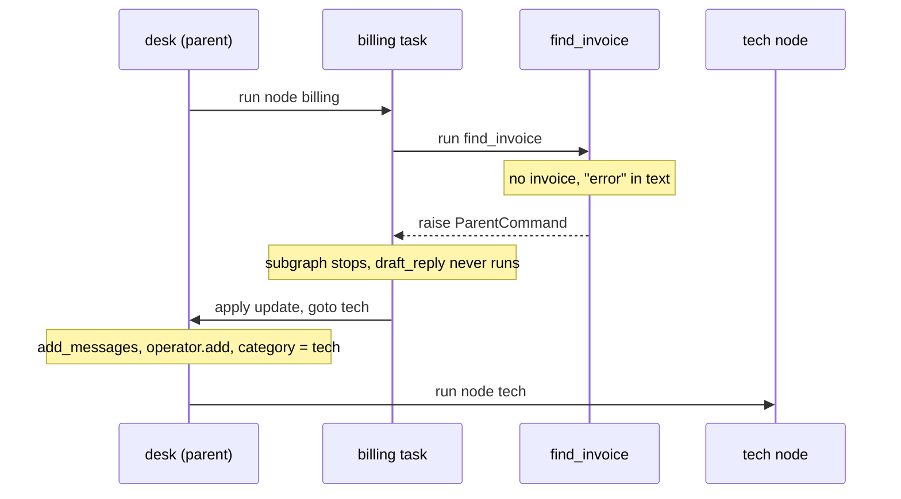
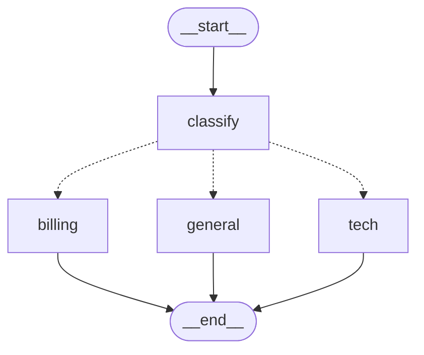

# 8.3 Handoffs Between Agents with Command.PARENT

## The problem

The desk from [lesson 8.2](../../8.2-subgraphs-own-state/docs/notes.md) decides once, at the start, who answers a ticket. `classify` looks for keywords, `route_ticket` reads the result, and the conditional edge sends the ticket to `billing`, `tech` or `general`. After that the desk never reconsiders.

Keyword classifiers make mistakes, and this one makes two typical ones. "The payment page shows an error on my phone." contains "payment", so it goes to billing, although it is a problem with the app. "I paid INV-2077 twice and now my login fails." contains "login", so it goes to tech, although the customer wants money back. In 8.2 billing would answer the first ticket with a refund for an invoice called `unknown`, and tech would stop to ask the customer which device they use, although the customer wants money back.

The team that receives a ticket is often the first to notice that it is in the wrong place. Billing can see that there is no invoice number and that the text talks about an error. Tech can see an invoice number. What they cannot do with the tools of 8.1 and 8.2 is act on it. A [subgraph](../../../GLOSSARY.md#subgraph) runs its own nodes over its own state, and when it finishes, control goes back to the parent node that called it, which then follows its edges to `END`. Nothing inside the billing graph can say "send this to tech instead".

You could make the desk smarter: add a second router after each team, or an edge from billing to tech with a condition. Both move the knowledge "this is not mine" out of the team and into the desk, and the desk grows a routing rule for every pair of teams. This lesson does the opposite. The team that notices the mistake passes the ticket on itself.

## The concept

### Handoff

A [handoff](../../../GLOSSARY.md#handoff) is a transfer of control between agents in which the agent that is working decides who takes over next, and what that agent gets to see. There is no central router that is asked again. Control moves sideways, from one peer to another.

In this lesson the agents are the two teams. They contain no language model, only keyword rules, but the mechanism is the same one that LLM agents use: a node inside one agent's subgraph tells the [parent graph](../../../GLOSSARY.md#parent-graph) which of its nodes should run next.

### A Command for the parent

[Lesson 3.3](../../../3-control-flow/3.3-command/docs/notes.md) introduced [Command](../../../GLOSSARY.md#command): a node returns `Command(update=..., goto=...)` to update the state and pick the next node in one step. That Command was always handled by the graph the node runs in. `goto` named a node of that graph, and `update` was applied to that graph's state.

A Command has a third field for this lesson, `graph`. It says which graph the command is addressed to. Its default, `None`, means the current graph. The constant [Command.PARENT](../../../GLOSSARY.md#commandparent), which is just the string `"__parent__"`, means the closest parent graph. That one field changes the meaning of the other two:

| Field | `Command(update, goto)` in a subgraph node | `Command(graph=Command.PARENT, update, goto)` |
|---|---|---|
| `goto` | a node of the subgraph | a node of the **parent** graph, usually a sibling of the subgraph's node |
| `update` | applied to the subgraph's state, with the subgraph's keys and reducers | applied to the **parent's** state, with the parent's keys and reducers |
| the subgraph | continues with the next node | stops at this node |

The mental model: **a `Command.PARENT` is a return value for the node one level up.** When billing's `find_invoice` returns it, the desk treats it as if its own node `billing` had returned `Command(update=..., goto="tech")`. The subgraph run ends there, the update lands in `DeskState`, and the desk runs `tech` next.

### What travels with the handoff

The update is the only thing that crosses the boundary. Whatever the team worked out inside its subgraph, it reaches the desk only if the node puts it into this update. That makes every handoff a decision about context. The LangChain docs call this [context engineering](../../../GLOSSARY.md#context-engineering) and warn that subgraph handoffs need it to be done with care: the receiving agent sees exactly what you pass, no more and no less.

Here a handoff passes three things: a short note for the customer, the corrected `category`, and an entry for a new log of handoffs. Because the update is applied in the parent, it can write keys that the subgraph does not have. The tech graph has no desk keys at all, and still its handoff writes `messages`, `category` and `handoffs`.

### Reducers across levels

Each of those keys is merged by the desk's [reducer](../../../GLOSSARY.md#reducer) for it, exactly as if a desk node had written it. `messages` goes through [add_messages](../../../GLOSSARY.md#add_messages), so the note is appended. `category` has no reducer, so the last write wins. The new key `handoffs` is a log that should grow, so it gets `operator.add`.

The docs put this as a rule: when a subgraph node sends an update to the parent for a key, the parent state **must** declare a reducer for that key. Their warning is phrased for a key that both schemas share, but the reason is general. An update from a lower level is still one update among others on the parent's thread. Without a reducer it replaces the value, and you lose whatever the earlier updates wrote, without any error (experiment 2).

## How it works

### The handoff is an exception

A node's return value normally becomes writes to its own graph's channels. For a `Command` whose `graph` is `Command.PARENT`, LangGraph 1.2.16 writes nothing in the subgraph. Instead, the function that turns a node's Command into writes (`_control_branch` in `langgraph/graph/state.py`) raises [ParentCommand](../../../GLOSSARY.md#parentcommand), an exception from `langgraph.errors` that carries the Command.

`ParentCommand` is a [GraphBubbleUp](../../../GLOSSARY.md#graphbubbleup), the same family as the exception behind `interrupt()`. LangGraph's retry logic does not treat it as a failure. In `run_with_retry` (`langgraph/pregel/_retry.py`) the task that raised it replaces `"__parent__"` in the Command with the namespace of the level above and raises it again. The exception unwinds the subgraph run, comes out of the subgraph's `invoke`, and reaches the task in the parent whose namespace matches. That task feeds the Command to its own writers, which apply the `update` and turn the `goto` into "run this node next".

The sequence below follows ticket 1 of the run. Watch where the exception starts and where it stops: it skips everything in between.



Two consequences follow directly from the mechanism.

- **The subgraph produces nothing of its own.** `find_invoice` writes no update in the billing graph, `draft_reply` is never scheduled, and billing never hands its final `messages` back, as it did in 8.1. The only thing the desk receives from the `billing` node is the handoff's update.
- **Code between the two levels is skipped.** The tech team is called inside the [wrapper node](../../../GLOSSARY.md#wrapper-node) `tech` from 8.2. When the tech subgraph hands off, `ParentCommand` comes out of `TECH_TEAM.invoke(...)` like any Python exception and leaves the wrapper too. The map-out lines after the call never run. The desk applies the handoff's update as the update of the node `tech`.

The same exception explains what happens when there is no parent. Run billing as a top-level graph, and nobody catches `ParentCommand`: it comes out of `invoke` with the Command inside (section 4 of the run).

### A goto adds a route, it removes none

`goto` adds a dynamic edge at run time. It does not cancel the static edges of the node that returned it. When billing hands off, the desk schedules `tech` because of the goto, and also `END` because of `add_edge("billing", END)`. `END` does nothing, so here the extra edge is harmless. If `billing` had a static edge to another node, that node would run too, in parallel with `tech`. The docs warn that static edges still execute next to a goto, so for each node it is safer to route with Command or with edges, not both.

A goto also does not re-run routing. `route_ticket` ran once, after `classify`. When the handoff changes `category` later, nothing reads it again. The goto alone moves the ticket, and `category` is just a record of where it went.

## In our example

The billing and tech teams and the desk are the 8.2 code with a few changes. The new file [handoff.py](../src/l8_3_agent_handoffs/handoff.py) holds what both teams share. All nodes use keyword rules and fixed strings, so the run needs no model and prints the same lines every time.

### The handoff

<!-- snippet: src/l8_3_agent_handoffs/handoff.py#hand_off -->
```python
def hand_off(source: str, target: str, reason: str) -> Command:
    """Send the ticket from the team `source` to the desk node `target`."""
    # A short note for the customer, signed by the team that hands off.
    note = AIMessage(f"{reason} Passing you to the {target} team.", name=source)
    # How it travels: when a node returns this Command, LangGraph raises
    # ParentCommand (langgraph.errors) inside the subgraph. The exception
    # unwinds the subgraph run and is caught by the desk's task for the team
    # node, which applies the update and the goto as if that node had
    # returned them (section 4 of the run shows the exception).
    return Command(
        # graph=Command.PARENT: this command is not for the graph the node
        # runs in (the team's subgraph) but for the closest parent graph, the
        # desk. So goto names a DESK node ("tech", "billing"), a sibling of
        # the team that hands off; the team's own graph has no such node.
        graph=Command.PARENT,
        goto=target,
        # The update is applied to the DESK's state, with the desk's keys and
        # the desk's reducers, not to the subgraph's state. That is why it may
        # write category and handoffs, keys billing does not have and tech
        # does not know at all (TechState has no desk key). messages goes
        # through add_messages and handoffs through operator.add (DeskState);
        # category is a plain key, so the last write wins.
        #
        # What a handoff passes is a choice ("context engineering" in the
        # docs): here a short note for the customer, the new category and one
        # log entry. Nothing the team computed inside its subgraph reaches the
        # desk unless it is put into this update.
        update={
            "messages": [note],
            "category": target,
            "handoffs": [f"{source} -> {target}"],
        },
    )
```
<!-- /snippet -->

`hand_off` does not run anything. It builds the Command, and the node that returns it decides when the handoff happens. Three details matter:

- `goto=target` names a **desk** node, `"tech"` or `"billing"`. Neither team graph has a node with that name.
- The update writes three desk keys, each merged in its own way. `"handoffs"` is a list with one entry, because `operator.add` joins lists.
- The note is an `AIMessage` with `name=source`, so the run prints it signed by the team that handed off.

The file imports nothing from the desk or the teams. The desk imports the teams, and the teams import `hand_off`, so putting it in `desk.py` would create a circular import. The [code walkthrough](readalong.md#handoffpy) goes through the file line by line.

### Who hands off, and when

Billing hands off in its first node:

<!-- snippet: src/l8_3_agent_handoffs/billing.py#billing_nodes -->
```python
def find_invoice(state: BillingState) -> dict | Command:
    """Pull the invoice number out of the ticket, or hand a tech problem to tech."""
    # The ticket arrived from the desk through the shared `messages` key; the
    # subgraph did not write it. After a handoff from tech the last message
    # is tech's note, not the ticket, so read the ticket with ticket_text.
    text = ticket_text(state["messages"])
    match = re.search(r"INV-\d+", text)
    if match is None and any(word in text.lower() for word in TECH_WORDS):
        # This node does not finish normally: draft_reply never runs, and
        # billing's subgraph never hands its final messages back to the desk
        # (no root billing update with ['human', 'billing'] as in 8.2). Only
        # the handoff's update reaches the desk (section 1 of the run).
        return hand_off(
            "billing", "tech", "Billing team: there is no invoice here, this looks technical."
        )
    return {"invoice_id": match.group() if match else "unknown"}


def draft_reply(state: BillingState) -> dict:
    """Answer the customer about the invoice found in the previous step."""
    text = f"Billing team: the refund for {state['invoice_id']} is on its way."
    # name="billing" says which team wrote the message; the run prints it.
    return {"messages": [AIMessage(text, name="billing")]}
```
<!-- /snippet -->

The rule needs both parts: no invoice number **and** a technical word. A ticket that names an invoice stays with billing even if it says "error". Tech's rule, at the top of `identify_device`, is the mirror image: a ticket that names an invoice goes to billing.

```python
if re.search(r"INV-\d+", state["problem"]):
    return hand_off("tech", "billing", "Tech team: questions about invoices go to billing.")
```

The check comes before the device lookup and its `interrupt()`, so an invoice ticket leaves before tech could ask which device the customer uses. Notice that neither team knows anything about the other. Each team owns only its own rule for "this is not mine", and names the desk node it wants.

### Finding the ticket after a handoff

Before this lesson, every team read the ticket as `messages[-1]`. After a handoff that is wrong: the last message is the other team's note. Both teams now read the ticket through one helper:

<!-- snippet: src/l8_3_agent_handoffs/handoff.py#ticket_text -->
```python
def ticket_text(messages: Sequence[AnyMessage]) -> str:
    """The customer's latest ticket: the last human message."""
    # After a handoff the last message is the other team's note, not the
    # ticket, so a team that read messages[-1] would answer the note
    # (experiment 3). Every team finds the ticket with this function.
    return next(m.content for m in reversed(messages) if m.type == "human")
```
<!-- /snippet -->

Billing calls it in `find_invoice`. Tech never sees messages, so the desk's wrapper uses it in the map-in: `TECH_TEAM.invoke({"problem": ticket_text(state["messages"])})`. This is context engineering in its smallest form. The receiving agent has to know which part of the history is the actual request. Experiment 3 shows what happens when it does not.

### The desk: one new key, no new edges

<!-- snippet: src/l8_3_agent_handoffs/desk.py#desk_state -->
```python
class DeskState(TypedDict):
    """State of the parent (desk) graph."""

    # Shared with the billing subgraph: same name, same reducer. Handoff
    # notes from both teams are added through it too.
    messages: Annotated[list[AnyMessage], add_messages]
    # Exists only in the parent: the subgraph never sees it and cannot
    # overwrite it.
    category: NotRequired[Category]
    # A log of handoffs such as "billing -> tech", written by nodes inside
    # the subgraphs through Command.PARENT (handoff.py). A key that is
    # updated across graph levels needs a reducer in the PARENT state (the
    # docs say "must"): each update is applied through it, so operator.add
    # appends the entries of every handoff on the thread (both tickets of
    # the run, section 3). Without a reducer each handoff replaces the log:
    # no error, just a lost entry (experiment 2). It starts as [] even when
    # no ticket was handed off.
    handoffs: Annotated[list[str], operator.add]
```
<!-- /snippet -->

That is the only change to the desk's structure. `build_desk` gets no new nodes and no edges between `billing` and `tech`. The drawing below was generated from the code with `build_desk(None).get_graph().draw_mermaid()` (styling dropped, structure unchanged):



The handoff routes are missing from the picture, because they exist only in the values that nodes return. Experiment 5 shows how to declare them for the drawing.

### A team without a parent

Section 4 runs billing on its own:

<!-- snippet: src/l8_3_agent_handoffs/__main__.py#on_its_own -->
```python
print("== 4. A team on its own has no parent to hand off to ==")
# This is how a handoff travels: as an exception that unwinds the
# subgraph until a parent graph catches it. Run as a top-level graph,
# nobody catches it, so it reaches the caller with the Command inside.
# A team built for handoffs only works inside a parent that has the goto
# targets.
try:
    build_billing().invoke({"messages": [HumanMessage(BILLING_TO_TECH_TICKET)]})
except ParentCommand as exc:
    command = exc.args[0]
    print(f"  build_billing().invoke(...) raised {type(exc).__name__}")
    print(f"  goto: {command.goto!r}, update keys: {sorted(command.update)}")
```
<!-- /snippet -->

`exc.args[0]` is the Command that `hand_off` built. The code prints only `goto` and the update's keys, not `graph`: by the time the exception reaches the caller, LangGraph has already replaced `"__parent__"` with a namespace. The walkthrough explains the details in [section 4](readalong.md#section-4-a-team-on-its-own-lines-83-96).

## Run it

From the course root, `./run.sh 8.3` prints:

```text
== 1. Billing hands a ticket to tech ==
  (root)   classify -> {'category': 'billing'}
  (root)   billing -> {'messages': ['billing'], 'category': 'tech', 'handoffs': ['billing -> tech']}
  tech     identify_device -> {'device': 'phone'}
  tech     suggest_fix -> {'fix': 'reinstall the app'}
  (root)   tech -> {'messages': ['tech']}

== 2. Tech hands a ticket back to billing ==
  (root)   classify -> {'category': 'tech'}
  (root)   tech -> {'messages': ['tech'], 'category': 'billing', 'handoffs': ['tech -> billing']}
  billing  find_invoice -> {'invoice_id': 'INV-2077'}
  billing  draft_reply -> {'messages': ['billing']}
  (root)   billing -> {'messages': ['human', 'billing', 'tech', 'human', 'tech', 'billing']}

== 3. What the desk kept on the thread ==
  human: The payment page shows an error on my phone.
  billing: Billing team: there is no invoice here, this looks technical. Passing you to the tech team.
  tech: Tech team: on your phone, reinstall the app.
  human: I paid INV-2077 twice and now my login fails.
  tech: Tech team: questions about invoices go to billing. Passing you to the billing team.
  billing: Billing team: the refund for INV-2077 is on its way.
  handoffs: ['billing -> tech', 'tech -> billing']
  category: billing

== 4. A team on its own has no parent to hand off to ==
  build_billing().invoke(...) raised ParentCommand
  goto: 'tech', update keys: ['category', 'handoffs', 'messages']
```

What to notice:

- **Section 1: a missing line.** In 8.2 a billing ticket streamed `billing find_invoice` and `billing draft_reply` before the root `billing` line. Here there is no inner billing line at all, because the node that handed off wrote nothing in its subgraph. The root `billing` line is the handoff's update: the note, the new category and the log entry. The classifier still said `billing`; the handoff corrected it.
- **Section 2: the same from the other kind of subgraph.** The root `tech` line carries the handoff's three keys instead of the tech reply, because the wrapper's map-out never ran. Then billing runs as usual. It finds `INV-2077` in the ticket, not in tech's note, which does not repeat the number. Its last root line lists six messages, because billing, added as a node, writes back its whole shared `messages` list (8.1), and the thread already holds the first ticket.
- **Section 3: two merge rules side by side.** Both tickets ran on one thread. `handoffs` holds both entries, because `operator.add` appended the second one. `category` holds only `billing`, the last write. The six messages show each ticket, its handoff note and its reply, in order.
- **Section 4: the handoff as it travels.** Without a parent, the `ParentCommand` that a parent would have caught reaches the caller, with `goto` and the update inside.

## Details and edge cases

**A reducer key starts empty.** Because `handoffs` has a reducer, LangGraph stores it in a channel that starts as `[]`. A ticket that is never handed off ends with `handoffs == []`, although no node wrote it. The tests check this for the three 8.2 tickets.

**The return annotation cannot name parent nodes.** In lesson 3.3 the annotation `Command[Literal[...]]` told the graph which nodes a Command can go to, so `get_graph()` could draw the routes. That does not work for a handoff. In a scratch run, annotating `find_invoice` with `Command[Literal["tech"]]` made `build_billing()` fail with ``ValueError: Found edge ending at unknown node `tech` ``, because the annotation is checked against the subgraph's nodes. The parent-side way to declare handoff routes is the `destinations=` argument of `add_node` (experiment 5).

**A handing-off node must not be wrapped in a broad `except`.** `ParentCommand` is a subclass of `Exception`. A `try/except Exception` around `TECH_TEAM.invoke(...)` in the wrapper would catch the handoff, and the desk would never see it. Let `GraphBubbleUp` exceptions pass through, as with `interrupt()` in lesson 6.3.

**The 8.2 pause still works.** A vague tech ticket without an invoice number passes the handoff check and reaches `interrupt()` as before. The order of the checks inside a node decides whether a ticket can pause before it is handed off.

### The handoff pattern and its trade-offs

The desk now combines two multi-agent patterns. `classify` is a **router**: one step at the start decides who answers. The teams' rules are **handoffs**: each agent can pass control to a peer, and no one is asked centrally again. Designs in which agents pass control among themselves like this are sometimes called swarm-style. Lesson 8.4 adds the third common pattern, a supervisor that calls specialist agents as tools and gets their results back.

What handoffs give you:

- **No extra routing hop.** The agent that notices the problem moves the work directly. There is no second call to a central router.
- **Local rules.** Each agent owns its escalation rule. Billing's `TECH_WORDS` and tech's invoice check live in the teams, and the desk does not need to know them.
- **Direct conversation.** The agent that takes over talks to the customer itself and can stay active for follow-up messages. The docs' comparison of patterns gives handoffs the highest rating for direct user interaction.

What they cost:

- **Invisible routes.** The routes live in node code, not in the graph structure, so the drawing does not show them unless you declare `destinations=` (experiment 5).
- **Loops.** Nothing in the graph prevents two agents from passing a ticket back and forth. Only your own rules and the [recursion_limit](../../../GLOSSARY.md#recursion_limit) stop it, with a [GraphRecursionError](../../../GLOSSARY.md#graphrecursionerror) (experiment 4).
- **Context decisions at every handoff.** Each handoff has to decide what to pass, and each receiving agent has to read the history correctly (experiment 3).
- **Sequential work.** One agent is active at a time. The docs' comparison gives handoffs no rating at all for parallelization (a dash), and the highest rating to subagents, where a main agent can call several specialists at once.

The LangChain handoffs page recommends a single agent with middleware for most handoff use cases, where the "agents" are configurations that a state variable switches between. It reserves separate agent subgraphs, as in this lesson, for cases where each agent needs its own implementation.

**With language models.** In an LLM application the handoff is usually a tool that the model calls, and the tool returns the same `Command(graph=Command.PARENT, goto=..., update=...)`. The update must then also carry the `AIMessage` with the [tool call](../../../GLOSSARY.md#tool-call) and a matching [ToolMessage](../../../GLOSSARY.md#toolmessage), because chat models expect each tool call to be answered. Without the pair, the receiving agent sees an incomplete conversation. This lesson has no model, so its note is a plain `AIMessage`.

**A contrast: AutoGen.** The AutoGen framework (Wu et al., 2023) builds multi-agent systems from agents that converse: each agent replies to messages it receives, and the flow of control emerges from the conversation, or from a group chat manager that picks the next speaker. LangGraph takes the opposite position. A handoff is an explicit Command with a named target, applied by the runtime, which is why you can test it, log it and stream it.

## Common mistakes

> [!WARNING]
> **Forgetting `graph=Command.PARENT`.** Without it the Command is for the subgraph itself. There is no error at the return: `goto="tech"` names no billing node and is ignored, only `messages` (a billing key) is applied, and the static edge runs `draft_reply`, which fails with `KeyError: 'invoice_id'` (experiment 1). If `goto` names a node of the parent, the Command must be addressed to the parent.

> [!WARNING]
> **A key written by handoffs without a reducer.** A log or counter that several handoffs write to needs a reducer in the **parent** state. Without one, every handoff replaces the value. There is no error, just a lost entry (experiment 2).

> [!WARNING]
> **Reading `messages[-1]` after a handoff.** The last message is now the previous agent's note, not the request. Billing then answers the note and promises a refund for `unknown` (experiment 3). Decide explicitly what the receiving agent reads.

> [!WARNING]
> **A typo in the target.** In a scratch run, `hand_off("billing", "refunds", ...)` raised no error. LangGraph only logged `Task billing ... wrote to unknown channel branch:to:refunds, ignoring it.`, the update was applied (with `category` set to `refunds`), and the first ticket ended with the handoff note and no reply. A test that checks the final reply catches this; the run does not.

> [!TIP]
> Give every handoff a log entry, as `handoffs` does here. When a ticket ends up in the wrong place or loops, the log on the thread shows the path it took, in order.

## Experiments

Each experiment starts from the original code. Run the lesson with `./run.sh 8.3` from the course root after each change.

1. **Forget `graph=Command.PARENT`.** In `hand_off`, delete the line `graph=Command.PARENT,`.

   <details><summary>What happens and why</summary>

   Section 1 prints `classify`, then `billing  find_invoice -> {'messages': ['billing']}`, and stops with `KeyError: 'invoice_id'` in `draft_reply`; the traceback names the tasks `draft_reply` and `billing`. Without `graph`, the Command is addressed to billing's own graph. `goto="tech"` names no billing node and is ignored. Of the update, only `messages` is a billing key, so `category` and `handoffs` are dropped. The node did not set `invoice_id`, and the static edge `find_invoice -> draft_reply` runs as usual. `goto` always names a node of the graph the command is addressed to. Put the code back as it was (`git checkout -- .` in the lesson directory).

   </details>

2. **Drop the reducer.** In `DeskState`, declare `handoffs: NotRequired[list[str]]` instead of the `Annotated[..., operator.add]` line.

   <details><summary>What happens and why</summary>

   The run finishes without an error, and sections 1 and 2 look the same. Section 3 prints `handoffs: ['tech -> billing']`: the second handoff replaced the log. An update sent with `Command.PARENT` goes through the parent's channels like any node's update, so a key without a reducer keeps only the last value. A key that several handoffs and levels write to needs a reducer in the parent state. Put the code back as it was.

   </details>

3. **Read the wrong message.** In billing's `find_invoice`, replace `text = ticket_text(state["messages"])` with `text = state["messages"][-1].content`.

   <details><summary>What happens and why</summary>

   Section 1 is unchanged, because there the last message is still the ticket. Section 2 prints `billing  find_invoice -> {'invoice_id': 'unknown'}`, and section 3 ends with `billing: Billing team: the refund for unknown is on its way.` After tech's handoff, the last message is tech's note, which deliberately does not repeat the invoice number. Billing read the note instead of the ticket. Deciding what the receiving agent reads is part of every handoff. Put the code back as it was.

   </details>

4. **Build a ping-pong.** In tech's `identify_device`, replace `if re.search(r"INV-\d+", state["problem"]):` with `if True:`, so tech hands every ticket to billing. In `main`, add `"recursion_limit": 10` to the `customer` config, next to `"configurable"`. Keep the low limit: with the default of 1000 the loop runs for minutes, because the message list grows on every lap.

   <details><summary>What happens and why</summary>

   Section 1 prints `classify`, then root `billing` and `tech` lines alternating, each one a handoff update, with no inner lines between them. Then the run stops with `GraphRecursionError: Recursion limit of 10 reached without hitting a stop condition.` Billing hands the ticket to tech because it has no invoice number, tech now hands everything back, and billing applies its rule again. Each handoff is one super-step of the desk, and nothing in the graph notices the cycle. With peer handoffs, only your own rules and the recursion limit stop a loop. A real design would check the `handoffs` log, for example by refusing to hand a ticket back to a team that already had it. Put the code back as it was.

   </details>

5. **Draw the handoff routes.** In `build_desk`, add `destinations=("tech",)` to `add_node("billing", build_billing())` and `destinations=("billing",)` to `add_node("tech", tech)`. In `main`, print `desk.get_graph().draw_mermaid()` right after the desk is built.

   <details><summary>What happens and why</summary>

   The run is unchanged. The drawing gains the dashed edges `billing -.-> tech` and `tech -.-> billing`, and it no longer draws the edges from `billing` and `tech` to `__end__`; only `general --> __end__` remains. `destinations` tells `get_graph()` where a node may go, the parent-side counterpart of the return annotation from lesson 3.3, which a subgraph node cannot use for parent nodes. It informs only the drawing: the goto in `hand_off` is what moves the ticket, and the static edges to `END` still exist and still fire. Put the code back as it was.

   </details>

## Summary

- A node inside a subgraph hands control to the parent graph by returning `Command(graph=Command.PARENT, goto=..., update=...)`. `goto` names a node of the parent, and the subgraph stops at that node.
- The update is applied to the parent's state, with the parent's keys and reducers, as the update of the parent node that ran the subgraph. It may write keys the subgraph does not have.
- A key that handoffs write to across levels needs a reducer in the parent state. Without one, each update replaces the previous value, silently.
- The handoff travels as the exception `ParentCommand`. It skips the rest of the subgraph and any wrapper code after the inner `invoke`, and it reaches the caller if no parent catches it.
- A handoff passes only what you put into its update, and the receiving agent must find the request in the history. Both are design decisions.
- Handoffs keep routing rules inside the agents and save a routing hop, at the cost of routes that the graph does not show, possible loops and a context decision at every handoff.

## Self-check

1. Billing's `find_invoice` returns `Command(graph=Command.PARENT, goto="tech", update={"category": "tech"})`. Which graph's state gets `category`, and why does that work although `BillingState` has no `category`?

   <details><summary>Answer</summary>

   The desk's. A `Command.PARENT` is addressed to the closest parent graph, and its update is applied there, with the parent's schema and reducers, as the update of the desk node `billing`. The subgraph never applies it, so it does not matter that `BillingState` has no such key.

   </details>

2. In section 1 of the run there is no `billing find_invoice` line, although `find_invoice` ran. Why?

   <details><summary>Answer</summary>

   A node that returns a `Command.PARENT` writes nothing in its own graph. LangGraph raises `ParentCommand` instead, the subgraph stops, and the update shows up as the update of the parent node: the root `billing` line.

   </details>

3. A teammate adds a counter `handoff_count: int` to `DeskState`, and `hand_off` writes `{"handoff_count": 1}`. After two handoffs on one thread the counter is 1. What is missing?

   <details><summary>Answer</summary>

   A reducer. Without one the channel keeps the last value, so each handoff writes 1 again. With `Annotated[int, operator.add]` the updates are added up. The fact that the update comes from a subgraph changes nothing: it goes through the parent's channel like any update.

   </details>

4. Billing's subgraph is invoked directly, outside the desk, with a ticket that billing hands off. What happens?

   <details><summary>Answer</summary>

   `invoke` raises `langgraph.errors.ParentCommand`. The exception would normally be caught by the parent's task for the billing node, but there is no parent, so it reaches the caller with the Command in `exc.args[0]`. A team written to hand off works only inside a parent that has the goto targets.

   </details>

5. Name two problems that the handoff pattern brings and that a single router at the start does not have.

   <details><summary>Answer</summary>

   Any two of: the routes are not visible in the graph unless declared with `destinations=`; agents can pass work back and forth in a loop that only the recursion limit stops; every handoff needs a decision about what context to pass, and the receiver can misread the history; work runs strictly one agent at a time.

   </details>

## Further reading

- [Graph API overview: Command](https://docs.langchain.com/oss/python/langgraph/graph-api#command), LangChain docs: `Command` with `graph=Command.PARENT`, Command in tools for handoffs, the warning that static edges still run next to a goto, and the recursion limit.
- [Navigate to a node in a parent graph](https://docs.langchain.com/oss/python/langgraph/use-graph-api#navigate-to-a-node-in-a-parent-graph), LangChain docs: the how-to example, with the warning that the parent must define a reducer for keys updated from a subgraph.
- [Handoffs](https://docs.langchain.com/oss/python/langchain/multi-agent/handoffs), LangChain docs: single agent with middleware versus multiple agent subgraphs, context engineering during handoffs, and the AIMessage and ToolMessage pairing for handoff tools.
- [Multi-agent](https://docs.langchain.com/oss/python/langchain/multi-agent), LangChain docs: the subagents, handoffs, skills, router and custom workflow patterns compared.
- Wu et al., [AutoGen: Enabling Next-Gen LLM Applications via Multi-Agent Conversation](https://arxiv.org/abs/2308.08155), 2023: multi-agent control through conversation and speaker selection.
- LangGraph 1.2.16 source: `Command` and `Command.PARENT` in `langgraph/types.py`; `ParentCommand` and `GraphBubbleUp` in `langgraph/errors.py`; `_control_branch` in `langgraph/graph/state.py`; `run_with_retry` in `langgraph/pregel/_retry.py`.
