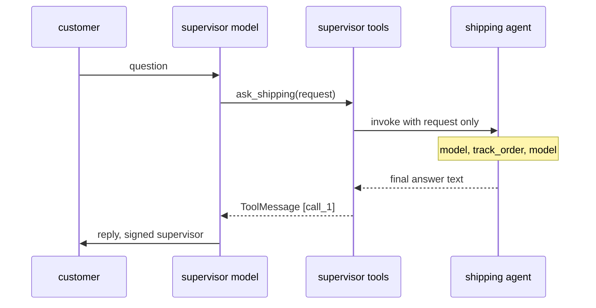
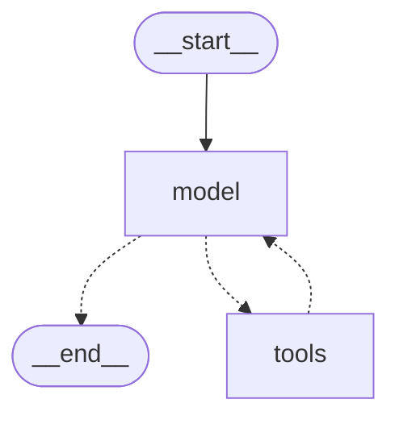

# 8.4 A Supervisor with Specialist Agents as Tools

## The problem

In [lesson 8.3](../../8.3-agent-handoffs/docs/notes.md) the agent that was working decided who took over next. That design keeps routing rules inside the teams, and that chapter listed its costs under [the handoff pattern and its trade-offs](../../8.3-agent-handoffs/docs/notes.md#the-handoff-pattern-and-its-trade-offs). This chapter does not repeat that list. It builds the third pattern 8.3 named, and lets the code answer each of those costs with a concrete counterpoint.

Take a customer who writes "I was charged twice for INV-2077. And where is my order ORD-1042?". Two different teams know the answers. With handoffs, billing would answer the first half and hand the ticket to shipping, which would answer the second half and talk to the customer from then on. The two halves would be handled one after the other, and each handoff would have to decide what part of the conversation travels with it.

There is a simpler arrangement, and you already know all its parts from [lesson 4.3](../../../4-agents/4.3-create-agent/docs/notes.md). A [create_agent](../../../GLOSSARY.md#create_agent) agent calls tools, gets their results back and decides what to do next. Nothing says a tool has to be a small function like `add` or `multiply`. A tool can run a whole agent.

## The concept

### The supervisor pattern

In the [supervisor pattern](../../../GLOSSARY.md#supervisor-pattern), one main agent, the supervisor, talks to the user and owns the conversation. It has no domain tools of its own. Instead, each specialist agent is one of its tools. The supervisor's model picks a specialist, writes what to ask it, receives the specialist's answer as a tool result and decides what comes next: ask another specialist, ask the same one again, or answer the user.

LangChain's docs call the specialists [subagents](../../../GLOSSARY.md#subagent), and describe the pattern by its central property: all routing passes through the main agent. Control moves down to a specialist and always comes back up. It never moves sideways from one specialist to another, as it did between the 8.3 teams.

### An agent as a tool

The mechanism is an [agent as a tool](../../../GLOSSARY.md#agent-as-a-tool): a tool function whose body invokes a compiled agent. Three choices define it.

- **The arguments.** The supervisor's model only sees the tool's name, description and argument schema, as with any tool. Here the schema is one string, `request`. What the model writes into it is all the specialist will get.
- **What the specialist starts from.** The function builds a new input from the arguments. Our specialists start a fresh conversation that holds one `HumanMessage`, the request.
- **What travels back.** The function returns something, usually the text of the specialist's last message. The supervisor's [ToolNode](../../../GLOSSARY.md#toolnode) wraps it in a [ToolMessage](../../../GLOSSARY.md#toolmessage), like the result of any tool.

Together, the first two choices and the third give [context isolation](../../../GLOSSARY.md#context-isolation), the docs' term for this property. The specialist never sees the customer's message or the supervisor's history, and the supervisor never sees the specialist's working steps: its tool calls, the raw records they returned, its intermediate messages. Each side's [context window](../../../GLOSSARY.md#context-window) holds only what is relevant to it.

This is [context engineering](../../../GLOSSARY.md#context-engineering) again, the 8.3 idea that every boundary between agents is a decision about what crosses it. In 8.3 the decision was the handoff's `update`. Here it is the tool's signature and its return value.

### The mental model

**A specialist is a function call, not a colleague.** The supervisor calls it with an argument and gets a return value, and the specialist has no memory of the call afterwards. It does not know who called it, it cannot pass the work on, and it never speaks to the customer. Everything the specialist knows comes in through `request`, and everything the supervisor learns from it comes out through the return value.

## How it works

### One request through two levels

The sequence below follows section 1 of the run, the question "Where is my order ORD-1042?". Look at where control goes after the shipping agent answers: back to the supervisor's `model` node, which writes the reply.



The specialist run is a complete `create_agent` loop of its own: a model step that asks for `track_order`, a tools step that runs it, and a model step that answers. To the supervisor, all of that happens inside one tools step. The supervisor's `tools` node finishes only when the specialist has returned, and its update is one `ToolMessage`.

### A run inside a tool is still a child run

`as_tool` calls `agent.invoke(...)` without passing a config, and yet the specialist's steps show up in the supervisor's stream. LangChain keeps the config of the running step in a Python context variable (`var_child_runnable_config` in `langchain_core/runnables/config.py`). The supervisor's `ToolNode` runs the tool inside that context, and when the specialist's `invoke` starts, it reads the parent config from the variable. So the specialist runs as a child of the supervisor's `tools` task, and `stream(..., subgraphs=True)` reports its updates under the [subgraph namespace](../../../GLOSSARY.md#subgraph-namespace) `("tools:<task id>",)`, as it did for the subgraphs of [lesson 8.1](../../8.1-subgraphs-shared-state/docs/notes.md).

That makes the specialist behave like a [subgraph](../../../GLOSSARY.md#subgraph) called from inside a node, the arrangement of [lesson 8.2](../../8.2-subgraphs-own-state/docs/notes.md), with one difference: it is called from inside a tool, not from a node function. [get_subgraphs](../../../GLOSSARY.md#get_subgraphs) looks for compiled graphs that node functions reference, and it does not look into tools. In a scratch run, `list(supervisor.get_subgraphs())` on our supervisor returned `[]`. The specialists are invisible in the structure of the supervisor graph. Generated with `build_supervisor(...).get_graph().draw_mermaid()` (styling dropped), the supervisor is the plain 4.3 loop:



### Several specialists in one step

[Lesson 4.3](../../../4-agents/4.3-create-agent/docs/notes.md#routing-one-send-per-tool-call) showed that `create_agent` sends each [tool call](../../../GLOSSARY.md#tool-call) of one model reply to its own `tools` task with [Send](../../../GLOSSARY.md#send), so all of them run in the same [super-step](../../../GLOSSARY.md#super-step). When the tools are specialists, this means the supervisor can put two specialists to work at the same time, simply by asking for both in one reply. The two specialist runs are independent: different requests, different models, different namespaces. The supervisor's next model step sees both `ToolMessage`s, in the order of the calls.

### Who answers the customer

After every tools step, the graph goes back to the supervisor's `model` node. The supervisor reads the specialists' answers and writes the reply. That is why, in the run, the only `AIMessage` without tool calls in the supervisor's history is signed `supervisor`. The specialists' texts reach the customer only if the supervisor repeats them.

## In our example

The three agents are 4.3-style agents built with `create_agent`, driven by scripted fake models (the same [GenericFakeChatModel](../../../GLOSSARY.md#genericfakechatmodel) subclass with a do-nothing [bind_tools](../../../GLOSSARY.md#bind_tools) as in 4.3), so the run is offline and prints the same lines every time. The scripts in [scripts.py](../src/l8_4_supervisor_agents/scripts.py) stand in for the decisions a real model would make: which specialist to ask and with what words. The graph mechanics around them are real. The [code walkthrough](readalong.md) goes through every file.

### The specialists know nothing about a supervisor

<!-- snippet: src/l8_4_supervisor_agents/specialists.py#specialists -->
```python
BILLING_PROMPT = "You are the billing specialist."
SHIPPING_PROMPT = "You are the shipping specialist."

# name= does three things in create_agent (langchain/agents/factory.py 1.4.6):
# it becomes the compiled graph's name, it is set as .name on every AIMessage
# the agent's model returns, and it is stored as metadata "lc_agent_name".
# Both agents have nodes "model" and "tools", so the message name is how a
# trace tells billing from shipping.


def build_billing_agent(model: BaseChatModel) -> CompiledStateGraph:
    """The billing specialist: answers invoice and charge questions with lookup_invoice."""
    return create_agent(model, [lookup_invoice], system_prompt=BILLING_PROMPT, name="billing")


def build_shipping_agent(model: BaseChatModel) -> CompiledStateGraph:
    """The shipping specialist: answers order questions with track_order."""
    return create_agent(model, [track_order], system_prompt=SHIPPING_PROMPT, name="shipping")
```
<!-- /snippet -->

Each specialist is one `create_agent` call with one tool and its own [system_prompt](../../../GLOSSARY.md#system_prompt). Nothing in [specialists.py](../src/l8_4_supervisor_agents/specialists.py) refers to a supervisor or to the other specialist. The `name=` argument matters for reading the trace: `create_agent` sets it as `.name` on every `AIMessage` the agent's model returns. Both specialists have nodes called `model` and `tools`, so the message name is what tells billing from shipping.

### The tool that runs an agent

<!-- snippet: src/l8_4_supervisor_agents/supervisor.py#agent_as_tool -->
```python
def as_tool(agent: CompiledStateGraph, name: str, description: str) -> BaseTool:
    """Wrap a compiled agent as a tool that takes one request string."""

    # The tool is the whole contract between the two levels. The supervisor's
    # model only sees the name, the description and one argument, `request`.
    @tool(name, description=description)
    def ask(request: str) -> str:
        """Run the specialist on the request and return its final answer."""
        # The supervisor's model wrote `request` as a tool-call argument. The
        # specialist starts a FRESH conversation with only that HumanMessage:
        # it never sees the customer's message or the supervisor's history
        # (context isolation).
        #
        # No config is passed, yet this run is still a child of the
        # supervisor's run: LangGraph hands the parent config down through a
        # context variable, so stream(subgraphs=True) on the supervisor shows
        # the specialist's steps under the namespace "tools:<task id>".
        #
        # The specialist has no checkpointer: every call is a new, stateless run.
        result = agent.invoke({"messages": [HumanMessage(request)]})
        # Only the final message's content travels back. create_agent's
        # ToolNode wraps it in the ToolMessage for this call; the specialist's
        # own tool calls stay inside its run.
        return result["messages"][-1].content

    return ask
```
<!-- /snippet -->

This is the whole contract between the two levels, in three lines of body:

- `@tool(name, description=description)` gives the tool its name and description from the arguments, so one `ask` function becomes both `ask_billing` and `ask_shipping`. The supervisor's model sees a tool with one string argument, `request`.
- `agent.invoke({"messages": [HumanMessage(request)]})` starts the specialist from a fresh input. The supervisor's `messages` are not passed. The test `test_specialist_sees_only_the_request` records what the billing model receives and checks that its first call holds exactly two messages: its system prompt and the supervisor's request, `Why was INV-2077 charged twice?`. The customer's text and the order number never reach it.
- `result["messages"][-1].content` returns only the final answer. The specialist's own tool call and its `ToolMessage` stay in `result`, which is then dropped.

The specialist has no [checkpointer](../../../GLOSSARY.md#checkpointer), and every call is a new run that remembers nothing. Experiment 1 changes the return line, and the [walkthrough of supervisor.py](readalong.md#supervisorpy) goes through it line by line.

### The supervisor is an ordinary agent

<!-- snippet: src/l8_4_supervisor_agents/supervisor.py#build_supervisor -->
```python
SUPERVISOR_PROMPT = (
    "You are the support supervisor. Ask the billing specialist about invoices "
    "and charges and the shipping specialist about orders, then answer the customer."
)


def build_supervisor(
    model: BaseChatModel, billing: CompiledStateGraph, shipping: CompiledStateGraph
) -> CompiledStateGraph:
    """The supervisor agent: two specialists as its tools, and the last word to the customer."""
    # To the supervisor these are ordinary tools, like 4.3's add and multiply.
    # create_agent sends every tool call of one reply to its own "tools" task
    # (Send), so two specialist calls in one reply run in the same super-step.
    # After every tools step control returns to the supervisor's model node:
    # the supervisor, not a specialist, decides what happens next and writes
    # the reply to the customer.
    return create_agent(
        model,
        [
            as_tool(
                billing,
                "ask_billing",
                "Ask the billing specialist about an invoice, a charge or a refund.",
            ),
            as_tool(
                shipping,
                "ask_shipping",
                "Ask the shipping specialist where an order is and when it arrives.",
            ),
        ],
        system_prompt=SUPERVISOR_PROMPT,
        name="supervisor",
    )
```
<!-- /snippet -->

`build_supervisor` takes the compiled specialists as arguments, wraps them and passes them to `create_agent` like any other tools. The descriptions are what a real model would use to choose between them, so they say which questions each specialist handles. The system prompt tells the supervisor to finish by answering the customer.

### A specialist on its own

<!-- snippet: src/l8_4_supervisor_agents/__main__.py#on_its_own -->
```python
print("== 3. A specialist on its own ==")
# The specialist does not know it is used as a tool and needs no parent.
# Contrast 8.3: a team run on its own raised ParentCommand when it handed off.
result = build_billing_agent(make_model(billing_script())).invoke(
    {"messages": [HumanMessage("Why was INV-2077 charged twice?")]}, CONFIG
)
for m in result["messages"]:
    print(f"  {describe(m)}")
```
<!-- /snippet -->

Section 3 invokes the billing agent directly, with the same request the supervisor sends it in section 2. It needs no parent and no special setup, because it was never written for one.

## Run it

From the course root, `./run.sh 8.4` prints:

```text
== 1. One question through two levels ==
question: Where is my order ORD-1042?
  (root)  model  supervisor asks for ask_shipping(request='Where is order ORD-1042 and when will it arrive?') [call_1]
  tools   model  shipping asks for track_order(order_id='ORD-1042') [ship_1]
  tools   tools  ToolMessage [ship_1] track_order = shipped 2026-10-14, arrives 2026-10-18
  tools   model  shipping: ORD-1042 shipped on 2026-10-14 and arrives on 2026-10-18.
  (root)  tools  ToolMessage [call_1] ask_shipping = ORD-1042 shipped on 2026-10-14 and arrives on 2026-10-18.
  (root)  model  supervisor: Your order ORD-1042 shipped on 2026-10-14 and arrives on 2026-10-18.

== 2. Two specialists in one step ==
question: I was charged twice for INV-2077. And where is my order ORD-1042?
  supervisor steps: model -> tools -> tools -> model
  specialist runs: billing (3 messages), shipping (3 messages)
  the supervisor's history:
    human: I was charged twice for INV-2077. And where is my order ORD-1042?
    supervisor asks for ask_billing(request='Why was INV-2077 charged twice?') [call_1], ask_shipping(request='Where is order ORD-1042?') [call_2]
    ToolMessage [call_1] ask_billing = INV-2077 was charged twice; the extra 49.00 was refunded on 2026-10-15.
    ToolMessage [call_2] ask_shipping = ORD-1042 shipped on 2026-10-14 and arrives on 2026-10-18.
    supervisor: The second charge of 49.00 on INV-2077 was refunded on 2026-10-15, and your order ORD-1042 arrives on 2026-10-18.

== 3. A specialist on its own ==
  human: Why was INV-2077 charged twice?
  billing asks for lookup_invoice(invoice_id='INV-2077') [bill_1]
  ToolMessage [bill_1] lookup_invoice = charged twice (2 x 49.00), one charge refunded on 2026-10-15
  billing: INV-2077 was charged twice; the extra 49.00 was refunded on 2026-10-15.
```

What to notice:

- **Section 1: the request is not the question.** The customer asked "Where is my order ORD-1042?". The shipping agent worked on the supervisor's own wording, "Where is order ORD-1042 and when will it arrive?". The three `tools` lines are the specialist's whole run, nested inside the supervisor's tools step. The root `tools` line comes after them, because the supervisor's tool returns only when the specialist has finished. Its `ToolMessage` carries the shipping agent's last sentence, and the raw `track_order` record stays below.
- **Section 1: two different `tools`.** The first column is the level (`(root)` or the namespace `tools`), the second the node. `tools   tools` is the shipping agent's tools node running `track_order`, inside the supervisor's tools node running `ask_shipping`.
- **Section 2: two `tools` updates, one step.** `model -> tools -> tools -> model` lists the supervisor's updates: two `tools` updates, one per `Send` task, both in the same super-step. Each specialist run produced 3 messages (tool call, tool result, answer), yet the supervisor's history has five messages and none of them is a `lookup_invoice` or `track_order` message. That is context isolation, seen from the supervisor's side.
- **Section 3: what section 2 kept out.** The billing run on its own shows the four messages that, in section 2, existed only inside the specialist: the request, the `lookup_invoice` call, the raw record and the answer. Only the last one became `ToolMessage [call_1]`.

Section 2 prints summaries instead of the nested trace on purpose. The two specialist runs are concurrent, and the order in which their nested updates arrive can change from run to run. The supervisor's final state keeps the order of the calls (`call_1`, `call_2`), so it is stable.

## Details and edge cases

### Supervisor and handoffs, point by point

8.3's notes listed what handoffs cost. Each item has a counterpart in this code. Where a fact comes from an experiment, the experiment number is given.

| | Handoffs (8.3) | Supervisor with agents as tools (8.4) |
|---|---|---|
| Where control goes after an agent | to the peer named in `goto`, as [ParentCommand](../../../GLOSSARY.md#parentcommand) unwinding the subgraph | always back to the supervisor's `model` node, as a `ToolMessage` |
| What the next agent sees | billing: the whole shared thread, with the handoff's note appended; tech: only what its wrapper maps in (the last human message) | only the request the supervisor wrote (`test_specialist_sees_only_the_request`) |
| Parallel work | one agent active at a time | several specialists in one super-step (section 2, experiment 2) |
| A wrong target name | a warning in the log, the update applied, no reply | an error `ToolMessage` the supervisor can react to (experiment 3) |
| An agent run on its own | raises `ParentCommand` as soon as it hands off (8.3 section 4); without a handoff it returns normally | works (section 3) |
| Visible in `get_graph()` | no, unless declared with `destinations=` | no, the specialists hide inside the tools node |
| Talks to the customer | the agent that took over | only the supervisor |

The last two rows are the honest part. Neither design shows its agents in the graph drawing: handoff routes live in return values, and specialists live in tool functions. And the supervisor's isolation is also a restriction. The docs' comparison of patterns, cited in 8.3, rates handoffs highest for direct user interaction and subagents lowest, because a specialist cannot hold a conversation with the customer. If shipping needs to ask the customer which address to use, the question has to go through the supervisor, or through an interrupt.

### What a hop costs

Every specialist call costs at least one extra model call at the supervisor level. After each tools step, the supervisor's model runs again to read the results. In section 1, one question needed four model calls: two by the supervisor and two by the shipping agent. A single agent with `track_order` as its own tool would have needed two. LangChain's multi-agent comparison makes the same point with its own numbers: for a one-shot request, subagents need one more model call than handoffs, because the result flows back through the main agent.

The [recursion_limit](../../../GLOSSARY.md#recursion_limit) makes the step cost visible. It counts only the supervisor's own super-steps; the steps of the nested specialist runs do not count against it. The nested runs do not inherit the supervisor's limit either: `create_agent` compiles every agent with `{"recursion_limit": 9_999}` (langchain 1.4.6, `factory.py`), so an `agent.invoke(...)` without its own config runs with 9 999. A specialist that loops is therefore not stopped by the supervisor's `recursion_limit`, which is the "Loops" cost from 8.3 in a new place. Pass a config with a limit to `agent.invoke` inside the tool if you need that bound. Section 2 takes three supervisor super-steps (model, tools with both calls, model): with `recursion_limit=3` it fails with a [GraphRecursionError](../../../GLOSSARY.md#graphrecursionerror), with 4 it finishes (`test_parallel_specialists_share_a_step`). The same two calls in two separate replies need five steps (experiment 2).

### Errors: a wrong name versus a failing specialist

The supervisor's `ToolNode` treats two kinds of failure differently.

- **A tool name that does not exist** never reaches an error handler. `ToolNode._validate_tool_call` checks the name before the tool runs and answers with a `ToolMessage` with `status="error"` and the text `Error: ask_returns is not a valid tool, try one of [ask_billing, ask_shipping].` (experiment 3). The run goes on and the supervisor's model sees the error. A real model could then choose a valid specialist or tell the customer it cannot help.
- **An exception inside the specialist** is not converted. The default error handler of `ToolNode` in langgraph-prebuilt 1.1.1 (`_default_handle_tool_errors`) converts only `ToolInvocationError`, that is tool calls with invalid arguments, into messages and re-raises everything else. A `KeyError` in `lookup_invoice` passes through the billing agent's `ToolNode`, then through the supervisor's, and ends the whole request (experiment 4).

### State and memory

Our specialists have no checkpointer and the supervisor has none either, so every specialist call is stateless. If you compile the supervisor with a checkpointer, the specialists still start fresh on each call: the docs describe subagents as using the inherited checkpointer by default, which is [per-invocation persistence](../../../GLOSSARY.md#per-invocation-persistence) from lesson 8.2. That is also what lets an `interrupt()` inside a specialist pause and resume the supervisor's run. The supervisor keeps the conversation on its thread; a specialist that should remember earlier calls needs its own persistent history, which the docs set up with `checkpointer=True`.

### Two libraries, two meanings of "supervisor"

The name is used for two different designs. The `langgraph-supervisor` package's `create_supervisor` (not installed in this course) builds a supervisor that passes control to agents with handoff tools, by default with the full message history, which is closer to 8.3. Its README now recommends building the supervisor pattern directly with tools, as this lesson does, for most use cases, because it gives more control over context engineering. The [agent-service-toolkit](https://github.com/JoshuaC215/agent-service-toolkit) uses `create_supervisor` with `output_mode="full_history"`, which keeps the agents' messages in the output: the opposite of the isolation in our section 2. The official LangSmith agent lifecycle workshop builds its support supervisor the way this lesson does: two `@tool` functions that invoke a compiled agent with the supervisor's query and return the last message's content.

### A contrast: AutoGen's group chat

The AutoGen paper (Wu et al., 2023) also has a central coordinator, the group chat manager, which picks the next speaker. But all speakers share one conversation, so every agent sees what the others said. The supervisor here coordinates in the other way: it hands each specialist a private task and gets a private answer back.

## Common mistakes

> [!WARNING]
> **Returning the specialist's whole result.** Returning `result["messages"]` or all their contents makes the supervisor's history carry the specialist's working notes, raw tool output and its copy of the request (experiment 1). That fills the supervisor's context window and undoes the reason for having specialists. Return what the supervisor needs, usually the final answer, and prompt the specialist to put everything important into that answer.

> [!WARNING]
> **Sharing one fake script or one model between runs.** The scripted fake is an iterator consumed once. A specialist called a second time with a two-reply script fails with `RuntimeError: generator raised StopIteration`. The fake also sets ids on the scripted `AIMessage` objects, so two models must never share one list. Build fresh scripts, models and agents per run, as every section of `__main__.py` does.

> [!WARNING]
> **Catching everything around `agent.invoke`.** A `try/except Exception` in `ask` would turn a failing specialist into an error string, but it would also swallow the [GraphBubbleUp](../../../GLOSSARY.md#graphbubbleup) exceptions that carry an `interrupt()` from inside the specialist ([lesson 6.3](../../../6-human-in-the-loop/6.3-rules-of-interrupts/docs/notes.md)). Catch only the exceptions you expect.

> [!WARNING]
> **Writing the request for the customer instead of the specialist.** The specialist sees only `request`. If the supervisor writes "Answer the second question" or "Check that order", the specialist has nothing to work with: no question, no order number. The tool description and the supervisor's prompt must make clear that the request has to be self-contained.

> [!TIP]
> To see what a specialist did, stream the supervisor with `subgraphs=True`. The nested updates arrive under the namespace `tools:<task id>`, and the agent's `name=` on each `AIMessage` tells you which specialist wrote it.

## Experiments

Each experiment starts from the original code. Run the lesson with `./run.sh 8.4` from the course root after each change.

1. **Send back everything the specialist wrote.** In `as_tool`, replace `return result["messages"][-1].content` with `return "\n".join(m.content for m in result["messages"] if m.content)`.

   <details><summary>What happens and why</summary>

   The root `ToolMessage` in section 1 now spans three lines: `Where is order ORD-1042 and when will it arrive?`, then `shipped 2026-10-14, arrives 2026-10-18`, then the shipping answer. The two `ToolMessage`s in section 2's history grow the same way. The supervisor now receives the request it wrote itself, the raw `track_order` record and the answer. The tool call has no text content, so it is the only message left out. Nothing breaks, but the supervisor's context now holds the specialist's working material, which is what agents as tools are meant to keep out. The return value is the whole interface between the levels: choose it as carefully as a handoff's update in 8.3. Put the code back as it was (`git checkout -- .` in the lesson directory).

   </details>

2. **Call the specialists one after the other.** Change `supervisor_two_script()` to return three replies: `tool_call("ask_billing", "call_1", request="Why was INV-2077 charged twice?")`, `tool_call("ask_shipping", "call_2", request="Where is order ORD-1042?")` and the final `AIMessage`. Run it, then also set `CONFIG` to `{"recursion_limit": 5}` and run again.

   <details><summary>What happens and why</summary>

   Section 2 prints `supervisor steps: model -> tools -> model -> tools -> model`, and the supervisor's history now has two `supervisor asks for` lines, each followed by its `ToolMessage`. With `recursion_limit` 5 the run stops in section 2 with `GraphRecursionError: Recursion limit of 5 reached without hitting a stop condition.`; it needs 6. Each extra reply is one more supervisor model call and two more super-steps, and the specialists no longer run at the same time. Asking for several specialists in one reply is something a supervisor can do and a chain of handoffs cannot: in 8.3 one agent was active at a time. Put the code back as it was.

   </details>

3. **Ask for a specialist that does not exist.** In `supervisor_one_script()`, change the tool name `"ask_shipping"` to `"ask_returns"`.

   <details><summary>What happens and why</summary>

   Section 1 prints no nested `tools` lines. The root `tools` line is `ToolMessage [call_1] ask_returns = Error: ask_returns is not a valid tool, try one of [ask_billing, ask_shipping].`, and the supervisor's scripted reply follows. No specialist ran, and the run did not fail: the supervisor's `ToolNode` answered the bad call with an error message that the supervisor's model reads on its next step. The fake model ignores that message and still prints the order's arrival date, which nobody looked up; a real model would have to react to the error, for example by calling `ask_shipping`. Compare 8.3, where a handoff to a misspelled node only logged a warning and the ticket ended without a reply. Put the code back as it was.

   </details>

4. **Let a specialist fail.** In `lookup_invoice`, replace the `return` line with `raise KeyError(invoice_id)`.

   <details><summary>What happens and why</summary>

   Section 1 runs as before, because it never asks billing. Section 2 stops with `KeyError: 'INV-2077'`, and the traceback ends with two lines `During task with name 'tools' and id '...'`: the exception went through the billing agent's `tools` task and then through the supervisor's. Neither `ToolNode` turns a plain exception into a `ToolMessage` by default, so a failing specialist fails the whole request, including the shipping half. Wrapping `agent.invoke` in a broad `try/except` inside `ask` would return an error string instead, but it would also swallow interrupts from the specialist (`GraphBubbleUp`, lesson 6.3): catch only the exceptions you expect. Put the code back as it was.

   </details>

5. **Hide the inner runs.** In section 1, remove `subgraphs=True` from the `stream` call, loop with `for update in supervisor.stream(...)` (each item is now just the update dict), and print `f"  {node:<6} {describe(m)}"`.

   <details><summary>What happens and why</summary>

   Section 1 prints three lines: the supervisor's `ask_shipping` call, the `ToolMessage` with the shipping answer and the supervisor's reply. The three lines of the shipping run are gone. To the supervisor graph a specialist is a black box inside one tools step, and `subgraphs=True` is what opens it. That works although `as_tool` passes no config, because the specialist's `invoke` picks up the parent config from the context variable and runs as a child of the `tools` task. Put the code back as it was.

   </details>

## Summary

- In the supervisor pattern, one agent owns the conversation and calls specialist agents as tools. Control always returns to the supervisor as a `ToolMessage`, and only the supervisor answers the user.
- An agent becomes a tool through a function that invokes it. The tool's arguments are all the specialist receives, and the function's return value, usually the last message's text, is all the supervisor learns: context isolation in both directions.
- A specialist invoked inside a tool is still a child run. `stream(subgraphs=True)` shows its steps under `tools:<task id>`, although `get_graph()` and `get_subgraphs()` do not show it.
- Several specialist calls in one supervisor reply run in the same super-step, so independent sub-questions are answered in parallel.
- A wrong tool name comes back as an error `ToolMessage` the supervisor can handle, while an exception inside a specialist fails the whole request by default.
- The price is an extra supervisor model call after every tools step, and specialists that never talk to the user directly.

## Self-check

1. The customer writes "Where is my order ORD-1042?". What exactly does the shipping agent's model receive in section 1?

   <details><summary>Answer</summary>

   Its system prompt, "You are the shipping specialist.", and one `HumanMessage` with the supervisor's request, "Where is order ORD-1042 and when will it arrive?". On its second call it also sees its own `track_order` call and result. It never sees the customer's message, because `as_tool` starts the specialist from a fresh input that holds only `request`.

   </details>

2. In section 2, each specialist run has three messages, yet the supervisor's history contains no `lookup_invoice` or `track_order` message. Where did they go?

   <details><summary>Answer</summary>

   They stayed in the specialists' own results. `ask` returns only `result["messages"][-1].content`, and the supervisor's `ToolNode` wraps that string in a `ToolMessage`. The rest of `result` is dropped when the tool function returns. Section 3 shows such a run in full.

   </details>

3. Why does section 2 finish with `recursion_limit=4` although the two specialists took four model steps between them, and the supervisor two more?

   <details><summary>Answer</summary>

   The limit applies to the supervisor's own super-steps: model, tools (both calls as two `Send` tasks in one super-step), model. That is three. The specialists' steps happen inside the supervisor's tools step, in their own runs, and do not count against the supervisor's limit. Those runs do not take the supervisor's limit at all: `create_agent` compiles each agent with `recursion_limit` 9 999, and the tools call `agent.invoke` without a config.

   </details>

4. The supervisor's model asks for `ask_returns`, which does not exist. In 8.3, a handoff to `"refunds"` ended the ticket without a reply. What is different here, and why?

   <details><summary>Answer</summary>

   The run continues. The supervisor's `ToolNode` answers the unknown call with a `ToolMessage` with `status="error"` that lists the valid tools, and the graph goes back to the supervisor's model, which can react. A wrong target is just a failed tool call that comes back to the caller, not a route into nowhere.

   </details>

5. A product owner wants the shipping specialist to ask the customer for a delivery address and then keep chatting with them about the delivery. Is the supervisor pattern a good fit, and what would you consider instead?

   <details><summary>Answer</summary>

   Not for that part. A specialist cannot talk to the customer: its answer goes to the supervisor, and it has no memory between calls. It could pause with an interrupt for one question, but an ongoing conversation with one specialist is what handoffs are good at, because the agent that took over stays active. Many systems combine the two: a supervisor for questions that touch several teams, a handoff when one team should take over the conversation.

   </details>

## Further reading

- [Subagents](https://docs.langchain.com/oss/python/langchain/multi-agent/subagents), LangChain docs: the supervisor and its subagents, centralized control, stateless subagents, context isolation, tool per agent versus a single dispatch tool, subagent inputs and outputs, and checkpointing.
- [Multi-agent](https://docs.langchain.com/oss/python/langchain/multi-agent), LangChain docs: the comparison of subagents, handoffs, skills and router, with ratings and model-call counts.
- [langgraph-supervisor-py](https://github.com/langchain-ai/langgraph-supervisor-py), LangChain: `create_supervisor` built on handoff tools, and the recommendation to use the tool-calling supervisor pattern directly instead.
- [LangSmith Agent Lifecycle Workshop](https://github.com/langchain-ai/langsmith-agent-lifecycle-workshop), LangChain: `agents/supervisor_agent.py`, a support supervisor whose two specialists are wrapped as `@tool` functions.
- [agent-service-toolkit](https://github.com/JoshuaC215/agent-service-toolkit): `src/agents/langgraph_supervisor_agent.py`, a `create_supervisor` setup with `output_mode="full_history"`.
- Wu et al., [AutoGen: Enabling Next-Gen LLM Applications via Multi-Agent Conversation](https://arxiv.org/abs/2308.08155), 2023: conversable agents and the group chat manager.
- Installed sources: `create_agent` and its `Send` per tool call in `langchain/agents/factory.py` (langchain 1.4.6); `ToolNode`, `_default_handle_tool_errors` and the invalid-tool message in `langgraph/prebuilt/tool_node.py` (langgraph-prebuilt 1.1.1); `var_child_runnable_config` and `ensure_config` in `langchain_core/runnables/config.py` (langchain-core 1.6.12).
