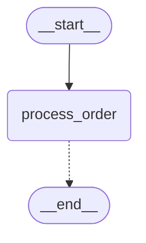
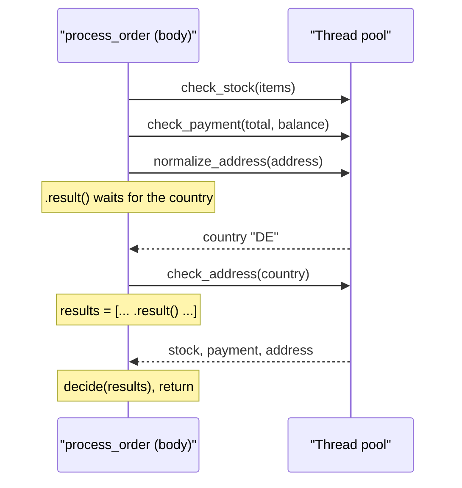

# 9.1 @entrypoint and @task

## The problem

Lesson 3.1 checked an order with a graph. Two checks ran in parallel with a two-node address branch, and a `decide` node joined the results. To get that behaviour we wrote:

- a [state schema](../../../GLOSSARY.md#state-schema), `OrderState`, that holds the input, the intermediate `country`, the decision and the results,
- a [reducer](../../../GLOSSARY.md#reducer), `operator.add` on `results`, because three nodes write that key,
- nodes that read the whole state and return partial updates, even when they need only one field,
- a [fan-out](../../../GLOSSARY.md#fan-out) from `START` and a [waiting edge](../../../GLOSSARY.md#waiting-edge) into `decide`, so the join runs once and only after every check is done.

All of this machinery serves one plain idea, which a Python programmer would write in a few lines: start the checks, wait for them, decide. The graph is worth its cost when the structure is the point: many decision points, loops you want to draw, a team that reads the picture. For a short procedure like this one, most of the code is about the framework, not the order.

Without a graph, though, you seem to lose what modules 5 and 6 built on: a [checkpointer](../../../GLOSSARY.md#checkpointer) that saves the work under a [thread_id](../../../GLOSSARY.md#thread_id), a run that can be streamed and inspected with `get_state`, and the ability to resume after a failure without redoing the finished parts. LangGraph's second API keeps those features and drops the graph.

## The concept

LangGraph has two APIs over the same runtime.

- The [Graph API](../../../GLOSSARY.md#graph-api) is what this course has used so far: a `StateGraph` with a state schema, nodes and edges, compiled into a runnable graph.
- The [Functional API](../../../GLOSSARY.md#functional-api) lets you write the workflow as ordinary Python functions. Control flow is `if`, `for`, function calls and return values. There is no state schema and no edges.

The Functional API has exactly two decorators, both in `langgraph.func`.

**[@entrypoint](../../../GLOSSARY.md#entrypoint)** marks the function that *is* the workflow. It takes one positional input and returns the workflow's result. The decorator does not return a function. It returns a [Pregel](../../../GLOSSARY.md#pregel) object, the same runtime class that `StateGraph.compile()` builds on (`CompiledStateGraph` is a subclass of `Pregel`). That is why everything you know about running a compiled graph still applies: `invoke`, `stream`, `get_state`, a checkpointer, a `thread_id` in the [run config](../../../GLOSSARY.md#run-config).

**[@task](../../../GLOSSARY.md#task)** marks a unit of work that the entrypoint calls. Calling a task does not run its body on the spot. The call schedules the task and immediately returns a *future*, a placeholder for a result that will exist later (in the sync API, a `concurrent.futures.Future`). You get the value with `.result()`, which waits until the task has finished. Two things follow from that:

- **Concurrency comes from the call pattern.** Create several futures before you wait on any of them, and their tasks run at the same time. Waiting right after each call makes them run one after another.
- **A task's result is saved.** With a checkpointer, every finished task's return value is written to the checkpointer as soon as the task ends. If the run fails later and is resumed, finished tasks return their saved result instead of running again.

The mental model: **the entrypoint is the program, tasks are its saved steps.** The entrypoint's code decides what happens and in which order. Tasks are the pieces of work that are expensive, slow, or have side effects, the pieces you do not want to repeat. Code that is pure and fast (a calculation, a formatting step, a decision over values you already have) can stay as a plain function.

The official Functional API overview sums up the difference from the Graph API in four points, and the rest of this chapter makes each one concrete:

| | Graph API | Functional API |
|---|---|---|
| Control flow | declared with nodes and edges | ordinary Python code |
| State | a shared state schema, reducers for parallel writes | local variables, arguments and return values; nothing shared |
| Checkpointing | a new checkpoint after every super-step | task results saved as writes on the run's current checkpoint |
| Visualization | the graph can be drawn | not possible: the "graph" is just the code that runs |

## How it works

### What `@entrypoint` builds

The decorator wraps your function in a `Pregel` object with a **single node**, named after the function. That node's input is the entrypoint's one argument. Its output is whatever the function returns. A checkpointer passed to `@entrypoint(checkpointer=...)` is attached right then, at decoration time, just as `compile(checkpointer=...)` attached one in lesson 5.1.

We can ask the decorated `process_order` to draw itself, as lesson 1.1 did for a compiled `StateGraph`. The diagram below was generated with `process_order.get_graph().draw_mermaid()`, with the styling removed:



There is one node and nothing else. The four tasks do not appear, because they are not part of a structure fixed in advance. They are whatever the body happens to call when it runs. This is what the docs mean when they say a functional workflow cannot be visualized.

### What a task call does

Inside a running entrypoint, a task call hands the function and its arguments to the runtime, which submits it to the run's thread pool (the runner that also executes the parallel nodes of a super-step in the Graph API) and returns the future. The body continues straight away. The sequence diagram shows the timing of our `process_order` body for one order: the body, in the node's thread, versus the tasks in pool threads.



Look at where the body waits. `check_stock` and `check_payment` are submitted and left running. The body waits only for the country, because `check_address` cannot be called without it. While it waits, the first two checks keep running in their threads.

A task called *outside* a running entrypoint (or graph node) has nowhere to be scheduled. In 1.2.16 it raises `RuntimeError: Called get_config outside of a runnable context`.

### What gets checkpointed

In the Graph API, a [checkpoint](../../../GLOSSARY.md#checkpoint) is written at every [super-step](../../../GLOSSARY.md#super-step) boundary. The whole entrypoint body is one node, so a full entrypoint run is a **single super-step**. It writes two checkpoints, like any one-node graph:

- step -1, source `input`, written before the node runs,
- step 0, source `loop`, written when the node has finished, holding the return value.

Task results do not get checkpoints of their own. Each one is saved, as soon as its task finishes, as a write on the special channel `__return__`, attached to the checkpoint of the step that is still running, the `input` one. You have met this mechanism already: these are the [pending writes](../../../GLOSSARY.md#pending-writes) from lesson 5.2, the saved outputs of single tasks whose super-step has not closed yet. In the Graph API they rescue the finished nodes of a failed super-step. In the Functional API every task is a "single task" of that one long step, so pending writes are where all of its results live.

When a run fails, the body is not resumed from the middle. Python cannot restart a function halfway. Instead, calling `invoke(None, config)` on the same thread runs the body again **from the top**. Each task call checks whether a saved `__return__` write exists for it, and if so, returns that value without running the task. Only the tasks that never finished really run. The third experiment below shows this, and lesson 9.2 uses the same mechanism to resume after an interrupt.

What `get_state` reports is also different. A Graph API snapshot holds every state key. An entrypoint has no state keys, only the value it returned, so `get_state(config).values` is exactly that return value (and `None` while the run has not finished).

## In our example

The workflow is in [workflow.py](../src/l9_1_entrypoint_and_task/workflow.py), the runner in [\_\_main\_\_.py](../src/l9_1_entrypoint_and_task/__main__.py). The [code walkthrough](readalong.md#workflowpy) goes through both. The data, the check logic and the detail strings are the same as in 3.1, so the decisions match line for line.

### Tasks take what they need

<!-- snippet: src/l9_1_entrypoint_and_task/workflow.py#check_tasks -->
```python
# @task marks a function whose result is worth saving. Each task takes plain
# arguments, not the whole order: it gets only the data it needs.
@task
def check_stock(items: dict[str, int]) -> CheckResult:
    """Check that every line's quantity is in stock (unknown skus count as 0)."""
    short = [
        f"{sku} {qty}>{STOCK.get(sku, 0)}" for sku, qty in items.items() if qty > STOCK.get(sku, 0)
    ]
    detail = ", ".join(short) or "all in stock"
    return {"check": "stock", "ok": not short, "detail": detail}


@task
def check_payment(total: float, balance: float) -> CheckResult:
    """Check that the customer's balance covers the order total."""
    ok = balance >= total
    detail = f"balance {balance} covers {total}" if ok else f"balance {balance} < total {total}"
    return {"check": "payment", "ok": ok, "detail": detail}
```
<!-- /snippet -->

Compare these with 3.1's nodes. There, `check_stock(state: OrderBase)` read `state["items"]` and returned `{"results": [ ... ]}`, a one-element list for the reducer. Here, the task takes `items` and returns one `CheckResult`. Nobody else writes to it, so there is nothing to merge, and the reducer disappears together with the shared state.

`normalize_address` returns a bare `str`. A task can return any value the checkpointer can serialize, not just a dict of updates.

### A plain function for the decision

<!-- snippet: src/l9_1_entrypoint_and_task/workflow.py#decide -->
```python
# A plain function, not a task: pure, fast, deterministic code needs no task.
# Tasks are for work whose result is worth saving: I/O, slow or
# side-effecting calls.
def decide(results: list[CheckResult]) -> dict:
    """Join the check results into a decision and a sorted list of problems."""
    by_check = {r["check"]: r for r in results}
    problems = [
        f"{name}: {by_check[name]['detail']}"
        for name in sorted(by_check)
        if not by_check[name]["ok"]
    ]
    return {"decision": "on_hold" if problems else "approved", "problems": problems}
```
<!-- /snippet -->

`decide` is the same join logic as 3.1's `decide` node, but it is not a task. It works on values that are already in memory, it is fast and it has no side effects, so saving its result would buy nothing. Running it again on a resume costs nothing and gives the same answer. As a plain function it can also be tested directly, without any entrypoint around it.

### The entrypoint

<!-- snippet: src/l9_1_entrypoint_and_task/workflow.py#process_order -->
```python
# The checkpointer is fixed when the decorator runs, like
# compile(checkpointer=...) in 5.1.
checkpointer = InMemorySaver()


# @entrypoint turns the function into a Pregel graph (the same compiled object
# type as StateGraph.compile()) with one node named after the function, so
# invoke, stream and get_state work as in 5.1. The entrypoint takes exactly
# one positional input, so pass a dict. (9.2 adds `previous` and an approval
# interrupt.)
@entrypoint(checkpointer=checkpointer)
def process_order(order: Order) -> OrderOutcome:
    """Run the three order checks, stock and payment concurrently, and decide."""
    # Calling a task does not run it inline: it schedules it and returns a
    # concurrent.futures.Future at once. These two run at the same time in a
    # thread pool.
    stock = check_stock(order["items"])
    payment = check_payment(order["total"], order["balance"])
    # .result() blocks until that task is done. The address chain needs the
    # country first, while stock and payment keep running.
    country = normalize_address(order["address"]).result()
    address = check_address(country)
    results = [stock.result(), payment.result(), address.result()]
    return {"order_id": order["order_id"], "country": country, **decide(results)}
```
<!-- /snippet -->

Read the body and map it onto 3.1's wiring:

| 3.1, Graph API | 9.1, Functional API |
|---|---|
| three edges from `START` (fan-out) | three task calls before the first `.result()` |
| `normalize_address -> check_address` edge, an extra super-step | `country = ....result()`, then `check_address(country)` |
| waiting edge `[check_stock, check_payment, check_address] -> decide` | `results = [stock.result(), payment.result(), address.result()]` |
| `results` with `operator.add` | a local list |
| `country`, `decision`, `problems` as state keys | local variables and the returned dict |
| `builder.compile()` | `@entrypoint(checkpointer=checkpointer)` |

Here is the wiring of 3.1's [checks.py](../../../3-control-flow/3.1-parallel-branches/src/l3_1_parallel_branches/checks.py), the equivalent `StateGraph`, for comparison:

```python
builder.add_edge(START, "check_stock")
builder.add_edge(START, "check_payment")
builder.add_edge(START, "normalize_address")
builder.add_edge("normalize_address", "check_address")
builder.add_edge(["check_stock", "check_payment", "check_address"], "decide")
builder.add_edge("decide", END)
```

The same dependency, "address needs the country", is an edge there and a function argument here. The join is a waiting edge there, and here it is just the line that collects the results: a value cannot be used before `.result()` has returned it.

The `Order` annotation on the parameter is not a state schema. LangGraph uses it only to describe the input, for example in `process_order.get_input_jsonschema()`. Values are neither validated nor coerced.

### One thread per order

`__main__.py` runs every order on its own thread, with `config_for(order)` returning `{"configurable": {"thread_id": order["order_id"]}}`. Because the entrypoint has a checkpointer, a `thread_id` is required. `invoke` without one raises `ValueError: Checkpointer requires one or more of the following 'configurable' keys: thread_id, checkpoint_ns, checkpoint_id`, as it did for a compiled graph in 5.1.

The last section of `main` reads back what the checkpointer saved for Ada:

<!-- snippet: src/l9_1_entrypoint_and_task/__main__.py#saved_checkpoints -->
```python
print("\n== What the checkpointer saved for thread A-1001 ==")
# The whole run is ONE super-step, so a run writes only two checkpoints
# (3.1's StateGraph with a checkpointer would write five, steps -1..3).
# pending_writes is a public field of CheckpointTuple holding
# (task_id, channel, value) triples. "__return__" is the channel a task's
# result is written to as soon as that task finishes, so the task results
# hang on the "input" checkpoint as writes. The entrypoint's own
# "__end__" and "__previous__" writes are skipped. Write order is
# completion order, so the list is sorted.
for cp in reversed(list(checkpointer.list(config_for(ADA)))):
    saved = sorted(show(w[2]) for w in cp.pending_writes or [] if w[1] == "__return__")
    print(f"  step {cp.metadata['step']:>2}  {cp.metadata['source']:<5}  task results: {saved}")
# get_state holds only the return value, not the inputs or the
# intermediate results (a StateGraph snapshot holds every state key).
snap = process_order.get_state(config_for(ADA))
print(f"  get_state values: {snap.values}")
print(f"  next: {snap.next}")
```
<!-- /snippet -->

`checkpointer.list` returns the newest checkpoint first, so `reversed` puts them in run order. Each checkpoint tuple carries its `pending_writes` as `(task_id, channel, value)` triples. The loop keeps only the `__return__` writes, the task results, and skips the entrypoint's own writes (`__end__` for the return value and `__previous__`, which 9.2 explains).

## Run it

Run the program with `./run.sh 9.1` from the course root. This is the output of the latest verify run:

```text
== Ada A-1001: one update per task ==
  check_address      address: ships to DE
  check_payment      payment: balance 50.0 covers 10.0
  check_stock        stock: all in stock
  normalize_address  DE
  process_order      approved

== Decisions ==
B-1002 (UK) -> on_hold
    address: no shipping to UK
    payment: balance 20.0 < total 60.0
    stock: MUG 1>0
C-1003 (US) -> on_hold
    address: no shipping to US

== What the checkpointer saved for thread A-1001 ==
  step -1  input  task results: ['DE', 'address: ships to DE', 'payment: balance 50.0 covers 10.0', 'stock: all in stock']
  step  0  loop   task results: []
  get_state values: {'order_id': 'A-1001', 'country': 'DE', 'decision': 'approved', 'problems': []}
  next: ()
```

What to notice:

- **One update per task, keyed by the function name.** With `stream_mode="updates"` each task sends `{task_name: result}` when it finishes, and the entrypoint's own update, its return value under `process_order`, comes last. `decide` has no line: it is a plain function, so the runtime never sees it. The program sorts the names, because the three tasks started at the beginning finish in a different order from run to run.
- **The same decisions as 3.1.** Bob fails all three checks and Cleo only the address, with the same problem strings in the same order. `invoke` returned the entrypoint's return value, an `OrderOutcome`. In 3.1, `invoke` returned the whole state, including the input keys and `results`.
- **Two checkpoints, not five.** Ada's thread has step -1 (`input`) and step 0 (`loop`). The 3.1 graph with an `InMemorySaver` writes five checkpoints for the same order, steps -1 to 3: the input, the input applied, and one per super-step.
- **The task results hang on the `input` checkpoint.** All four `__return__` writes, the country and the three check results, are attached to step -1, the step that was running when they finished. The `loop` checkpoint has none: once the step is over, nothing is pending, and the checkpoint stores the step's result, the return value.
- **`get_state` shows only the outcome.** No `items`, no `results`, no `address`. The inputs and intermediate values were local variables, and only the return value is the thread's state. `next` is empty because the run finished.

The program has no LLM, so the printed text is the same on every run with 1.2.16. Only the order in which tasks finish varies, and the program hides that by sorting.

## Details and edge cases

- **One input, always.** An entrypoint receives exactly one positional value. Put several values in a dict, as `Order` does. A second positional parameter is accepted when the decorator runs and fails only on `invoke` (experiment 5). Keyword-only parameters such as `previous` are injected by LangGraph; lesson 9.2 uses one.
- **Serializable inputs and outputs.** With a checkpointer, the entrypoint's input and output and every task's result are saved, so they must be serializable. Dicts, lists, strings, numbers and TypedDicts are fine. An instance of your own class fails with `TypeError: Type is not msgpack serializable` (experiment 4). The docs ask for JSON-serializable values. Without a checkpointer nothing is saved, and this restriction does not bite.
- **The default stream mode is `"updates"`.** `process_order.stream(order, config)` without a `stream_mode` yields the per-task updates. With `stream_mode="values"` you get a single chunk, the return value, because the entrypoint has no state keys to show step by step.
- **A second run on the same thread** adds two more checkpoints (steps 1 and 2). Each run of the entrypoint is one super-step on top of the thread's history. The entrypoint does not see the previous run's result unless it asks for it with `previous`, which is 9.2's topic.
- **A resume after an error stays in the same step.** In experiment 3 the failed run and the resumed run together still leave only steps -1 and 0 on the thread. The resume finishes the step that failed; it does not start a new one.
- **Concurrency has the usual limits.** Sync tasks run in threads, so they help with I/O-bound work (HTTP calls, database queries), not with CPU-bound Python code. Be careful with [max_concurrency](../../../GLOSSARY.md#max_concurrency): do not reuse 3.2's `{"max_concurrency": 2}` on an entrypoint. In 1.2.16 the sync executor is one `ThreadPoolExecutor(max_workers=max_concurrency)`, and the entrypoint's own body runs in that pool too: it holds a worker for the whole time it waits in `.result()`, and `stream()` also puts a waiter on the same pool, so two workers are taken before any task runs. So the cap does not count only tasks, and a low value makes the run hang instead of throttling it. In a test with 1.2.16, `max_concurrency` of 1 or 2 hung this lesson's `process_order` and an entrypoint with a single one-second task; with 3, three one-second tasks took 2 s instead of 1. If you need a cap, set it well above the number of tasks you start at once and run the program once to see that it finishes.
- **Mixing the APIs.** Both APIs share one runtime and can be used in the same application. The docs show an entrypoint that invokes a compiled `StateGraph`, and tasks may also be called from inside a `StateGraph` node.

### Choosing between the two APIs

The official "Choosing between Graph and Functional APIs" guide gives criteria that this lesson's comparison makes concrete.

- **Prefer the Graph API** when the structure itself matters: several decision points, loops or parallel paths that merge, a state that many steps read and write, or a team that debugs and documents with the drawn graph. The 3.1 picture says at a glance which checks run in parallel; the entrypoint's picture says nothing.
- **Prefer the Functional API** when you are adding persistence, streaming or interrupts to existing procedural code with as few changes as possible, when the flow is mostly linear with simple branches, and when you would rather not design a state schema. Our order checks are this case: the logic stayed the same Python, and the framework code shrank to two decorators and a few `.result()` calls.

Neither choice is final. The guide suggests moving a functional workflow to a graph when it grows complicated, and back when a graph is overbuilt for a simple process.

## Common mistakes

> [!WARNING]
> **Calling `.result()` right after every task call.** `check_stock(items).result()` followed by `check_payment(...).result()` raises no error and produces the right answer, but the tasks now run one after the other. Concurrency only exists between calling a task and waiting on it. Create every future you can before the first `.result()` (experiment 1).

> [!WARNING]
> **Forgetting `.result()`.** A task call returns a future, not the value. Passing futures to code that expects the values fails, here with `TypeError: 'Future' object is not subscriptable` inside `decide` (experiment 2). In the Graph API the framework handed every node the state; here you collect each result yourself.

> [!WARNING]
> **Calling a task outside an entrypoint.** A test or script that calls `check_stock({"PEN": 1})` directly gets `RuntimeError: Called get_config outside of a runnable context`. Test the logic through the entrypoint, or keep the pure part in a plain function like `decide` and test that.

> [!WARNING]
> **Passing several arguments to the entrypoint.** `process_order(order, priority)` decorates fine and fails on the first `invoke`. The entrypoint gets one input; wrap everything in a dict.

> [!WARNING]
> **Returning objects the checkpointer cannot store.** With a checkpointer every task result is saved. Return plain data (dicts, lists, strings, numbers), not instances of your own classes or open connections.

## Experiments

Each experiment starts from the original code. Edit [workflow.py](../src/l9_1_entrypoint_and_task/workflow.py), then run the program with `./run.sh 9.1`, or a short script with `env -u VIRTUAL_ENV uv run python ...` in the lesson directory. Every new run of the program starts with an empty `InMemorySaver`, so old threads do not get in the way.

1. Add `import time` and a `time.sleep(1)` at the top of `check_stock` and of `check_payment`. Time Ada's order in a script: `t = time.perf_counter(); process_order.invoke(ADA, config_for(ADA)); print(time.perf_counter() - t)`. Then change the two calls in `process_order` to `stock = check_stock(order["items"]).result()` and `payment = check_payment(order["total"], order["balance"]).result()`, use `stock` and `payment` directly in `results`, and time it again.

   <details><summary>What happens and why</summary>

   The first version takes about 1.0 s, the second about 2.0 s, and both return the same approved outcome. In the original body both futures exist before anything waits, so the two sleeps overlap in two pool threads. Calling `.result()` right after the call makes the body wait for `check_stock` before it even schedules `check_payment`. Nothing in LangGraph warns about this; the call pattern alone decides whether tasks run concurrently.

   Undo the change afterwards (`git checkout -- .` in the lesson directory).

   </details>

2. In `process_order`, replace the `results` line with `results = [stock, payment, address]`, passing the futures instead of their results. Run the program.

   <details><summary>What happens and why</summary>

   The first run fails with `TypeError: 'Future' object is not subscriptable`, raised inside `decide` when it reads `r["check"]`. The run is reported as a failure of the task named `process_order`, the entrypoint's node. A task call returns a placeholder, not the value. Python does not know that the future will someday hold a `CheckResult`, so the mistake shows up only where the value is first used.

   Undo the change afterwards.

   </details>

3. Make a task fail once and resume. In `workflow.py`, add `CARRIER_DOWN = True` and `CALLS = {"check_stock": 0, "check_address": 0}` at module level. In `check_stock` add `CALLS["check_stock"] += 1`. In `check_address` add `CALLS["check_address"] += 1` and then `if CARRIER_DOWN: raise ConnectionError("carrier API down")`. In a script, invoke Ada's order inside `try`/`except ConnectionError`, print `process_order.get_state(config).next`, set `workflow.CARRIER_DOWN = False`, call `process_order.invoke(None, config)` with the same config, and print the result and `workflow.CALLS`.

   <details><summary>What happens and why</summary>

   After the failure, `next` is `('process_order',)`: the entrypoint's node is still due, and `values` is `None` because nothing was returned. The resume returns the approved outcome, and `CALLS` is `{'check_stock': 1, 'check_address': 2}`. The body ran twice, from the top each time, but on the second run `check_stock`, `check_payment` and `normalize_address` returned their saved `__return__` writes without running. Only `check_address`, which had never finished, ran again. The thread still has only two checkpoints, steps -1 and 0, because the resume finished the step that had failed. This is why expensive or side-effecting work belongs in tasks: work outside a task is repeated on every resume. Lesson 9.2 uses the same replay to resume after an interrupt.

   Undo the change afterwards.

   </details>

4. Make `normalize_address` return an object of a small class of your own, for example `class Country:` with an `__init__` that stores `self.code`, and return `Country(...)` instead of the string, and change its return annotation from `-> str` to `-> Country`. Adjust `check_address` to read `country.code` and annotate its parameter as `country: Country`, and the return line of `process_order` to use `country.code`. Run the program.

   <details><summary>What happens and why</summary>

   The run fails with `TypeError: Type is not msgpack serializable: Country`. The task itself ran fine; the error comes when its result is written to the checkpointer. With a checkpointer every task result is persisted, so it has to be something the serializer knows: dicts, lists, strings, numbers, TypedDicts. Keep rich objects inside a task, and return plain data from it.

   Undo the change afterwards.

   </details>

5. Change the signature to `def process_order(order: Order, priority: str) -> OrderOutcome:` and run the program.

   <details><summary>What happens and why</summary>

   Importing the module works: the decorator accepts the function. The first `stream` call then fails with `TypeError: process_order() missing 1 required positional argument: 'priority'`. The runtime passes the run's single input to the first parameter and nothing to the second. An entrypoint has exactly one input value; put everything it needs into the dict. Keyword-only parameters such as `previous` are a different matter: LangGraph fills them in itself, as lesson 9.2 shows.

   Undo the change afterwards.

   </details>

## Summary

- The Functional API writes a workflow as Python functions: `@entrypoint` marks the workflow, `@task` marks units of work. Both are in `langgraph.func`.
- `@entrypoint` returns a `Pregel` object with one node, so `invoke`, `stream`, `get_state`, checkpointers and `thread_id` work as for a compiled graph. It takes exactly one positional input.
- Calling a task returns a future at once. Tasks run concurrently when you create several futures before calling `.result()` on any of them.
- There is no shared state and no reducer: data flows through arguments and return values, and `get_state` holds only the return value.
- One entrypoint run is one super-step with two checkpoints. Task results are saved as `__return__` pending writes as each task finishes, so a resumed run reruns the body but skips finished tasks.
- Choose the Graph API when the structure, shared state or the drawn graph matters; choose the Functional API to add persistence to straightforward procedural code.

## Self-check

1. An entrypoint body calls `a = fetch_a()`, then `b = fetch_b(a.result())`, then `c = fetch_c()`, then returns `[b.result(), c.result()]`. All three are tasks that take 1 s. Roughly how long does the run take, and does it help to move `c = fetch_c()` to the top of the body?

   <details><summary>Answer</summary>

   About 2 s. `fetch_a` runs alone, because the body waits for it before it can call `fetch_b`. `fetch_c` is only called after that wait, so it overlaps with `fetch_b`. Moving `c = fetch_c()` to the top lets it run alongside `fetch_a` instead. With these timings the total stays about 2 s, because the chain `fetch_a -> fetch_b` cannot be shortened, but `fetch_c` is no longer on that chain: if it took 2 s, the original body would need about 3 s and the reordered one about 2 s. The rule is the same as in the lesson: start every task you can before the first `.result()`.

   </details>

2. Why does Ada's thread hold two checkpoints in this lesson and five in 3.1's graph, for the same work?

   <details><summary>Answer</summary>

   A checkpoint is written at every super-step boundary. 3.1's graph needs three super-steps (`check_stock`, `check_payment` and `normalize_address`, then `check_address`, then `decide`), plus the input checkpoint and the one with the input applied. The entrypoint runs its whole body as one node, so the run is one super-step: an `input` checkpoint before it and a `loop` checkpoint after. Task results are saved as writes on the `input` checkpoint, not as checkpoints of their own.

   </details>

3. `decide` is a plain function. What would change if you made it a `@task`?

   <details><summary>Answer</summary>

   It would have to be called as `decide(results).result()`. It would show up as its own update in the stream, and its result would be saved as a `__return__` write. On a resume, the saved result would be returned instead of computing the decision again. For pure, fast code that buys nothing, and you could no longer call it outside an entrypoint, for example in a unit test.

   </details>

4. After a failed run, `get_state(config).next` is `('process_order',)`. What do you call to continue, and which code runs again?

   <details><summary>Answer</summary>

   `process_order.invoke(None, config)` with the same `thread_id`, once the cause of the failure is fixed. The whole entrypoint body runs again from the top, including plain functions like `decide`. Task calls that already have a saved result return it without running; only tasks that had not finished really run.

   </details>

5. Your team maintains a support workflow with a dozen routing decisions, two loops and several people who debug it from the drawn graph. Would you rewrite it with the Functional API?

   <details><summary>Answer</summary>

   Probably not. That workflow's value lies in its structure: the routing, the loops and a picture everyone can read. The Graph API makes those explicit and drawable, while an entrypoint would hide them in code and draw as a single node. The Functional API fits procedural flows that are mostly linear, like the order checks of this lesson.

   </details>

## Further reading

- [Functional API overview](https://docs.langchain.com/oss/python/langgraph/functional-api): `@entrypoint` and `@task`, the comparison with the Graph API, serialization, and resuming after an error.
- [Use the Functional API](https://docs.langchain.com/oss/python/langgraph/use-functional-api): how-to examples, including parallel execution with futures, calling graphs from an entrypoint, and resuming after an error.
- [Choosing between Graph and Functional APIs](https://docs.langchain.com/oss/python/langgraph/choosing-apis): the selection criteria and trade-offs used above.
- [LangGraph quickstart](https://docs.langchain.com/oss/python/langgraph/quickstart): the same calculator agent built once with each API, a good side-by-side read.
- [`langgraph/func/__init__.py` at 1.2.16](https://github.com/langchain-ai/langgraph/blob/1.2.16/libs/langgraph/langgraph/func/__init__.py): the implementation of `task` and `entrypoint`, including the one-node `Pregel` the decorator builds.
- [langgraph core tests at 1.2.16](https://github.com/langchain-ai/langgraph/tree/1.2.16/libs/langgraph/tests): the `test_imp_*` and `test_entrypoint_*` cases in `test_pregel.py` pin down the Functional API's behaviour.
