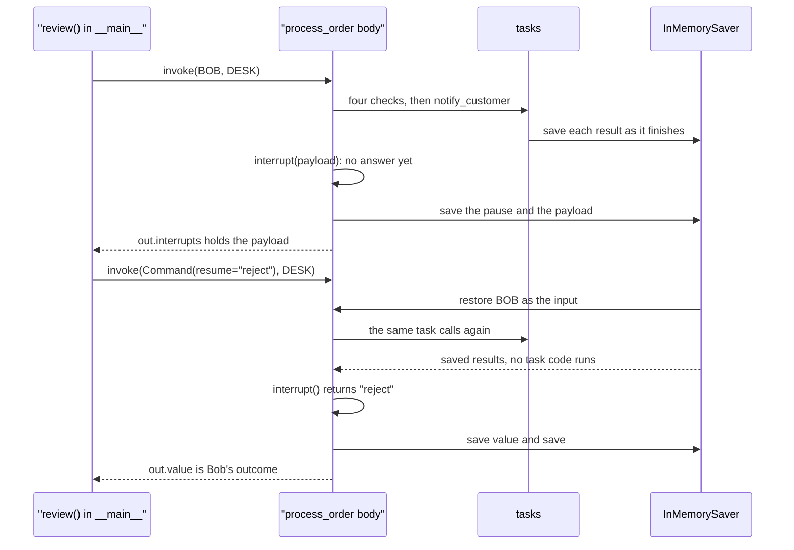
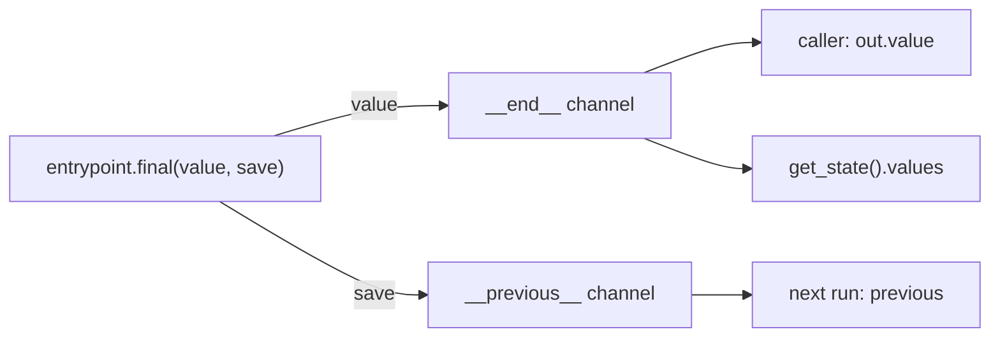

# 9.2 Functional API: Memory, Interrupts and Determinism

## The problem

Lesson 9.1 rewrote the order checks as an [@entrypoint](../../../GLOSSARY.md#entrypoint) with four [@task](../../../GLOSSARY.md#task) functions. Every order ran on its own thread, every run was complete in itself, and an order that failed a check simply came back `on_hold`. Two things a real order desk needs are still missing.

- **A person decides the orders on hold.** Module 6 solved this for graphs: a node calls [interrupt()](../../../GLOSSARY.md#interrupt), the run stops and is saved, and the caller resumes it later with [Command](../../../GLOSSARY.md#command)`(resume=...)`. The entrypoint has no nodes of its own to put the call in, so where does `interrupt()` go, and what runs again on resume?
- **The desk keeps a running count.** How many orders has it seen, how many were approved, how many rejected? In the Graph API that count would be a state key that every run updates. An entrypoint has no state keys. Its locals are gone when the function returns, and [get_state](../../../GLOSSARY.md#get_state) shows only the return value, which should be one order's outcome, not a tally.

There is also a question that 9.1 raised but did not press. The third experiment there showed that a resumed entrypoint runs its body again **from the top**, and that only the tasks that never finished really run. That was harmless there, because the body only scheduled tasks and called a pure `decide`. Once the body pauses for a person and sends a message to a customer, "the body runs again" becomes a question of correctness: which code may sit in the body, and which must be in a task?

## The concept

This lesson adds three pieces to the Functional API, all built on the replay mechanism you already know.

### `previous`: what the thread remembers

An entrypoint can ask LangGraph for extra arguments that the caller never passes. These are [injectable parameters](../../../GLOSSARY.md#injectable-parameter), recognised by their **name** (and, for `config`, `store` and `writer`, also by the matching type annotation): `previous`, `config`, `store`, `writer` and `runtime`. They come after the single input. This lesson uses only one of them:

```python
def process_order(order: Order, *, previous: DeskTally | None = None) -> ...
```

The [previous parameter](../../../GLOSSARY.md#previous-parameter) receives what the **last finished run on the same thread** left behind. On a new thread there is nothing yet, so it is `None`. It works only with a [checkpointer](../../../GLOSSARY.md#checkpointer), because "the last run on this thread" is something read from a saved [checkpoint](../../../GLOSSARY.md#checkpoint). This is [short-term memory](../../../GLOSSARY.md#short-term-memory) in the sense of lesson 5.4: it lives in one thread, and a new [thread_id](../../../GLOSSARY.md#thread_id) starts from nothing.

### `entrypoint.final`: return one thing, remember another

By default, what `previous` receives is the entrypoint's **return value**. That is often wrong. The caller wants this order's outcome; the next run wants the tally. [entrypoint.final](../../../GLOSSARY.md#entrypointfinal) separates the two:

```python
return entrypoint.final(value=outcome, save=tally)
```

- `value` is what `invoke` returns to the caller, and what `get_state().values` holds.
- `save` is stored in the checkpoint and arrives as `previous` on the next run of this thread.

The return annotation `-> entrypoint.final[OrderOutcome, DeskTally]` names both types, in that order. LangGraph takes the first one as the entrypoint's output type. Both arguments are required: `entrypoint.final[OrderOutcome]` fails when the module is imported, with `TypeError: Too few arguments`.

### `interrupt()` in an entrypoint, and the replay that follows

`interrupt()` and `Command(resume=...)` are the same functions as in [lesson 6.1](../../../6-human-in-the-loop/6.1-interrupt-and-resume/docs/notes.md). Called in the entrypoint body, `interrupt(payload)` stops the run, the run is saved as paused, and the caller gets the payload back. The caller later sends the answer, the [resume value](../../../GLOSSARY.md#resume-value), with `Command(resume=answer)` on the same thread.

In 6.1 the node that paused ran again from its first line on resume. The whole entrypoint is a single node, so here the **whole body** runs again from its first line. It is the same replay that 9.1 used to recover from an error:

- every task call that finished before the pause gets its saved result back, and the task's code does not run;
- every line of plain code in the body runs again for real;
- when the body reaches `interrupt()` again, the call returns the resume value instead of pausing.

The mental model: **a resumed entrypoint is a replay of the same function, in which only task results and interrupt answers come from the checkpoint.** Everything else is computed again.

### Determinism: the body must take the same path again

Replay works only if the second pass through the body asks for the same things as the first. LangGraph matches each task call to its saved result by the task's name and the **position** of the call among all task calls of the run: one counter counts every task call, whatever its name, so in Bob's run `notify_customer` is the 5th task call, after the four checks. If the order of calls changes on the replay, a later call either runs again (the name at its position no longer matches) or, when the name at that position happens to be the same, gets another call's saved result. LangGraph does not compare arguments, and it does not warn when the second pass takes a different path. This requirement is [deterministic replay](../../../GLOSSARY.md#deterministic-replay), and it gives three rules for code in the body:

| Put in the body | Put in a task |
|---|---|
| control flow over values you already have (`if`, `for`, function calls) | side effects: emails, payments, writes to other systems |
| pure, fast functions such as `decide` | anything random: `uuid4()`, `random.choice()` |
| | anything that depends on time or on the outside world: `time.time()`, reading a file, an HTTP call |

A task's result is saved the moment it finishes. On a replay, the call returns the saved value: the email is not sent twice, and the random ticket number is the same one the manager saw. The same call written directly in the body would run on every pass.

Lesson 6.3 phrased the same problem for graph nodes: code before `interrupt()` runs again on every resume, so it must be [idempotent](../../../GLOSSARY.md#idempotent), or come after the pause, or move into its own node. In the Functional API the last option is the easy one: wrap the code in a `@task`.

## How it works

### Bob's order, pause and resume

The sequence diagram follows Bob's order through its two `invoke` calls. Look at how often each part runs: the body twice, each task once.



The first call:

1. The body starts, schedules the checks, gets an `on_hold` decision from `decide` and calls `notify_customer`, which really runs and puts a note in `OUTBOX`.
2. `interrupt()` finds no answer. It raises an internal exception, LangGraph saves the pause together with the payload, and `invoke` returns normally.
3. `get_state(DESK).next` is now `('process_order',)`: the entrypoint's node is still due.

The second call:

1. `Command(resume="reject")` carries no order. LangGraph loads the paused run of the `DESK` thread and passes the **saved input** to the body again, so `order` is still Bob's order.
2. The body starts from its first line. `previous` has the same value as on the first pass, because a paused run has not finished and has saved nothing for `previous` yet.
3. Every task call gets its saved result. The `TASK_RUNS` counter does not move, and `OUTBOX` gets no second note.
4. `interrupt()` returns `"reject"`. The lines after it run for the first time, the tally is updated, and `entrypoint.final` ends the run.

The pause and the resume belong to the same [super-step](../../../GLOSSARY.md#super-step). As in 9.1's error recovery, the resume finishes the step that paused; it does not start a new one. Bob's run adds two checkpoints to the thread, an `input` checkpoint and a `loop` checkpoint. The `input` one carries the task results, the interrupt and the resume value as [pending writes](../../../GLOSSARY.md#pending-writes).

### Where `value` and `save` go

9.1 noted that the entrypoint's node writes two internal channels, `__end__` and `__previous__`, and left the second one for this lesson. The diagram shows what `entrypoint.final` sends to each.



A plain `return x` writes the same `x` to both channels. That is why `previous` is "the last return value" by default. With `entrypoint.final`, the [\_\_previous\_\_](../../../GLOSSARY.md#__previous__) channel holds `save` instead. The name is internal: your code reads the saved value through `previous` in the next run. The program reads the channel directly once at the end, only to show where `save` went.

## In our example

The code is in [workflow.py](../src/l9_2_functional_memory_interrupts/workflow.py) and [\_\_main\_\_.py](../src/l9_2_functional_memory_interrupts/__main__.py), and the [code walkthrough](readalong.md#workflowpy) goes through every change from 9.1. Here are the parts that carry the ideas.

### A counter that tells real runs from replays

To see replay from outside, the lesson counts how often each task's code really runs, and gives the side effect somewhere visible to land:

<!-- snippet: src/l9_2_functional_memory_interrupts/workflow.py#run_log -->
```python
# How often each task's code really ran; the live run and the tests read it to
# show that resumed runs reuse saved results.
TASK_RUNS: Counter[str] = Counter()
# Stands in for an email service: the side effect this lesson keeps out of the
# entrypoint body.
OUTBOX: list[str] = []
```
<!-- /snippet -->

Each of the four 9.1 tasks got one new first line, `TASK_RUNS["<name>"] += 1`, and nothing else changed. The counter is not part of the workflow. It is a probe: it moves only when LangGraph executes the task's body, not when the entrypoint calls the task.

### The side effect is a task

<!-- snippet: src/l9_2_functional_memory_interrupts/workflow.py#notify_customer -->
```python
# A side effect lives in a task: its result is saved in the checkpoint, so on
# resume the saved result is returned and the message is not sent a second
# time.
@task
def notify_customer(order_id: str, message: str) -> str:
    """Send the customer a message (here: append it to OUTBOX) and return it."""
    TASK_RUNS["notify_customer"] += 1
    note = f"to {order_id}: {message}"
    OUTBOX.append(note)
    return note
```
<!-- /snippet -->

`OUTBOX.append` stands in for an email service. Because the call is in a task, the note it returns is saved in the checkpoint. On the replay after the resume, `notify_customer(...)` gets that note back and the append does not happen again. Experiment 1 moves the same append into the body and gets two notes per paused order.

### The entrypoint

<!-- snippet: src/l9_2_functional_memory_interrupts/workflow.py#process_order -->
```python
# The checkpointer is fixed when the decorator runs, like
# compile(checkpointer=...) in 5.1.
checkpointer = InMemorySaver()


# @entrypoint turns the function into a Pregel graph (the same compiled object
# type as StateGraph.compile()) with one node named after the function, so
# invoke, stream and get_state work as in 5.1. The entrypoint takes exactly
# one positional input, so pass a dict.
# `previous` is injected by LangGraph: it is keyword-only and found by its
# name. It holds what the last FINISHED run on this thread saved, and is None
# on a new thread.
# The annotation entrypoint.final[ReturnType, SaveType] names both types: what
# the caller gets and what the next run receives as `previous`.
@entrypoint(checkpointer=checkpointer)
def process_order(
    order: Order, *, previous: DeskTally | None = None
) -> entrypoint.final[OrderOutcome, DeskTally]:
    """Check the order, ask the manager when it is on hold, and count it on the desk tally."""
    # A print is a side effect too: left here on purpose to show that the body
    # replays on resume.
    print(f"  [process_order] body starts for {order['order_id']}, previous={previous}")
    # Calling a task does not run it inline: it schedules it and returns a
    # concurrent.futures.Future at once. These two run at the same time in a
    # thread pool.
    stock = check_stock(order["items"])
    payment = check_payment(order["total"], order["balance"])
    # .result() blocks until that task is done. The address chain needs the
    # country first, while stock and payment keep running.
    country = normalize_address(order["address"]).result()
    address = check_address(country)
    results = [stock.result(), payment.result(), address.result()]
    outcome: OrderOutcome = {"order_id": order["order_id"], "country": country, **decide(results)}
    if outcome["decision"] == "on_hold":
        notify_customer(order["order_id"], "your order is waiting for review").result()
        # Same interrupt() and Command as 6.1; here the whole entrypoint is the
        # one node that pauses. The run stops here and is checkpointed.
        # Resuming with Command(resume=answer) on the same thread re-runs the
        # body from its first line: the tasks that finished before the pause
        # return their saved results without running, and interrupt() returns
        # the resume value instead of pausing. So everything before
        # interrupt() must take the same path again: no time, random or I/O
        # calls in the body, put them in a task.
        answer = interrupt(
            {
                "order_id": order["order_id"],
                "problems": outcome["problems"],
                "question": "approve or reject?",
            }
        )
        print(f"  [process_order] resumed with {answer!r}")
        outcome["decision"] = "approved" if answer == "approve" else "rejected"
    tally = previous or {"orders": 0, "approved": 0, "rejected": 0}
    tally = {
        **tally,
        "orders": tally["orders"] + 1,
        outcome["decision"]: tally[outcome["decision"]] + 1,
    }
    # value goes to the caller (and get_state().values); save goes to the
    # checkpoint and is what `previous` receives on the next run. Returning
    # the outcome directly would make `previous` the last outcome.
    return entrypoint.final(value=outcome, save=tally)
```
<!-- /snippet -->

Read it in three parts.

- **The signature.** `previous` is after the `*`, so it is keyword-only: it cannot be confused with the input, and the caller cannot pass it by position. In 1.2.16 LangGraph also injects a `previous` declared as an ordinary parameter after the input; keyword-only is the form most docs examples use, and the clearer one. The default `None` covers the first run of a thread.
- **The pause.** The checks and `decide` are 9.1's body. Only orders on hold reach `notify_customer` and `interrupt()`. The payload is a small dict of plain values, because it is saved in the checkpoint and shown to whoever answers. The `print` on the first line is a side effect left in the body on purpose: it shows in the output when the body replays.
- **The memory.** `previous or {...}` starts a new tally on the first run of a thread. The tally is copied, not changed in place, and counted under the final decision, which is `"approved"` or `"rejected"` by then. `entrypoint.final(value=outcome, save=tally)` sends the outcome to the caller and keeps the tally for the next run.

### One thread for the whole desk

`previous` belongs to a thread. 9.1 gave each order its own thread, so every run would start with `previous=None` and the tally would never pass 1. Here all three orders run on one thread, `DESK = {"configurable": {"thread_id": "desk-1"}}`, and share one tally. The [review](readalong.md#review) function runs one order and answers its pause:

<!-- snippet: src/l9_2_functional_memory_interrupts/__main__.py#review_order -->
```python
def review(order: Order) -> None:
    """Run one order on the desk thread; if it pauses, resume it with the manager's answer."""
    print(f"== {order['order_id']} ==")
    TASK_RUNS.clear()
    # version="v2" returns a GraphOutput with .value and .interrupts (as in
    # 6.1). While the run is paused, out.value is still the PREVIOUS run's
    # return value (Ada's outcome when Bob pauses), so read out.interrupts,
    # not the value.
    out = process_order.invoke(order, DESK, version="v2")
    if out.interrupts:
        print(f"  paused, asks: {out.interrupts[0].value}")
        answer = ANSWERS[order["order_id"]]
        print(f"  manager answers {answer!r}")
        # The resume call passes no order: the input is restored from the
        # checkpoint.
        out = process_order.invoke(Command(resume=answer), DESK, version="v2")
    print(f"  -> {out.value['decision']}")
    print(f"  task runs: {dict(sorted(TASK_RUNS.items()))}")
```
<!-- /snippet -->

It reads `out.interrupts`, not `out.value`, to find out whether the run paused. That is the [v2 format](../../../GLOSSARY.md#v2-format) from 6.1, in which `invoke` returns a [GraphOutput](../../../GLOSSARY.md#graphoutput). While Bob's run is paused, `out.value` is not Bob's outcome: Bob's run has returned nothing yet. It is the last finished run's value on the thread, Ada's outcome. Experiment 4 shows what happens when code trusts that value.

Finally, `main` reviews the three orders and shows what the thread keeps:

<!-- snippet: src/l9_2_functional_memory_interrupts/__main__.py#desk_memory -->
```python
for order in (ADA, BOB, CLEO):
    review(order)
    print()
print("== What the desk thread keeps ==")
print(f"  outbox: {OUTBOX}")
# get_state holds entrypoint.final's value.
print(f"  get_state values: {process_order.get_state(DESK).values}")
# save is stored in the "__previous__" channel of the latest checkpoint (an
# internal channel name, read here only to show where save goes, like
# "__return__" in 9.1).
saved = checkpointer.get_tuple(DESK).checkpoint["channel_values"]["__previous__"]
print(f"  saved for previous: {saved}")
```
<!-- /snippet -->

## Run it

Run the program with `./run.sh 9.2` from the course root. This is the output of the latest verify run:

```text
== A-1001 ==
  [process_order] body starts for A-1001, previous=None
  -> approved
  task runs: {'check_address': 1, 'check_payment': 1, 'check_stock': 1, 'normalize_address': 1}

== B-1002 ==
  [process_order] body starts for B-1002, previous={'orders': 1, 'approved': 1, 'rejected': 0}
  paused, asks: {'order_id': 'B-1002', 'problems': ['address: no shipping to UK', 'payment: balance 20.0 < total 60.0', 'stock: MUG 1>0'], 'question': 'approve or reject?'}
  manager answers 'reject'
  [process_order] body starts for B-1002, previous={'orders': 1, 'approved': 1, 'rejected': 0}
  [process_order] resumed with 'reject'
  -> rejected
  task runs: {'check_address': 1, 'check_payment': 1, 'check_stock': 1, 'normalize_address': 1, 'notify_customer': 1}

== C-1003 ==
  [process_order] body starts for C-1003, previous={'orders': 2, 'approved': 1, 'rejected': 1}
  paused, asks: {'order_id': 'C-1003', 'problems': ['address: no shipping to US'], 'question': 'approve or reject?'}
  manager answers 'approve'
  [process_order] body starts for C-1003, previous={'orders': 2, 'approved': 1, 'rejected': 1}
  [process_order] resumed with 'approve'
  -> approved
  task runs: {'check_address': 1, 'check_payment': 1, 'check_stock': 1, 'normalize_address': 1, 'notify_customer': 1}

== What the desk thread keeps ==
  outbox: ['to B-1002: your order is waiting for review', 'to C-1003: your order is waiting for review']
  get_state values: {'order_id': 'C-1003', 'country': 'US', 'decision': 'approved', 'problems': ['address: no shipping to US']}
  saved for previous: {'orders': 3, 'approved': 2, 'rejected': 1}
```

What to notice:

- **`previous` grows from run to run.** Ada's run starts with `None`, the thread is new. Bob's starts with Ada's tally, Cleo's with the tally after Bob. Each run sees what the run before it saved, never its own outcome.
- **The body starts twice for each paused order.** Bob and Cleo each print `body starts` twice: once before the pause, once after the resume. Both times `previous` is the same, because the paused run had saved nothing yet.
- **Each task ran once.** After the resume every counter is 1, although the body called each task twice. The second calls were answered from the checkpoint. Ada never reached `notify_customer`, so her line has no entry for it.
- **`resumed with` appears only once.** The lines after `interrupt()` run only in the pass that has the answer.
- **One note per paused order.** The outbox has Bob's and Cleo's notes, once each, even though the code that sends them was reached twice.
- **`value` and `save` end up in different places.** `get_state` holds Cleo's outcome, the `value` of the last `entrypoint.final`, with no tally in it. The tally `{'orders': 3, 'approved': 2, 'rejected': 1}` is in the `__previous__` channel, waiting for the next run.

The program has no LLM and the manager's answers are fixed in `ANSWERS`, so the output is the same on every run with 1.2.16. The tasks that run at the same time may finish in a different order, which the program hides by sorting the counter.

## Details and edge cases

- **`previous` changes only when a run finishes.** A paused run has saved nothing for `previous`, so both passes of a paused run see the same value. A run that fails with an error saves nothing either.
- **Without a checkpointer, `previous` is always `None`.** Nothing is saved between runs, so there is nothing to inject, and a pause cannot be resumed either. In 1.2.16 no error tells you so.
- **The resume carries no input.** `Command(resume=...)` takes the place of the input, and the body gets the saved input of the paused run. You don't need the order again: the thread_id is enough. With this lesson's `InMemorySaver` the resume must happen in the same process, because the saver loses every thread when the process exits. Resuming from another process, for example after a restart, needs a persistent checkpointer such as the SQLite saver from [lesson 5.2](../../../5-persistence/5.2-sqlite-checkpointer/docs/notes.md).
- **A different path on replay is not detected.** Task calls are matched to saved results by name and by position among all task calls of the run, not by their arguments. In a test with 1.2.16, a body that called a task with a different argument on the second pass got the first pass's saved result back, silently. A body that decides differently on replay, for example from `time.time()`, can therefore pair a call with the wrong saved result. Interrupt answers are matched by position too, as 6.3 explained.
- **`interrupt()` inside a task.** The docs also show `interrupt()` called inside a task. That task has not finished when it pauses, so on resume it runs again from its top, and so does the body. Code in that task before `interrupt()` repeats, just like code before `interrupt()` in a graph node. This lesson keeps the pause in the body and the side effect in a task that finishes before the pause.
- **A plain `return` still works with the `entrypoint.final[...]` annotation.** The annotation is not checked when the function returns. A plain return just writes the same value to `__end__` and `__previous__` (experiment 3).
- **The tally lives in the thread.** A second thread starts again from `None`, as the tests show by running Ada on a fresh thread. For memory that spans threads, such as a customer's history across conversations, lesson 5.4's store is the tool, not `previous`.
- **`previous` is a value, not a log.** It holds whatever the last finished run saved. If you need history, save it yourself: append to a list in `save`, as the docs' chatbot example does with messages.

## Common mistakes

> [!WARNING]
> **Side effects in the entrypoint body.** An email, a payment or a database write placed directly in the body runs again on every resume. Put it in a `@task`, whose saved result is reused (experiment 1).

> [!WARNING]
> **Randomness or time in the body.** `uuid4()`, `random` and `time.time()` give a new value on the replay. The manager is shown ticket `29e6faa5`, and the ticket the code holds after the resume is a different one. Wrap the call in a task (experiment 2).

> [!WARNING]
> **Returning the result directly when the next run expects something else.** With a plain `return outcome`, `previous` becomes the last outcome, not the tally, and the next run fails when it reads a key that is not there. Use `entrypoint.final(value=..., save=...)` whenever the caller and the next run need different things (experiment 3).

> [!WARNING]
> **Reading `out.value` to find out whether the run finished.** While a run is paused, `out.value` is the previous run's value on the thread. Check `out.interrupts` (or `get_state(config).next`) first (experiment 4).

> [!WARNING]
> **Sending new input to a paused thread.** A new `invoke` with an order on a paused thread does not raise. It starts a new run, and the pending question is dropped. Resume first, or give each paused case its own thread (experiment 4).

> [!WARNING]
> **Resuming on the wrong thread.** On a thread with nothing paused, `Command(resume=...)` is not a resume: it is passed to the body as the input (experiment 5).

## Experiments

Each experiment starts from the lesson's original code. Edit the files in the lesson directory and run the program with `./run.sh 9.2`, or put a short script in the lesson directory and run it with `env -u VIRTUAL_ENV uv run python <script>.py`. Each new run of the program starts with an empty `InMemorySaver`, so old threads do not get in the way.

1. In `process_order`, replace the line `notify_customer(order["order_id"], "your order is waiting for review").result()` with `OUTBOX.append(f"to {order['order_id']}: your order is waiting for review")`, and run the program.

   <details><summary>What happens and why</summary>

   The decisions are the same, but the outbox at the end holds four notes: two for B-1002 and two for C-1003. The `task runs` lines no longer mention `notify_customer`. The append is now plain body code, and the body runs twice for every paused order: once before the pause and once on resume. Only task results are replayed from the checkpoint; everything else runs again. A real email service would have sent each customer the same message twice. This is the reason side effects go into tasks.

   Undo the change afterwards (`git checkout -- .` in the lesson directory).

   </details>

2. Add `import uuid` at the top of `workflow.py`. In `process_order`, right after the `notify_customer(...)` line, add `ticket = uuid.uuid4().hex[:8]`. Add `"ticket": ticket` to the interrupt payload, and after the line that sets `outcome["decision"]` add `print(f"  ticket after resume: {ticket}")`. Run the program. Then define a task `@task def new_ticket() -> str: return uuid.uuid4().hex[:8]`, replace the `ticket = ...` line with `ticket = new_ticket().result()`, and run it again.

   <details><summary>What happens and why</summary>

   In the first version the ticket in `paused, asks:` and the ticket after the resume differ, for example `29e6faa5` and then `62e43b9c` for Bob. The ticket printed after the resume differs from the one the manager was shown. The body ran `uuid4()` on each pass, and nothing in LangGraph noticed. In the second version both numbers are equal for each order (for example `9a91d679` twice), because `new_ticket`'s result was saved when it first finished and returned again on replay. The numbers are random, so yours will differ, but the pattern is the same on every run.

   Undo the change afterwards.

   </details>

3. Replace `return entrypoint.final(value=outcome, save=tally)` with `return outcome` and run the program.

   <details><summary>What happens and why</summary>

   Ada's order goes through as before. Bob's run starts with `previous={'order_id': 'A-1001', 'country': 'DE', 'decision': 'approved', 'problems': []}`: Ada's outcome, not a tally. It still pauses and resumes, because the tally is only touched after the interrupt. Then it fails with `KeyError: 'orders'`, raised in the line that adds 1 to `tally["orders"]`, during the task named `process_order`. A plain return writes the same value to the caller and to `__previous__`, so `previous` becomes the last return value. The return annotation does not stop this; it is not checked at run time. `entrypoint.final` is what separates what the caller gets from what the next run remembers.

   Undo the change afterwards.

   </details>

4. In `review` in `__main__.py`, change `if out.interrupts:` to `if out.interrupts and order["order_id"] != "B-1002":`, so Bob's pause is never answered, and run the program.

   <details><summary>What happens and why</summary>

   There is no error. Bob's line reads `-> approved`, which is wrong: it is Ada's outcome, the value of the last finished run, which a paused run's `out.value` still holds. Cleo's run then starts with `previous={'orders': 1, 'approved': 1, 'rejected': 0}`, as if Bob had never existed. The new input started a new run on the thread and silently replaced Bob's pending one. After Cleo's resume the saved tally reads `{'orders': 2, 'approved': 2, 'rejected': 0}`, and Bob's note is still in the outbox: the customer was told the order is under review, and nobody will ever review it. A paused thread waits for a resume; new input on it does not queue up behind the pause.

   Undo the change afterwards.

   </details>

5. Put this script in the lesson directory and run it:

   ```python
   from langgraph.types import Command

   from l9_2_functional_memory_interrupts.__main__ import BOB, DESK
   from l9_2_functional_memory_interrupts.workflow import process_order

   process_order.invoke(BOB, DESK, version="v2")
   other = {"configurable": {"thread_id": "other"}}
   process_order.invoke(Command(resume="reject"), other)
   ```

   <details><summary>What happens and why</summary>

   Bob pauses on `desk-1` as usual. The second call fails with `TypeError: 'Command' object is not subscriptable`, raised by the body's first line, which reads `order['order_id']`. The thread `other` has nothing paused, so the `Command` is not treated as a resume. It is passed to the body as the input, and the body tries to use it as an order. Meanwhile `get_state(DESK).next` is still `('process_order',)`: Bob is waiting on `desk-1`. A resume must use the paused run's thread_id; that id is the address of the pause.

   Delete the script afterwards.

   </details>

## Summary

- An entrypoint can declare [injectable parameters](../../../GLOSSARY.md#injectable-parameter), found by name (plus a matching type for `config`, `store` and `writer`). `previous` receives what the last finished run on the same thread saved, and is `None` on a new thread or without a checkpointer.
- `entrypoint.final(value=..., save=...)` returns `value` to the caller and to `get_state`, and saves `save` for the next run's `previous`. A plain return does both with one value.
- `interrupt()` and `Command(resume=...)` work in an entrypoint as in a graph node. The whole entrypoint is the node, so on resume the whole body runs again from its first line.
- On that replay, finished tasks return their saved results without running, and `interrupt()` returns the resume value. Plain code in the body runs again.
- Keep the body deterministic: side effects, randomness and time go into tasks. Task calls are matched to saved results by name and by position among all task calls of the run, and a different path is not detected.

## Self-check

1. The body of an entrypoint calls `log_audit(order)` as a plain function (it writes a line to a file), then a task `charge(order)`, then `interrupt()`. The run pauses and is resumed once. How many audit lines and how many charges are there?

   <details><summary>Answer</summary>

   Two audit lines and one charge. The body runs twice, once before the pause and once on resume, and `log_audit` is plain body code, so it runs both times. `charge` is a task: it finished before the pause, so the second call returns its saved result and the card is not charged again. To get one audit line, make `log_audit` a task too.

   </details>

2. An entrypoint returns `entrypoint.final(value=len(items), save=items)`. A thread runs it three times. What do the caller, `get_state(config).values` and the third run's `previous` see?

   <details><summary>Answer</summary>

   Each caller gets the number of items of its own run, and `get_state(config).values` after the third run is the third run's count. The third run's `previous` is the `items` list that the second run saved. `value` goes to the caller and to the thread's state, `save` only to the next run.

   </details>

3. While Bob's run is paused, a dashboard calls `process_order.get_state(DESK)`. What do `next`, `interrupts` and `values` show?

   <details><summary>Answer</summary>

   `next` is `('process_order',)`, because the entrypoint's node is still due. `interrupts` holds one `Interrupt` whose `value` is Bob's payload, the problems and the question. `values` is still Ada's outcome, the value of the last finished run: Bob's run has not returned anything yet.

   </details>

4. A colleague writes `deadline = datetime.now() + timedelta(days=2)` in the body before `interrupt()` and puts the deadline in the payload. After the resume, the code compares the deadline with the answer's time. What is wrong, and how do you fix it?

   <details><summary>Answer</summary>

   The body runs again on resume, so `datetime.now()` is called again and `deadline` is recomputed, later than the deadline the manager saw. The comparison then uses a different deadline. Put the time call in a task, for example `@task def get_deadline() -> datetime`, and call `get_deadline().result()`: its saved result is returned on the replay, so both passes use the same deadline. Returning the `datetime` itself is fine: LangGraph's checkpoint serializer saves and restores `datetime` values, so the replay gets a `datetime` back.

   </details>

5. Why does the lesson put all three orders on one thread, when 9.1 gave each order its own?

   <details><summary>Answer</summary>

   `previous` is per thread. With one thread per order, every run would be the first on its thread, `previous` would always be `None`, and the tally would never get past one order. The desk's running count only exists if the orders share a thread. The cost is that a paused order must be answered before the next order runs on the thread, because new input would replace it, as experiment 4 shows.

   </details>

## Further reading

- [Functional API overview](https://docs.langchain.com/oss/python/langgraph/functional-api): injectable parameters, short-term memory with `previous` and `entrypoint.final`, resuming, and the sections on determinism, idempotency and common pitfalls that this chapter's rules come from.
- [Use the Functional API](https://docs.langchain.com/oss/python/langgraph/use-functional-api): how-to examples, including `entrypoint.final` with a running total, a chatbot that saves its messages, and human-in-the-loop with `interrupt()` in a task or in a helper of the entrypoint.
- [Interrupts](https://docs.langchain.com/oss/python/langgraph/interrupts): `interrupt()` and `Command(resume=...)`, and the rules of interrupts, including idempotent side effects before the pause.
- [`langgraph/func/__init__.py` at 1.2.16](https://github.com/langchain-ai/langgraph/blob/1.2.16/libs/langgraph/langgraph/func/__init__.py): the `entrypoint.final` dataclass and the node writers that send `value` to `__end__` and `save` to `__previous__`.
- [langgraph core tests at 1.2.16](https://github.com/langchain-ai/langgraph/tree/1.2.16/libs/langgraph/tests): the `test_imp_*` and `test_entrypoint_*` cases in `test_pregel.py` pin down the Functional API's resume and `previous` behaviour.
